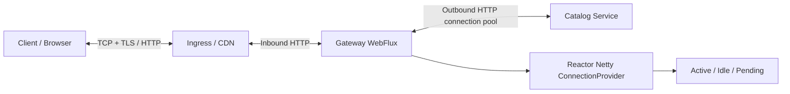
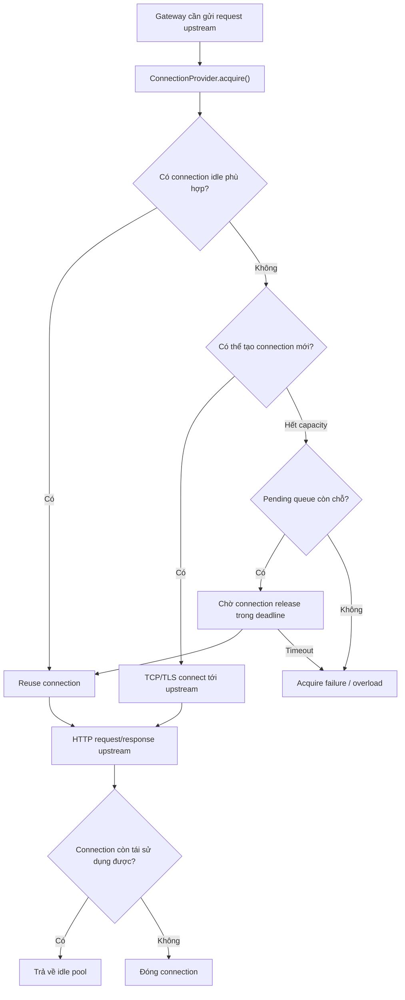
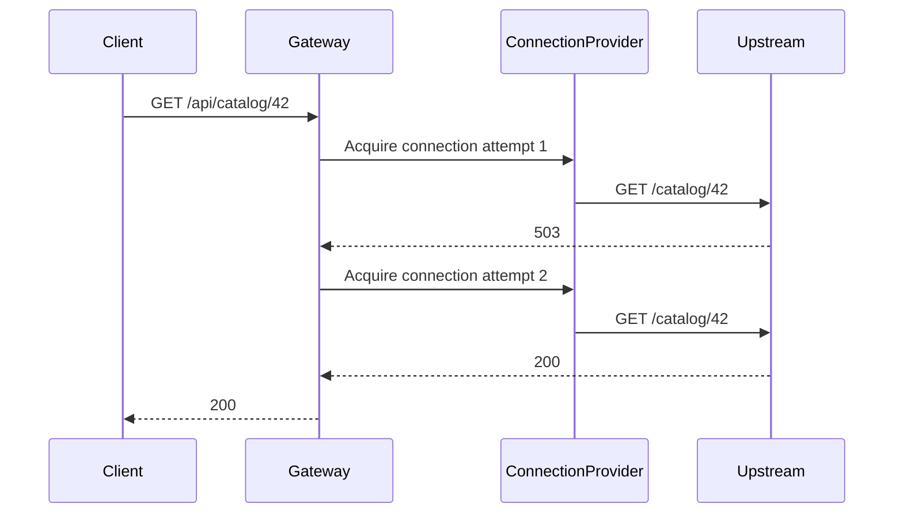
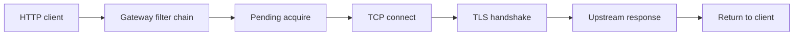

# Tối ưu connection pool và giới hạn kết nối đồng thời trong Spring Cloud Gateway

Một API Gateway thường phải xử lý rất nhiều kết nối cùng lúc: browser gọi catalog, mobile app tạo đơn hàng, backend thanh toán đôi khi chậm, và một số client giữ WebSocket/SSE hàng phút. Nếu cấu hình **connection pool** quá nhỏ, các request có thể xếp hàng chờ kết nối đến upstream rồi timeout; nếu đặt quá lớn, Gateway và backend có thể cạn file descriptors, bộ nhớ, socket hoặc CPU. Nếu chỉ tăng giới hạn socket mà không có cơ chế **backpressure/admission control**, tải đột biến vẫn có thể làm toàn hệ thống suy giảm.

Trong **Spring Cloud Gateway Server WebFlux**, việc tối ưu hiệu năng không chỉ là đặt một con số `max-connections`. Cần hiểu **Reactor Netty HttpClient ConnectionProvider**, sự khác nhau giữa **inbound connections** và **outbound pooled connections**, hàng đợi **pending acquire**, timeout kết nối, giới hạn **số request in-flight**, tài nguyên Reactor Netty event loop và hành vi của LoadBalancer, Retry, CircuitBreaker, TLS, WebSocket/streaming.

Bài thuộc chương **Hiệu năng** của module `SPRING_CLOUD_GATEWAY`. Nội dung gắn với vai trò Gateway định tuyến request bằng predicates, filter chain, biến đổi path/header, service discovery và bảo vệ microservices bằng authentication, rate limiting, circuit breaker, retry, TLS và observability.

**Mục tiêu sau bài học:**

1. Phân biệt TCP connection, HTTP request in-flight, pooled connection, pending acquire và queue ở backend.
2. Biết các cấu hình connection pool của Gateway WebFlux và Reactor Netty theo phiên bản.
3. Tính gần đúng nhu cầu concurrency bằng **Little's law**, có tính đến tail latency, phân bố theo instance và retry.
4. Chọn `max-connections`, `acquire-timeout`, idle/life eviction và timeout theo ngân sách request.
5. Hiểu vì sao connection pool **không phải** giới hạn đồng thời toàn cụm; khi cần nên dùng bulkhead/admission control riêng.
6. Đọc các số liệu active/idle/pending connections, HTTP latency, 429/503 và lỗi socket.
7. Tổ chức load test có kiểm soát để tránh tối ưu bằng suy đoán.

> **Phạm vi:** Phần code/config trọng tâm là **Spring Cloud Gateway Server WebFlux** với Reactor Netty. Gateway Server Web MVC dùng Servlet-based infrastructure và HTTP client/pool integration khác; không tự áp thuộc tính WebFlux sang MVC. Tên property `spring.cloud.gateway.server.webflux...` áp dụng cho các nhánh mới, còn các nhánh cũ có `spring.cloud.gateway...`. Các giới hạn trong bài **chỉ là ví dụ khởi đầu để đo**, không phải thông số mặc định hoặc chuẩn production chung. Không chạy load test trên môi trường production nếu chưa được phê duyệt.

## 1. Một request đi qua những loại kết nối nào?

Xét một request:

```text
GET https://api.example.com/api/catalog/products/42
```

Đường đi thường có các kết nối riêng:



- **Inbound connection:** socket mà Gateway **nhận** từ ingress/client. Reactor Netty HttpServer quản lý chặng này.
- **Outbound connection:** socket mà Gateway **mở** tới upstream khi Netty HTTP client routing diễn ra.
- **Connection pool:** tập các kết nối outbound được tái sử dụng hoặc đang được sử dụng để tránh thiết lập TCP/TLS mới cho mỗi request.
- **Pending acquire:** request đã cần upstream connection nhưng chưa lấy được connection từ pool, đang chờ theo giới hạn/hợp đồng của provider.
- **In-flight request:** request chưa hoàn tất theo một phạm vi đo (ví dụ client request tại Gateway); số in-flight có thể khác active TCP connections.
- **Backend concurrency:** số operation thực sự đang được upstream xử lý; có thể khác cả hai số trên.

**Tăng outbound pool không làm số inbound connections giảm, không tăng CPU backend và không tự giới hạn lưu lượng của client.**

### 1.1. Ví dụ các số không đồng nghĩa

```text
Client/Ingress giữ 2.000 inbound keep-alive sockets.
Gateway nhận khoảng 500 client requests/giây.
Gateway có 80 outbound connections đang active.
Backend đang xử lý 120 operation vì có retry/async processing.
```

Không có mâu thuẫn: một inbound socket có thể gửi nhiều request tuần tự; outbound keep-alive tái sử dụng; HTTP/2 multiplex và backend async work làm số lượng không còn tương ứng 1:1.

### 1.2. Không gộp “kết nối” và “yêu cầu” trong cùng chỉ số

| Đại lượng | Đơn vị | Ý nghĩa |
| --- | --- | --- |
| Incoming open sockets | Connections | Số kết nối tới Gateway. |
| Active outbound pool connections | Connections | Số kết nối outbound đang được mượn/sử dụng theo provider. |
| Idle outbound connections | Connections | Kết nối giữ sẵn để tái sử dụng. |
| Pending pool acquisitions | Requests/waiters | Request đang đợi quyền dùng connection. |
| HTTP RPS | Requests/giây | Lưu lượng request. |
| In-flight HTTP requests | Requests | Số request chưa xong trong khoảng đo. |
| Event-loop pending tasks | Tasks | Công việc chờ được event loop xử lý. |
| Backend operations | Operations | Công việc nghiệp vụ đang chạy; có thể tiếp tục sau HTTP 202. |

Một dashboard chỉ hiển thị “số kết nối hiện tại” là chưa đủ để xác định Gateway đang ở giới hạn nào.

## 2. Connection pool trong Reactor Netty hoạt động ra sao?

Spring Cloud Gateway Server WebFlux dùng **Reactor Netty HttpClient** cho nhiều route HTTP outbound. Reactor Netty có abstraction **`ConnectionProvider`** để cung cấp và tái sử dụng connections.



Sơ đồ logic không bao quát hết HTTP/2 multiplex, eviction races hoặc pool per-address. Nhưng nó cho thấy:

1. Nếu có socket idle và hợp lệ, có thể **reuse**.
2. Nếu thiếu và còn capacity, có thể **mở mới**.
3. Nếu hết connection capacity, request có thể **chờ pending acquire**.
4. Nếu hàng đợi đầy hoặc chờ quá lâu, **acquire thất bại**.
5. Khi response xong, connection có thể được trả về pool; nếu lỗi/hết hạn, bị đóng.

### 2.1. Vì sao pool giúp tăng hiệu năng?

Mở TCP + TLS mới liên tục có chi phí:

- TCP connect cần network round trips, DNS/resolution và socket setup.
- TLS handshake tiêu tốn CPU và latency.
- Chứng chỉ/hostname verification cũng cần xử lý.
- Kernel quản lý nhiều sockets ở các trạng thái kết nối khác nhau.
- Khi có burst, connection churn tăng nguy cơ lỗi/timeout.

**Keep-alive + pooling** giảm chi phí đó. Tuy nhiên không nên “giữ tất cả connections mãi”: idle sockets lâu có thể bị load balancer/NAT/backend đóng, và chúng cũng tốn tài nguyên.

### 2.2. Pool không phải singleton toàn thế giới

Một `ConnectionProvider` có thể có các pool/partition theo **địa chỉ đích, giao thức, identity hoặc các thuộc tính kết nối** tùy implementation. Vì thế `maxConnections=200` thường là giới hạn **trên từng pool/remote-address scope**, không phải lời hứa “một Gateway process chỉ có tối đa 200 outbound sockets đến tất cả services”.

Kiểm tra tag `name`/`remote.address` và số lượng host/instances thực trước khi ước lượng file descriptors.

### 2.3. LoadBalancer có thể phân bố kết nối theo nhiều instances

Route:

```yaml
uri: lb://catalog-service
```

có thể chọn giữa nhiều instance. Nếu mỗi địa chỉ có một pool riêng, tổng outbound connection count tới `catalog-service` phụ thuộc số instances thực được chọn, không chỉ route ID.

**Đừng suy pool theo một route là một bucket duy nhất** nếu có discovery, DNS/multiple addresses hoặc route URI khác nhau.

## 3. Fixed, elastic và disabled pool: lựa chọn phải có giới hạn

Các thế hệ Gateway WebFlux có khả năng chọn kiểu connection pool như **`fixed`**, **`elastic`** hoặc **`disabled`** ở cấu hình `httpclient.pool.type`, tùy phiên bản.

| Kiểu | Ý tưởng | Khi phù hợp | Rủi ro |
| --- | --- | --- | --- |
| **Fixed/bounded** | Giới hạn số connections và có acquisition queue/timeouts theo implementation. | Production cần kiểm soát áp lực tới upstream. | Quá thấp gây queue/acquire timeout; quá cao gây socket overload. |
| **Elastic** | Linh hoạt mở/đóng connections theo tải, hành vi giới hạn tùy phiên bản. | Một số workload/dev, khi đã hiểu provider semantics. | Tăng đột biến sockets, làm backend/kernel nghẽn. |
| **Disabled/no reuse** | Không tái sử dụng pooled connections theo mode hỗ trợ. | Debug đặc biệt/kiểm thử kết nối, không mặc định production. | TCP/TLS churn, latency và CPU cao. |

**Không xem elastic là “tự tối ưu vô hạn và an toàn”.** Với traffic lớn hoặc backend có connection caps, cần bounded resources và đo thực tế.

### 3.1. Dùng bounded pool là điểm xuất phát tốt khi nào?

Nếu backend có giới hạn connections rõ, có nhiều Gateway replicas và latency khác nhau theo route, một bounded pool giúp đặt budget cho mỗi upstream destination. Nhưng vẫn cần **admission control** cho request concurrency, vì request có thể đứng chờ acquire trong queue mà không chiếm active connection.

### 3.2. Disabled không phải mẹo giải quyết “stale connection” lâu dài

Nếu reuse gặp lỗi do idle timeout lệch giữa Gateway và proxy, vô hiệu hóa pool có thể làm lỗi biến mất trong thử nghiệm, nhưng đánh đổi hiệu năng lớn. Cách xử lý tốt thường là cấu hình idle/lifetime, eviction, keepalive và đo connection reuse, không tắt pooling vô điều kiện.

## 4. Các thông số pool cần hiểu trước khi cấu hình

| Thông số | Ý nghĩa chính | Sai lầm thường gặp |
| --- | --- | --- |
| `type` | Chọn kiểu pool nếu Gateway version hỗ trợ. | Nghĩ `elastic` luôn có hard upper bound an toàn. |
| `max-connections` | Giới hạn kết nối trong phạm vi provider/pool phù hợp. | Coi đây là global HTTP RPS hoặc in-flight cap. |
| `acquire-timeout` | Thời gian chờ lấy connection từ pool. | Nhầm với TCP connect timeout. |
| `pendingAcquireMaxCount` | Số waiter được phép chờ, nếu cấu hình trực tiếp Reactor Netty. | Coi queue là miễn phí; không giới hạn memory/latency. |
| `max-idle-time` | Thời gian kết nối có thể idle trước khi hết hạn. | Đặt dài hơn upstream/ingress idle timeout rất nhiều. |
| `max-life-time` | Thời gian sống tối đa của một connection. | Nhầm nó với request timeout. |
| `eviction-interval` | Chu kỳ background eviction theo property/version. | Tin rằng mọi stale socket sẽ bị đóng đúng từng mili giây. |
| `metrics` | Có ghi metrics connection pool hay không. | Bật nhưng không dùng tag/namespace đúng. |
| `leasing-strategy` | Chính sách chọn idle connection như FIFO/LIFO nếu hỗ trợ. | Thay chiến lược mà không đo reuse/stale connections. |

Các tên `max-connections`, `acquire-timeout`, `max-idle-time`, `max-life-time`, `eviction-interval`, `metrics` xuất hiện trong họ cấu hình Gateway WebFlux ở những phiên bản hỗ trợ. **Reactor Netty builder API và Spring Cloud Gateway properties không ánh xạ một-một tất cả tùy chọn qua mọi phiên bản.**

### 4.1. Pending acquire là một hàng đợi thật

Nếu có **100 active connections** và 500 requests mới đến, chúng có thể:

- Được xử lý nếu một số connections nhanh chóng trở thành idle.
- Chờ trong pending queue.
- Bị từ chối vì queue đã đầy.
- Hết `acquire-timeout`.
- Bị client cancel trước khi có connection.

**Một queue dài không tạo thêm backend throughput.** Nó chủ yếu dời latency về phía chờ, có thể tăng memory và làm response timeout.

### 4.2. Max idle time và max life time khác nhau

- `maxIdleTime=30s`: connection không hoạt động quá lâu có thể bị loại bỏ.
- `maxLifeTime=5m`: connection đã tồn tại quá thời lượng dù được dùng thường xuyên có thể cần bị loại khỏi pool theo lifecycle.
- `evictInBackground` hoặc `eviction-interval`: giúp quét/loại connections hết hạn theo cơ chế/version.

Max life time không được hiểu là **“một HTTP request đang chạy sẽ bị kill chính xác sau 5 phút”**. Cơ chế loại khỏi pool và request đang active cần được kiểm thử theo implementation.

### 4.3. FIFO hay LIFO?

Ở một số Reactor Netty versions, `leasingStrategy` cho phép **FIFO** (ít được sử dụng gần đây nhất trước, theo queue) hoặc **LIFO** (kết nối vừa dùng gần nhất trước). LIFO có thể tập trung reuse vào sockets “ấm”, để sockets cũ idle và bị eviction, nhưng không có chiến lược luôn tốt hơn trong mọi topology. Phải đo cache hit/reuse, stale-close và distribution trước khi đổi.

## 5. Cấu hình minh họa trong Spring Cloud Gateway Server WebFlux

Với **nhánh Gateway Server WebFlux mới** sử dụng prefix `spring.cloud.gateway.server.webflux`, một cấu hình để **thử nghiệm và đo** có thể là:

```yaml
spring:
  cloud:
    gateway:
      server:
        webflux:
          httpclient:
            connect-timeout: 3000
            response-timeout: 10s
            pool:
              type: fixed
              max-connections: 200
              acquire-timeout: 2000
              max-idle-time: 30s
              max-life-time: 5m
              eviction-interval: 15s
              metrics: true
```

**Ý nghĩa và giới hạn:**

- `connect-timeout: 3000`: một số Gateway versions dùng **mili giây** cho TCP connect timeout; phải kiểm tra metadata của version.
- `response-timeout: 10s`: timeout liên quan phản hồi HTTP outbound theo contract, **không tự kiểm soát tổng deadline của mọi retries hay WebSocket session**.
- `type: fixed` và `max-connections: 200`: giới hạn connection pool trong scope phù hợp, không phải 200 requests/giây.
- `acquire-timeout: 2000`: thường là **mili giây** ở Gateway property này, không phải 2.000 giây. Kiểm tra đúng version.
- `max-idle-time`/`max-life-time`/`eviction-interval` có ý nghĩa lifecycle, không phải throughput trực tiếp.
- `metrics: true` bật pool telemetry nếu phiên bản và Micrometer instrumentation hỗ trợ.

**Không coi đây là cấu hình mặc định của Spring Cloud Gateway.** Nó là **một điểm khởi đầu đo** trên nhánh có các properties tương ứng; startup không lỗi chưa chứng minh từng property đã được bind và có hiệu lực.

### 5.1. Khi dùng Gateway WebFlux đời cũ

Một số phiên bản trước sử dụng prefix:

```yaml
spring:
  cloud:
    gateway:
      httpclient:
        pool:
          type: fixed
          max-connections: 200
          acquire-timeout: 2000
```

**Không khai cả prefix cũ và prefix mới** rồi hy vọng hệ thống tự ưu tiên đúng. Xác định Spring Cloud Release Train, Gateway Server variant, config metadata và metrics thực tế trước khi deploy.

Ở những nhánh cũ, đường cấu hình đầy đủ có dạng `spring.cloud.gateway.httpclient.pool.max-connections`; đừng trộn với `spring.cloud.gateway.server.webflux.httpclient.pool.max-connections` khi chuyển giữa các nhánh.

### 5.2. Pool max-connections có phải luôn là 200 toàn ứng dụng?

Không. Tùy Reactor Netty ConnectionProvider, các connection pools có thể được phân chia theo **remote address/connection configuration**. Ví dụ Gateway có 4 upstream instances, một giới hạn 200 cho mỗi destination có thể cho nhiều hơn 200 sockets outbound tổng.

Nếu có thêm 3 Gateway replicas, tổng tiềm năng kết nối tới backend có thể cao hơn nhiều. Vì vậy cần **dự toán capacity từ phía backend** và giám sát toàn cụm.

### 5.3. Không gắn timeout vô điều kiện cho mọi traffic

Routes truy vấn JSON thường phù hợp response timeout vài giây. Nhưng SSE, long polling, file download lớn hoặc WebSocket có semantics khác. Chỉ định default timeout một cách mù quáng có thể làm các stream hợp lệ bị cắt; cần profile theo route và kiểm thử từng loại.

## 6. Reactor Netty ConnectionProvider builder: hiểu các knobs cấp thư viện

Khi phát triển một HTTP client Reactor Netty riêng, hoặc dùng **extension point được Gateway version hỗ trợ**, có thể cấu hình `ConnectionProvider` trực tiếp:

```java
import java.time.Duration;

import io.netty.channel.ChannelOption;
import reactor.netty.http.client.HttpClient;
import reactor.netty.resources.ConnectionProvider;

public final class PoolExample {

    public static HttpClient createClient() {
        ConnectionProvider provider =
            ConnectionProvider.builder("upstream-demo")
                .maxConnections(100)
                .pendingAcquireMaxCount(200)
                .pendingAcquireTimeout(Duration.ofSeconds(2))
                .maxIdleTime(Duration.ofSeconds(30))
                .maxLifeTime(Duration.ofMinutes(5))
                .evictInBackground(Duration.ofSeconds(15))
                .metrics(true)
                .build();

        return HttpClient.create(provider)
            .option(ChannelOption.CONNECT_TIMEOUT_MILLIS, 3000)
            .responseTimeout(Duration.ofSeconds(8));
    }
}
```

Điểm quan trọng:

- `maxConnections(100)` là capacity kết nối ở scope của provider.
- `pendingAcquireMaxCount(200)` giới hạn **số lượt chờ**, tránh queue vô tận.
- `pendingAcquireTimeout(2s)` buộc request không chờ pool quá lâu.
- `maxIdleTime`, `maxLifeTime`, `evictInBackground` giúp quản lý socket lifecycle.
- `metrics(true)` ghi số liệu pool theo support của Reactor Netty/Micrometer.
- `CONNECT_TIMEOUT_MILLIS` khác `responseTimeout`.

**Cảnh báo:** Tạo một `HttpClient` tùy ý như trên **không tự động làm Gateway NettyRoutingFilter dùng client đó**. Gateway có auto-configuration và extension points riêng theo version. Nếu muốn custom client/pool thực sự đi vào routing của Gateway, phải dùng cách tùy biến **được Gateway phiên bản ấy hỗ trợ**, tránh định nghĩa Bean bừa bãi rồi tưởng đã thay toàn bộ outbound client. Không sao chép class ví dụ này như một bean thay thế auto-config khi chưa có integration test.

### 6.1. Vì sao `pendingAcquireMaxCount` cần giới hạn?

Một ứng dụng có thể xử lý 10.000 client requests in-flight, nhưng pool chỉ có 100 outbound sockets. Nếu 9.900 requests được giữ trong hàng đợi chờ không giới hạn, memory tăng, tail latency kéo dài, client timeout rồi retry; Gateway vẫn nhận thêm traffic và cuối cùng có thể bị quá tải.

**Queue là một bộ nhớ đệm áp lực, không phải công suất xử lý.** Giới hạn số waiter và từ chối sớm có kiểm soát giúp giảm sự khuếch đại lỗi.

### 6.2. Không đồng nhất pool limits với RateLimiter

- **Rate limiter:** kiểm soát tốc độ yêu cầu theo thời gian và key (ví dụ 30 requests/giây/user).
- Trong Gateway Server WebFlux, `RequestRateLimiter` là một filter kiểm soát quota request theo policy; nó không tự giới hạn số HTTP operations đang chạy đồng thời.
- **Connection pool:** kiểm soát số outbound sockets và acquisition queue.
- **Concurrency limiter / bulkhead:** kiểm soát số operations/request đang in-flight trong phạm vi phù hợp.
- **Circuit breaker:** tạm chặn khi downstream lỗi/chậm theo policy.
- **Timeout:** giới hạn thời gian chờ.

Một API có thể thỏa rate limit nhưng nhiều requests đều chậm, khiến số in-flight tăng đến mức cạn connections. Ngược lại, một client burst nhiều requests rất nhanh có thể không tạo số in-flight lớn nhưng vẫn vượt quota theo tốc độ.

## 7. Tính nhu cầu concurrency bằng Little's law

**Little's law** trong trạng thái tương đối ổn định:

\[
L \approx \lambda W
\]

Trong đó:

- \(L\): số requests/operations trung bình **đang ở trong hệ thống**.
- \(\lambda\): throughput trung bình (requests/giây).
- \(W\): thời gian trung bình một request ở trong phạm vi đang xét (giây).

Ví dụ:

```text
Một Gateway đưa tới upstream 800 requests/giây.
Thời gian giữ kết nối outbound trung bình 0,15 giây.

Số operation đang giữ connection gần đúng:
  L = 800 × 0,15 = 120
```

**Giá trị 120 là mức trung bình ước lượng**, không phải `max-connections=120` bắt buộc hay giới hạn peak. Peak RPS, p95/p99 latency, retry, slow consumers và phân bố instances đều có thể khiến concurrency tăng mạnh.

### 7.1. Bài toán theo từng upstream instance

Giả sử 800 RPS này được chia đều cho 4 backend instances, mỗi connection xử lý một request HTTP/1.1 tại một thời điểm:

```text
RPS mỗi backend instance:    800 / 4 = 200 RPS
Thời gian service trung bình: 0,15 giây
Concurrency trung bình:      200 × 0,15 = 30
```

Như vậy có thể cần khoảng 30 active connections **trên mỗi destination** ở điều kiện trung bình, chứ không phải 120 trên mỗi destination. Tuy nhiên LoadBalancer không nhất thiết phân phối đều tuyệt đối; khi 1 instance mất, 3 instance còn lại có thể gánh 800 RPS, làm nhu cầu mỗi instance tăng.

### 7.2. Thêm headroom có kiểm soát

Với 30 active connections trung bình, một benchmark có thể thử pool capacity 48, 64, 96 cho destination đó để so sánh, **không khẳng định 64 là đáp án đúng**. Điểm tối ưu là nơi:

- Pending queue hiếm khi kéo dài.
- p95/p99 latency vẫn trong SLO.
- Backend không bị quá tải.
- Số socket/memory/file descriptors vẫn có dự phòng.
- Lỗi acquire timeout/connect timeout không tăng khi burst.
- Không tạo quá nhiều idle connections tốn tài nguyên.

### 7.3. Tính từ p99 thay vì chỉ average có ổn không?

Dùng p99 latency để nhân với RPS có thể **ước lượng quá bảo thủ** nếu coi toàn bộ requests đều chậm như p99, nhưng chỉ dùng average dễ đánh giá thấp burst/queue tail. Tốt hơn là mô phỏng tải có phân bố latency thật, kiểm tra peak/pending/timeouts và chọn budget theo SLO/chi phí.

### 7.4. Little's law không áp đơn giản cho WebSocket

WebSocket giữ connection lâu, có thể truyền hàng nghìn messages trên một session. \(W\) lúc này có thể là **thời lượng session**, không phải HTTP request latency, và một WebSocket connection thường không được tái sử dụng như một HTTP/1.1 connection sau upgrade. Cần tính capacity cho active sessions riêng.

## 8. Hiểu HTTP/1.1 và HTTP/2 trước khi đặt connection cap

### 8.1. HTTP/1.1 thông thường

Trong các HTTP/1.1 proxy client implementations phổ biến, một connection thường phục vụ một request in-flight tại một thời điểm, sau đó được reuse. Với giả định đó, số active outbound connections là một **proxy gần đúng** cho số concurrent upstream HTTP requests.

### 8.2. HTTP/2 multiplexing

HTTP/2 cho phép **nhiều streams đồng thời trên một TCP/TLS connection** (có giới hạn SETTINGS/MAX_CONCURRENT_STREAMS và tài nguyên).

Khi upstream được cấu hình dùng HTTP/2:

- 50 active streams có thể chạy trên ít hơn 50 TCP connections.
- `maxConnections` **không phải** hard cap cho số concurrent HTTP requests.
- Flow control, stream limits, connection-level head-of-line tại TCP và upstream support trở nên quan trọng.
- Client/server negotiation qua TLS ALPN và Gateway/Netty version phải được kiểm tra.

Vì vậy **không định nghĩa bulkhead bằng cách chỉ đặt `max-connections`**, nhất là nếu route dùng HTTP/2.

### 8.3. HTTP/3 và gateway variant

HTTP/3 dùng QUIC, khác TCP connection pooling của Reactor Netty HTTP/1.1. Không chuyển các quy tắc socket của bài thành tuyên bố chung cho HTTP/3 nếu Gateway/path chưa hỗ trợ hoặc chưa test riêng.

## 9. Giới hạn kết nối đồng thời khác giới hạn request in-flight

Giả sử Gateway có:

```text
Inbound sockets:                  3.000
Client requests in-flight:         700
Active outbound connections:       180
Pending connection acquisitions:   240
Backend CPU utilization:           95%
```

Một admin thấy 180 active connections và tăng `max-connections` từ 200 lên 1.000. Có thể điều này làm pending queue ngắn lại **tạm thời**, nhưng backend CPU đang 95% có thể khiến mỗi request chậm thêm; số in-flight tăng, Gateway tạo nhiều sockets hơn và lỗi lan rộng.

Đây là tình huống cần **admission control** hoặc bulkhead ở mức request/concurrent operations, không chỉ tăng pool.

### 9.1. Bốn mức “giới hạn” hay bị nhầm

| Cơ chế | Giới hạn thứ gì? | Scope thường gặp |
| --- | --- | --- |
| `max-connections` | Outbound TCP connections trong scope pool. | Remote destination/provider/instance. |
| Pending acquire queue cap | Số request chờ connection. | Pool/scope cụ thể. |
| Semaphore/Bulkhead | Số operation/request in-flight. | Gateway instance, route, tenant hoặc service. |
| RateLimiter/Token bucket | Số yêu cầu trên một khoảng thời gian. | Key user/tenant/IP/route. |

**RateLimiter không thể thay bulkhead** khi requests đều chậm. **Bulkhead không thể thay rate limiter** khi requests rất nhanh nhưng số request/s cực cao.

## 10. Ví dụ giới hạn in-flight bằng `GlobalFilter` nonblocking

Một cơ chế **local admission control** đơn giản có thể dùng `Semaphore.tryAcquire()` **không block** trên Netty event-loop. Khi hết slots, từ chối ngay thay vì xếp hàng không giới hạn.

Ví dụ minh họa cho Gateway **Server WebFlux**:

```java
package com.example.gateway;

import java.util.concurrent.Semaphore;
import java.util.concurrent.atomic.AtomicInteger;

import org.springframework.cloud.gateway.filter.GatewayFilterChain;
import org.springframework.cloud.gateway.filter.GlobalFilter;
import org.springframework.core.Ordered;
import org.springframework.http.HttpStatus;
import org.springframework.stereotype.Component;
import org.springframework.web.server.ServerWebExchange;

import reactor.core.publisher.Mono;

@Component
public final class InFlightGlobalFilter
        implements GlobalFilter, Ordered {

    private final Semaphore permits = new Semaphore(150);
    private final AtomicInteger inFlight = new AtomicInteger();

    @Override
    public Mono<Void> filter(ServerWebExchange exchange,
                             GatewayFilterChain chain) {

        return Mono.defer(() -> {
            if (!permits.tryAcquire()) {
                exchange.getResponse().setStatusCode(
                    HttpStatus.SERVICE_UNAVAILABLE);
                return exchange.getResponse().setComplete();
            }

            inFlight.incrementAndGet();

            // Mono.defer bảo vệ cả lỗi sync trong chain.filter().
            return Mono.defer(() -> chain.filter(exchange))
                .doFinally(signal -> {
                    inFlight.decrementAndGet();
                    permits.release();
                });
        });
    }

    @Override
    public int getOrder() {
        return -100;
    }

    public int currentInFlight() {
        return inFlight.get();
    }
}
```

**Cách đọc:**

1. `Semaphore(150)` cho tối đa **150 gateway chain executions đang chạy** qua filter này trên **một application instance**.
2. `tryAcquire()` trả về ngay, không block event-loop threads.
3. Khi hết permits, filter trả response **503 Service Unavailable** theo chính sách minh họa (có thể thay bằng status khác theo API contract).
4. `Mono.defer(...)` đặt việc acquire vào thời điểm subscribe; không acquire ngay khi xây dựng publisher.
5. `doFinally(...)` chạy khi complete, error hoặc cancellation, giúp giải phóng permit đúng lifecycle.
6. `AtomicInteger` chỉ để quan sát in-flight; phải gắn Micrometer gauge/counter nếu muốn dashboard.

### 10.1. Giới hạn quan trọng của filter minh họa

- `GlobalFilter` của Gateway được chạy cho requests **đã match một Gateway route**, không đo mọi HTTP request bị Security hoặc handler mapping chặn sớm.
- `150` là **theo JVM/instance**, không phải global 150 cho cả cluster. Với 5 Gateway replicas, có thể có tới khoảng 750 operations tương ứng nếu load cân.
- Các requests SSE/streaming lâu dài giữ permit cho tới khi stream kết thúc/cancel; phải phân loại route và chọn policy riêng.
- `getOrder() = -100` chỉ là thứ tự minh họa; cần kiểm tra thứ tự filters khác (`Retry`, `CircuitBreaker`, custom filters) để định nghĩa chính xác thứ gì đang được đếm.
- Không có per-user fairness, queue, weighted cost hoặc global coordination; đây là bộ giới hạn cơ bản để hiểu.
- HTTP `503` cho quá tải local chỉ là một contract lựa chọn; `429` thường phù hợp quota per-client. Đừng báo 429 như thể user hết quota khi thực tế backend/gateway đang quá tải.
- Nếu request được định tuyến tới nhiều upstream attempts trong filter Retry, việc đếm một client request không tự giới hạn **số upstream attempts đồng thời**.

### 10.2. Vì sao không dùng `semaphore.acquire()`?

`Semaphore.acquire()` có thể **block thread**. Nếu gọi nó trên Reactor Netty event loop, một chờ đợi kéo dài có thể giữ thread vốn phục vụ hàng nghìn connections, gây nghẽn toàn cụm.

Dùng `tryAcquire()`, mô hình bulkhead phù hợp reactive hoặc queue/bounded scheduler được thiết kế có backpressure; không chặn event-loop chờ token/connection.

### 10.3. Bulkhead theo route hoặc theo downstream service

Trong production, có thể tách budgets:

```text
catalog-api:     tối đa 180 in-flight / Gateway instance
orders-api:       tối đa 40 in-flight / Gateway instance
payments-api:     tối đa 20 in-flight / Gateway instance
reports-api:       tối đa 8 in-flight / Gateway instance
```

Các số là ví dụ học tập. Nếu phát triển per-route filter:

- Sử dụng route ID từ metadata/`GATEWAY_ROUTE_ATTR` **đã được Gateway xác định**.
- Có bản đồ permits theo route/service bounded, tránh tạo semaphore mới mỗi request.
- Xử lý route dynamic refresh và cleanup permit state.
- Tính cả backend capacity và số Gateway replicas.
- Không coi một route “payment” với 5 upstream instances là 5 lần quota chung trừ khi có chủ đích.

## 11. Bulkhead library và Resilience4j

Nếu hệ thống dùng Spring Cloud CircuitBreaker tích hợp Resilience4j, **bulkhead** có thể là một primitive riêng để giới hạn số tác vụ đồng thời hoặc số thread theo cấu hình và integration.

Cần phân biệt:

| Cơ chế | Khi nào hoạt động | Trạng thái hữu ích |
| --- | --- | --- |
| **Semaphore bulkhead** | Khi số in-flight tasks quá giới hạn. | Available permits, rejected calls. |
| **Thread-pool bulkhead** | Khi cần cách ly một nhóm workloads theo thread resources, tùy execution model. | Queue size, active tasks, rejected. |
| **Circuit breaker** | Khi rate failures/slow calls vượt policy. | CLOSED/OPEN/HALF_OPEN, not permitted calls. |
| **Rate limiter** | Khi traffic vượt token/period. | Allowed/denied requests, wait time. |
| **Pool limit** | Khi hết outbound connections. | Active/idle/pending, acquire failures. |

**Không tự đặt blocking thread-pool bulkhead vào một reactive Gateway event loop** mà không hiểu scheduling. Thư viện/auto-configuration có thể thay đổi theo version; xác minh integration hoạt động ở vị trí Gateway filter chain được mong muốn.

### 11.1. Chặn sớm thay vì tăng queue

Với API latency-sensitive, từ chối có kiểm soát và trả `503`/thông báo overload có thể tốt hơn giữ request trong queue 30 giây rồi trả 504. Với tác vụ bất đồng bộ, có thể nhận 202 và đưa vào **durable job queue** thay vì giữ HTTP request/chờ pool lâu.

Chọn behavior theo API contract, khả năng retry của client và mức độ quan trọng của traffic.

## 12. Vì sao Retry làm connection pool chịu tải lớn hơn?

Một client request có thể tạo **nhiều upstream attempts**:



Nếu một route có 500 client requests/giây và trung bình 1,4 upstream attempts/request, **outbound attempt rate có thể khoảng 700/giây**. Tùy retry order, backoff và duration, điều này làm tăng pool demand, CPU/TLS/network và backend load.

### 12.1. Retry amplification trong sự cố

Giả sử backend chậm từ 100 ms lên 2 giây:
- In-flight trung bình tăng khoảng 20 lần nếu throughput giữ nguyên theo Little's law.
- Acquire queue tăng nếu pool bị giới hạn.
- Client timeout rồi retry thêm.
- Gateway Retry cũng có thể tăng số attempts.
- Backend lại càng quá tải → vòng phản hồi xấu.

**Đừng chữa bằng cách tăng max-connections 20 lần.** Cần timeout, retry budget, circuit breaker, bulkhead và backoff/jitter phù hợp.

### 12.2. Không retry POST thiếu idempotency

Một POST tạo đơn/thanh toán có thể đã commit ở backend dù Gateway nhận timeout. Retry không có idempotency key có thể tạo giao dịch trùng. Pool tuning không giải quyết business correctness.

### 12.3. Metrics cần tách client và upstream attempts

| Metric | Đơn vị | Mục đích |
| --- | --- | --- |
| Gateway client requests | Requests | Đo tải client/SLO. |
| Upstream attempts | Attempts | Nhìn retry amplification. |
| Connection acquire attempts | Acquisitions | Nhìn áp lực trên pool. |
| Retry exhausted | Events | Tách lỗi do attempts không cứu được. |
| Circuit breaker rejected | Events | Biết request không được gửi lên backend. |
| Bulkhead rejected | Events | Biết admission control chặn sớm. |

Một HTTP 200 cuối cùng có thể che upstream 503 ở attempt trước. Cần tracing/metrics outbound riêng.

## 13. Timeout ngân sách: pending acquire, connect, TLS, response

Một request qua Gateway có thể chờ nhiều giai đoạn:



Một ví dụ budget để thảo luận:

```text
Client end-to-end deadline:      10 s
Pool pending-acquire timeout:     2 s
TCP connect timeout:             3 s
TLS handshake timeout:           theo profile/version
Upstream response timeout:       6 s
Retry count / backoff:           cần tính riêng
```

**Không cộng các số trên rồi kết luận Gateway bảo đảm tổng đúng 11 giây**. Timeout có thể chồng lấp, reset theo đọc dữ liệu, chạy từng retry attempt hoặc được xử lý khác giữa versions. Một request có nhiều attempts có thể vượt client deadline dù mỗi attempt đúng limit.

### 13.1. Chọn thời gian chờ acquire như thế nào?

Một client API có SLO 300 ms thì pending acquire 2 giây là quá lớn so với SLO; dù cuối cùng upstream rất nhanh, phần chờ queue đã làm request chậm không thể cứu được. Ngược lại, một background batch chấp nhận 30 giây có thể dùng policy khác.

`acquire-timeout` cần được thiết kế **độc lập và nhỏ so với budget tổng** nếu sản phẩm đòi latency thấp.

### 13.2. Timeouts theo route

Spring Cloud Gateway WebFlux hỗ trợ route metadata cho một số HTTP connection/response timeouts theo phiên bản, ví dụ khái niệm:

```yaml
spring:
  cloud:
    gateway:
      server:
        webflux:
          routes:
            - id: reporting-api
              uri: lb://report-service
              predicates:
                - Path=/api/reports/**
              metadata:
                connect-timeout: 3000
                response-timeout: 20000
```

Với các nhánh WebFlux dùng metadata route timeout dạng số, `connect-timeout: 3000` và `response-timeout: 20000` biểu thị **mili giây**. Đây là **ví dụ cần kiểm tra schema/version của route metadata**; nó không thay connection pool config toàn Gateway. Đừng giả định mọi loại stream/WebSocket đều chịu cùng `response-timeout` như HTTP JSON.

### 13.3. Khi pending acquire timeout xảy ra

Nếu pending queue dài hơn deadline, request có thể thất bại **trước khi mở một socket mới** đến backend. HTTP status client nhận phụ thuộc exception mapping của Gateway/WebFlux/filter chain, **không có một status chuẩn cố định** cho mọi acquire timeout.

Một response 503/5xx có thể do pool overload, nhưng cũng có thể do service discovery không có instance. Cần Reactor Netty pool metrics và stack trace/exception type phù hợp để phân biệt.

## 14. Idle connections, stale sockets và server-side keep-alive

Một connection idle có thể bị backend, NAT hoặc load balancer đóng trước khi Gateway tái sử dụng. Nếu Gateway chưa kịp biết remote đã đóng, request kế tiếp có thể gặp lỗi connection reset/premature close.

Các giải pháp nên được đánh giá cùng nhau:

- `max-idle-time` của pool thấp hơn một chút so với **upstream idle timeout** đã đo, không dựa vào mặc định không rõ.
- `max-life-time` có giới hạn để tránh giữ sockets lâu bất tận.
- Background eviction nếu module hỗ trợ.
- TCP keepalive phù hợp, nhưng **không thay application-level liveness** cho WebSocket/streaming.
- Graceful shutdown/drain ở backend và ingress.
- Retry **có kiểm soát** cho GET idempotent khi stale connection; không retry mọi POST.
- Quan sát connection reset, premature close, TLS handshake và pool reuse.

### 14.1. TCP keepalive không có nghĩa mọi HTTP request luôn khỏe

TCP keepalive chỉ phát hiện một số trạng thái connection chết theo chu kỳ kernel, thường không trực tiếp kiểm chứng backend application. Một socket có TCP hoạt động vẫn có thể gắn với backend đang nghẽn thread/event loop.

### 14.2. LIFO/FIFO và idle eviction

Nếu workload có nhiều idle sockets và backend đóng connections sau một ngưỡng ngắn, chọn strategy và eviction phù hợp có thể giảm reuse sockets cũ. Nhưng vẫn cần test trong điều kiện churn/rollout/long idle, vì không có chiến lược pool loại bỏ mọi race với remote close.

## 15. HTTP keep-alive và HTTP connection limits ở phía inbound

`ConnectionProvider` của Netty HttpClient chủ yếu nói về **outbound**. Phía nhận có các giới hạn khác:

- Ingress/CDN có max connections/IP, idle timeout, max concurrent requests.
- Reactor Netty HttpServer có số accepted sockets và handler/event-loop resources.
- Spring Security/RateLimiter có thể chặn request **sau** khi socket đã được nhận.
- Các HTTP/2 client connections có nhiều concurrent streams.
- WebSocket và SSE có session duration dài.
- OS có file descriptor limit, memory per socket và network queue limits.

**Đừng kỳ vọng `httpclient.pool.max-connections` giới hạn inbound connections**. Muốn giới hạn ingress phải cấu hình tại edge/load balancer hoặc HTTP server/transport layer riêng và test đúng runtime.

### 15.1. File descriptors và ephemeral ports

Một Gateway process có thể giữ:
- Inbound sockets.
- Outbound sockets.
- File descriptors cho log, jar, sockets khác.
- DNS/client telemetry connections.

Nếu tăng pool, cần xem **ulimit nofile**/container limits, kernel socket states, ephemeral port availability và NAT/SNAT limits.

Đừng áp một công thức “mỗi request = hai file descriptors” cho mọi trường hợp; keep-alive reuse, HTTP/2 multiplex, ingress termination và service mesh đều làm phép đếm khác.

### 15.2. SNAT và nhiều pods

Trong Kubernetes hoặc cloud, outbound traffic có thể đi qua SNAT/NAT gateway. Nhiều Gateway pods mở rất nhiều connections tới cùng destination có thể chạm **SNAT port exhaustion** trước khi JVM hết heap. Dấu hiệu có thể là connect timeouts/reset, không phải pool acquire timeout. Cần quan sát cả hạ tầng network.

## 16. TLS, HTTP proxy và service mesh ảnh hưởng pooling thế nào?

Một outbound `https://` connection cần TLS; pooling giúp giảm handshake overhead. Nhưng nếu Gateway đi qua service mesh sidecar hoặc HTTP proxy:

```text
Gateway HttpClient → Sidecar → Mesh/Network → Backend
```

có thể có **hai lớp connection pools** và idle timeouts riêng. Số active sockets ở Gateway không phản ánh toàn bộ sockets mà sidecar tạo.

Kiểm tra:
- TLS termination ở đâu? Gateway, ingress hay sidecar?
- Certificate validation/SNI/hostname có đúng không?
- HTTP/1.1 hay HTTP/2 ở từng hop?
- Sidecar có connection pool/concurrency/circuit breaker riêng?
- Upstream có rate/concurrency caps không?
- Những connection failures có xảy ra trước hay sau mesh proxy?

**Không tắt TLS validation để “tăng performance”**. Nếu TLS handshake trở thành bottleneck, đo session reuse, CPU và cấu hình transport phù hợp thay vì bỏ an toàn.

## 17. WebSocket và SSE: connection pool không giống HTTP ngắn

### 17.1. WebSocket

Sau handshake, một WebSocket session dùng kết nối lâu dài. Gateway có thể mở một outbound WebSocket connection tương ứng; kết nối này thường không được tái sử dụng cho HTTP request khác trong khi session đang mở.

Với 10.000 active WebSocket clients:
- Inbound/outbound sockets có thể rất lớn.
- Buffers, heartbeat, timer, fan-out và file descriptors chi phối capacity.
- Pool reuse logic của HTTP request ngắn không tự giải quyết session lifetime.
- Cần connection/session quotas, heartbeat timeout và graceful drain riêng.

Không áp một response timeout 10s của HTTP JSON rồi giả định áp dụng đúng cho WebSocket frames.

### 17.2. SSE và streaming response

SSE là HTTP response có thể mở nhiều phút. Một outbound HTTP connection/stream có thể bị chiếm lâu, làm giảm số slots dành cho request ngắn nếu cùng pool/scope.

Nên tách route/profile/tầng capacity cho:
- JSON API ngắn.
- SSE/long-poll streaming.
- File download/upload lớn.
- WebSocket.
- Async job responses 202.

Nếu có nguy cơ stream chiếm sạch pool của critical APIs, cân nhắc isolate Gateway instances, destinations, route-specific limits hoặc upstream endpoints riêng, chứ không chỉ tăng global maxConnections.

### 17.3. Slow consumer không được chữa bằng thêm sockets

Khi browser đọc SSE chậm, Gateway có thể tích lũy outbound buffers hoặc backpressure tới backend. Tăng connections không làm browser xử lý nhanh hơn. Cần bounded buffers, quota session, cancellation và metric queue pressure.

## 18. Reactor Netty event loop: bottleneck không phải lúc nào là connection count

Gateway Server WebFlux sử dụng reactive/nonblocking model, nhưng custom filter có thể vô tình chặn event loop:

```java
// KHÔNG nên gọi JDBC blocking hoặc chờ Thread.sleep trên event loop:
String tenant = blockingTenantRepository.findTenant(userId);
Thread.sleep(200);
```

Khi event loop bị block:
- TCP sockets vẫn đang mở nhưng requests không tiến triển.
- Acquire/release callbacks bị trễ.
- p95/p99 latency tăng.
- Pending connections tăng dù backend chưa hẳn đạt capacity.
- Client timeout/retry làm tải thêm.

Giải pháp:
- Ưu tiên reactive client cho I/O.
- Offload legacy blocking call qua scheduler phù hợp và giới hạn worker pool; không tạo unbounded blocking threads.
- Không gọi `block()` bên trong GatewayFilter/GlobalFilter reactive chain.
- Quan sát event-loop pending tasks, blocked thread diagnostics và GC.
- Giới hạn request body buffering và tránh copy/giữ DataBuffer quá mức.

**Tuning pool sẽ không khắc phục được một custom filter đang block Netty event loop.**

## 19. Metrics để quyết định có nên tăng max-connections

Reactor Netty có các meter families cho ConnectionProvider, thường xuất hiện với tên dotted dạng:

- `reactor.netty.connection.provider.active.connections`.
- `reactor.netty.connection.provider.idle.connections`.
- `reactor.netty.connection.provider.pending.connections`.
- `reactor.netty.connection.provider.max.connections`.
- `reactor.netty.connection.provider.pending.connections.time`.

Tên, labels, mức hỗ trợ và cách export phụ thuộc **Reactor Netty/Micrometer version**. Bật pool metrics và mở **`/actuator/prometheus`** hoặc `/actuator/metrics` để xác minh actual meter names.

### 19.1. Các chỉ số cần đi cùng nhau

| Tín hiệu | Khi cao liên tục có thể gợi ý |
| --- | --- |
| Active connections gần configured capacity | Pool đang được dùng hết/traffic cao. |
| Pending connections > 0 kéo dài | Connection acquisition trở thành queue, hoặc backend chậm. |
| Acquire latency p95/p99 tăng | Pool contention hoặc idle reuse/connection churn. |
| Connection creation rate tăng | Max idle quá ngắn, churn, backend close hoặc pool disabled. |
| Connect/TLS handshake errors | Network, certificate, DNS, SNAT, backend readiness. |
| Gateway request p95/p99 tăng | Tổng latency khách hàng tăng; cần phân rã stage. |
| Upstream service time tăng | Backend bottleneck, không chỉ thiếu pool. |
| CPU/GC/event loop pending tasks tăng | JVM/scheduler bottleneck. |
| Retry attempts per request tăng | Amplification khi upstream lỗi. |
| In-flight requests/pending queue tăng | Cần admission control hoặc bảo vệ backend. |

### 19.2. Cảnh báo không nên chỉ dựa vào active=max

Một pool active gần capacity trong vài giây có thể hoàn toàn bình thường khi load test. Điều đáng báo động là **pending queue tăng kéo dài, acquire failures, p95 vượt SLO và backend error rate tăng**.

Ngược lại, active connections thấp nhưng Gateway p99 cao có thể do event loop blocking, DNS/TLS, upstream latency hoặc client-side bottleneck.

### 19.3. HTTP route metrics theo nghiệp vụ

Gateway Metrics Filter WebFlux có thể tạo Timer `spring.cloud.gateway.requests`, với tags như `routeId`, `routeUri`, `outcome`, `httpStatusCode` và `httpMethod` khi bật đúng version.

Nên kết hợp:
- Request RPS theo route.
- p50/p95/p99 latency.
- HTTP 429/503/504 rates.
- Reactor Netty pool active/idle/pending.
- Backend instance health/latency.
- Retry/CircuitBreaker/Bulkhead decisions.

Một request bị chặn bởi Spring Security **trước route match** có thể không xuất hiện trong route-timer, nhưng vẫn tạo inbound socket. Khi tính capacity, cần biết scope của mỗi meter.

## 20. PromQL: từ connection pool đến latency

Những PromQL sau giả định exporter có tên normalized như thường thấy. **Chỉ dùng sau khi kiểm tra actual metrics trong `/actuator/prometheus`**; tên/tag có thể khác.

### 20.1. Active outbound connections

```promql
sum(reactor_netty_connection_provider_active_connections)
```

Đây là tổng theo các time series exporter cung cấp. Nếu muốn phân tích Gateway replicas/remote addresses, group theo labels thực được xuất (ví dụ `instance`, `name` hoặc `remote_address`), không tự đoán mỗi `routeId` sẽ có sẵn trên pool meter.

### 20.2. Pending acquisitions

```promql
sum(reactor_netty_connection_provider_pending_connections)
```

Nếu pending tăng ở giờ cao điểm, cần xem kết hợp active connections, upstream service time, pool capacity và request arrival rate.

### 20.3. RPS theo route

```promql
sum by (routeId) (
  rate(spring_cloud_gateway_requests_seconds_count[5m])
)
```

Counter/timer name và `routeId` phải được xác minh ở exporter. Query này đo **client requests ghi nhận bởi Gateway route meter**, không tự bằng outbound attempts sau Retry.

### 20.4. HTTP 5xx ratio theo route

```promql
sum by (routeId) (
  rate(spring_cloud_gateway_requests_seconds_count{
    httpStatusCode=~"5.."
  }[5m])
)
/
clamp_min(
  sum by (routeId) (
    rate(spring_cloud_gateway_requests_seconds_count[5m])
  ),
  0.001
)
```

Mẫu query này cần volume threshold để tránh hiểu sai route ít traffic. Không nên coi mọi 5xx đều là acquire timeout; còn có LoadBalancer no-instance, backend 503, TLS/connect errors và filter exceptions.

### 20.5. p95 Gateway HTTP latency

Nếu đã bật histogram cho Gateway Timer:

```promql
histogram_quantile(
  0.95,
  sum by (le, routeId) (
    rate(spring_cloud_gateway_requests_seconds_bucket[5m])
  )
)
```

**Không có `_bucket` thì query không chạy**; khi đó phải bật histogram/SLI buckets đúng metric qua Micrometer hoặc dùng các chỉ số có sẵn. Đừng lấy p95 từ từng pod rồi tính trung bình thành p95 toàn cụm.

### 20.6. Pool sử dụng nhiều không nhất thiết là xấu

Một dashboard tốt cần thể hiện song song `active`, `idle`, `pending`, `acquire duration`, client RPS, upstream latency và errors. Đặt một cảnh báo “active > 80% capacity” đơn lẻ dễ tạo false alarms hoặc che nguyên nhân thật.

## 21. Kế hoạch benchmark trước và sau tuning

Đừng tăng `max-connections` bằng cảm giác. Một thí nghiệm có kiểm soát cần:

1. Chọn một route cụ thể và backend giả/lab đủ mạnh.
2. Đo baseline ở phiên bản config hiện tại.
3. Chạy ramp-up, steady load và burst load.
4. Tạo profile upstream latency bình thường, chậm và timeout.
5. Mỗi lần chỉ thay **một tham số pool hoặc admission control**.
6. So sánh throughput, p95/p99, errors, active/idle/pending, CPU/GC và backend throughput.
7. Chạy lặp lại đủ lần để tránh kết luận từ một spike.
8. Thử backend instance bị mất và retry amplification.
9. Lưu config/version/test workload để tái lập và rollback.
10. Chốt lựa chọn bằng **SLO và giới hạn backend**, không bằng “RPS cao nhất”.

### 21.1. Dùng closed-loop load hay open-loop load?

- **Closed-loop**: VUs gửi request, chờ response rồi gửi tiếp; khi hệ thống chậm, load generator tự giảm arrival rate.
- **Open-loop/arrival rate**: cố giữ tốc độ request/giây mục tiêu; thích hợp phát hiện queue/pending overload khi backend chậm.

Cả hai đều hữu ích, nhưng nếu chỉ dùng closed-loop, có thể bị **coordinated omission**: hệ thống chậm khiến số request mới giảm, che một phần thời gian chờ thực của users.

### 21.2. Ví dụ k6 theo arrival rate

Ví dụ JavaScript để dùng với k6 trong **staging có phê duyệt**:

```javascript
import http from "k6/http";
import { check } from "k6";

export const options = {
  scenarios: {
    catalog: {
      executor: "constant-arrival-rate",
      rate: 200,
      timeUnit: "1s",
      duration: "2m",
      preAllocatedVUs: 300,
      maxVUs: 600
    }
  },
  thresholds: {
    http_req_duration: ["p(95)<500"],
    http_req_failed: ["rate<0.02"]
  }
};

export default function () {
  const response = http.get(
    "http://127.0.0.1:8080/api/catalog/products/42"
  );
  check(response, {
    "gateway responded 2xx": (r) =>
      r.status >= 200 && r.status < 300
  });
}
```

**Quan trọng:** Thresholds, RPS/VUs và URL chỉ để minh họa, **không được chạy thẳng trên production**. `http_req_duration` của k6 đo client-observed duration theo semantics của k6, không hoàn toàn trùng Gateway timer. Nếu load generator không đủ VUs hoặc CPU, `dropped_iterations` có thể tăng và **arrival rate thực thấp hơn mục tiêu**.

### 21.3. Thí nghiệm tham số

| Lượt | Pool max connections | Acquire timeout | In-flight cap | Điều quan sát |
| --- | ---: | ---: | ---: | --- |
| Baseline | Theo config hiện tại | Theo config hiện tại | Không đổi | RPS, p95, pending, errors. |
| A | 64 | 1 s | Không đổi | Có giảm sockets và chặn sớm? |
| B | 128 | 1 s | Không đổi | Pending có giảm, backend có chậm hơn? |
| C | 256 | 1 s | Không đổi | Chênh lệch p95 có đáng kể? |
| D | 128 | 1 s | 160 per Gateway | Bulkhead có giảm tail/timeout khi burst? |
| E | 128 | 200 ms | 160 per Gateway | Từ chối sớm có cải thiện SLO cho requests được phục vụ? |

Tất cả số trên là **ứng viên cần benchmark**, không phải kết quả thực nghiệm hay khuyến nghị chung. Bảng không thay yêu cầu xem per-remote pool scope.

## 22. Kiểm thử pool và bulkhead bằng WebTestClient

Một integration test phù hợp có thể:

- Khởi động Gateway WebFlux qua `@SpringBootTest(RANDOM_PORT)`.
- Dùng upstream Reactor Netty/WireMock trả response sau delay có kiểm soát.
- Dùng nhiều `WebTestClient` requests đồng thời hoặc một load client hỗ trợ concurrency.
- Đo hit count tại upstream và response times.
- Dùng một pool capacity nhỏ trong test profile để phát hiện pending.
- Test route với bulkhead local có slots cố định và assert số concurrent operations không vượt slots.
- Kiểm tra cancellation, timeout và cleanup permit.
- Đặt timeout test client lớn hơn một khoảng phù hợp so với Gateway timeout; không chờ vô hạn.

### 22.1. Một test không đủ chứng minh global quota

Nếu test một Gateway instance với `Semaphore(10)` và thấy không quá 10 in-flight, **chưa chứng minh** cluster 5 instances không vượt 10. Khi cần global cap, phải thiết kế coordination/quota ngoài JVM hoặc chia ngân sách theo replica và kiểm thử failover.

### 22.2. Không kiểm tra “connection count = request count”

Một test HTTP keep-alive có thể gửi 1.000 requests qua 10 sockets. Với HTTP/2, một socket có thể chứa nhiều streams. Hãy assert **limiter decisions, upstream hit/concurrency, response latency, pool metrics** thay vì đòi số sockets bằng số requests.

### 22.3. Test queue overflow

Một scenario hữu ích:

```text
Given:
  1 Gateway instance
  1 upstream instance luôn xử lý 500ms/request
  Pool max-connections = 2
  Pending-acquire max count = 3 (nếu cấu hình Reactor Netty trực tiếp)
  Burst 20 HTTP/1.1 requests đồng thời

Expect:
  Một số requests được phục vụ.
  Một số requests chờ pending.
  Những request vượt capacity/timeout bị từ chối hoặc lỗi theo mapping.
  Không treo vô hạn; thread/event-loop và memory không tăng mất kiểm soát.
```

Không gán cứng số lỗi khi setup có thời điểm bắt đầu, retry và connection reuse không deterministic; kiểm tra bounds và telemetry, dùng barrier để khống chế concurrency nếu cần.

## 23. Phân biệt 429, 503, 504 và acquire failure

| Dấu hiệu | Lớp có thể tạo | Điều phải kiểm tra |
| --- | --- | --- |
| **429 Too Many Requests** | RateLimiter Gateway/CDN/backend theo quota. | Key, replenish/burst, nơi áp quota. |
| **503 Service Unavailable** | LoadBalancer không có instance; bulkhead overload hoặc upstream trả 503. | Route, discovery, upstream hit, bulkhead counters. |
| **504 Gateway Timeout** | Proxy/upstream timeout theo mapping. | Connect/response deadlines và request timeline. |
| **5xx khác sau acquire failure** | Reactor Netty/Gateway exception handler. | Exception type, pending queue, stack trace. |
| **Connection refused/reset** | TCP/OS/backend/mesh. | Sockets/network logs, không quy thành pending acquire. |
| **PrematureCloseException** | Connection đóng sớm, stale pool socket hoặc upstream reset. | Idle timeouts, shutdowns và reuse timeline. |
| **Client canceled** | Client ngắt, request bị hủy. | Cleanup permits, active/pending signals, downstream cancellation. |

**Không có một HTTP status bắt buộc chung cho mọi loại pool overflow**. Nếu thiết kế custom bulkhead trả 503, đó là policy bạn định nghĩa, không phải default được Reactor Netty bảo đảm.

### 23.1. Case: pending cao nhưng backend không quá tải?

Có thể do:
- Pool max quá thấp so với legitimate traffic.
- Pool partitions không đồng đều vì LoadBalancer hot spots.
- Connection churn do idle/lifetime quá ngắn.
- TLS handshake/connect chậm.
- Chỉ một upstream instance bị chậm trong khi các instance khác khỏe.
- Event loop bị block làm release chậm.
- Leak/cancellation handling sai khiến connection không được trả.

Điều tra **theo remote address và instance**, không chỉ aggregate toàn Gateway.

### 23.2. Case: tăng max-connections rồi lỗi tăng

Khi số backend concurrent calls tăng, backend có thể cạn DB pool hoặc thread pool. Lúc đó latency và 5xx tăng, retry làm outbound connections tăng thêm. Giải pháp thường là **giảm concurrency, tăng cache/hiệu quả backend, hoặc scale đúng điểm nghẽn**, không tiếp tục mở connections vô hạn.

## 24. Capacity planning toàn cụm

Giả sử:

```text
Gateway replicas:                   4
Catalog upstream instances:         6
Max outbound connections/pool:    100 (giả định per destination)
```

Nếu mọi Gateway replica có thể kết nối tới mọi catalog instance, **cận trên lý thuyết rất thô** cho những pool tương ứng có thể là:

\[
4 \times 6 \times 100 = 2400 \text{ outbound connections}
\]

Con số trên **không phải số sockets chắc chắn tồn tại**. Thực tế phụ thuộc routing, pool partitioning, HTTP/2, traffic, idle eviction, available instances, DNS/LoadBalancer, kết nối khác và giới hạn hạ tầng.

### 24.1. Backend chịu được bao nhiêu connections?

Backend cần dành capacity cho:
- Gateway connections.
- Health checks và metrics.
- Internal service-to-service traffic.
- Database pool/remote dependencies.
- Rolling updates và failover.
- Các phần tài nguyên còn lại khi một replica chết.

Không đặt 100 connections mỗi Gateway nếu một backend chỉ chịu được 100 concurrent operations tổng mà bạn có 4 Gateway replicas — trừ khi protocol/cấu hình và thực nghiệm chứng minh khác.

### 24.2. Failure scenario quan trọng hơn happy path

Nếu 6 catalog instances còn 3, LoadBalancer có thể dồn traffic lên số instance còn lại. Thử:
- Một instance chết.
- Nửa số instances bị drain.
- Kết nối mới TLS handshake chậm.
- Một Gateway pod restart làm reconnect burst.
- Redis rate limiter storage outage.
- Downstream latency tăng gấp 5.
- SNAT port saturation.
- Traffic surge đúng giờ khuyến mại.

Cần chọn budget bảo đảm **degrade gracefully** chứ không chỉ chạy đẹp ở steady-state.

## 25. Một runbook khi hiệu năng Gateway suy giảm

### 25.1. Bước 1 — Xác nhận symptom theo route

- RPS theo `routeId` tăng hay giảm?
- p95/p99 tăng route nào?
- Lỗi 429, 503, 504 hoặc 502 tăng ở đâu?
- Có deploy/route refresh/cấu hình pool thay đổi gần đó không?

### 25.2. Bước 2 — Xác định queue ở tầng nào

| Tầng | Dấu hiệu |
| --- | --- |
| Ingress | Connection queue/5xx/idle timeouts trước Gateway. |
| Gateway event loop | Pending tasks/CPU/GC cao, phản hồi chậm nhiều routes. |
| Outbound pool | Active gần cap, pending acquire cao, acquire latency/timeouts. |
| LoadBalancer | Không có instance hoặc phân bố lệch. |
| Upstream backend | Service time/CPU/DB pool/queue tăng. |
| RateLimiter/Bulkhead | 429/503 rejections và policy decisions tăng. |
| Client | Timeout/retries/cancel/reconnect surge. |

### 25.3. Bước 3 — Tách nguyên nhân thay vì “tăng số connection”

1. Pending acquire cao, backend khỏe → xem pool capacity, idle reuse, imbalance.
2. Pending cao, backend chậm → ưu tiên bảo vệ backend, giảm retry/concurrency.
3. Active thấp, p99 cao → xem event loop blocking, connect/TLS, DNS, downstream.
4. 503 no-instance → sửa discovery/readiness/service ID, **không** tăng pool.
5. 429 tăng → xem rate-limit quota/key, không nhầm pool.
6. PrematureClose tăng → xem idle/lifetime/upstream drain/TLS.
7. SNAT exhaustion → xử lý network capacity/churn, không tăng connections thêm.

### 25.4. Bước 4 — Thay đổi có rollback

- Thay một config tại một thời điểm, có ghi lại trước/sau.
- Canary trên subset Gateway replicas hoặc traffic nếu hạ tầng cho phép.
- Đo ít nhất p95/p99, 5xx, pending, CPU/GC, backend throughput.
- Không thay mọi routes cùng lúc nếu traffic/latency khác nhau.
- Chuẩn bị rollback config và làm mới/restart đúng lifecycle theo version.

## 26. Ma trận kiểm thử tính đúng đắn và hiệu năng

| Test case | Input/setup | Tiêu chí chấp nhận |
| --- | --- | --- |
| Reuse HTTP/1.1 | Gửi nhiều GET tuần tự với keep-alive. | Số connection creations thấp hơn số requests, status/body đúng. |
| Pool cap | Bounded pool + upstream chậm + burst. | Active bounded theo scope; pending/errors đo được. |
| Acquire timeout | Pool hết slots, chờ quá deadline. | Không chờ vô hạn; mapping lỗi theo contract. |
| Pending queue full | Giới hạn số waiters nhỏ. | Không tạo unbounded queue/memory. |
| Idle eviction | Không có traffic dài hơn max idle. | Connections cũ được loại theo lifecycle, không leak. |
| Max life | Connections chạy lâu/được reuse. | Rotation/reuse phù hợp policy. |
| Backend closes idle | Upstream đóng connection trước Gateway. | Không gây retry storm; đo reset/premature close. |
| HTTP/2 multiplex | Đã cấu hình HTTP/2 thật. | Streams concurrency được kiểm tra riêng, không coi socket cap là req cap. |
| LoadBalancer 2 instances | Hai backend với response marker. | Traffic distribution/pool per remote được quan sát. |
| No-instance | Supplier/registry trả danh sách rỗng. | Lỗi discovery đúng; không nhầm pool exhaustion. |
| Backend 503 | Upstream trả 503. | Có upstream hit và final status theo filter contract. |
| Connection refused | Instance vẫn đăng ký nhưng port chết. | Chẩn đoán socket error, không nhầm no-instance. |
| Retry | First 503, next 200. | Đếm upstream attempts và latency toàn request. |
| CircuitBreaker OPEN | Upstream bị từ chối sớm. | Không mở outbound connection ngoài policy. |
| Bulkhead cap | In-flight slots nhỏ. | Tối đa số operations đã đặt, permit được release trên cancel/error. |
| RateLimiter | Burst cùng key. | 429 theo quota, không nhầm connection cap. |
| JWT/auth reject | Security chặn 401/403. | Không tự tạo outbound request không cần thiết. |
| SSE slow stream | Long-lived response, idle clients. | Không starvation API ngắn, bounded buffers. |
| WebSocket many sessions | Nhiều WS clients sống lâu. | Session/socket caps và cleanup đúng. |
| TLS handshake failure | Test CA/hostname sai có chủ đích. | Kết nối không qua nếu không tin cậy; metric rõ. |
| Sidecar/proxy | Mesh pool khác Gateway pool. | Có telemetry từng hop, không đếm gộp sai. |
| 1 Gateway pod down | Traffic dồn qua phần còn lại. | Không vượt backend SLO hoặc degrade có kiểm soát. |
| Config canary/rollback | Thay pool trên một subset. | Có bằng chứng p95/pending/5xx cải thiện trước rollout. |

## 27. Bài tập thực hành có đáp án

### Bài 1 — Nhận biết pool

`httpclient.pool.max-connections=100` có nghĩa Gateway chỉ nhận tối đa 100 inbound client connections?

**Đáp án:** Không. Nó điều khiển phạm vi outbound pool của HTTP client theo implementation; inbound HttpServer connections cần chính sách riêng.

### Bài 2 — Little's law

Một upstream nhận 400 requests/giây, mean service time 0,2 giây. In-flight trung bình xấp xỉ bao nhiêu?

**Đáp án:** \(L \approx 400 \times 0{,}2 = 80\) operations, với giả định ổn định và cùng phạm vi đo.

### Bài 3 — Per destination

Gateway xử lý 600 RPS, chia đều 3 backend instances, mean outbound duration 0,1 giây. Concurrency trung bình mỗi instance?

**Đáp án:** \(600/3 \times 0{,}1 = 20\). Đây là mức trung bình, chưa gồm burst/retries.

### Bài 4 — Pending queue

Active connections đã chạm max và pending acquisitions tăng liên tục. Tăng queue từ 500 lên 5.000 có chắc cải thiện throughput không?

**Đáp án:** Không. Queue chỉ giữ requests chờ lâu hơn; nếu backend đã quá tải, tail latency và memory có thể xấu hơn.

### Bài 5 — Acquire timeout khác connect timeout

Acquire timeout hết trước khi có socket outbound. Có thể khẳng định backend đã từ chối TCP connection không?

**Đáp án:** Không. Request có thể chưa thử connect vì đang chờ slot pool. Kiểm tra pool pending/acquire metrics và connection events.

### Bài 6 — HTTP/2

Một HTTP/2 connection có thể chạy nhiều streams cùng lúc. `maxConnections=10` có nghĩa tối đa 10 HTTP requests in-flight không?

**Đáp án:** Không. Với multiplexing, một connection có thể chứa nhiều requests; cần giới hạn streams/operations riêng.

### Bài 7 — Bulkhead local

Có ba Gateway replicas, mỗi replica dùng Semaphore cap=50. Giới hạn tổng toàn cụm chắc chắn 50 không?

**Đáp án:** Không. Theo giả định load phân bố và không có coordination, tổng có thể gần 150. Nếu cần global cap, phải chia budget hoặc dùng shared coordination.

### Bài 8 — Chọn response code

GlobalFilter từ chối vì hết in-flight slots và trả 503. Một client hỏi có phải quota tài khoản đã hết không. Kết luận?

**Đáp án:** Không. 503 theo policy minh họa biểu thị overload/service unavailable; 429 phù hợp hơn khi một rate-limit quota đã bị vượt. Cần contract/error code rõ.

### Bài 9 — Retry amplification

Có 1.000 client requests và bình quân 1,5 upstream attempts/request. Ước lượng số outbound attempts?

**Đáp án:** Khoảng **1.500 attempts**, không phải 1.000. Pool/backend có thể chịu tải cao hơn client RPS.

### Bài 10 — Backend chậm gấp 5

RPS giữ nguyên nhưng backend mean duration tăng từ 100 ms lên 500 ms. Little's law gợi ý điều gì?

**Đáp án:** In-flight trung bình tăng khoảng **5 lần**, nếu throughput không đổi; dễ làm cạn pool/queue.

### Bài 11 — Rate limit vs bulkhead

100 users mỗi người gửi 1 request/giây, nhưng mỗi request mất 20 giây. Per-user rate limit 1 RPS đã đủ bảo vệ backend concurrency chưa?

**Đáp án:** Chưa. Tổng có thể có khoảng 2.000 in-flight operations; cần concurrency/admission control và backend capacity planning.

### Bài 12 — Stale socket

Gateway gặp premature-close ngay sau vài phút idle, nhưng không gặp khi tắt pooling. Có nên tắt pool production?

**Đáp án:** Không mặc định. Kiểm tra idle timeout upstream, `max-idle-time`/`max-life-time`, eviction và graceful drain trước.

### Bài 13 — Kết quả load test

Tăng max-connections từ 100 lên 400: RPS giữ nguyên, p99 xấu hơn, backend CPU 99%. Thay đổi này có ích không?

**Đáp án:** Có thể không; backend đang bottleneck. Cân nhắc giảm concurrency, kiểm tra retry/circuit breaker và rollback config.

### Bài 14 — Pool metrics

`active` chỉ 10 nhưng `pending` 0, p99 vẫn cao. Có thể kết luận cần tăng max-connections không?

**Đáp án:** Chưa. Tìm nguồn độ trễ: TLS/DNS/connect, event loop blocking, backend processing, ingress hoặc client.

### Bài 15 — WebSocket

Có 5.000 WebSocket sessions mở lâu và JSON HTTP API bị chậm. Tối ưu bằng việc nâng pool của JSON lên rất lớn có chắc cứu được không?

**Đáp án:** Không. WebSocket có socket/session/buffer capacity riêng; cần tách workload, quota session và theo dõi file descriptors/CPU.

### Bài 16 — Pool nhiều remote addresses

Một service có 6 upstream instances và 4 Gateway replicas, mỗi per-destination pool max 100. Vì sao không nên tính tổng tối đa là 400?

**Đáp án:** Nếu mỗi Gateway giữ pool tới cả 6 instances, cận trên thô có thể tới \(4 \times 6 \times 100 = 2400\), trước khi tính cấu hình/host-specific scope thực tế.

### Bài 17 — Event loop

Custom GlobalFilter gọi `Thread.sleep(500)` trên Netty event loop. Tăng pool max có giải quyết root cause không?

**Đáp án:** Không. Blocking event loop có thể trì hoãn xử lý cho rất nhiều sockets; phải loại bỏ/offload blocking work và giới hạn tài nguyên.

### Bài 18 — Test client timeout

WebTestClient client đặt deadline 2 giây, Gateway acquire-timeout 5 giây. Test client báo timeout. Có chứng minh Gateway bị pool acquire timeout không?

**Đáp án:** Không. Client hết deadline trước; cần telemetry ở Gateway và timeout budgets được đặt theo tầng.

### Bài 19 — SLA và load profile

Một benchmark dùng 100 VUs đóng vòng. Khi backend chậm, RPS giảm nhưng p95 ít thay đổi. Tại sao nên thêm open-loop test?

**Đáp án:** Closed-loop giảm arrival rate khi chậm, có thể che queue accumulation. Constant arrival rate giúp xem hệ thống xử lý khi nhu cầu đầu vào vẫn cao.

### Bài 20 — Rate limiter storage outage

Redis rate limiter mất kết nối; Gateway có 503 tăng nhưng pool pending không tăng. Có thể quy lỗi cho max-connections không?

**Đáp án:** Không. Cần phân biệt quota storage error, LoadBalancer và HTTP connection pool bằng logs/metrics.

## 28. Checklist trước production

- [ ] Xác định đúng **Spring Cloud Gateway Server WebFlux**, không sao chép cấu hình pool sang Server MVC.
- [ ] Nắm rõ upstream HTTP client `ConnectionProvider` khác inbound Netty HttpServer connections.
- [ ] Biết `max-connections` có scope theo pool/remote destination, không tự xem là giới hạn sockets toàn cụm.
- [ ] Đã chọn `fixed`/`elastic`/`disabled` theo version và benchmark, không chọn theo tên.
- [ ] Có `max-connections`, `acquire-timeout` và queue policy được kiểm chứng trên runtime thực.
- [ ] Nếu cần, giới hạn `pendingAcquireMaxCount` qua API/extension thích hợp; không tạo unbounded backlog.
- [ ] `max-idle-time`/`max-life-time`/eviction phù hợp với upstream idle/drain behavior.
- [ ] `connect-timeout`, TLS handshake, pool acquire và `response-timeout` có budget rõ.
- [ ] Little's law được áp theo đúng phạm vi RPS/latency, cộng burst/retry/failover headroom.
- [ ] HTTP/2 multiplexing và streaming được kiểm tra riêng với HTTP/1.1 request-per-connection assumptions.
- [ ] Có admission control/bulkhead cho các routes quan trọng khi pool cap không đủ.
- [ ] Không chặn Reactor Netty event loop bằng `Semaphore.acquire()`, `Thread.sleep()`, JDBC hoặc `block()`.
- [ ] Semaphores/permits được release khi completion/error/cancel; có test cancellation.
- [ ] Phân biệt quota 429, overload 503, backend 503, no-instance 503 và acquire failures.
- [ ] Retry/circuit breaker/rate limiting không gây outbound amplification ngoài ngân sách.
- [ ] Không retry POST có tác dụng phụ nếu thiếu idempotency.
- [ ] Gateway instance count và số upstream destinations được tính vào giới hạn backend toàn cụm.
- [ ] Tính file descriptors, ephemeral ports, SNAT/NAT và TLS/mesh connection limits.
- [ ] Tách chính sách connection/session cho WebSocket, SSE và HTTP ngắn.
- [ ] Bật pool metrics và xác minh tên meter/labels ở `/actuator/prometheus`.
- [ ] Dashboard hiển thị active, idle, pending, acquire duration, RPS, latency p95/p99, retries và 5xx.
- [ ] Có benchmark baseline, open-loop/closed-loop load, backend slow/fault scenarios và retry.
- [ ] Có khả năng canary/rollback cấu hình pool với việc so sánh metrics trước/sau.
- [ ] Không tăng max-connections khi backend CPU/DB pool đang bão hòa mà chưa điều tra.
- [ ] Cấu hình security, TLS, access log/observability không bị vô hiệu vì tối ưu hiệu năng.
- [ ] Mỗi cấu hình đặc thù theo version đã được xác minh qua Spring Cloud Gateway + Reactor Netty reference docs.
- [ ] Chưa coi việc viết học liệu này là chứng nhận tải hoặc Content QA của hệ thống thực tế.

## 29. Tài liệu nên đối chiếu theo phiên bản

Những nguồn kỹ thuật chính thức và hữu ích để triển khai:

1. **Spring Cloud Gateway — Configuration Properties**: tra các properties liên quan `httpclient.pool`, `connect-timeout`, `response-timeout`:  
   https://docs.spring.io/spring-cloud-gateway/reference/configprops.html
2. **Spring Cloud Gateway Server WebFlux — Global Filters/Netty Routing**: hiểu chặng HTTP client và route filter chain:  
   https://docs.spring.io/spring-cloud-gateway/reference/spring-cloud-gateway-server-webflux/global-filters.html
3. **Reactor Netty Reference Guide**: `ConnectionProvider`, HTTP client, pooling, metrics, event-loop resources:  
   https://projectreactor.io/docs/netty/release/reference/index.html
4. **Micrometer — Metrics Concepts**: timers, gauges và Prometheus exporter:  
   https://docs.micrometer.io/micrometer/reference/
5. **Prometheus Querying**: rate, histogram quantile và alerting:  
   https://prometheus.io/docs/prometheus/latest/querying/functions/
6. **Grafana k6 — Constant Arrival Rate Executor**: benchmark có arrival rate mục tiêu:  
   https://grafana.com/docs/k6/latest/using-k6/scenarios/executors/constant-arrival-rate/

**Quan trọng:** Tên namespace/properties/defaults có thể khác giữa Spring Cloud Gateway 4.x và 5.x. Ví dụ cấu hình không tự thay thế việc kiểm tra chính xác **Spring Boot BOM, Gateway Server variant, Reactor Netty version, runtime metrics và bài test có tải**.

## 30. Tổng kết

**Tối ưu connection pool và giới hạn kết nối đồng thời** trong `SPRING_CLOUD_GATEWAY` phải bắt đầu bằng một mô hình đúng về luồng kết nối. **Reactor Netty `ConnectionProvider`** quản lý **outbound connections** tới upstream, với các giới hạn và thời gian chờ như `maxConnections`, pending acquisition, idle/lifetime eviction và connect/response timeouts. Nó **không tự giới hạn tất cả inbound sockets, requests in-flight hoặc concurrency trên toàn cụm**. HTTP/2 multiplexing, WebSocket/SSE và LoadBalancer nhiều instances càng làm khác biệt này quan trọng.

Dùng **Little's law** \(L \approx \lambda W\) để ước lượng nhu cầu concurrency, nhưng phải tính tail latency, burst, retry amplification và failover. Khi backend chậm, **mở thêm connections có thể làm sự cố nặng hơn**; bulkhead/admission control không blocking, bounded queues, circuit breaker và rate limiting mới là những lớp kiểm soát bổ sung. Để chọn cấu hình thực tế, hãy đo active/idle/pending connections, acquire timeouts, p95/p99 latency, upstream attempts, CPU và file descriptors trên từng Gateway replica/remote destination.

Đối với microservices production, mục tiêu không phải là “số kết nối lớn nhất”, mà là **throughput ổn định, latency trong SLO, lỗi có kiểm soát và bảo vệ được backend khi xảy ra burst, chậm hoặc mất instance**.
