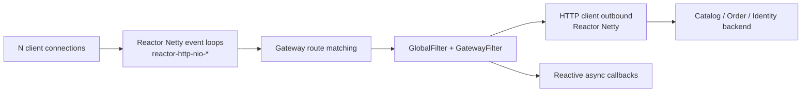
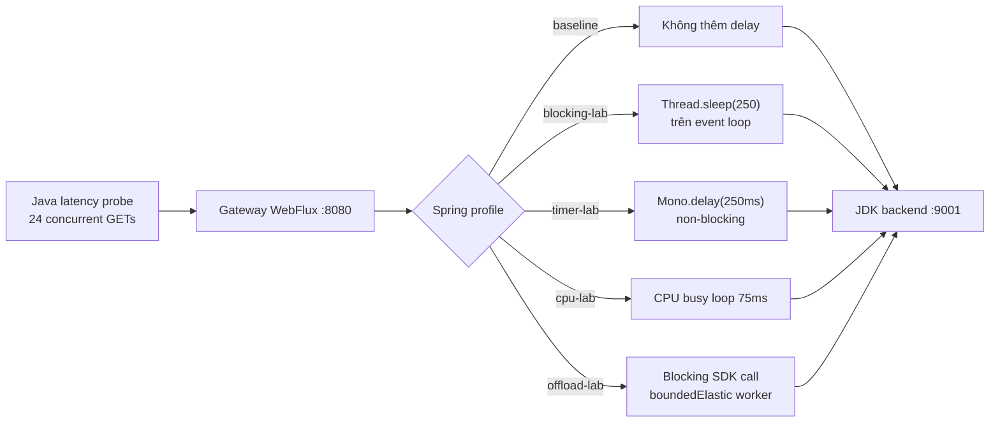
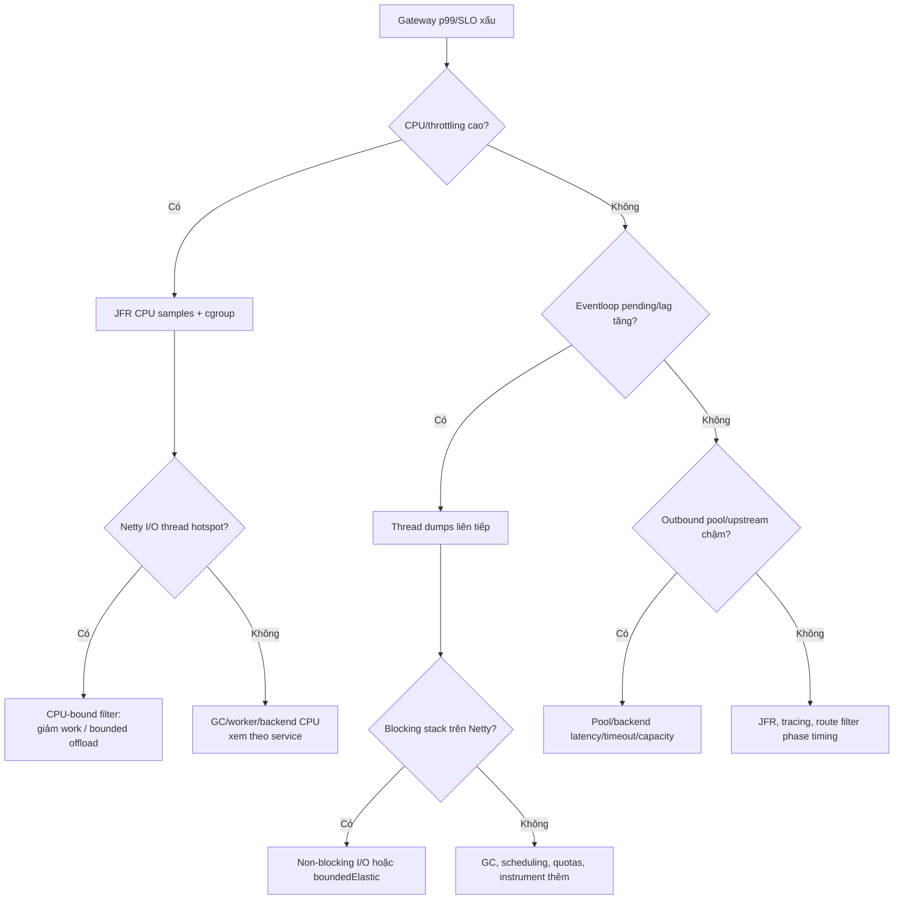

# Phát hiện lời gọi chặn event loop và điểm nghẽn CPU trong Spring Cloud Gateway

Spring Cloud Gateway là điểm vào microservices, chịu trách nhiệm chọn tuyến bằng route predicate, thực thi filter chain, sửa đường dẫn/header, dùng service discovery và kết hợp xác thực, rate limiting, circuit breaker, retry, TLS và quan sát request. **Hiệu năng Gateway phụ thuộc nhiều vào việc có giữ được các luồng xử lý I/O thông suốt hay không**. Một lời gọi JDBC đồng bộ, `Thread.sleep()` hoặc đoạn mã CPU-intensive nằm sai vị trí trong một filter có thể khiến **nhiều request không liên quan cùng chậm**, dù upstream của chúng vẫn khỏe.

Bài thuộc chương **Hiệu năng** của module `SPRING_CLOUD_GATEWAY`, tập trung vào **phát hiện lời gọi chặn event loop và điểm nghẽn CPU**, phân biệt nguyên nhân, thu thập bằng chứng và chọn cách sửa phù hợp. Chúng ta sẽ thực hành trên **Spring Cloud Gateway Server WebFlux**, so sánh trường hợp chặn luồng Reactor Netty với phương án non-blocking, dùng metrics, thread dump, Java Flight Recorder (JFR) và BlockHound để khoanh vùng. Bài cũng giải thích vì sao **Server Web MVC chạy trên Servlet** có thread model và hướng chẩn đoán khác.

> **Phạm vi kỹ thuật:** Spring Cloud Gateway Server WebFlux **5.0.x** với Spring Boot 4.x/Spring Cloud 2025.1.x tương thích; JDK 17+ (JDK 21 được đề xuất cho JFR và công cụ chẩn đoán). Các thuộc tính YAML của Gateway WebFlux có tiền tố `spring.cloud.gateway.server.webflux.*`. Spring Cloud Gateway Server Web MVC dùng Servlet/WebMvc.fn, **không** tự động dùng chính Reactor Netty event loop của Gateway Server WebFlux. Những ví dụ tạo nghẽn chỉ chạy **trên loopback và trong profile lab**; tuyệt đối không bật profile đó trên môi trường dùng chung hoặc production.

## 1. Mục tiêu học tập

Sau bài, bạn có thể:

1. Mô tả Reactor Netty **event loop** và vì sao số luồng I/O thường nhỏ hơn rất nhiều số request concurrent.
2. Phân biệt **blocking I/O**, **CPU-bound code**, **chờ connection pool**, **GC pause**, **backpressure** và upstream chậm.
3. Nhận diện những thao tác nguy hiểm trong `GlobalFilter`, `GatewayFilter`, authentication, route lookup, logging và body transformations.
4. Chọn đúng tín hiệu: p50/p95/p99 latency, throughput, error rate, CPU user/system, event-loop pending tasks, outbound connections, GC, scheduler queue.
5. Thu thập thread dumps bằng `jcmd`/`jstack`, JFR bằng `jcmd JFR.start` và CPU profiles có kiểm soát.
6. Dùng **BlockHound trong kiểm thử** để bắt những phương thức blocking được instrument trên luồng non-blocking; hiểu các giới hạn của công cụ.
7. Chạy lab với một filter cố ý `Thread.sleep()` và hai bản thay thế bằng `Mono.delay`/`Schedulers.boundedElastic()`, phân biệt độ trễ request riêng với **khả năng phục vụ request khác**.
8. Phát hiện vòng lặp tính toán chiếm CPU mà **BlockHound không nhất thiết bắt được**, sau đó profiling và tối ưu/giới hạn concurrency.
9. Lập ma trận regression/performance tests và quy trình xử lý sự cố có thể lặp lại, không điều chỉnh thread count mù quáng.

## 2. Event loop là gì và vì sao Gateway cần tránh chặn?

### 2.1. Mô hình WebFlux/Reactor Netty

Server WebFlux dùng Reactor Netty cho network I/O. Một nhóm nhỏ luồng event loop quản lý đọc/ghi socket, network events, timers và nhiều callback reactive. Về mặt khái niệm:



Khi hệ thống hoạt động tốt, event loop thực hiện **một đoạn code ngắn**, đăng ký I/O bất đồng bộ rồi sẵn sàng xử lý các kết nối khác. Nếu một callback chạy lâu, những kết nối khác được gán cùng event loop có thể phải chờ nó hoàn thành.

Trong ứng dụng thật, request có thể đổi luồng khi bạn dùng Reactor scheduler, các callback từ remote server hoặc thread pool của thư viện; **không phải mọi đoạn reactive pipeline đều luôn chạy trên cùng một event loop**. Nhưng quy tắc quan trọng vẫn đúng: **không thực hiện thao tác chờ lâu hoặc chiếm CPU lâu trên Netty I/O thread**.

### 2.2. Ví dụ hiện tượng “một request làm chậm các request khác”

Giả sử một `GlobalFilter` chạy trước khi proxy:

```java
@Override
public Mono<Void> filter(ServerWebExchange exchange,
                         GatewayFilterChain chain) {
    // CẤM trong sản phẩm WebFlux: chặn ngay luồng đang gọi filter().
    Thread.sleep(250);
    return chain.filter(exchange);
}
```

Đây là **mã minh họa anti-pattern, không biên dịch nguyên vẹn** vì `Thread.sleep` có checked exception. Nếu được xử lý và đặt vào filter chạy trên event loop, mỗi request có thể giữ event-loop thread trong 250 ms chỉ để chờ. Với ít event loops, backlog xuất hiện ngay cả khi upstream phản hồi trong 1 ms.

Giải thích đơn giản: không phải 250 ms latency của một request là vấn đề duy nhất; vấn đề là **chiếm luồng cần thiết để phục vụ những request khác**.

### 2.3. Sự khác nhau giữa non-blocking I/O và “nhanh”

`WebClient`/Reactor Netty dùng network I/O bất đồng bộ, nhưng request tới một upstream chậm vẫn có thể mất 2 giây. Non-blocking **không có nghĩa response luôn nhanh**; nó giúp Gateway không cần giữ một I/O thread đứng chờ 2 giây cho mỗi request.

Ngược lại, gọi `RestTemplate.getForObject(...)` hoặc `java.net.http.HttpClient.send(...)` đồng bộ trong event loop có thể bị chặn cho đến khi upstream trả response. Chuyển thư viện sang non-blocking client (hoặc đặt lời gọi cũ đúng worker pool) giúp event loop tiếp tục xử lý request khác, nhưng **upstream latency và timeout vẫn phải được kiểm soát**.

### 2.4. Server Web MVC khác ở đâu?

| Vấn đề | Gateway Server WebFlux | Gateway Server Web MVC |
|---|---|---|
| Inbound HTTP server | Reactor Netty event loops | Servlet container, ví dụ Tomcat |
| Route/filter API | `GlobalFilter`/`GatewayFilter` + Mono | Spring MVC/WebMvc.fn `HandlerFilterFunction` và Servlet filters |
| Security | `SecurityWebFilterChain` | `SecurityFilterChain` |
| Luồng xử lý thường gặp | I/O event loop + reactive schedulers | Servlet request worker threads |
| `Thread.sleep` trong request handler | Có thể giữ **event loop** và ảnh hưởng rất nhiều connections | Giữ **một Servlet worker**, làm cạn worker pool khi concurrent |
| Chẩn đoán quan trọng | Event-loop pending tasks, `reactor-http-nio-*` thread states, connection pool | Tomcat busy threads, request queue, `http-nio-*-exec-*` thread states |
| Cách sửa | Non-blocking, tách blocking work sang bounded workers, giảm CPU per callback | Giảm blocking time, timeout, thread pool/queue, async processing khi phù hợp |

**Không tuyên bố MVC “không bị nghẽn vì blocking là bình thường”.** MVC có thể hết Servlet workers và hàng đợi request tăng nhanh. Chỉ khác cách diễn giải: thuật ngữ *event-loop starvation* của Reactor Netty là vấn đề đặc thù **Server WebFlux**, còn MVC cần kiểm tra giới hạn request-thread pool và các thành phần async nếu có.

## 3. Ba loại “chậm” dễ bị nhầm lẫn

### 3.1. Blocking I/O hoặc chờ đồng bộ

Ví dụ:

```java
Thread.sleep(200);           // Timer blocking
jdbcTemplate.queryForList("SELECT ..."); // JDBC sync
legacyHttpClient.execute(request);        // HTTP client sync
future.get();                // Chờ kết quả thread khác
fileInputStream.read(bytes); // I/O file đồng bộ
latch.await();               // Chờ lock/latch
```

Các ví dụ là **đoạn trích minh họa**, không phải một Java class chạy độc lập. Những thao tác này có thể làm thread bị `WAITING`/`TIMED_WAITING` hoặc chờ native I/O. Khi thực hiện **trên event loop**, request khác phải xếp hàng ngay cả khi **CPU của JVM không cao**.

**Kết luận quan trọng:** CPU thấp + latency p99 tăng + event-loop pending tasks tăng là một dấu hiệu đáng điều tra về blocked event loop, nhưng **chưa đủ** để kết luận nguyên nhân là JDBC hoặc sleep. Phải xem thread stack, trace và các queue khác.

### 3.2. CPU-bound code chiếm event loop

Ví dụ:

```java
// CPU-heavy loop: tiêu thụ CPU trên luồng gọi hiện tại.
for (int i = 0; i < 5_000_000; i++) {
    digest.update(someBytes);
}
```

Nếu nó chạy trong một Gateway filter hay body transformation trên Netty event loop, thread bị `RUNNABLE` và tiêu thụ CPU suốt thời gian tính toán. Khác `Thread.sleep`, thread vẫn **đang chạy**, nhưng không sẵn sàng xử lý socket events mới.

Ví dụ thực tế:

- Xác minh chữ ký/cryptography lớn hoặc xử lý JWT custom nặng trên mỗi request.
- Serialize/deserialize JSON payload lớn, XML parsing, regex catastrophic backtracking.
- Nén/giải nén, hashing/encryption nguyên body kích thước lớn.
- Logging đồng bộ kèm format chuỗi/stacktrace khổng lồ.
- Chuyển đổi request/response body bằng vòng lặp không giới hạn.
- Đọc kho route lớn rồi tính predicate/regex nặng trên mỗi request.

**BlockHound không tự phát hiện mọi vòng lặp CPU**. Nó phát hiện **những blocking methods được instrument** khi chạy trên non-blocking threads; tính toán kéo dài không gọi blocking primitive có thể vượt qua BlockHound nhưng vẫn làm event loop starvation.

### 3.3. Upstream/connection pool/GC chậm

Một request p99 cao không luôn do custom filter. Các nguyên nhân khác:

| Nhóm | Dấu hiệu thường gặp | Bằng chứng cần tìm |
|---|---|---|
| Upstream chậm | Gateway latency tăng tương ứng upstream latency | Traces client span, upstream response time, saturation backend |
| Connection pool cạn | Pending connection acquires/timeout tăng | Reactor Netty connection provider pending/active metrics |
| DNS/TLS handshake chậm | Connect/TLS phase tăng, errors | HTTP client metrics, TLS diagnostics, name resolution |
| GC pause | Các request cùng có độ trễ spike, GC pause metrics | JFR GC events, `jvm.gc.pause`, heap/off-heap pressure |
| CPU throttling container | CPU usage có thể chưa cao theo host nhưng pod bị throttle | cgroup throttled time, CPU limits, JFR sampled stacks |
| Memory/allocator pressure | Direct memory cao, GC/allocations tăng | Netty ByteBuf allocator, heap/GC, JFR allocation profiles |
| Event loop blocked | Một số `reactor-http-nio-*` threads bị stuck trong JDBC/sleep/lock | Thread dump/JFR + pending tasks |
| CPU hotspot trên event loop | `reactor-http-nio-*` thread RUNNABLE trong regex/crypto/body code | CPU profile và per-thread CPU |
| `boundedElastic` queue đầy | Event loop bình thường nhưng request chờ task được offload | Scheduler queue/active/pending, thread dumps |
| Traffic spike hoặc DDoS | RPS/connections cao hơn baseline | Ingress request rate, admission control, per-route metrics |

Đừng “chữa” mọi p99 bằng cách tăng Netty worker count. Nếu nguyên nhân là upstream 2 giây, kết nối pool cạn hay blocking trong filter, tăng event loops có thể chỉ dời nghẽn sang chỗ khác và tăng overhead.

## 4. Những chỗ dễ đưa blocking code vào Gateway

| Vị trí | Anti-pattern | Vì sao nguy hiểm | Thay thế |
|---|---|---|---|
| `GlobalFilter.filter(...)` | `Thread.sleep`, gọi DB sync | Thường nằm trên hot path của nhiều routes | I/O reactive hoặc offload có giới hạn |
| `GatewayFilterFactory` custom | `Mono.block()`, `Future.get()` | Deadlock/blocked loop, mất concurrency | Compose `Mono/Flux`, không block |
| `KeyResolver` cho rate limiter | Lookup user/session DB sync | Quota lookup làm nghẽn trước proxy | Reactive lookup + cache/timeout |
| Reactive Security auth | Synchronous password/provider/HTTP call | Chặn request authentication và các request khác | Reactive authentication manager hoặc scheduler phù hợp |
| Dynamic route locator | JDBC blocking khi refresh trên event-loop | Rebuild routes kẹt, chậm kích hoạt revision | Snapshot preload/worker riêng hoặc repository reactive |
| Service discovery | Client registry đồng bộ ở hot path | Route chọn instance chậm | Reactive supplier/caching + timeout |
| Request body filter | JSON/XML parse/nén lớn đồng bộ | CPU hotspot, memory và buffer spike | Size limit, stream/async, tối ưu codec |
| Response body filter | `collectList()` toàn stream | OOM/backpressure, độ trễ first byte | Streaming transforms hoặc không rewrite stream |
| Audit/logging | Ghi file/sync network logging | I/O/lock khi traffic tăng | Async bounded logging, sampling/redaction |
| Regex/rewrite path | Pattern backtracking trên input dài | CPU nóng dù không có I/O | Regex bounded/safer patterns + input limit |
| TLS/client trust | Tắt verify để tránh chậm | Tạo rủi ro MITM, không giải quyết gốc | Pool reuse, CA/SAN hợp lệ, TLS tuning có đo lường |
| Retry/fallback | Retry unbounded + sync work | Nhân tải lên backend và Gateway | Giới hạn attempts/backoff, idempotency, CB |

Đừng chỉ kiểm tra controller của Gateway. **Filter chain** được áp dụng ngay cả khi business logic không viết một dòng nào trong Gateway. Một custom logger, Authentication Manager, Metrics binder hoặc filter đi kèm thư viện vẫn có thể là thủ phạm.

## 5. Mô hình số: vì sao blocking nhỏ cũng ảnh hưởng nhiều?

Giả sử có `E` event loops, mỗi callback chiếm CPU hoặc block trong `T` giây. Một giới hạn lý thuyết cực kỳ đơn giản là:

\[
\text{callback capacity} \lesssim \frac{E}{T}.
\]

Ví dụ giả định `E = 4`, `T = 0,25` giây: nếu mọi request phải giữ một event loop suốt 250 ms, hệ thống bị giới hạn xấp xỉ **16 callbacks/giây** trước khi tính mọi overhead. Đây **không** phải throughput đo thực tế của Gateway: event-loop affinity, HTTP client, TLS, CPU quotas, scheduler, connection reuse và workload làm kết quả thay đổi lớn.

Theo Little's Law (với hệ thống ở trạng thái ổn định):

\[
L = \lambda W,
\]

trong đó `L` là concurrency trung bình, `λ` là throughput và `W` là response time trung bình. Khi throughput không tăng nhưng time-in-system `W` tăng, requests đang chờ `L` tăng. Tuy nhiên công thức **không chỉ ra nguyên nhân**; phải kết hợp queue metrics, sampled stacks và upstream latency.

Vì vậy “có 8 CPU cores thì tăng Netty workers lên 64” không phải một phương pháp tối ưu có cơ sở. Trước hết phải giảm thời gian event loop bị giữ, chặn ingress overload, xử lý external I/O đúng cách và xác định CPU hotspots.

## 6. Đo trước khi sửa: metrics cần có

### 6.1. Bốn tín hiệu vàng và tín hiệu nội bộ

Một dashboard Gateway tối thiểu nên thể hiện:

- **Traffic:** RPS theo route và HTTP method.
- **Latency:** p50/p95/p99, so với baseline, SLO và upstream latency.
- **Errors:** 4xx/5xx, timeout, connection reset, upstream failures.
- **Saturation:** CPU/cgroup throttling, memory/GC, Netty event loop backlog, outbound connection pool.

Không kết luận bằng **trung bình latency**. Ví dụ 99% request 5 ms, 1% request 3 giây thì trung bình vẫn có thể trông chấp nhận được trong khi p99 làm người dùng trải nghiệm tệ.

### 6.2. Bật Actuator cho **lab WebFlux** trên loopback

Dependencies liên quan:

```xml
<dependencies>
    <dependency>
        <groupId>org.springframework.cloud</groupId>
        <artifactId>spring-cloud-starter-gateway-server-webflux</artifactId>
    </dependency>

    <dependency>
        <groupId>org.springframework.boot</groupId>
        <artifactId>spring-boot-starter-actuator</artifactId>
    </dependency>

    <!-- Chỉ cần khi muốn scrape /actuator/prometheus. -->
    <dependency>
        <groupId>io.micrometer</groupId>
        <artifactId>micrometer-registry-prometheus</artifactId>
    </dependency>
</dependencies>
```

Đây là **đoạn dependencies**, không phải `pom.xml` hoàn chỉnh: project phải có Spring Boot parent/plugin và Spring Cloud BOM tương thích. Khi chạy Servlet Gateway MVC, dùng `spring-cloud-starter-gateway-server-webmvc` thay cho WebFlux starter; đừng trộn chúng.

`application.yml` tối giản cho lab metric:

```yaml
server:
  address: 127.0.0.1
  port: 8080

spring:
  application:
    name: gateway-performance-lab
  cloud:
    gateway:
      server:
        webflux:
          metrics:
            enabled: true
            path-tags:
              enabled: false
          routes:
            - id: lab-fast
              uri: http://127.0.0.1:9001
              predicates:
                - Path=/demo/**
                - Method=GET
              filters:
                - StripPrefix=1

management:
  endpoints:
    web:
      exposure:
        include: health,metrics,prometheus
```

**Lưu ý version:** Configuration Properties của Gateway **5.0.5** ghi rõ `spring.cloud.gateway.server.webflux.metrics.enabled` và default `false`; trong lab đặt **`true` tường minh**, thay vì giả định chỉ thêm Actuator sẽ luôn tạo Gateway timer. Một số trang hướng dẫn chung/phiên bản cũ mô tả khác về mặc định; hãy đối chiếu effective configuration trên bản Gateway đang chạy.

- `metrics.path-tags.enabled: false` để tránh thêm URL path cụ thể như `/users/12345` thành tag cardinality cao.
- `management.endpoints.web.exposure.include` **không tự xác thực endpoint**; trong lab toàn bộ server bind `127.0.0.1`. Production cần management network và Security policy riêng.
- Không bật `threaddump`/`heapdump` qua Internet; dùng `jcmd` có quyền truy cập process khi cần chẩn đoán.
- Gateway `metrics`, Boot `http.server.requests` và Reactor Netty `eventloop` metrics là **các tầng quan sát khác nhau**.

### 6.3. Xem Gateway và HTTP server timers

Sau khi Gateway nhận traffic:

```bash
curl -s http://127.0.0.1:8080/actuator/metrics
curl -s http://127.0.0.1:8080/actuator/metrics/spring.cloud.gateway.requests
curl -s http://127.0.0.1:8080/actuator/metrics/http.server.requests
curl -s http://127.0.0.1:8080/actuator/prometheus
```

Tùy cấu hình instrumentation và phiên bản, `spring.cloud.gateway.requests` là timer của Gateway có tags `routeId`, `routeUri`, `outcome`, `status`, `httpMethod`; `http.server.requests` là metric của Spring Boot cho HTTP server. Cả hai đều không tự cho biết callback nào đang block. Trong Prometheus, tên có thể được normalize, ví dụ dấu chấm thành dấu gạch dưới và timer có các hậu tố `_count`/`_sum`.

**Nếu một metric không xuất hiện**:

1. Xác định request thật đã đi qua đúng route.
2. Kiểm tra Actuator, Micrometer registry, `metrics.enabled` và profile.
3. Kiểm tra path Actuator/management port, quyền truy cập.
4. Đối chiếu metric names của release và đường instrument đã bật.
5. Đừng bịa giá trị `0` chỉ vì không tìm thấy metric; **missing instrumentation khác zero load**.

### 6.4. Reactor Netty event loop và outbound connection pool

Reactor Netty cung cấp metric với tên:

| Metric được tài liệu Reactor Netty mô tả | Ý nghĩa | Giới hạn diễn giải |
|---|---|---|
| `reactor.netty.eventloop.pending.tasks` | Số tasks đang chờ trên event loop, dạng gauge | Tăng liên tục là tín hiệu backlog, **không tự chỉ ra** I/O block hay CPU hotspot |
| `reactor.netty.connection.provider.active.connections` | Số outbound connections đang dùng | Cao có thể do nhiều request hợp lệ hoặc backend chậm |
| `reactor.netty.connection.provider.idle.connections` | Connections đang rảnh trong pool | Không phải số request “đang chờ” |
| `reactor.netty.connection.provider.pending.connections` | Requests chờ acquire outbound connection | Tăng có thể do pool saturation, không phải event loop block |
| `reactor.netty.connection.provider.pending.connections.time` | Thời gian chờ acquire connection | Cần so với connect/response time |
| `reactor.netty.http.client.response.time` | Thời gian HTTP client interaction theo metric recorder | Phải xem setup/tags thực tế |
| `reactor.netty.bytebuf.allocator.active.direct.memory` | Netty direct buffer đang dùng | Cao có thể gây memory pressure dù JVM heap ổn |

Các tên và tags theo tài liệu Reactor Netty hiện hành. **Không cam kết tất cả metric tự xuất hiện chỉ vì thêm Actuator**: một số cần enable Reactor Netty instrumentation/connection provider metrics và phải có traffic đúng code path. Kiểm tra `/actuator/metrics`/Prometheus output thật trước khi viết alert. Nếu metric không được phát, bật instrumentation bằng cấu hình Netty/Boot được hỗ trợ cho đúng release hoặc instrument một probe custom.

### 6.5. Một “event loop lag probe” nên được hiểu thế nào?

Có thể xây một **periodic task** được schedule lên chính event loop và đo độ lệch giữa thời điểm dự kiến và thời điểm chạy thực. Nếu lag cao và pending tasks tăng, đó là dấu hiệu event loop không được cấp CPU hoặc đang bận.

Nhưng probe này phải:

- Có overhead thấp, tần suất hữu hạn; không tạo thêm load đáng kể.
- Được đăng ký đúng trên event loop cần đo, không dùng một `@Scheduled` executor khác rồi gắn nhãn event-loop lag.
- Phân biệt **CPU throttling**, GC stop-the-world và blocked callback.
- Báo aggregate/histogram với tags giới hạn, không dùng mỗi connection làm metric label.
- Kiểm chứng bằng JFR/thread dump khi nhận alert.

**Không coi một event-loop lag probe tự viết là API chuẩn của Gateway**. Nếu ứng dụng chưa instrument được, có thể bắt đầu với pending tasks, p99, CPU throttling và stack sampling.

### 6.6. Đọc các tín hiệu theo tổ hợp, không đơn lẻ

| Hiện tượng | CPU | Event-loop backlog | Thread dump/JFR | Nghi ngờ ưu tiên |
|---|---|---|---|---|
| p99 tăng, CPU thấp | Thấp | Có thể tăng | `TIMED_WAITING` ở `Thread.sleep`/I/O trên Netty threads | Blocking call |
| p99 tăng, CPU cao | Cao | Có thể tăng | `RUNNABLE` hotspot regex/JSON/crypto trên Netty threads | CPU-bound filter |
| p99 tăng, CPU thấp và pool pending tăng | Thấp/vừa | Không nhất thiết | Nhiều requests chờ HTTP connection acquire | Outbound pool/upstream |
| p99 tăng, JVM heap/GC pause tăng | Có thể cao | Lag tăng theo pause | JFR GC pauses, allocations | GC/memory |
| p99 tăng, pod throttled time tăng | Host CPU có thể bình thường | Có thể tăng | CPU throttling events/cgroup | CPU quota |
| p99 tăng, upstream cũng chậm | Có thể bình thường | Không nhất thiết | Client spans dài, backend p99 cao | Upstream |
| p99 tăng, boundedElastic queue cao | Tùy work | Có thể vẫn ổn | Workers bận JDBC/file sync | Offload pool saturated |

Không tính p95/p99 bằng cách lấy trung bình p95/p99 của mỗi pod. Percentiles không cộng tuyến tính; cần histogram/metrics aggregation đúng để tạo percentiles toàn cụm.

## 7. Lấy bằng chứng từ một JVM đang chậm

### 7.1. Quy trình quan sát an toàn

Khi có latency spike:

1. Ghi **thời điểm và khoảng thời gian** xảy ra sự cố, route IDs, RPS, concurrency và deployment revision.
2. Đối chiếu Gateway p95/p99 với upstream p95/p99, error rate và connection pool.
3. Xem CPU **của process và cgroup**, không chỉ CPU host.
4. Xem `reactor.netty.eventloop.pending.tasks` nếu đã instrument.
5. Lấy **một vài thread dumps** cách nhau vài giây, không chỉ snapshot duy nhất.
6. Nếu chưa xác định, dùng **JFR profile** trong khoảng ngắn có kiểm soát hoặc CPU profiler phù hợp.
7. Liên hệ stack frames với custom filters, auth providers, path/body rewrite và logging.
8. Đưa ra giả thuyết có thể kiểm chứng và A/B test trên môi trường cô lập trước khi đổi cấu hình production.

**Thread dump và JFR có thể chứa tên class, stack trace, URL, host, thậm chí dữ liệu nhạy cảm** theo cấu hình event; cần bảo vệ file và retention, không đính kèm toàn bộ public issue.

### 7.2. Tìm process và xem thread dump bằng `jcmd`

Trên host/container có JDK tools và quyền attach process:

```bash
# Liệt kê JVM nhìn thấy trong namespace hiện tại:
jcmd -l

# Thay 12345 bằng PID Gateway:
jcmd 12345 Thread.print -l
```

Khi đang điều tra production, lưu ra file được bảo vệ theo quy trình của đội:

```bash
jcmd 12345 Thread.print -l > gateway-threads.txt
```

Nếu JVM chạy trong Docker/Kubernetes, PID bên trong container có thể là `1` nhưng PID trên host khác. Phải chạy `jcmd` trong cùng process namespace hoặc một debug container được cấp quyền hợp lệ, chứ không giả định `jcmd 1` trên máy cá nhân là JVM Gateway.

Với JDK 21+, còn có:

```bash
# Đặc biệt hữu ích nếu JVM có virtual threads:
jcmd 12345 Thread.dump_to_file -format=text /tmp/gateway-dump.txt
```

Lệnh có thể cần JDK đủ mới, quyền attach và đường dẫn ghi **trong filesystem của process JVM**. `Thread.print` và `Thread.dump_to_file` có nội dung/định dạng khác nhau; dùng đúng lệnh hỗ trợ bởi JDK đang chạy.

### 7.3. Đọc stack trace mẫu

Ví dụ một phần thread dump:

```text
"reactor-http-nio-3" #23 ...
   java.lang.Thread.State: TIMED_WAITING (sleeping)
     at java.lang.Thread.sleep(Native Method)
     at com.example.gateway.BadBlockingFilter.filter(BadBlockingFilter.java:31)
     at org.springframework.cloud.gateway.handler.FilteringWebHandler...
```

Đây là **stack giả lập để đọc pattern**, không phải output lấy từ ứng dụng thật. Nó gợi ý `BadBlockingFilter` gọi sleep trực tiếp trên Reactor Netty thread.

Một CPU hotspot khác:

```text
"reactor-http-nio-2" ...
   java.lang.Thread.State: RUNNABLE
     at java.util.regex.Pattern$Loop.match(...)
     at com.example.gateway.ExpensiveRewriteFilter.filter(...)
```

Điều này chỉ là **tín hiệu**, không phải bằng chứng regex chiếm toàn bộ CPU. Nếu bắt cùng các frames ở nhiều mẫu JFR/CPU profile và đúng thời điểm pod nóng, độ tin cậy cao hơn.

### 7.4. Đối chiếu PID, thread ID và CPU

Trên Linux có thể xem threads đang dùng CPU:

```bash
top -H -p 12345
```

Thread ID ở `top` thường là OS TID thập phân. Trong một số định dạng Java thread dump truyền thống có `nid=0x...` hệ thập lục phân; cần đổi/đối chiếu cẩn thận trước khi nối một TID có CPU cao với stack Java. Ví dụ Windows/Linux/macOS khác nhau; JFR giúp tránh thao tác đối chiếu thủ công khi thread IDs khó đọc.

Không kết luận `RUNNABLE` nghĩa thread dùng 100% CPU: Java `RUNNABLE` có thể bao gồm đang thực hiện native call mà CPU thực chưa chắc cao. Phải xem process/thread CPU counters hoặc profiler samples.

### 7.5. Dùng Java Flight Recorder

JFR tích hợp trong JDK hiện đại, có thể ghi CPU samples, allocations, lock contention, GC, `ThreadSleep` và các events tùy recording settings. Một ví dụ được Oracle mô tả:

```bash
jcmd 12345 JFR.start \
  name=GatewayPerf \
  settings=profile \
  duration=60s \
  filename=/tmp/gateway-perf.jfr
```

Sau đó, dùng JDK Mission Control (JMC) hoặc JFR CLI để xem:

```bash
jfr summary /tmp/gateway-perf.jfr

# Xem một số loại event có thể xuất hiện khi profile được bật:
jfr print --events jdk.ThreadSleep,jdk.JavaMonitorEnter \
  /tmp/gateway-perf.jfr
```

**Không bảo đảm một event cụ thể luôn được thu thập**: phụ thuộc `settings`, phiên bản JDK và event enabled/threshold. Nếu không thấy `jdk.ThreadSleep`, kiểm tra recording settings và xem method sampling/thread dumps, không kết luận không có sleep.

JFR cần ghi file tại filesystem có quyền của JVM, và file có overhead/độ nhạy dữ liệu. Chạy trong khoảng ngắn, theo quy trình vận hành, không để `profile` chạy vô hạn trên production mà không giới hạn disk/retention.

### 7.6. Khi nào dùng CPU profiler?

Khi CPU process/cgroup cao và thread dumps lặp lại cho thấy `RUNNABLE` trên `reactor-http-nio-*` hoặc `parallel-*`, CPU profiler lấy **sampled stack traces**, cho biết thời gian chạy đang tiêu ở phương thức nào.

Công cụ phổ biến: JFR/JDK Mission Control, async-profiler (nếu tổ chức cho phép), JVM profiler của APM. Điều quan trọng không phải tên công cụ mà là:

- Chọn khoảng thời gian tương ứng p99 spike.
- Phân biệt CPU sampling với wall-clock tracing.
- Chỉ bật event/sampling cần thiết, đo overhead.
- Lọc theo thread name/route/filter và **so với baseline**.
- Kiểm tra hotspot thuộc Gateway JVM hay backend JVM; không tối ưu nhầm service.

**Một method chiếm nhiều CPU samples không nhất thiết là bug** nếu đó là công việc ứng dụng cần làm. Tối ưu khi work per request không hợp lý, thiếu cache/limit, hoặc đặt CPU work sai luồng dẫn đến starvation.

## 8. BlockHound: phát hiện những lời gọi blocking trên luồng non-blocking

### 8.1. BlockHound hoạt động như thế nào?

**BlockHound** là một Java agent/instrumentation tool của Reactor, có thể phát hiện những blocking APIs đã biết khi chúng được gọi từ các thread được đánh dấu **non-blocking** (ví dụ Reactor `Schedulers.parallel()` và các thread phù hợp với Reactor/Netty integrations).

Ví dụ một chuỗi:

```text
reactor-http-nio-3
  -> GlobalFilter.filter()
     -> legacyDao.findAccount()
        -> java.lang.Thread.sleep()
           -> reactor.blockhound.BlockingOperationError
```

BlockHound không phải CPU profiler, không tự biết một query SQL chạy 50 ms hay 5 giây nếu đường gọi đó chưa được instrument, và không tự đảm bảo mọi thư viện native/third-party blocking đều được phát hiện.

### 8.2. Sử dụng trong **test profile**, không bật đại trà production

Thêm dependency `io.projectreactor.tools:blockhound` theo bản tương thích với Reactor/JDK của project và đặt vào **test scope**:

```xml
<dependency>
    <groupId>io.projectreactor.tools</groupId>
    <artifactId>blockhound</artifactId>
        <version>1.0.18.RELEASE</version>
    <scope>test</scope>
</dependency>
```

Ví dụ chọn BlockHound `1.0.18.RELEASE` đã phát hành tháng 10/2026. Đây là **test dependency có version cụ thể**, nhưng vẫn phải kiểm tra tương thích với Reactor và JDK của project thực tế. Java agent có thể gặp giới hạn Byte Buddy/attach/instrumentation trên một số tổ hợp JDK, dù artifact Maven tồn tại.

Test JUnit 5 cơ bản:

```java
import java.time.Duration;

import org.junit.jupiter.api.BeforeAll;
import org.junit.jupiter.api.Test;

import reactor.blockhound.BlockHound;
import reactor.blockhound.BlockingOperationError;
import reactor.core.publisher.Mono;
import reactor.core.scheduler.Schedulers;
import reactor.test.StepVerifier;

class BlockHoundGuardTest {

    @BeforeAll
    static void install() {
        // Nên install sớm, trước khi ứng dụng tạo nhiều threads.
        BlockHound.install();
    }

    private static void sleepTenMillis() {
        try {
            Thread.sleep(10);
        } catch (InterruptedException ex) {
            Thread.currentThread().interrupt();
            throw new IllegalStateException(ex);
        }
    }

    @Test
    void detectsSleepOnNonBlockingScheduler() {
        Mono<Void> blockingWork = Mono
                .fromRunnable(BlockHoundGuardTest::sleepTenMillis)
                .subscribeOn(Schedulers.parallel());

        StepVerifier.create(blockingWork)
                .expectError(BlockingOperationError.class)
                .verify(Duration.ofSeconds(5));
    }
}
```

Cần `reactor-test` và `junit-jupiter` trong test dependencies. Đây là **test của BlockHound integration**, không tự động chạy tất cả Gateway routes. Muốn bắt custom filter thực sự, phải có test kích hoạt filter trên non-blocking scheduler/embedded Gateway.

**Trên JDK 13+**, tài liệu BlockHound còn ghi nhận yêu cầu/giới hạn của JVM instrumentation và đề cập JVM option `-XX:+AllowRedefinitionToAddDeleteMethods` cho một số tổ hợp. Tùy JDK/Byte Buddy/BlockHound, option và agent có thể không hoạt động; hãy kiểm chứng theo version trước khi áp dụng trong CI. **Đừng coi lỗi install BlockHound là bằng chứng ứng dụng không có blocking calls.**

### 8.3. Những điều BlockHound có thể bỏ sót

| Trường hợp | BlockHound có bắt chắc không? | Cần thêm gì? |
|---|---|---|
| `Thread.sleep` trên một thread được đánh dấu non-blocking | Thường có | Test đúng scheduler/thread |
| `Mono.block()` trên Reactor NonBlocking thread | Reactor tự có check trong nhiều trường hợp | Kiểm thử reactive chain, stacktrace |
| JDBC/SDK sync đi qua một API chưa instrument | Không chắc | JFR, trace, timing, wrapper metrics |
| CPU loop/regex chạy 250ms | **Không mặc định** | CPU profiler/JFR samples, event-loop lag |
| Blocking trên `boundedElastic` | Thường được phép, không phải violation theo marker | Theo dõi pool saturation, timeout và queue |
| Async I/O tới backend chậm | Không phải local blocking | HTTP client spans/connection metrics |
| GC pause/cgroup throttling | Không | GC/JFR/cgroup metrics |
| Native call hoặc lock custom | Tùy instrumentation | Thread dump/JFR/async-profiler |

**Không “sửa” cảnh báo bằng cách allowlist toàn bộ package của ứng dụng.** `allowBlockingCallsInside` chỉ nên dùng cho trường hợp false positive hẹp, được giải thích và theo dõi, nếu không sẽ làm mù công cụ.

### 8.4. Thực hành kết hợp BlockHound với review code

Khi một test BlockHound báo lỗi:

1. Đọc stack từ `BlockingOperationError` đến method gọi blocking.
2. Xác định đó là **hot path** hay chỉ chạy trong startup/shutdown.
3. Xác định thread thực tế và work type (I/O, lock, CPU).
4. Đề xuất non-blocking API hoặc tách worker theo concurrency cap.
5. Giữ test regression tránh đưa `Thread.sleep`/JDBC sync trở lại Gateway filter.
6. Đo p95/p99 và saturation sau sửa, không dừng ở “BlockHound xanh”.

Nếu test không chạy được trên tổ hợp JDK/agent, vẫn có thể dùng JFR/thread dumps và source review; đừng bỏ hẳn việc kiểm tra hiệu năng.

## 9. Chọn cách sửa phù hợp với nguyên nhân

### 9.1. Nếu chỉ cần chờ timer: dùng `Mono.delay`

Anti-pattern:

```java
Thread.sleep(250);
return chain.filter(exchange);
```

Đúng ý nghĩa **chờ timer không làm việc**:

```java
return Mono.delay(Duration.ofMillis(250))
        .then(Mono.defer(() -> chain.filter(exchange)));
```

`Mono.delay` sắp lịch callback, không giữ Netty event loop đứng chờ 250 ms. Sau khi timer hoàn tất, downstream chain tiếp tục khi publisher được subscribe. **Nó không làm request nhanh hơn 250 ms**; nó chỉ giải phóng I/O thread trong thời gian chờ.

Đừng dùng `Mono.delay` để “thay JDBC”: `Mono.delay` không tự biến JDBC thành non-blocking, cũng không lấy dữ liệu từ database.

### 9.2. Nếu cần network I/O: dùng non-blocking client

Anti-pattern trong Gateway filter:

```java
// Chặn thread cho đến khi remote HTTP service trả response.
String value = blockingHttpClient.get(...);
return chain.filter(exchange);
```

Cách tốt hơn dùng reactive HTTP client và compose signal:

```java
// PSEUDO-CODE: injected WebClient identityClient;
// cần định nghĩa policy fallback/timeout/circuit breaker cụ thể.
return identityClient.get()
        .uri("/internal/subject")
        .retrieve()
        .bodyToMono(Subject.class)
        .timeout(Duration.ofMillis(800))
        .flatMap(subject -> {
            // Dùng thông tin đã được xác thực/ủy quyền.
            ServerHttpRequest request = exchange.getRequest()
                .mutate()
                .headers(headers ->
                    headers.set("X-Verified-Subject", subject.id()))
                .build();

            return chain.filter(exchange.mutate().request(request).build());
        });
```

Đây là **khung cấu trúc**, không phải class chạy độc lập: phải có imports, bean `identityClient`, class `Subject`, error handling và chính sách trust rõ. Không bao giờ nhận `X-Verified-Subject` do client tự gửi như authority; phải sanitize header inbound trước và chỉ tạo từ identity đã xác minh.

Cũng cần **timeout, connection pool/bulkhead, fallback hoặc failure policy** phù hợp. Non-blocking client vẫn có thể khiến Gateway nghẽn nếu upstream trả chậm và không giới hạn concurrency.

### 9.3. Nếu phụ thuộc thư viện blocking: offload bằng bounded scheduler

Khi chưa thể thay SDK/JDBC đồng bộ, đặt **chính lời gọi blocking** vào `Mono.fromCallable` và dùng `Schedulers.boundedElastic()`:

```java
return Mono.fromCallable(() -> legacyDao.findAccount(accountId))
        .subscribeOn(Schedulers.boundedElastic())
        .timeout(Duration.ofSeconds(2))
        .flatMap(account -> chain.filter(exchange));
```

**Điều cần phân biệt:**

- `Mono.fromCallable(...)` trì hoãn thực hiện cho tới khi subscription, không gọi JDBC ngay khi tạo pipeline.
- `subscribeOn(Schedulers.boundedElastic())` đặt callable trên worker scheduler có giới hạn thay vì Netty event loop.
- `timeout` giới hạn thời gian của reactive publisher, nhưng **không chứng minh** JDBC/native call thực sự dừng ngay khi timeout; phải cấu hình database/socket/query timeout tương ứng.
- `flatMap` tiếp tục reactive chain theo signal; callback có thể chạy trên scheduler khác với original event loop. Không giả định `subscribeOn` tự đưa tất cả execution trở lại Netty thread.
- `boundedElastic()` có thread/task queue capacity hữu hạn nhưng default queue có thể khá lớn. Nếu burst vượt năng lực blocking dependency, queue tăng rồi xuất hiện latency/rejection.

Đừng bọc **toàn bộ `chain.filter(exchange)`** vào `boundedElastic` bằng `publishOn` với kỳ vọng có thêm throughput. Chỉ tách **phần blocking thật sự**, giới hạn số tác vụ đồng thời và tránh gom các response/body lớn trong heap.

### 9.4. Isolate một blocking SDK bằng scheduler riêng

Nếu một legacy SDK có tài nguyên riêng (DB pool tối đa 8 connections), có thể cấp một scheduler chuyên biệt, không chia sẻ global boundedElastic với mọi filter:

```java
import org.springframework.context.annotation.Bean;
import org.springframework.context.annotation.Configuration;
import reactor.core.scheduler.Scheduler;
import reactor.core.scheduler.Schedulers;

@Configuration
public class LegacySchedulerConfig {

    @Bean(destroyMethod = "dispose")
    Scheduler legacyScheduler() {
        // Tối đa 8 threads, tối đa 64 tasks đang queue
        // theo boundedElastic scheduler API.
        return Schedulers.newBoundedElastic(8, 64, "gateway-legacy");
    }
}
```

Và:

```java
// Code fragment bên trong một class có field Scheduler legacyScheduler.
return Mono.fromCallable(() -> legacyDao.load(key))
        .subscribeOn(legacyScheduler)
        .timeout(Duration.ofSeconds(2))
        .flatMap(result -> chain.filter(exchange));
```

`Schedulers.newBoundedElastic` giúp đặt cap/queue cho nhóm work này; **không có nghĩa 8 threads luôn là giá trị tối ưu**. Để chọn kích thước, đo capacity DB pool, latency của SDK, CPU limit, concurrency và SLO. Nếu queue bị đầy, phản hồi lỗi có kiểm soát/overload policy, đừng để request đợi vô hạn.

Cũng không dùng `Schedulers.parallel()` làm nơi chạy JDBC blocking: scheduler đó dành cho việc xử lý CPU/non-blocking, có số workers giới hạn và marker `NonBlocking`.

### 9.5. Nếu là CPU-bound: giảm công việc rồi mới tính offload

Với CPU hotspot, **thêm threads không tạo thêm CPU cores**. Các bước:

1. Đo CPU samples để biết method nào đang nóng.
2. Loại bỏ gọi lặp, chuyển parse/config ra khỏi request hot path.
3. Giới hạn payload, regex complexity, số route/predicate cần đánh giá.
4. Tối ưu thuật toán/caching những dữ liệu **an toàn để cache**.
5. Nếu CPU task dài vẫn cần làm, chuyển sang một **CPU worker pool có giới hạn** và admission control, không để Netty event loops bị giữ.
6. Với tác vụ rất nặng, chuyển sang service chuyên trách/queue và dùng async response/workflow phù hợp.
7. Đo lại CPU/cgroup throttling, event-loop lag, p99 và throughput.

`Schedulers.parallel()` có thể phù hợp với **CPU tasks ngắn và được kiểm soát**; nó không phải nơi cho blocking I/O. Đừng đẩy mọi request lên parallel scheduler rồi bỏ qua vấn đề tổng CPU saturation.

### 9.6. Vì sao virtual threads không tự sửa Reactor Netty?

JDK 21+ và Reactor `boundedElastic` có tùy chọn sử dụng **virtual threads** trên một số tổ hợp cấu hình (ví dụ system property `reactor.schedulers.defaultBoundedElasticOnVirtualThreads` nếu bản Reactor hỗ trợ).

Nhưng:

- Reactor Netty I/O event loops không tự biến thành virtual threads chỉ vì bạn bật một property.
- Một callback chạy CPU nặng trên Netty thread vẫn giữ event loop.
- Virtual threads giúp mô hình chờ I/O đồng bộ thuận tiện hơn, **không làm tăng CPU cores**.
- Pinning/native locks/driver behavior cần kiểm tra với JFR/monitoring; không mặc định mọi JDBC client được cải thiện.
- Cơ chế của Gateway Server Web MVC trên Servlet workers khác với bài toán non-blocking gateway này.

**Không quảng bá virtual threads là “bật là hết blocked event loop”.** Ưu tiên API non-blocking trên WebFlux và dùng offload có giới hạn cho những thư viện đồng bộ không thể thay.

## 10. Lab: tạo ba trạng thái hiệu năng để quan sát

Mục tiêu thực hành:

1. **Baseline:** Gateway proxy qua backend nhanh, không có custom filter gây delay.
2. **`blocking-lab`:** filter gọi `Thread.sleep(250)` **trực tiếp** trong `GlobalFilter.filter(...)`.
3. **`timer-lab`:** cùng thời gian chờ 250 ms nhưng dùng `Mono.delay` **không chặn** I/O thread.
4. **`cpu-lab`:** một loop chạy CPU khoảng 75 ms trên event loop để phân biệt với `Thread.sleep`.
5. **`offload-lab`:** mô phỏng legacy blocking SDK, nhưng lời gọi chạy trên bounded scheduler riêng.

Tất cả đều dùng cùng Gateway route và cùng backend. Chỉ bật **một Spring profile** mỗi lần, và chỉ trên **127.0.0.1**.



### 10.1. Backend JDK nhỏ để trả kết quả nhanh và chậm

Tạo `LatencyBackend.java` trong một thư mục lab độc lập với project Gateway:

```java
import com.sun.net.httpserver.HttpServer;
import com.sun.net.httpserver.HttpExchange;

import java.net.InetSocketAddress;
import java.nio.charset.StandardCharsets;
import java.util.concurrent.Executors;
import java.util.concurrent.atomic.LongAdder;

public class LatencyBackend {

    private static final LongAdder CALLS = new LongAdder();

    public static void main(String[] args) throws Exception {
        HttpServer server = HttpServer.create(
                new InetSocketAddress("127.0.0.1", 9001), 0);
        server.createContext("/", LatencyBackend::handle);
        server.setExecutor(Executors.newFixedThreadPool(8));
        server.start();

        System.out.println("Lab backend at 127.0.0.1:9001");
        System.out.println("Routes: GET /fast and /slow");
    }

    private static void handle(HttpExchange exchange)
            throws java.io.IOException {

        String path = exchange.getRequestURI().getRawPath();
        int status;

        try (exchange) {
            if (!"GET".equals(exchange.getRequestMethod())) {
                status = 405;
            } else if ("/fast".equals(path)) {
                status = 200;
            } else if ("/slow".equals(path)) {
                // Mô phỏng latency của UPSTREAM trên backend worker.
                // Không nhầm nó với Netty event loop của Gateway.
                try {
                    Thread.sleep(120);
                } catch (InterruptedException ex) {
                    Thread.currentThread().interrupt();
                    exchange.close();
                    return;
                }
                status = 200;
            } else {
                status = 404;
            }

            CALLS.increment();
            String body = "backend=lab\n"
                    + "path=" + path + "\n"
                    + "count=" + CALLS.sum() + "\n";

            byte[] bytes = body.getBytes(StandardCharsets.UTF_8);
            exchange.getResponseHeaders().set(
                    "Content-Type", "text/plain; charset=utf-8");
            exchange.getResponseHeaders().set(
                    "X-Lab-Upstream", "reached");

            exchange.sendResponseHeaders(status, bytes.length);
            try (var output = exchange.getResponseBody()) {
                output.write(bytes);
            }
        }
    }
}
```

Chạy với JDK 17+:

```bash
java --add-modules jdk.httpserver LatencyBackend.java
```

Backend dùng worker threads của **JDK HttpServer** riêng, nên `Thread.sleep(120)` tại `/slow` là hành vi upstream cố ý mô phỏng service chậm. Nó **không phải lời gọi blocking trên event loop Gateway**. Chỉ lab mới dùng cách này; production backend phải có I/O timeout, request size limits và authentication phù hợp.

Kiểm tra trực tiếp:

```bash
curl -i http://127.0.0.1:9001/fast
curl -i http://127.0.0.1:9001/slow
```

`/fast` trả `200` gần như ngay; `/slow` có khoảng 120 ms delay do backend. Cả hai có header `X-Lab-Upstream: reached` để chứng minh request thực sự tới upstream.

### 10.2. Ứng dụng Gateway Server WebFlux

Tạo Spring Boot 4.x project tương thích Spring Cloud 2025.1.x. Dependencies chính:

```xml
<dependencies>
    <dependency>
        <groupId>org.springframework.cloud</groupId>
        <artifactId>spring-cloud-starter-gateway-server-webflux</artifactId>
    </dependency>
    <dependency>
        <groupId>org.springframework.boot</groupId>
        <artifactId>spring-boot-starter-actuator</artifactId>
    </dependency>
</dependencies>
```

Đây không phải `pom.xml` hoàn chỉnh: cần Spring Boot parent/plugin và Spring Cloud BOM tương thích.

Class entrypoint:

```java
import org.springframework.boot.SpringApplication;
import org.springframework.boot.autoconfigure.SpringBootApplication;

@SpringBootApplication
public class GatewayPerformanceApp {

    public static void main(String[] args) {
        SpringApplication.run(GatewayPerformanceApp.class, args);
    }
}
```

`application.yml`:

```yaml
server:
  address: 127.0.0.1
  port: 8080

spring:
  application:
    name: gateway-eventloop-performance-lab

  cloud:
    gateway:
      server:
        webflux:
          metrics:
            enabled: true
          routes:
            - id: lab-forward
              uri: http://127.0.0.1:9001
              predicates:
                - Path=/demo/**
                - Method=GET
              filters:
                - StripPrefix=1

management:
  endpoints:
    web:
      exposure:
        include: health,metrics
```

Với request `GET /demo/fast`, Gateway dùng `StripPrefix=1` nên backend thấy `GET /fast`. Cả ba profile áp dụng vào **cùng route**; nếu profile chưa bật, không có custom blocking/delay filter và ta thu được baseline.

### 10.3. Profile cố ý **chặn event loop** — chỉ dùng trong lab

Tạo `BadBlockingFilter.java`:

```java
import org.springframework.cloud.gateway.filter.GlobalFilter;
import org.springframework.cloud.gateway.filter.GatewayFilterChain;
import org.springframework.core.Ordered;
import org.springframework.context.annotation.Profile;
import org.springframework.stereotype.Component;
import org.springframework.web.server.ServerWebExchange;

import reactor.core.publisher.Mono;

@Component
@Profile("blocking-lab")
public class BadBlockingFilter implements GlobalFilter, Ordered {

    @Override
    public Mono<Void> filter(
            ServerWebExchange exchange,
            GatewayFilterChain chain) {

        // CỐ Ý SAI: thực thi blocking ngay tại lời gọi filter()
        // thường chạy trên Netty I/O thread.
        try {
            Thread.sleep(250);
        } catch (InterruptedException ex) {
            Thread.currentThread().interrupt();
            return Mono.error(new IllegalStateException(
                    "Blocking lab interrupted", ex));
        }

        return chain.filter(exchange);
    }

    @Override
    public int getOrder() {
        return -100;
    }
}
```

**Vì sao `getOrder()=-100`?** Nó chạy sớm trong combined filter chain để thể hiện delay trước HTTP proxy. Điều này **không** làm `Thread.sleep` an toàn; ở bất kỳ thứ tự nào, chặn event loop vẫn là vấn đề.

**Cảnh báo:** Filter này có thể làm chậm mọi route match, kể cả health/management routes khi chúng cũng đi qua Gateway route; chỉ khởi động server trên loopback và **không** dùng profile `blocking-lab` trong môi trường dùng chung.

### 10.4. Profile `timer-lab`: tương đương về chờ, khác về thread

Tạo `NonBlockingTimerFilter.java`:

```java
import java.time.Duration;

import org.springframework.cloud.gateway.filter.GlobalFilter;
import org.springframework.cloud.gateway.filter.GatewayFilterChain;
import org.springframework.context.annotation.Profile;
import org.springframework.core.Ordered;
import org.springframework.stereotype.Component;
import org.springframework.web.server.ServerWebExchange;

import reactor.core.publisher.Mono;

@Component
@Profile("timer-lab")
public class NonBlockingTimerFilter implements GlobalFilter, Ordered {

    @Override
    public Mono<Void> filter(
            ServerWebExchange exchange,
            GatewayFilterChain chain) {

        // Không gọi Thread.sleep(); thread có thể phục vụ kết nối khác.
        return Mono.delay(Duration.ofMillis(250))
                .then(Mono.defer(() -> chain.filter(exchange)));
    }

    @Override
    public int getOrder() {
        return -100;
    }
}
```

**Bản timer vẫn khiến request riêng chịu thêm khoảng 250 ms latency.** Nhưng nhiều requests có thể chờ timer đồng thời mà không chiếm một Netty event-loop thread cho mỗi request. `Mono.delay` tiếp tục signal trên một Reactor Scheduler phù hợp; nó không hứa callback downstream quay lại **chính xác** original thread.

### 10.5. Profile `cpu-lab`: CPU hotspot **không có blocking call**

Tạo `CpuHotspotFilter.java`:

```java
import java.util.concurrent.TimeUnit;

import org.springframework.cloud.gateway.filter.GlobalFilter;
import org.springframework.cloud.gateway.filter.GatewayFilterChain;
import org.springframework.context.annotation.Profile;
import org.springframework.core.Ordered;
import org.springframework.stereotype.Component;
import org.springframework.web.server.ServerWebExchange;

import reactor.core.publisher.Mono;

@Component
@Profile("cpu-lab")
public class CpuHotspotFilter implements GlobalFilter, Ordered {

    @Override
    public Mono<Void> filter(
            ServerWebExchange exchange,
            GatewayFilterChain chain) {

        long deadline = System.nanoTime()
                + TimeUnit.MILLISECONDS.toNanos(75);
        long checksum = 0L;

        // Chỉ dùng để tạo CPU hotspot trên loopback lab.
        while (System.nanoTime() < deadline) {
            checksum ^= System.nanoTime() * 31L;
        }

        exchange.getAttributes().put(
                "lab.cpu.checksum", checksum);

        return chain.filter(exchange);
    }

    @Override
    public int getOrder() {
        return -100;
    }
}
```

Đây là **CPU busy-spin** cố ý chạy khoảng 75 ms (không bảo đảm chuẩn từng millisecond). Nó không gọi `Thread.sleep`, JDBC hay `Future.get`. BlockHound có thể **không báo lỗi**, nhưng thread vẫn chiếm CPU và không xử lý socket event mới. Quan sát JFR CPU samples, `reactor-http-nio-*` `RUNNABLE`, cgroup CPU/throttling và event-loop backlog.

**Không cố tạo heavy load quá số cores của máy**; với CPU saturation, ngay cả backend và JVM khác trên cùng laptop cũng có thể bị ảnh hưởng, làm kết quả so sánh sai.

### 10.6. Profile `offload-lab`: tách SDK blocking sang scheduler riêng

Tạo `LegacyOffloadConfig.java`:

```java
import org.springframework.context.annotation.Bean;
import org.springframework.context.annotation.Configuration;
import org.springframework.context.annotation.Profile;
import reactor.core.scheduler.Scheduler;
import reactor.core.scheduler.Schedulers;

@Configuration
@Profile("offload-lab")
public class LegacyOffloadConfig {

    @Bean(destroyMethod = "dispose")
    Scheduler legacyLabScheduler() {
        // Chỉ lab: ít workers và task queue hữu hạn.
        return Schedulers.newBoundedElastic(8, 64, "legacy-lab");
    }
}
```

Tạo `LegacyOffloadFilter.java`:

```java
import java.time.Duration;

import org.springframework.cloud.gateway.filter.GlobalFilter;
import org.springframework.cloud.gateway.filter.GatewayFilterChain;
import org.springframework.context.annotation.Profile;
import org.springframework.core.Ordered;
import org.springframework.stereotype.Component;
import org.springframework.web.server.ServerWebExchange;

import reactor.core.publisher.Mono;
import reactor.core.scheduler.Scheduler;

@Component
@Profile("offload-lab")
public class LegacyOffloadFilter implements GlobalFilter, Ordered {

    private final Scheduler legacyLabScheduler;

    public LegacyOffloadFilter(Scheduler legacyLabScheduler) {
        this.legacyLabScheduler = legacyLabScheduler;
    }

    @Override
    public Mono<Void> filter(
            ServerWebExchange exchange,
            GatewayFilterChain chain) {

        return Mono.fromCallable(() -> {
                // Giả lập một SDK/JDBC blocking chưa thể thay.
                Thread.sleep(250);
                return Boolean.TRUE;
            })
            .subscribeOn(legacyLabScheduler)
            .timeout(Duration.ofSeconds(3))
            .then(Mono.defer(() -> chain.filter(exchange)));
    }

    @Override
    public int getOrder() {
        return -100;
    }
}
```

Ở đây `Thread.sleep` vẫn tồn tại, nhưng chạy **trên bounded worker** chứ không trực tiếp ở Netty I/O thread. Nếu hơn tám jobs muốn chạy đồng thời, tasks có thể xếp hàng tới queue cap; khi quá giới hạn, có thể bị từ chối. `timeout(3s)` không có nghĩa Java sleep/JDBC luôn bị hủy ngay sau 3 giây; blocking driver vẫn cần native timeout và cancellation policy.

**Trong production, thay blocking SDK bằng reactive API khi có thể**. Offload là cầu nối tương thích cần đi kèm metrics, concurrency bounds, bulkhead và capacity planning — không phải phép màu tăng throughput vô hạn.

## 11. Chạy từng profile và so sánh độ trễ có kiểm soát

### 11.1. Chạy Gateway baseline

Mở terminal 1 chạy `LatencyBackend` ở `127.0.0.1:9001`. Terminal 2 chạy Gateway:

```bash
# Linux/macOS, không bật Spring profile:
./mvnw spring-boot:run

# Windows PowerShell:
.\mvnw.cmd spring-boot:run
```

Kiểm tra:

```bash
curl -i http://127.0.0.1:8080/demo/fast
curl -i http://127.0.0.1:8080/demo/slow
```

Kỳ vọng:

- `GET /demo/fast` tới backend `/fast`, có `X-Lab-Upstream: reached`.
- `GET /demo/slow` tới backend `/slow`, chậm hơn vì upstream đợi khoảng 120 ms.
- Không có filter chặn luồng nhân tạo ở baseline.
- Gateway metric `spring.cloud.gateway.requests` có dữ liệu sau khi route nhận traffic và đã bật metrics.

Lưu ý test trực tiếp bằng `curl -w` từng request chỉ đo **end-to-end elapsed time**; không phân biệt Netty event loop block với backend delay nếu không quan sát thêm.

### 11.2. Bật `blocking-lab`

Dừng Gateway baseline rồi khởi động với một profile:

```bash
# Bash:
SPRING_PROFILES_ACTIVE=blocking-lab ./mvnw spring-boot:run
```

Trên PowerShell:

```powershell
$env:SPRING_PROFILES_ACTIVE = 'blocking-lab'
.\mvnw.cmd spring-boot:run
```

Ở profile này, `BadBlockingFilter` giữ một thread trong 250 ms trước khi chuyển request sang upstream, kể cả `/demo/fast`. Kết quả đáng xem không chỉ là “request đơn chậm 250 ms”; quan trọng là **nhiều request đến đồng thời** sẽ ảnh hưởng nhau trên các Netty event loops.

### 11.3. Bật `timer-lab`, `cpu-lab` và `offload-lab`

Dừng process Gateway cũ trước khi đổi profile; không chạy hai process cùng port `8080`.

```bash
# Bash, chọn một lệnh:
SPRING_PROFILES_ACTIVE=timer-lab ./mvnw spring-boot:run
SPRING_PROFILES_ACTIVE=cpu-lab ./mvnw spring-boot:run
SPRING_PROFILES_ACTIVE=offload-lab ./mvnw spring-boot:run
```

Trên PowerShell, đổi giá trị `$env:SPRING_PROFILES_ACTIVE` thành một trong ba profile rồi chạy lại `.\mvnw.cmd spring-boot:run`. Để quay về baseline, **xóa biến môi trường** thay vì để lại profile cũ:

```powershell
Remove-Item Env:SPRING_PROFILES_ACTIVE
```

Đừng bật một lúc `blocking-lab,timer-lab,cpu-lab` khi làm bài so sánh, vì khi đó mỗi request gặp nhiều filters, và bạn không biết bottleneck đến từ đâu.

### 11.4. Một request bằng `curl` chưa đủ; cần concurrency

Đo một request:

```bash
curl -s -o /dev/null \
  -w "status=%{http_code} total_seconds=%{time_total}\n" \
  http://127.0.0.1:8080/demo/fast
```

Kỳ vọng qualitative:

| Profile | Single request | Nhiều request đồng thời | Dấu hiệu nổi bật |
|---|---|---|---|
| Baseline | Gần latency backend + overhead | Ổn đến khi gặp bottleneck khác | CPU/pending tasks bình thường |
| `blocking-lab` | Thêm ≥250 ms (ước lượng) | Tail latency tăng theo cạnh tranh event loops | `reactor-http-nio-*` `TIMED_WAITING` tại sleep |
| `timer-lab` | Thêm khoảng 250 ms | Các timers có thể chờ đồng thời, ít chiếm I/O threads | CPU thấp, không có sleep trên Netty |
| `cpu-lab` | Thêm khoảng 75 ms | CPU tăng, tail latency/khoảng chờ event loop tăng | `RUNNABLE`/CPU samples trong loop |
| `offload-lab` | Thêm khoảng 250 ms | Giới hạn bởi 8 workers/queue, không giữ Netty event loop | `legacy-lab-*` workers bận, queue saturation |

**Đây là dự đoán định tính**, không phải benchmark đã chạy. Kết quả thực tế thay đổi theo CPU cores, số Netty I/O threads, JIT warmup, GC, scheduler, connection reuse và số request. Đặc biệt khi 24 requests ở `offload-lab` và chỉ có 8 workers, batch có thể xử lý theo nhiều đợt, nên p95 cao hơn `timer-lab` dù event loops không bị chặn.

### 11.5. Java HTTP probe chạy 24 requests đồng thời trên loopback

Tạo file `GatewayLatencyProbe.java` ngoài project Gateway. Probe dùng Java `HttpClient.sendAsync` để phát các requests gần đồng thời, đo **tổng thời gian mỗi request**, rồi báo p50/p95/max và HTTP error count. Nó chỉ chấp nhận URL **loopback** để tránh vô tình load test public service.

```java
import java.net.URI;
import java.net.http.HttpClient;
import java.net.http.HttpRequest;
import java.net.http.HttpResponse;
import java.time.Duration;
import java.util.ArrayList;
import java.util.Comparator;
import java.util.List;
import java.util.concurrent.CompletableFuture;
import java.util.concurrent.TimeUnit;

public class GatewayLatencyProbe {

    record Sample(long millis, int status, boolean failed) { }

    public static void main(String[] args) throws Exception {
        if (args.length < 1) {
            throw new IllegalArgumentException(
                "Usage: java GatewayLatencyProbe.java <loopback-url> [count]");
        }

        URI target = URI.create(args[0]);
        String host = target.getHost();

        if (!"127.0.0.1".equals(host)
                && !"localhost".equalsIgnoreCase(host)) {
            throw new IllegalArgumentException(
                "Probe is restricted to loopback targets");
        }

        int count = args.length > 1
                ? Integer.parseInt(args[1]) : 24;
        if (count < 1 || count > 64) {
            throw new IllegalArgumentException(
                "Lab supports 1..64 requests only");
        }

        HttpClient client = HttpClient.newBuilder()
                .connectTimeout(Duration.ofSeconds(3))
                .followRedirects(HttpClient.Redirect.NEVER)
                .build();

        List<CompletableFuture<Sample>> calls = new ArrayList<>();

        long batchStart = System.nanoTime();

        for (int i = 0; i < count; i++) {
            HttpRequest request = HttpRequest.newBuilder(target)
                    .timeout(Duration.ofSeconds(15))
                    .GET()
                    .build();

            long started = System.nanoTime();

            CompletableFuture<Sample> future = client
                .sendAsync(request,
                        HttpResponse.BodyHandlers.discarding())
                .handle((response, failure) -> {
                    long elapsedMillis = TimeUnit.NANOSECONDS
                        .toMillis(System.nanoTime() - started);
                    return new Sample(elapsedMillis,
                        response == null ? -1 : response.statusCode(),
                        failure != null);
                });

            calls.add(future);
        }

        CompletableFuture.allOf(
                calls.toArray(new CompletableFuture[0])).join();

        List<Sample> samples = calls.stream()
                .map(CompletableFuture::join)
                .sorted(Comparator.comparingLong(Sample::millis))
                .toList();

        long success = samples.stream()
                .filter(s -> !s.failed() && s.status() == 200)
                .count();

        long p50 = percentile(samples, 0.50);
        long p95 = percentile(samples, 0.95);
        long max = samples.get(samples.size() - 1).millis();

        long batchMillis = TimeUnit.NANOSECONDS.toMillis(
                System.nanoTime() - batchStart);

        System.out.printf(
                "requests=%d ok200=%d failedOrNon200=%d%n",
                count, success, count - success);

        System.out.printf(
                "p50_ms=%d p95_ms=%d max_ms=%d batch_ms=%d%n",
                p50, p95, max, batchMillis);
    }

    private static long percentile(List<Sample> sorted, double q) {
        int index = Math.max(0,
                (int) Math.ceil(q * sorted.size()) - 1);
        return sorted.get(index).millis();
    }
}
```

Chạy từng profile sau khi Gateway đã ready:

```bash
java GatewayLatencyProbe.java \
  http://127.0.0.1:8080/demo/fast 24
```

Đo trực tiếp backend để có đối chứng:

```bash
java GatewayLatencyProbe.java \
  http://127.0.0.1:9001/fast 24
```

Probe **cố ý không ghi raw response body**, không dùng credentials thật và giới hạn 64 requests để an toàn cho laptop. Nó không phải công cụ benchmark chuẩn sản xuất: phân bố các requests không nhất thiết đều trên tất cả connections/event loops, JIT và HTTP client connection pool còn ảnh hưởng. Dùng để thấy **xu hướng** và thu thập bằng chứng cùng thread dump/metrics.

### 11.6. Kết hợp probe với `jcmd`/JFR

Trong lúc chạy profile `blocking-lab`, mở terminal thứ ba:

```bash
jcmd -l
jcmd 12345 Thread.print -l
```

Thay `12345` bằng Gateway PID. Lặp lại thread dump khi probe đang chạy; stack có thể xuất hiện `BadBlockingFilter.filter` phía dưới `Thread.sleep` trên `reactor-http-nio-*`. Probe 24 requests có thể kết thúc nhanh; nếu không bắt được sampling window, **không** tăng tải tùy tiện đến hàng chục nghìn requests. Hãy chạy vài batch **trên loopback**, hoặc dùng JFR trong một khoảng thử nghiệm có kiểm soát.

Với `cpu-lab`, thread dump có thể cho thấy `CpuHotspotFilter.filter` ở `RUNNABLE` và JFR samples xác nhận CPU tiêu vào loop. Với `offload-lab`, thread sleep được kỳ vọng trên `legacy-lab-*` workers, **không** phải Netty I/O thread.

### 11.7. Những sai số cần ghi trong báo cáo

Một bảng kết quả lab nên gồm:

| Trường | Ví dụ |
|---|---|
| Spring Boot/Gateway release | Boot 4.x, Gateway 5.0.x |
| Java version | JDK 21.x |
| CPU/container quota | 4 vCPU, throttling disabled/enabled |
| Gateway profile | baseline, blocking-lab, timer-lab, cpu-lab, offload-lab |
| Request count | 24, tối đa 64 trong probe |
| Upstream | JDK server `/fast`, 8 workers |
| Warmup | Hai batches trước khi ghi kết quả |
| p50/p95/max | Số liệu thực thu được, ghi đơn vị ms |
| Failure rate | Non-200, timeouts, connection errors |
| Event-loop metric | `pending.tasks` nếu đã instrument |
| JVM evidence | JFR summary, thread dumps, CPU samples |
| Kết luận | Có/không thấy blocking hay CPU bottleneck |

Không điền các con số giả định vào cột “đã đo”. Kết quả lab là **bằng chứng trên đúng cấu hình**, chưa phải SLO production.

## 12. Phân tích kết quả: cùng latency, nguyên nhân hoàn toàn khác

### 12.1. Case A — CPU thấp, p99 cao, Netty thread ngủ

```text
Observation:
  gateway route latency p99 high
  process CPU low/moderate
  reactor-http-nio-3 TIMED_WAITING at Thread.sleep
  stack -> BadBlockingFilter.filter

Hypothesis:
  blocking wait occurs on an event loop

Fix:
  remove synchronous wait, use async timer/non-blocking API
  or offload legacy SDK with bounded concurrency

Validation:
  no Netty sleep stack in repeated samples
  event-loop pending tasks and p99 improve
```

**Đừng dùng CPU thấp để loại trừ bottleneck**. Một thread có thể bị chặn lâu mà không dùng CPU, nhưng vẫn trì hoãn event loop và nhiều socket connections.

### 12.2. Case B — CPU cao, Netty thread RUNNABLE

```text
Observation:
  CPU per-process/cgroup high
  eventloop pending tasks may grow
  JFR CPU samples include CpuHotspotFilter.filter
  no Thread.sleep or JDBC on event loop

Hypothesis:
  CPU-bound code monopolizes event loop

Fix:
  remove/optimize computation on routing hot path
  enforce input/regex/body limits
  isolate bounded CPU work if unavoidable

Validation:
  CPU samples shift away from Netty I/O threads
  p95/p99 and connection acceptance recover
```

BlockHound có thể **không phát hiện** case này. Tắt `BlockHound` hay “test BlockHound pass” không có nghĩa CPU hotspot đã biến mất.

### 12.3. Case C — Netty threads rảnh, outbound pool đang chờ

```text
Observation:
  reactor.netty.connection.provider.pending.connections increases
  backend request duration increases
  eventloop pending.tasks low
  CPU near baseline

Hypothesis:
  outbound connections/backend throughput saturated
  NOT necessarily a blocking call in custom filters

Fix:
  inspect backend latency, pool limits, timeout, load shedding
  consider upstream scaling, connection reuse and circuit breaker
```

Không tăng số `boundedElastic` workers ở case này nếu không có blocking SDK liên quan. Nó có thể tăng tải đến backend mà không giải quyết pool bottleneck.

### 12.4. Case D — Offload đúng nhưng `boundedElastic` quá tải

```text
Observation:
  Netty event loops responsive
  many legacy-lab workers waiting on JDBC/file sync
  task queue grows; some requests timeout/reject
  p99 high despite non-blocking event loops

Hypothesis:
  legacy dependency capacity lower than arrival rate

Fix:
  reduce request admission/parallelism
  optimize legacy query/client timeout/cache
  isolate scheduler, size based on DB pool
  migrate to async API when possible
```

**Offload chuyển vị trí nghẽn chứ không xóa công việc**. Khi blocking dependency chỉ phục vụ được 20 operations/giây mà client tạo 200 RPS, không có scheduler nào bảo đảm mọi request hoàn thành trong SLO nếu không dùng cache, load shedding, tăng năng lực dependency hoặc thay kiến trúc.

## 13. Ma trận kiểm thử phát hiện blocking và CPU saturation

Một test performance hữu ích phải phân biệt **nguyên nhân** thay vì chỉ đo HTTP status/latency. Tạo các tình huống có kiểm soát:

| ID | Profile / thay đổi | Loại tải | Expected observation | Assertion quyết định |
|---|---|---|---|---|
| P01 | Baseline `/demo/fast` | 1 request | 200, upstream reached | Không có custom delay |
| P02 | Baseline `/demo/fast` | 24 concurrent | p95 baseline; no errors | Counter upstream tăng, event loop responsive |
| P03 | `blocking-lab` | 1 request | Thêm khoảng 250 ms | Stack có `BadBlockingFilter` khi sampling |
| P04 | `blocking-lab` | 24 concurrent | Tail latency tăng tùy event-loop count | Netty thread ngủ, pending tasks có thể tăng |
| P05 | `timer-lab` | 1 request | Vẫn thêm khoảng 250 ms | Chờ timer không giữ Netty thread |
| P06 | `timer-lab` | 24 concurrent | Nhiều timers có thể overlap | Không có `Thread.sleep` từ filter trên Netty thread |
| P07 | `cpu-lab` | 1 request | CPU work thêm ~75 ms | CPU samples chỉ ra hotspot |
| P08 | `cpu-lab` | 24 concurrent | CPU saturation/tail latency tăng | Thread `RUNNABLE`; BlockHound có thể không báo |
| P09 | `offload-lab` | 1 request | Blocking worker, request có delay | `legacy-lab-*`, không phải `reactor-http-nio-*` |
| P10 | `offload-lab` | 24 concurrent | Worker cap=8, queueing có thể xảy ra | Không giữ Netty event loop, đo queue/latency |
| P11 | `offload-lab` | Quá capacity trong lab cô lập | Bounded queue/rejection/timeout | Không queue vô hạn hoặc fail-open |
| P12 | `/demo/slow` baseline | 1 request | Upstream +~120 ms | Netty không cần `Thread.sleep` cho outbound I/O |
| P13 | Tắt backend `:9001` | 1 request | Connect error/5xx theo release | Không nhầm upstream outage với event-loop block |
| P14 | Mock backend trì hoãn response dài | 24 concurrent có giới hạn | Upstream span tăng, connection pool có thể chờ | Không quy lỗi cho custom filter nếu event loop responsive |
| P15 | Bad JDBC filter trong test-only app | 1 request | BlockHound hoặc thread dump tìm sync I/O | Có stack rõ tới dependency |
| P16 | Legacy JDBC offload nhưng DB pool nhỏ | 24 concurrent | Queue/timeout ở bounded worker | Giới hạn DB+worker và không overload |
| P17 | Filter `Mono.block()` trên non-blocking thread | 1 request | Reactor có thể throw blocking-in-nonblocking exception | Không dùng `block()` trong filter |
| P18 | Regex pathological input | Input dài có giới hạn | CPU tăng theo path length | Input/regex limit chống ReDoS |
| P19 | Request JSON body lớn | 1–N requests nhỏ | CPU/allocations tăng hoặc reject theo size policy | Không buffer không giới hạn |
| P20 | CPU quota thấp trong container | Same workload | Throttling tăng, latency xấu | Phân biệt CPU throttle và code block |
| P21 | GC pressure | Controlled allocations | GC pause trùng latency spikes | Không đổ lỗi sai cho Netty filter |
| P22 | Outbound pool saturation | Connection cap nhỏ trong test | Pending acquires tăng | Điều chỉnh pool/upstream, không offload tùy tiện |
| P23 | Retry/CB bật cùng chỗ nghẽn | Transient upstream failures | Attempts/latency có thể nhân lên | Retry budget/timeout/concurrency đủ |
| P24 | WebSocket session dài + slow filter | Handshake và messages | Blocking handshake khác message processing | Không suy từ HTTP 101 rằng session khỏe |
| P25 | Gateway Server Web MVC | Servlet handler có sleep | Tomcat workers có thể cạn | Không dùng eventloop.pending.tasks làm chỉ số MVC |
| P26 | Bản vá loại bỏ `Thread.sleep` | Regression load | p95/p99 và queues cải thiện so baseline lỗi | Không xuất hiện blocking stack |
| P27 | Thay Blocking SDK bằng WebClient | Integration with slow upstream | Không giữ event loop trong remote wait | WebClient span và timeout đúng |
| P28 | JFR profiling on/off | Same controlled load | Overhead đo được chấp nhận | Không để profiler làm thay đổi kết luận |
| P29 | High-cardinality metric tags | Many unique path IDs | Metrics registry có thể phình | Đặt pathTags=false và cardinality limit |
| P30 | Rolling update với CPU/memory limits khác | 2 Gateway replicas | Mỗi pod có latency/saturation riêng | Không gộp percentile trung bình |

Ma trận là **định hướng case**, không phải kết quả đã chạy trên máy người đọc. Những case nặng (P18, P20, P21, P29) chỉ chạy trong **môi trường cô lập với giới hạn tài nguyên**, không thử trực tiếp trên production.

### 13.1. Những assertion quan trọng hơn “status 200”

- Backend có/không được gọi, bằng `X-Lab-Upstream` hoặc request journal.
- P50/p95/p99 và số lỗi theo route, không chỉ latency trung bình.
- Số thread và stack đang block **trên Netty I/O thread**.
- CPU **process + container CPU throttling**, GC pauses và memory.
- Reactor Netty event-loop pending tasks nếu instrument.
- Active/pending outbound connections và HTTP client latency.
- Số tasks đang queue/chờ ở bounded worker pool.
- Blocking exception từ BlockHound ở test environment.
- Thời gian khôi phục sau rollout hoặc giảm tải.
- Không có retry storm, thread leak, unbounded queue hoặc memory leak.

### 13.2. Kiểm thử BlockHound và CPU trong CI phải là hai nhóm

| Nhóm | Tool | Mục tiêu |
|---|---|---|
| `BLOCKING_GUARD` | BlockHound + StepVerifier | Bắt lời gọi blocking thuộc known instrumentation |
| `REACTIVE_COMPOSITION` | StepVerifier + mock reactive dependency | Bảo đảm không gọi `block()`/`subscribe()` fire-and-forget |
| `CPU_REGRESSION` | JFR/benchmarks có giới hạn | Phát hiện work per request quá lớn/regex quá chậm |
| `LOAD_SMOKE` | Java HttpClient/concurrency probe | Xem p95 và 5xx dưới tải hữu hạn |
| `SATURATION` | Metrics + fault injection | Phân biệt eventloop, connection pool, worker queue |
| `COMPATIBILITY` | Gateway WebFlux vs MVC riêng | Không copy công cụ/thread model sai giữa variants |

Không nhất thiết chạy JFR profiler sâu mỗi lần commit: unit tests nhanh chạy trên PR, còn bounded load/JFR chạy nightly hoặc khi đổi code hot path/dependency. Các thay đổi Security, routing và TLS vẫn cần chức năng/regression tests riêng.

## 14. Thiết kế cảnh báo và SLO không tạo báo động giả

### 14.1. Chọn SLO dựa trên business route

Ví dụ một tổ chức định nghĩa:

```text
Route: /api/catalog/**
SLO: 99% request hợp lệ < 200 ms trong 30 ngày
Error budget: 1% request chậm hoặc lỗi theo định nghĩa SLI
Scope: API client-facing, loại trừ health probes được chuẩn hóa
```

Đây là **SLO giả định của tổ chức**, không phải tiêu chuẩn hay mặc định của Spring Gateway. Một route `/api/report/export` có response thời gian lâu hơn; không dùng ngưỡng 200 ms chung cho mọi dịch vụ.

Để biết Gateway đang chậm do nội bộ hay upstream, nên định nghĩa:

- **Gateway edge latency** từ client đến client (hoặc đến reverse proxy hop).
- **Upstream time** trong outbound client request.
- **Routing/filter time** được instrument đúng phase, không đếm lặp.
- **End-to-end deadline** gồm ingress, security, retries, fallback và response.
- **Tail latency SLI** p95/p99 theo route/capability, có histogram và sampling đủ.

### 14.2. Tín hiệu cảnh báo hỗ trợ tìm gốc

| Cảnh báo gợi ý | Điều kiện đề xuất | Tại sao không dùng riêng |
|---|---|---|
| Tail latency | p99 vượt route SLO trong nhiều cửa sổ | Không biết nguồn chậm |
| Error budget burn | 5xx/timeout tăng theo budget | Có thể do backend |
| Event-loop backlog | `pending.tasks` tăng liên tục so baseline | Có thể do CPU throttling/GC |
| CPU saturation | Container CPU near limit + throttling tăng | Không biết hotspot nằm ở đâu |
| Bounded worker queue | Pending/rejections/timeouts tăng | Có thể là DB/SDK chậm |
| Outbound pool acquire | Pending connections/time tăng | Có thể do upstream chậm hoặc pool quá nhỏ |
| GC pause | Pause time tăng trùng với latency | Có thể do body allocations/caching |
| Netty direct memory | Active direct buffers tăng bất thường | Cần loại trừ tăng load hợp lệ |
| Route metric missing | Không có measurement khi traffic vẫn tồn tại | Instrumentation outage khác zero traffic |
| Thread dump pattern | Netty threads nằm trong JDBC/sleep cùng lúc lag | Cần xác minh nhiều samples |

Dùng **baseline + multi-signal correlation**; không đặt alert chỉ vì `eventloop.pending.tasks > 0` một lần. Pending tasks khác 0 trong một khoảnh khắc có thể bình thường. Tính threshold từ traffic, SLO và CPU limits của deployment thật.

### 14.3. Nguy cơ metric cardinality

Bật path tag raw `/api/users/123456` sẽ tạo nhiều time series nếu mỗi URL chứa user/order ID khác nhau. Nó có thể làm Prometheus/Micrometer tăng memory/CPU và trở thành **chính bottleneck** của Gateway.

Biện pháp:

- Dùng route ID hoặc URI template đã chuẩn hóa, không dùng raw user path/token.
- Giới hạn tags/labels bằng Micrometer `MeterFilter.maximumAllowableTags` khi phù hợp.
- Không thêm `userId`, raw IP, JWT, session ID, request ID làm metric tags.
- Dùng tracing/sampling có kiểm soát cho high-cardinality requests.
- Tách logs và metrics: logs có thể chứa opaque correlation ID theo privacy policy, metrics nên có nhãn ít giá trị.

### 14.4. Scaling không chữa được bug blocking

Thêm Gateway replicas có thể tăng capacity tạm thời, nhưng nếu mỗi replica vẫn block event loop:

- Một số requests vẫn bị tail latency spikes, và pod mới có thể bị saturation khi load tăng.
- Tăng pods không xử lý một route do JDBC sync chặn lâu hay CPU regex ReDoS.
- Redis rate limiting/cache/connection pool sẽ nhận thêm tải.
- Các upstream không tăng capacity tương ứng có thể trở thành bottleneck mới.
- HPA dựa trên CPU có thể **không scale đủ** nếu Netty thread bị `Thread.sleep` mà CPU thấp.

Do đó nên có thêm metrics **latency/concurrency/saturation** ngoài CPU HPA và ưu tiên sửa nguyên nhân trước khi dùng scale-out để bù đắp.

## 15. Quy trình xử lý sự cố production trong 15 phút đầu

Đây là **runbook theo bước**, không phải lời hứa mọi sự cố sẽ giải quyết trong 15 phút. Mỗi tổ chức điều chỉnh theo quy trình incident response và quyền vận hành.

**0–2 phút:** Xác định phạm vi: routes nào, pod nào, thời điểm bắt đầu, change/rollout nào gần nhất. Kiểm tra ingress RPS, latency p95/p99, 4xx/5xx, active connections.

**2–5 phút:** Đối chiếu Gateway với upstream spans/metrics và outbound connection pool. Nếu upstream cũng chậm, phối hợp team dịch vụ; nếu chỉ Gateway chậm, tập trung filter/Security/event loops.

**5–8 phút:** Đọc CPU/cgroup throttling, GC pauses, event-loop pending tasks, boundedElastic/legacy worker saturation. Chọn một vài replicas bị ảnh hưởng để lấy thread dumps an toàn.

**8–12 phút:** Nếu Netty thread ở `TIMED_WAITING`/`WAITING` vì code sync, nghi blocking; nếu `RUNNABLE` với CPU cao, nghi CPU hotspot. Nếu chưa rõ, bắt JFR ngắn hạn và xác minh stack samples.

**12–15 phút:** Chọn mitigation có tác động giới hạn: rollback filter/deployment mới, tắt feature tùy chọn bằng cơ chế quản trị an toàn, giảm tải/route traffic, tăng timeout hợp lý nếu nguyên nhân upstream đã xác định, hoặc chuyển dependency chặn sang worker pool có bulkhead. Ghi trạng thái, owner và bước xác nhận recovery.

**Đừng** mở Actuator `threaddump` công khai, tắt authentication, tắt TLS verify hay tắt circuit breaker/rate limit vô điều kiện chỉ để lấy lại latency đẹp.

### 15.1. Khi nào rollback ngay?

Rollback đáng cân nhắc khi:

- Bắt đầu latency spike ngay sau một thay đổi `GlobalFilter`/Security provider/route rewrite.
- Một deployment mới tạo `reactor-http-nio-*` blocking stacks lặp lại.
- CPU hotspot mới gây traffic overload hoặc OOM/GC liên tục.
- Rate limit/connection pool/retry thay đổi gây amplification sang backend.
- Phần mềm mới làm lộ PII, bypass auth hoặc mở endpoint quản trị.

Mitigation phải theo **quy trình change control** và có health gates. Đối với route cấu hình động, rollback cần refresh từng Gateway replica và xác minh revision có hiệu lực, không chỉ cập nhật một bản ghi database.

### 15.2. Checklist “đã phục hồi” sau khắc phục

- Route P0/P1 có p95/p99 trở lại baseline/SLO với traffic tương đương.
- Error rate và timeout giảm, upstream healthy.
- Event-loop pending tasks/lag không tăng kéo dài.
- Không còn blocking stacks trên Netty threads trong các samples đại diện.
- CPU/JFR samples không còn hotspot bất thường; GC pause/cgroup throttling ổn.
- Bounded worker queue/connection pool không bị đẩy sang trạng thái nghẽn mới.
- Không mất auth, tenant isolation, TLS verification, quotas hay cache privacy.
- WebSocket/SSE sessions mới hoạt động; tránh reconnect storm.
- Có regression test và owner cho root cause/postmortem.

## 16. Bảng lỗi thường gặp khi phân tích hiệu năng Gateway

| Triệu chứng | Nguyên nhân thường gặp | Kiểm tra đúng | Cách sửa phù hợp |
|---|---|---|---|
| Gateway p99 tăng nhưng CPU thấp | Blocking sleep/JDBC/file/network trên event loop | `reactor-http-nio-*` stacks, pending tasks | Non-blocking I/O hoặc offload bounded |
| Gateway CPU 100%, BlockHound không báo | CPU loop/regex/JSON/crypto | JFR CPU samples, thread CPU | Giảm thuật toán/input, giới hạn CPU tasks |
| `Mono.block()` ném IllegalStateException | Gọi blocking API trên Reactor `NonBlocking` thread | Stacktrace `block()`/scheduler | Compose Mono/Flux, không gọi `block()` |
| `Mono.fromCallable` vẫn chặn event loop | Quên `subscribeOn` hoặc callable được gọi bên ngoài Mono | Thread name/JFR stacks | Bọc lời gọi trong Callable rồi subscribeOn bounded scheduler |
| Đã `subscribeOn(boundedElastic)` mà p99 còn cao | DB/SDK chậm, queue/connection pool cạn | BoundedElastic active/queue, DB p99 | Bulkhead, pool cap, SDK timeout, tối ưu query |
| Đã offload nhưng error tăng | Bounded queue rejected tasks hoặc timeout | Scheduler rejection metrics/logs | Admission control, trả overload có kiểm soát |
| Đã sửa sleep bằng `Mono.delay` nhưng p50 vẫn +250 ms | Timer delay có chủ đích | Timer profile, no Netty sleep | Bỏ delay nếu nghiệp vụ không cần |
| `reactor.netty.eventloop.pending.tasks` không thấy | Netty instrumentation chưa được kích hoạt hoặc không có traffic phù hợp | Actuator metric list, Netty config | Bật instrumentation đúng release; không coi missing là 0 |
| Gateway metric không xuất hiện | `metrics.enabled` false trong 5.0, thiếu Actuator hoặc không có route traffic | Configprops, `/actuator/metrics` | Enable explicitly, test effective profile |
| CPU “thấp” trên node nhưng pod chậm | Container CPU quota/throttling | cgroup throttled time, pod CPU limits | Tăng quota có đo lường hoặc giảm CPU work |
| Các requests cùng spike theo chu kỳ | GC pauses, allocation burst | `jvm.gc.pause`, JFR GC events | Giảm allocations/body buffering/cache pressure |
| `reactor.netty.connection.provider.pending.connections` tăng | Outbound pool/backend latency cao | Active/pending/time metrics, client spans | Điều chỉnh capacity/timeout, giảm tải |
| Nhiều 503 sau traffic spike | Backend không đủ capacity, retry amplification | Upstream request count, retry metrics | Retry budget, circuit breaker, load shedding |
| Request nhỏ chạy ổn, body lớn làm chậm cả route khác | Aggregate/parse/compress trên event loop | JFR allocations/CPU, body sizes | Request size limit, streaming, codec optimization |
| Route regex chỉ chậm với path đặc biệt | Catastrophic backtracking/ReDoS | CPU profile + bounded test input | Viết regex an toàn và giới hạn input |
| TLS test chỉ pass khi tắt verify | CA/SAN/mTLS sai, không phải event loop | TLS handshake logs, test CA | Sửa certificate/trust, không trust-all |
| `GatewayFilter` không log đúng requestId sau offload | Context/MDC propagation khác thread | Reactor Context, trace propagation | Instrument tracing/context propagation, không copy ThreadLocal bừa |
| Custom filter gọi `subscribe()` rồi return immediately | Fire-and-forget mất error/cancel/order | Tests race, missing auth header | Trả publisher liên kết với Gateway chain |
| Nhiều `log.info` lớn trên hot path làm CPU tăng | Format/encoding/sync appender lock | CPU samples, logging latency | Async bounded logging/sampling + redact |
| JFR không thấy `jdk.ThreadSleep` | Event chưa bật/threshold/profile không thu được | JFR settings, event list | Dùng đúng config/sampling, lấy thread dump bổ sung |
| Thread dump không có `reactor-http-nio-*` | Đang chạy Server Web MVC hoặc phiên bản khác | Starter/runtime, thread names | Chọn Servlet diagnostics cho MVC |
| `Thread.print` permission denied | JVM/container khác user/namespace, attach disabled | Process identity/runtime permissions | Dùng môi trường debug được cấp quyền |
| Thread `RUNNABLE` trong dump nhưng CPU thực thấp | JVM thread state không đồng nghĩa CPU usage | Per-thread CPU/JFR | Không kết luận chỉ từ state |
| p95 trông tốt, p99 cực xấu | Tail latency do queue/GC/lock cạnh tranh | Histogram quantiles, exemplars | Tìm tail source và admission limits |
| Dashboards chậm sau bật path tags | High-cardinality metrics | Series count, registry memory/CPU | Dùng route ID/URI template, giới hạn labels |
| Thêm event-loop workers không cải thiện | Workload chủ yếu blocked/upstream/CPU-bound | Same stacks before/after, saturation elsewhere | Sửa root cause thay vì tăng threads mù |
| HPA CPU không scale dù users chậm | Event loops WAITING, CPU thấp | Thread dump, latency/connections | Scale theo SLO/saturation + sửa blocking |
| Timer/CB retry test không ổn định | Dùng `sleep` fixed hoặc shared fixture | Test timestamps, result distribution | Virtual clock/polling deadline, isolate state |
| MVC request workers bị đầy | Blocking Servlet work và max threads | Tomcat busy threads/request queue | Tune MVC worker pool với đo lường, reduce blocking time |
| WebSocket upgrade thành công nhưng session chậm | Per-message CPU, broker/sessions, heartbeat timeout | Message latency/close codes | Instrument session layer, không chỉ HTTP 101 |
| Route refresh chậm | Locator DB sync, route conversion CPU, duplicate definitions | Refresh timing, thread stacks | Preload validated immutable snapshot hoặc reactive store |

### 16.1. Cây quyết định chẩn đoán



Không áp dụng cây quyết định như “chân lý tuyệt đối”: một hệ thống có thể đồng thời bị CPU throttling và JDBC blocking, hoặc backend chậm dẫn đến connection pool đầy và retry storm. Hãy ưu tiên **bằng chứng trực tiếp** và mức độ ảnh hưởng.

### 16.2. Phân biệt mã lỗi từ Gateway, upstream và overload controller

- `200` chậm không có nghĩa upstream nhanh; xem client spans.
- `429` do rate limiter có thể là chặn từ Gateway hoặc upstream; cần metric/marker/trace.
- `503` có thể là missing service instance, connection pool timeout, custom bulkhead reject hoặc backend 503.
- `504` có thể do ingress Gateway hoặc upstream timeout; tìm lớp nào sinh response.
- Kết nối TCP reset không nhất thiết tạo HTTP status.
- JFR/BlockHound instrument failures có thể khiến **test không khởi động**, khác runtime 5xx do request.

Đừng sửa ngẫu nhiên HTTP status hay tắt retry/circuit breaker trong production để thử “độ trễ có tốt lên không”. Dùng staging hoặc rollout có kiểm soát.

## 17. Checklist hiệu năng cho Gateway Server WebFlux

- [ ] Đúng runtime **Server WebFlux**, không nhầm Servlet MVC; dùng starter và namespace config tương ứng.
- [ ] Luồng `reactor-http-nio-*` không có JDBC, `Thread.sleep`, `Future.get`, `Mono.block`, file/network I/O sync trong hot path.
- [ ] Code reactive dùng **composition** `Mono/Flux`, không tự `subscribe()` bên trong filter để làm side effect quan trọng.
- [ ] Với legacy blocking SDK, bọc `Mono.fromCallable` và `subscribeOn` bounded scheduler đúng cách.
- [ ] Có concurrency/queue cap và timeouts ở cả reactive publisher và underlying blocking SDK.
- [ ] CPU-heavy regex/JSON/crypto/body work không giữ event loop lâu; có input/body/regex limits.
- [ ] Không dùng `Schedulers.parallel()` cho JDBC/file sync, không dùng unbounded thread pool.
- [ ] Không bật virtual threads rồi mặc định event loop đã được bảo vệ.
- [ ] Có baseline RPS, p50/p95/p99, 4xx/5xx và upstream latency theo route.
- [ ] Có CPU JVM/container, cgroup throttling, heap/GC pauses và direct memory observability.
- [ ] Có Reactor Netty event-loop pending tasks/lag nếu instrumentation hỗ trợ.
- [ ] Có HTTP client connection provider active/pending/time metrics nếu đã bật.
- [ ] Có worker/boundedElastic queue, rejection, timeout và resource saturation signals.
- [ ] Bật `spring.cloud.gateway.server.webflux.metrics.enabled: true` nếu muốn Gateway timers trên 5.0.5; kiểm tra metrics **thật sự xuất hiện**.
- [ ] Metric labels giới hạn cardinality; không gắn userId, raw path IDs, JWT, session ID.
- [ ] Actuator/diagnostics chỉ trên management network đã xác thực, không mở `threaddump`/`heapdump` công khai.
- [ ] Có JDK tooling/permission để lấy `jcmd Thread.print` và JFR ngắn hạn khi incident.
- [ ] Có BlockHound trong test environment nếu agent tương thích, không giả định nó bắt CPU loops.
- [ ] Có regression tests riêng cho blocking I/O, CPU hotspot, pool saturation và upstream slowness.
- [ ] Có request/response size cap, retry budget, CB fallback và rate limiter chống quá tải.
- [ ] Có test cross-filter Security/Cache/Retry/TLS để tối ưu không phá tính đúng đắn.
- [ ] Có load tests trên môi trường cô lập, với throughput cap, deadline, setup/cleanup và warmup rõ.
- [ ] Có canary/rollback/alerts; xác minh route revisions trên từng Gateway instance.
- [ ] Nếu dùng Server Web MVC, đo **Servlet worker saturation** thay vì gán nhãn Netty event-loop cho toàn app.
- [ ] Không đánh đổi bảo mật, TLS, authentication hoặc data isolation để giảm latency.
- [ ] Sau sửa, đo lại p95/p99, CPU, queues, errors dưới **workload tương đương** và lưu evidence.

### 17.1. Checklist riêng cho code review `GlobalFilter`

Khi review một custom Gateway filter, đặt các câu hỏi:

1. Bất kỳ dòng nào chạy **ngay khi gọi `filter(...)`** có thể block hoặc chiếm CPU lâu không?
2. Có call đến JDBC/Redis synchronous client/RestTemplate/file SDK/`Future.get` không?
3. Có `Mono.block()`/`Flux.blockFirst()` hay `subscribe()` fire-and-forget không?
4. Có giới hạn số lần retry/circuit breaker, timeout và body buffering không?
5. Có Regex/backtracking, JSON parse, compress/crypto lớn trong `map`/`doOnNext` không?
6. Nếu `subscribeOn(boundedElastic)`, có thật sự **defer** lời gọi blocking vào `fromCallable` không?
7. Worker queue có giới hạn, có backpressure/load shedding, có đo saturation không?
8. Khi timeout/cancel, underlying JDBC/network request có dừng thực không?
9. Có test concurrency, CPU profile/BlockHound và regression trên hot route không?
10. Có log/trace/context propagation an toàn, không ghi raw body/token/cookie không?

Nếu chỉ trả lời “đã dùng Reactive Mono rồi” mà không chứng minh được những điểm trên, review chưa đủ.

## 18. Câu hỏi tự kiểm tra

**Câu 1.** Một request mất hai giây có nghĩa Gateway đã chặn event loop hai giây không?

**Đáp án:** Không. Network I/O tới upstream có thể bất đồng bộ, request vẫn chờ kết quả hai giây nhưng event loop được giải phóng. Cần thread stacks, pool metrics, traces.

**Câu 2.** Vì sao CPU thấp vẫn có thể đi kèm p99 tăng?

**Đáp án:** Event loop có thể đứng chờ `Thread.sleep`, JDBC, file I/O, lock hoặc `Future.get` mà không tiêu nhiều CPU; các kết nối khác phải chờ loop.

**Câu 3.** Một CPU loop không gọi `Thread.sleep` có thể gây event-loop starvation không?

**Đáp án:** Có. CPU-bound callback trên Netty thread chiếm thời gian xử lý sockets, gây backlog và latency; BlockHound không tự bắt mọi vòng lặp CPU.

**Câu 4.** `Mono.delay(Duration.ofMillis(250))` khác `Thread.sleep(250)` ở điểm nào?

**Đáp án:** Mono.delay schedule timer không giữ luồng I/O đứng chờ, còn Thread.sleep giữ thread. Cả hai vẫn có thể thêm khoảng 250 ms vào latency của **request riêng**.

**Câu 5.** `Mono.fromCallable(() -> jdbc.query(...))` không `subscribeOn` có chắc chạy trên worker không?

**Đáp án:** Không. Callable chạy trên thread subscribe (có thể event loop). Cần `subscribeOn(Schedulers.boundedElastic())` hoặc scheduler riêng đúng cách.

**Câu 6.** Vì sao `subscribeOn(boundedElastic())` không bảo đảm throughput vô hạn?

**Đáp án:** Worker threads và task queue hữu hạn, underlying DB pool/SDK capacity hữu hạn, task có thể timeout/reject. Offload chỉ chuyển nơi chờ.

**Câu 7.** Có nên dùng `Schedulers.parallel()` để chạy JDBC đồng bộ không?

**Đáp án:** Không. Parallel scheduler dành cho CPU/non-blocking, có `NonBlocking` marker và số workers giới hạn; JDBC sync có thể block hoặc gây BlockHound error.

**Câu 8.** `reactor.netty.eventloop.pending.tasks` tăng cho biết gì?

**Đáp án:** Có tasks đang chờ event loop xử lý. Đó là tín hiệu backlog, không chỉ ra chắc chắn nguyên nhân là blocking I/O, CPU throttling hay GC.

**Câu 9.** Nếu không có metric `reactor.netty.eventloop.pending.tasks` thì giá trị thực có bằng 0 không?

**Đáp án:** Không. Có thể instrumentation chưa bật hoặc không có traffic đúng code path; kiểm tra metric registration/config.

**Câu 10.** `reactor.netty.connection.provider.pending.connections` tăng và event-loop backlog thấp thì nên nghi gì?

**Đáp án:** Outbound connection pool acquisition/backends chậm hoặc pool capacity hạn chế, không mặc định custom filter đang block event loop.

**Câu 11.** Vì sao phải so p95/p99 thay vì chỉ average?

**Đáp án:** Một phần nhỏ requests rất chậm có thể bị average che khuất, trong khi tail latency phá SLO.

**Câu 12.** Thread `RUNNABLE` trong dump có chắc tiêu CPU cao không?

**Đáp án:** Không. Cần per-thread CPU counters hoặc profiler samples để xác minh; Java state không phải CPU utilization meter.

**Câu 13.** Tool nào giúp xem source code line đang ngủ trên Netty thread?

**Đáp án:** `jcmd Thread.print`/thread dump hoặc JFR events/stacks, kết hợp thời điểm incident. BlockHound trong tests có thể báo BlockingOperationError với stack.

**Câu 14.** BlockHound có bắt được tất cả JDBC/CPU loops không?

**Đáp án:** Không. Nó instrument những phương thức blocking đã biết trên non-blocking threads, có giới hạn JVM/third-party integration và không phải CPU profiler.

**Câu 15.** Với Web MVC, có nên dùng chỉ số Reactor Netty eventloop.pending.tasks để kết luận Servlet worker có bị block không?

**Đáp án:** Không. Gateway Server MVC thường chạy Servlet request worker threads; cần Tomcat busy threads/thread dumps và observability riêng. Một JVM MVC vẫn có thể dùng Reactor Netty cho thành phần khác nhưng không đồng nghĩa đó là thread model chính của Gateway MVC.

**Câu 16.** Nếu JFR không có `jdk.ThreadSleep`, có thể kết luận không có sleep trong app không?

**Đáp án:** Không. Event có thể chưa bật, threshold chưa đạt, sampling không bắt đúng thời điểm. Xem recording settings và bằng chứng khác.

**Câu 17.** Vì sao retry có thể làm nghẽn nặng thêm khi upstream chậm?

**Đáp án:** Một request client có thể tạo nhiều attempts, nhân outbound connections/CPU/load, gây queue và tail latency tăng. Cần retry budget, backoff, idempotency, circuit breaker.

**Câu 18.** Bật virtual threads có biến các Reactor Netty I/O threads thành virtual threads không?

**Đáp án:** Không. Virtual-thread option của boundedElastic (khi được hỗ trợ) không thay Netty event loops hoặc tăng CPU cores.

**Câu 19.** Vì sao không nên bật path tags chứa user ID trên metrics?

**Đáp án:** Cardinality cao gây memory/CPU overhead, lộ thông tin và có thể biến monitoring thành bottleneck.

**Câu 20.** Bộ kiểm thử nào giúp phân biệt `blocking-lab` và `cpu-lab`?

**Đáp án:** Kết hợp load probe, CPU/process throttling, thread dumps và JFR/CPU profiling; blocking-lab có Netty thread chờ `Thread.sleep`, cpu-lab có CPU hotspot và `RUNNABLE` samples.

**Câu 21.** Vì sao kết quả 24 requests trong lab không đủ kết luận production đáp ứng 100.000 RPS?

**Đáp án:** Lab không mô phỏng số clients/connections, TLS, memory, CPU limits, upstream, security, retry/cache, deployment replicas và traffic distribution production; nó chỉ minh họa cơ chế.

**Câu 22.** Khi đã offload JDBC nhưng p99 tăng ở boundedElastic queue, hướng sửa tiếp là gì?

**Đáp án:** Đo DB pool/SDK latency/queue, đặt admission limit, tối ưu query/cache, cân nhắc reactive driver và năng lực backend; không tăng queue vô hạn.

## 19. Bài tập mở rộng

### Bài tập 1 — Tái hiện blocking trên Netty event loop

Chạy backend `LatencyBackend` và Gateway với profile `blocking-lab`. Gửi `GET /demo/fast` bằng `GatewayLatencyProbe`, lấy thread dumps khi tải đang chạy.

Yêu cầu:

- Ghi lại p50/p95 và number of requests; không ghi con số giả định.
- Tìm stack `BadBlockingFilter.filter` → `Thread.sleep` trên `reactor-http-nio-*`.
- Giải thích vì sao CPU thấp nhưng p95 tăng.
- Đổi qua `timer-lab`, so sánh p95 và concurrent completion.
- Không dùng tối đa hóa concurrency cho tới khi laptop quá tải.

### Bài tập 2 — Từ Blocking HTTP client sang reactive `WebClient`

Giả sử filter cũ gọi `RestTemplate` hoặc `HttpClient.send` để hỏi identity service. Viết lại để dùng reactive `WebClient`, có timeout, whitelist upstream URI, authentication/authorization và fallback rõ.

Điều kiện đạt:

- Không có blocking call trong `GlobalFilter.filter`.
- Không tự `subscribe()` rồi return `chain.filter(...)` không liên quan.
- Phải có test client timeout và không gửi header identity giả từ request client.
- Khi identity service chậm, event loop vẫn phục vụ routes không phụ thuộc identity.
- Không gọi `WebClient` trùng nhiều lần trên cùng logical request vì subscribe sai chỗ.

### Bài tập 3 — Bounded scheduler cho SDK cũ

Thay `Mono.delay` bằng một function sync stub mô phỏng driver legacy. Dùng `Schedulers.newBoundedElastic(4, 16, "legacy-test")`. Chạy 24 concurrent requests, quan sát queue/latency và rejection/timeout behavior.

Yêu cầu: không để event loop bị `Thread.sleep`; xác minh concurrency không vượt năng lực của backend, chỉ retry khi policy an toàn. Đừng tăng queued task cap lên vô hạn để tránh error trong test.

### Bài tập 4 — CPU hotspot từ regex

Dùng một input string có độ dài được giới hạn trong test-only JVM và một regex minh họa có nguy cơ backtracking. Đo latency trên `cpu-lab` hoặc một filter tương đương, lấy JFR CPU profile để xác định stack.

Yêu cầu:

- Không chạy regex pathological với input không giới hạn hoặc nhận input từ Internet trong lab.
- Viết lại bằng pattern an toàn/linear-time nếu có thể.
- Đặt giới hạn length/path/body, so trước/sau.
- Kiểm tra không bypass route Security/authorization khi normalize URL.

### Bài tập 5 — Phân biệt upstream chậm và event-loop block

Chạy `GET /demo/slow` với baseline và `GET /demo/fast` với `blocking-lab`.

Hãy trả lời:

1. Request nào chờ trong **backend worker** và request nào giữ **Netty event loop**?
2. CPU/stack/metrics nào phân biệt được hai trường hợp?
3. Nếu cả hai đều trả 200 sau 120–250 ms, status có giúp chỉ ra nguyên nhân không?
4. Nếu outbound pool pending tăng, cần kiểm tra thêm điều gì?

### Bài tập 6 — BlockHound regression test

Cài BlockHound tương thích JDK/Reactor trong test scope. Viết test phát hiện `Thread.sleep(10)` trên `Schedulers.parallel()` và test đối chứng cho `Mono.delay`. Kiểm tra trường hợp BlockHound installation không tương thích JDK: lỗi nằm ở instrumentation, không suy ra filter production đã non-blocking.

### Bài tập 7 — JFR incident report

Tạo JFR ngắn trong khi `cpu-lab` đang nhận requests, dùng JMC/jfr CLI để ghi:

```text
incident_id:
time_window:
route_id:
gateway_version:
java_version:
cpu_limit:
p95/p99:
event_loop_pending:
top_cpu_stack:
gc_pause:
hypothesis:
mitigation:
after_change:
```

Không đưa private network host, JWT/cookie hoặc raw request body vào báo cáo.

### Bài tập 8 — So sánh WebFlux và MVC đúng nghĩa

Tạo một Gateway Server Web MVC project độc lập và một Servlet handler/filter test có `Thread.sleep(250)`. So sánh:

- `reactor-http-nio-*` của WebFlux với `http-nio-*-exec-*` của Tomcat.
- Reactor Netty eventloop pending tasks với Tomcat busy threads.
- Vì sao cùng một lời gọi đồng bộ có **cơ chế saturation khác nhau**.
- Kiểm tra Spring Security stack tương ứng, không dùng `SecurityWebFilterChain` trong MVC.

### Bài tập 9 — Retry/RateLimiter và khả năng tự gây nghẽn

Tạo stub upstream trả `503` rồi `200`, thêm Retry filter có một retry ở route test. Đo số backend attempts và Gateway p95 trước/sau; sau đó bật CircuitBreaker và rate limiting theo bản Gateway đang dùng. Chứng minh **một request client** có thể gây **nhiều upstream attempts**, khiến backend/connection pool nóng thêm dù HTTP response cuối là 200.

### Bài tập 10 — Thiết kế dashboard và alert

Đề xuất dashboard cho ít nhất ba routes: public catalog, authenticated order và SSE stream. Mỗi route phải có SLO/SLI riêng và các tín hiệu:

- p95/p99, RPS, HTTP error/timeout;
- upstream/client latency, connection pool active/pending;
- CPU process, cgroup throttling, GC;
- event-loop pending tasks/lag khi được instrument;
- bounded workers queue/rejections;
- metadata deployment version/route ID;
- dữ liệu không chứa raw user/session/token labels.

Giải thích vì sao **một alert duy nhất “CPU > 80%”** sẽ bỏ sót blocked event loop tiêu thụ ít CPU.

## 20. Tài liệu tham khảo chính thức và nguồn kỹ thuật

1. [Spring Cloud Gateway 5.0 — Configuration Properties](https://docs.spring.io/spring-cloud-gateway/reference/5.0/configprops.html). Kiểm tra `spring.cloud.gateway.server.webflux.metrics.enabled`, tiền tố YAML và cấu hình HTTP client/WebFlux theo release.
2. [Spring Cloud Gateway Server WebFlux — Global Filters](https://docs.spring.io/spring-cloud-gateway/reference/spring-cloud-gateway-server-webflux/global-filters.html). `GlobalFilter`, `GatewayFilterChain`, `Ordered`, Gateway timer và Netty HTTP routing.
3. [Spring Cloud Gateway Server WebFlux — How It Works](https://docs.spring.io/spring-cloud-gateway/reference/5.0/spring-cloud-gateway-server-webflux/how-it-works.html). Route predicate, filter chain pre/post và cơ chế proxy.
4. [Spring Cloud Gateway Server Web MVC — How It Works](https://docs.spring.io/spring-cloud-gateway/reference/5.0/spring-cloud-gateway-server-webmvc/how-it-works.html). Servlet/WebMvc.fn architecture và khác biệt với WebFlux.
5. [Spring Boot 4.0 — Metrics](https://docs.spring.io/spring-boot/4.0/reference/actuator/metrics.html). Micrometer, `http.server.requests`, HTTP client metrics, Reactor Netty/server instrumentation và registries.
6. [Spring Boot — Actuator Endpoints](https://docs.spring.io/spring-boot/reference/actuator/endpoints.html). Exposure, Security và chẩn đoán; không mở `threaddump`/`heapdump` công khai.
7. [Reactor Netty — Observability](https://projectreactor.io/docs/netty/release/reference/observability.html). `reactor.netty.eventloop.pending.tasks`, HTTP client và connection-provider metrics.
8. [Reactor Netty — HTTP Server](https://projectreactor.io/docs/netty/release/reference/http-server.html). HTTP server I/O, metrics, timeouts và Netty runtime.
9. [Project Reactor — Threading and Schedulers](https://projectreactor.io/docs/core/release/reference/coreFeatures/schedulers.html). `subscribeOn`, `publishOn`, `parallel`, `boundedElastic`, virtual-thread option.
10. [Project Reactor — Schedulers API](https://projectreactor.io/docs/core/release/api/reactor/core/scheduler/Schedulers.html). BoundedElastic caps, queue limits, shared/virtual-thread implementations.
11. [Project Reactor — Debugging Reactor](https://projectreactor.io/docs/core/release/reference/debugging.html). Operator assembly traces và reactive diagnostics.
12. [BlockHound — Reactor Project](https://github.com/reactor/BlockHound). BlockingOperationError, Java agent, JDK instrumentation limitations, test usage.
13. [BlockHound — Customization](https://github.com/reactor/BlockHound/blob/master/docs/customization.md). Blocklist/allowlist và integrations; không allowlist vô điều kiện.
14. [BlockHound Maven Releases](https://mvnrepository.com/artifact/io.projectreactor.tools/blockhound). Kiểm tra version artifact tương thích, ví dụ `1.0.18.RELEASE` tháng 10/2026.
15. [Oracle JDK 21 — jcmd](https://docs.oracle.com/en/java/javase/21/docs/specs/man/jcmd.html). `Thread.print` và `JFR.start` cho process diagnostics.
16. [Oracle Java 21 — Java Flight Recorder](https://docs.oracle.com/en/java/javase/21/jfapi/flight-recorder.html). Cơ chế JFR và recording settings.
17. [Oracle — Troubleshooting Guide](https://docs.oracle.com/en/java/javase/21/troubleshoot/troubleshooting-guide.pdf). Các lệnh `jcmd` và JFR sampling khi xử lý performance incidents.
18. [Oracle Java 21 — Virtual Threads](https://docs.oracle.com/en/java/javase/21/core/virtual-threads.html). Virtual-thread behavior và thread dumps, không nhầm với Reactor event loops.
19. [Spring Framework — WebClient](https://docs.spring.io/spring-framework/reference/web/webflux-webclient.html). Reactive HTTP client, request/response và asynchronous composition.
20. [Spring Framework — WebFlux](https://docs.spring.io/spring-framework/reference/web/webflux.html). Reactive non-blocking I/O model, backpressure và Server WebFlux architecture.
21. [Micrometer — Concepts and Meters](https://docs.micrometer.io/micrometer/reference/concepts.html). Timers, gauges, percentiles/histograms, tags và cardinality.
22. [OpenTelemetry — Semantic Conventions](https://opentelemetry.io/docs/specs/semconv/http/). HTTP spans/metrics và conventions cần đối chiếu với phiên bản agent/runtime thực tế.

**Ghi nhớ:** Khi Gateway Server WebFlux chậm, **đừng mặc định tăng Netty threads hoặc bật virtual threads**. Hãy phân biệt **blocking I/O trên event loop** (CPU có thể thấp), **CPU-bound callback** (CPU có thể cao), **connection pool/upstream/GC/cgroup bottleneck**. Sử dụng cùng lúc latency, event-loop pending tasks, CPU/container metrics, JFR/thread dumps và BlockHound trong test để xác nhận nguyên nhân. Khi sửa, chọn **non-blocking I/O** trước; với thư viện sync không thể thay, offload **đúng đoạn code** sang worker pool có giới hạn và theo dõi saturation. Luôn đo lại p95/p99 và lỗi dưới tải tương đương, bảo toàn authentication, rate limits, TLS, session/tenant isolation và độ đúng của các route microservices.
