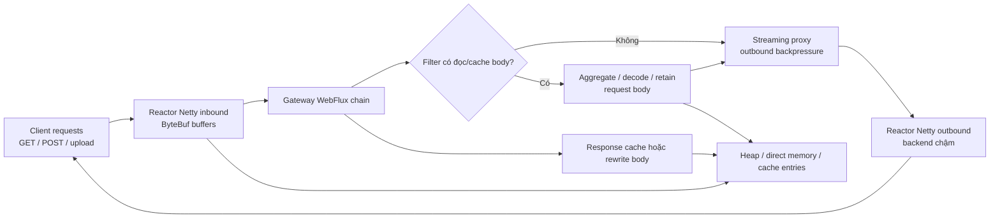

# Giới hạn codec, direct memory và số body đang được lưu

## 1. Bài toán hiệu năng: vì sao Gateway có thể hết bộ nhớ dù CPU còn rảnh?

**SPRING_CLOUD_GATEWAY** là điểm vào của nhiều microservices: nhận request, chọn tuyến bằng route predicate, thực thi filter chain, biến đổi đường dẫn/header rồi proxy tới backend thông qua HTTP(S) hoặc service discovery. Trên tuyến đường đó, Gateway còn xử lý xác thực, rate limiting, circuit breaker, retry, TLS và quan sát lưu lượng. Ở tải lớn, **dữ liệu đang nằm trong bộ nhớ** thường là nút thắt trước cả CPU.

Hãy tưởng tượng Gateway nhận một luồng POST với body 1 MiB; mỗi request cần 2 giây vì backend chậm. Một filter đọc body để kiểm tra JSON, một filter khác cache body để retry. Số request đang chờ có thể tăng mạnh. JVM heap không nhất thiết đầy ngay; ngược lại, Netty direct memory hoặc RSS của container có thể tăng trước khi log xuất hiện `java.lang.OutOfMemoryError: Direct buffer memory`.



**Mục tiêu bài học** trong chương **Hiệu năng** là phân biệt ba câu hỏi dễ bị nhập nhằng:

1. **Codec giữ tối đa bao nhiêu byte khi giải mã/tập hợp dữ liệu?** Liên quan `maxInMemorySize`, `DataBufferLimitException`.
2. **Netty và `DataBuffer` dùng bao nhiêu native/direct memory?** Liên quan `ByteBuf`, reference counting, allocator pool và vòng đời release.
3. **Có bao nhiêu body đang được cache/giữ đồng thời?** Liên quan `CacheRequestBody`, `Retry`, `ModifyRequestBody`, response modification/cache, concurrency, thời gian backend và áp lực tải.

Ba câu hỏi liên quan nhưng **không dùng chung một núm vặn**. Tăng `-Xmx` có thể không cứu một ứng dụng sắp cạn direct memory; tăng `max-in-memory-size` có thể khiến nhiều body lớn được giữ hơn; bật retry với POST lớn có thể tăng mức chiếm bộ nhớ ngay cả khi codec limit không đổi.

### Kết quả cần đạt

Sau bài này, bạn có thể:

- Nhận diện `DataBufferLimitException`, `OutOfMemoryError: Direct buffer memory`, lỗi do pool/cache body và áp lực RSS/container mà không quy chúng thành cùng một lỗi.
- Dùng **Spring Boot 3.5 WebFlux codec property** `spring.http.codecs.max-in-memory-size` đúng phạm vi; không coi nó là request-size firewall.
- Dùng `RequestSize` để giới hạn request theo hành vi phiên bản, đồng thời **kiểm thử chunked transfer / không có `Content-Length`**.
- Biết lúc nào `CacheRequestBody`, `ModifyRequestBody`, `ModifyResponseBody`, `Retry` và `LocalResponseCache` tạo ra dữ liệu được giữ lại.
- Ước lượng bộ nhớ giữ bởi body theo **kích thước × số request đồng thời × số bản sao**, có tính thêm allocator/heap/native overhead.
- Quản lý `DataBuffer` với `DataBufferUtils.join(source, maxByteCount)` và `DataBufferUtils.release`, không tạo leak/double release.
- Quan sát heap, RSS, direct allocator gauges, concurrent requests, body size, latency và OOM ở mức JVM/Pod.
- Thiết lập baseline, chạy thử tải nhỏ có kiểm soát, đánh giá tối ưu theo route và xác minh không làm suy yếu JWT/rate limit/TLS.

> **Phạm vi phiên bản:** Spring Cloud Gateway **Server WebFlux 4.3.x**, Spring Cloud **2025.0.x**, Spring Boot **3.5.x**, Spring Framework **6.2.x**, Reactor Netty và JDK 17+. Bài sử dụng namespace `spring.cloud.gateway.server.webflux` và `spring.http.codecs.max-in-memory-size` tương ứng hệ phiên bản này. Gateway **Server Web MVC** có Servlet/runtime và cơ chế buffering khác; không chép nguyên các tuning keys dưới đây sang MVC. Mọi thông số dung lượng trong ví dụ đều là **mức thử nghiệm**, không phải giá trị tối ưu phổ quát.

## 2. Bốn lớp bộ nhớ và ba ranh giới giới hạn

Một Gateway WebFlux không chỉ có JVM heap.

| Vùng / thực thể | Thường chứa gì? | Quan sát bằng gì? | Cần tránh điều gì? |
| --- | --- | --- | --- |
| **JVM heap** | Java objects, JSON/string đã decode, metadata, collections, một phần cache, heap buffers. | `jvm.memory.used`, GC, heap histogram/dump. | `Java heap space`, GC pause, giữ body `String`/`byte[]` lâu. |
| **Direct/native ByteBuf** | Netty pooled direct buffers cho network I/O; `NettyDataBuffer` có thể tham chiếu ByteBuf. | `reactor.netty.bytebuf.allocator.used.direct.memory`, Netty allocator diagnostics, RSS. | Không release, giữ buffer qua request lifecycle, allocator fragmentation/arena growth. |
| **Các vùng native khác** | Metaspace, thread stacks, code cache, TLS/native libraries, mmap và bộ nhớ runtime khác. | RSS/cgroup, `jcmd`, NMT khi bật; metrics OS. | Giả định `RSS == Xmx + direct` hoặc chỉ nhìn heap đã đủ. |
| **Bộ nhớ giữ ở tầng ứng dụng** | Request body cache trong exchange, response cache Caffeine, retry buffers, logging/inspection copies. | Counters/in-flight gauges do app bổ sung, cache size, heap/direct metrics. | Body sống qua nhiều subscription hoặc nhiều request; giữ cache vượt ngân sách. |

**Số liệu không được cộng mù:** `used.direct.memory` phản ánh bộ nhớ **Netty allocator giữ/reserve**, không nhất thiết chính xác bằng tổng bytes nội dung body còn sống. Một ByteBuf có thể là slice/reference của vùng lớn hơn; pooled arenas có thể giữ capacity sau khi request kết thúc để tái sử dụng. Cần xem **xu hướng dưới tải ổn định và sau khi tải hạ xuống**, không chỉ một snapshot.

### 2.1. Ba loại giới hạn dễ nhầm

| Loại | Ví dụ | Chặn vấn đề gì? | Không đảm bảo |
| --- | --- | --- | --- |
| **Codec aggregation limit** | `spring.http.codecs.max-in-memory-size: 512KB` | Một số decoder/reader không buffer quá ngưỡng khi cần tổng hợp. | Không phải giới hạn toàn bộ upload qua Gateway hoặc mọi custom `DataBufferUtils.join`. |
| **Request body size policy** | `RequestSize` với `maxSize: 1MB` | Từ chối request vượt chính sách kích thước theo cách filter hiện hành kiểm tra. | Không mặc nhiên chặn mọi request chunked/HTTP/2 thiếu `Content-Length`; phải test. |
| **JVM/container/direct memory budget** | `-Xmx`, `-XX:MaxDirectMemorySize`, Kubernetes memory limit. | Đặt ranh giới tài nguyên process/container. | Không tự giảm số request đồng thời hoặc dọn `DataBuffer` bị retain sai. |

**Thứ tự suy luận đúng:** đầu tiên xác định **thành phần nào đang giữ body**, tiếp theo chọn **giới hạn tương ứng**, sau cùng kiểm thử với nhiều request đồng thời và đo RSS/heap/direct memory. Không áp dụng cách “hết bộ nhớ thì tăng mọi limit” vì có thể chuyển lỗi sớm, có kiểm soát thành OOM khó phục hồi.

### 2.2. Streaming bình thường không đồng nghĩa body được giữ toàn bộ

Đường proxy bình thường trong Gateway Server WebFlux có thể chuyển tiếp `Flux<DataBuffer>` theo cơ chế reactive/network backpressure. Không phải mọi request upload 50 MiB đều bị biến thành một `byte[50MiB]` trên heap.

Nhưng streaming **không bảo đảm dùng bộ nhớ hằng số trong mọi trường hợp**:

- Socket buffers và allocator pools vẫn có footprint.
- Client nhanh hơn downstream tạo **queueing pressure**.
- Filter đọc JSON, ghi log body hoặc rewrite body có thể **aggregate**.
- Retry với method có body có thể cache để **replay**.
- Response cache giữ dữ liệu giữa các requests.
- Một custom filter dùng `collectList()`/`join()` không giới hạn có thể vô hiệu hóa ưu điểm streaming.
- Backpressure có thể bị phá nếu code tự `subscribe()`, `onBackpressureBuffer()` không giới hạn hoặc chuyển công việc blocking sang event loop.

## 3. Đọc dấu hiệu: codec limit, direct memory và container OOM

### 3.1. `DataBufferLimitException`

Lỗi thường gặp:

```text
org.springframework.core.io.buffer.DataBufferLimitException:
Exceeded limit on max bytes to buffer : 262144
```

`262144` bytes = 256 KiB. Theo tài liệu Spring Framework, nhiều codec mặc định giới hạn tổng lượng buffered data khoảng **256 KiB**. Exception có thể phát sinh khi các `DataBuffer` được gom thành một body, **hoặc** lúc parser JSON/SSE tích lũy biểu diễn đã decode. <https://docs.spring.io/spring-framework/reference/web/webflux-webclient/client-builder.html>

Trình tự chẩn đoán:

1. Xác định stack trace nằm ở **inbound decoder**, `CacheRequestBody`, `ModifyRequestBody`, custom `DataBufferUtils.join` hay `WebClient` của filter.
2. Đọc **kích thước input thật** và content type. Body 300 KiB có thể fail ở codec limit 256 KiB **nếu** đường code decode/tổng hợp body; cùng body đó có thể đi qua proxy streaming mà không fail.
3. Kiểm tra property đúng cho **Spring Boot 3.5** và đoạn code tự tạo `WebClient`/codec riêng.
4. Điều chỉnh ở **đúng nơi decode** và đặt request-size/admission control riêng.
5. Test cả request hợp lệ sát ngưỡng và request vượt ngưỡng; xác nhận HTTP status/khả năng phục hồi.

`DataBufferLimitException` **không đồng nghĩa JVM hết RAM**. Nó thường là cơ chế guard ngăn một hoạt động aggregation vượt giới hạn cấu hình.

### 3.2. `OutOfMemoryError: Direct buffer memory`

Ví dụ:

```text
java.lang.OutOfMemoryError: Direct buffer memory
```

Lỗi này liên quan giới hạn hoặc áp lực **direct/native allocation**. Tìm nguyên nhân như:

- Nhiều `ByteBuf` được giữ từ `CacheRequestBody`, retry hoặc custom filter.
- `DataBufferUtils.retain(...)` mà không có ownership/release tương ứng.
- Netty pooled allocator đang nắm nhiều arenas/caches.
- Số request in-flight, kết nối hoặc response streams tăng nhanh.
- Container native budget thấp so với heap/direct và phần native còn lại.

**Không kết luận cứ thấy direct OOM là chắc chắn có memory leak.** Dưới tải đột biến, hoạt động bình thường nhưng body concurrency cao vẫn có thể làm cạn ngân sách. Ngược lại, tăng `-XX:MaxDirectMemorySize` có thể che một leak hoặc đẩy Pod vào cgroup OOM.

### 3.3. Pod `OOMKilled` hoặc RSS cao nhưng heap bình thường

Kubernetes có thể kill container khi memory usage vượt giới hạn, bất kể `-Xmx` chưa đạt. Thêm các yếu tố:

- Direct buffer pool,
- Metaspace / code cache / thread stacks,
- TLS/compression native memory,
- File/page cache hoặc mapped buffers tùy môi trường,
- Các phần heap đã committed nhưng hiện không dùng.

Lệnh đọc trạng thái (ví dụ vận hành, **không phải bước worker chạy**):

```bash
kubectl describe pod gateway-pod
kubectl top pod gateway-pod
```

Với JVM trên máy được phép điều tra:

```bash
jcmd <PID> VM.flags
jcmd <PID> GC.heap_info
jcmd <PID> VM.native_memory summary
```

`VM.native_memory` cần **Native Memory Tracking (NMT) bật từ startup** và chỉ phản ánh những vùng mà HotSpot theo dõi; không được coi là báo cáo chính xác tuyệt đối của mọi native allocation/Netty ByteBuf. Việc bật NMT có overhead; chỉ dùng theo runbook và chính sách vận hành.

## 4. Giới hạn codec đúng cho Spring Boot 3.5

### 4.1. Property cần dùng: `spring.http.codecs.max-in-memory-size`

Với Spring Boot **3.5**, danh sách Common Application Properties định nghĩa:

```yaml
spring:
  http:
    codecs:
      max-in-memory-size: 512KB
```

Property này điều chỉnh **số bytes tối đa được buffer khi input stream cần được tổng hợp** trên **auto-configured WebFlux server và WebClient instances**. Nếu không khai báo, defaults của từng codec sẽ được áp dụng; **nhiều codec mặc định khoảng 256 KiB**. <https://docs.spring.io/spring-boot/3.5/appendix/application-properties/>

**Cảnh báo tương thích:** nhiều bài blog cũ dùng `spring.codec.max-in-memory-size`. Đó là namespace của các nhánh Spring Boot trước; **không copy sang Boot 3.5 rồi mặc định nó đang tác dụng**. Hãy kiểm tra properties của phiên bản thực, binding report và integration test với body quanh ngưỡng.

**Những điều property này KHÔNG làm:**

- Không phải **HTTP request total-size limit**.
- Không tự giới hạn **số body cached đồng thời**.
- Không đặt `-XX:MaxDirectMemorySize` hoặc cấu hình Netty allocator.
- Không áp dụng cho mọi `DataBufferUtils.join(source)` tự viết **không có maxByteCount**.
- Không chắc chắn thay đổi `WebClient` được tự xây với `ExchangeStrategies` riêng.
- Không tự làm sạch một body đã bị giữ trong exchange attributes qua nhiều asynchronous operations.
- Không tự biến mọi lỗi vượt ngưỡng thành HTTP 413; response mapping là chính sách riêng.

### 4.2. Nếu cần cấu hình codec thủ công

Khi không sử dụng codec auto-configuration mặc định, Spring WebFlux cung cấp `ServerCodecConfigurer`:

```java
import org.springframework.context.annotation.Configuration;
import org.springframework.http.codec.ServerCodecConfigurer;
import org.springframework.web.reactive.config.WebFluxConfigurer;

@Configuration
public class WebFluxCodecConfiguration implements WebFluxConfigurer {

    @Override
    public void configureHttpMessageCodecs(
            ServerCodecConfigurer configurer) {

        configurer.defaultCodecs()
                .maxInMemorySize(512 * 1024);
    }
}
```

Đây là **phương án thay thế/tuỳ biến cho WebFlux codecs**. Không cần thêm class này nếu `spring.http.codecs.max-in-memory-size` đã đáp ứng yêu cầu. Khi tự cấu hình nhiều nơi, cần xác định precedence và tránh tưởng một property sẽ sửa mọi HTTP codec trong hệ thống.

Nếu custom filter dùng một `WebClient` riêng:

```java
WebClient webClient = WebClient.builder()
        .codecs(configurer -> configurer.defaultCodecs()
                .maxInMemorySize(512 * 1024))
        .build();
```

`WebClient` ở ví dụ trên tự thiết lập codec limit cho chính nó. **Gateway Reactor Netty routing client không đơn giản là một `WebClient` tự tạo**, vì vậy không coi việc chỉnh bean WebClient bất kỳ là đã thay toàn bộ Gateway Netty proxy behavior.

### 4.3. Tham số `maxInMemorySize` có nghĩa theo từng codec

Với JSON, decoder có thể buffer payload hoặc tạo objects/strings từ body. Với SSE có thể tích lũy bytes cho một event; với text/line decoder có thể buffer đến delimiter. Đừng tự kết luận codec sẽ luôn buffer **toàn bộ TCP stream** hoặc rằng 512 KiB tương ứng luôn một HTTP message.

Để chọn mức hợp lý:

1. Đo **phân bố body** của đúng route/Content-Type, ví dụ P50/P95/P99 và maximum được chấp thuận.
2. Xác định đường xử lý có cần decode không. Một route chỉ proxy video/file có thể không cần decode ở Gateway.
3. Dùng **ngưỡng thấp vừa đủ** cho business payload phổ biến, không mở 50–100 MiB trên mọi route để tránh một request đặc biệt fail.
4. Với upload lớn, dùng streaming hoặc object-store upload có giới hạn riêng; không biến Gateway thành công cụ lưu/parse mọi bytes.
5. Kiểm thử cú pháp property bằng Actuator config/binding và test body ở hai phía ngưỡng; không chỉ nhìn startup log.

### 4.4. Multipart có ngưỡng khác, đừng nhầm

Spring Boot 3.5 còn có các property khác cho **WebFlux multipart**, ví dụ:

```yaml
spring:
  webflux:
    multipart:
      max-in-memory-size: 256KB
      max-disk-usage-per-part: 20MB
      max-headers-size: 10KB
```

Đây là những **giới hạn cho multipart parsing/part storage**, khác với `spring.http.codecs.max-in-memory-size` và khác với `RequestSize` của Gateway. `max-in-memory-size` cho multipart thường quyết định khi nào part phải được ghi xuống disk; **không phải giới hạn tổng upload**. Ngay cả khi chuyển từ RAM sang disk, cần giới hạn disk quota, số parts, thời gian upload và cleanup temp files. Nếu Gateway không parse multipart mà proxy streaming, các property multipart parser không tự biến thành network body firewall.

## 5. Đếm số body được giữ: công thức giúp tránh cấu hình theo cảm tính

Một giới hạn **trên từng body** không bảo đảm tổng lượng dữ liệu đang được giữ dưới ngưỡng. Đặt:

- `B`: kích thước trung bình một body được cache/aggregate (bytes).
- `N`: số request đồng thời **đang giữ body đó**, không phải tổng TCP connections.
- `K`: số bản sao hoặc cách biểu diễn vật lý cùng tồn tại (raw buffers, `String`, `byte[]`, decoded objects...), đo hoặc ước lượng có điều kiện.
- `H`: overhead allocator/objects/metadata và những buffers khác.

Một xấp xỉ để lập ngân sách:

```text
M_retained_body ≈ B × N × K + H
```

Đây **không phải** một định luật chính xác của Netty; zero-copy, pooled buffers và object decoding làm hệ số `K` thay đổi. Nhưng nó chỉ ra tại sao **body size × concurrency** là một biến cần giám sát.

### 5.1. Ví dụ số học

Giả sử hệ thống nhận khoảng **400 requests/giây** đến một route, và mỗi request giữ body trong **2 giây** do chờ backend. Theo trực giác Little's Law, số request trung bình đang chờ có thể khoảng:

```text
N ≈ 400 requests/s × 2 s = 800 requests
```

Nếu mỗi request giữ **1 MiB**, chỉ **một bản body** đã khoảng:

```text
800 × 1 MiB ≈ 800 MiB
```

Nếu một số route vừa giữ raw bytes vừa tạo decoded String/DTO, footprint thực có thể cao hơn. Nếu backend chậm gấp đôi thành 4 giây mà arrival rate không giảm, số request đang giữ body có thể tăng tương ứng. Đây là lý do **timeout, concurrency limit, rate limiting và body caching policy** phải được nhìn cùng nhau.

**Đừng sử dụng `N ≈ λW` như dự báo chính xác khi hệ thống đang quá tải, có burst, queue không ổn định hoặc nhiều loại requests.** Hãy dùng nó như một baseline, rồi đo số requests thật đang giữ body và quan sát phân bố P95/P99.

### 5.2. Giữa in-flight request và retained body có khác biệt

Một Gateway có thể có 5.000 client connections nhưng chỉ 100 requests đang cache body. Ngược lại, một response cache Caffeine có thể giữ **hàng trăm entries sau khi request đã hoàn tất**. Vì vậy:

| Chỉ số | Ý nghĩa | Có tương đương body count không? |
| --- | --- | --- |
| Active TCP connections | Số kênh HTTP/TCP đang mở. | **Không.** Keep-alive có thể idle. |
| In-flight HTTP requests | Requests chưa hoàn tất. | Không hẳn; nhiều request proxy streaming. |
| Body aggregation in progress | Requests đang decode/join body. | Gần với số body tạm được giữ. |
| Cached request bodies | Requests có `CACHED_REQUEST_BODY_ATTR` hoặc cache tương đương. | Cần đo trong từng filter, tránh đếm trùng. |
| Retry attempts | Số HTTP downstream calls (có thể nhiều lần/request). | Không nhất thiết là số bản copy body. |
| Local response cache entries | Responses đã lưu giữa các requests. | Một loại retention **khác** in-flight request body. |

### 5.3. Nên chọn baseline theo phân bố, không dùng "average" một mình

Có thể chia body-size classes:

| Loại body (ví dụ) | Dung lượng giả định | Quy trình gợi ý |
| --- | --- | --- |
| JSON auth/context | 1–32 KiB | Có thể decode, limit nhỏ, tối ưu latency. |
| API JSON nghiệp vụ | 32–512 KiB | Kiểm tra codec/response-body rewrite, chọn cap theo hợp đồng. |
| 1–5 MiB body | Mức trung bình–lớn | Tránh cache tùy tiện, hạn chế concurrency, retry có chọn lọc. |
| File/video hàng chục MiB+ | Lớn | Ưu tiên streaming hoặc direct-to-object-storage, hạn chế buffering. |

Đây là **phân loại minh họa**, không phải ngưỡng được Spring Cloud Gateway tự áp dụng. Phải căn cứ traffic thật và chính sách API được phê duyệt.

## 6. Những bộ lọc nào khiến Gateway giữ body trong bộ nhớ?

### 6.1. `CacheRequestBody`: cố ý đọc và cache request body

Theo [tài liệu Gateway Server WebFlux 4.3](https://docs.spring.io/spring-cloud-gateway/reference/4.3/spring-cloud-gateway-server-webflux/gatewayfilter-factories/cacherequestbody-factory.html), request body có thể chỉ đọc một lần; nếu filter cần đọc body mà downstream vẫn cần đọc, phải **cache**. `CacheRequestBody` đọc/chuyển đổi body theo `bodyClass`, rồi đặt trong exchange attributes với key `ServerWebExchangeUtils.CACHED_REQUEST_BODY_ATTR`.

Ví dụ một **route cần đọc String body**:

```yaml
spring:
  cloud:
    gateway:
      server:
        webflux:
          routes:
            - id: inspected_post
              uri: http://127.0.0.1:9001
              predicates:
                - Path=/inspect/**
                - Method=POST
              filters:
                - StripPrefix=1
                - name: CacheRequestBody
                  args:
                    bodyClass: java.lang.String
```

Điều này không tương đương một route proxy raw request: một decoder và bản biểu diễn `String` có thể được tạo, body được giữ qua nhiều phần của chain.

**Quy tắc:** chỉ thêm `CacheRequestBody` khi thực sự cần đọc lại nội dung. Đừng bật trên mọi route tải file/video hay dùng để ghi toàn bộ request body vào log. Body có thể chứa access token, PII và thông tin thanh toán. `CACHED_REQUEST_BODY_ATTR` là **exchange-scoped**, không phải một cache toàn cục có TTL, nhưng nó vẫn tồn tại trong thời gian xử lý request; nếu upstream chậm, lifetime dài ra.

**Đừng giả định** nội dung attr luôn có kiểu `String` trên tất cả code paths: `CacheRequestBody` có thể chuyển đổi sang `bodyClass` được chọn, trong khi cơ chế **retry/replay** hoặc custom request caching có thể dùng chính key attr nhưng lưu `DataBuffer`. Đọc/ép kiểu phải dựa trên filter và phiên bản cụ thể. Không cố release một `String`; cũng không tự release một `DataBuffer` mà bạn **không sở hữu**.

### 6.2. `ModifyRequestBody` và `ModifyResponseBody`

Khi Gateway biến đổi JSON/body, nội dung có thể được **decode thành object** rồi encode lại. Trên Gateway Server WebFlux 4.3, `ModifyRequestBody` được cấu hình qua **Java DSL**, ví dụ một route nhỏ cần chỉnh JSON:

```java
@Bean
RouteLocator normalizeRoutes(RouteLocatorBuilder builder) {
    return builder.routes()
        .route("normalize_route", r -> r.path("/normalize/**")
            .filters(f -> f.stripPrefix(1)
                .modifyRequestBody(
                    String.class,
                    String.class,
                    MediaType.TEXT_PLAIN_VALUE,
                    (exchange, body) ->
                        Mono.justOrEmpty(body)
                            .map(String::trim)))
            .uri("http://127.0.0.1:9001"))
        .build();
}
```

Ví dụ giả định class đã có imports `@Bean`, `RouteLocator`, `RouteLocatorBuilder`, `MediaType`, `Mono`. Đây là **code minh họa filter body transformation**, không phải bước tối ưu mặc định. Để bảo đảm không làm sai `Content-Type`, body rỗng, kích thước và `Content-Length`, cần integration test qua backend thật.

Khi dùng body rewrite, có thể có nhiều biểu diễn cùng tồn tại trong thời gian ngắn:

```text
Inbound DataBuffer
    |
    +--> decode String/DTO
             |
             +--> tạo String/DTO mới
                        |
                        +--> encode outbound DataBuffer
```

Không suy rằng `max-in-memory-size: 512KB` luôn có nghĩa **tổng heap/direct chỉ 512 KiB/request**. Codec cap là ranh giới của **một hoạt động aggregation**, không phải tổng tất cả allocations.

### 6.3. `Retry` với method có body

Tài liệu Gateway 4.3 cảnh báo rõ: khi `Retry` được dùng cho HTTP method có body, Gateway có thể **cache body** để phát lại và làm hệ thống **memory-constrained**; dữ liệu replay liên quan `CACHED_REQUEST_BODY_ATTR` và `DataBuffer`. <https://docs.spring.io/spring-cloud-gateway/reference/4.3/spring-cloud-gateway-server-webflux/gatewayfilter-factories/retry-factory.html>

Một cấu hình thận trọng cho route đọc dữ liệu có thể chỉ retry `GET`:

```yaml
spring:
  cloud:
    gateway:
      server:
        webflux:
          routes:
            - id: safe_get_retry
              uri: http://127.0.0.1:9001
              predicates:
                - Path=/read/**
                - Method=GET
              filters:
                - StripPrefix=1
                - name: Retry
                  args:
                    retries: 2
                    methods: GET
                    statuses: BAD_GATEWAY,SERVICE_UNAVAILABLE
                    backoff:
                      firstBackoff: 50ms
                      maxBackoff: 200ms
                      factor: 2
                      basedOnPreviousValue: false
```

**Không coi GET retry là miễn phí:** nó vẫn giữ request đang xử lý lâu hơn, chiếm connection/time budget và nhân số outbound attempts. Với `POST`/`PUT`/`PATCH` có body, phải có lý do rõ ràng về **idempotency**, giới hạn payload và ngân sách bộ nhớ. Một retry sai có thể **vừa nhân tải backend vừa giữ cached body lâu hơn**.

Filter `Retry` còn có thể retry **những filters phía sau nó**. Nếu filter phía sau có side effect hoặc giữ body, phải kiểm tra thứ tự, replay behavior và lifecycle.

### 6.4. `LocalResponseCache`: khác request-body cache

`LocalResponseCache` giữ **response** giữa các requests, thường qua Caffeine khi được bật. Đây là **retention ngoài vòng đời một request**: dù in-flight request count về 0, cache entries vẫn có thể chiếm bộ nhớ.

Theo docs WebFlux, cache chủ yếu áp dụng các **GET không có request body**, status được phép như 200/206/301 và tôn trọng `Cache-Control` phù hợp. Giới hạn kích thước/TTL và điều kiện cache tùy Gateway version. Không dùng nó để cache response `private`, `no-store` hoặc dữ liệu tenant/user mà cache key không phân vùng đúng.

Một dashboard phải tách:

```text
M_active_request_body   = payload đang giữ bởi exchanges
M_local_response_cache  = các response cache entries còn sống
M_codec_decode          = allocations tạm khi parsing/encoding
M_netty_allocator       = pool/direct buffers được allocator giữ
```

**Không cộng các giá trị như những nhóm bytes chắc chắn hoàn toàn độc lập**: có thể có buffers tham chiếu chung, heaps/chunks khác nhau và allocator pools. Dùng cách phân loại để đặt câu hỏi đúng, sau đó xác nhận với profiler/metrics.

### 6.5. Body logging và custom inspection

Anti-pattern rất dễ xuất hiện trong `GlobalFilter`:

```java
// KHÔNG LÀM: đọc toàn bộ raw body để ghi log.
return DataBufferUtils.join(exchange.getRequest().getBody())
        .doOnNext(buffer -> log.info(
                "request body size={}, body={}",
                buffer.readableByteCount(),
                buffer.toString(StandardCharsets.UTF_8)))
        .then(chain.filter(exchange));
```

Đoạn trên có nhiều vấn đề:

- **`join()` không giới hạn** và có thể giữ body lớn.
- Không xử lý rõ quyền sở hữu/`release` của buffer tổng.
- Đã **consume request body**; downstream có thể không còn dữ liệu để đọc.
- Ghi toàn bộ body làm lộ mật khẩu, token, cookie, PII, nội dung nhạy cảm.
- Reactor operator `.then(chain.filter(exchange))` không tự biến body đã đọc thành publisher có thể replay.
- Log I/O có thể chặn event loop hoặc tăng heap khi format dữ liệu lớn.

Đây là **mẫu sai để phân tích**, không phải code production. Với observability, ưu tiên log route ID, method, status, time, **kích thước/đặc tính đã làm tròn hoặc được phép**, trace ID đã validate; không log raw body.

## 7. `DataBuffer`, Netty `ByteBuf` và ownership của bộ nhớ

### 7.1. `DataBuffer` không luôn là một mảng byte Java

WebFlux cung cấp abstraction `DataBuffer`; khi dùng Reactor Netty, implementation thường có liên hệ đến Netty `ByteBuf` và pooled direct memory. Các `ByteBuf` có thể dùng **reference counting**.

```text
Netty pooled direct memory
        |
        v
  ByteBuf (refCount)
        |
        v
  NettyDataBuffer
        |
        +--> gateway route filter
        +--> decoder / body cache / request decorator
        +--> outbound write
```

Khi một filter chủ động giữ buffer lâu hơn subscriber gốc, phải biết **ai sở hữu reference** và **khi nào release**. Dùng `DataBufferUtils.retain` chỉ khi thật sự cần tăng reference ownership, kèm `DataBufferUtils.release` tương ứng sau khi xong. Không retain vô điều kiện và không release trước khi downstream đọc xong.

### 7.2. `DataBufferUtils.join(..., maxByteCount)` giới hạn một lần tổng hợp

Spring Framework cung cấp:

```java
Mono<DataBuffer> join(
        Publisher<? extends DataBuffer> buffers,
        int maxByteCount)
```

Khi một stream cần tổng hợp và vượt `maxByteCount`, operator có thể phát `DataBufferLimitException`. Đối với các publisher nhiều `DataBuffer`, implementation quản lý việc giải phóng accumulated buffers khi xảy ra lỗi hoặc cancellation theo hợp đồng Spring Framework. **Nếu join thành công, bên tiêu thụ kết quả phải giải phóng buffer tổng sau khi đã xử lý xong**, trừ khi ownership đã được chuyển tiếp cho một API khác nhận trách nhiệm. <https://docs.spring.io/spring-framework/docs/6.2.11/javadoc-api/org/springframework/core/io/buffer/DataBufferUtils.html>

Ví dụ một **diagnostic endpoint chỉ đếm bytes**, không proxy body đi tiếp:

```java
package com.example.gateway;

import org.springframework.core.io.buffer.DataBuffer;
import org.springframework.core.io.buffer.DataBufferLimitException;
import org.springframework.core.io.buffer.DataBufferUtils;
import org.springframework.http.HttpStatus;
import org.springframework.http.ResponseEntity;
import org.springframework.http.server.reactive.ServerHttpRequest;
import org.springframework.web.bind.annotation.PostMapping;
import org.springframework.web.bind.annotation.RestController;
import reactor.core.publisher.Mono;

@RestController
public class BoundedBodyLabController {

    private static final int CAP_BYTES = 128 * 1024;

    @PostMapping("/lab/bounded")
    public Mono<ResponseEntity<String>> countBytes(
            ServerHttpRequest request) {

        return DataBufferUtils.join(request.getBody(), CAP_BYTES)
                .map(buffer -> {
                    try {
                        int bytes = buffer.readableByteCount();
                        return ResponseEntity.ok("bytes=" + bytes);
                    } finally {
                        // Thành công: trả lại quyền sở hữu buffer tổng.
                        DataBufferUtils.release(buffer);
                    }
                })
                .switchIfEmpty(Mono.just(
                        ResponseEntity.ok("bytes=0")))
                .onErrorResume(
                        DataBufferLimitException.class,
                        error -> Mono.just(
                                ResponseEntity
                                        .status(HttpStatus.PAYLOAD_TOO_LARGE)
                                        .body("body exceeds lab cap")));
    }
}
```

**Mục đích ví dụ:** cho thấy cách dùng **bounded join** và release tại nơi nhận `DataBuffer`. Endpoint không forward body tới backend nên không cần cơ chế cache/replay. Trên hệ thống thật, nếu muốn đọc body rồi proxy tiếp, phải dùng một cơ chế body caching/decorator được thiết kế đúng ownership và retry/commit/cancellation semantics, **không** copy method này vào GlobalFilter rồi mong downstream vẫn đọc body bình thường.

**Lưu ý triển khai:** chọn `CAP_BYTES` từ API contract, không dùng giá trị mặc định vô hạn (`-1`). Nếu nguồn là `Mono<DataBuffer>` đã được tạo/tổng hợp bởi một thành phần khác, cần kiểm tra semantics của đúng overload/phiên bản; không xem bounded join là **lá chắn HTTP upload toàn hệ thống**. Thử bằng WebTestClient với bodies gần/ngay trên ngưỡng và chunked transfer.

### 7.3. Vì sao cần release trong `finally`?

Một buffer thành công có thể được tạo bởi composite/zero-copy join, và giải phóng composite có thể giải phóng các references thành phần. Nếu logic giữa chừng throw exception sau khi nhận buffer, `finally` bảo đảm nó được release.

Ngược lại, đoạn:

```java
return DataBufferUtils.join(source, maxBytes)
        .map(buffer -> {
            String body = buffer.toString(StandardCharsets.UTF_8);
            return transform(body);
        });
```

không có release rõ ràng cho buffer join thành công. Khi code đó nằm trong một đường đi nhiều request và buffer pooled, có thể gây tăng direct memory/leak. **Không tùy ý gọi release ở cả `doFinally` và `finally` cho cùng buffer** vì double release cũng gây hỏng reference count.

### 7.4. Một phần xử lý streaming không cần join

Nếu chỉ cần tính **số bytes** rồi vẫn chuyển tiếp body, một request decorator có thể quan sát `DataBuffer.readableByteCount()` của từng chunk trong pipeline, **không ghép toàn bộ stream**. Nhưng việc hiện thực production-grade phải tính đến:

- Chỉ có một subscriber hợp lệ đọc request body?
- Có giữ buffers để dùng lại không? Nếu có, ai retain/release?
- Khi vượt ngưỡng giữa stream, phía outbound đã gửi một số bytes chưa? Response có thể đã commit?
- Cancel/error có dọn các buffers đang xếp hàng không?
- Filter order so với cache/retry/HTTP routing đã đúng chưa?
- HTTP/2 streams/chunked uploads có bị limit thực theo số bytes nhận không?

Vì giới hạn body theo stream có thể can thiệp network flow và HTTP status khi đã commit, **không đưa một custom request decorator vài dòng lên production mà chưa test tích hợp**. Tốt hơn là kết hợp chính sách ingress/server HTTP body limits với Gateway filters, **kiểm thử both Content-Length và không Content-Length**.

## 8. `RequestSize` là chính sách body-size, không phải codec limit

Tài liệu **Gateway Server WebFlux 4.3** mô tả `RequestSize` với `maxSize` kiểu `DataSize`; request vượt ngưỡng bị trả **413 Payload Too Large** với header `errorMessage` trong những tình huống filter nhận diện vượt ngưỡng.

Ví dụ:

```yaml
spring:
  cloud:
    gateway:
      server:
        webflux:
          routes:
            - id: limited_upload
              uri: http://127.0.0.1:9001
              predicates:
                - Path=/limit/**
                - Method=POST
              filters:
                - StripPrefix=1
                - name: RequestSize
                  args:
                    maxSize: 512KB
```

Nếu HTTP request có `Content-Length` vượt `512KB`, filter có thể từ chối **trước khi proxy**. Tuy nhiên, đây là chỗ cần đặc biệt thận trọng:

**Cảnh báo theo vấn đề Gateway được báo cáo năm 2025:** `RequestSize` ở một số phiên bản kiểm tra dựa trên **header `Content-Length`**; nếu client gửi **chunked body hoặc HTTP/2 stream không biết trước Content-Length**, chỉ dùng filter này có thể **không chặn đủ bytes thực tế**. Đã có [issue #3843 của spring-cloud-gateway](https://github.com/spring-cloud/spring-cloud-gateway/issues/3843) về hạn chế này. Hãy kiểm tra behavior của đúng bản vá bạn triển khai; không dựa vào một successful test với Content-Length để tuyên bố đã chống body-size DoS.

Một policy upload nghiêm túc nên có nhiều lớp:

1. **Ingress/WAF/reverse proxy** có request-body-size limit thực và timeout trên streaming body.
2. **Gateway** có route-specific size policy và/hoặc streaming byte counter được test đúng phiên bản.
3. **Backend** có giới hạn parser/body riêng; không trông chờ Gateway chặn mọi lối truy cập.
4. **Admission/concurrency limit** để ngăn nhiều uploads hợp lệ cùng tiêu tốn bộ nhớ/kết nối.
5. **Logging/metrics** ghi rejection counts theo route, không log body thực.

### 8.1. Phân biệt `RequestSize` với `DataBufferLimitException`

| Tình huống | Kết quả mong đợi |
| --- | --- |
| Client khai Content-Length 2 MiB; `RequestSize` max 512 KiB | Thường **413 trước backend**, theo behavior filter. |
| Client gửi streaming/chunked 2 MiB không Content-Length | **Không tự kết luận** bị chặn; phải test và có guard ở ingress. |
| Route không đọc body, proxy raw 300 KiB; codec cap 256 KiB | Có thể **vẫn đi qua**, vì không có decode/aggregate phù hợp. |
| Controller decode text 300 KiB; codec cap 256 KiB | Có thể phát `DataBufferLimitException`, status tùy error policy. |
| Custom `DataBufferUtils.join(source, 128 KiB)` | Vượt limit thì báo exception, ví dụ diagnostic controller map thành 413. |
| 1.000 body 100 KiB cùng được giữ, mỗi body dưới 512 KiB | Vẫn có nguy cơ **tổng bộ nhớ ~100 MiB trở lên**, cap per-body không giải quyết concurrency. |

Đó là lý do bài này nói **ba trục**: *kích thước đơn lẻ*, *cách body được xử lý/giữ*, *số body đang giữ*.

## 9. Lab có thể chạy: so sánh streaming, decode và body caching

Bài lab dùng **hai tiến trình** trên một máy cá nhân:

```text
                       127.0.0.1:8080                  127.0.0.1:9001
  curl ---- POST ------> Gateway Server WebFlux ------> EchoBackend
              |            |          |
              |            |          +--> /proxy/** : raw proxy
              |            +-------------> /cache/** : CacheRequestBody
              +--------------------------> /limit/** : RequestSize
                           |
                           +--> /lab/decode  : WebFlux text codec
                           +--> /lab/bounded : bounded DataBufferUtils.join
                           |
                       Actuator 127.0.0.1:8081
```

**Đây không phải cấu hình production.** EchoBackend không có authentication và các endpoint `/lab/**` cố ý đo body. Chỉ chạy trên máy cô lập, không expose Gateway/Actuator ra Internet. Không dùng dữ liệu thật có PII/token/credentials trong bài thực hành.

### 9.1. `pom.xml`

Yêu cầu JDK 17+, Maven và `curl`. Tạo một Maven project **mới của người học**, không chỉnh các build files trong repository chứa bài giảng:

```xml
<?xml version="1.0" encoding="UTF-8"?>
<project xmlns="http://maven.apache.org/POM/4.0.0"
         xmlns:xsi="http://www.w3.org/2001/XMLSchema-instance"
         xsi:schemaLocation="http://maven.apache.org/POM/4.0.0
                             https://maven.apache.org/xsd/maven-4.0.0.xsd">
    <modelVersion>4.0.0</modelVersion>

    <parent>
        <groupId>org.springframework.boot</groupId>
        <artifactId>spring-boot-starter-parent</artifactId>
        <version>3.5.0</version>
        <relativePath/>
    </parent>

    <groupId>com.example</groupId>
    <artifactId>gateway-memory-lab</artifactId>
    <version>0.0.1-SNAPSHOT</version>

    <properties>
        <java.version>17</java.version>
    </properties>

    <dependencyManagement>
        <dependencies>
            <dependency>
                <groupId>org.springframework.cloud</groupId>
                <artifactId>spring-cloud-dependencies</artifactId>
                <version>2025.0.0</version>
                <type>pom</type>
                <scope>import</scope>
            </dependency>
        </dependencies>
    </dependencyManagement>

    <dependencies>
        <dependency>
            <groupId>org.springframework.cloud</groupId>
            <artifactId>spring-cloud-starter-gateway-server-webflux</artifactId>
        </dependency>

        <dependency>
            <groupId>org.springframework.boot</groupId>
            <artifactId>spring-boot-starter-actuator</artifactId>
        </dependency>

        <dependency>
            <groupId>org.springframework.boot</groupId>
            <artifactId>spring-boot-starter-test</artifactId>
            <scope>test</scope>
        </dependency>

        <dependency>
            <groupId>io.projectreactor</groupId>
            <artifactId>reactor-test</artifactId>
            <scope>test</scope>
        </dependency>
    </dependencies>

    <build>
        <plugins>
            <plugin>
                <groupId>org.springframework.boot</groupId>
                <artifactId>spring-boot-maven-plugin</artifactId>
            </plugin>
        </plugins>
    </build>
</project>
```

- Starter WebFlux cung cấp Gateway routing và Reactor Netty.
- Actuator dùng để quan sát health/metrics trên **management port local**, không expose route administration.
- Test dependencies dùng cho unit/integration tests; chưa bắt buộc chạy load test phức tạp.
- Phiên bản `3.5.0` và `2025.0.0` chỉ minh họa một cặp tương thích; khi triển khai cần bản vá còn được hỗ trợ.

### 9.2. Entry point

Tạo `src/main/java/com/example/gateway/GatewayMemoryApplication.java`:

```java
package com.example.gateway;

import org.springframework.boot.SpringApplication;
import org.springframework.boot.autoconfigure.SpringBootApplication;

@SpringBootApplication
public class GatewayMemoryApplication {

    public static void main(String[] args) {
        SpringApplication.run(GatewayMemoryApplication.class, args);
    }
}
```

Đặt `BoundedBodyLabController` từ mục 7.2 và `DecodeLabController` bên dưới trong **cùng package** `com.example.gateway` để component scan nhận ra.

### 9.3. `application.yml`: ba routes và codec cap rõ ràng

Tạo `src/main/resources/application.yml`:

```yaml
server:
  port: 8080
  address: 127.0.0.1

management:
  server:
    port: 8081
    address: 127.0.0.1
  endpoints:
    web:
      exposure:
        include: health,metrics

spring:
  application:
    name: gateway-memory-lab

  # Spring Boot 3.5: property codec đúng namespace.
  http:
    codecs:
      max-in-memory-size: 256KB

  cloud:
    gateway:
      server:
        webflux:
          httpclient:
            pool:
              metrics: true

          routes:
            - id: raw_proxy
              uri: http://127.0.0.1:9001
              predicates:
                - Path=/proxy/**
              filters:
                - StripPrefix=1

            - id: cached_post
              uri: http://127.0.0.1:9001
              predicates:
                - Path=/cache/**
                - Method=POST
              filters:
                - StripPrefix=1
                - name: CacheRequestBody
                  args:
                    bodyClass: java.lang.String

            - id: limited_post
              uri: http://127.0.0.1:9001
              predicates:
                - Path=/limit/**
                - Method=POST
              filters:
                - StripPrefix=1
                - name: RequestSize
                  args:
                    maxSize: 128KB
```

**Giải thích các mục:**

- `/proxy/**`: route proxy bình thường; **không tự decode String**, mục đích quan sát đường streaming.
- `/cache/**`: cố ý thêm `CacheRequestBody` với `bodyClass: java.lang.String` để thấy việc đọc/giữ body; mặc định codec limit có thể ảnh hưởng.
- `/limit/**`: `RequestSize` giới hạn theo chính sách filter; **không xem nó đủ bảo vệ chunked/unknown-length**.
- `/lab/decode` và `/lab/bounded`: **local controller endpoints**, không cần khai báo Gateway route; phục vụ thí nghiệm codec và bounded join.
- `httpclient.pool.metrics: true`: bật nhóm **pool metrics** của Gateway HTTP client; allocator gauges có thể cần instrumentation Netty/Micrometer phù hợp. Không bảo đảm mọi metric tự xuất hiện chỉ nhờ một property.
- Management server chỉ bind `127.0.0.1:8081`; không mở `/actuator/env` hoặc `/actuator/gateway` writable trong lab.

### 9.4. WebFlux endpoint có decode text thực sự

Tạo `src/main/java/com/example/gateway/DecodeLabController.java`:

```java
package com.example.gateway;

import org.springframework.http.MediaType;
import org.springframework.http.ResponseEntity;
import org.springframework.web.bind.annotation.PostMapping;
import org.springframework.web.bind.annotation.RequestBody;
import org.springframework.web.bind.annotation.RestController;

import reactor.core.publisher.Mono;

@RestController
public class DecodeLabController {

    @PostMapping(
            path = "/lab/decode",
            consumes = MediaType.TEXT_PLAIN_VALUE)
    public Mono<ResponseEntity<String>> decode(
            @RequestBody Mono<String> text) {

        // WebFlux dùng HttpMessageReader / codec để decode.
        return text.map(body ->
                ResponseEntity.ok(
                        "decoded-chars=" + body.length()));
    }
}
```

Điểm khác với raw proxy là `@RequestBody Mono<String>` phải chạy **decoder text**. Vì codec cap lab là **256 KiB**, body ASCII 300 KiB đi qua `/lab/decode` có thể phát **`DataBufferLimitException`**.

Nếu client nhận 5xx thay vì 413, **không đổi kết luận rằng decoder có limit**: mapping từ exception sang HTTP status khác với kích thước codec buffer. Chỉ gán 413 khi tầng error handling của hệ thống đã được thiết kế/test phù hợp.

### 9.5. EchoBackend đọc dữ liệu theo từng chunk thay vì giữ cả body

Để tránh bản thân backend test gây nhiễu bằng `readAllBytes()`, tạo `EchoBackend.java` trong một **thư mục riêng** (ngoài Spring Boot project):

```java
import com.sun.net.httpserver.HttpServer;
import java.io.InputStream;
import java.net.InetSocketAddress;
import java.nio.charset.StandardCharsets;
import java.util.concurrent.atomic.AtomicLong;

public class EchoBackend {

    public static void main(String[] args) throws Exception {
        AtomicLong requests = new AtomicLong();

        HttpServer server = HttpServer.create(
                new InetSocketAddress("127.0.0.1", 9001), 0);

        server.createContext("/", exchange -> {
            long id = requests.incrementAndGet();
            long bytesRead = 0;
            byte[] chunk = new byte[8192];

            try (InputStream body = exchange.getRequestBody()) {
                int n;
                while ((n = body.read(chunk)) != -1) {
                    bytesRead += n;
                }
            }

            String output = "backend-request=" + id + "\n"
                    + "method=" + exchange.getRequestMethod() + "\n"
                    + "path=" + exchange.getRequestURI().getRawPath() + "\n"
                    + "bytes=" + bytesRead + "\n";

            byte[] response = output.getBytes(StandardCharsets.UTF_8);

            System.out.printf(
                    "ORIGIN #%d path=%s bytes=%d%n",
                    id, exchange.getRequestURI().getRawPath(),
                    bytesRead);

            exchange.getResponseHeaders().set(
                    "Content-Type", "text/plain; charset=UTF-8");
            exchange.sendResponseHeaders(200, response.length);

            try (var out = exchange.getResponseBody()) {
                out.write(response);
            }
        });

        server.start();
        System.out.println(
                "EchoBackend listening at 127.0.0.1:9001");
    }
}
```

Vì backend chỉ đếm bytes trên một array 8192 bytes tái sử dụng, ví dụ giúp quan sát sự khác nhau giữa một upstream **streaming reader** và Gateway có thể **decode/cache** body. Nó không phải một benchmark production-grade và không có authentication/TLS; chỉ dùng trên loopback.

### 9.6. Khởi động và tạo test payload

Trong terminal A:

```bash
# Thư mục riêng có EchoBackend.java:
java EchoBackend.java
```

Trong terminal B:

```bash
# Thư mục Spring Boot có pom.xml:
mvn spring-boot:run
```

Trong terminal C (Linux/macOS hoặc Bash môi trường lab), tạo các file test **chỉ chứa bytes 0**:

```bash
dd if=/dev/zero of=payload-64KiB.bin bs=1024 count=64
dd if=/dev/zero of=payload-300KiB.bin bs=1024 count=300
dd if=/dev/zero of=payload-1MiB.bin bs=1024 count=1024
```

Số 0 là dữ liệu nhị phân; `/lab/decode` nhận `text/plain` và có thể có hành vi charset tùy codec đối với `NUL`. Khi muốn test **text** chính xác, tạo file toàn ký tự ASCII `a` (ví dụ bằng một công cụ sinh file trong môi trường lab), còn ba file `dd` phù hợp để kiểm tra **số byte** trên đường HTTP proxy/size-limit.

**Mọi lệnh ở đây chỉ dành cho người học**, không phải một bước worker STEP 4 thực thi trong repository nội dung.

## 10. Thí nghiệm HTTP: quan sát ranh giới thay vì suy đoán

### 10.1. Đường raw proxy với body lớn hơn codec cap

```bash
curl -i -X POST \
  -H "Content-Type: application/octet-stream" \
  --data-binary @payload-300KiB.bin \
  "http://127.0.0.1:8080/proxy/upload"
```

Nếu Gateway không có filter decode/aggregate thêm, **300 KiB lớn hơn 256 KiB codec cap vẫn có thể proxy thành công**, backend echo:

```text
method=POST
path=/upload
bytes=307200
```

`307200` bytes = 300 × 1024. Kiểm tra backend counter tăng **1**, response status và direct allocator metrics. Không coi raw route thành công là bằng chứng mọi loại body hoặc streaming lớn đều an toàn.

### 10.2. `CacheRequestBody` với body cùng kích thước

```bash
curl -i -X POST \
  -H "Content-Type: text/plain" \
  --data-binary @payload-300KiB.bin \
  "http://127.0.0.1:8080/cache/upload"
```

Vì route này cố ý yêu cầu decode/cache `String`, nó có thể gặp **`DataBufferLimitException`** ở những code paths áp dụng codec cap 256 KiB. **Không assert status cứng** nếu chưa cấu hình một exception handler; quan sát logs, response code và backend counter.

Nếu một release/patch đã triển khai cách cache khác, hành vi có thể khác; **test trên artifact thực**, không chỉ suy từ YAML. Tăng codec limit lên 512 KiB có thể khiến request được decode/cache thành công, nhưng điều đó **tăng mức giữ body cho mỗi concurrent request** và không tự chống upload 50 MiB.

### 10.3. `RequestSize` với Content-Length bình thường

```bash
curl -i -X POST \
  -H "Content-Type: application/octet-stream" \
  --data-binary @payload-300KiB.bin \
  "http://127.0.0.1:8080/limit/upload"
```

`curl --data-binary @file` thường gửi `Content-Length` đúng số byte. Với `maxSize: 128KB`, filter được kỳ vọng trả **413 Payload Too Large** trước khi backend nhận request. Kiểm tra **backend counter không tăng**.

**Không nhầm `128KB` với 128 bytes**, và không khẳng định response body luôn có JSON: docs RequestSize mô tả header `errorMessage`, còn status/headers có thể bị các lớp error handling thay đổi.

### 10.4. Thử chunked/unknown Content-Length — ca bắt buộc

Một ca thử trên HTTP/1.1, với client đã được cấu hình gửi **Transfer-Encoding: chunked**:

```bash
cat payload-300KiB.bin | \
  curl --http1.1 -i -v \
    -X POST \
    -H "Transfer-Encoding: chunked" \
    -H "Content-Length:" \
    -H "Content-Type: application/octet-stream" \
    --data-binary @- \
    "http://127.0.0.1:8080/limit/upload"
```

**Trước khi kết luận, đọc `curl -v` để xác minh HTTP request thực sự không có `Content-Length` và đang chunked**. Nếu phiên bản `RequestSize` chỉ kiểm tra length header, request này **có thể được proxy dù vượt 128 KiB**. Đây là một **phép thử giới hạn của cơ chế**, không phải lời khuyên cố tình làm quá tải máy chia sẻ.

Với production, cần body-size enforcement ở ingress/backends và test chunked/HTTP2 riêng. Một filter chỉ đọc header không thể chứng minh đã đếm đủ bytes stream.

### 10.5. Decode endpoint và bounded join

```bash
# Decode text qua codec WebFlux:
curl -i -X POST \
  -H "Content-Type: text/plain" \
  --data-binary @payload-300KiB.bin \
  "http://127.0.0.1:8080/lab/decode"

# Bounded join tự đặt cap 128 KiB ở mục 7.2:
curl -i -X POST \
  -H "Content-Type: application/octet-stream" \
  --data-binary @payload-300KiB.bin \
  "http://127.0.0.1:8080/lab/bounded"

# Body nhỏ hơn cap để kiểm chứng success:
curl -i -X POST \
  -H "Content-Type: application/octet-stream" \
  --data-binary @payload-64KiB.bin \
  "http://127.0.0.1:8080/lab/bounded"
```

Kỳ vọng ở `/lab/bounded`:

- 64 KiB → `200 OK`, body `bytes=65536`.
- 300 KiB → `413 Payload Too Large`, body `body exceeds lab cap`.
- Cả hai đều **không gọi EchoBackend**, vì đó là local controller.
- Nếu file là 0 bytes, `switchIfEmpty` dùng response `bytes=0`.

Với `/lab/decode`, theo codec cap 256 KiB sẽ có failure ở đường decode body lớn; status tùy exception handler. Từ đó thấy **codec limit khác bounded join** và **cả hai khác RequestSize filter**.

### 10.6. Không tăng kích thước ngay lên hàng trăm MiB

Chỉ test 64 KiB/300 KiB/1 MiB trước. Nếu thử payload lớn hơn, tăng từ từ trên máy riêng có giới hạn CPU/RAM đã biết, theo dõi RSS/heap/direct memory và dừng khi lỗi/độ trễ tăng. **Không** chạy tải làm suy giảm môi trường shared/production, không biến một bài lab thành load test gây từ chối dịch vụ.

## 11. Quan sát direct memory và số body đang giữ

### 11.1. Nhóm metrics nên đặt trên dashboard

| Nhóm | Metric / chỉ số minh họa | Vì sao cần |
| --- | --- | --- |
| JVM heap | `jvm.memory.used`, `jvm.memory.max`, GC pause. | Nhận biết object/decoded-body retention trên heap. |
| Netty allocator **reserved** | `reactor.netty.bytebuf.allocator.used.direct.memory`. | Bytes được allocator dành cho direct buffer pool. |
| Netty allocator **active** | `reactor.netty.bytebuf.allocator.active.direct.memory` (nếu instrumentation hỗ trợ). | Bytes thực tế đang được dùng bởi pooled direct buffers. |
| Netty heap buffer allocator | `reactor.netty.bytebuf.allocator.used.heap.memory`. | Heap buffers do Netty allocator quản lý. |
| Outbound connections | `reactor.netty.connection.provider.active.connections`, `pending.connections` tùy instrumentation. | Xem connection pressure/queue chờ backend. |
| Gateway requests | `spring.cloud.gateway.requests` với routeId/status. | So latency/error rate giữa raw và cached routes. |
| Response cache | Caffeine size/eviction/entries nếu bật. | Phân biệt response retention tồn tại sau request. |
| Container memory | RSS/cgroup usage, OOMKilled count. | Phát hiện vượt memory limit ngoài JVM heap. |
| **Custom** in-flight body counter | Số request đang có body cached/aggregated, phân theo route. | Định lượng `N` trong công thức `B × N × K`. |
| **Custom** body bytes distribution | Histogram P50/P95/P99 size theo route/body class. | Chọn codec size/quota phù hợp hợp đồng. |

Reactor Netty định nghĩa các allocator gauges nêu trên, nhưng **không bảo đảm tất cả có sẵn trong Actuator ngay lập tức**. Cần Micrometer registry, bật instrumentation HTTP/connection allocator phù hợp với phiên bản Netty/Gateway, rồi kiểm tra `/actuator/metrics` liệt kê đúng tên. <https://projectreactor.io/docs/netty/release/reference/http-server.html>

**Reserved khác active:** một direct allocator đã nở lên 128 MiB rồi giữ pool để reuse có thể không giảm ngay khi traffic ngừng. Nếu `active.direct.memory` tiếp tục tăng qua các chu kỳ tải rồi không trở về baseline, đó là dấu hiệu cần điều tra retention/leak. Đừng kết luận leak chỉ vì `used.direct.memory` có plateau cao.

### 11.2. Kiểm tra Actuator chỉ qua management port local

Ví dụ với cấu hình ở mục 9:

```bash
curl -i "http://127.0.0.1:8081/actuator/health"

curl -s "http://127.0.0.1:8081/actuator/metrics"

curl -s \
  "http://127.0.0.1:8081/actuator/metrics/jvm.memory.used"

curl -s \
  "http://127.0.0.1:8081/actuator/metrics/reactor.netty.bytebuf.allocator.used.direct.memory"
```

Nếu tên metric Netty chưa xuất hiện, **không tự ghi nhận giá trị 0**. Đó có thể là chưa bật Micrometer/Netty metrics, đường metric đổi theo release, traffic chưa kích hoạt allocator hoặc thiếu registry. Kiểm tra actuator metrics listing, cấu hình Netty và tài liệu đúng phiên bản.

Trên production, không expose `/actuator/metrics`/Prometheus cho Internet. Sử dụng endpoint auth và mạng quản trị riêng, kiểm soát scrape. Không đặt raw URL, user ID, JWT hoặc trace ID đa dạng vào metric labels vì gây **high cardinality** và lộ thông tin.

### 11.3. Bổ sung custom retained-body counter ở đúng lifecycle

Spring Cloud Gateway **không tự xuất một gauge “số body đang cache trong exchange”** cho tất cả filters. Muốn đo `N`, cần instrumentation ứng dụng, ví dụ ý tưởng:

```java
AtomicInteger bodiesInUse = new AtomicInteger();

// Chỉ tăng tại thời điểm body thật sự được giữ.
bodiesInUse.incrementAndGet();

return processBody()
        .doFinally(signal -> {
            bodiesInUse.decrementAndGet();
        });
```

**Đây là pseudocode về ownership, chưa phải một filter production hoàn chỉnh**:

- Chỉ tăng khi cache/aggregation thật được tạo, không tăng với mọi request đi qua route.
- `doFinally` chạy khi complete/error/cancel **của subscription tương ứng**; nếu operation có multiple subscriptions, phải kiểm tra việc đếm.
- Khi body được giữ lâu hơn publisher `processBody()`, decrement phải gắn với **thời điểm thật release/evict**, không chỉ HTTP response complete.
- Dùng `LongAdder`/Micrometer gauge phù hợp nếu throughput cao và cần nhiều route instances.
- Không dùng request ID hoặc principal làm meter tag.

Nếu muốn đo bytes đang giữ thay vì count, cần thêm một counter bytes khi acquire và giảm đúng bytes khi release; không đoán byte count từ `Content-Length` đối với streaming/encoded bodies.

### 11.4. Dấu hiệu buffer leak và cách điều tra

Ở môi trường **lab/staging** (không bật thường trực khi đang cần hiệu năng), có thể kích hoạt Netty leak detection:

```bash
# Chỉ chạy khi chẩn đoán, có overhead.
java -Dio.netty.leakDetection.level=advanced \
  -jar target/gateway-memory-lab-0.0.1-SNAPSHOT.jar
```

Hoặc bật logger `_reactor.netty.channel.LeakDetection` ở DEBUG theo tài liệu Reactor Netty nếu phù hợp phiên bản. Nếu thấy leak warnings, lần theo custom filter `DataBufferUtils.retain()`, `release()`, caching/decorators và publisher cancellation.

Một quy trình phân tích tốt:

1. Đo `active.direct.memory` trước tải.
2. Chạy **một lượng request nhỏ có giới hạn**.
3. Dừng tải và chờ các in-flight requests hoàn tất.
4. Kiểm tra `active.direct.memory`, RSS và heap sau một khoảng ổn định.
5. Lặp chu kỳ để phân biệt cache/pool warmup với tăng không hồi phục.
6. Nếu nghi leak, dùng Netty leak detection/profiler phù hợp; kiểm tra source code ownership và callbacks `doOnDiscard`, `doFinally`.
7. Không vô hiệu hóa TLS hoặc bật logging body nhạy cảm chỉ để dễ debug.

### 11.5. JVM/native budget không phải một núm vặn đơn độc

Một cấu hình JVM ví dụ để **thử giới hạn trong lab**:

```bash
java -Xms256m -Xmx512m \
  -XX:MaxDirectMemorySize=256m \
  -jar target/gateway-memory-lab-0.0.1-SNAPSHOT.jar
```

Giá trị **256 MiB direct** và **512 MiB heap** ở trên **không phải khuyến nghị production**. Dùng sai có thể khiến một workload bình thường bị direct OOM sớm. Cần dự toán:

```text
Container memory limit
  >= heap committed + direct/native allocations + metaspace
     + thread stacks + code cache + TLS/compression native
     + OS/runtime overhead + headroom
```

Không có một phép cộng đơn giản chính xác tuyệt đối; pooled direct buffers và shared memory cần quan sát. Chọn `-Xmx`, direct cap và container limit bằng **baseline, load test và SLO**, không bằng cách sao chép các tham số từ bài viết khác. Khi thấy OOM, cách xử lý tốt có thể là **bỏ một filter cache body** chứ không phải tăng heap/direct cap.

## 12. Quy trình đo có kiểm soát và tối ưu từng bước

**Tối ưu không bắt đầu bằng việc tăng giới hạn.** Trước tiên cần biết route nào thực sự tạo ra body retention, kích thước payload và số in-flight requests.

### 12.1. Chốt baseline

Một kế hoạch đo đáng tin trong staging riêng:

1. Ghi JDK, Spring Boot/Cloud/Gateway/Reactor Netty versions, `-Xmx`, direct cap, cgroup memory limit, codec limit, cache/retry settings.
2. Liệt kê routes có `CacheRequestBody`, `ModifyRequestBody`, `ModifyResponseBody`, `Retry` với request body, `LocalResponseCache` và các custom body decorators.
3. Ghi request body sizes P50/P95/P99/max, rate theo route và tỉ lệ các requests có body.
4. Đo `jvm.memory.used`, GC, RSS, allocator `used.direct.memory` và `active.direct.memory`, in-flight/retained-body count.
5. Thiết lập stub backend có latency cố định 50 ms và một biến thể chậm 2 giây, đo P95/P99 response latency.
6. Ghi tình trạng ban đầu khi không có tải, ở tải nhỏ và sau khi dừng tải. Đừng lấy một đỉnh của `used.direct.memory` làm bằng chứng leak.
7. Định nghĩa điều kiện **dừng thử nghiệm**: OOM, 5xx tăng mạnh, RSS gần giới hạn, P99 vượt ngưỡng hoặc backend nhận request lẽ ra phải bị chặn.

### 12.2. Thử tải nhỏ trên loopback

Ví dụ chỉ tạo **12 POST 64 KiB**, tối đa **3 requests đồng thời** ở máy lab:

```bash
seq 1 12 | xargs -P 3 -I {} sh -c \
  'curl -sS --max-time 5 -o /dev/null \
     -X POST -H "Content-Type: text/plain" \
     --data-binary @payload-64KiB.bin \
     "http://127.0.0.1:8080/cache/upload"'
```

Lệnh dành cho Bash/Linux/macOS, yêu cầu file được tạo ở mục 9. **Không chạy vào môi trường chia sẻ hoặc production.** Sau thử nghiệm, chờ tất cả requests hoàn tất rồi xem RSS, heap, allocator active/used, lỗi và latency.

Những câu hỏi cần trả lời:

- Body đã được cache/giữ bao lâu, có release sau complete/error/cancel không?
- Dưới backend chậm, retained-body count có tăng cùng in-flight requests không?
- `active.direct.memory` có trở về vùng baseline hợp lý sau nhiều chu kỳ không?
- `used.direct.memory` plateau do Netty pooled arenas hay tiếp tục tăng không có giới hạn?
- Nếu tắt `CacheRequestBody`, backend có vẫn nhận body đúng không và memory có giảm không?
- Nếu tăng codec limit, lỗi decode giảm nhưng heap/direct/RSS và P99 có xấu đi không?

### 12.3. Thay từng biến, có rollback

| Thay đổi thử | Giả thuyết | Bằng chứng cần có |
| --- | --- | --- |
| Codec cap 256 KiB → 512 KiB | Payload đúng hợp đồng không còn bị decoder reject. | `DataBufferLimitException` giảm, không tăng OOM/GC vượt SLO. |
| Bỏ `CacheRequestBody` ở route không cần đọc body | Giảm retained bytes/bản sao. | HTTP backend vẫn nhận đúng data; active direct/heap giảm. |
| Ngừng retry cho POST có body | Giảm replay/retention và tránh double side effects. | Attempts và bộ nhớ theo policy mới. |
| Giới hạn số in-flight uploads | Giảm `N` trong `B × N × K`. | Memory ổn định, reject/queue behavior được nghiệm thu. |
| Giảm response-cache TTL/size | Không giữ response lâu hơn cần thiết. | Cache entries/eviction/hit rate, privacy và latency đúng. |
| Điều chỉnh `-Xmx`/direct cap | Cân bằng JVM/container budget. | RSS/cgroup headroom đủ, không chuyển lỗi sớm thành OOM. |

Không thay đồng thời codec cap, retry, connection pool, heap và direct memory rồi kết luận ngẫu nhiên nguyên nhân. **Một thí nghiệm = một thay đổi chính + cùng workload + cùng tiêu chí nghiệm thu.**

## 13. Kiểm thử tự động bằng WebTestClient

Các bài thử codec/size phải được chia theo lớp: **unit** cho toán tử `DataBuffer` và **integration HTTP** cho codec, Gateway filters, request framing và upstream.

### 13.1. Test `/lab/bounded` với HTTP thực

Tạo `src/test/java/com/example/gateway/BoundedBodyIntegrationTest.java`:

```java
package com.example.gateway;

import org.junit.jupiter.api.Test;
import org.springframework.beans.factory.annotation.Autowired;
import org.springframework.boot.test.autoconfigure.web.reactive.AutoConfigureWebTestClient;
import org.springframework.boot.test.context.SpringBootTest;
import org.springframework.http.MediaType;
import org.springframework.test.web.reactive.server.WebTestClient;

@SpringBootTest(
        webEnvironment = SpringBootTest.WebEnvironment.RANDOM_PORT)
@AutoConfigureWebTestClient
class BoundedBodyIntegrationTest {

    @Autowired
    WebTestClient client;

    @Test
    void accepts64KiB() {
        client.post()
                .uri("/lab/bounded")
                .contentType(MediaType.APPLICATION_OCTET_STREAM)
                .bodyValue(new byte[64 * 1024])
                .exchange()
                .expectStatus().isOk()
                .expectBody(String.class)
                .isEqualTo("bytes=65536");
    }

    @Test
    void rejects300KiB() {
        client.post()
                .uri("/lab/bounded")
                .contentType(MediaType.APPLICATION_OCTET_STREAM)
                .bodyValue(new byte[300 * 1024])
                .exchange()
                .expectStatus().isEqualTo(413)
                .expectBody(String.class)
                .isEqualTo("body exceeds lab cap");
    }
}
```

Test này xác minh bounded join và logic map `DataBufferLimitException` sang HTTP 413 **của local controller**, không tự chứng minh `RequestSize` đã đếm bytes trong chunked request. Để kiểm tra chunked/HTTP2 cần HTTP client gửi framing phù hợp, và backend stub đếm số request/bytes nhận.

### 13.2. Ma trận regression tests

| ID | Request | Kết quả cần kiểm chứng |
| --- | --- | --- |
| T01 | POST `/proxy/upload` 64 KiB | Raw proxy 200, backend nhận 65536 bytes. |
| T02 | POST `/proxy/upload` 300 KiB | Không tự bị codec limit 256 KiB chặn nếu chỉ streaming. |
| T03 | POST `/cache/upload` 64 KiB | Body được decode/cache và backend nhận đúng. |
| T04 | POST `/cache/upload` 300 KiB | Quan sát codec limit, error handling và backend count trên artifact thật. |
| T05 | POST `/limit/upload` 300 KiB có Content-Length | Theo `RequestSize`, thường 413, backend 0 calls. |
| T06 | POST `/limit/upload` 300 KiB **chunked, no Content-Length** | Không mặc định 413; phải xác minh hạn chế phiên bản và ingress size guard. |
| T07 | POST `/lab/bounded` 64 KiB | 200, `bytes=65536`, không tới backend. |
| T08 | POST `/lab/bounded` 300 KiB | 413, `body exceeds lab cap`. |
| T09 | Client hủy request giữa upload | Không giữ buffers/in-flight count không hồi phục. |
| T10 | Backend phản hồi chậm 2 giây | Body retention, latency và RSS nằm trong ngân sách. |
| T11 | Retry POST body trong staging riêng | Attempts/size/side effects phù hợp idempotency và memory cap. |
| T12 | Response cache và dữ liệu private/no-store | Không cache/trao nhầm giữa principals/tenants. |
| T13 | N requests đồng thời | Không OOM, không mất dữ liệu/chia sẻ body sai. |
| T14 | Upstream TLS cert sai SAN/CA | Handshake fail, không tắt kiểm tra chứng chỉ. |

**T01–T14 không phải tất cả đã được chạy trong bài này.** Đây là hợp đồng đề xuất cho CI/staging. Chỉ T07/T08 được minh họa bằng test code hoàn chỉnh. Những bài test có backend cần dựng HTTP stub và inject endpoint, tương tự EchoBackend trong lab.

### 13.3. Một HTTP status chưa phải bằng chứng size policy bảo vệ upstream

Đối với request phải chặn **trước backend**, yêu cầu đồng thời:

```text
Gateway response = 413
AND
Backend request count delta = 0
```

Nếu một streaming limiter phát hiện vượt ngưỡng **sau khi gửi một số chunks**, backend có thể đã nhận request và thậm chí có side effect. Không được tự tuyên bố payload đã bị chặn hoàn toàn chỉ vì client thấy 413. Đối với POST tạo đơn hàng/thanh toán, cần validation/idempotency ở backend, đồng thời chặn sớm tại ingress.

## 14. Những giới hạn bổ sung: decompression, concurrency và bảo mật

Kích thước body có nhiều cách hiểu:

- **On-wire encoded bytes**: bytes đi qua HTTP/TCP sau compression/framing.
- **Decoded bytes**: bytes sau `Content-Encoding: gzip` hoặc parsing.
- **Parsed objects**: Java strings/DTOs/maps có thể có footprint lớn hơn raw text.
- **Cached representations**: copies/retained buffers được giữ qua request.
- **Response caches**: dữ liệu còn sống ngay cả khi request đã hoàn tất.

Một body nén 100 KiB có thể giải nén thành dữ liệu lớn hơn rất nhiều (*decompression bomb*). Nếu Gateway hoặc backend giải nén, cần guard cho **compressed size, decoded size, CPU/time và concurrency**, không dựa vào một Content-Length header.

Các chính sách hỗ trợ, **không thay thế codec cap**:

1. Xác thực/phân quyền JWT/tenant trước khi cho phép các upload lớn; backend vẫn phải thực thi quyền.
2. Rate limiting theo principal/IP từ trusted proxy chain, không theo `X-Forwarded-For` tự khai báo.
3. Concurrency/admission control theo route hoặc workload class.
4. Timeout cho slow clients, backend và tổng request; không giữ body vô thời hạn.
5. Retry chỉ với chính sách idempotency; không replay body lớn tùy tiện.
6. TLS/mTLS ở chặng proxy, không bỏ certificate/hostname verification để tăng tốc.
7. Ingress/server body-size enforcement có khả năng đếm thực streaming bytes.
8. Response-cache key/TTL/size và `Cache-Control` không làm lộ dữ liệu private.
9. Logging/metrics không chứa raw body, access tokens, cookie hay PII.

## 15. Các lỗi dễ chẩn đoán sai

| Triệu chứng | Nên điều tra |
| --- | --- |
| `DataBufferLimitException: 262144` | Codec/aggregation nào đang giữ 256 KiB; path có `CacheRequestBody`, `String` decode hoặc custom join? |
| Proxy raw 1 MiB vẫn qua dù codec cap 256 KiB | Có thể không decode body. Codec cap không phải request-size limit. |
| `RequestSize` chặn file nhưng không chặn chunked | Hành vi kiểm tra Content-Length của version; test HTTP framing, ingress guard. |
| `OutOfMemoryError: Direct buffer memory` | Netty `ByteBuf` pools, retention, body concurrency, `retain/release`. |
| Pod `OOMKilled` khi heap chưa đầy | Native/direct + thread stacks + metaspace + cgroup RSS. |
| `used.direct.memory` cao nhưng ổn định sau tải | Có thể là pooled allocator warmup; xem `active.direct.memory`. |
| `active.direct.memory` tăng qua mỗi chu kỳ | Nghi leak/retained buffers; bật leak detection có kiểm soát ở staging. |
| Heap tăng khi thêm `ModifyRequestBody` | Decoded `String`/DTO và copies tồn tại đồng thời. |
| Memory tăng khi backend chậm | In-flight requests và body retention time tăng theo Little's Law. |
| Response-cache memory không giảm sau khi hết requests | Caffeine entries chưa expire/evict; TTL/size/privacy. |
| Gateway trả 500 thay vì 413 cho lỗi codec | Error mapping chưa được thiết kế; không đồng nghĩa decoder bỏ qua limit. |
| Backend nhận payload dù client thấy lỗi | Có thể đã forward trước khi reject; kiểm tra request counter/bytes và filter order. |
| Actuator báo metric Netty không tồn tại | Micrometer/Netty instrumentation chưa đăng ký hoặc meter chưa được khởi tạo. |
| Leak detector báo `ByteBuf` | Xem code `retain/release`, `doOnDiscard`, cancellation và lifecycle của cached body. |

**Tránh cách chữa sai:** đặt codec limit vô hạn hoặc dùng `DataBufferUtils.join(source)` không có byte cap để bỏ một lỗi decoder sớm. Điều này có thể chuyển một lỗi đã được kiểm soát thành native/heap OOM dưới tải hoặc thành rủi ro từ chối dịch vụ.

## 16. Checklist trước khi rollout

### Về bộ nhớ và body lifecycle

- [ ] Phân loại rõ routes streaming, decode, cached request, cached response, retry body.
- [ ] Property **Boot 3.5** `spring.http.codecs.max-in-memory-size` đã được xác minh bằng test.
- [ ] Không xem codec cap hoặc multipart in-memory threshold là HTTP request max-size.
- [ ] `RequestSize` đã test có và **không có Content-Length**, cùng policy ingress/backend.
- [ ] Custom `DataBufferUtils.join` có cap; success/error/cancel/release được kiểm tra.
- [ ] Không giữ `ByteBuf` ngoài lifecycle hoặc release sai ownership.
- [ ] Body lớn được streaming hoặc chuyển tới object storage thay vì aggregate tại Gateway.
- [ ] Retry có body không làm double side effect, có idempotency và memory budget.
- [ ] LocalResponseCache có TTL/size/private-data boundaries phù hợp.
- [ ] Không log hoặc metric-tag body/token/PII.

### Về quan sát và hiệu năng

- [ ] Theo dõi heap, GC, RSS/cgroup, `used.direct.memory`, `active.direct.memory` khi có instrumentation.
- [ ] Đo in-flight request count, retained-body count/bytes và body-size distribution.
- [ ] Có timeout/concurrency/rate limit phù hợp với slow clients/backends.
- [ ] Có thử tải nhỏ có giới hạn, với baseline và stop conditions rõ ràng.
- [ ] JVM `-Xmx`, direct cap, native headroom và container memory limit tương thích.
- [ ] Không có tăng `active.direct.memory` bất thường sau nhiều chu kỳ tải.
- [ ] 413/429/5xx được map theo API contract, backend không bị side effect trái policy.
- [ ] Auth/authorization, TLS/mTLS và circuit breaker vẫn đúng sau tuning.
- [ ] Có rollback plan và owner chịu trách nhiệm cho mỗi thay đổi config.

## 17. Câu hỏi tự kiểm tra

**1. Tăng `spring.http.codecs.max-in-memory-size` lên 5MB có chặn mọi request lớn hơn 5MB không?**

Không. Đây là codec aggregation limit, không phải HTTP streaming body firewall.

**2. Vì sao `DataBufferLimitException` khác `OutOfMemoryError: Direct buffer memory`?**

Lỗi đầu thường báo một hoạt động decode/join vượt limit chủ động. Lỗi sau báo allocator/direct memory không thể đáp ứng; có thể do concurrency, pooling hoặc leak.

**3. `CacheRequestBody` có nghĩa lưu body vĩnh viễn không?**

Không. Nó thường giữ dữ liệu theo vòng đời một exchange, nhưng với backend chậm, nhiều exchanges cùng giữ body vẫn làm tổng bộ nhớ tăng.

**4. 800 request cùng giữ mỗi body 1 MiB tiêu thụ ít nhất khoảng bao nhiêu dữ liệu payload?**

Khoảng **800 MiB payload** nếu mỗi request giữ một bản 1 MiB; decoded representations, allocator và overhead có thể làm footprint cao hơn.

**5. `used.direct.memory` và `active.direct.memory` khác nhau?**

`used` là dung lượng allocator đã reserve/giữ, còn `active` phản ánh bytes trong các in-use pooled buffers. Pooled arenas không nhất thiết trả memory ngay khi hết tải.

**6. `RequestSize` 128 KiB có chắc chặn chunked 300 KiB không?**

Không được mặc định; cần kiểm tra bản vá và test request không khai `Content-Length`, kết hợp ingress/backend limits.

**7. Khi `DataBufferUtils.join(..., maxByteCount)` thành công, ai release buffer tổng?**

Bên tiêu thụ/owner của buffer kết quả, trừ khi ownership đã được chuyển cho một API có hợp đồng release rõ.

**8. Tại sao Retry với POST có body dễ gây áp lực memory?**

Gateway có thể cache body để replay, kéo dài lifetime và nhân số outbound attempts; còn rủi ro side effects nếu POST không idempotent.

**9. Vì sao Pod OOMKilled khi heap chưa chạm `-Xmx`?**

Vì container limit tính các vùng ngoài heap như direct buffers, metaspace, thread stacks và native allocations.

**10. Chỉ thấy client nhận 413 đã đủ kết luận backend chưa nhận bytes chưa?**

Chưa. Phải quan sát backend request counter và số bytes nhận, đặc biệt nếu phát hiện vượt limit sau một phần streaming.

## Kết luận

**Giới hạn codec, direct memory và số body đang được lưu** là ba chiều liên quan nhưng khác nhau của bài toán memory trên **Spring Cloud Gateway Server WebFlux**. Codec limit của Spring Boot 3.5 (`spring.http.codecs.max-in-memory-size`) hạn chế một số thao tác decode/aggregation. Netty `ByteBuf`/`DataBuffer` cần ownership và release đúng. Số bodies được giữ bởi `CacheRequestBody`, body rewrite, retry hoặc response cache quyết định **tổng dung lượng bị chiếm khi có nhiều requests đồng thời**.

Không nên “tuning” bằng cách mở mọi limit. Thay vào đó, đo body-size distribution, xác định route nào phải cache, giảm buffering/copies không cần thiết, kiểm soát concurrency/timeout, tránh replay request body khi không cần và theo dõi heap/direct/RSS. Luôn thử **chunked/unknown-length uploads** thay vì tin duy nhất vào `RequestSize` với Content-Length. Những cải tiến về hiệu năng chỉ có giá trị khi **không làm suy yếu xác thực, rate limiting, circuit breaker, TLS và quyền truy cập backend**.

### Tài liệu tham khảo

- [Spring Boot 3.5 — Common Application Properties, `spring.http.codecs.max-in-memory-size`](https://docs.spring.io/spring-boot/3.5/appendix/application-properties/)
- [Spring Framework — WebFlux WebClient `MaxInMemorySize`](https://docs.spring.io/spring-framework/reference/web/webflux-webclient/client-builder.html)
- [Spring Framework — WebFlux HTTP Message Codecs](https://docs.spring.io/spring-framework/reference/web/webflux/config.html)
- [Spring Framework 6.2 — `DataBufferUtils.join`/`release` Javadoc](https://docs.spring.io/spring-framework/docs/6.2.11/javadoc-api/org/springframework/core/io/buffer/DataBufferUtils.html)
- [Spring Framework 6.2 — `DataBufferLimitException` Javadoc](https://docs.spring.io/spring-framework/docs/6.2.12/javadoc-api/org/springframework/core/io/buffer/DataBufferLimitException.html)
- [Spring Cloud Gateway Server WebFlux 4.3 — `CacheRequestBody`](https://docs.spring.io/spring-cloud-gateway/reference/4.3/spring-cloud-gateway-server-webflux/gatewayfilter-factories/cacherequestbody-factory.html)
- [Spring Cloud Gateway Server WebFlux 4.3 — `ModifyRequestBody`](https://docs.spring.io/spring-cloud-gateway/reference/4.3/spring-cloud-gateway-server-webflux/gatewayfilter-factories/modifyrequestbody-factory.html)
- [Spring Cloud Gateway Server WebFlux 4.3 — `Retry`](https://docs.spring.io/spring-cloud-gateway/reference/4.3/spring-cloud-gateway-server-webflux/gatewayfilter-factories/retry-factory.html)
- [Spring Cloud Gateway Server WebFlux 4.3 — `RequestSize`](https://docs.spring.io/spring-cloud-gateway/reference/4.3/spring-cloud-gateway-server-webflux/gatewayfilter-factories/requestsize-factory.html)
- [Spring Cloud Gateway Server WebFlux 4.3 — GlobalFilters / LocalResponseCache](https://docs.spring.io/spring-cloud-gateway/reference/4.3/spring-cloud-gateway-server-webflux/global-filters.html)
- [Spring Cloud Gateway — Configuration Properties, Netty pool metrics](https://docs.spring.io/spring-cloud-gateway/reference/4.3/configprops.html)
- [Reactor Netty — HTTP Server Metrics / ByteBufAllocator](https://projectreactor.io/docs/netty/release/reference/http-server.html)
- [Reactor Netty — Reference Guide / Memory Leak Detection](https://projectreactor.io/docs/netty/release/reference/index.html)
- [Spring Cloud Gateway issue #3843 — RequestSize với chunked/no Content-Length](https://github.com/spring-cloud/spring-cloud-gateway/issues/3843)
- [Spring Cloud — Release Train Compatibility](https://spring.io/projects/spring-cloud/)


