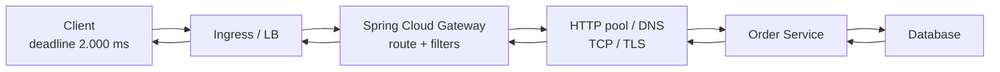
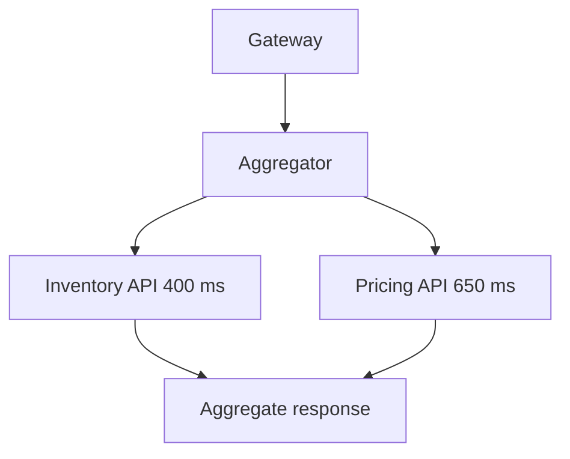

# Thiết kế timeout budget xuyên gateway và dịch vụ

## Mục tiêu bài học

Trong chương **Hiệu năng** của module **SPRING_CLOUD_GATEWAY**, bài học này trình bày cách thiết kế **timeout budget xuyên suốt** từ client, ingress, Spring Cloud Gateway, service discovery/load balancing, HTTP client, backend microservices cho tới database và dịch vụ phụ thuộc. Mục tiêu không phải tìm một con số `timeout` để thêm vào YAML, mà là tạo một **hợp đồng thời gian**: một request cần trả kết quả hoặc thất bại có kiểm soát trước khi người gọi bỏ cuộc; các tầng bên trong không được tiếp tục tiêu tốn tài nguyên vô ích sau deadline ấy.

Spring Cloud Gateway có thể match route predicates, chạy filter chain, rewrite path/header, xác thực, rate limit, retry và circuit breaker trước khi đi tới backend. Mỗi bước đều dùng một phần latency budget; vì vậy đặt `response-timeout: 5s` trong khi client đã timeout sau `2s` không giải quyết được bài toán hiệu năng.

Sau bài, bạn có thể:

- Phân biệt **latency SLO**, **timeout**, **deadline** và **remaining budget**.
- Mô hình hóa thời gian ở từng hop: DNS, chờ connection pool, TCP connect, TLS, request write, response wait/read, xử lý backend, database và truyền dữ liệu ra client.
- Phân bổ budget có **safety margin** cho request đồng bộ; hiểu critical path khi có fan-out song song.
- Cấu hình `connect-timeout` và `response-timeout` **toàn cục** và **theo route** của **Spring Cloud Gateway Server WebFlux** với đúng kiểu dữ liệu.
- Tránh nhầm `response-timeout` của Netty với một **end-to-end deadline cho toàn request**, hoặc với timeout của Resilience4j `TimeLimiter`.
- Đặt retry, backoff, jitter và số lần thử trong **budget tổng**, xét idempotency, memory và tải khuếch đại.
- Phân biệt timeout tại pool acquire, DNS, TLS, upstream response, database, ingress và client.
- Thiết kế **deadline propagation**, clamp deadline từ client không đáng tin, đo thời gian còn lại bằng monotonic clock và xử lý cancellation.
- Điều chỉnh timeout cho API nhanh, xử lý chậm, fan-out, SSE, file download, WebSocket và batch/job bất đồng bộ.
- Kiểm thử bằng backend stub tạo độ trễ/lỗi, quan sát p95/p99 và xác minh không còn các request mồ côi.

> **Phạm vi kỹ thuật:** ví dụ cấu hình dùng **Spring Cloud Gateway Server WebFlux** trên Reactor Netty. Đây không phải bộ thuộc tính Web MVC, `ProxyExchange` hoặc ingress. Các dòng Gateway cũ thường có prefix `spring.cloud.gateway.*`, còn bảng configuration properties ở các dòng mới sử dụng `spring.cloud.gateway.server.webflux.*`. Một số trang hướng dẫn timeout chính thức vẫn hiển thị prefix ví dụ cũ: hãy đối chiếu **bảng configprops của đúng phiên bản đang chạy**, đừng trộn hai namespace. Các con số ở bài là **giả định cho bài tập thiết kế**, không phải giá trị nên sao chép vào production.

## 1. Timeout budget là một hợp đồng thời gian

Giả sử web client gọi:

```text
GET https://api.example.com/api/orders/42
```

Hệ thống đi qua:



Nếu client cho tối đa **2.000 ms** nhưng ingress chờ **3.000 ms**, Gateway HTTP client chờ **5.000 ms** và backend database query chờ **30.000 ms**, thì khi client đã rời đi, các tầng sau có thể vẫn giữ sockets, queue slots, DB connections hoặc chạy thao tác không còn người nhận.

**Timeout budget** là kế hoạch phân chia khoảng thời gian tối đa cho những phần của một request, kèm quy tắc **dừng sớm khi thời gian còn lại không đủ**.

### 1.1. Phân biệt bốn khái niệm

| Khái niệm | Diễn giải | Ví dụ |
| --- | --- | --- |
| **Latency SLO** | Tỷ lệ requests cần hoàn tất trong một ngưỡng | 99% GET orders hoàn tất trong 1.500 ms |
| **Timeout** | Giới hạn chờ một hoạt động hoặc một vùng xử lý | TCP connect tối đa 200 ms |
| **Deadline** | Thời điểm cuối cùng request phải hoàn tất hoặc bị từ chối | `now + 2.000 ms` |
| **Remaining budget** | Thời gian còn lại tại một bước sau khi đã tiêu tốn thời gian trước đó | Còn 780 ms trước khi gọi database |

**SLO không tự thiết lập timeout.** Một request có thể mất 1.700 ms và vẫn hoàn thành, nhưng nó vi phạm SLO 1.500 ms nếu vượt mục tiêu. Timeout là cơ chế bảo vệ tài nguyên và đáp ứng hợp đồng; không phải biểu đồ chất lượng dịch vụ.

### 1.2. Deadline khác một chuỗi timeouts độc lập

Một timeout riêng được “reset” tại mỗi hop có thể gây tích lũy:

```text
Gateway đợi backend 2s
  → Backend đợi service B 2s
    → B đợi DB 2s
```

Người dùng không có nghĩa đã cho phép chờ **6s**. Với deadline tổng:

```text
Tại Gateway: remaining = 1.700ms
Tại Backend: remaining = 1.200ms
Tại Service B: remaining = 700ms
Tại DB call: budget được clamp <= remaining - reserve
```

Các tầng phải **giảm dần thời gian còn lại**, không bắt đầu một đồng hồ mới không giới hạn theo mỗi request.

### 1.3. Một timeout không bao trùm mọi thứ

Khi cấu hình:

```yaml
httpclient:
  connect-timeout: 200
  response-timeout: 1200ms
```

điều này không tự đảm bảo mọi request hoàn tất trong `1.400ms`. Thời gian có thể còn gồm route/security filters, DNS, connection acquire queue, TCP/TLS handshake, request body write, response body consumption, retry/backoff, response serialization và latency ingress/client. Các giới hạn Netty có **phạm vi riêng**; hãy dựa vào instrumentation/kiểm thử để biết phạm vi cụ thể trong phiên bản đang dùng.

## 2. Bản đồ latency của một HTTP request

Một request đồng bộ đơn giản có thể tách:

```text
T_total ≈ T_client_network
        + T_ingress_queue
        + T_gateway_inbound
        + T_auth_route_filters
        + T_service_discovery_or_LB
        + T_pool_acquire
        + T_DNS_if_needed
        + T_TCP_connect_if_needed
        + T_TLS_if_needed
        + T_request_write
        + T_backend_wait_and_processing
        + T_response_read
        + T_gateway_response_filters
        + T_egress_to_client
```

Đây là mô hình **logic**, không có nghĩa các hoạt động luôn xảy ra nối tiếp hoặc mỗi request đều có DNS/TCP/TLS mới. **Keep-alive và connection pooling** có thể tái sử dụng connection; HTTP/2 có multiplexing; streaming có nhiều lần đọc body; filter và work scheduling có thể chồng lấp nhau.

### 2.1. Các loại timeout phải gọi đúng tên

| Điểm chờ | Giới hạn bảo vệ | Nếu hết thời gian |
| --- | --- | --- |
| Client tổng | User experience / caller deadline | Client hủy/bỏ chờ |
| Ingress / L7 LB | Request/idle/read timeout của proxy | Có thể đóng kết nối hoặc trả error |
| Gateway total | Deadline inbound-to-completion có chủ đích | Dừng/fail request nếu chưa commit |
| Route/httpclient connect | Thời gian **TCP connect** | Connect timeout |
| Pool acquire | Thời gian đợi available connection/channel | Pool acquire timeout/rejection |
| DNS resolution | Chờ resolver tên miền | DNS timeout/failure |
| TLS handshake | Chờ xác lập TLS | TLS handshake timeout |
| HTTP response | Netty response read timeout theo semantics runtime | Read/response timeout |
| Retry | Tổng các attempts/backoffs theo chính sách | Hết retry budget |
| CircuitBreaker/TimeLimiter | Phạm vi publisher/call được bao bọc | Timeout/fallback/rejection theo policy |
| Backend total | Thời gian xử lý ở service | Backend trả lỗi hoặc hủy task |
| DB query | Query execution/lock wait/statement timeout | Query bị ngắt theo DB/driver semantics |
| Outbound response streaming | Idle giữa dữ liệu hoặc stream lifetime | Ngắt stream nếu vượt policy |

Không dùng thuật ngữ “Gateway timeout” mơ hồ trong incident report. Phải chỉ rõ **timeout được kích hoạt ở đâu**.

### 2.2. Thời gian queue cũng là latency

Nếu một request đợi **800 ms** trong connection pool nhưng `connect-timeout: 200` và `response-timeout: 500ms`, tổng thời gian chưa chắc được chặn ở 500 ms. `connect-timeout` không đo thời gian chờ **mượn** connection; `response-timeout` không phải một watchdog bao trùm toàn bộ Gateway handling.

Ví dụ:

```text
Gateway filters                  50 ms
Pool acquire queue             800 ms
TCP connect                     90 ms
TLS                             70 ms
Upstream response              420 ms
Response copy                  100 ms
────────────────────────────────────
Tổng thực tế                ≈ 1.530 ms
```

Ngay cả khi từng timeout “không vi phạm”, request có thể vượt caller deadline. **Đo và giới hạn queue**, không chỉ tăng số connections.

### 2.3. Queue càng dài, timeout càng vô dụng

Một hệ thống quá tải có thể biến mỗi request thành:

```text
900ms chờ đến lượt + 100ms xử lý
```

Tăng timeout từ 1s lên 5s làm nhiều request đợi lâu hơn và giữ tài nguyên nhiều hơn; nó không tạo thêm CPU, DB connections hoặc throughput.

Cần kết hợp:

- **Bounded concurrency** và **bounded pending queue**.
- Admission control/rate limiting/bulkhead.
- Pool sizing theo tài nguyên upstream.
- Load shedding/fail fast khi remaining budget quá nhỏ.
- Autoscaling dựa trên tín hiệu có ý nghĩa (queue, CPU, throughput), không chỉ số request đang mở.

## 3. Thiết kế budget từ ngoài vào trong

Một nguyên tắc hữu ích:

> Giới hạn của tầng trong nên để lại đủ thời gian cho tầng ngoài **phát hiện lỗi, thực hiện fallback hợp lệ, ghi telemetry và trả response**, chứ không chỉ “gần bằng” timeout client.

### 3.1. Ví dụ hợp đồng GET Orders

**Giả định bài tập**:

```text
Client hard deadline:                    2.000 ms
Ingress request ceiling:                1.850 ms
Gateway whole-request ceiling:          1.650 ms
Target outer HTTP-upstream attempt:     1.200 ms
Backend service internal budget:          900 ms
DB statement budget:                      500 ms
```

Đây là **các trần lồng nhau**, không cộng thành một tổng; mỗi tầng bắt đầu đo ở thời điểm request đến tầng đó. Độ trễ trước khi đến backend phải được trừ khỏi budget còn lại.

Một kế hoạch phần thời gian cho Gateway sau khi nhận request:

| Hoạt động | Budget tham khảo |
| --- | ---: |
| Authentication, route match, filters | 100 ms |
| Outbound upstream operation gồm pool/connect/TLS/read | 1.200 ms |
| Response filters, ghi response tới ingress | 150 ms |
| Dự phòng jitter/scheduling/bất định | 200 ms |
| **Gateway whole-request ceiling** | **1.650 ms** |

**Không hiểu lầm** `response-timeout: 1200ms` của Reactor Netty là đã tự tạo một `1.200ms` upstream-operation deadline. Phải áp một **outer deadline riêng** nếu muốn bao trùm pool wait, connect, TLS, request/response processing và retry.

### 3.2. Budget có dự phòng để trả lỗi

Nếu upstream được phép dùng đủ **1.650 ms** nhưng Gateway chỉ còn vài microseconds trước khi ingress đóng kết nối, thì `fallbackUri` hoặc response lỗi JSON có thể không kịp đến client.

**Reserve** nên đủ cho:

- Thời gian response serialization/HTTP transfer.
- Gateway filter post-phase.
- Load balancer/ingress flush.
- Fallback **ngắn, an toàn** nếu policy cho phép.
- Scheduler jitter và phần bất định ở p99.

Không nên bảo toàn một response “đẹp” bằng cách kéo dài vượt client deadline; khi không còn đủ budget, nên fail fast/cancel để tránh làm tải xấu thêm.

### 3.3. Budget theo loại API, không áp một con số cho tất cả

| Loại API | Đặc tính | Hướng thiết kế |
| --- | --- | --- |
| GET metadata nhỏ | Read nhanh, có thể idempotent | Deadline ngắn, retry rất giới hạn |
| POST tạo đơn | Side effect có thể đã xảy ra | Deadline rõ, **không retry mù quáng** |
| GET tổng hợp nhiều backend | Fan-out, tail latency tích lũy | Critical-path budget, parallel limits |
| Export báo cáo lớn | Có thể tính toán lâu | Trả `202 Accepted` và polling/webhook |
| SSE | Một response stream dài | Tách stream idle timeout và connection lifetime |
| WebSocket | Kết nối nâng cấp lâu dài | Handshake budget khác heartbeat/idle policy |
| File download | Body truyền lâu | Tách timeout khởi đầu và throughput/idle timeout |

Một Gateway có thể có **global defaults** để tránh vô hạn thời gian đợi, và **route-level overrides** cho các lớp API với SLO khác nhau.

## 4. Tính thời gian còn lại: mô hình deadline

Giả sử ở thời điểm yêu cầu được nhận, Gateway dành:

```text
deadline = now + 1.650ms
```

Sau 300ms ở bước authentication và pool queue:

```text
remaining ≈ 1.350ms
```

Trước khi gọi upstream, phải dành phần cho response:

```text
available_for_upstream =
    max(0, remaining - response_reserve)
```

Nếu `remaining=350ms` và `response_reserve=150ms`, một call mà tối thiểu cần 400ms để có kết quả **không nên được khởi động chỉ để chắc chắn timeout**. Có thể trả `503`/`504` hoặc một fallback an toàn, tùy hợp đồng.

### 4.1. Dùng monotonic clock trong một tiến trình

Trên JVM, tính elapsed time với `System.nanoTime()`, không dùng `System.currentTimeMillis()` trừ hai mốc để đo vì wall clock có thể bị NTP chỉnh.

```java
import java.time.Duration;

final class LocalDeadlineBudget {
    private final long startNanos = System.nanoTime();
    private final long totalNanos;

    LocalDeadlineBudget(Duration total) {
        if (total.isZero() || total.isNegative()) {
            throw new IllegalArgumentException("Budget must be positive");
        }
        this.totalNanos = total.toNanos();
    }

    Duration remaining() {
        long elapsed = System.nanoTime() - startNanos;
        long left = Math.max(0L, totalNanos - elapsed);
        return Duration.ofNanos(left);
    }

    boolean expired() {
        return remaining().isZero();
    }
}
```

Đây là **utility minh họa cho một budget ngắn**, chưa có overflow guard cho Durations cực lớn. Dùng `System.nanoTime` **không** tạo một giá trị timestamp có thể gửi sang máy khác; đồng hồ monotonic của mỗi process không có cùng gốc.

### 4.2. Mô hình absolute deadline giữa các dịch vụ

Một số hệ thống định nghĩa header nội bộ:

```http
X-Internal-Deadline-Epoch-Millis: 1795500000123
```

Đây chỉ là **protocol ví dụ do hệ thống tự định nghĩa**, **không phải một header chuẩn có sẵn của Spring Cloud Gateway**. Nó có thể hữu ích để qua nhiều service không reset budget, nhưng cần:

1. Header chỉ được sinh/chuẩn hóa ở **trusted edge/Gateway**.
2. Không tin deadline client gửi từ Internet; xóa hoặc clamp theo policy.
3. Validate parse, range, kích thước, negative/overflow và maximum TTL.
4. Có đồng bộ wall clocks giữa các nodes, định nghĩa cách xử lý clock skew.
5. Khi nhận, convert thành **remaining Duration** rồi dùng monotonic local clock để đếm tiếp.
6. Nếu cần integrity xuyên trust boundary, dùng internal auth/mTLS hoặc message-signing theo policy.
7. Không đưa header timestamp hoặc user-controlled values vào metric labels vô hạn.

**Không thể dùng deadline absolute chỉ để “ép mọi downstream cancel” nếu chúng không có logic hiểu header và cancellation.** Forwarded header không tự điều khiển Reactor Netty, JDBC hay Resilience4j.

### 4.3. Phân biệt timeout hint và deadline cưỡng chế

Một header như:

```http
X-Request-Timeout-Millis: 500
```

chỉ có ý nghĩa khi downstream được lập trình để sử dụng nó. Khi header được **forward nguyên giá trị** qua 3 hops, mỗi hop có thể tự cho 500ms mới, làm tổng vượt 1.500ms.

Nếu chọn **remaining-time header**, từng service phải trừ **elapsed** trước khi gửi đi. Nếu chọn **absolute deadline**, phải xử lý clock skew và trust. Cả hai cần test contract xuyên các ngôn ngữ/runtime.

## 5. Cấu hình timeout trong Spring Cloud Gateway Server WebFlux

Spring Cloud Gateway có khả năng đặt **HTTP connect timeout** và **HTTP response timeout** toàn cục, rồi override theo route qua metadata.

**Khác biệt kiểu dữ liệu quan trọng**:

| Thuộc tính | Giá trị | Ý nghĩa |
| --- | --- | --- |
| Global `httpclient.connect-timeout` | Số nguyên **milliseconds** | Ví dụ `250` = 250ms |
| Global `httpclient.response-timeout` | **`java.time.Duration`** | Ví dụ `1200ms`, `2s` |
| Route `metadata.connect-timeout` | Số nguyên **milliseconds** | Ví dụ `200` = 200ms |
| Route `metadata.response-timeout` | Số nguyên **milliseconds** | Ví dụ `850` = 850ms |

Đặc biệt, nếu dùng `response-timeout: 850` ở **global HTTP client** thay vì `850ms`, có thể bị bind/diễn giải khác với ý định tùy Spring Boot conversion. Viết rõ Duration string ở global và số nguyên milliseconds ở route.

### 5.1. Ví dụ global timeout cho môi trường thử nghiệm

```yaml
spring:
  cloud:
    gateway:
      server:
        webflux:
          httpclient:
            connect-timeout: 250
            response-timeout: 1200ms
          routes:
            - id: orders-read
              uri: http://localhost:9001
              predicates:
                - Path=/api/orders/**
                - Method=GET
              filters:
                - StripPrefix=1
```

`connect-timeout: 250` là giới hạn connect theo HTTP client, không có nghĩa DNS + pool acquire + TLS + backend response hoàn tất trong 250ms. `response-timeout: 1200ms` không thay ingress timeout, deadline của caller hoặc DB query timeout.

`localhost:9001` là backend stub cho bài tập. Khi chạy Kubernetes, `localhost` trong Gateway pod **không** trỏ tới một microservice ở pod khác. Thay bằng DNS/service discovery của deployment.

### 5.2. Per-route metadata override

```yaml
spring:
  cloud:
    gateway:
      server:
        webflux:
          httpclient:
            connect-timeout: 250
            response-timeout: 1200ms
          routes:
            - id: orders-read
              uri: lb://order-service
              predicates:
                - Path=/api/orders/**
                - Method=GET
              metadata:
                connect-timeout: 200
                response-timeout: 850
              filters:
                - StripPrefix=1

            - id: reports-read
              uri: lb://report-service
              predicates:
                - Path=/api/reports/**
                - Method=GET
              metadata:
                connect-timeout: 300
                response-timeout: 3000
              filters:
                - StripPrefix=1
```

Ở đây:

- `orders-read` sử dụng route metadata `200ms` connect và `850ms` response.
- `reports-read` sử dụng `300ms` connect và `3.000ms` response.
- Các route khác không override sẽ lấy global defaults phù hợp.
- `lb://` cần **Spring Cloud LoadBalancer** và danh sách service instances. Đây là giả định của ví dụ.

**Quan trọng:** route `reports-read` có timeout dài hơn **không thể** tự vượt qua client/ingress timeout ngắn hơn. Muốn phục vụ report chậm, phải thiết kế hợp đồng API/caller hợp lý, hoặc chuyển sang job bất đồng bộ.

### 5.3. Disable global response timeout bằng giá trị âm

Tài liệu Gateway mô tả:

```yaml
metadata:
  response-timeout: -1
```

trên một route sẽ **disable global response-timeout** đối với route đó. Đây là một **ngoại lệ nguy cơ cao**, không phải giải pháp mặc định khi gặp 504:

- Nếu backend đứng im hoặc stream hỏng, Gateway có thể chờ lâu hơn.
- Socket và pending work vẫn tiêu thụ tài nguyên.
- Ingress/client có thể đã đóng kết nối.
- Với SSE/WebSocket/file streaming, cần một **idle/lifetime policy riêng**, không đồng nghĩa cho phép vô hạn mọi hoạt động.

Nếu bắt buộc bỏ response timeout vì một stream dài, cần **connection limits, heartbeat, idle timeouts, client cancellation, monitoring và graceful shutdown**.

### 5.4. Java DSL metadata cho timeout

Spring Cloud Gateway cung cấp các constants:

```java
import static org.springframework.cloud.gateway.support.RouteMetadataUtils
    .CONNECT_TIMEOUT_ATTR;
import static org.springframework.cloud.gateway.support.RouteMetadataUtils
    .RESPONSE_TIMEOUT_ATTR;

// Trong RouteLocatorBuilder routes() definition:
.metadata(CONNECT_TIMEOUT_ATTR, 200)
.metadata(RESPONSE_TIMEOUT_ATTR, 850)
```

Các constants tránh sai key string khi cấu hình bằng Java DSL. Tuy nhiên `metadata` vẫn là **route HTTP timeout**; nó không tự tính remaining deadline cho từng request hoặc tự truyền deadline header sang service.

### 5.5. Prefix cũ và mới

Trong một số trang hướng dẫn timeout chính thức, ví dụ còn ghi:

```yaml
spring:
  cloud:
    gateway:
      httpclient:
        connect-timeout: 1000
        response-timeout: 5s
```

Đó là dạng **namespace cũ** thường thấy ở các release trước. Bảng properties Spring Cloud Gateway Server WebFlux mới liệt kê:

```text
spring.cloud.gateway.server.webflux.httpclient.connect-timeout
spring.cloud.gateway.server.webflux.httpclient.response-timeout
spring.cloud.gateway.server.webflux.httpclient.pool.acquire-timeout
```

Hãy kiểm tra phiên bản thực và runtime effective properties. Không thêm cả hai prefixes để hy vọng một trong hai hoạt động; cách đó làm cấu hình khó bảo trì và khó debug.

## 6. Timeout của connection pool là một phần budget độc lập

Gateway có thể duy trì một pool outbound HTTP connections. Khi lượng request đồng thời vượt khả năng pool/upstream, request mới có thể **xếp hàng chờ mượn connection**.

Reactor Netty có các khái niệm:

- `maxConnections`: giới hạn concurrent channels/connections theo pool.
- `pendingAcquireMaxCount`: số acquisitions được xếp hàng tối đa.
- `pendingAcquireTimeout`: thời gian chờ acquire.
- `maxIdleTime`, `maxLifeTime`: quản lý tuổi/idle connections, không phải request deadlines.
- Pool metrics: đo idle/active/pending connections để phát hiện saturation.

### 6.1. Cấu hình Gateway pool dạng fixed

Ví dụ có chủ đích:

```yaml
spring:
  cloud:
    gateway:
      server:
        webflux:
          httpclient:
            pool:
              type: fixed
              max-connections: 100
              acquire-timeout: 150
              metrics: true
            connect-timeout: 250
            response-timeout: 1200ms
```

**Giải thích:**

- `acquire-timeout: 150` dùng **milliseconds** trong properties của Gateway.
- `max-connections: 100` là cấu hình minh họa; chọn dựa trên load test, giới hạn backend, sockets/FDs, HTTP protocol và số replicas, **không phải một giá trị “tối ưu” phổ quát**.
- `metrics: true` hữu ích để theo dõi saturation nếu cấu hình Micrometer phù hợp.
- Tài liệu configprops ghi `acquire-timeout`/`max-connections` áp dụng cho **`FIXED` pool type**; không suy rằng mọi pool type xử lý như nhau.

### 6.2. Không tùy tiện nhân số connections

Giả sử:

```text
20 Gateway replicas × 200 max connections = tối đa 4.000 outbound connections
```

Nếu upstream chỉ chịu được 800 active requests, tăng connection pool từ 100 lên 200 trên mỗi Gateway có thể **khuếch đại overload**, không cải thiện p99.

Nên đặt giới hạn tổng dựa trên capacity của service phía sau, chính sách HPA và số replicas. Nếu một service có concurrency budget C, cần phân phối budget tương đối giữa các callers, có thể dùng service-side bulkhead.

### 6.3. Pool acquire timeout không giống connect timeout

```text
T_pool_acquire = 120ms
T_TCP_connect = 90ms
```

Nếu cả hai đều dưới ngưỡng của riêng mình, tổng đã là 210ms trước TLS/HTTP response. Nên có **outer request deadline** và fail fast nếu pool queue đã dùng gần hết remaining budget.

### 6.4. Stale connections và idle timeout

Một connection pool giữ socket quá lâu hơn idle timeout của load balancer/backend có thể làm request gặp premature close và retry bất ngờ.

Thiết lập `maxIdleTime` nên xem xét idle timeout của upstream/ingress; Reactor Netty khuyến nghị chọn pool idle limit **không lớn hơn** server-side idle limit khi phù hợp. Tránh nhầm `maxIdleTime` (tuổi idle connection trong pool) với response timeout hay request TTL.

## 7. DNS, TLS và network proxies có timeout riêng

Một request tới `https://order.internal.example` có thể cần:

```text
Resolver lookup (DNS)
   ↓
Pool acquire
   ↓
TCP connect
   ↓
TLS handshake / SNI / certificate verification
   ↓
HTTP write
   ↓
Response read
```

Thứ tự thực có thể khác do pooling/cache, nhưng **mỗi bước có thể fail trước khi upstream application nhận request**.

### 7.1. TCP connect timeout

Global/route `connect-timeout` của Gateway tập trung vào thời gian thiết lập **TCP connection** theo HTTP client. Nó không phải:

- DNS resolution timeout;
- TLS handshake timeout;
- pool pending acquire timeout;
- thời gian backend chờ DB;
- thời gian hoàn thành response body.

Vì vậy, nếu incident report nói “timeout 200ms nhưng request treo 1.2s”, phải kiểm tra **phạm vi và thời gian của từng bước** thay vì giả định property bị bỏ qua.

### 7.2. TLS handshake timeout

Với HTTPS upstream, Reactor Netty có timeout cho TLS handshake. Bảng Gateway configprops mới có thuộc tính tương tự:

```text
spring.cloud.gateway.server.webflux.httpclient.ssl.handshake-timeout
```

Ví dụ giá trị kiểu Duration:

```yaml
spring:
  cloud:
    gateway:
      server:
        webflux:
          httpclient:
            ssl:
              handshake-timeout: 500ms
```

`500ms` chỉ là **test value**. TLS ở những mạng, proxy hoặc cert chains khác nhau có tail latency khác. Chọn từ p95/p99 handshake thực và reliability requirements. Không sửa TLS timeout bằng cách bật **insecure trust manager**; certificate trust, SNI và hostname verification phải giữ đúng.

### 7.3. Resolver/proxy timeouts

Reactor Netty có các timeout knobs liên quan:

- Name resolver query timeout.
- HTTP proxy connect timeout khi dùng outbound proxy.
- TLS handshake timeout.
- Pool pending acquire timeout.

Không tự đoán có sẵn một Spring Cloud Gateway YAML key cho **mọi** Reactor Netty option. Nếu cần tùy chỉnh sâu, dùng HTTP client customizer được tài liệu phiên bản hỗ trợ và integration test để tránh vô tình mất pooling, proxy, TLS hay load balancer behavior.

### 7.4. Timeouts khác nhau khi connection được reuse

**Cold request:**

```text
DNS + connect + TLS + request + response
```

**Warm keep-alive request:**

```text
Pool acquire + request + response
```

Đừng đo đúng một request đầu tiên rồi áp timeout cho toàn traffic. Load test cần có **warmup** và phân tích riêng các cold-start/connection churn scenarios.

## 8. Response timeout không đồng nghĩa toàn bộ request deadline

Reactor Netty `HttpClient.responseTimeout(Duration)` là một giới hạn ở lớp **HTTP response/read**. Nó có thể được áp mặc định cho client và override theo request. Tài liệu Netty còn phân biệt những timeout khác ở pool, connect, SSL/TLS, proxy và resolver.

### 8.1. Phân biệt response wait và total wall clock

Giả sử:

```text
Pool acquire           200 ms
TCP connect            100 ms
TLS handshake          100 ms
Request write           50 ms
Upstream response      800 ms
Gateway response       100 ms
──────────────────────────────
Tổng                   1.350 ms
```

Một config `response-timeout: 900ms` **không phải** công thức `T_total <= 900ms`. Nếu request có Retry, tổng wall clock có thể còn lớn hơn.

### 8.2. Response timeout và streaming

Một service SSE có thể phát heartbeat mỗi 20s trong nhiều giờ. Một HTTP response có thể **bắt đầu nhanh** nhưng kéo dài rất lâu. Cần phân biệt:

- **Time to first response headers / first byte**.
- **Idle time giữa chunks/messages**.
- **Full response completion time**.
- **Maximum stream lifetime**.

Không gán bừa `Mono.timeout(Duration.ofSeconds(2))` lên **toàn bộ response completion** rồi thắc mắc SSE bị cắt sau 2s. Ngược lại, **disable hết timeout** có thể giữ vô hạn những connections không còn hữu ích.

Với `responseTimeout` của Reactor Netty, kiểm tra runtime/version cụ thể để hiểu nó đo inactivity/read như thế nào cho từng protocol và streaming case. Luôn test với **slow headers, slow first byte, slow body và heartbeat** tách biệt.

### 8.3. HTTP status không đủ xác định nguồn timeout

Client nhận 504 có thể do:

- Ingress timeout trước khi Gateway trả kết quả.
- Gateway timeout với upstream HTTP client.
- CircuitBreaker/TimeLimiter timeout.
- Upstream tự trả HTTP 504 khi gọi service khác.

Không được suy từ `504` rằng `spring.cloud.gateway.server.webflux.httpclient.response-timeout` chính là timeout đã kích hoạt. Cần trace spans, exception category, selected route, upstream attempt count và error source.

## 9. End-to-end deadline qua Reactor: minh họa một lớp bảo vệ

Một outer deadline có thể dùng **Reactor `timeout(Duration)`** để giới hạn một `Publisher`. Nhưng nó phải được đặt đúng **phạm vi** và tích hợp với HTTP response lifecycle, khác `connect-timeout`/`response-timeout`.

Ví dụ **mô hình minh họa** cho một route ngắn:

```java
import java.time.Duration;
import java.util.concurrent.TimeoutException;

import org.springframework.cloud.gateway.filter.GatewayFilterChain;
import org.springframework.cloud.gateway.filter.GlobalFilter;
import org.springframework.core.Ordered;
import org.springframework.http.HttpStatus;
import org.springframework.stereotype.Component;
import org.springframework.web.server.ServerWebExchange;

import reactor.core.publisher.Mono;

@Component
public final class DemoGatewayDeadlineFilter
        implements GlobalFilter, Ordered {

    private static final Duration TOTAL_LIMIT =
        Duration.ofMillis(1650);

    @Override
    public int getOrder() {
        return -100; // Ví dụ: vị trí cần kiểm chứng theo filter order thực
    }

    @Override
    public Mono<Void> filter(
            ServerWebExchange exchange,
            GatewayFilterChain chain) {

        return chain.filter(exchange)
            .timeout(TOTAL_LIMIT)
            .onErrorResume(TimeoutException.class, error -> {
                if (exchange.getResponse().isCommitted()) {
                    return Mono.error(error);
                }
                exchange.getResponse()
                    .setStatusCode(HttpStatus.GATEWAY_TIMEOUT);
                return exchange.getResponse().setComplete();
            });
    }
}
```

**Đây không phải production-ready blanket GlobalFilter.** Lưu ý:

1. Nó tính thời gian từ lúc GlobalFilter bắt đầu, **không tính** thời gian đã dùng bởi ingress hoặc Security WebFilters chạy trước đó.
2. `chain.filter(exchange)` là `Mono<Void>` hoàn tất theo lifecycle của Gateway response; áp timeout cứng có thể **cắt SSE, WebSocket hoặc downloads** hợp lệ.
3. Nếu response đã commit, **không thể đổi status thành 504**; cần quản lý cancellation/connection close theo giao thức.
4. `TimeoutException` từ một publisher và exception do HTTP client/TimeLimiter phát có thể không phải cùng type. Cần mapping nguyên nhân rõ.
5. `getOrder()` và vị trí so với Retry/CircuitBreaker quyết định phạm vi được bảo vệ. Đừng coi `-100` là số thứ tự có tính chuẩn.
6. Timeout/cancellation không đảm bảo SQL query hoặc payment transaction ở remote backend **đã dừng**; chúng còn cần cooperative cancellation/idempotency.
7. Một filter toàn cục cần có **route policy** và ngoại lệ rõ ràng, thay vì dùng cùng limit cho health, upload, SSE và admin long-running requests.

**Mục đích của ví dụ** là minh họa “outer total cap” khác với HTTP client timers. Để triển khai thật, xác định deadline từ ingress, match route class, xử lý committed response, preserve Reactor Context và kiểm tra mọi error paths.

### 9.1. Không chặn Netty event loop

Trong reactive Gateway, đừng làm:

```java
Thread.sleep(1000);
```

hoặc:

```java
someMono.block();
```

trên event loop để “chờ budget”. Các thao tác blocking kéo dài chiếm event-loop threads và làm p99 của nhiều request khác tăng, dẫn đến timeout dây chuyền.

Sử dụng non-blocking HTTP/DB clients, backpressure và bounded schedulers cho những thư viện bắt buộc blocking. Nếu có custom filter, đo thời gian blocking/hot paths trước khi tăng timeouts.

## 10. Retry phải nằm trong remaining budget

Retry có thể tăng tỷ lệ thành công khi một lỗi nhất thời xảy ra. Nhưng nếu mỗi attempt được phép chờ nguyên một per-route timeout, tổng thời gian có thể vượt hard deadline.

### 10.1. Công thức budget cho retry tuần tự

Với `N` là **số retries sau attempt đầu**, tối đa có `N+1` attempts:

```text
T_total_retry ≈ Σ(i=1..N+1) T_attempt_i
              + Σ(j=1..N) T_backoff_j
              + T_filters_and_response
```

Một cận trên thiết kế thận trọng:

```text
T_total_retry_upper <= (N+1) × T_attempt_cap
                     + Σ T_backoff_max
                     + T_overhead_reserve
```

**Chú ý:** `T_attempt_cap` ở đây phải là **attempt-level end-to-end cap được định nghĩa rõ**, không đơn giản là Reactor Netty `response-timeout`. Một attempt còn có pool acquire, TCP/TLS và scheduling.

### 10.2. Ví dụ không đủ budget

Giả sử:

```text
Remaining Gateway budget:       1.300 ms
One attempt total cap:            700 ms
One retry:                           1
Backoff:                          60 ms
Response/filters reserve:         100 ms
```

Worst case:

```text
2 × 700 + 60 + 100 = 1.560 ms
```

**Lớn hơn remaining 1.300 ms**. Vì vậy không nên bật attempt thứ hai với nguyên cap 700ms.

Một phương án:

```text
Attempt #1 cap:             600 ms
Backoff tối đa:              50 ms
Attempt #2 cap:             500 ms
Response reserve:           150 ms
─────────────────────────────────
Tổng:                     1.300 ms
```

Những số này là cận thiết kế; production còn phải tính queue jitter, IO overhead và xác minh từ latency metrics. Nếu attempt 1 đã dùng 580ms và pool queue sau đó tiếp tục tăng, attempt 2 **có thể bị bỏ qua** khi remaining không đủ.

### 10.3. Retry GatewayFilter trong YAML

Ví dụ thử nghiệm cho **GET idempotent**:

```yaml
spring:
  cloud:
    gateway:
      server:
        webflux:
          routes:
            - id: orders-read
              uri: lb://order-service
              predicates:
                - Path=/api/orders/**
                - Method=GET
              metadata:
                connect-timeout: 200
                response-timeout: 700
              filters:
                - StripPrefix=1
                - name: Retry
                  args:
                    retries: 1
                    methods: GET
                    statuses:
                      - BAD_GATEWAY
                      - SERVICE_UNAVAILABLE
                    backoff:
                      firstBackoff: 30ms
                      maxBackoff: 50ms
                      factor: 2
                    jitter:
                      randomFactor: 0.3
                    timeout: 1250ms
```

**Đọc đúng semantics của config:**

- `retries: 1` là **thêm một lần thử sau attempt đầu**, không phải tổng một attempt.
- `statuses` giới hạn status đáng retry; không retry 401/403/404 vì lỗi quyền/tài nguyên không tự hết.
- `methods: GET` tránh tự động replay POST/PUT khi có side effects.
- Backoff và jitter giảm đồng bộ retry khi backend chập chờn.
- `Retry.timeout` là một option của **Retry GatewayFilter** theo phiên bản hiện hành; **không coi nó là thay thế mặc định cho toàn client deadline**. Phạm vi timeout cần xác minh với filter order và runtime của bản dùng.
- Route `response-timeout: 700` là HTTP-client read timeout theo route, **không phải toàn attempt cap**; một layer outer deadline vẫn cần bảo vệ toàn request.

Khi có `Retry`, **những filters đặt sau nó có thể chạy lại**; thứ tự `StripPrefix`, security, body caches và telemetry phải được test. Tài liệu Gateway cảnh báo retry request có body có thể cache body vào memory; với uploads lớn, đây là rủi ro đáng kể.

### 10.4. Cancellation không hoàn tác side effects

Giả sử `POST /payments/charge` đã được backend ghi giao dịch vào DB nhưng response bị timeout:

```text
Client/Gateway thấy timeout
Backend có thể đã commit giao dịch
Gateway retry POST
→ có nguy cơ charge hai lần
```

**Timeout không chứng minh một transaction chưa thực hiện.** Các thao tác ghi cần:

- Idempotency key theo business operation.
- Deduplication nguyên tử tại backend.
- Cơ chế truy vấn trạng thái khi kết quả chưa rõ.
- Retry policy theo mã lỗi và giai đoạn an toàn.
- Không cache/replay body vô giới hạn.

Gateway không tự bảo đảm exactly-once cho mọi request chỉ vì có Retry filter.

### 10.5. Retry amplification qua nhiều tầng

Nếu Gateway retry tối đa 2 attempts, Service A retry tối đa 3, Service B retry tối đa 2, một inbound request có thể tạo tới:

```text
2 × 3 × 2 = 12 downstream attempts
```

trong kịch bản nested retries phù hợp. Đây là **số lượng attempts tiềm năng**, không có nghĩa một request luôn gọi 12 lần.

Trước khi bật retries ở nhiều tầng, quyết định **một retry owner**, giới hạn attempt count và đặt **total retry budget**. Tránh mỗi microservice tự retry theo default.

## 11. CircuitBreaker, TimeLimiter và fallback trong budget

`CircuitBreaker` giúp **ngừng gửi thêm calls** tới một upstream đang lỗi hoặc quá chậm; `TimeLimiter` hạn chế thời gian của vùng xử lý được wrap. Hai cơ chế **khác** với TCP connect/response timeout của Gateway.

### 11.1. CircuitBreaker không tự cắt mọi slow call

Một circuit breaker có thể ghi nhận failures và chuyển:

```text
CLOSED → OPEN → HALF_OPEN
```

Tại trạng thái OPEN, request có thể bị **reject nhanh** mà chưa mở upstream connection. Nhưng cấu hình CircuitBreaker chỉ có tên/threshold **không chứng minh** đã có một total deadline phù hợp. Với Spring Cloud CircuitBreaker + Resilience4j, chính sách TimeLimiter được cấu hình riêng và phải được test.

### 11.2. TimeLimiter của Resilience4j

Ví dụ:

```yaml
resilience4j:
  timelimiter:
    instances:
      ordersRead:
        timeoutDuration: 1100ms
```

Và route có:

```yaml
filters:
  - name: CircuitBreaker
    args:
      name: ordersRead
      fallbackUri: forward:/fallback/orders
```

Để route này hoạt động theo tài liệu Gateway Server WebFlux, cần dependency tương thích, ví dụ:

```text
spring-cloud-starter-circuitbreaker-reactor-resilience4j
```

**Lưu ý:** `TimeLimiter` giới hạn publisher/call được **CircuitBreaker filter bao bọc**, không tự là deadline của toàn bộ inbound request nếu authentication, filters khác hoặc response write nằm ngoài vùng ấy. Khi đặt `Retry` trước/sau CircuitBreaker, vùng được wrap khác nhau; cần kiểm thử thứ tự thực tế. Tài liệu Spring Cloud CircuitBreaker hiện hành cho biết TimeLimiter có thể enabled theo mặc định và cho phép cấu hình thời lượng/disable theo instance/group, nhưng không mặc định dựa vào giá trị đó cho SLO.

### 11.3. Ví dụ thứ tự có thể tạo kết quả khác

**Kịch bản A — CircuitBreaker bao cả Retry:**

```text
CircuitBreaker/TimeLimiter
  └─ Retry
      └─ HTTP routing
```

TimeLimiter có thể giới hạn **toàn vùng retry** nếu filter publisher composition đúng.

**Kịch bản B — Retry ở ngoài CircuitBreaker:**

```text
Retry
  └─ CircuitBreaker/TimeLimiter
      └─ HTTP routing
```

Mỗi attempt có thể được bảo vệ bởi TimeLimiter nhưng **toàn bộ retries/backoffs** không nhất thiết bị giới hạn bởi một TimeLimiter duy nhất. Đây là mô hình **phạm vi bao bọc**, không khẳng định cứ đổi hai dòng YAML là chắc chắn có behavior theo sơ đồ; `Ordered`, built-in filters và Reactor publisher semantics phải được test.

### 11.4. Fallback cũng tốn thời gian

Nếu circuit breaker mở và `fallbackUri` gọi một handler/backend khác, fallback cần:

- Budget riêng nhỏ và rõ.
- Không biến dữ liệu lỗi thành “success giả” cho giao dịch quan trọng.
- Không kích hoạt một chuỗi requests đắt hơn upstream gốc.
- Không chờ đến khi ingress/client đã đóng connection.
- Trả HTTP status/body đúng contract, có cache policy nếu dùng stale value.

Một fallback gọi backend thứ hai và mất thêm 2s trong khi client còn 200ms là **fallback không có ích**.

## 12. Propagate deadline xuống backend và database

Một Gateway có deadline nhưng backend vẫn chạy DB query quá lâu có thể tạo **orphaned work**:

```text
T0: Gateway gửi GET tới Order Service
T0+900ms: Gateway hết budget; hủy HTTP subscription
T0+2000ms: DB query vẫn chạy vì driver/server không nhận cancellation
T0+5000ms: Backend vẫn cố trả response, nhưng caller đã biến mất
```

Nguyên tắc là **cancellation propagation best-effort**, không phải bảo đảm mọi phần việc đã dừng.

### 12.1. Backend đọc remaining budget

Service nhận deadline nội bộ đã được kiểm chứng nên:

1. Parse và clamp deadline theo service policy.
2. Tính remaining = deadline - now (và điều chỉnh clock skew nếu cần).
3. Từ chối request nếu không đủ thời gian tối thiểu để có kết quả.
4. Đặt HTTP client/DB call timeouts **nhỏ hơn remaining - reserve**.
5. Khi caller cancel, cố gắng cancel publishers/queries hỗ trợ cancellation.
6. Không commit business side effects phụ thuộc vào giả định “client còn chờ”.

### 12.2. DB query timeout và lock waits

Backend thường có ít nhất hai lớp timeout:

- **Connection acquisition**: chờ mượn JDBC/R2DBC connection.
- **Statement/query timeout**: chờ câu lệnh/transaction ở DB.

Chúng phải đi theo **remaining backend budget**, không lấy `spring.datasource.hikari.connection-timeout` (nếu dùng JDBC/Hikari) làm bằng chứng mọi query sẽ hoàn tất dưới ngưỡng đó. DB driver, dialect và server-side `statement_timeout`/lock wait behavior cần cấu hình phù hợp.

Ví dụ budget còn 700ms:

```text
Acquire DB connection:      tối đa 80ms
Query execution:            tối đa 450ms
Response mapping/commit:    dự phòng 100ms
Safety margin:               70ms
─────────────────────────────────
Tổng:                       700ms
```

Đây là mô hình phân bổ, không phải YAML áp dụng chung cho PostgreSQL/MySQL/Oracle. Phải kiểm tra driver hỗ trợ cancellation, transaction commit và connection pool lifecycle.

### 12.3. Fan-out cần critical-path analysis

Một aggregator service gọi **hai backend song song**:



Nếu chúng thực sự chạy **song song**, thời gian chờ hai calls xấp xỉ:

```text
max(400ms, 650ms) = 650ms
```

không phải `400 + 650 = 1.050ms`. Nhưng aggregator còn có dispatch/queue/serialization overhead và có thể phải chờ kết quả của cả hai. Nếu call B chỉ bắt đầu sau kết quả A, tổng lại là **sequential sum**.

**Quy tắc:** tính timeout từ **critical path của dependency graph**, không đơn giản cộng hết durations của mọi service hoặc gán mỗi nhánh toàn bộ deadline mà không giới hạn concurrency.

### 12.4. Tail latency và fan-out

Nếu mỗi dependency có xác suất hoàn tất dưới ngưỡng X là 99%, và một aggregator phải chờ 10 dependencies độc lập với xác suất giống nhau, xác suất **tất cả 10** kịp X xấp xỉ:

\[
P(\text{all 10 on time}) = 0.99^{10} \approx 0.904
\]

Tức chỉ khoảng **90,4%** aggregator calls có mọi nhánh kịp X trong mô hình giả định độc lập. Thực tế latencies có tương quan vì chung DB/network/load, nên công thức là **minh họa**, không phải dự báo production.

Vì vậy fan-out lớn rất dễ làm p99 end-to-end tệ dù từng service có p99 khá tốt. Cân nhắc cache, partial response, bulkhead, timeout theo nhánh, giảm fan-out hoặc tách công việc bất đồng bộ.

## 13. Đừng cộng p99 của các hop một cách máy móc

Một bảng quan sát:

| Hop | p95 | p99 |
| --- | ---: | ---: |
| Ingress | 30ms | 70ms |
| Gateway filters | 25ms | 80ms |
| Backend | 450ms | 1.100ms |
| DB | 280ms | 750ms |

**Không thể** đơn giản lấy `p99_total = 70 + 80 + 1100 + 750` trong mọi hệ thống. Còn có:

- DB latency đã được tính **bên trong backend latency** (double count).
- Percentiles của các distributions không cộng tuyến tính.
- Có những hops chạy song song.
- Tail latencies tương quan theo load hoặc shared infrastructure.
- Các requests timeout có thể làm metric sample bị censor/ghi khác.

### 13.1. Cần đo end-to-end trực tiếp

Để thiết kế budget, thu:

```text
Ingress request duration
Gateway route timer
Gateway HTTP client attempts latency
Pool acquire wait
DNS/TCP/TLS phases (khi cần)
Backend handler duration
DB query time
End-user observed latency
```

Sau đó xác định:

- `p50`, `p95`, `p99`, **timeout rate** và **error rate**.
- Sự khác nhau giữa warm và cold connections.
- Giờ cao điểm, deployment, cache miss và upstream saturation.
- Phần latency ở Gateway **không nằm** trong backend span.

### 13.2. Percentile SLO và hard deadline

Ví dụ:

```text
SLO: 99% GET /orders hoàn tất <= 1.500ms
Caller hard deadline: 2.000ms
Gateway safety deadline: 1.650ms
```

Khoảng giữa SLO và hard deadline giúp hấp thụ tail events và trả lỗi có kiểm soát, **không khuyến khích service dùng hết 1.650ms thường xuyên**. Nếu p95 tăng sát hard timeout, tăng timeout có thể che đi saturation thay vì sửa nguyên nhân.

## 14. Lỗi timeout không phải lúc nào cũng là HTTP 504

HTTP 504 Gateway Timeout là response của một gateway/proxy khi nó không nhận kịp phản hồi thích hợp từ upstream. Nhưng thực tế còn:

| Dấu hiệu | Khả năng | Điều cần đo |
| --- | --- | --- |
| `504` ở ingress | Ingress chờ Gateway quá lâu | Ingress access log + Gateway span |
| `504` ở Gateway | Upstream response/TimeLimiter timeout | Gateway HTTP client, exception class |
| `502` | Connection reset, protocol error, TLS, upstream unavailable | HTTP client errors, TLS/connect metrics |
| `503` | Circuit OPEN, LB không có instance, admission/rejection | Circuit state, discovery, pool pressure |
| `408` | Server timeout khi nhận request từ client (theo server policy) | HTTP server inbound |
| `429` | Rate limit | Rate limiter metrics/retry-after |
| `499` ở một số proxies | Client đóng kết nối trước khi response | Proxy-specific non-standard status |
| Client `TimeoutException` | Client hết own deadline | Client timer, Gateway có còn xử lý? |

**Không map mọi exception sang 504** và gọi là “backend chậm”; nguồn lỗi khác nhau dẫn đến hành động vận hành khác nhau.

### 14.1. 504 từ upstream có thể được chuyển tiếp

Order Service có thể đóng vai client của một Payment Service và tự trả `504`; Gateway chỉ proxy status ấy. Trong trường hợp này, không nên quy lỗi cho Gateway `response-timeout`.

Một kỹ thuật là structured error classification:

```text
routeId=orders-read
errorSource=upstream
upstreamStatus=504
gatewayTransportError=false
```

Không log raw bearer token, cookie, request body hoặc query chứa dữ liệu nhạy cảm chỉ để tìm nguồn timeout.

### 14.2. Response đã commit

Nếu Gateway đã gửi status/headers 200 và một phần body xuống client, timeout xảy ra sau đó có thể chỉ còn cách **đóng stream**, không thể chuyển nó thành:

```http
HTTP/1.1 504 Gateway Timeout
```

trên cùng response. Streaming clients phải được thiết kế để nhận incomplete streams, retry/resume nếu protocol cho phép; telemetry cần ghi `responseCommitted`, bytes sent và close reason.

## 15. Timeouts cho streaming, SSE và WebSocket

Không áp cùng timeout với REST JSON cho mọi kết nối dài.

### 15.1. SSE

SSE (`Content-Type: text/event-stream`) là HTTP response có thể phát events nhiều giờ. Các timeouts hữu ích:

- **Initial response/header timeout**: phải kết nối/đăng ký nhanh.
- **Heartbeat/idle timeout**: nếu không nhận bytes/event trong thời gian quá lâu.
- **Maximum session lifetime**: có thể chủ động rotate stream theo policy.
- **Reconnect policy**: client dùng `Last-Event-ID` nếu ứng dụng hỗ trợ resume.

Nếu route SSE có `metadata.response-timeout: -1`, đó chỉ là một cách bỏ global response timeout theo Gateway docs, **không loại bỏ yêu cầu giám sát memory, sockets, heartbeat và cancellation**.

### 15.2. WebSocket

WebSocket bắt đầu bằng HTTP handshake 101 rồi chuyển sang hai phiên WebSocket client–Gateway và Gateway–upstream. Cần tách:

```text
Handshake budget   ≠  lifetime của WebSocket session
TCP/TLS timeout    ≠  Ping/Pong/heartbeat timeout
```

Một Gateway `WebsocketRoutingFilter` với URI `ws://`, `wss://` hoặc `lb:ws://` có semantics khác HTTP NettyRoutingFilter. **Không giả định HTTP response-timeout route metadata áp giống nhau cho toàn lifetime của WebSocket**, và không retry một session đã nâng cấp như HTTP GET bình thường.

### 15.3. Downloads / uploads lớn

Một file 1 GiB có thể tải vài phút dù server trả headers nhanh. Cần:

- Giới hạn inactivity/read/write.
- Minimum throughput hoặc transfer cap nếu sản phẩm yêu cầu.
- Request body size, backpressure và concurrency limits.
- Range requests/resumable uploads khi phù hợp.
- Không buffer toàn bộ response chỉ để đáp ứng một fixed total timeout nhỏ.

### 15.4. Dịch vụ chạy tác vụ dài

Thay vì giữ:

```http
POST /api/reports/export
```

trong 120 giây, cân nhắc:

```http
POST /api/reports/export
→ 202 Accepted
Location: /api/jobs/job-123
```

Client tiếp tục:

```text
GET /api/jobs/job-123
→ PENDING / RUNNING / DONE / FAILED
```

hoặc nhận webhook/event theo security contract. Gateway chỉ cần timeout ngắn cho **create job** và **poll status**, trong khi worker batch có deadline riêng. Cách này giảm sockets dài, dễ retry/status reconciliation và dễ quản lý khi client disconnect.

## 16. Test timeout budget với backend giả lập

Một bài kiểm thử hiệu năng đáng tin phải **tạo độ trễ có kiểm soát**, không chỉ đặt YAML và nhìn thấy response 200.

Chuẩn bị:

- **Gateway** chạy test profile trên random port.
- **Backend stub** (WireMock, MockWebServer hoặc HTTP server test).
- Client `WebTestClient.bindToServer()` hoặc HTTP client thật với deadline rõ.
- Metrics/traces và công cụ đếm outbound calls.
- Test data hoàn toàn giả, không có JWT/cookie/PII thật.

### 16.1. Ma trận độ trễ ở backend stub

| Trường hợp | Backend stub | Kỳ vọng |
| --- | --- | --- |
| Nhanh | Header/body sau 50ms | Thành công, latency trong SLO |
| Gần ngưỡng | Header sau 700ms, route response cap 850ms | Thường thành công nếu total budget còn |
| Chậm | Header sau 1.300ms, cap 850ms | Fail theo policy; không chờ vô hạn |
| Không trả response | Hold connection | Timeout/cancel và giải phóng tài nguyên |
| Chậm giữa chunks | Headers nhanh, body chunk tiếp theo sau gap dài | Đo read-idle/stream semantics |
| Reset connection | Gửi một phần rồi đóng | 502/connection failure theo mapping |
| Trả 503 | 503 tức thì | Retry/fallback theo policy, không coi là network timeout |
| DNS fail | Tên không resolve | Resolver error, không phải backend p99 |
| TCP port không mở | Connection refused | Connect failure nhanh, phân loại khác connect timeout |
| TLS server sai cert | Handshake fail | TLS error, không bật insecure trust |
| Pool exhausted | Giữ nhiều active calls | Pending acquire timeout/fail fast |
| Slow client | Client đọc response rất chậm | Backpressure/response commit behavior |

### 16.2. Test HTTP chậm bằng WebTestClient

Một test scaffold (stub cần được tạo trước và route URI trỏ đúng tới stub):

```java
import java.time.Duration;

import org.junit.jupiter.api.Test;
import org.springframework.boot.test.context.SpringBootTest;
import org.springframework.boot.test.web.server.LocalServerPort;
import org.springframework.test.web.reactive.server.WebTestClient;

@SpringBootTest(
    webEnvironment = SpringBootTest.WebEnvironment.RANDOM_PORT
)
class GatewayTimeoutIntegrationTest {

    @LocalServerPort
    int port;

    private WebTestClient client() {
        return WebTestClient.bindToServer()
            .baseUrl("http://localhost:" + port)
            .responseTimeout(Duration.ofSeconds(4))
            .build();
    }

    @Test
    void upstreamQuickResponseIsSuccessful() {
        // Setup: stub /orders/42 trả 200 sau ~50ms.
        client().get()
            .uri("/api/orders/42")
            .exchange()
            .expectStatus().isOk();
    }

    @Test
    void verySlowUpstreamFailsByGatewayPolicy() {
        // Setup: stub giữ response > 2s;
        // Gateway route response timeout = 850ms trong test profile.
        client().get()
            .uri("/api/orders/slow")
            .exchange()
            .expectStatus().is5xxServerError();
        // Kiểm tra thêm error category/latency và stub calls.
    }
}
```

Đoạn code là **test scaffold**, chưa runnable độc lập: phải có test stub được khởi động, route URI được inject vào application context, security policy cho fixture, timeout profile và HTTP client dependencies tương thích. Import `@LocalServerPort` phụ thuộc Spring Boot version. Không hứa hẹn một exact status 504 nếu default exception handler/Retry/CircuitBreaker/fallback của project đang map timeout thành 502/503.

`WebTestClient.responseTimeout(Duration.ofSeconds(4))` ở đây là **timeout của test client** — không phải cấu hình timeout của Gateway hoặc backend.

### 16.3. Assert latency một cách không flaky

Không nên viết:

```java
assertTrue(elapsedMillis == 850);
```

Thread scheduling, GC, network loopback và CI contention làm thời gian thực dao động. Một test có thể:

- Assert timeout xảy ra **trước ngưỡng an toàn**, ví dụ dưới 1.8s khi stub cố tình giữ 5s.
- Assert error source/cause hoặc outcome theo integration contract.
- Kiểm tra không còn pending backend calls sau thời gian hợp lý.
- Dùng virtual time cho **unit testing reactive operator timeout** nếu không có Netty/HTTP thật.
- Dùng thực clock với giới hạn rộng hơn trong integration test; không phụ thuộc chính xác 1ms.

### 16.4. Virtual time và network time khác nhau

Reactor `StepVerifier.withVirtualTime` hữu ích để test:

```java
Mono.never().timeout(Duration.ofSeconds(1))
```

và những publishers dùng schedulers tương thích. Nhưng virtual time **không tự tăng tốc DNS, TCP connect, TLS handshake, pool acquire hay external HTTP server**. Test end-to-end Netty phải chạy với **network thật hoặc stub**.

### 16.5. Test deadline propagation giữa hai services

Mô hình:

```text
Client budget 2.000ms
Gateway dùng 300ms
Order Service nhận remaining ≈ 1.700ms
Order Service dùng 400ms
Inventory Service nhận remaining ≈ 1.300ms
```

Điều cần test:

- Internal deadline header do trusted Gateway sinh, không tin client fake deadline.
- Deadline giảm dần; không reset tại mỗi hop.
- `remaining <= 0` → không gọi backend/DB tốn kém.
- Server nhận `remaining` thấp sẽ trả fail fast theo policy.
- Khi client cancel, downstream work được cancel **trong khả năng stack**.
- Không còn orphaned DB queries, leaked connections hoặc endless retries.

### 16.6. Test retry nằm trong budget

Stub:

```text
Attempt 1: 503 sau 150ms
Attempt 2: 200 sau 200ms
```

Kỳ vọng khi retry được cho phép:

- Một inbound GET, **hai outbound attempts**.
- Tổng duration gồm backoff, vẫn dưới hard deadline.
- Nếu attempt 1 mất gần hết budget, **attempt 2 không khởi động** hoặc dùng deadline nhỏ hơn.
- POST không có idempotency policy không được replay vô ý.

Đếm attempts ở backend stub; đừng đếm Netty wiretap WRITE lines vì một request có nhiều network writes.

### 16.7. Test pool exhaustion

Giả lập N upstream calls giữ connection:

```text
maxConnections = 2
pending acquire max/timeout có giới hạn
```

Gửi 3–5 requests đồng thời:

- Hai requests chiếm active connections.
- Các requests còn lại phải chờ acquire hoặc bị reject theo policy.
- Khi vượt acquire timeout, không chờ tới khi client đã bỏ đi.
- Gateway vẫn xử lý requests khác và phát metrics phù hợp.

Không dùng `Thread.sleep` ngay trên Gateway Netty event-loop để tạo độ trễ; làm chậm ở **backend test server** hoặc dùng non-blocking delay.

## 17. Load test: nhìn tail latency, concurrency và queue

Một kết quả p50 đẹp có thể che p99 rất xấu. Chạy load test nhiều giai đoạn:

1. **Warmup:** khởi tạo pools, DNS caches, JIT và connections.
2. **Baseline:** traffic thấp, xác định latency của request nhanh.
3. **Normal load:** mức RPS/concurrency mục tiêu.
4. **Peak/burst:** request bursts và fan-out.
5. **Saturation:** tăng tải tới khi queue/timeout/error rate tăng.
6. **Failure injection:** backend chậm, 503, partial close, DNS/TLS/network faults.
7. **Recovery:** backend hồi phục, kiểm tra retry storm và pool draining.

### 17.1. Metrics cần thu

| Metric/tín hiệu | Vì sao quan trọng |
| --- | --- |
| End-to-end latency p50/p95/p99 | Trải nghiệm người dùng |
| Gateway route request timer | Latency qua route/filter chain |
| HTTP client connect duration | Chậm kết nối |
| Pool active/idle/pending connections | Saturation và queue wait |
| Pending acquire timeouts | Pool không đủ hoặc upstream quá tải |
| DNS/TLS failures | Network/trust issues |
| Upstream response latency | Service chậm |
| Retry attempts per inbound request | Amplification |
| Circuit state/rejections | Fail-fast behavior |
| 429/502/503/504 | Phân loại lỗi |
| Gateway CPU/GC/event-loop delay | Blocking/saturation |
| Backend DB pool/query/lock wait | Bước nghẽn sâu hơn |
| Cancellation/orphaned work | Wasted work sau deadline |

Tên Micrometer metrics cụ thể có thể khác giữa Spring Cloud Gateway/Reactor Netty/Observability versions. Gateway docs mô tả route metric `spring.cloud.gateway.requests`; Reactor Netty có các meter liên quan HTTP client và connection provider. **Kiểm tra `/actuator/metrics`/Prometheus exporter trên đúng bản đang chạy**, không hard-code alert dựa trên tên metric nhớ từ bản khác.

### 17.2. Đừng gắn ID vào metric labels

Metric labels nên dùng:

```text
routeId=orders-read
method=GET
status=504
outcome=TIMEOUT
```

Không dùng:

```text
userId=<id>
requestPath=/api/orders/123456789
token=<jwt>
query=<customer-data>
```

Các labels có cardinality cao làm nổ số lượng time series và có thể rò dữ liệu vào monitoring. Tracing cho phép phân tích những request cụ thể mà không cần đưa raw identifiers vào every metric label.

### 17.3. Đo request completion và attempts riêng

Khi Retry:

```text
Inbound requests:      100
Outbound attempts:     170
```

Nếu chỉ đo completion rate của 100 inbound, bạn có thể bỏ qua tải thực **170 calls** lên backend. Cần theo dõi **attempt ratio** và error amplification, đặc biệt lúc degradation.

### 17.4. Open-loop và closed-loop load

Một closed-loop client đợi response rồi gửi request kế tiếp có thể **tự giảm arrival rate** khi Gateway chậm, che hiện tượng queueing ở traffic production thực. Nếu muốn mô phỏng lượng user/request arrivals độc lập, cân nhắc open-loop load generator với rate mục tiêu và kiểm soát coordinated omission.

Không lấy một benchmark laptop localhost làm bằng chứng production p99 dưới tải đa replica qua TLS/ingress. Cần tương quan môi trường test với traffic shape, body size, concurrency, latency và phần cứng thực.

## 18. Hệ quả bảo mật của timeout budget

Timeout là một phần của khả năng bảo vệ hệ thống trước tài nguyên bị giữ quá lâu, nhưng cấu hình thiếu chặt có thể bị lạm dụng.

### 18.1. Không tin deadline client gửi

Attacker có thể gửi:

```http
X-Internal-Deadline-Epoch-Millis: 9999999999999
```

Nếu Gateway tin giá trị đó, họ có thể buộc backend xử lý lâu ngoài policy. Ngược lại, một deadline quá ngắn có thể gây fail-fast giả, tạo nhiễu logs và rate-limit decisions.

Tại edge:

- Xóa hoặc overwrite internal headers từ public client.
- Clamp requested timeout theo **min/max service policy**.
- Chỉ truyền qua trusted network/mTLS.
- Validate kiểu số, overflow, clock skew, URL/header injection.
- Không dùng deadline header làm bằng chứng authentication.

### 18.2. Slowloris, streaming và request size

Timeout chờ upstream response **không** bảo vệ mọi trường hợp inbound client gửi headers/body từng byte rất chậm. Ingress/HTTP server cần riêng:

- Header read timeout/limits.
- Request body size và upload time policy.
- Concurrent connections limit.
- Slow-client/read idle handling.
- Rate limiter/WAF phù hợp.

Không để HTTP client response timeout thay thế inbound anti-Slowloris protections.

### 18.3. Retry và dữ liệu nhạy cảm

Retry có thể ghi/gửi token và body nhiều lần, và một Gateway wiretap có thể làm nhiều bản sao log payload. Không bật raw wiretap trên traffic thật chỉ để debug timeout; dùng synthetic delays và metadata logs như:

```text
routeId=orders-read
attempt=2
elapsedMs=780
remainingBucket=0-250ms
errorCategory=response-timeout
traceId=<valid-trace-id>
```

Không log `Authorization`, `Cookie`, personal data, raw request body hoặc deadline header chứa giá trị user-controlled tùy ý.

## 19. Troubleshooting các tình huống thường gặp

### 19.1. Đã đặt response timeout 1s nhưng client đợi 3s

**Khả năng:**

- Response timer không bao trùm pool acquire, DNS, connect, TLS hoặc response write.
- Có Retry/filter/fallback tạo thêm attempts.
- Property sai namespace nên không có hiệu lực.
- Ingress/client có timeout dài hơn.

**Cách xử lý:** xác minh configprops runtime, tách spans/timers theo phase, đếm attempts và thêm outer deadline rõ.

### 19.2. Connect timeout đặt 200ms nhưng kết nối vẫn lâu

**Khả năng:** chờ pool acquire/DNS/TLS hoặc remote service chưa kịp accept connection ở một lớp khác. TCP connect timeout không bao trùm mọi phase.

**Cách xử lý:** xem metrics pool/connection, resolver/TLS errors và event-loop blocking. Không tăng connect timeout trước khi đo latency composition.

### 19.3. Có nhiều 504 ngay sau deployment

**Khả năng:**

- Cold DNS/TLS/connection pool initialization.
- JVM JIT/cache warmup.
- Backend instances mới chưa ready.
- Client/ingress/Gateway timeouts không nhất quán.

**Cách xử lý:** tách cold-vs-warm latency, readiness/probes, upstream health và deployment traffic shifting; không mặc định tăng timeout vĩnh viễn để che cold-start issue.

### 19.4. p99 tăng khi RPS gần đỉnh

**Khả năng:** bounded resource đã saturate, pool queue tăng, DB lock waits hoặc CPU/GC/event-loop delay.

**Cách xử lý:** xem saturation metrics, queue lengths, active/pending connections, concurrency limit và backend DB; xem xét load shedding/autoscaling/caching. **Tăng timeout không phải tối ưu hóa** nếu hệ thống thiếu capacity.

### 19.5. Retry làm backend chậm hơn

**Khả năng:** retry amplification và backoff đồng bộ khi nhiều callers gặp lỗi; requests gần hết deadline vẫn retry.

**Cách xử lý:** giảm số retries, chỉ retry lỗi transient, thêm jitter, giới hạn theo remaining budget và có một retry owner. Dùng circuit breaker/bulkhead để fail fast khi upstream quá tải.

### 19.6. POST timeout nhưng giao dịch vẫn xuất hiện

**Đây có thể là hành vi bình thường của hệ thống phân tán:** client timeout không hoàn tác commit ở backend.

**Cách xử lý:** idempotency key, trạng thái nghiệp vụ, reconciliation/query status; không retry POST tự động khi không có protocol chống trùng.

### 19.7. Fallback trả 200 nhưng SLO vẫn tệ

**Khả năng:** fallback chỉ chạy sau 2s chờ upstream và mất thêm 1s, trong khi client timeout 2s.

**Cách xử lý:** đặt TimeLimiter/outer deadline bao gồm fallback reserve; fallback chỉ dùng dữ liệu an toàn và trả sớm. Tránh giả thành công một payment/business action quan trọng.

### 19.8. SSE bị đóng dù backend vẫn healthy

**Khả năng:** một layer áp full-request timeout hoặc idle timeout ngắn hơn interval heartbeat; route response timeout không hợp stream semantics.

**Cách xử lý:** tách initial-response/idle/stream-lifetime budgets, gửi heartbeat hợp lệ và test ingress/Gateway/backend từng hop.

### 19.9. WebSocket cứ 60 giây lại ngắt

**Khả năng:** idle timeout ở ingress/LB/backend hoặc heartbeat không đủ, không hẳn lỗi `WebsocketRoutingFilter`.

**Cách xử lý:** đo connection lifetime, close codes, ping/pong, application heartbeat và proxy timeouts. Đừng tăng mọi HTTP timeouts thành vô hạn.

### 19.10. `lb://` route có 503 dù service vẫn chạy

**Khả năng:** discovery không có healthy instances, update stale, LB health status hoặc connection pool/TLS không tới instance chọn.

**Cách xử lý:** kiểm tra service instance selection và readiness, chứ không chỉ thay `response-timeout`.

### 19.11. `TimeoutException` được log nhưng client nhận 502

**Khả năng:** exception mapping, route fallback, circuit breaker hoặc upstream response committed khác nhau. Không có ánh xạ 1–1 phổ quát từ Java exception sang HTTP status.

**Cách xử lý:** test error handling của project, phân loại `timeoutSource` và kiểm tra response committed.

### 19.12. Tắt global response timeout bằng `-1` khiến nhiều sockets tồn tại lâu

**Khả năng:** route không có idle/lifetime limits và clients/backends ngừng gửi dữ liệu mà không đóng.

**Cách xử lý:** dùng policy phù hợp loại stream, connection limits, heartbeats, cancellation và max lifetime; không để tài nguyên giữ vô hạn.

## 20. Checklist vận hành timeout budget

| Phạm vi | Câu hỏi cần xác minh |
| --- | --- |
| **Client SLO** | p95/p99 mục tiêu, hard deadline và request types đã định nghĩa? |
| **Ingress** | Request/idle timeout nhỏ hơn caller deadline với reserve? |
| **Gateway** | Có outer end-to-end budget ngoài HTTP-client timers? |
| **Properties** | Namespace và global Duration vs route metadata milliseconds đúng bản chạy? |
| **Route** | Các API nhanh/chậm có per-route cap riêng, không blanket timeouts? |
| **Connection pool** | Fixed/elastic type, max connections, acquire timeout và queue metrics phù hợp? |
| **DNS/TCP/TLS** | Resolver, connect, handshake được đo/tune riêng? |
| **Retry** | (N+1) attempts + backoff + overhead nằm trong remaining budget? |
| **Methods** | POST/PUT/PATCH có idempotency/reconciliation khi retry? |
| **CircuitBreaker** | TimeLimiter/fallback scope khớp filter order và SLO? |
| **Fallback** | Có reserve để trả lỗi, không giả thành công? |
| **Deadline header** | Internal-only, clamp, signed/trusted, xử lý clock skew? |
| **Backend** | Timeout cho HTTP calls/DB, cooperative cancellation, không orphan work? |
| **Parallel fan-out** | Critical path, parallelism và tail amplification được tính? |
| **Streams** | SSE/WebSocket/upload/download có initial/idle/lifetime policy riêng? |
| **Error mapping** | 408/429/502/503/504/499 được phân biệt đúng nguồn? |
| **Observability** | p50/p95/p99, pool pending, retries, circuit, timeout origin, cancellations? |
| **Security** | Không tin timeout headers public; logs không lộ token/PII? |
| **Tests** | Có slow headers/body, reset, pool exhaustion, TLS, retries, fan-out, client cancel? |
| **Change control** | Rollout canary, cảnh báo p99/error, rollback và cập nhật SLO docs? |

## 21. Bài luyện tập tính toán

### Bài 1 — Có đủ budget cho retry?

Một GET còn **1.400ms** ở Gateway. Response reserve **150ms**. Attempt 1 cần tối đa **700ms**, backoff tối đa **100ms**, attempt 2 cũng được cấp **700ms**.

**Hỏi:** có nằm trong budget không?

**Đáp án:**

```text
700 + 100 + 700 + 150 = 1.650ms
```

**Không.** Vượt 250ms. Phải giảm per-attempt caps, bỏ attempt 2 khi remaining thấp hoặc tăng caller contract **nếu sản phẩm thực sự cho phép**. Không chỉ sửa `response-timeout` mà bỏ qua pool/connect/retry.

### Bài 2 — Pool wait có quan trọng?

Gateway filters 70ms, pool acquire 400ms, connect/TLS 130ms, backend response 600ms, response write 100ms.

**Hỏi:** tổng latency khoảng bao nhiêu?

**Đáp án:** `70 + 400 + 130 + 600 + 100 = 1.300ms`. Một `response-timeout=700ms` không có nghĩa total phải dưới 700ms. Cần outer deadline và pool limits.

### Bài 3 — Sequential hay parallel?

Aggregator gọi Inventory 350ms và Pricing 650ms, dispatch/aggregate overhead 100ms.

**Nếu song song:** `max(350,650) + 100 = 750ms` trong mô hình lý tưởng.

**Nếu tuần tự:** `350 + 650 + 100 = 1.100ms`.

Tính budget theo dependency graph thật và đo queue/scheduling, không chỉ cộng/so p99 độc lập.

### Bài 4 — Có nên retry POST sau timeout?

Payment Service nhận `POST /charge`, đã commit thành công nhưng Gateway timeout trước khi nhận response.

**Đáp án:** không retry mù quáng. Cần idempotency key, backend deduplication và endpoint kiểm tra trạng thái thanh toán. Timeout phía client **không hủy transaction đã commit**.

### Bài 5 — Trần timeout xếp thế nào?

Client deadline 2.000ms, ingress 2.500ms, Gateway 1.900ms, backend 4.000ms.

**Đáp án:** có nguy cơ caller timeout trước ingress/backend, wasted work. Thiết kế lại để ingress/Gateway hoàn tất/timeout có **reserve** trước caller và backend nhận remaining budget nhỏ hơn available time. Giá trị tối ưu phụ thuộc độ trễ/hợp đồng thật.

### Bài 6 — Vì sao 99% service on-time vẫn chưa đủ?

Một aggregator cần 10 dependencies độc lập, mỗi dependency có 99% xác suất hoàn tất dưới một ngưỡng.

**Đáp án:** xác suất tất cả kịp xấp xỉ `0.99^10 ≈ 90.4%`; fan-out làm tail latency xấu đi. Tính toán chỉ minh họa giả định độc lập, thực tế cần đo phân phối và tương quan.

### Bài 7 — Timeout của HTTP response và SSE

SSE mở trong 2 giờ, có heartbeat mỗi 20 giây; Gateway có toàn-request `Mono.timeout(2s)`.

**Đáp án:** nếu publisher không hoàn tất trong 2s, outer timeout có thể cắt một stream đang hoạt động. Thiết kế budget handshake, idle timeout, heartbeat và session lifetime riêng.

### Bài 8 — Vì sao không tin client-provided deadline?

Client tự gửi `X-Internal-Deadline-Epoch-Millis` cách hiện tại 10 ngày.

**Đáp án:** header có thể bị giả. Trusted edge phải overwrite hoặc clamp và backend chỉ chấp nhận metadata từ authenticated/trusted hops; không biến deadline thành quyền giữ socket vô hạn.

### Bài 9 — Giới hạn `Response Timeout` route

Global:

```yaml
httpclient:
  response-timeout: 2s
```

Route:

```yaml
metadata:
  response-timeout: 700
```

**Đáp án:** với Gateway WebFlux theo tài liệu, global property dùng `Duration`, route metadata dùng **700ms**. Đây vẫn là giới hạn HTTP client response của route, không tự là total request cap.

### Bài 10 — Khi nào tăng timeout?

**Đáp án:** chỉ khi business SLO/caller contract cho phép, đo được phần xử lý cần thêm thời gian trong điều kiện có capacity và không che overload. Nếu p99 tăng do queue saturation hoặc deadlock, ưu tiên sửa nguyên nhân, backpressure và admission control.

## 22. Quy trình thiết kế thực hành cho một route mới

### Bước 1 — Chốt hợp đồng với client

Ghi rõ:

```text
API: GET /api/orders/{id}
Expected p99: 1.500ms
Client hard deadline: 2.000ms
Acceptable fallback: chỉ dữ liệu cached khi không nhầm quyền
Request body: không có
Retry safety: GET idempotent theo business contract
```

Không chọn timeout trước khi biết **operation có thể retry hay có side effect**.

### Bước 2 — Lập dependency graph

```text
Ingress
  → Gateway Security/Route/Filter
  → Order Service
      ├─ Database
      └─ Inventory Service
          └─ Cache
```

Đánh dấu các nhánh song song và tuần tự. Tìm critical path và những điểm có queue.

### Bước 3 — Thu latency baseline

Thu p50/p95/p99 theo route/hop từ test traffic đại diện. Phân loại cold connections và steady-state.

### Bước 4 — Phân phối limits với reserve

Thiết kế:

```text
Client:     2.000ms
Ingress:    1.850ms
Gateway:    1.650ms
Upstream:   1.200ms outer cap
Backend:      900ms
DB call:      500ms
```

Sau đó cấu hình **mỗi loại timeout đúng phạm vi** — không nhầm route `response-timeout` với outer operation cap.

### Bước 5 — Quyết định retry/fallback owner

- GET idempotent chỉ retry transient failures với attempt budget.
- POST cần idempotency.
- Circuit breaker/TimeLimiter bao vùng xử lý mong muốn.
- Fallback đủ nhanh, có contract an toàn.

### Bước 6 — Thêm deadline propagation/cancellation

Thiết kế internal header nếu cần nhiều hops, trusted edge clamp, tính remaining tại mỗi service và giảm budgets cho DB/HTTP clients.

### Bước 7 — Fault injection

Test slow upstream, 503, pool queue, TLS, no response, client abort, 2+ replicas và streaming.

### Bước 8 — Rollout và quan sát

Canary timeout changes; theo dõi timeout rate, p99, attempt ratio, pool saturation và user-visible error rate. Có rollback nếu tăng lỗi hoặc phát hiện canceled work vẫn chạy quá lâu.

## 23. Tài liệu tham khảo chính thức

- [Spring Cloud Gateway Server WebFlux — HTTP Timeouts Configuration](https://docs.spring.io/spring-cloud-gateway/reference/spring-cloud-gateway-server-webflux/http-timeouts-configuration.html): global/per-route `connect-timeout`, `response-timeout`, route metadata và giá trị âm để disable global response timeout.
- [Spring Cloud Gateway — Configuration Properties](https://docs.spring.io/spring-cloud-gateway/reference/configprops.html): namespace Server WebFlux, HTTP client pool acquire, connect, response và SSL properties.
- [Spring Cloud Gateway Server WebFlux — Retry GatewayFilter Factory](https://docs.spring.io/spring-cloud-gateway/reference/spring-cloud-gateway-server-webflux/gatewayfilter-factories/retry-factory.html): retries, statuses, methods, backoff/jitter, timeout, filter order và cached request body.
- [Spring Cloud Gateway Server WebFlux — CircuitBreaker GatewayFilter Factory](https://docs.spring.io/spring-cloud-gateway/reference/spring-cloud-gateway-server-webflux/gatewayfilter-factories/circuitbreaker-filter-factory.html): circuit, Resilience4j, fallback và status-code behavior.
- [Spring Cloud CircuitBreaker — Resilience4j Circuit Breaker Properties](https://docs.spring.io/spring-cloud-circuitbreaker/reference/spring-cloud-circuitbreaker-resilience4j/circuit-breaker-properties-configuration.html): TimeLimiter instance/default config và lựa chọn disable.
- [Reactor Netty — HTTP Client Reference, Timeout Configuration](https://projectreactor.io/docs/netty/release/reference/http-client.html): connection-pool, response, connect, TLS, proxy và name resolver timeouts.
- [Project Reactor — Error Handling](https://projectreactor.io/docs/core/release/reference/coreFeatures/error-handling.html): reactive timeout/error/cancellation semantics.
- [Spring Cloud Gateway Server WebFlux — Global Filters](https://docs.spring.io/spring-cloud-gateway/reference/spring-cloud-gateway-server-webflux/global-filters.html): Gateway metrics và filter chain.

## Tổng kết

**Timeout budget xuyên Gateway và microservices** là một thiết kế **end-to-end**, không phải tập hợp các con số độc lập. Bắt đầu từ **caller deadline**, dành reserve cho ingress/Gateway trả response, sau đó phân phối remaining budget cho connection acquire, DNS/TCP/TLS, HTTP client, backend, database và các lời gọi phụ thuộc. Với nhánh song song, tính theo **critical path**; với retry, tính cả **attempts + backoff + filter overhead** và tránh amplification. Một caller timeout không tự ngắt transaction/DB query đã chạy, vì vậy cần **deadline propagation, cooperative cancellation và idempotency**.

Trong **Spring Cloud Gateway Server WebFlux**, phân biệt kỹ **global `connect-timeout` milliseconds**, **global `response-timeout` Duration**, **per-route metadata timeouts milliseconds**, connection-pool acquire timeout và Resilience4j TimeLimiter. **Netty response timeout không phải total request deadline**; hãy kiểm thử actual request wall clock và lập riêng timeout policy cho streaming/SSE/WebSocket. Kết hợp **metrics p95/p99, queue/pool saturation, tracing, synthetic fault tests, canary rollout và log privacy** sẽ giúp Gateway đạt latency SLO, fail sớm khi quá tải và không biến một lỗi chậm đơn lẻ thành suy giảm dây chuyền toàn hệ thống.
