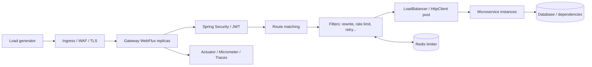
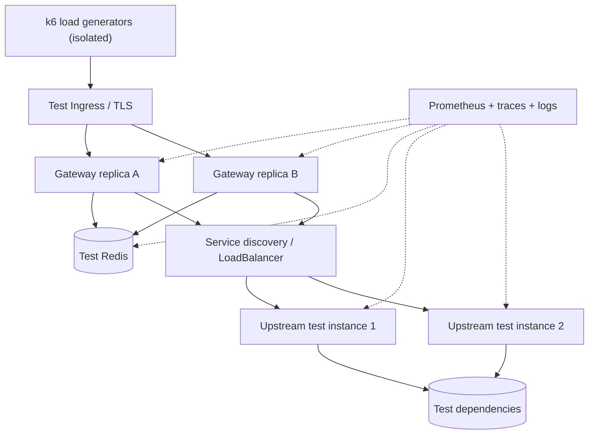
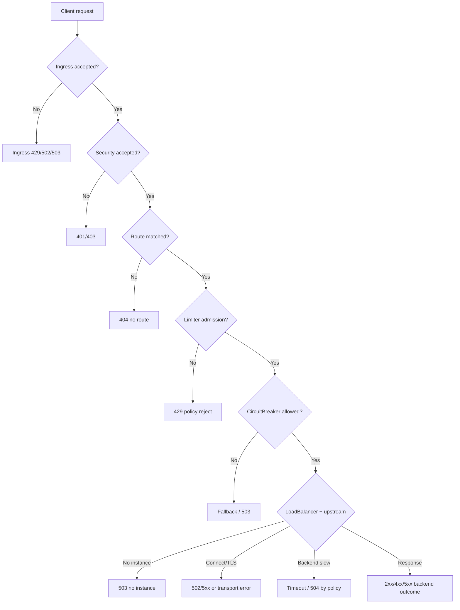

# Kiểm thử bão hòa, tải đột biến và hành vi khi quá tải

Một **Spring Cloud Gateway** có thể hoạt động ổn định ở 500 requests/giây nhưng phản hồi rất khác khi lưu lượng tăng lên 1.500 requests/giây trong 30 giây: độ trễ p99 kéo dài, hàng chờ kết nối tăng, Redis rate limiter trả `429`, CircuitBreaker mở hoặc các Gateway replicas lần lượt cạn bộ nhớ. Mục tiêu của **kiểm thử hiệu năng** không chỉ là tìm một con số “RPS tối đa”, mà còn là chứng minh **hệ thống suy giảm có kiểm soát và hồi phục** khi tải vượt quá năng lực phục vụ.

Bài thuộc chương **Hiệu năng** của **Spring Cloud Gateway**, tập trung vào ba tình huống: **bão hòa tài nguyên (saturation)**, **tải đột biến (burst/spike)** và **hành vi khi quá tải (overload behavior)**. Các ví dụ liên kết từ route predicate, filter chain, rewrite đường dẫn/header, khám phá dịch vụ `lb://` đến xác thực, Redis rate limiting, Retry, CircuitBreaker, TLS và observability. Bài hướng tới **Spring Cloud Gateway Server WebFlux** với Reactor Netty; Gateway Server Web MVC sử dụng Servlet stack và nhiều chỉ số/client transport khác, nên phải điều chỉnh setup tương ứng.

> **Cảnh báo vận hành:** Chỉ thực hiện stress/burst/failure-injection test trên môi trường được phép, có cô lập tài nguyên và giới hạn tốc độ, thời lượng, dữ liệu thử nghiệm. Không bắn tải gây gián đoạn lên dịch vụ công khai hoặc Redis/Identity Provider dùng chung. Các số liệu và threshold trong bài chỉ minh họa cách thiết kế thí nghiệm, **không phải SLO hay cấu hình khuyến nghị chung**. Tên metric, prefix thuộc tính và API k6/Spring Cloud Gateway có thể thay đổi theo phiên bản; luôn xác minh trong môi trường đang chạy.

## 1. Thế nào là bão hòa, burst và quá tải?

Ba khái niệm có liên quan nhưng không đồng nhất:

| Khái niệm | Định nghĩa thực hành | Dấu hiệu quan sát |
| --- | --- | --- |
| **Bão hòa (saturation)** | Một tài nguyên tiến gần giới hạn phục vụ: connection pool, CPU, event loop, Redis, backend, memory... | Hàng chờ, pending, utilization và thời gian đợi tăng |
| **Tải đột biến (spike/burst)** | Lưu lượng đến tăng rất nhanh trong một khoảng ngắn | Arrival rate có bước nhảy lớn, surge connections hoặc Redis decisions |
| **Quá tải (overload)** | Nhu cầu vượt capacity phục vụ trong ngân sách thời gian/SLO | Latency, timeout, rejected load, 5xx hoặc shed traffic |
| **Hồi phục (recovery)** | Khi tải giảm hoặc dependency phục hồi, hệ thống quay lại trạng thái ổn định | Queue draining, latency trở về baseline, memory đạt plateau |
| **Quá tải lan truyền (cascading overload)** | Bottleneck ở một tầng làm nghẽn các tầng khác qua retry/queue/timeout | Nhiều routes cùng suy giảm, retry amplification, replicas restart |

**Bão hòa không nhất thiết gây lỗi ngay.** Gateway có thể dùng 90% outbound connections và vẫn đạt SLO; nhưng nếu hàng đợi `pending acquire` tăng liên tục, p95 vượt deadline và tỷ lệ timeout tăng, đã có dấu hiệu năng lực không theo kịp lưu lượng.

**Burst không nhất thiết vượt capacity.** Một service có headroom, warm connections và token bucket burst budget tốt có thể hấp thụ spike ngắn mà không tăng latency nhiều. Cần kiểm thử **biên độ lẫn tốc độ tăng tải**, không chỉ RPS trung bình.

### Một ví dụ trực quan

```text
Tải theo thời gian (request/giây):

t=00–02 phút:   200 RPS  (baseline)
t=02–04 phút:   400 RPS  (ramp)
t=04–06 phút:   800 RPS  (ramp)
t=06–06:30:    2400 RPS  (spike)
t=06:30–09:00: 300 RPS  (recovery)
```

Cần trả lời: ở 800 RPS hệ thống còn đạt SLO không? Khi nhảy lên 2.400 RPS, nó từ chối request bằng `429`/`503` có kiểm soát hay để mọi request treo chờ? Sau spike 30 giây, queue có drain và số kết nối/bộ nhớ có trở lại mức ổn định không?

## 2. Mục tiêu kiểm thử: hiệu năng **và** tính ổn định

Một bài test phải định nghĩa trước **tiêu chí đạt**, thay vì chạy xong mới chọn biểu đồ đẹp.

Ví dụ mục tiêu cho route `GET /api/orders/{id}` trong môi trường thử nghiệm:

- Ở **400 RPS** với request mix đã định: p95 phía client không vượt **300 ms**.
- Với **800 RPS** duy trì: p99 không vượt **800 ms**, lỗi 5xx do hệ thống không vượt **0,5%**.
- Trong spike gấp ba lần: chấp nhận **429** theo quota, nhưng không crash/OOM hoặc để hàng đợi tăng vô hạn.
- Request bị rate limiter từ chối **không đến upstream**.
- Sau khi tải trở về 200 RPS, p95 và pending connections trở về gần baseline trong **khoảng thời gian recovery đã định**.
- Không có dữ liệu xuyên tenant, mất authorization, hoặc duplicate side effects do retry.

**Các con số trên chỉ là mẫu để học cách thiết kế acceptance criteria.** SLO thật phải được đội vận hành và chủ API xác nhận theo độ quan trọng nghiệp vụ, workload và năng lực hạ tầng.

### Thế nào là một kết quả “tốt”?

Một Gateway tự bảo vệ bằng `429` trong spike có thể **tốt hơn** Gateway trả 200 cho một phần traffic nhưng treo 60 giây với phần còn lại, khiến toàn bộ pool và backend sụp đổ.

Cần đánh giá ít nhất ba thuộc tính:

1. **Correctness:** Request được chấp nhận đi đúng route, đúng backend, đúng auth/tenant và không bị replay sai.
2. **SLO/performance:** Độ trễ, throughput và error budget ở mức tải công bố.
3. **Graceful degradation:** Khi vượt capacity, Gateway từ chối nhanh, giữ các route quan trọng hoạt động và hồi phục sau khi tải giảm.

## 3. Gateway không phải một bottleneck đơn lẻ

Một client request đi qua nhiều lớp:



Mọi lớp đều có thể tạo một “điểm gãy”:

| Lớp | Tài nguyên/giới hạn | Biểu hiện |
| --- | --- | --- |
| Load generator | CPU, NIC, socket/file descriptors | Không phát đủ target RPS, kết quả giả |
| Ingress/WAF | TLS, connection limits, request queue | `429`/`502`/`503` trước Gateway |
| Security | JWT signature/issuer validation, JWK cache | `401` hoặc CPU cao |
| Gateway route/filter | Regex, body rewrite, logging, authorization | Event loop bị block, heap/direct memory tăng |
| Redis rate limiter | Redis RTT, command throughput, keys, connections | Admission latency, 429 hoặc Redis errors |
| Outbound HttpClient | Pool active/max/pending, connect/TLS | Pool acquire timeouts, tail latency |
| Service discovery | Instance list, cache và readiness | No-instance, stale endpoint, `503` |
| Upstream | Threads, DB pool, I/O latency | `503`, `504` hoặc request xử lý chậm |
| Retry/CircuitBreaker | Attempt amplification, state/fallback | Tăng tải nội bộ hoặc shed traffic |
| Response cache/streaming | Memory, bandwidth, slow consumers | Cache misses, queues, buffer pressure |

**Một bài load test không phân biệt các lớp này có thể đo nhầm bottleneck.** Ví dụ client 504 vì Ingress timeout 5 giây không cho biết backend đã xử lý xong hay chưa.

## 4. Phân biệt request, attempt, connection và frame

Trong load test, bốn đại lượng thường bị trộn:

- **Client request:** Một HTTP request do load generator gửi tới Gateway.
- **Gateway route execution:** Một request đã match route và chạy filter chain.
- **Upstream attempt:** Một lần gọi outbound tới backend; Retry có thể nhân số attempts.
- **Connection:** Một TCP/TLS connection được tái sử dụng hoặc giữ lâu; HTTP/2 có thể multiplex nhiều requests.
- **WebSocket frame:** Message sau HTTP `101`; không phải một HTTP request mới.

Ví dụ:

```text
1000 client GET requests
  -> 800 requests được rate limiter cho qua
  -> 200 requests nhận 429
  -> Trong 800 allowed: 100 requests cần 1 retry
  -> Upstream nhận 900 attempts
```

Không thể lấy metric `http.server.requests`, `spring.cloud.gateway.requests` và outbound HTTP client attempts cộng lại rồi gọi là “tổng requests”. Chúng đo **những lớp khác nhau**.

### Vì sao phải đo cả hai đầu?

Nếu client cuối nhận `200` nhờ retry sau upstream `503`, Gateway 5xx rate có thể thấp trong khi backend đang lỗi nhiều và chịu thêm traffic.

Nếu Gateway trả `429`, upstream call count giảm là dấu hiệu bảo vệ thành công, **không phải thiếu traffic đo được**.

## 5. Định nghĩa thành công trước khi gửi tải

Một test có thể có kết quả:

| HTTP outcome | Ý nghĩa có thể | Cách tính theo mục tiêu test |
| --- | --- | --- |
| `200/201` | Thành công theo HTTP | Vẫn cần kiểm tra body và backend correctness |
| `204` | Thành công không có body | Đúng nếu API contract cho phép |
| `301/302` | Redirect | Có thể sai nếu không dự kiến, chẳng hạn bị đẩy tới login |
| `400` | Input sai | Loại khỏi eligible traffic hoặc tính theo policy |
| `401/403` | Chưa xác thực/không đủ quyền | Không tự coi là Gateway outage |
| `404` | Route miss hoặc upstream resource missing | Cần phân loại nguồn |
| `429` | Rate limit/admission từ chối | **Có thể là hành vi đúng trong overload**, nhưng vẫn là request chưa phục vụ |
| `502` | Proxy/transport hoặc upstream gateway lỗi | Điều tra ingress/Gateway/HTTP client |
| `503` | Load shedding, no-instance, breaker, upstream unavailable | Phân biệt nguồn trước khi đánh giá |
| `504` | Timeout trên một hop | Kiểm tra toàn bộ deadline chain |
| `5xx` khác | Lỗi server | Kiểm tra cả upstream attempt và Gateway logs |

Không gộp tất cả `429` vào “success” của SLO người dùng. Cần tách **admission-policy correctness** khỏi **dịch vụ hữu dụng**: một load test overload có thể pass phần self-protection nhưng fail acceptance của một API bắt buộc phải nhận số request xác định.

## 6. Open-loop, closed-loop và coordinated omission

Cách phát tải ảnh hưởng mạnh đến kết luận.

### Closed-loop: user ảo đợi phản hồi rồi gửi tiếp

```text
VU 1: gửi request -> đợi response -> think time -> gửi tiếp
VU 2: gửi request -> đợi response -> think time -> gửi tiếp
...
```

Khi Gateway chậm, mỗi VU gửi ít request hơn. Tổng arrival rate **tự giảm**, khiến áp lực lên hệ thống giảm đúng lúc hệ thống nghẽn. Đây là mô hình hữu ích cho mô phỏng người dùng có tương tác, nhưng không phù hợp nếu mục tiêu là **giữ arrival rate cố định để tìm điểm bão hòa**.

### Open-loop: giữ tốc độ request đến theo lịch

```text
t=0.0s: request 1
t=0.1s: request 2
t=0.2s: request 3
...
Dù response cũ còn đang chờ, arrival schedule vẫn tiếp tục
(nếu load generator còn đủ capacity).
```

Open-loop hoặc **arrival-rate executor** giúp bộc lộ queue growth/tail latency khi hệ thống không phục vụ kịp target RPS. Nhưng công cụ vẫn có giới hạn VUs/CPU/network; phải theo dõi **achieved RPS và dropped iterations**.

### Coordinated omission

Nếu load generator chờ request chậm hoàn tất trước khi phát request tiếp theo, khoảng thời gian hệ thống nghẽn có thể ít mẫu latency mới, làm p99 nhìn **đẹp giả**. Đây là một dạng coordinated omission.

**Cách giảm sai lệch:**

1. Dùng arrival-rate model cho bài kiểm thử capacity/saturation.
2. Ghi **target arrivals, achieved starts/completions và dropped starts**.
3. Đặt deadline/request timeout rõ.
4. Quan sát latency phía client **và** Gateway/backend spans.
5. Xem lỗi connection/timeouts, không chỉ percentile của những requests hoàn tất thành công.
6. Nếu công cụ có cơ chế correction/scheduled latency, hiểu semantics trước khi so sánh.

**Không có mô hình tải nào tốt cho mọi mục đích.** Dùng closed-loop cho luồng người dùng thực và open-loop cho bài kiểm tra khả năng hấp thụ arrival spikes.

## 7. Throughput không bằng arrival rate

Cho một cửa sổ 10 giây:

```text
Planned arrivals:        10000 requests
Requests thực sự bắt đầu: 9800
Responses hoàn tất:     7500
Requests còn in-flight:  1800
Client timeout/failure:   500
Dropped iterations:      200
```

Nếu chỉ xem “7.500 requests completed” rồi báo throughput `750 RPS`, bạn bỏ qua 2.500 requests chưa phục vụ đúng kỳ vọng.

Phải phân biệt:

\[
\text{Offered load} \neq \text{Admitted load} \neq
\text{Completed throughput}
\]

Trong một cửa sổ ngắn, completed throughput có thể trễ sau offered load do hàng chờ; sau khi spike kết thúc, các requests tồn đọng vẫn hoàn tất. Đây là lý do đo cả **in-flight**, **pending queues** và **recovery time**.

## 8. Little's Law và điểm bão hòa

Trong điều kiện ổn định:

\[
L = \lambda W
\]

- \(L\): số operations trung bình đang nằm trong hệ thống.
- \(\lambda\): throughput trung bình (operations/giây).
- \(W\): thời gian trung bình một operation ở trong hệ thống (giây).

Nếu backend có 500 calls/giây và response time trung bình 0,2 giây:

\[
L = 500 \times 0{,}2 = 100
\]

Khoảng 100 upstream operations đồng thời là một **ước lượng trung bình**. Nếu backend chậm lên 1 giây mà arrivals vẫn 500/giây:

\[
L \approx 500
\]

Concurrency có thể tăng mạnh, chiếm pool/heap/direct memory. Tuy nhiên **Little's Law không trực tiếp nói phải đặt `maxConnections=500`**, vì scope hàng chờ, HTTP/2 multiplexing, retries và tính ổn định của cửa sổ khác nhau.

### “Knee point” của đường tải

Tăng arrival rate từng bước, đo:

```text
Offered RPS      Completed RPS     p95 latency    5xx/timeout
200              200               70 ms          ~0
400              400              100 ms          ~0
600              595              180 ms          ~0
800              740              900 ms           tăng
1000             750             3.5 s            tăng mạnh
```

Đây là dữ liệu giả lập. Tại khoảng 600–800 offered RPS, hệ thống bắt đầu có **điểm gãy**: tăng đầu vào không làm completed throughput tăng tương ứng, nhưng latency và errors tăng nhanh.

Không định nghĩa “max RPS” là 1.000 chỉ vì tool đã gửi 1.000 arrivals/s. Cần xác định **sustainable throughput dưới SLO** và **hành vi ngoài SLO**.

## 9. Các loại bài kiểm thử cần tách

| Loại | Cách phát tải | Mục tiêu |
| --- | --- | --- |
| **Baseline** | Tải thấp, ổn định | Lấy latency/resource baseline |
| **Load test** | Tải kỳ vọng ở production | Kiểm tra SLO ở nhu cầu bình thường |
| **Ramp/step test** | Tăng RPS theo từng nấc | Tìm knee point, capacity margin |
| **Stress/saturation** | Vượt công suất dự kiến | Xác định bottleneck và fail behavior |
| **Spike/burst** | Tăng tải rất nhanh, ngắn | Kiểm tra burst absorption, rate limiting |
| **Soak/endurance** | Tải dài trong giới hạn | Phát hiện memory leak, cache/connection growth |
| **Recovery test** | Hạ tải sau spike/stress | Đo queue drain, reconnect, trở lại baseline |
| **Failure-injection** | Làm Redis/backend/instance chậm hoặc lỗi | Kiểm tra CircuitBreaker, fail policy, resilience |
| **Scale-out test** | Thêm Gateway replicas khi tải tăng | Kiểm tra capacity, quota chung và hotspot |
| **Mix traffic test** | Nhiều routes, methods, kích thước body | Tránh benchmark chỉ một GET đơn giản |

Một bài stress có thể **cố tình vượt SLO**. Điều đó không đồng nghĩa test “vô ích”; nhưng tiêu chí pass phải là **từ chối an toàn và hồi phục**, không phải giữ 0% lỗi tại mọi mức tải.

## 10. Chuẩn bị workload đại diện production

Một bài kiểm thử gọi duy nhất:

```http
GET /health HTTP/1.1
```

không đo được Gateway route predicate, Redis, LoadBalancer, path rewrite, JWT verification hay backend proxy. Nó thường cho kết quả “RPS tối đa” ảo.

### Mẫu workload nhiều routes

| Route | Tỷ trọng | Method | Body | Tác động |
| --- | ---: | --- | --- | --- |
| `orders-read` | 50% | GET | Nhỏ | `lb://order-service`, rewrite |
| `catalog-read` | 25% | GET | Không | Cache hoặc backend read |
| `orders-create` | 10% | POST | JSON 2–10 KiB | Authentication, body/side effect |
| `payments-create` | 5% | POST | JSON nhỏ | Không retry thiếu idempotency |
| `reports-download` | 5% | GET | Response nhiều MiB | Bandwidth/direct buffer |
| `events-stream` | 5% | SSE/WS | Long-lived | Connection lifecycle và backpressure |

Tỷ trọng chỉ minh họa. Chọn theo logs/metrics traffic thực và phân loại workloads riêng.

### Đặc điểm cần mô phỏng

- Authenticated/anonymous traffic theo policy.
- Nhiều user/tenant IDs **đã xác thực**, không giả mạo header.
- Request body/response size distribution, không chỉ trung bình.
- Cache hit/miss ratio.
- HTTP/1.1 vs HTTP/2, TLS handshake/reuse.
- Keep-alive, connection churn và client timeout.
- Tỷ lệ requests có Retry/CircuitBreaker fallback.
- Các backend instances nhanh/chậm khác nhau.
- Tốc độ tạo WebSocket connections và số sessions sống dài.
- Geographic/network RTT nếu có ảnh hưởng đáng kể.

**Không dùng production credentials, dữ liệu cá nhân thật hoặc payment side effects** cho load test. Dùng test identities/data set cô lập và idempotency policy.

## 11. Route predicate và filter chain phải được kiểm chứng trước benchmark

Ví dụ một route WebFlux:

```yaml
spring:
  cloud:
    gateway:
      routes:
        - id: orders-read
          uri: lb://order-service
          predicates:
            - Path=/api/orders/**
            - Method=GET
          filters:
            - StripPrefix=1
```

Request:

```text
GET /api/orders/42
  -> Path + Method predicate
  -> route orders-read
  -> StripPrefix=1
  -> GET /orders/42 tại một order-service instance
```

Trước khi stress, phải test:

1. Route đã được nạp trong runtime.
2. Đúng Method/Path/Host predicates.
3. Upstream nhận đúng path sau rewrite.
4. JWT/authorization được xác minh.
5. Không có filter nào vô tình trả response giả.
6. Service discovery có ít nhất một instance test khỏe.
7. Gateway/Ingress metrics và tracing đang chạy.

**Không đánh giá benchmark theo số HTTP 200** nếu request thực tế đang đi nhầm route fallback/cached response hoặc bị rewrite đến endpoint test quá nhẹ.

> **Tương thích:** Một số dòng Spring Cloud Gateway mới sử dụng prefix `spring.cloud.gateway.server.webflux.routes` thay cho `spring.cloud.gateway.routes`. Tên starter và Gateway filter properties phải được kiểm tra theo phiên bản pin. Bài không sửa hoặc giả định một namespace áp dụng cho mọi phiên bản.

## 12. Thiết kế môi trường load test có kiểm soát



Cần kiểm soát những thành phần không thuộc mục tiêu test:

- Load generator không chạy chung CPU quota với Gateway nếu điều đó làm kết quả sai.
- Redis và backend không dùng chung với production.
- Gateway CPU/memory limits, HPA, replicas và JVM settings được ghi rõ.
- Ghi version Spring Boot/Gateway/Reactor Netty và route config revision.
- TLS cert/trust, DNS và Ingress config tương đương mục tiêu nếu là performance integration.
- Network latency/bandwidth có baseline; không lẫn throughput của loopback với Internet.
- Rate limiter policy được định nghĩa trước: bật hay tắt trong từng thí nghiệm.
- Prometheus scrape **từng Gateway pod** chứ không qua một Service load-balanced chung.
- Có rollback/stop conditions và phân quyền người chạy test.

Không chạy một load test làm cạn Redis hoặc DB mà các đội khác đang dùng.

## 13. Warm-up và kiểm soát biến số

Sau khi khởi động, nhiều chi phí xuất hiện lần đầu:

- JVM class loading/JIT compilation.
- TLS handshake và connection pool warm-up.
- DNS cache / discovery client khởi tạo instance list.
- JWT decoder/JWK cache hoặc OIDC metadata.
- CircuitBreaker state, Redis script loading.
- HTTP response cache bắt đầu trống.
- Backend JVM/DB pool warm-up.

Một bài test 30 giây ngay sau startup có thể phản ánh **cold start** chứ không phải capacity ổn định.

Quy trình hợp lý:

1. Deploy bản test, xác nhận readiness.
2. Warm-up với tải nhỏ trong khoảng được xác định.
3. Xác nhận caches/connection pools đã đạt trạng thái dự kiến.
4. Thu baseline ít nhất một cửa sổ đo.
5. Tăng tải theo test plan.
6. Cooldown/recovery và kiểm tra không còn operations tồn đọng.
7. Lặp test khi cần, báo kết quả cùng độ biến động.

**Cold-start performance** cũng có thể là mục tiêu riêng, nhất là autoscaling. Nhưng phải đặt tên rõ và không so trực tiếp với steady-state test.

## 14. Đo đúng latency: client, Gateway hay backend?

Ba khoảng thời gian:

```text
Client end-to-end:
  TLS / send + Gateway queue/filters + upstream + receive

Gateway request duration:
  Một phạm vi do instrumentation ở Gateway đo

Backend handler duration:
  Phần xử lý trong microservice
```

Chúng không bằng nhau. Một k6 HTTP metric thường tách:

- `http_req_blocked`: chờ một connection trong load generator.
- `http_req_connecting`: thời gian thiết lập TCP connection.
- `http_req_tls_handshaking`: thời gian TLS.
- `http_req_sending`: gửi request.
- `http_req_waiting`: chờ byte phản hồi đầu (TTFB).
- `http_req_receiving`: đọc response.
- `http_req_duration`: thời gian sending + waiting + receiving theo semantics k6, **không bao gồm tất cả blocked/connecting/TLS**.

Cần xem phiên bản k6/tool được dùng. Nếu đo “người dùng đợi từ lúc gọi đến lúc có response”, phải xác định có tính connection setup, client scheduling và retries tại client hay không.

### p95 và p99

Nếu p95 = 500 ms, nghĩa là khoảng 95% mẫu trong **phạm vi đo** không vượt 500 ms (tùy estimator). Không có nghĩa “chỉ 5% requests thất bại”.

p99 phản ánh tail latency nhưng cần đủ mẫu. Với 100 requests, một percentile p99 đơn lẻ rất nhiễu; nên có lưu lượng đủ lớn/cửa sổ phù hợp và so với status/timeout.

**Không tính p95 của toàn cluster bằng cách lấy trung bình p95 các pod.** Dùng histogram buckets được tổng hợp đúng, hoặc dữ liệu requests trên client, bởi percentiles không có tính cộng.

## 15. Phân loại lỗi theo nguồn và giai đoạn



Status có thể được ánh xạ khác nhau tùy Ingress/Gateway/error handling. Sơ đồ là hướng điều tra, không phải bảng cam kết `TLS fail luôn 502` hay `timeout luôn 504`.

### Tại sao cần biết nguồn lỗi?

Nếu Gateway bị Redis rate limiter chặn đúng policy ở `429`, tăng outbound pool không khắc phục.

Nếu Gateway không tìm được `lb://order-service` instance, Retry mạnh hơn có thể làm Redis/backend chịu thêm tải nhưng không có instance nào mới để chọn.

Nếu backend trả 404 vì `StripPrefix` sai, đó là lỗi logic định tuyến, không phải capacity saturation.

## 16. Mô hình bão hòa connection pool

Reactor Netty HttpClient có thể giữ kết nối outbound trong `ConnectionProvider`:

```text
Gateway route -> HttpClient outbound
                  |
                  +-- idle connections
                  +-- active connections
                  +-- pending acquisitions
                  +-- new TCP/TLS connections
```

Các chỉ số thường quan sát trong một số Reactor Netty versions:

| Micrometer meter mẫu | Ý nghĩa |
| --- | --- |
| `reactor.netty.connection.provider.active.connections` | Connections đang active |
| `reactor.netty.connection.provider.idle.connections` | Connections nhàn rỗi |
| `reactor.netty.connection.provider.total.connections` | Tổng connections theo provider/pool scope |
| `reactor.netty.connection.provider.max.connections` | Giới hạn tương ứng |
| `reactor.netty.connection.provider.pending.connections` | Acquire requests đang chờ |
| `reactor.netty.connection.provider.pending.connections.time` | Thời gian chờ lấy connection |

Những meter có thể không hiện nếu metrics chưa bật, chưa có traffic hoặc API naming khác. Cần xem thực tế `/actuator/metrics`/`prometheus`.

### Failure pattern

```text
Backend latency tăng
  -> outbound connections active lâu
  -> idle giảm, active gần max
  -> pending acquire tăng
  -> acquire time tăng
  -> client p95/p99 tăng
  -> deadline/timeout
  -> retry nhân thêm pressure
```

**Không tăng `maxConnections` vô điều kiện.** Nếu backend chỉ xử lý được 100 requests đồng thời, cho Gateway mở 500 connections có thể khiến backend sụp đổ nhanh hơn.

## 17. Sử dụng active/max, pending và acquire latency

Một PromQL minh họa (chỉ dùng khi exporter có tên/labels này):

```promql
reactor_netty_connection_provider_active_connections
```

```promql
reactor_netty_connection_provider_pending_connections
```

Một tỷ lệ sử dụng:

```promql
100 *
reactor_netty_connection_provider_active_connections
/
clamp_min(
  reactor_netty_connection_provider_max_connections,
  1
)
```

**Điều kiện:** Vector labels của tử/mẫu phải khớp, và cả hai phải đại diện **cùng provider/remote pool scope**. Nếu label khác nhau, PromQL sẽ không match hoặc ghép sai. Không gộp max các pools khác giới hạn để che hotspot một remote address.

Pending connections là **gauge**, không phải counter. Đừng `rate(pending_connections[5m])` rồi báo “pending RPS”; muốn biết chờ bao lâu cần timer acquire duration và timeout metrics.

### Ví dụ kết luận

| Tình trạng | Active/max | Pending | Backend p95 | Phán đoán ban đầu |
| --- | --- | --- | --- | --- |
| Bình thường | 40/200 | 0 | 80 ms | Có headroom |
| Bắt đầu nghẽn | 180/200 | 25 | 350 ms | Upstream chậm hoặc pool gần full |
| Quá tải | 200/200 | 400 | 2 s | Nhu cầu > capacity, timeout risk |
| Pool chưa đầy nhưng p99 cao | 60/200 | 0 | 1,5 s | Có thể do backend, TLS, event loop/filter |
| Một pool đầy, pool khác rỗng | Varies | Theo remote | Varies | Hotspot, phân phối instance |

Đó chỉ là giả thuyết. Cần đối chiếu HTTP client timings, backend metrics và route traffic.

## 18. Event loop bão hòa khác connection pool bão hòa

**Reactor Netty event loop** chạy non-blocking I/O và callback nhanh. Nếu custom `GatewayFilter` gọi `Thread.sleep`, `.block()`, JDBC blocking hay CPU-heavy JSON processing kéo dài, một event loop có thể làm nhiều connections bị trễ.

```java
// ANTI-PATTERN: Không dùng trong reactive GatewayFilter.
public Mono<Void> filter(ServerWebExchange exchange,
                         GatewayFilterChain chain) {
    legacyDatabaseClient.querySync("some-query");
    return chain.filter(exchange);
}
```

Synchronous call phía trên có thể chặn thread đang thực thi Gateway filter trước khi trả `Mono`. Một hướng tạm thời khi không thể thay client:

```java
public Mono<Void> filter(ServerWebExchange exchange,
                         GatewayFilterChain chain) {
    return Mono.fromCallable(() ->
            legacyDatabaseClient.querySync("some-query"))
        .subscribeOn(Schedulers.boundedElastic())
        .flatMap(result -> chain.filter(exchange));
}
```

Đây là **skeleton minh họa**, cần imports, error/timeout handling, kiểm soát concurrency và không dùng raw query input thiếu validation. `boundedElastic` chỉ dời blocking operation sang scheduler có giới hạn, không biến dependency thành non-blocking và không thay capacity plan.

### Metric event loop

Một số Reactor Netty versions cung cấp:

```text
reactor.netty.eventloop.pending.tasks
```

Pending tasks tăng liên tục cùng p99 tăng là tín hiệu cần điều tra. **Pending=0 không chứng minh không có blocking**, vì thread có thể đang bị kẹt trong một task đang chạy. Sử dụng CPU profiling, thread dump, JFR và BlockHound trong test khi phù hợp.

### Cách tách hai bottlenecks

| Metric | Pool nghẽn | Event loop nghẽn |
| --- | --- | --- |
| Outbound active/max | Thường cao | Có thể cao hoặc thấp |
| Pending acquire | Có thể tăng sớm | Có thể tăng gián tiếp |
| Event loop pending tasks | Có thể bình thường | Thường tăng nếu scheduling delay |
| Backend response time | Thường tăng nếu upstream chậm | Có thể vẫn bình thường |
| Thread dump | Chờ connection/backend I/O ở mức async | Blocking call/lock/CPU loop |
| Nhiều routes cùng chậm | Có nếu cùng pool | Có thể ảnh hưởng rộng theo event loop |
| Cách sửa | Capacity/bulkhead/timeout/backend | Bỏ blocking, offload đúng, tối ưu CPU |

## 19. Heap, direct memory và DataBuffer dưới burst

Gateway WebFlux có thể sử dụng **Netty pooled direct ByteBuf**, được Spring WebFlux bọc thành `DataBuffer`. Với body modification, retry/replay hoặc caching, dữ liệu có thể bị giữ trong memory.

```text
100 requests đồng thời
  mỗi body 5 MiB
  retained data ≈ 500 MiB

500 requests đồng thời
  mỗi body 5 MiB
  retained data ≈ 2.5 GiB
```

Đây là **ước lượng raw payload một lớp**, chưa tính heap objects, copies, decompression, buffers, TLS và pool allocation.

### Những biểu đồ cần đồng thời

- `jvm.memory.used` (heap/nonheap).
- `jvm.gc.pause` và object allocation/GC pressure.
- Netty direct memory allocator meters khi có.
- Container RSS/working set và memory limit.
- Number of active requests/connections/streams.
- Request/response body size percentiles.
- DataBuffer leak detector warnings.
- Retry body buffering và cache sizes.

**Heap ổn định không bác bỏ khả năng direct memory OOM.** Container có thể `OOMKilled` vì native/direct allocations dù JVM heap chưa đạt `-Xmx`. Đừng sửa bằng cách nâng `-Xmx` lên gần container limit, khiến headroom direct memory còn ít hơn.

## 20. Thử bão hòa với body rewrite và streaming

So sánh hai routes có payload cùng kích thước:

**A. Streaming pass-through:**

```text
Client -> Gateway -> backend
         chuyển chunks khi có thể
```

**B. Body transform:**

```text
Client -> Gateway
         aggregate/decode body
         rewrite JSON
         encode/forward
         -> backend
```

Route B có thể tốn heap/direct memory và CPU cao hơn do aggregation/copy. Nếu custom filter còn giữ references tới `DataBuffer` mà không release theo ownership contract, burst test có thể làm memory tăng liên tục.

Test cần kiểm tra:

1. Body size 1 KiB, 1 MiB, 10 MiB.
2. Concurrency 1, 10, 100, 500 theo budget.
3. Client cancel giữa upload/download.
4. Backend 503/timeout và request body retry.
5. Stream chậm/SSE slow consumer.
6. Sau tải, direct memory/active buffers và RSS ổn định qua nhiều load–idle cycles.
7. Không có data leak/cross-tenant response caching.

**Không tăng `spring.codec.max-in-memory-size` vô hạn** để vượt `DataBufferLimitException` mà không tính \(body\ size \times concurrency\) và memory budget.

## 21. Rate limiting: bảo vệ quá tải bằng Redis

Với `RequestRateLimiter`/`RedisRateLimiter`, token bucket có:

- `replenishRate`: số tokens hồi mỗi giây.
- `burstCapacity`: số tokens có thể tích lũy.
- `requestedTokens`: token cost cho một request.
- `KeyResolver`: quota subject (user/tenant/API key) đã xác thực.

Ví dụ WebFlux route lab:

```yaml
spring:
  cloud:
    gateway:
      routes:
        - id: orders-limited
          uri: lb://order-service
          predicates:
            - Path=/api/orders/**
          filters:
            - name: RequestRateLimiter
              args:
                key-resolver: "#{@userRateKeyResolver}"
                redis-rate-limiter.replenishRate: 100
                redis-rate-limiter.burstCapacity: 200
                redis-rate-limiter.requestedTokens: 1
            - StripPrefix=1
```

Các con số trên chỉ để minh họa policy. Với bucket đầy, có thể cho burst khoảng 200 requests cho **một key trong một route**, rồi hồi token khoảng 100/s theo algorithm. Đây **không phải max connections** hay concurrency cap.

### Test rate limiter dưới spike

- Gửi spike 500 requests trong 1 giây tới **một key**.
- Đo allowed vs 429 và số backend calls.
- Kiểm tra requests bị deny **không tới backend**.
- Lặp với 100 keys khác nhau: tổng backend load có thể cao gấp nhiều lần vì quota per key.
- Nếu quota toàn cụm, bắn tải xen kẽ tới ít nhất **hai Gateway replicas**, cùng Redis, cùng route ID và KeyResolver.
- Redis lỗi: test fail policy, không giả định tự trả 429 hay tự fail-open.
- Khi clock/TTL/route configuration đổi, kiểm tra quota có bị reset/nhân đôi.

**Quan trọng:** Per-user rate limiting không tự bảo vệ aggregate backend capacity nếu có 100.000 active users. Có thể cần thêm **global admission/concurrency policy** hoặc backend-level bulkhead.

## 22. Token bucket vs concurrency limit

Hai chính sách khác nhau:

| Cơ chế | Giới hạn | Không đảm bảo |
| --- | --- | --- |
| Token bucket rate limiter | Lưu lượng trung bình và burst allowance theo key | Số requests đồng thời tối đa |
| Concurrency limiter/bulkhead | Số operations cùng đang xử lý | Số requests/s trong một khoảng dài |
| Connection pool max | Số connections theo pool/remote scope | Số business requests đồng thời khi HTTP/2 multiplex |
| Queue cap | Số yêu cầu chờ | Throughput backend |
| CircuitBreaker | Giới hạn calls đến backend đang lỗi dựa policy | Điều tiết mọi spike khi backend vẫn trả 200 chậm |
| Ingress rate limit | Request arrivals ở mép mạng | Resource budget bên trong Gateway/backend |

Nếu backend có thể xử lý 100 operations đồng thời, một rate limiter 500 RPS **không bảo đảm** concurrency ≤100 khi latency đột nhiên tăng 2 giây.

Do đó overload protection thường cần phối hợp **rate limit + concurrency/bulkhead + bounded queues + deadlines + circuit breaker**, được kiểm chứng theo thứ tự thực thi thực tế.

## 23. Retry amplification: khi chính Gateway làm tải tăng

Một client request có thể tạo nhiều upstream attempts:

```text
Client GET /orders/42
  -> attempt 1: timeout
  -> attempt 2: HTTP 503
  -> attempt 3: HTTP 200
Client nhận HTTP 200
```

Nếu 500 client requests/giây và trung bình 2,4 attempts mỗi request:

\[
\text{upstream attempts/s} = 500 \times 2{,}4 = 1.200
\]

Backend phải xử lý khoảng 1.200 attempts/giây dù client chỉ gửi 500 RPS. Khi backend đã bão hòa, retry thiếu kiểm soát tạo **positive feedback loop**: chậm → timeout → retry → thêm tải → chậm hơn.

### Các nguyên tắc khi kiểm thử Retry

1. Dùng GET hoặc request idempotent có contract rõ.
2. Đặt max attempts, backoff, jitter và **total deadline**.
3. Phân biệt `retries` với tổng attempts (thường attempts tối đa = 1 + retries nếu đủ điều kiện).
4. Chỉ retry lỗi tạm thời đã xác định, tránh retry mọi `4xx/429`.
5. Xem Retry filter bao bọc hay được bao bọc bởi rate limiter/LoadBalancer/CircuitBreaker như thế nào.
6. Đo attempts per client request và percent retries exhausted.
7. Kiểm tra không tạo thêm request nghiệp vụ sau khi client đã hủy ngoài policy.
8. Với POST/PATCH, cần idempotency key và backend enforcement nếu retry có side effect.

**Không dùng HTTP 200 cuối** làm bằng chứng upstream khỏe; Retry có thể che nhiều lỗi.

## 24. Một cấu hình Retry chống storm không chỉ là `retries=2`

Các biến quan trọng:

- **Statuses/series/methods** đủ điều kiện retry.
- **Exceptions** được xem là transient.
- **Backoff** và jitter: tránh tất cả clients retry đồng loạt.
- **Connect/response timeout** từng attempt.
- **Tổng request deadline**.
- **Retry budget** cho toàn service/route khi cần.
- **CircuitBreaker** và bulkhead phối hợp.
- **Body replay memory** nếu request có body.
- **Service instance selection** có thể chọn lại hoặc tái dùng một instance.

Ví dụ:

```text
Client deadline:          2.0 s
Attempt 1 response budget 700 ms
Backoff 1                 100–200 ms
Attempt 2 budget          700 ms
Remaining time            dùng cho response/transfer
```

Cần thiết kế budget theo thực tế; nếu mỗi attempt timeout 5 giây, retries=2 và backoff còn thêm, tổng thời gian có thể vượt xa deadline client.

### Test matrix retry storm

| Tình huống | Điều cần đo |
| --- | --- |
| Backend 503 trong 5 giây | Attempts/client, backend load, recovery |
| Backend timeout nhưng vẫn xử lý side effect | Duplicate operations |
| 50% instances unhealthy | LB selected instance vs retry distribution |
| CircuitBreaker OPEN | Có retry request bị từ chối không? |
| Client disconnect | Cancellation có ngừng thêm attempts không? |
| Rate limiter 429 | Gateway/client có retry 429 sai chỗ không? |
| Bulkhead full | Có shed nhanh không, hay queued attempts? |
| Redis limiter chậm | Total deadline và upstream calls |

## 25. CircuitBreaker: ngăn lỗi lan truyền

CircuitBreaker như Resilience4j có thể chuyển giữa **CLOSED**, **OPEN** và **HALF_OPEN**. Khi backend lỗi quá mức:

- CLOSED: cho calls đi qua, ghi nhận kết quả.
- OPEN: từ chối các calls mới thuộc protected boundary.
- HALF_OPEN: cho một số calls thử để đánh giá phục hồi.

Trong overload test, quan sát:

| Chỉ số | Ý nghĩa |
| --- | --- |
| Breaker state | Đã OPEN chưa? |
| Failure rate / slow-call rate | Vì sao breaker có thể OPEN? |
| Calls not permitted | Bao nhiêu calls bị chặn |
| Fallback activations | Có suy giảm chức năng không? |
| Backend call count | OPEN có thực sự giảm tải backend? |
| Client-visible errors/latency | Người dùng bị ảnh hưởng ra sao? |
| Recovery time | Breaker khôi phục đúng khi backend khỏe lại? |

Không mong breaker luôn tự OPEN khi CPU Gateway bão hòa: nó phản ứng theo **calls trong protected boundary**, không phải bộ đo mọi loại saturation.

### Fallback phải đúng hợp đồng

Fallback trả `200` với dữ liệu cũ có thể phù hợp cho public catalog; với thanh toán, trả `200` giả là nguy hiểm. Đặt test assertions cho tính đúng nghiệp vụ, không chỉ status/latency.

## 26. Admission control và load shedding

Khi hệ thống vượt capacity, có ba lựa chọn khái quát:

1. **Queue vô hạn:** chấp nhận mọi request, hy vọng xử lý sau.
2. **Fail nhanh:** từ chối vượt quota/overload bằng status có hợp đồng rõ.
3. **Ưu tiên:** giữ request quan trọng, shed requests ít quan trọng, đồng thời có fairness.

Đối với Gateway, **queue vô hạn thường nguy hiểm**: tăng memory, vượt client deadlines và tạo retry storms. Cần:

- Bounded pending acquire/connection queues.
- Bounded concurrency cho route/backend.
- Rate limiting và quota theo trusted identity.
- Fail-fast status khi không thể phục vụ trong deadline.
- Retry budgets và circuit breaker.
- Kế hoạch ưu tiên/fairness nếu có premium/critical routes.
- Monitoring rejected traffic để không che một outage sau lớp 429/503.

### Vì sao không trả 429 cho mọi loại quá tải?

`429 Too Many Requests` thường diễn đạt **client/subject vượt chính sách rate limit**. Khi Gateway hoặc backend unavailable toàn cục, `503 Service Unavailable` có thể phù hợp hơn theo API contract. Nhưng quyết định status thực tế phải thống nhất trong hệ thống, vì Ingress, filters và upstream có thể trả các status khác nhau.

**Shed traffic không phải một lỗi tự động cần Retry vô hạn.** Client phải có backoff/deadline và chỉ retry khi hợp đồng cho phép.

## 27. Response `Retry-After` và client behavior

`429` hoặc `503` có thể kèm `Retry-After` theo HTTP semantics. Nhưng không mặc định RedisRateLimiter, CircuitBreaker hoặc Ingress tự phát header này ở mọi phiên bản.

Nếu API công bố retry policy:

- Hỗ trợ `Retry-After` với đơn vị/value hợp lệ.
- Cung cấp backoff có jitter và giới hạn tổng thời gian.
- Không đẩy tất cả clients reconnect tại cùng một mốc tuyệt đối.
- Không hứa retry thành công nếu tài nguyên thiếu trong dài hạn.
- Không dùng body chứa thông tin nội bộ/PII để giải thích 429.

### Thử nghiệm client retry phối hợp

Một Gateway có thể hoạt động tốt trong benchmark k6 nếu load generator **không retry**, nhưng production mobile SDK có thể tự retry 429/503 5 lần. Do đó cần ít nhất hai profiles:

1. Raw offered arrivals không retry (để đo Gateway capacity).
2. Client behavior thực có retry/backoff hợp lệ (để đo feedback/amplification).

Ghi rõ profile nào được dùng trong kết quả.

## 28. Redis rate limiter: shared quota không đồng nghĩa aggregate capacity

Giả sử mỗi user có quota 20 RPS, 100 users active:

\[
100 \times 20 = 2.000\ \text{RPS}
\]

Dù RedisRateLimiter chính xác per user, backend chỉ chịu 800 RPS vẫn bị quá tải.

Kiểm thử cần:

- **Một key:** Burst cap và refill hoạt động đúng.
- **Nhiều keys:** Tổng load có vượt backend capacity không?
- **Multi-replica:** Quota một key không nhân đôi theo số Gateway pods.
- **Redis outage:** Fail policy có tạo flood đột ngột không?
- **Key spoofing:** Không cho client tự thay header `X-User-Id` để né quota.
- **Key cardinality:** Không để attacker tạo vô số Redis keys/metrics labels.
- **Policy rollout:** Gateway replicas không dùng route IDs/parameters khác nhau ngoài kế hoạch.

Nếu cần **global backend capacity limit**, thiết kế một admission control riêng hoặc phối hợp quota tổng; không mặc định mọi subject buckets cộng lại vẫn nằm trong capacity.

## 29. LoadBalancer và hotspot instances

Với `lb://order-service`, Gateway có thể chọn giữa:

```text
order-service:
  - instance A: 10.20.1.11:8080
  - instance B: 10.20.1.12:8080
  - instance C: 10.20.1.13:8080
```

Tổng Gateway RPS có thể ổn, nhưng instance B chậm do DB pool hoặc GC. Khi service discovery cache còn chứa B, một số requests sẽ gặp tail latency. Retry có thể chọn lại B tùy policy.

### Test cần biết đích thực

- Correlate routeId, gateway replica, chosen ServiceInstance và backend instance ID.
- Đo p95/p99/error rate theo backend instance.
- Tắt/đánh dấu instance B unhealthy trong staging rồi quan sát discovery convergence.
- Kiểm tra connection pool giữ stale connections bao lâu.
- Test rolling deploy và graceful draining.
- Nếu dùng circuit breaker per route, nhớ rằng nó có thể mở **cho cả route**, không chỉ instance B.

**Route đúng và LoadBalancer chọn instance không chứng minh upstream endpoint khỏe.** Cần backend metrics và access logs.

## 30. TLS, DNS và kết nối mới trong spike

Một burst tạo nhiều **new TCP/TLS handshakes** có thể nghẽn dù khi reuse connections latency vẫn thấp.

Biến số:

- Public HTTPS handshake ở Ingress/Gateway.
- TLS outbound tới upstream `https://`.
- Certificate chain/trust/SNI và hostname verification.
- DNS lookup/caching.
- TCP connect backlog và ephemeral ports.
- Connection pool keep-alive/idle eviction.
- HTTP/1.1 vs HTTP/2 multiplexing.
- File descriptors và NAT/conntrack limits.

Test tách:

1. **Warm keep-alive test:** Client kết nối đã tồn tại, upstream pool ấm.
2. **Cold connection burst:** Nhiều clients mới mở TCP/TLS cùng lúc.
3. **Connection churn:** Client đóng/mở liên tục, giả lập mobile/reconnect.
4. **Backend rolling restart:** Connections cũ bị drain/reset.
5. **DNS/instance change:** Service địa chỉ mới sau rollout.

Không tắt TLS verification để đạt RPS cao. Nếu benchmark bỏ TLS nhưng production dùng TLS, kết quả cần ghi rõ **không đại diện chi phí mã hóa production**.

## 31. HTTP/2 và WebSocket làm thay đổi capacity model

Một HTTP/2 connection có thể multiplex nhiều concurrent streams. Vì vậy active connections thấp **không đồng nghĩa** Gateway xử lý ít requests; ngoài connection count cần xem HTTP/2 stream concurrency và flow control nếu instrumentation có hỗ trợ.

Với **WebSocket**:

- Handshake HTTP `101` là một request, nhưng connection sống lâu.
- Rate limit HTTP handshake không tự giới hạn **messages/giây**.
- Active sessions, inbound/outbound queues, frame sizes và slow consumers quyết định RAM/CPU.
- Restart Gateway làm sockets disconnect; clients có thể reconnect đồng loạt.
- Reconnect burst có thể đánh sập authentication/Redis/upstream nếu không có jitter.

Với **SSE/streaming**, request timer có thể chỉ hoàn tất sau khi stream đóng; dùng throughput/active stream gauges phù hợp thay vì chỉ p95 HTTP requests ngắn.

### Spike test WebSocket

1. Mở 100, rồi 1.000 test sockets theo nhịp có kiểm soát.
2. Đo handshake success/401/403/429/5xx.
3. Duy trì số sockets trong thời gian đã định.
4. Gửi message rate đã thiết kế (có authorization).
5. Giả lập slow readers và server-side close.
6. Đóng một Gateway replica để xem reconnect surge.
7. Đo recovery, memory và active connection count.

Không đưa raw user session cookies/tokens vào telemetry.

## 32. k6: chọn executor đúng bài toán

**k6** là công cụ phổ biến để phát HTTP load. Hai lựa chọn khác nhau:

| Executor | Kiểu tải | Dùng khi |
| --- | --- | --- |
| `constant-vus`/`ramping-vus` | Closed-loop dựa số VUs | Mô phỏng số người dùng đồng thời |
| `constant-arrival-rate` | Open-loop mục tiêu starts/s | Tải đến cố định, capacity test |
| `ramping-arrival-rate` | Open-loop thay đổi starts/s | Ramp, spike, tìm knee point |
| `per-vu-iterations` | Số iterations theo mỗi VU | Functional flows và kiểm soát count |

Một VU thường gửi request tiếp theo sau khi iteration trước hoàn tất. Với arrival-rate executors, k6 phân phối VUs sẵn có để bám tốc độ starts/s. Nếu thiếu VUs, **dropped iterations** tăng; đó là giới hạn của load generator hoặc request latency, cần xem trước khi kết luận Gateway từ chối.

### Vì sao script phải báo phiên bản và môi trường?

Một benchmark được dùng để so bản Gateway trước/sau nâng cấp phải ghi ít nhất:

- Tool/k6 version và executor.
- Load generator CPU/network specs.
- Gateway version, số pods và resource limits.
- Redis/upstream/dependencies version/config.
- TLS/HTTP protocol settings.
- Warm-up, traffic mix, token source.
- Offered/completed load và error status classification.

Không ghi các yếu tố này thì số “max RPS” không có cơ sở tái lập.

## 33. k6 baseline script với fixed arrival rate

Ví dụ k6 gửi **GET** tới một route có upstream stub và token test hợp lệ:

```javascript
import http from "k6/http";
import { check } from "k6";
import { Rate } from "k6/metrics";

const gateway5xx = new Rate("gateway_5xx_ratio");

export const options = {
  scenarios: {
    baseline: {
      executor: "constant-arrival-rate",
      rate: 100,
      timeUnit: "1s",
      duration: "2m",
      preAllocatedVUs: 100,
      maxVUs: 300,
    },
  },
  thresholds: {
    "gateway_5xx_ratio": ["rate<0.01"],
    "http_req_duration": ["p(95)<500"],
  },
};

export default function () {
  const base = __ENV.GATEWAY_URL || "http://127.0.0.1:8080";
  const token = __ENV.TEST_TOKEN;

  const headers = token
    ? { Authorization: "Bearer " + token }
    : {};

  const response = http.get(
    base + "/api/orders/42",
    {
      headers,
      tags: { operation: "orders-read" },
      timeout: "3s",
    }
  );

  gateway5xx.add(response.status >= 500);
  check(response, {
    "HTTP 200 theo test contract": (r) => r.status === 200,
  });
}
```

Lệnh chạy trong môi trường test, ví dụ:

```bash
GATEWAY_URL=http://127.0.0.1:8080 \
TEST_TOKEN="$TEST_TOKEN" \
k6 run baseline.js
```

**Các caveats:**

- Script là ví dụ test client, không tự tạo JWT; `TEST_TOKEN` phải là credential dành cho test được cấp hợp lệ nếu route bắt buộc auth.
- Không dùng token production hoặc để token xuất hiện ở console/CI artifacts.
- `http_req_duration` chưa bao gồm toàn bộ connection setup time; xem thêm built-in metrics khác.
- Threshold 500 ms và 1% chỉ minh họa; định nghĩa SLO thật phải khác.
- Test này không có retry phía client và dùng một operation/key; nó **không đại diện toàn bộ workload**.
- Với rate limiter cấu hình 100 RPS cho một key, rate 100 RPS có thể chạm quota; để đo gateway raw proxy capacity, dùng test profile có quota phù hợp hoặc tắt limiter **trên môi trường cô lập và ghi rõ**.

## 34. k6 ramp và spike theo arrival rate

Một script dùng `ramping-arrival-rate`:

```javascript
import http from "k6/http";
import { Counter, Rate } from "k6/metrics";

const rejected429 = new Counter("gateway_rejected_429_total");
const response5xx = new Rate("gateway_5xx_ratio");

export const options = {
  scenarios: {
    saturation_spike: {
      executor: "ramping-arrival-rate",
      timeUnit: "1s",
      startRate: 100,
      preAllocatedVUs: 200,
      maxVUs: 800,
      stages: [
        { target: 100, duration: "2m" }, // baseline
        { target: 300, duration: "2m" }, // ramp
        { target: 600, duration: "2m" }, // ramp
        { target: 1800, duration: "15s" }, // burst
        { target: 1800, duration: "20s" }, // giữ spike
        { target: 150, duration: "15s" }, // giảm nhanh
        { target: 150, duration: "3m" }, // recovery
      ],
    },
  },
};

export default function () {
  const base = __ENV.GATEWAY_URL || "http://127.0.0.1:8080";
  const token = __ENV.TEST_TOKEN;
  const headers = token
    ? { Authorization: "Bearer " + token }
    : {};

  const r = http.get(base + "/api/orders/42", {
    headers,
    tags: { operation: "orders-read" },
    timeout: "3s",
  });

  if (r.status === 429) {
    rejected429.add(1);
  }
  response5xx.add(r.status >= 500);
}
```

Điểm quan trọng của script:

- `target` là arrival rate mục tiêu trong lịch k6, **không cam kết achieved RPS**.
- Cần xem `dropped_iterations`/`vus`/CPU load generator.
- 15 giây tăng 600 → 1800 RPS là một spike mẫu, không nhất thiết phù hợp production.
- Không đặt hard threshold “429 phải bằng 0” khi mục tiêu test là xác nhận admission shedding.
- Sử dụng riêng test phases và đo status distribution theo từng phase thay vì chỉ tổng hợp suốt 12 phút.
- Bảo vệ staging/Redis/backend bằng stop conditions độc lập; script không phải giấy phép gây gián đoạn.

### Kiểm thử không nên chạy vô hạn

Bản thân script có giới hạn thời gian. Nếu backend/pod OOM hoặc pending tăng vượt budget, hãy dừng test theo runbook thay vì chờ đến hết lịch để lấy “đủ mẫu”.

## 35. Test hai profiles: limiter ON và limiter OFF

Để hiểu sự bảo vệ, thực hiện **hai thí nghiệm được cô lập**, không đổi cấu hình giữa một test rồi trộn số liệu.

### Profile A — Limiter ON

- Redis và `RequestRateLimiter` hoạt động.
- Cùng KeyResolver/quota cho chủ thể thử nghiệm.
- Spike vượt quota chủ đích.
- Kỳ vọng tỷ lệ `429` tăng theo policy.
- Backend RPS được giữ thấp hơn offered load.
- Gateway không nghẽn Redis/event loop khi từ chối.
- Sau spike, request được cấp lại theo refill policy và đạt baseline latency.

### Profile B — Limiter OFF (chỉ staging cô lập)

- Tắt limiter ở profile riêng được phê duyệt.
- Giữ nguyên workload, Gateway resources và backend stub.
- Quan sát điểm bão hòa của connection pool/backend, p99 và 5xx.
- Dừng nếu đạt stop conditions.

**Không rút kết luận rằng limiter “tăng capacity” chỉ vì có ít backend requests hơn.** Nó có thể cải thiện user-visible latency của **accepted traffic** bằng cách giảm admission, nhưng số request thực sự phục vụ có thể không tăng.

### Báo cáo nên phân nhóm

| Kết quả | Limiter ON | Limiter OFF |
| --- | --- | --- |
| Offered RPS | Ghi thực | Ghi thực |
| Accepted RPS | Ghi thực | Ghi thực |
| Rejected 429 RPS | Ghi thực | Ghi thực |
| Upstream attempts/s | Ghi thực | Ghi thực |
| p95 accepted requests | Ghi thực | Ghi thực |
| p95 tất cả responses | Ghi thực | Ghi thực |
| 5xx/timeout | Ghi thực | Ghi thực |
| Pool pending peak | Ghi thực | Ghi thực |
| Redis p95 latency | Ghi thực | N/A |
| Recovery time | Ghi thực | Ghi thực |

Nếu 429 là response nhanh, percentile gộp mọi responses có thể thấp giả, vì rejected requests làm giảm p95 tổng. **Tách latency của accepted requests và rejected responses**.

## 36. Test nhiều Gateway replicas với Redis chung

Mục tiêu: xác minh quota **không nhân theo số bản sao** khi scale-out.

```text
            Load generator
              /     \
      Gateway A      Gateway B
          \             /
              Shared Redis
                   |
             order-service
```

Một profile test:

1. Hai Gateway processes hoặc pods A/B độc lập.
2. Cùng effective route ID, KeyResolver, quota parameters và Redis namespace.
3. Dùng một test principal có JWT hợp lệ.
4. Gửi requests xen kẽ và đồng thời tới **địa chỉ từng pod**, không phụ thuộc load balancer chọn ngẫu nhiên.
5. Đếm tổng allowed/429 của A+B.
6. Đếm backend requests để xác minh denied requests không tới upstream.
7. HPA tăng từ 2 lên 3/4 replicas trong môi trường kiểm soát, quota tổng vẫn cùng policy.
8. Redis timeout/failover test được tách riêng.

**Bẫy:** Nếu A và B dùng route IDs khác nhau, RedisRateLimiter phổ biến có thể tạo buckets khác dù cả hai trỏ cùng Redis. Cần đọc lại route config/runtime từ từng replica.

### Nhiều users cùng lúc

Một quota per-user không bảo vệ tổng backend RPS khi số users quá lớn. Kịch bản 10 users và 10.000 users khác nhau về tổng tài nguyên Redis keys, JWT verification và upstream throughput. Đặt test riêng cho **per-subject quota** và **aggregate admission control**.

## 37. Connection pool và Redis cùng có thể bão hòa

Trong một burst:

```text
Client arrivals tăng
    -> Security xử lý nhiều JWT hơn
    -> Redis limiter nhận nhiều commands hơn
    -> Allowed requests tới HttpClient pool
    -> Upstream concurrency tăng
```

Nếu Redis chậm, response `429` cũng có thể chậm vì Gateway phải **đợi admission decision**. Khi Redis lỗi, limiter không còn biết bucket state; exception handling cần fail policy rõ.

Không mặc định Redis down = `429`. Lỗi có thể biểu hiện 5xx/timeout tùy version và custom handling.

### Giám sát riêng Redis

- Command latency/p95/p99.
- Redis CPU/network/used memory.
- Connected clients và command timeouts.
- Number of keys/evictions/expiry.
- Redis errors và failover events.
- Gateway rate limit denied/allowed decisions.
- Gateway p95 của **429 responses** và accepted requests.

Đừng log raw Redis keys chứa user/tenant ID. Dùng allowlisted low-cardinality error categories.

## 38. Redis failure injection và fail policies

Bài stress “Redis chậm 1 giây” có thể tạo bottleneck mới trong Gateway dù backend đang khỏe.

Các kịch bản:

| Sự cố | Mục tiêu test |
| --- | --- |
| Redis service tắt | Hệ thống từ chối/cho qua đúng fail policy |
| Redis RTT tăng 200–1000 ms | Gateway total deadline và queue budget |
| Redis command timeout | Không giữ hàng chờ vô hạn, không silently bypass |
| Redis Cluster failover | Script/key state/latency sau chuyển vai |
| Redis restart mất state | Bucket reset burst behavior được hiểu rõ |
| Một Gateway replica mất Redis connectivity | Không tạo đường bypass quota ngoài ý muốn |
| Redis key cardinality tăng | Memory/CPU dưới budget |
| Route policy rollout lệch | Không chia quota do khác route ID/parameters |

**Fail-open** và **fail-closed** là quyết định nghiệp vụ. Không được viết test “Redis luôn fail-open” khi implementation mặc định chỉ ném exception; nếu muốn fail-open có kiểm soát phải thiết kế explicitly, review security và quan sát.

## 39. Autoscaling: tăng replicas có tăng capacity tuyến tính?

Không tự động.

Giả sử:

```text
1 Gateway pod chịu 500 RPS dưới SLO.
2 pods không nhất thiết chịu 1000 RPS.
4 pods không nhất thiết chịu 2000 RPS.
```

Vì có thể chung bottleneck:

- Một Redis RateLimiter instance/cluster.
- Một backend service/DB pool.
- Ingress CPU/TLS và load balancing policy.
- Network bandwidth hoặc NAT connection tracking.
- Service discovery/HTTP client pool per-pod.
- HPA scale-up delay, pods cold-start.
- Cache locality và route config drift.

### Test autoscaling có kiểm soát

1. Giữ backend đủ capacity và Redis đủ headroom.
2. Tăng offered RPS theo từng bước.
3. Ghi Gateway pod count, CPU, memory và readiness.
4. Đo thời gian từ metric trigger tới pod Ready và nhận traffic.
5. Kiểm tra route metrics và backend selection trên pod mới.
6. Kiểm tra Redis quota không thay đổi khi số pods tăng.
7. Hạ tải để xem scale-down/drain, inflight requests và connection closes.
8. Lặp lại với upstream là bottleneck để chứng minh Gateway scale-out **không cứu** backend saturation.

**Không coi CPU average thấp là đủ để không scale** nếu queue/pending connections/latency tăng. HPA dựa CPU có thể phản ứng chậm với network wait hoặc Redis wait; cần kiểm chứng trigger theo workload.

## 40. Phép đo capacity theo resource budgets

Một request tiêu tốn nhiều loại ngân sách:

```text
CPU time
Heap allocations
Direct buffer bytes
Outbound connections / concurrent streams
Network bytes
Redis commands
Backend requests / DB operations
Request deadline
```

Giới hạn hiệu dụng là tài nguyên **chạm trần đầu tiên** theo workload.

Ví dụ:

| Resource | Capacity giả lập | Chi phí/operation | Bottleneck tiềm năng |
| --- | ---: | ---: | --- |
| Gateway CPU | 4 vCPU | 4 ms CPU/request | ~1000 RPS CPU-bound lý tưởng, chưa overhead |
| Redis | 10.000 commands/s | 1 decision/request | Chưa nghẽn ở 1000 RPS |
| Backend | 700 operations/s | 1 operation/request | Có thể bottleneck sớm |
| Outbound pool | 200 connections H1 | ~0,3 s/operation | Cỡ ~667 ops/s ở mức trung bình |
| Network | 100 MiB/s | 200 KiB/response | Cỡ ~512 responses/s nếu throughput thực bị giới hạn thế này |

Các phép chia chỉ là **ước lượng lý tưởng**, không phải dự báo chắc chắn; latency distribution, connection reuse, compression, HTTP/2, GC, TLS và contention có thể thay đổi kết quả.

Chỉ tăng Gateway replicas có thể không tăng throughput nếu DB/backend hoặc network là bottleneck chung.

## 41. Nhiệm vụ quan sát tối thiểu trước khi test

Cần một dashboard có timestamp đồng bộ:

| Signal | Phạm vi |
| --- | --- |
| Offered arrivals, dropped iterations | Load generator |
| Completed RPS, p50/p95/p99, timeout | Client/load generator |
| Gateway `spring.cloud.gateway.requests` | Theo route/outcome, version dependent |
| HTTP server requests | Request vào kể cả Security/route miss khi instrument |
| 429, 503, 504 theo source | Ingress/Gateway/backend |
| Outbound pool active/idle/pending/acquire time | Reactor Netty provider/remote |
| Event loop pending tasks | Gateway process |
| CPU, JVM heap/direct memory, RSS, GC | Gateway pod/container |
| Redis decisions/latency/errors | Rate limiting tier |
| Breaker state/rejections, retry attempts | Resilience tier |
| Backend requests/s, p95, DB pool | Microservice |
| Gateway pod count/readiness/restarts | Cluster |
| Traces/correlation IDs | Request path qua các tầng |

**Không tạo dynamic path/user/token làm metric labels**. Use route ID/operation template, status group, pod ID, environment; high-cardinality tags có thể làm monitoring thành một bottleneck mới.

## 42. Actuator, Micrometer và Prometheus

Trong Gateway WebFlux, thường dùng:

- `spring-boot-starter-actuator`.
- `micrometer-registry-prometheus`.
- Gateway metrics instrumentation.
- Reactor Netty metrics instrumentation khi cần connection/event-loop meters.
- Resilience4j metrics binder khi ứng dụng sử dụng breaker và được tích hợp.

Các endpoint:

```bash
curl -sS http://127.0.0.1:9090/actuator/health

curl -sS http://127.0.0.1:9090/actuator/metrics

curl -sS \
  http://127.0.0.1:9090/actuator/metrics/spring.cloud.gateway.requests

curl -sS http://127.0.0.1:9090/actuator/prometheus
```

Đây là ví dụ **môi trường lab** với management port trên loopback. Production cần authorization/TLS/network segmentation; không mở public Actuator chỉ để benchmark.

### Metric names phải được xác minh

Micrometer meter `spring.cloud.gateway.requests` có thể được export thành:

```text
spring_cloud_gateway_requests_seconds_count
spring_cloud_gateway_requests_seconds_sum
spring_cloud_gateway_requests_seconds_bucket
```

`_bucket` chỉ hiện nếu histogram/buckets được cấu hình và registry hỗ trợ. Tên tags như `routeId`, `httpStatusCode`, `httpMethod` phải được kiểm tra trên version thật trước khi dùng PromQL.

## 43. PromQL tính RPS, error rate và p95

**RPS theo route** (ví dụ):

```promql
sum by (routeId) (
  rate(spring_cloud_gateway_requests_seconds_count[5m])
)
```

**5xx ratio theo route** khi label `httpStatusCode` tồn tại:

```promql
sum by (routeId) (
  rate(
    spring_cloud_gateway_requests_seconds_count{
      httpStatusCode=~"5.."
    }[5m]
  )
)
/
clamp_min(
  sum by (routeId) (
    rate(spring_cloud_gateway_requests_seconds_count[5m])
  ),
  0.001
)
```

**p95 theo route** khi có histogram buckets:

```promql
histogram_quantile(
  0.95,
  sum by (le, routeId) (
    rate(spring_cloud_gateway_requests_seconds_bucket[5m])
  )
)
```

Đừng so `p95 = mean` hoặc cộng p95 từng pod. Muốn percentile toàn cluster phải tổng hợp histogram buckets đúng dimensions hoặc dùng dữ liệu client request.

### 429 ratio có thể khiến p95 tổng nhìn đẹp giả

Nếu 50% requests nhận `429` chỉ trong 5 ms và 50% allowed requests chậm 3 giây, p95 tính **mọi responses** sẽ phản ánh nhóm allowed chậm nhưng p50 có thể rất thấp; ở tỷ lệ rejected lớn hơn, nhiều percentiles tổng có thể bị responses 429 chi phối.

Vì vậy nên vẽ song song:

- p95 của **accepted/proxied** requests.
- p95 của **rejected** responses.
- Accepted throughput.
- Rejected throughput/status ratio.
- Upstream latency.
- Offered arrivals và completed responses.

## 44. PromQL xem pool và memory bão hòa

Nếu exporter thực tế có những series dạng sau:

**Active outbound connections:**

```promql
reactor_netty_connection_provider_active_connections
```

**Pending acquires:**

```promql
reactor_netty_connection_provider_pending_connections
```

**Event loop pending tasks:**

```promql
reactor_netty_eventloop_pending_tasks
```

**JVM heap used:**

```promql
sum by (instance) (
  jvm_memory_used_bytes{area="heap"}
)
```

**GC pause time rate:**

```promql
sum by (instance) (
  rate(jvm_gc_pause_seconds_sum[5m])
)
```

**Direct memory:** Một số Reactor Netty versions expose allocator used direct memory metric nhưng tên Prometheus có thể khác. Đọc raw `/actuator/prometheus` trước, không tự mặc định hậu tố `_bytes`.

### Đừng mất identity của replicas

Nếu Prometheus scrape một `Gateway Service` qua load balancer, mỗi scrape có thể lấy metrics từ một pod khác nhau, khiến counters nhảy sai và gauges trộn không nhất quán. Scrape **từng pod/instance**, rồi dùng `sum by(routeId)` hoặc `max by(pod)` có chủ đích.

## 45. Giám sát thời gian hồi phục

Khi tải giảm sau spike, đừng chỉ dừng test và đọc một HTTP 200. Hãy theo dõi:

1. Offered RPS đã quay về baseline.
2. Backend/Gateway completed RPS ổn định.
3. Outstanding requests/connection pending giảm về mức bình thường.
4. Event loop pending tasks và CPU/GC giảm.
5. Direct memory/RSS đạt plateau hợp lý, không tăng mãi.
6. Retry attempts/s và breaker rejects giảm.
7. Redis command latency và errors về baseline.
8. CircuitBreaker đã chuyển trạng thái theo đúng policy.
9. Các Gateway replicas đều Ready, không crash loop.
10. Routes quan trọng phục vụ bình thường với p95 trong SLO.

**Thời gian hồi phục (recovery time)** là một chỉ số có ý nghĩa: từ lúc offered load giảm đến khi hệ thống đạt trạng thái ổn định. Phải định nghĩa tiêu chí ổn định, ví dụ p95 và pool pending dưới baseline threshold trong liên tục 2 phút.

## 46. Detect memory leak bằng soak và load–idle cycles

Stress 30 giây có thể không phát hiện `DataBuffer` leak hoặc connection pool churn. Bài **soak test** giữ tải vừa phải trong một khoảng dài để xem xu hướng.

```text
Round 1: 10 phút tải / 5 phút idle
Round 2: 10 phút tải / 5 phút idle
Round 3: 10 phút tải / 5 phút idle
```

So sánh peak và plateau của:

- JVM heap used/committed.
- Netty direct allocator memory.
- Container RSS.
- Active/idle connections.
- File descriptors.
- Active WebSocket sessions/stream buffers.
- GC pause rate.
- Backend error/latency.

**Pooled allocator giữ memory để tái sử dụng không tự là leak.** Nếu memory tăng một lần rồi ổn định dù lặp load, đó có thể là pooling bình thường. Nếu memory tiếp tục leo thang qua các chu kỳ tương đương và sau idle không giảm, hãy điều tra body cache, retain/release, leak detector và slow consumer queues.

## 47. Hành vi cancellation khi client timeout

Một load test tạo deadline 1 giây, backend trả sau 5 giây. Client có thể timeout sớm:

```text
t=0s: client gửi request
t=1s: client timeout/disconnect
t=5s: backend hoàn thành operation
```

Không tự giả định:

- Gateway đã hủy outbound request ngay tại 1 giây.
- Backend đã dừng xử lý.
- Request không có side effect.
- Redis token đã được hoàn lại.
- Retry attempts sau cancellation không tồn tại.

Cần integration test cancellation với backend stub, trace upstream calls, connection cleanup và body buffer lifecycle. Với thao tác ghi nghiệp vụ, sử dụng idempotency/transaction contract; **client timeout không chứng minh backend chưa ghi dữ liệu**.

## 48. Response cache thay đổi ý nghĩa của capacity

Nếu `LocalResponseCache` hoặc CDN có hiệu lực:

```text
10.000 client GET requests
  -> 8.000 cache hits
  -> 2.000 upstream calls
```

Gateway có thể phục vụ nhiều RPS hơn vì backend load giảm. Nhưng bài test phải mô phỏng **cache key distribution, hit ratio và TTL** đúng production.

Không benchmark chỉ với một URL cache-hit rồi báo “Gateway proxy được 50.000 RPS” như thể nó thật sự gọi backend 50.000 lần.

### Bảo mật cache trong test

Nếu responses có auth/tenant scope:

- Không cache shared responses chứa private data trừ khi eligibility/key isolation đúng.
- Kiểm tra `Cache-Control`, `Vary`, cookies, Authorization và response status.
- Thử hai users/tenants với cùng path để phát hiện cross-user leak.
- Kiểm tra stale responses sau TTL và cache invalidation.
- Đừng chỉ đo hit ratio mà bỏ correctness.

## 49. So sánh release trước/sau: công bằng thí nghiệm

Một so sánh hiệu năng chỉ đáng tin khi kiểm soát biến:

| Yếu tố | Release A | Release B |
| --- | --- | --- |
| Hardware/CPU/memory limits | Giống hoặc ghi khác biệt | Giống hoặc ghi khác biệt |
| Gateway replica count | Cố định | Cố định |
| JVM flags/heap/direct | Ghi rõ | Ghi rõ |
| Spring Cloud/Boot version | Ghi rõ | Ghi rõ |
| Route predicates/filters | Tương đương hoặc ghi thay đổi | Tương đương hoặc ghi thay đổi |
| Redis state/quota | Reset/cùng state điều kiện | Reset/cùng state điều kiện |
| Backend instances/version | Cố định | Cố định |
| DNS/TLS/cache warmup | Theo cùng procedure | Theo cùng procedure |
| Offered load schedule | Cùng script | Cùng script |
| Auth tokens/data | Tương đương | Tương đương |
| Observability overhead | Tương đương | Tương đương |

Lặp test nhiều lần, so distribution và noise. Không chỉ lấy một run ngẫu nhiên rồi tuyên bố tối ưu 20%.

### Cẩn thận với startup và cold-cache

Nếu release A được warm 10 phút nhưng B test ngay sau deploy, kết quả không công bằng. Nếu mục tiêu là startup performance, thiết kế **cold-start test riêng**.

## 50. Acceptance criteria: xác định trước điều kiện PASS/FAIL

Một bộ tiêu chí thử nghiệm có thể là:

| Giai đoạn | Điều kiện PASS minh họa |
| --- | --- |
| Baseline | p95 < 200 ms, 5xx < 0,1%, backend đúng |
| Ramp đến 600 RPS | p95 < 400 ms, no-memory leak, pending ổn định |
| Burst 1800 RPS | Rejection theo quota; Gateway không OOM/crash |
| Trong burst | 429 không tới upstream, 503 có nguồn rõ |
| Limiter multi-replica | Tổng quota không nhân theo số pods |
| Retry | Attempts/client dưới budget |
| CircuitBreaker | Khi OPEN giảm upstream calls, fallback đúng contract |
| Recovery | Pending/latency về baseline trong thời gian định nghĩa |
| Security | Không lộ token/user/tenant trong telemetry, không bypass auth |
| Scale-out | Pod mới Ready, route config/quota nhất quán |

Không phải mọi sản phẩm phải đạt các ngưỡng ví dụ này; giá trị được xác nhận trong SLO/risk register của ứng dụng.

### Stop conditions thực tế

- Gateway pod OOMKilled hoặc crash-loop.
- Container RSS gần memory limit có nguy cơ ảnh hưởng node.
- Backend DB/Redis vượt giới hạn an toàn trong staging.
- Event loop pending/tasks hoặc backlog tăng không giới hạn.
- Ingress/Gateway trả quá nhiều timeouts và hệ thống không hồi phục.
- Load generator tự bão hòa, làm test không còn hợp lệ.
- Dữ liệu thử nghiệm bắt đầu ảnh hưởng hệ thống dùng chung.

Khi chạm stop condition, dừng offered load và ghi nhận kết quả như một **bằng chứng giới hạn**, không phải sự kiện cần cố vượt để đạt RPS kỷ lục.

## 51. Ma trận kiểm thử bão hòa Gateway

| ID | Tình huống | Kết quả cần quan sát |
| --- | --- | --- |
| S01 | 100 RPS baseline | p95/error/resource ổn định |
| S02 | Ramp 100 → 400 → 800 RPS | Knee point và latency curve |
| S03 | RPS cao nhưng ít users | Per-key quota/token bucket đúng |
| S04 | Nhiều users cùng tenant | Aggregate backend capacity/fairness |
| S05 | Đúng route vs route miss | Không đo nhầm 404 như capacity |
| S06 | JWT verification under load | Security CPU/cache/401 đúng |
| S07 | RewritePath/Header filters | Backend vẫn nhận đúng path/headers |
| S08 | Outbound connection max thấp | Pending acquire tăng có giới hạn |
| S09 | Backend latency tăng | Pool/queue response được đo |
| S10 | Backend không có instance | Phân biệt 503 no-instance |
| S11 | Một instance chậm | Hotspot/selected instance trace |
| S12 | Event loop bị block trong test cô lập | Latency/pending tăng, detector phát hiện |
| S13 | Body rewrite 5 MiB × concurrency | Heap/direct memory trong budget |
| S14 | Client cancel giữa body | Buffer/connection cleanup |
| S15 | 429 trước upstream | Backend journal không tăng |
| S16 | CircuitBreaker OPEN | Upstream attempt count giảm |
| S17 | Retry 503/timeout | Attempts budget không vượt |
| S18 | TLS handshake churn | Connect/TLS timings, no insecure bypass |
| S19 | Redis limiter RTT cao | Admission latency/timeout policy |
| S20 | Redis down | Fail policy đã xác nhận |
| S21 | HPA thêm Gateway pods | Quota chung và SLO được kiểm chứng |
| S22 | HTTP/2 multiplexing | Không suy concurrency từ TCP count |
| S23 | WebSocket burst | Connection count/message limits/recovery |
| S24 | Cache hit/miss mix | Backend RPS và correctness |
| S25 | Memory soak 30–60 phút trong staging | Stable plateau, không leak |
| S26 | Recovery sau spike | Queue drain, p95 về baseline |
| S27 | Hai release A/B | So sánh cùng điều kiện |
| S28 | Load generator quá tải | Dropped iterations được phát hiện |
| S29 | Pod rolling restart | Inflight requests/draining đúng |
| S30 | Telemetry high cardinality | Không lộ PII, chi phí metrics hữu hạn |

Không chạy toàn bộ S01–S30 bằng một kịch bản không thể phân tích. Mỗi test nên cô lập giả thuyết và chỉ mở rộng thành mixed-workload khi đã hiểu từng lớp.

## 52. Ma trận spike và overload responses

| ID | Spike / lỗi | Behavior mong muốn |
| --- | --- | --- |
| O01 | 5x arrivals, Redis limiter đủ capacity | Allowed within policy, không nghẽn |
| O02 | 5x arrivals vượt per-user quota | 429, không proxy denied |
| O03 | Nhiều users cùng lúc vượt backend capacity | Global admission/bulkhead giữ backend ổn |
| O04 | Backend p95 từ 100 ms → 3 s | Queue/retry có budget, không cascade |
| O05 | Upstream 503 liên tục | Breaker/fallback theo contract |
| O06 | CircuitBreaker OPEN | Không retry calls rejected vô hạn |
| O07 | Backend 504/timeout | Tổng deadline nhất quán |
| O08 | Redis command 1 s latency | Không block event loop, không treo vô hạn |
| O09 | Redis unavailable | Fail-open/closed theo policy chứ không ngẫu nhiên |
| O10 | Route ID khác nhau giữa Gateway replicas | Phát hiện quota tách |
| O11 | 2 → 4 Gateway replicas | Capacity có thể tăng nhưng quota không nhân |
| O12 | Reconnect storm của WebSocket clients | Jitter/admission, không sập auth |
| O13 | 1000 connections cold TLS | Handshake capacity trong budget |
| O14 | Response body rất lớn | Không OOM/direct buffer leak |
| O15 | Ingress trả 503 trước Gateway | Logs/metrics phân biệt nguồn |
| O16 | Một backend instance bị rút | Discovery/connection drain/recovery |
| O17 | Retry + downstream timeout | Không tăng requests vượt budget |
| O18 | 429 kèm client retry ngây thơ | Hạn chế feedback storm |
| O19 | Client disconnect giữa attempt | Cleanup và không duplicate nghiệp vụ |
| O20 | Spike kết thúc | Pending, RSS, breaker state trở về baseline |

**Kỳ vọng phải gắn với SLO của ứng dụng**, không phải mọi response 429/503 đều cùng một “correct behavior” trong mọi API.

## 53. Case study: tăng tải từ 300 lên 1800 RPS

Giả sử hệ thống staging có:

- 2 Gateway replicas, 2 vCPU/2 GiB mỗi pod.
- Redis dùng cho `RequestRateLimiter`.
- 3 `order-service` instances qua `lb://order-service`.
- JWT Resource Server, `StripPrefix=1`.
- GET retry tối đa hai lần khi upstream 503.
- k6 open-loop arrival schedule 300 → 600 → 1800 → 300 RPS.

Số liệu minh họa:

| Giai đoạn | Offered | Completed | Gateway p95 | 429 | 5xx | Pool pending |
| --- | ---: | ---: | ---: | ---: | ---: | ---: |
| Baseline | 300 | 300 | 90 ms | 0 | 0,1% | 0 |
| Ramp | 600 | 590 | 220 ms | 0 | 0,5% | 30 |
| Spike | 1800 | 1500 | 1,8 s | 24% | 6% | 500 |
| Recovery đầu | 300 | 600* | 950 ms | 5% | 2% | 230 |
| Recovery sau | 300 | 300 | 100 ms | 0 | 0,2% | 0 |

*Completed throughput có thể lớn hơn offered arrivals trong một cửa sổ recovery vì requests backlog từ spike đang hoàn tất. Các giá trị giả lập, không phải benchmark thực tế.

### Phân tích từng tầng

1. p95 tăng ngay khi 600 RPS: kiểm tra backend time, active/pending pool và Retry.
2. 429 ở spike: kiểm tra Redis quota policy và denied requests không tới upstream.
3. 5xx cũng tăng: có thể khác nguồn với 429 (pool timeout, backend 503, breaker).
4. Pending=500: dấu hiệu queueing, cần xem acquire time/max pending.
5. Completed RPS 1.500 nhưng offered 1.800: xem dropped iterations, in-flight, timeouts.
6. Sau tải giảm, p95 vẫn 950 ms: backlog vẫn đang drain; “giảm RPS xong” không đồng nghĩa hệ thống hồi phục tức thì.
7. Recovery sau có pending=0 và p95 gần baseline: cần kiểm tra RSS/direct memory, breaker state và toàn bộ Gateway replicas trước khi tuyên bố hồi phục hoàn toàn.

### Không được kết luận vội

Không thể từ bảng này tự khẳng định bottleneck là Redis hay backend. Phải có **Redis command latency**, **HttpClient pool acquire time**, **upstream p95**, **retry attempts** và **per-pod CPU/memory**.

## 54. Runbook khi Gateway p99 tăng nhưng CPU thấp

1. Xem offered vs achieved RPS; xác định load generator không bị nghẽn.
2. Xem HTTP client connection pool active/idle/pending và acquire latency.
3. So backend p95 và selected instances.
4. Kiểm tra DNS/connect/TLS durations và error categories.
5. Xem Redis limiter command p95 và timeouts.
6. Xem event loop pending tasks, GC pauses và thread dump nếu cần.
7. Xem Retry attempts/backoff và CircuitBreaker state.
8. Xem response size, streaming/slow client, network bandwidth.
9. Nếu có pending queue, kiểm tra timeout budget và recovery.
10. Nếu chỉ một Gateway pod bị lỗi, kiểm tra route/filter version drift và CPU throttling/cgroup metrics.

**CPU thấp không chứng minh hệ thống còn capacity** khi workload bị chặn bởi network wait, DB wait hoặc pending connection pool.

## 55. Runbook khi tăng tải làm tỷ lệ 5xx tăng

1. **Phân loại status:** 502/503/504 từ Ingress, Gateway hay backend?
2. **Xác định thời điểm:** Trùng spike RPS, deploy, HPA hoặc Redis failover?
3. **Đọc route ID và Gateway replica:** Một route hay toàn bộ routes?
4. **Security / rate limit:** Requests có bị chặn 401/403/429 trước upstream không?
5. **CircuitBreaker:** OPEN/half-open/rejections/fallback?
6. **LoadBalancer:** Có instance, readiness và discovery stale không?
7. **HttpClient pool:** Pending/acquire timeout, connection errors?
8. **Network/TLS:** DNS/SNI/trust/connection churn?
9. **Upstream:** 503, DB pool, CPU, GC và response time?
10. **Retry:** attempts có khuếch đại tải?
11. **Response/cancellation:** Client timeout nhưng backend vẫn xử lý?
12. **Giảm tải có kiểm soát:** Admission/bulkhead/rate limit; không chỉ nâng pool.
13. **Xác minh recovery:** 5xx, p95, pending, memory và backend metrics trở lại baseline.

Nếu lỗi do `RewritePath` gửi sai endpoint rồi backend trả 404, không nên dùng load shedding để “chữa”. Correctness phải được kiểm tra trước capacity.

## 56. Runbook khi pods OOMKilled trong stress test

1. Kiểm tra container termination reason: `OOMKilled` hay Java `OutOfMemoryError`?
2. So container memory limit với process RSS/working set.
3. So JVM heap used/committed/max, GC pauses và direct allocator metrics.
4. Xem pending requests, in-flight body sizes và response buffers.
5. Tìm `ModifyRequestBody`/`ModifyResponseBody`, cached bodies, request/response logging.
6. Kiểm tra Retry body replay và response cache retention.
7. Kiểm tra connections/streams/file descriptors; có memory tăng theo socket count?
8. Lặp load–idle cycles ở staging để phân biệt pooled memory plateau vs leak.
9. Bật leak detection có kiểm soát nếu cần, không dùng paranoid vô thời hạn.
10. Sửa buffer ownership/size/concurrency, rồi xác minh memory peak có headroom.

Không đặt `-Xmx` bằng gần toàn bộ container limit rồi kỳ vọng không còn OOM; Netty direct/native, TLS, metaspace và thread stacks cũng cần bộ nhớ.

## 57. Runbook khi bão hòa ngay ở load generator

Triệu chứng:

- `dropped_iterations` tăng khi Gateway metrics chưa thấy nhiều traffic.
- k6 VUs đụng `maxVUs`.
- CPU/NIC/load generator memory đạt trần.
- `http_req_blocked` tăng do client-side connection constraints.
- Gateway/server gần như idle.

Cần:

1. Đo resource usage của load generator.
2. Chia tải qua nhiều generator nodes có đồng hồ/aggregation thống nhất.
3. Tăng `preAllocatedVUs` hợp lý, không tăng vô hạn.
4. Kiểm tra client TLS, DNS, keep-alive, ephemeral port/FD limits.
5. Dùng generator ở network phù hợp, tránh bottleneck WAN ngoài mục tiêu.
6. Nếu đạt giới hạn generator, báo **test inconclusive** ở mức target đó; không khẳng định Gateway capacity đạt max.

**Không tăng target RPS trong báo cáo khi tool không đạt target arrivals.**

## 58. Báo cáo kết quả theo mẫu có thể tái lập

Một báo cáo tốt nên có:

### A. Cấu hình thử nghiệm

```text
Test ID:        PERF-GW-OVERLOAD-2026-01
Gateway:        Spring Cloud Gateway Server WebFlux
Version:        <pin cụ thể>
Replicas:       2
Pod resources:  <CPU/memory limits>
JVM:            <JDK, -Xmx, direct memory settings>
Ingress:        <vendor/config/TLS>
Redis:          <version/topology>
Upstreams:      <count/version/resources>
Load tool:      k6 <version>
Executor:       ramping-arrival-rate
Traffic mix:    <route/method/body/key distribution>
Time windows:   warm-up, baseline, ramp, spike, recovery
Test data:      synthetic identities, isolated backend state
```

### B. Kết quả định lượng

| Measurement | Baseline | Ramp | Spike | Recovery |
| --- | --- | --- | --- | --- |
| Offered RPS | ... | ... | ... | ... |
| Achieved arrival rate | ... | ... | ... | ... |
| Completed RPS | ... | ... | ... | ... |
| Accepted RPS | ... | ... | ... | ... |
| 429 RPS | ... | ... | ... | ... |
| 5xx rate | ... | ... | ... | ... |
| p50/p95/p99 accepted requests | ... | ... | ... | ... |
| Timeouts | ... | ... | ... | ... |
| Retry attempts/request | ... | ... | ... | ... |
| Pool pending peak | ... | ... | ... | ... |
| Redis command p95 | ... | ... | ... | ... |
| CPU/RSS/direct peak | ... | ... | ... | ... |
| Gateway restarts | ... | ... | ... | ... |
| Recovery time | N/A | N/A | N/A | ... |

### C. Kết luận có bằng chứng

- **Sustainable throughput dưới SLO**: khoảng giá trị, không chỉ một con số.
- **Điểm bão hòa đầu tiên**: tài nguyên nào và bằng chứng.
- **Overload behavior**: shed/throttle/fallback/timeout có đúng policy không?
- **Safety/correctness**: authn/authz, body, duplicate side effects, tenant isolation.
- **Recovery**: thời gian và resource plateau.
- **Action items**: sửa filter, timeout, pool, limiter, backend, alert, test.
- **Hạn chế bài test**: backend stub, traffic mix đơn giản, generator/network, chưa test failover, v.v.

Không viết “Gateway chịu 10.000 RPS” nếu chỉ phát 10.000 planned iterations mà không đo completed throughput, lỗi và latency.

## 59. Checklist vận hành trước khi stress test

- [ ] Thử nghiệm được cấp phép, giới hạn trong staging/test network.
- [ ] Redis, Identity Provider, DB và upstream không dùng chung production.
- [ ] Có stop conditions và người chịu trách nhiệm dừng test.
- [ ] Có rollback/deployment revision được ghi.
- [ ] Ghi rõ Gateway Server WebFlux/Web MVC và versions.
- [ ] Route predicates và path/header rewrite đã qua functional tests.
- [ ] JWT/session test identities hợp lệ, không dùng credential production.
- [ ] Load script phát arrival rate có thể đo được, không lẫn target với achieved.
- [ ] Load generator CPU/network/FD có headroom.
- [ ] Có baseline, warm-up, ramp, spike, cooldown và recovery.
- [ ] Có metrics từng Gateway replica và backend/Redis.
- [ ] Định nghĩa rõ success, 429/503/504 và eligible SLO requests.
- [ ] Có số đo upstream attempts để phát hiện Retry amplification.
- [ ] Kiểm tra ConnectionProvider pending/acquire, event loop và direct memory.
- [ ] Test concurrency, streaming/body size và cancellation khi phù hợp.
- [ ] HPA/route policy drift và Redis shared quota được kiểm soát.
- [ ] Actuator/Prometheus không expose public và không có PII/high-cardinality tags.
- [ ] Báo cáo có timestamps, test config và kết quả đạt/không đạt.
- [ ] Sau test, backend/test data/caches được dọn theo quy trình.

## 60. Bài tập tổng hợp: bảo vệ API orders trong Black Friday

Một hệ thống thương mại điện tử có:

- 3 Spring Cloud Gateway Server WebFlux replicas.
- `GET /api/orders/**` qua `lb://order-service` và `StripPrefix=1`.
- `POST /api/orders` tạo đơn hàng, có idempotency key.
- `RequestRateLimiter` dùng Redis quota per-user.
- CircuitBreaker cho orders và Retry giới hạn cho GET.
- 6 instances của `order-service`, chung một database pool.
- Prometheus, tracing và logs theo route/pod.
- Autoscaler thêm tối đa 6 Gateway replicas.

Production dự kiến có traffic gấp 5 trong 30 giây khi mở bán.

### Nhiệm vụ A — Xác định SLO

Viết SLO riêng cho:

1. GET đọc đơn hàng: latency/availability.
2. POST tạo đơn: idempotency, không duplicate side effects.
3. Hành vi khi vượt quota: 429, header/body và no-upstream-call.
4. Recovery: bao lâu sau khi spike kết thúc thì service trở lại baseline.

Không dùng một SLO “mọi request 200” vì auth/invalid input/throttle có thể là hành vi đúng.

### Nhiệm vụ B — Tạo workload

Dùng k6 arrival-rate script với:

```text
Warm-up      100 RPS trong 2 phút
Steady       400 RPS trong 5 phút
Ramp         400 -> 800 RPS trong 2 phút
Spike        2400 RPS trong 30 giây
Recovery     200 RPS trong 5 phút
```

Chọn tỷ lệ GET/POST và identities giống traffic thực. Ghi `dropped_iterations`, HTTP statuses, achieved arrivals và p95 theo route.

### Nhiệm vụ C — Kiểm tra Redis per-user và tổng backend

Với một user vượt quota, 429 phải tăng và backend không nhận denied calls. Với hàng nghìn users, tổng allowed requests có thể vượt backend capacity; đề xuất global load shedding/bulkhead nếu cần.

Khi thêm Gateway replica 4–6, cùng user vẫn dùng **một quota global** nếu đó là policy; kiểm tra Redis, route ID và KeyResolver consistency.

### Nhiệm vụ D — Gây lỗi có kiểm soát

Ở staging:

- Một backend instance trả 503.
- Một instance có response latency 3 giây.
- Redis chậm hoặc unavailable theo kịch bản.
- Gateway pod bị drain trong lúc spike.
- Client cancel một số requests sau timeout.

Đo Retry attempts, CircuitBreaker state, rate limiter behavior, pool pending và backend calls.

### Nhiệm vụ E — Xác định PASS

Hệ thống pass không phải vì mọi request đều 200 ở 2.400 RPS, mà vì:

- Traffic accepted vẫn tuân thủ SLO trong vùng load được công bố.
- Shed/reject traffic có chính sách và status đúng.
- Không vượt quota toàn cụm hoặc bypass auth.
- Không duplicate POST side effects.
- Không OOM/crash loop/queue vô hạn.
- Redis/backend không bị Retry storm.
- Sau spike, tất cả pods và backend hồi phục trong giới hạn thời gian đã định.

## 61. Câu hỏi tự kiểm tra

1. Saturation, spike và overload khác nhau như thế nào?
2. Vì sao bão hòa không nhất thiết tạo HTTP 5xx ngay?
3. Vì sao target RPS không bằng completed RPS?
4. `dropped_iterations` trong k6 cho biết điều gì?
5. Closed-loop workload có thể che saturation qua coordinated omission ra sao?
6. Open-loop arrival rate hữu ích khi đo knee point như thế nào?
7. Little's Law liên hệ concurrency, throughput và response time ra sao?
8. Tại sao không dùng công thức Little's Law trực tiếp làm `maxConnections`?
9. Vì sao benchmark `GET /health` không đại diện Gateway proxy capacity?
10. Những thuộc tính nào của traffic mix cần mô phỏng ngoài RPS?
11. Vì sao phải warm-up trước steady-state load test?
12. Cache-hit benchmark và proxy-throughput benchmark khác nhau thế nào?
13. Vì sao p95 client và p95 backend có thể khác nhau?
14. Có được cộng p95 của các pod để tính cluster p95 không?
15. Trong overload, khi nào 429 có thể là chính sách đúng?
16. 429 bị coi là success hay failure trong SLO theo tiêu chí nào?
17. Vì sao rejected 429 nhanh có thể làm latency tổng trông đẹp giả?
18. Active/max connection pool cao có tự chứng minh backend nghẽn không?
19. Vì sao pending acquire cần đo cùng acquire latency?
20. Event loop blocking khác chờ outbound connection ở chỗ nào?
21. `.block()` bên trong WebFlux GatewayFilter có thể gây vấn đề gì?
22. Heap used thấp có loại trừ Netty direct memory OOM không?
23. Body 5 MiB × 500 requests đồng thời có thể gây áp lực gì?
24. Vì sao rate limiter per-user không tự giới hạn aggregate backend RPS?
25. RedisRateLimiter với nhiều Gateway replicas cần những cấu hình nào nhất quán?
26. Redis down có mặc định là 429 không?
27. Vì sao tăng số Gateway replicas chưa chắc tăng throughput tuyến tính?
28. Retry làm upstream attempts lớn hơn client requests như thế nào?
29. CircuitBreaker OPEN có bảo vệ Gateway event loop khỏi mọi kiểu overload không?
30. Rate limit, concurrency limit và connection pool limit khác nhau thế nào?
31. Tại sao queue không giới hạn nguy hiểm khi client có deadline?
32. Client timeout có chắc backend đã dừng xử lý không?
33. Làm sao phát hiện duplicate side effects khi POST bị retry?
34. TLS handshake burst khác test warm keep-alive như thế nào?
35. HTTP/2 multiplexing làm thay đổi cách diễn giải connections ra sao?
36. WebSocket/SSE cần metric gì ngoài HTTP request rate?
37. Khi chỉ một Gateway pod có pool pending cao, cần điều tra gì?
38. Khi RPS giảm nhưng latency vẫn cao, đó có thể là backlog nào?
39. Vì sao phải đo recovery time sau spike?
40. Memory plateau sau tải có nhất thiết là leak không?
41. Test generator CPU chạm 100% làm benchmark mất tính hợp lệ ra sao?
42. Vì sao cần theo dõi source của 502/503/504 thay vì chỉ mã HTTP?
43. Như thế nào là sustainable throughput dưới SLO?
44. Những thông tin nào phải ghi để tái lập một benchmark?
45. Tại sao Prometheus nên scrape từng Gateway replica?
46. Vì sao không đưa userId/traceId/access token vào metric labels?
47. Khi CircuitBreaker fallback trả 200, SLO cần đo gì ngoài HTTP status?
48. Làm thế nào phân biệt saturation của Redis, Gateway pool và upstream?
49. Với spike 5x trong 30 giây, stop conditions nên được định nghĩa thế nào?
50. Điều gì chứng minh Gateway suy giảm an toàn và thực sự hồi phục sau quá tải?

**Ghi nhớ:** Kiểm thử bão hòa, tải đột biến và quá tải của **Spring Cloud Gateway** phải đo toàn bộ đường đi **offered arrivals → Security/route/filter admission → connection pool/LoadBalancer → upstream attempts → client outcome**, không chỉ số RPS công cụ định gửi. Dùng **open-loop arrival-rate** khi tìm điểm bão hòa, đo **latency/error/saturation** trên từng Gateway replica, Redis và backend, đồng thời kiểm tra **rate limiting, Retry, CircuitBreaker, queue/deadline, TLS, bộ nhớ và dữ liệu nghiệp vụ**. Một Gateway đáng tin không phải lúc nào cũng trả 200 dưới mọi mức tải, mà phải **giữ đúng chính sách khi có thể phục vụ, từ chối nhanh khi vượt khả năng và hồi phục rõ ràng sau khi spike kết thúc**.

