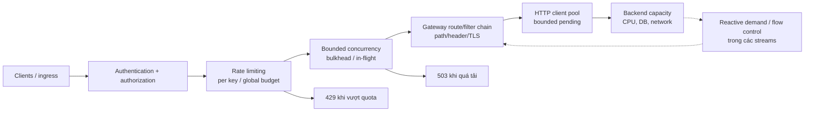
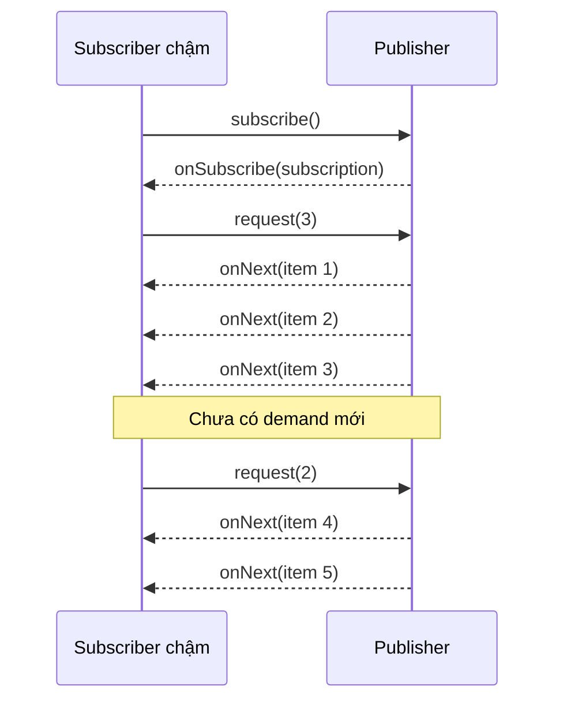
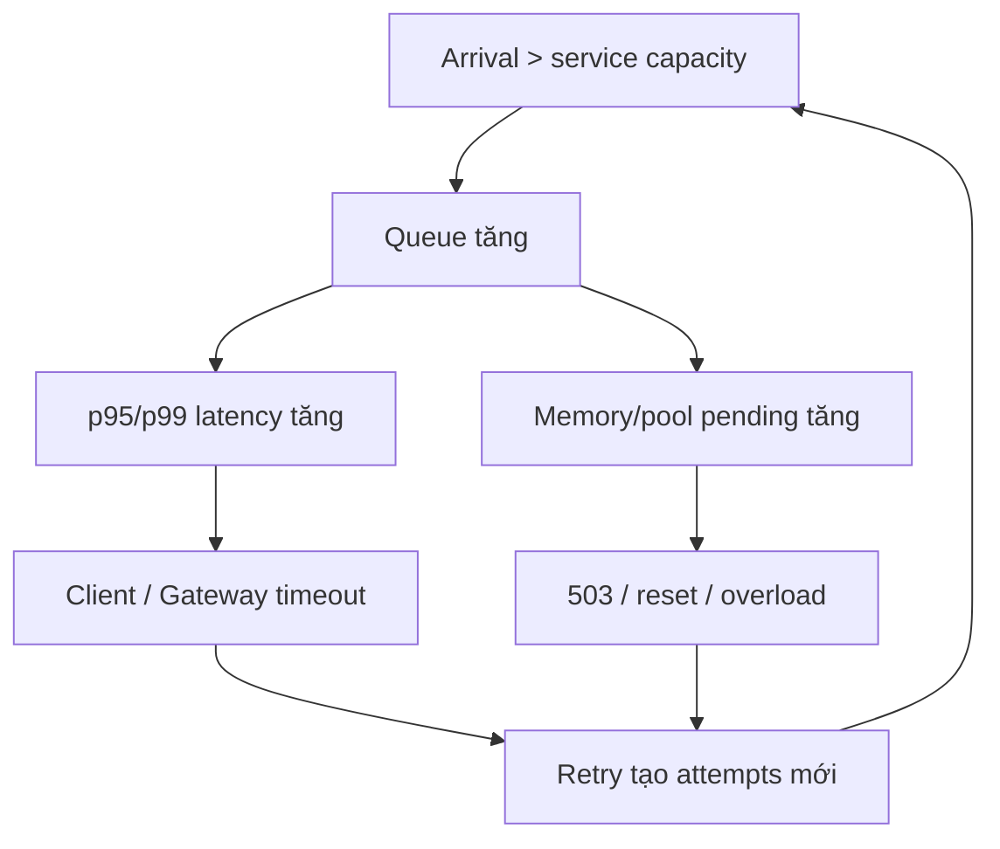
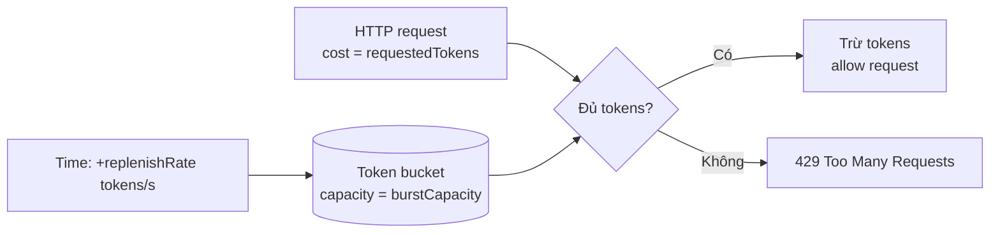
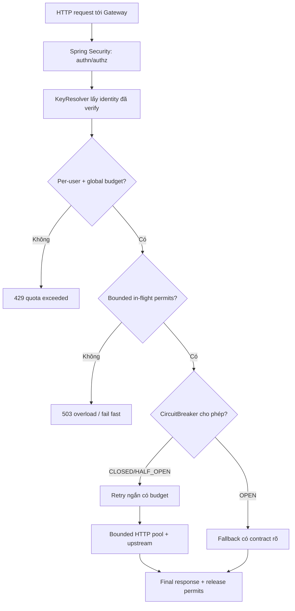
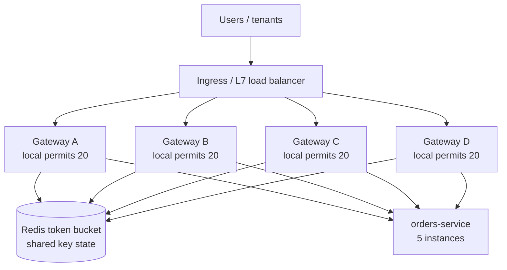

# Cân bằng giữa backpressure, rate limiting và năng lực dịch vụ

Một API Gateway không chỉ cần **định tuyến đúng** mà còn phải giữ hệ thống hoạt động khi số request vượt khả năng của backend. Ví dụ, Gateway nhận 1.000 request/giây nhưng các microservices chỉ xử lý ổn định được 300 request/giây. Dù các filter dùng **Spring WebFlux/Reactor** và không chặn event loop, chúng không thể tạo thêm năng lực CPU, database connections hay downstream capacity. Nếu để requests xếp hàng không giới hạn, thời gian chờ, bộ nhớ, retry và tỷ lệ lỗi có thể tăng cùng lúc.

Ba cơ chế thường bị đánh đồng:

- **Backpressure:** thành phần tiêu thụ trong một luồng reactive báo ngược **nhu cầu dữ liệu** cho upstream, giúp tránh phát dữ liệu nhanh hơn khả năng xử lý.
- **Rate limiting:** kiểm soát **tốc độ request được nhận** trong một khoảng thời gian, thường tính theo user, API key, tenant, route hoặc một ngân sách chung.
- **Giới hạn năng lực phục vụ (capacity/concurrency control):** kiểm soát **bao nhiêu công việc đang chạy đồng thời**, lượng hàng đợi được phép giữ và mức tải tối đa của Gateway/backend.

Bài thuộc chương **Hiệu năng** của module **SPRING_CLOUD_GATEWAY**. Mục tiêu là kết hợp route predicates, filter chain, biến đổi đường dẫn/header, service discovery, authentication, Redis `RequestRateLimiter`, Retry, CircuitBreaker, TLS và observability thành một chiến lược **admission control + backpressure + overload protection** có thể đo lường được.

**Sau bài học, bạn có thể:**

1. Giải thích chính xác vì sao **Reactive Streams backpressure không đồng nghĩa HTTP request rate limiting**.
2. Tính tải vào, tải sau retry, mức đồng thời theo **Little's Law** và giới hạn backend có headroom.
3. Cấu hình Redis token bucket qua `RequestRateLimiter`, `KeyResolver` và những thông số `replenishRate`, `burstCapacity`, `requestedTokens`.
4. Thiết kế giới hạn **per-user/tenant** và **aggregate/global** mà không nhầm lẫn hai loại.
5. Áp dụng một **concurrency limiter** có giới hạn, tránh queue/buffer không kiểm soát.
6. Đọc tín hiệu saturation từ Reactor Netty connection pool, 429/503, p95/p99 và retry attempts.
7. Kiểm thử burst load, sustained overload, Redis failure và quá tải khi backend chậm lại.
8. Chọn phương án từ chối nhanh, bảo vệ công bằng và phục hồi mà không gây retry storm.

> **Phạm vi:** Bài lấy **Spring Cloud Gateway Server WebFlux 5.x** làm ví dụ, với namespace `spring.cloud.gateway.server.webflux.*`. Gateway WebFlux 4.3.x thường sử dụng prefix `spring.cloud.gateway.*` và Gateway Server Web MVC dùng Servlet/HTTP client khác. Xác minh starter và configuration properties của release train đang chạy. Những ngưỡng RPS, số kết nối, timeout và số permits trong bài đều là **giá trị lab minh họa**, không phải cấu hình production mặc định.

## 1. Ba câu hỏi khác nhau về tốc độ và khả năng chịu tải

Hãy hỏi theo thứ tự:

| Câu hỏi | Cơ chế | Phạm vi kiểm soát |
| --- | --- | --- |
| Luồng dữ liệu downstream có đang tiêu thụ chậm hơn nguồn phát? | **Reactive backpressure** | Dữ liệu/items trong một subscription `Flux`/`Publisher` |
| Một người dùng có gửi quá nhiều HTTP requests trong một giây? | **Rate limiting** | Tần suất requests theo key và window/token bucket |
| Hệ thống có đang xử lý quá nhiều calls đang mở? | **Concurrency limit / bulkhead** | Số request/call in-flight |
| Pool outbound HTTP đã hết connection cho upstream chưa? | **Connection pool** | Sockets/channels và pending acquires |
| Backend bắt đầu lỗi hàng loạt? | **Circuit breaker** | Có nên cho call mới tới dependency |
| Lỗi transient có nên thử lại? | **Retry budget** | Số outbound attempts trên một logical request |
| Tổng request có vượt deadline của client? | **Timeout/deadline** | Thời gian của call/request |

**Không có cơ chế nào thay thế hoàn toàn cơ chế còn lại.** Một endpoint có `Flux` “reactive hoàn toàn” vẫn có thể nhận hàng trăm nghìn request mới. Một RedisRateLimiter có thể chặn 429 khi vượt 10 requests/s/user, nhưng **không** chặn 100.000 users mỗi người gửi 9 requests/s. Một fixed connection pool 100 connections có thể giới hạn sockets nhưng vẫn để các calls xếp hàng trước acquire rồi timeout.



Sơ đồ là **cấu trúc mong muốn**; thứ tự thực tế của Spring Security WebFilters, Gateway GlobalFilters, route GatewayFilters và Netty handler phải được kiểm tra trên đúng version. Không giả định vì một filter xuất hiện trước trong tài liệu mà luôn chạy trước mọi filter khác.

## 2. Backpressure trong Reactor thực sự là gì?

Trong **Reactive Streams**, `Subscriber` yêu cầu số phần tử sẽ nhận bằng `Subscription.request(n)`. `Publisher` được phép phát nhiều nhất theo demand đang còn. Đây là cơ chế **điều tiết items trong một subscription**, không phải quota HTTP requests toàn ứng dụng.



Ví dụ đơn giản với Reactor:

```java
import org.reactivestreams.Subscription;
import reactor.core.publisher.BaseSubscriber;
import reactor.core.publisher.Flux;

Flux.range(1, 100)
    .doOnRequest(n -> System.out.println("requested: " + n))
    .subscribe(new BaseSubscriber<Integer>() {
        @Override
        protected void hookOnSubscribe(Subscription subscription) {
            request(3);
        }

        @Override
        protected void hookOnNext(Integer value) {
            System.out.println("received: " + value);
            if (value == 3) {
                request(2);
            }
            if (value == 5) {
                cancel();
            }
        }
    });
```

Đây là **ví dụ giáo dục về Reactive Streams demand**. Nó không mở HTTP sockets, không tạo Redis tokens và không giới hạn số requests từ trình duyệt.

### Các operator cũng thay đổi demand

`limitRate(n)` chia nhu cầu được yêu cầu từ upstream thành những đợt nhỏ hơn. `flatMap` có tham số **concurrency** và **prefetch**, làm thay đổi số inner publishers hoặc số items có thể được chuẩn bị trước.

```java
// Giới hạn số inner calls đồng thời *trong một subscription*.
Flux.fromIterable(productIds)
    .flatMap(id -> lookupProduct(id), 16)
    .limitRate(32);
```

Nếu có 200 HTTP requests độc lập, mỗi request tự dùng `flatMap(..., 16)`, tổng concurrency tiềm năng có thể lên tới **200 × 16**, không phải 16 trên toàn ứng dụng. Giới hạn operator **cục bộ** không tự trở thành **global bulkhead**.

## 3. Non-blocking không có nghĩa tài nguyên vô hạn

WebFlux và Reactor Netty dùng event loops để phục vụ nhiều connections mà không cần một thread blocking cho từng request. Đó là một lợi thế về **hiệu quả sử dụng threads**, không phải bảo đảm vô hạn về tài nguyên.

Vẫn còn những giới hạn:

- CPU để parse TLS/HTTP/JWT, chạy predicates, filters và serialize headers.
- RAM heap/off-heap, Reactor queues, `DataBuffer`, kết nối TLS và buffers.
- Outbound TCP connections, ephemeral ports, file descriptors và connection pool.
- Thread/event-loop scheduling, GC pauses và blocking task vô tình chạy trên event loop.
- Redis QPS/latency nếu mọi request đều hỏi rate limiter.
- Backend workers, database connection pool, cache, disk, message broker.
- Số request đang chờ thời gian phản hồi của downstream.

**Phản ví dụ:** Gateway không block một thread nào nhưng nhận 10.000 stream subscriptions chờ backend 30 giây. Mỗi subscription/socket/metadata vẫn có chi phí; một Netty connection pool nhỏ sẽ có pending acquires; client p95 tăng ngay cả khi JVM CPU thấp.

### Phân biệt backpressure với TCP flow control

TCP có receive window/flow control, HTTP/2 có stream/connection flow control, Reactor có `request(n)`. Chúng liên quan tới **truyền bytes/items**, nhưng không tạo ra một chính sách HTTP-level như “chỉ nhận 200 order requests/s”. Client vẫn có thể mở **nhiều requests mới**. Để từ chối request quá khả năng, cần **admission control**, không chỉ dựa vào Reactive Streams.

## 4. Capacity planning: bắt đầu từ backend, không phải từ số pod Gateway

Giả sử service `orders-service` có:

- **5 healthy instances**.
- Mỗi instance xử lý **100 requests/s** ổn định cho workload đang test.
- Đội vận hành giữ **20% headroom** để chịu burst, deployment và biến động latency.
- Gateway có thể retry một phần request.

Năng lực thô:

\[
C_{\text{raw}}=5 \times 100 = 500\ \text{requests/s}.
\]

Năng lực với headroom:

\[
C_{\text{safe}}=500 \times (1-0{,}20)
=400\ \text{backend attempts/s}.
\]

**Đây là capacity của backend**, không phải capacity của mỗi Gateway pod. Thêm Gateway replicas từ 2 lên 5 **không** biến 400 thành 1.000 backend attempts/s.

### Phân biệt logical requests và outbound attempts

Giả sử 25% requests được Gateway retry **một lần thêm** vì lỗi transient, các requests còn lại không retry. Nếu `p=0,25` là tỷ lệ được retry, kỳ vọng attempts/request:

\[
A=1+p=1{,}25.
\]

Nếu Gateway nhận `\lambda=280` logical requests/s:

\[
\lambda_{\text{out}}
=280 \times 1{,}25
=350\ \text{attempts/s}.
\]

350 thấp hơn `C_safe=400`. Nhưng nếu nhận 400 logical requests/s với cùng tỷ lệ retry:

\[
400 \times 1{,}25 = 500
\]

thì backend đạt **100% năng lực thô**, không còn headroom.

**Tỷ lệ retry không phải hằng số khi backend bão hòa.** Khi latency/errors tăng, tỷ lệ retry có thể tăng theo, khiến throughput outbound tăng tiếp. Vì vậy, capacity plan cần tính **worst-case retry budget**, không chỉ happy-path.

## 5. Little's Law: tốc độ và độ trễ tạo ra concurrency

Trong một hệ thống đủ ổn định, **Little's Law**:

\[
L=\lambda W
\]

Trong đó:

- `L`: số request/call **đang ở trong hệ thống** trung bình.
- `\lambda`: arrival/throughput rate trung bình (requests/s).
- `W`: thời gian trung bình một request ở trong hệ thống (giây).

Nếu Gateway gửi `280` calls/s và mean outbound duration `0,2` giây:

\[
L=280\times0{,}2=56\ \text{in-flight calls}.
\]

Nếu backend chậm lại, `W=1` giây mà Gateway vẫn cố gửi 280 calls/s:

\[
L=280\times1=280\ \text{in-flight calls}.
\]

Cùng **RPS** nhưng concurrency tăng gấp **5 lần** vì latency tăng. Nếu hệ thống chỉ cho 80 calls in flight, phần vượt cần **chờ trong queue có giới hạn** hoặc **bị từ chối**; không thể biến mất nhờ non-blocking.

**Giới hạn của công thức:** Little's Law áp cho hệ thống ổn định/đo đúng phạm vi. Dùng **mean duration** theo cùng tập requests, không lấy p95 thay W để suy chính xác concurrency. Với workload burst và response time phân phối dài, cần load test thêm.

## 6. Vì sao queue không giới hạn làm hệ thống chậm và dễ sập?

Nếu requests đến với tốc độ `\lambda_{\text{in}}` cao hơn tốc độ hoàn thành `\mu` trong một khoảng dài, backlog tăng gần đúng:

\[
\Delta Q/\Delta t \approx
\max(0,\lambda_{\text{in}}-\mu).
\]

Ví dụ đầu vào `400/s` trong khi backend tối đa `300/s`:

\[
\Delta Q/\Delta t \approx 100\ \text{requests/s}.
\]

Sau 10 giây, nếu chưa có rejection và các điều kiện khác không đổi, có thể có khoảng **1.000 requests** bị dồn vào hàng đợi. Hàng đợi càng dài, client càng timeout; client retry lại tạo thêm arrival rate, gây **feedback loop quá tải**.



### Backpressure khác buffering

`onBackpressureBuffer()` không có giới hạn có thể biến chênh lệch tốc độ thành **nợ bộ nhớ**. Nếu nguồn quá nhanh kéo dài, bộ đệm cuối cùng vẫn có thể đầy. **Buffer có giới hạn** chỉ hấp thụ burst ngắn; khi tràn phải có policy rõ: error, drop (nếu dữ liệu mất được), hoặc từ chối request ở tầng nhận.

Một hệ thống request/response transactional thường nên **fail fast có chủ đích** hơn là giữ HTTP calls hàng chục giây để rồi client đã bỏ cuộc.

## 7. Tối ưu ba lớp: tốc độ, đồng thời và hàng đợi

Thiết kế overload protection thường gồm:

1. **Rate limit:** giảm arrival rate dựa trên quota/nguồn tải.
2. **Concurrency limit/bulkhead:** giữ số in-flight calls phù hợp với backend latency.
3. **Bounded queue + deadline:** cho một chút burst, nhưng không tích lũy work không thể hoàn tất trước client timeout.

| Lớp | Ví dụ giới hạn | Khi vượt nên làm gì? |
| --- | --- | --- |
| User quota | 10 req/s/user, burst 20 | 429 `Too Many Requests` |
| Tenant quota | 100 req/s/tenant | 429; quota theo gói dịch vụ |
| Aggregate route/backend | 280 logical req/s (ước lượng) | Admission shed 429/503 theo policy |
| Local in-flight | 20 calls mỗi pod × 4 pods | 503/overload hoặc chờ rất ngắn |
| HTTP pool | 50 active connections/pod | Pending acquire có deadline |
| Buffer/queue | 20 items hoặc một số rất nhỏ | Reject/error khi đầy |
| Backend | 400 attempts/s an toàn toàn cụm | Circuit breaker, horizontal/vertical scaling backend |

**Đừng biến con số thành quy tắc cố định.** Nếu HTTP/2 multiplexing đang bật, **số TCP connections khác số HTTP requests in-flight**. Nếu workload chủ yếu WebSocket/SSE lâu dài, request-duration và active-session capacity cần đo riêng.

## 8. Redis RequestRateLimiter: token bucket hoạt động như thế nào?

`RequestRateLimiter` là một **GatewayFilter Factory** quyết định request có được đi tiếp không; khi bị giới hạn, mặc định trả **HTTP 429** trong Gateway WebFlux. Với `RedisRateLimiter`, thuật toán là **token bucket**.



Ba tham số:

| Tham số | Ý nghĩa | Ví dụ |
| --- | --- | --- |
| `redis-rate-limiter.replenishRate` | Số tokens được bổ sung mỗi giây | `10` tokens/s |
| `redis-rate-limiter.burstCapacity` | Dung lượng tối đa của bucket | `20` tokens |
| `redis-rate-limiter.requestedTokens` | Chi phí mỗi request | `1` token |

Với bucket ban đầu đầy `20` tokens, 20 requests rất sát nhau có thể được nhận (nếu chưa có điều kiện khác); request thứ 21 bị giới hạn. Sau một giây, bucket có thể được bổ sung tối đa khoảng 10 tokens tùy thời gian/thuật toán.

**Không đọc `burstCapacity=20` thành “20 requests/s duy trì mãi”**. Tốc độ bền vững là số tokens nạp lại trên giây chia cho số tokens mỗi request, không phải kích thước bucket.

## 9. Công thức token bucket và lựa chọn cấu hình

Gọi:

- `R` = `replenishRate` (tokens/s),
- `B` = `burstCapacity` (tokens),
- `K` = `requestedTokens` (tokens/request).

Tốc độ request trung bình bền vững xấp xỉ:

\[
r_{\text{sustained}} = \frac{R}{K}\ \text{requests/s}.
\]

Số requests có thể đi cùng burst khi bucket đầy, chưa xét refill trong burst:

\[
N_{\text{burst}} =
\left\lfloor \frac{B}{K}\right\rfloor.
\]

Ví dụ:

| Mục tiêu | R | B | K | Tốc độ dài hạn | Burst đầy bucket |
| --- | ---: | ---: | ---: | ---: | ---: |
| 10 req/s, burst 20 | 10 | 20 | 1 | 10 req/s | 20 |
| 10 req/s, ít burst | 10 | 10 | 1 | 10 req/s | 10 |
| 1 request/60s | 1 | 60 | 60 | 1/60 req/s | 1 |
| 5 req/s, burst 10 | 5 | 10 | 1 | 5 req/s | 10 |
| 20 tokens/s, cost 2 | 20 | 40 | 2 | 10 req/s | 20 |

Spring Cloud Gateway mô tả cụ thể cách dùng `R=1`, `K=60`, `B=60` để đạt xấp xỉ **1 request/phút**, vì `replenishRate` là tokens/s và `requestedTokens` là chi phí một request.

**Không đặt `burstCapacity=0`** để mong “không burst nhưng vẫn nhận 10 req/s”: tài liệu nêu cấu hình này **chặn tất cả requests**. Để có tốc độ tương đối đều, thường đặt `B=R` khi `K=1` và điều chỉnh theo số burst hợp lệ.

## 10. Dependencies cho Redis rate limiter trên Gateway WebFlux

Cấu hình Maven minh họa:

```xml
<!-- WebFlux Gateway; để Spring Boot/Spring Cloud BOM chọn phiên bản. -->
<dependency>
  <groupId>org.springframework.cloud</groupId>
  <artifactId>spring-cloud-starter-gateway-server-webflux</artifactId>
</dependency>

<!-- Redis reactive dùng bởi RedisRateLimiter. -->
<dependency>
  <groupId>org.springframework.boot</groupId>
  <artifactId>spring-boot-starter-data-redis-reactive</artifactId>
</dependency>

<!-- Metrics và quan sát hệ thống. -->
<dependency>
  <groupId>org.springframework.boot</groupId>
  <artifactId>spring-boot-starter-actuator</artifactId>
</dependency>

<dependency>
  <groupId>io.micrometer</groupId>
  <artifactId>micrometer-registry-prometheus</artifactId>
</dependency>
```

Cần Redis Server/cluster kết nối được từ Gateway. Redis đóng vai trò **rate-limit state store**, không tự tạo backend capacity hay sửa nghẽn DB.

### Những điều không được bỏ qua

- Redis phải được bảo vệ network/TLS/auth theo chính sách; không public Internet.
- Redis latency/timeout trở thành **một dependency trên đường xử lý request**.
- Nếu nhiều Gateway pods cần áp quota chia sẻ, các pods phải dùng một **rate-limit state** nhất quán (ví dụ cùng Redis), tránh mỗi pod giữ quota độc lập.
- Mỗi route/key có thể mang state riêng; phải xác minh namespace/key strategy khi muốn một ngân sách **dùng chung nhiều routes**.
- Redis dùng cho `RedisRateLimiter` và Redis làm `RouteDefinitionRepository` có **chức năng khác nhau**, không xóa toàn bộ keys để “reset quota” giữa production.

## 11. KeyResolver: giới hạn ai và theo tiêu chí gì?

`KeyResolver` chọn **khóa rate limit**. Nếu dùng key không đáng tin, client có thể thay đổi giá trị ở mỗi request để né quota.

Ví dụ **WebFlux Java bean**:

```java
package example.gateway.performance;

import java.security.Principal;

import org.springframework.cloud.gateway.filter.ratelimit.KeyResolver;
import org.springframework.context.annotation.Bean;
import org.springframework.context.annotation.Configuration;

@Configuration(proxyBeanMethods = false)
class GatewayRateLimitKeys {

    @Bean
    KeyResolver principalRateKey() {
        return exchange -> exchange.getPrincipal()
            .map(Principal::getName)
            .filter(name -> !name.isBlank());
    }
}
```

**Điều kiện:** Route phải được Spring Security xác thực hợp lệ ở WebFilter chain trước khi dùng `Principal` cho quota. `Principal.getName()` có thể là một tên định danh được Security tạo; hãy bảo đảm **ổn định và không bị user tự giả mạo**. Nếu gateway cho anonymous requests đi tới route, đừng dùng một `anonymousUser` chung mà không chủ đích, vì họ sẽ cùng tranh một bucket hoặc được xử lý như một user thực.

Trong tài liệu Gateway, `PrincipalNameKeyResolver` đã là default key resolver. Khai báo riêng ở đây giúp người học thấy rõ lựa chọn **key = authenticated identity**. Với per-tenant quota, nên dùng **tenant ID từ JWT đã được xác thực** và gắn chính sách membership, không lấy raw `?tenant=...`.

### Không dùng input tự chọn làm quota identity

```java
// CHỈ minh họa lỗ hổng: client tự đổi "user" để né giới hạn.
// Không dùng làm KeyResolver production.
@Bean
KeyResolver unsafeUserKey() {
    return exchange -> Mono.justOrEmpty(
        exchange.getRequest().getQueryParams().getFirst("user"));
}
```

Tương tự, `X-User-ID`/`X-Tenant-ID` từ client không đáng tin, `X-Forwarded-For` có thể bị spoof nếu không có trusted proxy chain và IP có thể trùng do NAT. **KeyResolver là một phần security/quota policy**, không chỉ là thao tác lấy chuỗi.

## 12. Cấu hình route với RequestRateLimiter

Ví dụ **Gateway Server WebFlux 5.x**:

```yaml
spring:
  data:
    redis:
      host: localhost
      port: 6379
  cloud:
    gateway:
      server:
        webflux:
          routes:
            - id: orders-read
              uri: http://localhost:8081
              predicates:
                - Path=/api/orders/**
                - Method=GET
              filters:
                - StripPrefix=1
                - name: RequestRateLimiter
                  args:
                    key-resolver: "#{@principalRateKey}"
                    redis-rate-limiter.replenishRate: 10
                    redis-rate-limiter.burstCapacity: 20
                    redis-rate-limiter.requestedTokens: 1
```

Ở đây:

- `orders-read` chỉ match `GET /api/orders/**`.
- `StripPrefix=1` chuyển `/api/orders/42` thành `/orders/42`.
- Một key identity có tốc độ nạp **10 tokens/s** và burst tối đa **20 tokens**.
- Request bị deny bởi rate limiter thông thường trả **429** thay vì được proxy tới backend.
- `uri: http://localhost:8081` dành cho **lab**; production có thể dùng `lb://orders-service` với LoadBalancer/discovery được cấu hình đúng.

**Không dùng shortcut `RequestRateLimiter=10,20,...`**. Tài liệu chính thức nhấn mạnh filter này **không hỗ trợ** cấu hình shortcut kiểu các GatewayFilter khác; phải dùng `name`/`args`.

### Về empty key

Khi resolver không tìm được key, Gateway mặc định **deny** theo tài liệu. Status cụ thể và property cấu hình cần kiểm chứng theo version. **Không ép anonymous thành key ngẫu nhiên trên mỗi request** để “sửa lỗi 429”: cách đó vô hiệu quota. Cần yêu cầu authentication hoặc thiết kế bucket anonymous có giới hạn riêng.

## 13. RedisRateLimiter và fair use: một key không phải toàn bộ hệ thống

Giả sử mỗi user có quota `10 req/s`, nhưng có **100 users** đang hoạt động. Tổng request khả dĩ:

\[
100 \times 10 = 1.000\ \text{req/s}.
\]

Nếu backend chỉ an toàn ở **400 attempts/s**, Redis token bucket **theo user** không thể ngăn aggregate overload. Một người dùng sẽ không vượt quota, nhưng **cả hệ thống vẫn vượt capacity**.

### Các lớp ngân sách

| Quota | Key đề xuất | Mục tiêu |
| --- | --- | --- |
| Per-user | Authenticated user ID, tenant-bound | Chống một user gây tải quá mức |
| Per-tenant | Tenant ID đã verify | Công bằng theo hợp đồng |
| Per-client/application | OAuth2 client ID đã verify | Chặn một ứng dụng tích hợp |
| Per-route | Route ID + key | Chính sách API cụ thể |
| Per-backend aggregate | Service identity/capacity group | Bảo vệ năng lực chung của backend |
| Per-pod concurrency | Local in-flight permits | Bảo vệ memory/sockets của Gateway instance |

Một hệ thống tốt thường cần **ít nhất per-key quota và aggregate capacity budget**. Với một endpoint chi phí lớn, có thể thêm **weighted cost** (ví dụ mỗi request loại báo cáo tốn 5 tokens thay vì 1), nhưng chi phí phản ánh tải thực tế cần benchmark trước.

### Nhiều RequestRateLimiter trên cùng route?

Có thể nghĩ tới hai filter nối tiếp: một limiter user và một limiter toàn backend. **Cẩn trọng:** Hai phép trừ tokens **không tạo thành một giao dịch nguyên tử** chỉ vì cùng nằm trong filter chain. Nếu limiter đầu tiêu thụ token rồi limiter sau từ chối, quota đầu có thể đã bị trừ. Cần chính sách rõ cho tính công bằng, thứ tự và failure behavior.

Với nhu cầu aggregate chính xác trên nhiều routes/pods, cân nhắc **custom admission-control service/RateLimiter** có semantics kiểm soát thống nhất, hoặc global load-shedding tại edge/mesh, đồng thời test tính nhất quán.

## 14. Kết hợp tốc độ theo user với backend-wide budget

Giả sử:

- Backend chịu **400 attempts/s an toàn**.
- Dự báo mỗi logical request tốn trung bình **1,25 attempts** do retry.
- Chọn **280 logical requests/s** để có thêm headroom.
- Một user bình thường có thể đạt 10 req/s, burst 20.
- Có 4 Gateway pods.

Thiết kế:

```text
Client (user key)
  └── Per-user RedisRateLimiter: 10 req/s, burst 20
       └── Aggregate admission budget: ~280 logical req/s
            └── Local in-flight limiter: ví dụ ~20 calls/pod
                 └── HTTP client + backend
```

**Không suy từ `4 Gateway pods × 280 req/s = 1.120 req/s`.** Nếu 280 là budget **toàn bộ backend**, cần thực thi giới hạn dùng chung hoặc phối hợp quy mô pods. Nếu chia tĩnh đều, mỗi pod có budget 70 req/s, nhưng cách này **phân bổ không công bằng khi traffic lệch** (pod A có thể bão hòa trong khi B rảnh). Một token bucket global có thể linh hoạt hơn nhưng phụ thuộc độ trễ/độ sẵn sàng của state store.

**Không dùng một key constant chia sẻ cho mọi user mà không có fairness policy**, vì khách hàng ồn nhất có thể chiếm hết tokens trước khách hàng quan trọng. Có thể phối hợp quota cá nhân, quota tenant và global load shedding.

## 15. Concurrency limiter: bảo vệ số request đang chạy

Rate limit đo **requests/giây**; concurrency limiter đo **số công việc hiện tại**. Ví dụ 280 req/s và mean duration 200 ms cho khoảng 56 concurrent calls. Có thể bắt đầu test với **80 permits tổng** để chứa biến động, nhưng đây chưa phải ngưỡng production được chứng minh.

Nếu 4 Gateway pods chia đều, có thể đặt **20 permits mỗi pod**. Tuy nhiên, tổng đúng 80 chỉ khi cả bốn pods có cùng config và được phân phối đều; pod bị mất, thêm pod, rolling deployment hoặc ingress skew sẽ thay capacity thực tế. Local permits **không** là global quota.

### Bulkhead có ý nghĩa gì?

**Bulkhead** cô lập mức đồng thời để một dependency chậm không chiếm hết tài nguyên của các routes khác:

```text
catalog-service: in-flight tối đa 40
orders-service:  in-flight tối đa 20
reports-service: in-flight tối đa 10

Không dùng một queue vô hạn chung cho mọi backend.
```

Nếu `reports-service` đang chậm, nó chỉ dùng hết quota riêng; `orders-service` vẫn còn permits, giúp tránh cascading failure.

Spring Cloud CircuitBreaker/Resilience4j có hỗ trợ **Reactive Bulkhead** theo `SemaphoreBulkhead` cho reactive chains. Nhưng **không mặc định** rằng chỉ thêm `CircuitBreaker` route filter sẽ tự áp đúng bulkhead mong muốn trên mọi version/configuration. Cần kiểm tra dependency/auto-config và test số in-flight calls thực.

## 16. Java GlobalFilter minh họa fail-fast theo in-flight permits

Ví dụ sau giải thích nguyên lý **local concurrency admission** trong Gateway WebFlux. Nó **không phải triển khai production tổng quát**: áp dụng cho mọi routes đã match và chỉ kiểm soát **một JVM**; không biết per-backend capacity, HTTP/2 streams hay multiple pods.

```java
package example.gateway.performance;

import java.util.concurrent.Semaphore;

import org.springframework.cloud.gateway.filter.GatewayFilterChain;
import org.springframework.cloud.gateway.filter.GlobalFilter;
import org.springframework.core.Ordered;
import org.springframework.http.HttpStatus;
import org.springframework.stereotype.Component;
import org.springframework.web.server.ServerWebExchange;
import reactor.core.publisher.Mono;

@Component
public final class LocalInFlightGuard implements GlobalFilter, Ordered {

    private final Semaphore permits = new Semaphore(80);

    @Override
    public Mono<Void> filter(
            ServerWebExchange exchange,
            GatewayFilterChain chain) {

        return Mono.defer(() -> {
            // Không block Netty event loop để chờ permit.
            if (!permits.tryAcquire()) {
                exchange.getResponse()
                    .setStatusCode(HttpStatus.SERVICE_UNAVAILABLE);
                return exchange.getResponse().setComplete();
            }

            // Release khi normal completion, error hoặc cancellation.
            return chain.filter(exchange)
                .doFinally(signal -> permits.release());
        });
    }

    @Override
    public int getOrder() {
        return -50;
    }
}
```

**Điều quan trọng:**

- `Semaphore.tryAcquire()` không chờ/block.
- `Mono.defer` tạo quyết định acquire khi subscription xảy ra.
- `doFinally` nhả permit trên success, error hoặc cancellation của chain.
- 503 ở đây có nghĩa **Gateway đang từ chối do quá tải**, khác với 429 do quota client.
- `getOrder=-50` là **ví dụ**, không phải thứ tự chuẩn: phải xem **combined filter chain** so với `RequestRateLimiter` và filter khác.
- Nếu một route quan trọng cần 20 permits còn route khác 60, **không dùng một semaphore 80 chung** mà coi đã được bảo vệ công bằng.
- Nếu Gateway pod chết giữa request, semaphore trong process cũng biến mất; không có “distributed permit” được nhả qua Redis.
- Custom filter không thay thế input/body size limits, response timeout hoặc outbound connection pool.
- Nếu retry filter nằm **bên trong** guard, một logical request có thể giữ permit trong toàn thời gian attempts/backoff; nếu nằm ngoài, mỗi attempt có thể acquire riêng. Kiểm thử semantics thực.

Để production-ready, bổ sung **route/service keying, metrics, cấu hình động an toàn, shutdown behavior, fairness và load tests**. Nếu dùng framework bulkhead có sẵn, ưu tiên cơ chế đã được hỗ trợ/test hơn việc tự phát triển concurrency primitive phức tạp.

## 17. Reactor Netty HTTP client pool: giới hạn sockets, không thay limiter

Gateway WebFlux dùng Reactor Netty HTTP client để proxy HTTP upstream. Một fixed pool có thể giới hạn số connections và thời gian chờ acquire:

```yaml
spring:
  cloud:
    gateway:
      server:
        webflux:
          httpclient:
            connect-timeout: 1000     # milliseconds
            response-timeout: 2s      # Duration
            pool:
              type: fixed
              max-connections: 100
              acquire-timeout: 300   # milliseconds
              metrics: true
```

**Các điểm cần đọc đúng:**

- `pool.type: fixed` cho phép đặt giới hạn active connection thông qua `max-connections`.
- `acquire-timeout` là thời gian chờ lấy connection cho fixed pool, **tính bằng mili giây** theo config properties Gateway.
- `connect-timeout` là thời gian thiết lập kết nối TCP, cũng **milliseconds**.
- `response-timeout` global sử dụng `Duration` (ví dụ `2s`).
- `pool.metrics: true` bật theo dõi Reactor Netty connection provider, khi registry phù hợp.
- Những giá trị là **lab**, không phải lựa chọn tốt mặc định cho mọi backend.

**Không đồng nhất `max-connections=100` với “100 HTTP requests toàn gateway”**. Pool có thể có nhiều remote addresses/pool identities và HTTP/2 multiplexing khác HTTP/1.1. Connection limit giúp giới hạn một dạng tài nguyên nhưng chưa phải per-user quota hoặc global concurrency policy.

### Cần có queue deadline

Nếu mọi connections đều bận, request chờ acquire. Pending quá nhiều làm latency tăng và vẫn chiếm memory/metadata. Chọn timeout phù hợp **client deadline**; hạn chế tổng số pending khi HTTP client/framework hỗ trợ và kiểm tra behavior hiện hành. Nếu policy cần **từ chối ngay**, hãy dùng concurrency/admission guard ở trước outbound pool, không chờ pool tự rơi vào timeout.

## 18. Backpressure trong body/stream: giới hạn buffer và concurrency

Trong một pipeline chuyển đổi dữ liệu:

```java
Flux<Product> products = fetchProducts();

return products
    .flatMap(this::enrichProduct, 16)
    .limitRate(32);
```

- `flatMap(..., 16)` hạn chế tối đa khoảng 16 inner publishers **của subscription này**.
- `limitRate(32)` định hình upstream demand.
- Cả hai **không** đặt global Gateway RPS limit.
- Nếu `enrichProduct` dùng một client blocking, không đưa trực tiếp vào Reactor Netty event loop. Cần tách blocking work sang scheduler thích hợp hoặc thay bằng reactive client và giới hạn concurrency.

### Không buffer vô hạn

```java
// PHẢN VÍ DỤ cần tránh với nguồn push nhanh:
// sink nhiều events dùng onBackpressureBuffer() không giới hạn,
// trong khi consumer thường xuyên chậm hoặc mất kết nối.
Sinks.Many<Event> sink =
    Sinks.many().unicast().onBackpressureBuffer();
```

Reactor documentation nêu sink unicast dạng trên **có thể buffer không giới hạn theo mặc định**. Nếu use case cần buffering, dùng **bounded queue**/publisher policy thích hợp, kiểm tra cơ chế tràn và memory budget.

```java
// Minh họa bounded buffer cho một stream có thể báo lỗi khi quá tải.
// Không dùng để lưu đơn hàng hoặc tiền nếu loss/replay chưa được thiết kế.
Flux<Event> controlled = source
    .onBackpressureBuffer(64);
```

Khi quá số phần tử chưa xử lý, Reactor có thể **error/cancel** theo overload policy của operator thay vì giữ vô hạn. Với các stream telemetry mà **được phép mất dữ liệu**, có thể thiết kế drop/sampling rõ ràng; với orders/payments cần broker durable/ack/replay, không âm thầm drop.

### DataBuffer và request body

Các filters `ModifyRequestBody`, `CacheRequestBody` hoặc Retry với request body có thể **tập hợp/copy body vào bộ nhớ**. Đây là một giới hạn khác so với demand của `Flux`. Hãy đặt request-size limits, kiểm thử large uploads, cancel cleanup và tránh retry POST body lớn vô điều kiện.

## 19. Rate limiting không đo thời gian sử dụng backend

Một user được phép 10 req/s. So sánh hai loại request:

| Request | Backend duration | In-flight trung bình khi 10 req/s |
| --- | ---: | ---: |
| GET cache hit | 20 ms | 0,2 calls |
| GET báo cáo phức tạp | 2 giây | 20 calls |
| SSE giữ stream | 10 phút | Không nên tính như JSON GET |
| WebSocket session | Nhiều giờ | Cần concurrent-session quota riêng |

Cùng **10 req/s** nhưng tải concurrency và memory **rất khác**. Do vậy, rate limiting có thể cần phân lớp theo **chi phí endpoint**:

- Cheap reads: quota cao hơn.
- Heavy reporting: quota thấp và concurrency cap thấp.
- Upload: body size/bandwidth và concurrent uploads.
- SSE: active streams, duration, per-user sessions.
- WebSocket: handshake rate **và** active socket/session count.
- Writes: idempotency/rate cap và bảo vệ DB.

**Không áp cùng Redis token cost=1 và cùng concurrency cap cho mọi API** rồi kết luận hệ thống công bằng về tài nguyên. Một request báo cáo nặng có thể tốn nhiều backend capacity hơn mười cache hits.

## 20. Retry có thể phá cân bằng tải như thế nào?

Giả sử backend nhận 300 logical requests/s; 20% bị lỗi timeout và mỗi request lỗi được retry **một lần**:

\[
\lambda_{\text{out}}=300(1+0{,}2)=360\ \text{attempts/s}.
\]

Nếu 50% lỗi:

\[
\lambda_{\text{out}}=300(1+0{,}5)=450\ \text{attempts/s}.
\]

Backend vốn an toàn ở 400 attempts/s thì sau khi lỗi tăng, **retry tự đẩy nó lên 450** — đúng lúc cần giảm tải.

### Quy tắc tránh retry storm

1. Retry chỉ với lỗi **transient** và request có semantics **idempotent**.
2. Dùng **số attempts tối đa**, backoff và jitter có giới hạn.
3. Có deadline tổng, không để client timeout trước khi Gateway kết thúc loạt retries.
4. Không retry `401`/`403`; thận trọng với `429`/`503` do overload.
5. Tránh retries đồng thời ở client, ingress, Gateway và backend.
6. Có **retry budget** riêng và metrics `outbound attempts / logical requests`.
7. Khi breaker OPEN hoặc backend saturation rõ rệt, **shed/load-limit** thay vì gửi thêm attempts.
8. Nếu Retry đặt sau admission guard, phải hiểu liệu token/permit được dùng **một lần cho logical request** hay **mỗi attempt**.

Tài liệu Spring Cloud Gateway Retry ghi rõ: **những filters đứng sau Retry có thể được thực thi lại**. Vì vậy thứ tự `RequestRateLimiter`, Retry, custom filters và CircuitBreaker quyết định cách quota/metrics được tính. Không đoán bằng tên filter; dùng backend request journal trong integration test.

## 21. CircuitBreaker và bulkhead bổ sung cho nhau

CircuitBreaker nhận diện upstream có nhiều lỗi/slow và từ chối sớm những calls mới khi OPEN. **Bulkhead** giới hạn số calls đồng thời **ngay cả khi breaker đang CLOSED**.

| Trạng thái | Rate limiter | Bulkhead | CircuitBreaker |
| --- | --- | --- | --- |
| Traffic bình thường | Cho phép trong quota | Cho trong permits | CLOSED cho đi |
| Một tenant spam | 429 theo tenant | Chưa cần full | Có thể vẫn CLOSED |
| Backend chậm nhưng chưa nhiều 5xx | Quota không đổi | Permits đầy, shed | Có thể mở do slow-call threshold nếu cấu hình |
| Backend trả 503 liên tục | Không tự hiểu backend unhealthy | Chặn overload | OPEN sau đủ failures |
| CircuitBreaker OPEN | Quota vẫn là policy riêng | Chưa cần outbound permits nếu order phù hợp | Short-circuit + fallback |
| Backend phục hồi | Quota vẫn bảo vệ traffic | Giới hạn concurrent probes | HALF_OPEN → CLOSED |

**Sai lầm:** “Đã có CircuitBreaker nên không cần concurrency limit”. Breaker thường cần đủ mẫu và có thể chưa mở trong một burst vài trăm request; concurrency guard **giới hạn ngay**.

### Reactive Bulkhead và dependency

Trong Spring Cloud CircuitBreaker/Resilience4j, **ReactiveResilience4jBulkheadProvider** bọc `Mono`/`Flux` bằng `SemaphoreBulkhead`, tránh dùng fixed blocking thread pool cho reactive pipeline. Cần xác minh integration và factory thực sự được sử dụng ở version đang triển khai.

Không mặc định rằng cứ khai báo:

```yaml
resilience4j:
  bulkhead:
    instances:
      ordersBulkhead:
        maxConcurrentCalls: 20
```

thì mọi route `orders-read` tự động chịu cap 20. Đây là **cấu hình một instance bulkhead**; phải còn có **chỗ bọc Gateway call** dùng đúng name/factory. Kiểm chứng bằng load test in-flight count và bulkhead rejection metrics.

## 22. Thứ tự điều khiển tải và lỗi nghiệp vụ

Một thiết kế **logic** cho route đã bảo vệ:



**Không coi đây là thứ tự tự động mặc định của framework.** Spring Security chạy trong WebFilter chain; `GlobalFilter` và `GatewayFilter` có cách kết hợp/ordering riêng. Một filter đặt trước hoặc sau Retry/breaker tạo ra semantic khác (đếm logical request vs attempts). Phải kiểm thử request journal, counter Redis và breaker state.

### Từ chối đúng thời điểm

Nếu security đã từ chối request `401/403`, không cần tiêu tốn quota backend. Nếu rate limiter đã trả `429`, không nên mở outbound connection. Nếu concurrency guard không có permits, không nên giữ request trong queue hàng giây rồi mới trả `503`.

**Một policy chỉ có giá trị nếu ở đúng chỗ** trong data path; filter bị thực thi quá muộn có thể không giảm tải những bước tốn kém trước nó.

## 23. Chọn 429, 503, 504 và Retry-After cho đúng

| HTTP status | Khi nào phù hợp | Client nên hiểu |
| --- | --- | --- |
| `429 Too Many Requests` | Client/tenant vượt quota đã công bố | Giảm tốc, backoff theo quota |
| `503 Service Unavailable` | Gateway/backend tạm quá tải/không sẵn sàng | Có thể thử lại **có kiểm soát**, không ngay lập tức vô hạn |
| `504 Gateway Timeout` | Gateway đợi upstream quá deadline, theo error mapping | Không chắc backend chưa xử lý |
| `401 Unauthorized` | Chưa xác thực | Đăng nhập/lấy token hợp lệ; không retry tải |
| `403 Forbidden` | Không có quyền | Không dùng retry để vượt |
| `502 Bad Gateway` | Gateway gặp lỗi proxy/upstream | Chẩn đoán DNS/TLS/reset/upstream |

**`RequestRateLimiter` mặc định trả 429** theo tài liệu. Với custom local guard ví dụ `503` ở mục 16, đây là sự lựa chọn trong code, không phải status mặc định của Spring Cloud Gateway khi hết pool.

### Retry-After

Theo HTTP semantics, `Retry-After` có thể giúp client biết **khi nào thử lại**. Nhưng Spring Cloud Gateway **không tự tính một Retry-After chính xác cho mọi Redis token bucket/503 overload**. Nếu thêm header qua policy tùy biến, phải bảo đảm thời gian phản ánh thực tế và không khuyến khích hàng nghìn clients retry đồng loạt.

Client nên có **exponential backoff + jitter**, giới hạn attempts/deadline, không phụ thuộc vào một header luôn có mặt. Với `POST` không idempotent, ngay cả `Retry-After` cũng **không** làm retry trở nên an toàn.

## 24. Redis outage: rate limiter là một dependency mới

Nếu Redis timeout khi Gateway đang kiểm tra tokens, điều gì xảy ra?

**Không có câu trả lời fail-open hay fail-closed đúng cho mọi phiên bản/tùy biến.** Implementation, error mapping và fallback logic của ứng dụng quyết định. Bạn phải **test chính binary** đang chạy bằng cách dùng Toxiproxy hoặc một Redis container trong staging rồi cắt kết nối.

Hai hướng chính sách:

| Hướng | Lợi ích | Rủi ro |
| --- | --- | --- |
| **Fail-closed** | Không cho traffic không kiểm soát vào backend | Request hợp lệ có thể bị từ chối khi Redis down |
| **Fail-open** | Giữ availability tạm thời | Có thể gây overload toàn backend hoặc mở đường abuse |
| **Degraded mode có giới hạn local** | Duy trì một mức phục vụ nhỏ, có hard cap | Cần code/test cẩn thận, không còn quota toàn cluster chính xác |

**Không đổi từ fail-closed sang fail-open bằng cách nuốt mọi exception `onErrorResume(e -> allowAll)`**. Nếu muốn degraded mode, phải có **local concurrency cap, emergency aggregate budget, alert và thời hạn bật**. Với API nhạy cảm (thanh toán/quota bảo mật), fail-closed có thể phù hợp hơn; với API đọc công khai critical, có thể thiết kế phương án khác.

### Metric đặc biệt cần quan sát

- Redis command latency/errors, timeout rate.
- Tỷ lệ 429 theo route/key class (không raw user ID).
- RPS được nhận vs bị từ chối.
- Backend 5xx/p95/pool pending khi Redis lỗi.
- Redis pool/saturation, network errors.
- Thời gian Gateway đứng chờ quota decision.

## 25. Cache, service discovery và giới hạn tài nguyên

Không phải mọi request có chi phí giống nhau. Một route `GET /catalog/items/42` cache hit có thể rất rẻ; `GET /reports/monthly` có thể gọi nhiều services và database.

Một số cách giảm tải **trước** khi tăng rate limit:

- Cache đúng GET public/được phép cache theo contract, TTL rõ và bảo vệ tenant/PII.
- Gộp những calls trùng khi có thể mà không làm mất isolation.
- Tối ưu backend query/index và số kết nối DB.
- Giảm N+1 calls ở Gateway/Backend For-Each logic.
- Tách heavy routes ra worker/queue asynchronous có job ID khi nghiệp vụ cho phép.
- Điều chỉnh response compression, TLS connection reuse, HTTP keep-alive.
- Dùng LoadBalancer/discovery để phân phối tới **healthy instances**, nhưng không nhầm phân phối với tổng capacity.
- Đặt timeout và breaker phù hợp để một backend không giữ connections quá lâu.

**Cẩn thận với cache:** Đừng cache responses chứa user-specific data trên shared cache mà thiếu key/authorization boundary. Cache không thể là giải pháp tổng quát cho POST hay streaming WebSocket.

## 26. Chi phí kết nối và TLS khi scale

Một Gateway WebFlux thường nhận HTTPS ở edge và mở HTTP(S) tới upstream. Khi tăng số pods, có những chi phí khác ngoài RPS:

- TLS handshake CPU nếu connection reuse thấp.
- Số outbound connections tổng cộng tới backend.
- DNS queries và cache lifecycle.
- LB/ingress target connections.
- Socket/file descriptor limits.
- JVM direct memory buffers/Netty allocator.
- Redis connections/requests cho rate limiting.

Ví dụ 4 Gateway pods mỗi pod có fixed pool max 100 connections tới cùng backend **có thể** tạo tới nhiều trăm outbound connections tùy pool/remote address, không phải toàn bộ chỉ 100. Nếu thêm pods thành 10, backend/DB có thể thấy concurrency tăng đáng kể.

**Không tăng `max-connections` và Gateway replicas cùng lúc rồi mong latency tự giảm.** Khi bottleneck nằm ở DB, bạn chỉ tăng số requests đang đợi DB và p99 có thể tệ hơn.

## 27. Metrics bắt buộc để thấy cân bằng hay mất cân bằng

| Tín hiệu | Lý do |
| --- | --- |
| `spring.cloud.gateway.requests` theo routeId, status, method | RPS và kết quả logical client requests |
| Rate-limit accepted/rejected counts | Có đang shed đúng quota? |
| `429` theo route/tenant class | Có client bị giới hạn bất thường? |
| `503` theo source (gateway guard/backend/breaker) | Phân biệt overload với dependency outage |
| p50/p95/p99 và latency SLO | Queueing tăng trước 5xx |
| Outbound attempts per logical request | Retry amplification |
| Reactor Netty active/max/pending connections | Pool saturation |
| Pool pending acquire duration | Thời gian chờ connection |
| JVM heap/direct memory, GC, CPU throttling | Khả năng chạy Gateway |
| Redis latency/command errors | Quota decision bottleneck |
| Backend p95/5xx, DB pool/queue | Nút nghẽn thực ở đâu |
| CircuitBreaker OPEN/half-open/fallback | Upstream có đang bị bảo vệ |
| Active WS/SSE sessions | Capacity đặc thù streaming |
| Per-pod/cluster revision/config | Phát hiện quota không đồng bộ giữa replicas |

Tài liệu Gateway WebFlux mô tả timer `spring.cloud.gateway.requests` khi Actuator/Gateway metrics được bật. Với Prometheus, Micrometer Timer thường xuất `spring_cloud_gateway_requests_seconds_count`, `_seconds_sum` và histogram `_bucket` khi được cấu hình.

### Bật Netty pool metrics

```yaml
spring:
  cloud:
    gateway:
      server:
        webflux:
          httpclient:
            pool:
              metrics: true

management:
  endpoints:
    web:
      exposure:
        include: health,metrics,prometheus
```

**Nhớ:** Namespace có thể khác ở version 4.x. `management.endpoints.web.exposure.include` chỉ expose endpoint, **không tự bảo vệ nó**. Phải giới hạn ở management network, TLS/auth/RBAC. Không expose topology/metrics công khai.

## 28. PromQL: Traffic, 429, 5xx và pool pending

**Kiểm tra metric names/labels trên chính binary** trước khi dùng query. Trong một số hệ thống, label `httpStatusCode` có thể khác theo version/exporter.

RPS đã đi qua Gateway route metrics:

```promql
sum by (routeId) (
  rate(spring_cloud_gateway_requests_seconds_count{
    job="gateway-prod"
  }[5m])
)
```

RPS bị 429 (nếu các 429 của RequestRateLimiter đã được Gateway timer ghi nhận trên route tương ứng):

```promql
sum by (routeId) (
  rate(spring_cloud_gateway_requests_seconds_count{
    job="gateway-prod",
    httpStatusCode="429"
  }[5m])
)
```

RPS 5xx:

```promql
sum by (routeId) (
  rate(spring_cloud_gateway_requests_seconds_count{
    job="gateway-prod",
    httpStatusCode=~"5.."
  }[5m])
)
```

Pending outbound connections:

```promql
sum by (instance, name) (
  reactor_netty_connection_provider_pending_connections{
    job="gateway-prod"
  }
)
```

**Không dùng mỗi 429 làm bằng chứng quota đang hoạt động đúng.** Nếu request bị chặn trước route match/Security, Gateway route timer có thể không nhìn thấy. Cần metrics ở lớp admission của bạn và HTTP server/ingress, cùng **backend request journal** trong load tests.

### Sự khác nhau giữa rejected và saturated

Một hệ thống tốt có thể có 429 tăng do áp quota, trong khi p95 của **accepted** requests và backend 5xx vẫn thấp. Đó là bằng chứng cơ chế bảo vệ có thể đang hoạt động đúng.

Ngược lại, nếu 429 giảm nhưng backend 503 và pool pending tăng, có thể đội vận hành vừa **nới quota quá mức**. Không tối ưu một metric đơn lẻ.

## 29. Thiết kế một buổi load test có ý nghĩa

Để chọn rate limiter và concurrency permits, cần benchmark workload thật thay vì lấy số tùy ý.

### Chuẩn bị môi trường

1. Có Gateway WebFlux, Redis và một backend test với profile traffic gần production.
2. Có tối thiểu một endpoint cheap read, một endpoint slow/heavy và một response lỗi có thể điều khiển.
3. Dùng test identity/tokens thật sự được Security chấp nhận, không tin `X-User` do client tự gửi.
4. Đo backend throughput khi chạy **không có Retry**, tăng RPS tới khi p95 hoặc error rate vượt SLO.
5. Ghi nhận capacity của backend ở từng số instances.
6. Bật per-user RedisRateLimiter và quan sát 429/burst behavior.
7. Bổ sung aggregate admission/concurrency guard, chạy lại cùng tải.
8. Bật Retry có giới hạn, xem outbound attempts tăng và capacity giảm.
9. Tăng backend response time để mô phỏng saturation.
10. Thử Redis failure, pod restart và traffic lệch giữa Gateway replicas.

### Open-loop và closed-loop load generators

Một load generator tạo **arrival rate độc lập với response latency** (open-loop) giúp phát hiện overload thật. Nếu client cứ **chờ response xong mới gửi request tiếp** (closed-loop) thì khi backend chậm, tốc độ sinh request cũng giảm; kết quả có thể **che** phần tải mà production clients/queues thực vẫn tạo ra.

**Đừng dùng load test không giới hạn lên production**. Kết quả của buổi test là baseline cho cấu hình, không phải cơ hội cố làm sập hệ thống thật.

## 30. Ví dụ k6 với arrival-rate kiểm soát

Script **minh họa** dùng k6 và **nhiều test access tokens từ IdP staging**. Không hard-code JWT trong source và không log token.

```javascript
import http from "k6/http";
import { check } from "k6";
import { Counter, Trend } from "k6/metrics";

const rejected429 = new Counter("gateway_rejected_429");
const unavailable503 = new Counter("gateway_unavailable_503");
const successLatency = new Trend("accepted_latency_ms", true);

const baseUrl = __ENV.BASE_URL || "http://127.0.0.1:8080";
const tokens = (__ENV.TEST_TOKENS || "")
  .split(",")
  .map(x => x.trim())
  .filter(Boolean);

if (tokens.length === 0) {
  throw new Error("Provide staging-only TEST_TOKENS securely");
}

export const options = {
  scenarios: {
    controlled_arrivals: {
      executor: "ramping-arrival-rate",
      startRate: 30,
      timeUnit: "1s",
      preAllocatedVUs: 100,
      maxVUs: 300,
      stages: [
        { target: 100, duration: "1m" },
        { target: 250, duration: "2m" },
        { target: 400, duration: "2m" },
        { target: 100, duration: "1m" }
      ]
    }
  }
};

export default function () {
  // Các tokens phải đại diện nhiều authenticated principals
  // thực, không phải cùng token copy nhiều lần.
  const token = tokens[(__VU - 1) % tokens.length];

  const res = http.get(
    baseUrl + "/api/orders/42",
    {
      headers: { Authorization: "Bearer " + token },
      timeout: "5s"
    }
  );

  if (res.status === 429) rejected429.add(1);
  if (res.status === 503) unavailable503.add(1);
  if (res.status >= 200 && res.status < 400) {
    successLatency.add(res.timings.duration);
  }

  check(res, {
    "response is 2xx, 3xx, 429 or controlled 503": r =>
      (r.status >= 200 && r.status < 400) ||
      r.status === 429 || r.status === 503
  });
}
```

### Cách đọc bài test

- Với **một token duy nhất**, per-user quota 10 req/s sẽ chặn phần lớn traffic; **không** dùng kết quả đó để ước lượng aggregate backend capacity.
- Dùng nhiều tokens/principals/tenants có policy phù hợp để tạo tổng tải; bảo đảm không vượt quyền test.
- k6 có giới hạn số virtual users; kiểm tra `dropped_iterations` để biết load generator có tạo được desired arrival rate hay không.
- `http_req_duration` mặc định bao gồm cả 429 nhanh, vì vậy xem thêm metric `accepted_latency_ms` và backend p95 để không che latency.
- Ghi lại actual completed RPS, 429/503, backend attempts và số connections, không chỉ target arrival rate.
- Một 503 do custom load shed khác với 503 do backend outage; dùng correlation/metrics riêng để phân biệt.

Chỉ chạy ở staging/lab được phép, có stop conditions nếu Redis/DB/shared backend vượt giới hạn.

## 31. Bộ test acceptance để đánh giá cân bằng tải

| Test | Given | When | Then |
| --- | --- | --- | --- |
| T01 | Một user, bucket đầy 20 | Burst 20 GET gần như cùng lúc | Có thể accept tối đa theo 20 tokens, theo timing |
| T02 | Một user, bucket đã cạn | Gửi thêm requests ngay | 429, backend không thấy denied requests |
| T03 | 100 users, mỗi người dưới quota | Tổng RPS vượt backend safe capacity | Aggregate admission/bulkhead shed tải; p95 accepted bảo vệ |
| T04 | Backend mean 200ms | 280 req/s | In-flight gần mức dự báo, có headroom |
| T05 | Backend mean tăng lên 1s | Arrival giữ nguyên | In-flight guard/pool không tăng vô hạn |
| T06 | Retry 20% một lần | 300 logical req/s | Outbound attempts xấp xỉ 360/s |
| T07 | CircuitBreaker OPEN | Gửi GET | Upstream attempts mới giảm về 0 theo route, fallback đúng |
| T08 | JWT thiếu/sai | Gửi request | 401/403 theo Security, không vượt key quota bằng giả identity |
| T09 | KeyResolver trả empty | Gửi request | Deny theo policy, không tạo key random để allow |
| T10 | Redis bị ngắt | Gửi quota requests | Behavior fail-open/closed theo chính sách đã kiểm thử, có alert |
| T11 | Gateway pod restart | Gửi request nhiều pods | Rate limit cluster state còn nhất quán |
| T12 | Thay 4 pods thành 6 | Tăng Gateway instances | Không nhân backend quota không chủ đích |
| T13 | Backend chậm, pool fixed đầy | Gửi requests | Pending acquire có deadline, không memory leak |
| T14 | Heavy report và cheap GET cùng route | Cùng RPS | Weighted quota/concurrency phản ánh chi phí thực |
| T15 | POST payment timeout | Retry config bất kỳ | Không duplicate side effects nếu business cho retry |
| T16 | Streaming/SSE | Mở nhiều sessions | Có session/concurrency cap, không áp latency JSON một cách sai |
| T17 | 429 từ rate limiter | Load test nhiều clients | Không làm client retry đồng loạt không giới hạn |
| T18 | Redis rate limit latency tăng | Giữ load ổn định | Metrics phân biệt quota bottleneck với backend latency |
| T19 | Tắt admission layer | Arrival > service capacity | p95/queue/5xx tăng như giả thuyết đối chứng |
| T20 | Bật admission theo thiết kế | Cùng arrival | Accepted SLO tốt hơn, rejection nằm trong policy |

**Không kỳ vọng mỗi test luôn trả đúng một số 429 cố định theo “giây tròn”**. Token bucket nạp tokens liên tục/theo thuật toán và requests không thể luôn tới cùng timestamp. Assertion nên kiểm tra **upper bound, eventual refill, pattern** và backend request counts.

## 32. Hệ thống nhiều Gateway replicas và fairness

Với 4 Gateway pods phía sau ingress:



**Điều Redis giải quyết:** Khi các Gateway pods cùng dùng **shared rate-limit key namespace/state**, một user không tự có thêm 4 lần quota chỉ vì chuyển pod.

**Điều Redis không giải quyết:** 20 local permits/pod không tự tạo **một distributed semaphore 80 permits có độ công bằng hoàn hảo**. Ingress có thể chuyển 70% traffic vào một pod; pod đó trả 503 trong khi pods khác rảnh. Hãy đo distribution và điều chỉnh capacity/placement. Nếu cần quota/concurrency thực sự toàn cluster, cần hệ thống admission chuyên biệt hoặc thiết kế aggregate token budget có tính nhất quán.

### Quota theo tier cần chia đúng

Ví dụ:

- Gold tenant: 100 req/s, burst 150.
- Standard tenant: 20 req/s, burst 30.
- Anonymous: 2 req/s (theo nguồn danh tính/IP policy đã kiểm soát).

**Không lấy plan tier trực tiếp từ header `X-Plan: gold` do client gửi.** Nhãn plan phải xuất phát từ identity/entitlement đã verify hoặc một service quản lý quota có trust boundary rõ. Rate limiter là chính sách thương mại và bảo mật, không chỉ tuning hiệu năng.

## 33. Adaptive concurrency: khi năng lực thay đổi theo thời gian

Backend capacity không phải một hằng số: khi cache miss tăng, database maintenance, GC hoặc cross-region failover, throughput ổn định có thể thay đổi nhanh.

### Static vs adaptive

| Cách giới hạn | Ưu điểm | Điểm yếu |
| --- | --- | --- |
| Static per-user token bucket | Đơn giản, dễ công bố quota | Không phản ứng khi backend chậm |
| Static concurrency permits | Dễ cô lập overload | Có thể quá chặt/quá rộng theo từng thời điểm |
| Adaptive concurrency (dựa latency/queue) | Điều chỉnh theo năng lực quan sát được | Dễ dao động nếu thuật toán/tín hiệu không tốt |
| CircuitBreaker | Tránh gọi upstream đang lỗi nặng | Không đủ để kiểm soát burst trước khi lỗi |
| Autoscaling backend | Tăng capacity dài hạn | Startup time, DB/shared dependency vẫn giới hạn |

Một adaptive limiter có thể giảm permits khi **queueing delay/p95 tăng**, tăng từ từ khi backend khỏe. Nhưng đây là **thuật toán điều khiển có feedback**, cần guardrails: min/max, hysteresis, sampling window, cooldown, fairness, tránh dao động đồng bộ giữa nhiều pods.

**Không tự coi tăng CPU/HTTP pool size là adaptive concurrency.** Nếu bottleneck ở DB, tăng local permits có thể làm tình hình xấu hơn. Đo **latency của accepted requests và backend completion rate** trước/sau điều chỉnh.

## 34. Tuning theo SLO thay vì chỉ theo throughput

Một hệ thống “đạt 1.000 RPS” nhưng trả 20% 503 và p99 15 giây **không đạt** nếu SLO yêu cầu 99,9% availability và p95 <500ms.

### Chọn điểm làm việc

1. Chọn API tier: critical, interactive, background, streaming.
2. Chạy backend baseline đến khi p95 hoặc 5xx bắt đầu vượt SLO.
3. Giữ headroom, ví dụ 20%, cho burst/GC/rollout.
4. Tính amplification của Retry thực tế.
5. Chọn aggregate admitted logical RPS thấp hơn capacity an toàn.
6. Chọn in-flight bound theo mean duration và burst profile.
7. Giới hạn pool/queue/deadline không mâu thuẫn với bound.
8. Dùng per-user/tenant quotas để bảo đảm fairness.
9. Khi vượt budget, **shed có chủ đích**: 429/503 thay vì timeout hàng chục giây.
10. Theo dõi 429, accepted p95, backend 5xx, saturation và doanh thu/user impact sau mỗi thay đổi.

**Một mức 429 cao có thể chấp nhận được khi client cố ý gửi vượt quota**, nhưng nếu chính sách bất ngờ gây 429 trên workload hợp lệ, đó là sự cố về quota/service contract. Phải có dash/alerts riêng, không gom mọi 429 thành “backend lỗi”.

## 35. Runbook: backend quá tải nhưng Gateway chưa có nhiều 5xx

**Triệu chứng:**

```text
Ingress logical RPS:         340
Backend allowed safe RPS:    400 attempts/s
Retry fraction:              25%
Backend attempts/s:          ~425
Gateway HTTP pool pending:   tăng
Accepted route p95:          200ms -> 900ms
5xx client-visible:          chưa tăng nhiều
```

**Phân tích:** 340 × 1,25 = 425 attempts/s, đã vượt capacity an toàn 400. Retry có thể che client 5xx nhưng đang làm backend quá tải.

**Hành động ưu tiên:**

1. Kiểm tra metric outbound attempts/logical request và error/timeout của backend.
2. Nếu retry đang khuếch đại overload, giảm số retries hoặc tắt retry với lỗi quá tải có kiểm soát.
3. Kiểm tra Redis rate limiter per-user vẫn hoạt động; không nới quota chỉ vì 429.
4. Áp/thắt aggregate admission budget và bounded in-flight.
5. Xác minh client 429/503 có retry/backoff hợp lý, không tạo storm.
6. Kiểm tra backend DB pool/GC/readiness để xác định bottleneck.
7. Nếu bottleneck có thể scale, thêm backend capacity **có kiểm chứng**, không chỉ Gateway pods.
8. Giám sát accepted p95, queue pending, 5xx và error budget sau mitigation.

**Không sửa bằng cách chỉ tăng HTTP pool `max-connections`.** Điều đó có thể khiến backend nhận thêm concurrent requests khi đã quá tải.

## 36. Runbook: tăng rate limit làm 429 giảm nhưng p99 xấu đi

Giả sử trước khi chỉnh:

| Metric | Trước | Sau tăng quota |
| --- | ---: | ---: |
| Per-user quota | 10 req/s | 30 req/s |
| 429 fraction | 8% | 1% |
| Backend p95 | 300 ms | 1.200 ms |
| Gateway pool pending | 2 | 40 |
| 503 fraction | 0,2% | 4% |

**Không kết luận “cải thiện” vì 429 giảm**. Client có thể nhận ít rejection hơn nhưng thành công ít đi và latency tăng mạnh. Tốc độ **được nhận** vượt **tốc độ backend hoàn tất**.

**Hành động:** Khôi phục quota an toàn, kiểm tra những tenants/routes nào cần nâng hạn mức thật, đo backend capacity và tách heavy/cheap endpoints. Nếu muốn phục vụ nhiều người dùng hơn, phải **tăng năng lực backend hoặc giảm cost/request**, không đơn giản mở cửa rộng hơn.

## 37. Troubleshooting những sai lầm phổ biến

| Triệu chứng | Nguyên nhân có thể | Cách kiểm tra |
| --- | --- | --- |
| “Dùng WebFlux mà vẫn OOM” | Body cache, unbounded sink/buffer, quá nhiều connections | Heap/direct memory, DataBuffer/queue |
| “Rate limiter 10 req/s nhưng backend thấy 1.000 RPS” | 100 users/keys, quota không aggregate | Key cardinality, Redis keys, total traffic |
| “Một user có nhiều quota khi thêm pods” | Per-pod limiter, không chia sẻ state | Test request đi qua từng pod |
| “Cùng một tenant bị quota khác nhau” | KeyResolver lấy user thay tenant, inconsistent identity | JWT/Principal mapping |
| “Anonymous request vượt quota” | KeyResolver tạo random key hoặc bypass | Deny-empty-key / security path |
| “429 ngay cả dưới quota” | Bucket chưa refill, burst hết, cost>1 | Kiểm tra R/B/K, timestamps |
| “429 rất cao khi Redis chậm” | Quota decision error/timeout hoặc policy fail-closed | Redis latency/logs, error mapping |
| “503 dù breaker CLOSED” | Concurrency guard/pool/discovery/backend overload | Trace source 503, in-flight metrics |
| “Pool pending tăng nhưng CPU thấp” | Upstream chậm, connection leak, acquire queue | Active/max/pending, backend latency |
| “Thêm pods làm backend lỗi hơn” | Backend/DB bottleneck và tổng connections tăng | Backend saturation, attempts |
| “p95 thấp dù lỗi 5xx cao” | Fast failures pha latency | p95 successful + error SLI |
| “Retry làm backend sập nhanh hơn” | Amplification, thiếu backoff/jitter | Attempts/logical, retry status policy |
| “CircuitBreaker có mà overload vẫn xảy ra” | Breaker chưa đủ mẫu, CLOSED vẫn cho nhiều calls | Bulkhead/concurrency cap |
| “Không thấy 429 trong Gateway metric” | Request bị chặn trước route timer hoặc metric tắt | Ingress metrics, Actuator, filter instrumentation |
| “WebSocket vẫn mở được quá nhiều” | Quota handshake không giới hạn active sessions | Session count, connection limits |
| “HTTP/2 còn nhiều request dù pool chỉ 10 sockets” | Multiplexing nhiều streams/connection | Track in-flight streams, không suy socket=call |
| “Redis bucket hết ngay khi một request nặng” | `requestedTokens` >1 và bucket nhỏ | Tính B/K, test refill |
| “Header user thay đổi làm quota reset” | Tin client-supplied identity | Dùng verified principal/tenant |
| “Queue vẫn dài dù có backpressure” | Nhiều HTTP requests độc lập, buffered/pending | Admission queue bounds |
| “Route config thay rồi quota chưa đổi” | Pod chưa nhận config/route refresh | Verify từng pod và Redis state |

### Quy trình debug nhanh

1. Đúng starter WebFlux/version/property namespace chưa?
2. Client RPS, admitted RPS và backend attempts/s là bao nhiêu?
3. `R/B/K` RedisRateLimiter và resolver key có đúng identity không?
4. Quota là per-key, per-route hay aggregate; có shared Redis giữa pods không?
5. Có retries khác ở client/ingress/backend làm nhân tải không?
6. Active calls, pool pending, queue time và backend response duration thay đổi thế nào?
7. Request đã bị Security hoặc quota từ chối trước route match chưa?
8. Có custom blocking filter, DataBuffer caching hoặc unbounded reactive queue không?
9. Backend bottleneck là CPU, DB, Redis, TLS/DNS hay registry?
10. Mitigation nào giúp **SLO của accepted requests** tốt hơn mà không mở lỗ hổng auth/quota?

## 38. Bài tập củng cố

### Bài 1 — Backpressure khác rate limiting

Một handler dùng `Flux.limitRate(16)`, nhưng 500 clients đồng thời mở 500 HTTP requests.

**Đáp án:** `limitRate` điều tiết demand của **mỗi reactive subscription**, không giới hạn tổng HTTP request arrival. Cần rate limiting và/hoặc concurrency admission.

### Bài 2 — Little's Law

Gateway gửi 200 requests/s và mean duration outbound là 0,3 giây.

**Đáp án:** Trung bình khoảng `L=200×0,3=60` in-flight calls trong trạng thái ổn định.

### Bài 3 — Lỗi khi backend chậm

Mean duration tăng từ 0,3s lên 1,2s nhưng rate vẫn 200 requests/s.

**Đáp án:** In-flight tăng từ khoảng 60 lên 240. Nếu capacity bound 80, cần shedding/deadline, không thể chỉ dựa vào backpressure.

### Bài 4 — Token bucket

`R=10`, `B=20`, `K=1`.

**Đáp án:** Tốc độ dài hạn ~10 req/s/key, burst tối đa ~20 requests khi bucket đầy, chưa xét refill trong lúc burst.

### Bài 5 — Giới hạn dưới 1 request/s

Muốn trung bình 1 request/phút bằng Redis token bucket.

**Đáp án:** Theo ví dụ docs: `R=1`, `K=60`, `B=60`. Mỗi request tốn 60 tokens, nạp lại 1 token/s.

### Bài 6 — Fairness

Có 100 users, quota 10 req/s/user, backend an toàn ở 400 attempts/s.

**Đáp án:** Tổng vẫn có thể là 1.000 logical requests/s. Cần aggregate admission và capacity/retry budget ngoài per-user quota.

### Bài 7 — Retry amplification

250 logical requests/s, 40% retry một lần.

**Đáp án:** Kỳ vọng khoảng `250×1,4=350` backend attempts/s.

### Bài 8 — CircuitBreaker OPEN

Breaker đã OPEN, client vẫn nhận fallback 503, backend không có request mới.

**Đáp án:** Đó là short-circuit có chủ đích; không đồng nghĩa RedisRateLimiter đã trả 429. Cần metric breaker/fallback riêng.

### Bài 9 — HTTP pool

Có `max-connections=100` và HTTP/2 multiplexing.

**Đáp án:** Không khẳng định tối đa 100 HTTP requests in-flight. Connections và concurrent streams khác nhau.

### Bài 10 — Retry-After

Gateway trả 429, client tự retry mỗi 1 ms.

**Đáp án:** Client sẽ gây thêm áp lực và 429. Cần backoff/jitter, giới hạn attempts/deadline và dùng Retry-After chỉ nếu thực sự có/đáng tin.

### Bài 11 — Redis outage

RedisRateLimiter bị timeout; một hệ thống yêu cầu quota bảo mật.

**Đáp án:** Cần chính sách fail-closed hoặc degraded mode được phê duyệt, không tự `onErrorResume(allowAll)`. Kiểm thử behavior thật của version.

### Bài 12 — Scaling Gateway

Năng lực backend giữ nguyên; tăng Gateway từ 4 lên 8 pods.

**Đáp án:** Backend capacity không tăng. Local concurrency limits/connection pools có thể khiến tổng attempts và sockets tăng; cần aggregate budget.

## 39. Checklist vận hành cân bằng tải an toàn

- [ ] Phân biệt reactive backpressure, HTTP rate limiting, concurrency control và pool limits.
- [ ] Không coi WebFlux/non-blocking là khả năng phục vụ vô hạn.
- [ ] Xác định backend capacity bằng load test với workload và SLO thực.
- [ ] Giữ headroom cho burst, GC, deploy và network variance.
- [ ] Tính Retry amplification vào tổng backend attempts/s, không chỉ client RPS.
- [ ] Dùng Little's Law với mean duration đúng phạm vi để ước lượng in-flight.
- [ ] Duy trì queue/buffer có giới hạn và deadline; không tích lũy work vô hạn.
- [ ] Dùng `RequestRateLimiter` đúng `name/args`, không dùng shortcut invalid.
- [ ] Kiểm tra Redis starter/reactive client và connectivity trong WebFlux.
- [ ] Cấu hình `replenishRate`/`burstCapacity`/`requestedTokens` theo chi phí/contract.
- [ ] KeyResolver lấy identity đã được xác thực; không tin raw query/headers.
- [ ] Deny/mapping hợp lý khi KeyResolver không có key.
- [ ] Có per-user/tenant quota **và** aggregate backend protection nếu cần.
- [ ] Không nhân quota backend theo số Gateway replicas.
- [ ] Nếu nhiều limiters nối tiếp, tính đến việc token consumption không nguyên tử.
- [ ] Không dùng shared key constant mà bỏ qua fairness giữa tenants.
- [ ] Có local/global bounded in-flight hoặc bulkhead cho các dependencies nặng.
- [ ] Khi dùng custom Semaphore, acquire non-blocking và release trên mọi signal.
- [ ] Đặt RedisRateLimiter/bulkhead/Retry/CB theo thứ tự filter được kiểm thử.
- [ ] Kiểm tra Gateway httpclient fixed pool, max connections, acquire timeout và metrics.
- [ ] Không coi sockets = HTTP request count khi HTTP/2 multiplexing.
- [ ] Bảo vệ backend bằng connect/response timeout và client deadline hợp lý.
- [ ] Không retry 401/403/429 vô hạn; kiểm soát retries trên overload/503.
- [ ] Có backoff/jitter và tổng retry budget trên nhiều tiers.
- [ ] Không retry POST payment/order nếu không có idempotency nguyên tử.
- [ ] CircuitBreaker và bulkhead được cấu hình/đo riêng; breaker không thay concurrency cap.
- [ ] Tách quota cho report/upload/SSE/WebSocket theo cost/concurrency thực.
- [ ] Không dùng unbounded `onBackpressureBuffer()` hoặc cache body lớn không kiểm soát.
- [ ] Tách blocking work khỏi event loop và giới hạn scheduler concurrency.
- [ ] Khi Redis down, có policy fail-closed/degraded có hard cap và alert.
- [ ] Đo accepted/rejected, 429, 503, p95, pool pending, Redis latency, retry attempts.
- [ ] Đo Gateway logical requests và outbound backend attempts riêng.
- [ ] Không public Actuator/Prometheus hoặc log JWT/PII trong labels.
- [ ] Load test với open-loop arrival rate, nhiều verified identities và backend stub.
- [ ] Test burst, sustained overload, backend slowdown, Redis failure, rolling restart.
- [ ] Quan sát toàn cluster, per pod và per backend, không chỉ một Gateway instance.
- [ ] Có runbook rollback quota/filters và stop conditions cho load/chaos tests.
- [ ] Chỉ tăng rate limit hoặc pool/replicas khi đã đo **năng lực backend**.
- [ ] Xác nhận SLO availability/latency của **accepted requests** và tác động tổng client.

## Kết luận

**Backpressure, rate limiting và capacity control không phải ba tên của cùng một cơ chế.** Backpressure trong Reactor kiểm soát số items đang được yêu cầu trong các luồng reactive; `RequestRateLimiter` giới hạn **tốc độ HTTP requests** theo key; còn bulkhead/concurrency limit và Reactor Netty connection pool quản lý **mức công việc/sockets đang chạy và chờ**. Một hệ thống khỏe cần cả ba lớp để không biến burst ngắn thành hàng đợi vô hạn hoặc retry storm.

Với **Spring Cloud Gateway Server WebFlux**, Redis token bucket là công cụ hữu ích cho quota per-user/tenant, nhưng mỗi bucket chỉ bảo vệ đúng **phạm vi key** đã chọn. Muốn bảo vệ backend, phải tính **aggregate logical RPS, retry amplification, latency và in-flight concurrency**. Năng lực ổn định nên được xác định bằng SLO và load test, không phải bằng số Gateway pods hay một ngưỡng CPU cảm tính.

Cách vận hành bền vững là **admit có ngân sách → xử lý reactive có demand/buffer hữu hạn → giới hạn concurrency/HTTP pool → áp timeout, Retry và CircuitBreaker có kiểm soát → đo 429/503, p95, pool pending và backend attempts**. Khi quá tải, từ chối sớm theo policy thường an toàn hơn là nhận mọi request rồi để tất cả cùng timeout. Đó là nền tảng hiệu năng đáng tin cậy của API Gateway microservices.

## Tài liệu tham khảo

- [Spring Cloud Gateway Server WebFlux 5.1 — RequestRateLimiter GatewayFilter Factory](https://docs.spring.io/spring-cloud-gateway/reference/spring-cloud-gateway-server-webflux/gatewayfilter-factories/requestratelimiter-factory.html)
- [Spring Cloud Gateway — Configuration Properties WebFlux HTTP client pool và Redis rate limiter](https://docs.spring.io/spring-cloud-gateway/reference/configprops.html)
- [Spring Cloud Gateway Server WebFlux — Gateway Metrics Filter](https://docs.spring.io/spring-cloud-gateway/reference/spring-cloud-gateway-server-webflux/global-filters.html)
- [Spring Cloud Gateway Server WebFlux — Retry GatewayFilter Factory](https://docs.spring.io/spring-cloud-gateway/reference/spring-cloud-gateway-server-webflux/gatewayfilter-factories/retry-factory.html)
- [Spring Cloud Gateway Server WebFlux — CircuitBreaker GatewayFilter Factory](https://docs.spring.io/spring-cloud-gateway/reference/spring-cloud-gateway-server-webflux/gatewayfilter-factories/circuitbreaker-filter-factory.html)
- [Spring Cloud Gateway Server WebFlux — HTTP Timeouts](https://docs.spring.io/spring-cloud-gateway/reference/spring-cloud-gateway-server-webflux/http-timeouts-configuration.html)
- [Reactor Core — Backpressure and Request Demand](https://projectreactor.io/docs/core/release/reference/subscribe-backpressure.html)
- [Reactor Core — Sinks và bounded/unbounded buffering](https://projectreactor.io/docs/core/release/reference/coreFeatures/sinks.html)
- [Reactor Netty — Connection Provider Observability](https://projectreactor.io/docs/netty/release/reference/observability.html)
- [Spring Cloud CircuitBreaker — Reactive Bulkhead với Resilience4j](https://docs.spring.io/spring-cloud-circuitbreaker/reference/spring-cloud-circuitbreaker-resilience4j/bulkhead-pattern-supporting.html)
- [Spring Cloud CircuitBreaker — Bulkhead Configuration Properties](https://docs.spring.io/spring-cloud-circuitbreaker/reference/spring-cloud-circuitbreaker-resilience4j/bulkhead-properties-configuration.html)
- [AWS Well-Architected — Control and Limit Retry Calls](https://docs.aws.amazon.com/wellarchitected/latest/framework/rel05-bp03.html)
- [Google SRE Book — Handling Overload](https://sre.google/sre-book/handling-overload/)
- [Google SRE Book — Monitoring Distributed Systems](https://sre.google/sre-book/monitoring-distributed-systems/)
