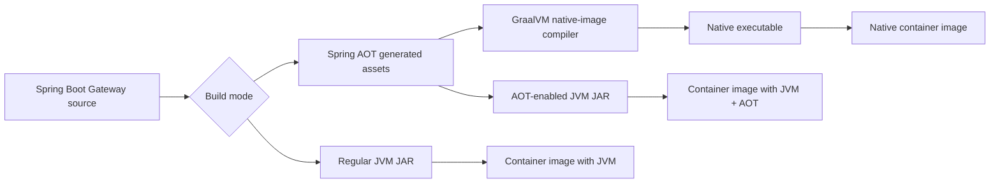
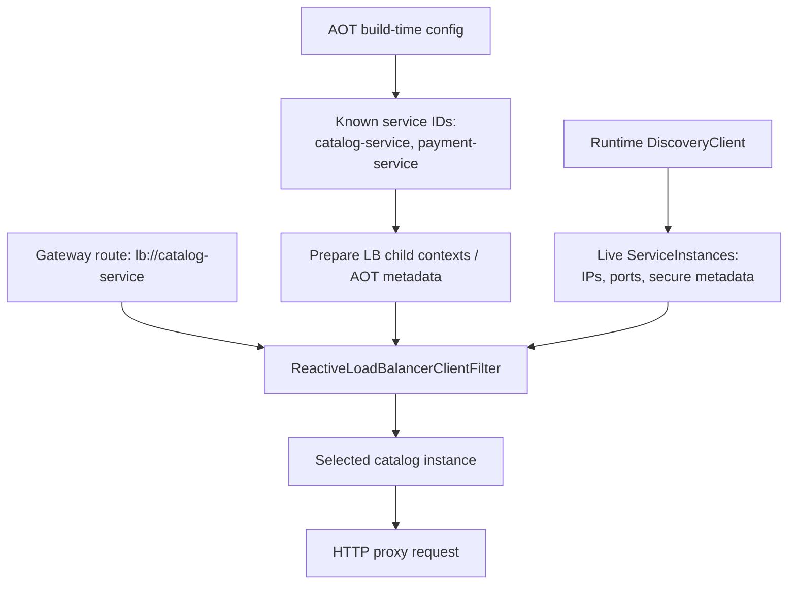
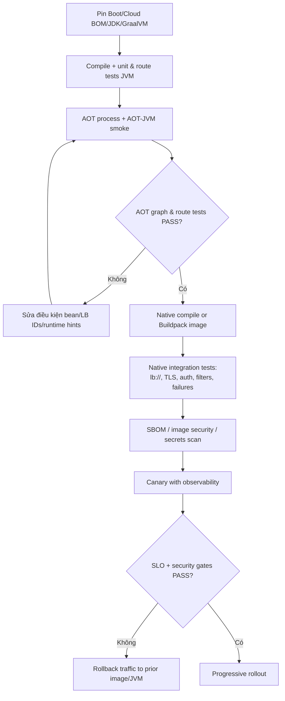

# Spring AOT, native image và khai báo dịch vụ load-balanced theo phiên bản hỗ trợ

**Chương:** Triển khai  
**Module:** `SPRING_CLOUD_GATEWAY` — Xây dựng API Gateway với Spring Cloud Gateway: định tuyến bằng predicates, filter chain, chuyển đổi path/header, khám phá dịch vụ; kết hợp xác thực, giới hạn lưu lượng, circuit breaker, retry, TLS và quan sát request.

Một API Gateway thường nằm ở đường đi của hầu hết request vào hệ thống microservices. Khi có nhiều bản Gateway cần khởi động nhanh trong Kubernetes hoặc serverless, việc dùng **Spring AOT** và **GraalVM Native Image** có thể giúp giảm thời gian khởi động và mức bộ nhớ khi vận hành. Nhưng kiến trúc native đặt một yêu cầu khác biệt: nhiều quyết định xây dựng Spring `ApplicationContext` được xử lý **trước lúc ứng dụng chạy**, thay vì phát hiện tất cả dependency/bean tại runtime.

Điều này ảnh hưởng trực tiếp đến các route dạng `lb://catalog-service`. Spring Cloud LoadBalancer thường xây dựng **một child context cho mỗi service ID** khi lần đầu phải chọn instance. Với native image, những service ID cần dùng phải được **khai báo tường minh** để AOT biết phải chuẩn bị cấu hình load balancer cho chúng. Nếu chỉ có một danh sách instances lấy từ Eureka/Kubernetes nhưng chưa công bố service ID trong quá trình AOT, việc khởi tạo LoadBalancer context khi route phát sinh ở runtime có thể không còn hoạt động như trên JVM bình thường.

Bài học này giải thích:

- Sự khác nhau giữa JVM JAR, Spring AOT, GraalVM Native Image và container image.
- Điều kiện hỗ trợ **theo phiên bản và Gateway flavor**; đặc biệt tài liệu chính thức Server WebFlux ghi hỗ trợ AOT từ **Spring Cloud Gateway 4.0.0**.
- Hai cách khai báo service IDs: `spring.cloud.loadbalancer.eager-load.clients` hoặc `@LoadBalancerClient(name/value=...)`.
- Bài lab Gateway WebFlux route `lb://catalog-service` đến hai backend, rồi thử **JVM thường → JVM dùng AOT → native executable/container**.
- Giới hạn của closed-world, `@Profile`, `@ConditionalOnProperty`, `@RefreshScope`, dynamic routes, service discovery, reflection/resources/serialization.
- Triển khai an toàn với TLS, secrets, readiness, metrics, CI/CD, canary, rollback và troubleshooting.

> **Nguyên tắc phiên bản:** Các ví dụ chính hướng đến **Spring Cloud Gateway Server WebFlux** trong những release train hỗ trợ Spring Boot AOT (dòng 4.x/5.x). Ở dòng 5.x, namespace route hiện đại là `spring.cloud.gateway.server.webflux.routes`; ở một số bản 4.x dùng `spring.cloud.gateway.routes`. **Gateway Server Web MVC** dùng starter, cấu hình và HTTP stack khác, cần đối chiếu native/AOT support riêng theo release train; không suy từ việc WebFlux đã có AOT mà mọi tùy biến MVC, WebSocket hoặc filter đều chạy native tương đương. Dùng phiên bản Spring Boot/Spring Cloud BOM tương thích, không chọn số version tùy ý.

## 1. Mục tiêu học tập

Sau bài này bạn có thể:

1. Phân biệt **Spring AOT processing**, **AOT-optimized JVM execution** và **GraalVM native compilation**.
2. Mô tả chính xác closed-world: **classpath và bean graph được phân tích tại build time**, không phải “mọi giá trị cấu hình runtime đều cố định vĩnh viễn”.
3. Giải thích tại sao `lb://service-id` trong native image cần **khai báo service ID tường minh**.
4. Sử dụng đúng `spring.cloud.loadbalancer.eager-load.clients` hoặc `@LoadBalancerClient` để khai báo `catalog-service`, `payment-service`.
5. Dựng một Gateway WebFlux và hai backend HTTP có thể quan sát instance được chọn.
6. Build/run JAR JVM bình thường, JAR đã qua Spring AOT, native executable hoặc native container theo Maven/Gradle.
7. Phân biệt **service ID được biết tại AOT time** với **địa chỉ/port/health của ServiceInstance** do discovery cung cấp ở runtime.
8. Nhận diện và kiểm thử khác biệt `@Profile`/`@Conditional`/`@RefreshScope`, dynamic routes và native reachability hints.
9. Thiết kế readiness, graceful shutdown, security, TLS, tracing, rate limit, circuit breaker, retry và các tình huống failover trên bản native.
10. Đặt tiêu chí đánh giá startup, RSS, throughput, p95/p99, build time, lỗi trước/sau deploy và rollback.

## 2. Ba mức triển khai: JVM, Spring AOT và native image

| Cách chạy | Sản phẩm | Khi nào phân tích Spring bean graph? | Đặc trưng |
|---|---|---|---|
| JVM thông thường | `gateway.jar` | Chủ yếu lúc khởi động JVM | Classloading/reflection và auto-configuration động tương đối linh hoạt |
| **JVM dùng Spring AOT** | JAR có generated AOT assets, chạy `-Dspring.aot.enabled=true` | Build time, rồi áp generated initialization trên JVM | Giúp phát hiện sớm các vấn đề AOT trước khi compile native |
| **GraalVM Native Image** | Executable theo OS/architecture, có thể đóng container | Spring AOT + GraalVM closed-world compilation | Không cần JVM runtime bên trong executable, thường startup nhanh và footprint thấp hơn ở workload phù hợp |

**Không nhầm lẫn:**

- **Spring AOT** là quá trình Spring phân tích configuration và tạo Java source/bytecode/proxy/runtime hints cho một application graph tương đối tĩnh.
- **Native Image** là quá trình GraalVM phân tích reachability và compile mã Java thành executable cho **một** kiến trúc/hệ điều hành cụ thể.
- **Container image** là gói triển khai (filesystem/layers/metadata). Container có thể chứa **JVM JAR** hoặc **native executable**.
- **CDS/AOT Cache** của JVM là một hướng tối ưu khác; không đồng nghĩa native image hoặc native binary. Kiểm tra chính xác tính năng theo JDK/Spring Boot phiên bản đang dùng.

### 2.1. Hai trục quyết định độc lập



Mỗi mũi tên có **trách nhiệm kiểm thử riêng**. Một route chạy đúng trong IDE/JVM không chứng minh native image đã có đủ service IDs, hints, SSL truststore hoặc resources. Ngược lại, native build thành công **không chứng minh** health/readiness, OAuth2, TLS, retries và load balancing vẫn đúng khi deploy.

### 2.2. Lợi ích phải đo, không quảng cáo

Native image thường có lợi thế về startup và resident memory, đặc biệt khi scale-to-zero hoặc autoscale nhanh. Nhưng có thể đánh đổi:

- **Build time** dài hơn, CI cần CPU/RAM và native toolchain.
- **Peak throughput**/p99/GC và warm-up có thể thay đổi theo workload; không mặc định native luôn nhanh hơn.
- **Debuggability** khác JVM: profiling, stack traces, JFR, attach agents, reflection và dynamic instrumentation có thể bị hạn chế theo GraalVM/version.
- **Native binary** không tự “di chuyển” giữa Linux/Windows/macOS hay amd64/arm64; cần artifacts phù hợp target architecture.
- Đưa native image vào container không tự sửa Kubernetes readiness, network egress, service discovery, certificate trust hay session management.

## 3. Ma trận hỗ trợ và giới hạn theo phiên bản

Tài liệu chính thức **Gateway Server WebFlux — AOT and Native Image Support** ghi Gateway hỗ trợ Spring AOT/native từ **4.0.0**, đồng thời nhấn mạnh load-balanced routes phải công bố service IDs. Tài liệu **Spring Cloud Commons — LoadBalancer** cũng ghi hỗ trợ AOT/native từ **4.0.0** với cùng điều kiện. Xem liên kết tài liệu Spring chính thức ở cuối bài.

| Thành phần | Điều đã được tài liệu hóa | Phải xác minh trên dự án |
|---|---|---|
| Gateway **Server WebFlux** 4.x/5.x | Có trang AOT/native riêng, yêu cầu khai báo service IDs cho LB | Starter, property namespace, custom filters, dependencies |
| Spring Cloud LoadBalancer 4.x/5.x | Hỗ trợ AOT/native; service IDs explicit | Child contexts, custom `ServiceInstanceListSupplier`, discovery implementation |
| Gateway **Server Web MVC** | Là stack Servlet/WebMvc.fn với DSL/client khác | Phiên bản target native support, WebSocket/MVC filters, HTTP client, AOT hints |
| DiscoveryClient | Tùy Eureka/Consul/Kubernetes/custom adapter | Adapter có native hints, health/registry access, client certificates không? |
| Spring Boot Maven/Gradle | AOT/native build qua build plugins/native profile | JDK/GraalVM, wrapper, Spring Boot BOM, CI OS/arch |
| Spring Cloud Context Refresh | **Không hỗ trợ trong AOT/native**; cần `spring.cloud.refresh.enabled=false` | Cách rollout config/bean changes khi không còn `@RefreshScope` |
| Runtime route repository | Tùy Gateway flavor/version | Route refresh/metadata và IDs mới có vượt phạm vi AOT? |

**Không coi “tính năng hỗ trợ native” là cam kết mọi extension đều chạy.** Một custom `GatewayFilter` dùng reflection động, custom DNS resolver, JNI library hay Lua/JavaScript engine có thể cần reachability hints hoặc thiết kế lại, dù Gateway core hỗ trợ AOT.

### 3.1. Khóa bộ version

Trước khi thêm native profile, ghi lại:

| Thành phần | Giá trị cần ghi |
|---|---|
| JDK và vendor | Exact JDK major/patch, OS/architecture |
| Spring Boot | Exact version và parent/plugin config |
| Spring Cloud release train/BOM | Exact BOM, Boot compatibility |
| Spring Cloud Gateway | Gateway 4.x hay 5.x, WebFlux hay Web MVC |
| Spring Cloud Commons/LoadBalancer | Versions từ BOM |
| GraalVM/native-image | Version tương thích JDK và Boot |
| Dependency khác | Eureka/Consul/Kubernetes, Reactor Netty, Security, Redis, Resilience4j |
| Native build strategy | Local GraalVM, Buildpacks hoặc CI builder |

Không thêm một property `spring.cloud.gateway.aot.enabled=true` theo trí nhớ: **không có một công tắc chung như vậy cần thiết cho bài**. Spring Boot AOT được kích hoạt qua plugin/build profile; các service IDs là điểm phải khai báo rõ.

## 4. AOT phân tích cái gì và không phân tích cái gì?

Spring có cơ chế **inversion of control**: khi JVM thông thường khởi động, Spring quét cấu hình, đánh giá điều kiện, đăng ký beans, tạo các proxy và runtime metadata. AOT chuyển phần lớn **khâu chuẩn bị graph** sang thời điểm build để GraalVM có thể compile một application graph được biết trước.

### 4.1. Closed-world và việc “đóng băng” bean graph

Các giả định quan trọng của Spring AOT:

1. **Classpath cố định khi build**. Không thêm một JAR chứa `GatewayFilterFactory` mới ở runtime rồi kỳ vọng native executable tự load.
2. **Bean definitions tương đối cố định**. Điều kiện như `@ConditionalOnClass`/`@ConditionalOnProperty` tác động việc có bean hay không đã được đánh giá trong quá trình AOT.
3. **`@Profile` tác động bean registration** không thể được bật/tắt tùy ý sau khi image được build để tạo một graph khác chưa được phân tích.
4. Reflection, dynamic proxies, resource loading và serialization cần metadata/hints khi GraalVM không suy ra được từ reachability.
5. Một số cách đăng ký bean động (như register singleton tùy ý sau khi context đã bootstrap) không đi qua transformations như người viết code giả định.

**Ví dụ sai về kỳ vọng:**

```java
@Configuration(proxyBeanMethods = false)
@ConditionalOnProperty(name = "gateway.security.enabled",
                       havingValue = "true")
class AuthConfiguration {
    // Security bean graph chỉ tồn tại khi condition được bật lúc AOT.
}
```

Nếu build native với `gateway.security.enabled=false`, sau đó deploy binary với `GATEWAY_SECURITY_ENABLED=true`, đừng mặc định các security beans được tạo y hệt một JVM app bình thường. Điều kiện về **sự tồn tại của beans** đã có thể được cố định trong generated AOT code. Tương tự, build với security bật nhưng runtime đặt false không phải một công tắc an toàn để phá chính sách.

Trong production, **không tạo native image với authentication tắt** rồi hy vọng bật lại sau deploy. Build/test/deploy phải nhất quán ở những property tham gia điều kiện cấu hình bean.

### 4.2. Những giá trị nào vẫn có thể thay đổi runtime?

**AOT không có nghĩa mọi giá trị đều compile cứng.** Ví dụ:

- Port server được chọn qua `server.port`;
- Một mật khẩu lấy từ mounted Secret thay vì đóng vào binary;
- Địa chỉ/port **instances** của service được discovery trả về;
- Một threshold được đọc runtime bởi bean đã tồn tại và được thiết kế update-safe;
- Route URL/headers được lấy từ nguồn config ở runtime **nếu implementation đang dùng hỗ trợ lifecycle đó** và không cần tạo một loại bean mới.

Tuy nhiên, mỗi thay đổi cần xác minh có phải property **ảnh hưởng bean graph**, **ảnh hưởng binding/route definitions**, hay chỉ là **data được một bean đã tồn tại sử dụng**. Đừng khẳng định mọi `@ConfigurationProperties` đều cập nhật live khi nguồn config thay đổi: nhiều beans chỉ bind lúc startup; `@RefreshScope` không được hỗ trợ ở native.

### 4.3. Phân biệt ba đối tượng dễ bị nhầm

| Đối tượng | Ví dụ | Thời điểm thường xác định | Tác động khi thay đổi |
|---|---|---|---|
| **Service ID** | `catalog-service` | Nên công bố cho AOT/build | LB child context cần hints/config cho ID này |
| **ServiceInstance** | `10.10.2.17:8080`, `10.10.2.18:8080` | Runtime qua discovery | Có thể thay đổi khi scale/rollout |
| **Gateway route definition** | `id=catalog-route, uri=lb://catalog-service, Path=/api/catalog/**` | YAML, Java DSL, repository hoặc locator | Runtime reload tùy implementation, có thể nhắc tới service ID khác |

**Kết luận:** native image không khóa luôn danh sách IP của mọi Pod, nhưng bạn phải thiết kế trước **tập các service IDs** và các bean/configurations cần thiết để Gateway có thể điều phối chúng. Mô hình “tạo service ID hoàn toàn mới từ request đầu tiên” vốn dễ làm trên JVM có thể là một unsupported path với AOT nếu chưa khai báo/hint đầy đủ.

## 5. Vì sao `lb://` cần công bố service ID tường minh?

Spring Cloud LoadBalancer cung cấp `ReactorLoadBalancer` cho stack reactive và các client lựa chọn blocking cho stack servlet. Khi Gateway WebFlux thấy một route:

```yaml
uri: lb://catalog-service
```

`ReactiveLoadBalancerClientFilter` sẽ phân giải `catalog-service`, lấy một `ServiceInstance` thông qua các suppliers/discovery adapters rồi thay host/port của outbound request.

### 5.1. Child context mỗi service ID

Spring Cloud LoadBalancer sử dụng `LoadBalancerClientFactory` để quản lý những cấu hình load balancing theo **service ID**. Trên JVM thường, các child contexts có thể được tạo **lazy** ở lần đầu một service cần load balancing. Nhưng trong AOT/native, quá trình phân tích phải biết trước những service IDs nào có thể cần một context riêng để tạo bean definitions và native hints tương ứng.



Nếu lần đầu runtime gặp `lb://new-service-not-declared`, không được kỳ vọng native image tự sinh một cấu hình LB child context hoàn chỉnh như khi JVM có khả năng reflect/scan động. Cách xử lý an toàn là **đăng ký service ID trước build**, sửa cấu hình route hoặc deploy bản image mới khi phạm vi dịch vụ thay đổi.

### 5.2. Cách A — `spring.cloud.loadbalancer.eager-load.clients`

Đây là cách phù hợp với hệ thống cấu hình phần lớn routes bằng YAML:

```yaml
spring:
  cloud:
    loadbalancer:
      eager-load:
        clients:
          - catalog-service
          - payment-service
          - inventory-service
```

Property này được **Spring Cloud Commons LoadBalancer** tài liệu hóa để eager-load child contexts, đồng thời là **cách khai báo service IDs cho AOT/native**. Đối với native builds, hãy đảm bảo danh sách này có mặt **khi quá trình AOT chạy** và phù hợp với routes/filters thực sự được ship.

Đừng nhầm:

```yaml
spring:
  cloud:
    loadbalancer:
      enabled: true
```

`enabled=true` chỉ bật cơ chế LB (nếu dependencies/config sẵn có); nó **không công bố** tập service IDs cần AOT. Cũng không dùng tên route ID thay cho service ID:

```text
Route ID:    catalog-public
Route URI:   lb://catalog-service
Eager ID:    catalog-service       (đúng)
Eager ID:    catalog-public        (sai mục tiêu)
```

### 5.3. Cách B — `@LoadBalancerClient` / `@LoadBalancerClients`

Nếu muốn công bố service IDs trực tiếp trong code:

```java
package com.example.gateway;

import org.springframework.cloud.client.loadbalancer.LoadBalancerClient;
import org.springframework.cloud.client.loadbalancer.LoadBalancerClients;
import org.springframework.context.annotation.Configuration;

@Configuration(proxyBeanMethods = false)
@LoadBalancerClients({
    @LoadBalancerClient(name = "catalog-service"),
    @LoadBalancerClient(name = "payment-service")
})
public class KnownLoadBalancedServices {
}
```

Tương tự, nếu chỉ có một client:

```java
@Configuration(proxyBeanMethods = false)
@LoadBalancerClient(value = "catalog-service")
class CatalogClientDeclaration {
}
```

Tài liệu Commons nêu có thể dùng thuộc tính **`value` hoặc `name`** của `@LoadBalancerClient`; không cần khai `configuration=...` nếu bạn dùng configuration mặc định. Đây là **khai báo client name**, không phải annotation để tạo một WebSocket/HTTP controller mới.

**Trường hợp custom configuration:**

```java
@Configuration(proxyBeanMethods = false)
@LoadBalancerClient(
    name = "catalog-service",
    configuration = CatalogLoadBalancerConfiguration.class)
class CatalogClientConfigRegistration {
}
```

`CatalogLoadBalancerConfiguration` là một class cung cấp các bean `ServiceInstanceListSupplier` hoặc `ReactorLoadBalancer` tùy policy. Theo docs, class được truyền vào `configuration` nên **không đặt trong component-scan thông thường** (hoặc không annotate `@Configuration`) nếu muốn cấu hình chỉ áp cho một client, tránh rò bean cho mọi LB contexts. Nếu bạn không cần policy đặc biệt, ưu tiên annotation không có `configuration` ở ví dụ trước.

### 5.4. Có cần dùng đồng thời cả hai cách không?

**Không bắt buộc.** Cả `eager-load.clients` và `@LoadBalancerClient` đều được docs nêu là cách khai báo. Với app có nhiều route IDs được sinh từ Config Server, bạn có thể chọn **một nguồn authoritative** để liệt kê service IDs, tránh drift:

| Tình huống | Gợi ý |
|---|---|
| Routes chủ yếu từ YAML và ít IDs | `eager-load.clients` trong config build/deploy kiểm soát |
| IDs ổn định, tổ chức ưu tiên annotation | `@LoadBalancerClient(name=...)` |
| Có policy LB riêng từng service | `@LoadBalancerClient(configuration=...)` kèm AOT tests |
| Routes sinh từ registry động, service IDs nhiều/khó đoán | Xem lại chiến lược AOT/route exposure; định nghĩa allowlist IDs hoặc tiếp tục JVM nếu không thể cố định graph |

### 5.5. Cẩn thận với tên service ID và đường dẫn public

`lb://CATALOG-SERVICE`, `lb://catalog-service` và `lb://catalog_service` có thể được registry/discovery xử lý khác nhau tùy adapter. Không mặc định mọi registry đều case-insensitive. Với DiscoveryClient route locator, `lower-case-service-id` có thể thay đổi **predicate/filter path**, không tự đổi tập client IDs được LoadBalancer công bố cho AOT.

Nếu service registry trả tên viết hoa, test chính xác:

- ID dùng trong route URI;
- ID khai trong `eager-load.clients` hoặc annotation;
- ID được `DiscoveryClient`/`ServiceInstanceListSupplier` trả;
- Path client nhìn thấy, ví dụ `/api/catalog/**`, vốn không nhất thiết trùng service ID.

## 6. Lab: hai HTTP backend và một Gateway route `lb://catalog-service`

Mục tiêu lab là kiểm chứng **tách biệt rõ service ID và runtime instance**. Ba process trên cùng máy:

| Thành phần | Port | Mục đích |
|---|---:|---|
| Catalog backend A | `8081` | Trả JSON có `instance=A` |
| Catalog backend B | `8082` | Trả JSON có `instance=B` |
| Gateway WebFlux | `8080` | Nhận `/api/catalog/**`, chọn A/B bằng LB |

Lab sử dụng `SimpleDiscoveryClient` — danh sách instances tĩnh được khai báo cho **Gateway process**. Đây là cách thử LB mà không cần Eureka/Consul. **SimpleDiscoveryClient không tự loại instance chết khỏi danh sách**; runtime discovery thật và native compatibility của từng adapter được kiểm tra sau.

### 6.1. Backend project riêng: Spring MVC echo

Tạo một Spring Boot project với dependency **Spring Web**; không cần Spring Cloud Gateway hoặc LoadBalancer trong backend. Ví dụ Java:

```java
package com.example.catalog;

import java.util.Map;
import org.springframework.beans.factory.annotation.Value;
import org.springframework.boot.SpringApplication;
import org.springframework.boot.autoconfigure.SpringBootApplication;
import org.springframework.web.bind.annotation.GetMapping;
import org.springframework.web.bind.annotation.PathVariable;
import org.springframework.web.bind.annotation.RestController;

@SpringBootApplication
@RestController
public class CatalogBackendApplication {

    @Value("${demo.instance-id:A}")
    private String instanceId;

    @GetMapping("/items/{sku}")
    public Map<String, String> getItem(@PathVariable String sku) {
        return Map.of(
            "sku", sku,
            "instance", instanceId,
            "service", "catalog-service");
    }

    @GetMapping("/healthz")
    public Map<String, String> health() {
        return Map.of("status", "UP", "instance", instanceId);
    }

    public static void main(String[] args) {
        SpringApplication.run(CatalogBackendApplication.class, args);
    }
}
```

`src/main/resources/application.yml` của backend:

```yaml
server:
  port: ${PORT:8081}
spring:
  application:
    name: catalog-backend
demo:
  instance-id: ${INSTANCE_ID:A}
```

**Đây là ứng dụng backend để học**, không có auth, persistence, TLS hay quotas. Không triển khai như catalog production. Nếu Spring Boot version sử dụng starter Maven artifact tên khác, chọn đúng starter từ Spring Initializr tương ứng với release train; API `@RestController`/`@GetMapping` vẫn minh họa HTTP response.

### 6.2. Chạy hai instances

Build backend JAR một lần trong môi trường lab (sau khi tạo project):

```bash
./mvnw -DskipTests package
```

Mở hai terminal:

```bash
# Backend A — dùng đúng JAR do Maven tạo (tên dưới đây minh họa).
PORT=8081 INSTANCE_ID=A java -jar target/catalog-backend.jar

# Backend B.
PORT=8082 INSTANCE_ID=B java -jar target/catalog-backend.jar
```

Trên Windows PowerShell, đặt `$env:PORT` và `$env:INSTANCE_ID` trong **hai terminal riêng** trước khi chạy JAR. Đổi `target/catalog-backend.jar` thành tên file đúng do build sinh (thường chứa version, ví dụ `catalog-backend-0.0.1-SNAPSHOT.jar`).

Kiểm tra backend trực tiếp:

```bash
curl -i http://localhost:8081/items/SKU-42
curl -i http://localhost:8082/items/SKU-42
```

Ví dụ output:

```json
{"sku":"SKU-42","instance":"A","service":"catalog-service"}
```

và:

```json
{"sku":"SKU-42","instance":"B","service":"catalog-service"}
```

Nếu một backend không phản hồi trực tiếp, chưa cần debug AOT/native hoặc LoadBalancer; trước hết sửa backend/port/path.

### 6.3. Project Gateway WebFlux

Tạo **một Spring Boot project khác** cho Gateway (không trộn Spring MVC backend cùng runtime). Chọn Spring Cloud BOM tương thích. Các dependencies Maven cần thiết:

```xml
<dependencies>
    <dependency>
        <groupId>org.springframework.cloud</groupId>
        <artifactId>spring-cloud-starter-gateway-server-webflux</artifactId>
    </dependency>
    <dependency>
        <groupId>org.springframework.cloud</groupId>
        <artifactId>spring-cloud-starter-loadbalancer</artifactId>
    </dependency>
    <dependency>
        <groupId>org.springframework.boot</groupId>
        <artifactId>spring-boot-starter-actuator</artifactId>
    </dependency>
    <dependency>
        <groupId>org.springframework.boot</groupId>
        <artifactId>spring-boot-starter-test</artifactId>
        <scope>test</scope>
    </dependency>
</dependencies>
```

Đây là **mảnh `pom.xml`**: còn cần Spring Boot parent/plugin và Spring Cloud dependency management từ release train tương thích. Với Spring Boot 4, dùng artifact/Boot starter có trong BOM và Spring Initializr của bản đã chọn. Không thêm `spring-boot-starter-web` cho Gateway Server WebFlux chỉ để “có web server”; nếu chọn Gateway MVC phải làm project riêng.

Class khởi động `GatewayApplication.java`:

```java
package com.example.gateway;

import org.springframework.boot.SpringApplication;
import org.springframework.boot.autoconfigure.SpringBootApplication;

@SpringBootApplication
public class GatewayApplication {
    public static void main(String[] args) {
        SpringApplication.run(GatewayApplication.class, args);
    }
}
```

### 6.4. `application.yml` của Gateway: route + eager service ID

```yaml
server:
  port: 8080

spring:
  application:
    name: native-catalog-gateway-lab

  cloud:
    # Spring Cloud Context Refresh is not supported with AOT/native.
    refresh:
      enabled: false

    # Khai báo client ID từ build time cho LoadBalancer AOT.
    loadbalancer:
      eager-load:
        clients:
          - catalog-service

    # Lab: danh sách hai instances tĩnh, cùng một service ID.
    discovery:
      client:
        simple:
          instances:
            catalog-service:
              - uri: http://localhost:8081
              - uri: http://localhost:8082

    gateway:
      server:
        webflux:
          routes:
            - id: catalog-route
              uri: lb://catalog-service
              predicates:
                - Path=/api/catalog/**
                - Method=GET
              filters:
                - StripPrefix=2
                - AddRequestHeader=X-Edge-Lab, native-gateway

management:
  endpoints:
    web:
      exposure:
        include: health,info
```

**Tại sao đoạn cấu hình này đặc biệt quan trọng?**

1. `spring.cloud.loadbalancer.eager-load.clients[0]=catalog-service` công bố **đúng ID của `lb://`** cho Spring AOT.
2. `simple.instances.catalog-service` cung cấp host/port của **hai ServiceInstances**. Nó không tự tạo LB child context hints chỉ bằng việc có danh sách IP; yêu cầu explicit clients vẫn cần được tuân thủ.
3. `uri: lb://catalog-service` cần `spring-cloud-starter-loadbalancer`.
4. `Path=/api/catalog/**` và `StripPrefix=2` biến `/api/catalog/items/SKU-42` thành `/items/SKU-42` ở backend.
5. `spring.cloud.refresh.enabled=false` áp dụng cho **Spring Cloud Context Refresh**, không có nghĩa mọi thuật toán load balancing hoặc danh sách instances runtime đều bị đóng băng.
6. Actuator chỉ expose `health` và `info`; không bật gateway route write/admin endpoints cho Internet.

### 6.5. Không lẫn `eager-load.clients` với `SimpleDiscoveryClient`

Hai cấu hình phục vụ mục đích **khác nhau**:

```yaml
spring:
  cloud:
    loadbalancer:
      eager-load:
        clients: [catalog-service]
```

Nói với AOT: **có một LoadBalancer client tên catalog-service** và cần biết cấu hình client đó.

```yaml
spring:
  cloud:
    discovery:
      client:
        simple:
          instances:
            catalog-service:
              - uri: http://localhost:8081
              - uri: http://localhost:8082
```

Nói với DiscoveryClient: **service catalog-service hiện có hai instances** với địa chỉ/port được gắn tĩnh. Trong production, mục thứ hai thường được thay bằng Eureka/Consul/Kubernetes/custom supplier (với native support đã được kiểm tra).

### 6.6. Chạy thử Gateway JVM thường

Trong project Gateway, ở terminal khác:

```bash
./mvnw spring-boot:run
```

Sau khi Gateway lắng nghe ở `8080`:

```bash
curl -i http://localhost:8080/api/catalog/items/SKU-42
curl -i http://localhost:8080/api/catalog/items/SKU-42
curl -i http://localhost:8080/api/catalog/items/SKU-42
```

Các responses có thể ghi `"instance":"A"` hoặc `"instance":"B"`. **Không bắt buộc kết quả chính xác A,B,A:** LoadBalancer strategy, health, cache, concurrency và release train có thể thay đổi. Cần xác minh:

- Gateway trả `200` và JSON có `sku=SKU-42`;
- Upstream nhận `/items/SKU-42` và header `X-Edge-Lab`;
- Cả hai instances được cấu hình là hợp lệ;
- Route sử dụng `lb://catalog-service`, không trỏ cứng `http://localhost:8081`.

### 6.7. Lỗi cố ý: bỏ eager client ID

Chỉ trong **bản sao của môi trường lab**, bỏ:

```yaml
spring.cloud.loadbalancer.eager-load.clients
```

rồi so hành vi JVM thường và native/AOT:

- **JVM thường** có thể vẫn tạo LoadBalancer child context một cách lazy cho `catalog-service` và chạy được.
- **AOT/native** không còn đáp ứng điều kiện được tài liệu Spring Cloud LoadBalancer yêu cầu; có thể thiếu context configuration/hints, lỗi khi khởi tạo hoặc khi request đầu tiên, tùy versions.
- **Không nhất thiết mọi bản native sẽ fail ngay** khi thiếu khai báo: một configuration khác như `@LoadBalancerClient`, bean custom hoặc optimizations có thể đã công bố client. Mục tiêu là hiểu **hợp đồng hỗ trợ**, không dự đoán một exception cố định.

Khôi phục eager client trước khi tiếp tục. Đừng dùng một test chỉ có route `http://localhost:8081` để kết luận `lb://catalog-service` đã tương thích AOT.

## 7. Maven build: JVM, JVM-AOT, native và buildpack

### 7.1. Chuẩn bị Maven project theo Spring Boot version

Với project dựa trên `spring-boot-starter-parent` tương thích, thêm Spring Boot Maven plugin và GraalVM Native Build Tools Maven plugin theo Boot docs (không ghi version riêng nếu đã được quản lý).

```xml
<build>
  <plugins>
    <plugin>
      <groupId>org.springframework.boot</groupId>
      <artifactId>spring-boot-maven-plugin</artifactId>
    </plugin>
    <plugin>
      <groupId>org.graalvm.buildtools</groupId>
      <artifactId>native-maven-plugin</artifactId>
    </plugin>
  </plugins>
</build>
```

Nếu không dùng Spring Boot starter parent hoặc dự án nhiều module, bạn phải chủ động cấu hình các executions cho `process-aot`/native metadata/plugin. Không sao chép một fragment plugin vào enterprise parent rồi mặc định build native profile đã tồn tại.

**Điều kiện hệ thống:**

- GraalVM/Mandrel/native-image toolchain tương thích Spring Boot version và JDK đang build.
- Compiler/system libraries và OS/architecture phù hợp.
- CPU/RAM/đĩa đủ cho native compilation (thường lớn hơn JVM jar build).
- Nếu build container qua Spring Boot buildpacks: Docker daemon/buildkit hoặc môi trường container builder được hỗ trợ.
- Quyền truy cập Maven repositories và SBOM/license/security scans được phê duyệt.

### 7.2. Bước 1 — JVM JAR thông thường

```bash
# Dành cho project Gateway trong môi trường của người học.
./mvnw clean package
java -jar target/native-catalog-gateway-lab.jar
```

Đổi `target/native-catalog-gateway-lab.jar` thành **tên JAR thực** (thường có version). Đây là baseline: nếu REST/lb route chưa chạy trên JVM, chưa nên bắt đầu native build.

### 7.3. Bước 2 — tạo AOT assets và chạy trên JVM

Theo Spring Boot, khi Maven project có `native` profile phù hợp:

```bash
./mvnw -Pnative package

# JAR này phải thực sự chứa generated AOT assets.
java -Dspring.aot.enabled=true \
  -jar target/native-catalog-gateway-lab.jar
```

Chạy với `spring.aot.enabled=true` là một **bước sàng lọc**: nếu build-time bean graph/conditions/route configuration không khớp, nó thường giúp phát hiện trước khi phải chờ GraalVM native compilation.

**Không đủ điều kiện nếu:**

- Build chỉ chạy `mvn package` mà không thực thi `process-aot`;
- Không có generated AOT initializer/classes/hints;
- Bật `-Dspring.aot.enabled=true` trên một JAR chưa được AOT process rồi gọi lỗi startup là “native limitation”.

Các hướng dẫn Boot nêu `native` profile của starter parent cấu hình phần AOT/native plugin phù hợp; kiểm tra lại effective POM và build logs.

### 7.4. Bước 3 — native executable cục bộ

Nếu GraalVM Native Image toolchain đã cài và version tương thích:

```bash
./mvnw -Pnative native:compile
```

Executable thường nằm trong `target/` theo artifact name, ví dụ:

```bash
./target/native-catalog-gateway-lab
```

Trên Windows, executable name có thể có `.exe` và cách gọi khác. **Không coi những tên binary trong tài liệu là tên bắt buộc** — plugin/project có thể đặt tên khác. Đừng chạy lệnh dành cho Linux trực tiếp trên Windows PowerShell khi nó dùng `./` hoặc kiểu environment syntax không tương thích.

Native executable không cần `java -jar`, nhưng vẫn cần **config, certificate trust, DNS/registry access, environment variables, health probes và security policies** ở runtime.

### 7.5. Bước 4 — build container image có native binary

Với Spring Boot Maven plugin và Docker/Buildpacks hỗ trợ:

```bash
./mvnw -Pnative spring-boot:build-image
```

Spring Boot dùng Cloud Native Buildpacks để tạo container image có native executable. Không cần tự tạo một Dockerfile cho lab đơn giản; tuy nhiên cần builder/run image tương thích OS/architecture, Docker daemon và quota build. Với multi-arch, build/test/publish artifacts riêng phù hợp từng architecture hoặc dùng workflow buildpacks được hỗ trợ; không dùng `linux/amd64` binary như thể nó chạy native trên ARM64.

Một lệnh kiểm tra container minh họa:

```bash
docker run --rm -p 8080:8080 \
  --name native-gateway-lab \
  <local-native-image-tag>
```

**Phải thay** `<local-native-image-tag>` bằng tag thật do build tạo. Quan trọng: Gateway chạy trong container không truy cập được backend host qua `localhost:8081`/`localhost:8082` theo cách khi chạy trên host. Phần 11 sẽ hướng dẫn mạng container trước khi thử LoadBalancer bằng Docker.

### 7.6. Lưu ý về thông số build

Đừng đo startup native bằng mỗi một dòng log từ Maven build. Đo **thời gian từ tiến trình bắt đầu đến sẵn sàng nhận route traffic**, và ghi thêm:

| Chỉ số | Vì sao |
|---|---|
| Build duration | Native compilation tốn tài nguyên CI |
| Artifact/container size | Ảnh hưởng push/pull/cold-start, nhưng phụ thuộc builder/layers |
| Startup to readiness | API Gateway thật sự đã route được chưa |
| RSS/heap/CPU | Footprint dưới tải và memory headroom |
| p50/p95/p99, RPS | Kiểm tra performance sau warm-up |
| TLS/auth/Retry/LB behavior | Native đúng chức năng, không chỉ nhanh khởi động |
| Native image arch/version | Tránh deploy sai platform/ABI |

## 8. Gradle: cùng mục tiêu nhưng khác build tasks

Nếu tổ chức dùng **Gradle**, bản Native Build Tools phù hợp sẽ cung cấp các tasks `processAot`/`nativeCompile`/`nativeTest`. Một skeleton `build.gradle` (Groovy) cho **Gateway WebFlux**:

```groovy
plugins {
    id 'java'
    id 'org.springframework.boot' version '<compatible-boot-version>'
    id 'io.spring.dependency-management' version '<compatible-version>'
    id 'org.graalvm.buildtools.native' version '<compatible-version>'
}

group = 'com.example'
version = '0.0.1-SNAPSHOT'

java {
    toolchain {
        languageVersion = JavaLanguageVersion.of(21)
    }
}

dependencyManagement {
    imports {
        mavenBom "org.springframework.cloud:spring-cloud-dependencies:<compatible-cloud-release-train>"
    }
}

dependencies {
    implementation 'org.springframework.cloud:spring-cloud-starter-gateway-server-webflux'
    implementation 'org.springframework.cloud:spring-cloud-starter-loadbalancer'
    implementation 'org.springframework.boot:spring-boot-starter-actuator'
    testImplementation 'org.springframework.boot:spring-boot-starter-test'
}

tasks.named('test') {
    useJUnitPlatform()
}
```

Các chuỗi `<compatible-...>` là **placeholder có chủ đích**, không phải version có thể build ngay; người học thay bằng các phiên bản **được Spring Initializr/Boot BOM tương thích cung cấp**. Java toolchain 21 chỉ là một lựa chọn cho lab; với Boot 4/GraalVM native, chọn JDK/GraalVM được nhà phát hành của bộ phiên bản hỗ trợ.

### 8.1. Các tác vụ Gradle

```bash
# JVM baseline
./gradlew clean bootJar

# Sinh AOT sources
./gradlew processAot

# GraalVM local native compile (cần native plugin/toolchain)
./gradlew nativeCompile

# Buildpack container, dùng native image nếu native plugin được áp dụng
./gradlew bootBuildImage
```

Đừng chạy `./gradlew` từ một module không có wrapper/project build. Một số tổ chức khóa Gradle trong CI, cần dùng wrapper đúng repository. Ví dụ chỉ để học; worker STEP 4 **không chạy Gradle** hay tạo dự án mới.

### 8.2. Chạy JVM có generated AOT code với Gradle

Mô hình khuyến nghị:

1. Build task phải đưa AOT sources/classes/resources vào artifact.
2. Chạy artifact với `-Dspring.aot.enabled=true`.
3. Xác minh beans, routes, LoadBalancer clients và security.
4. Chỉ sau đó chạy `nativeCompile` hoặc `bootBuildImage`.

Nếu `processAot` chỉ tạo thư mục generated files mà `bootJar` hiện tại chưa đóng chúng vào JAR như kỳ vọng, **không** chạy một JAR thường với system property rồi kết luận AOT lỗi. Theo docs, các task dependencies do Boot plugin và GraalVM plugin thiết lập; kiểm tra Gradle build scan/logs cho đúng phiên bản plugin.

## 9. Test ba chế độ bằng cùng một HTTP contract

Với backend A/B đang chạy:

```bash
# Phát request giống nhau trong cả ba chế độ:
curl -sS -i http://localhost:8080/api/catalog/items/SKU-42
curl -sS -i http://localhost:8080/api/catalog/items/SKU-43
curl -sS -i http://localhost:8080/no-route
```

Tạo bảng kết quả như sau:

| Test | JVM thường | JVM có AOT | Native |
|---|---|---|---|
| Gateway khởi động và bind port | PASS/FAIL | PASS/FAIL | PASS/FAIL |
| `GET /api/catalog/items/SKU-42` → 200 | ? | ? | ? |
| Backend thấy `/items/SKU-42` | ? | ? | ? |
| Header `X-Edge-Lab` được thêm | ? | ? | ? |
| `catalog-service` được phân giải | ? | ? | ? |
| A/B instances có thể được chọn | ? | ? | ? |
| Missing service → status theo cấu hình | ? | ? | ? |
| Route không match → 404 | ? | ? | ? |
| Đổi số instances theo discovery test | ? | ? | ? |
| TLS/security/filter smoke tests | ? | ? | ? |
| Startup đến readiness (ms) | Đo | Đo | Đo |
| RSS/CPU ở steady state | Đo | Đo | Đo |

**Không điền PASS/FAIL/latency giả** nếu chưa chạy test. Ba chế độ phải dùng:

- Cùng route predicates/filters;
- Cùng backend, request data, auth contract;
- Cùng service ID declared cho AOT;
- Cùng load balancing/discovery policy;
- Cùng cấu hình TLS/certificate chain;
- Cùng resource limits khi so performance.

Một native process chạy thành công nhưng chỉ gọi route `http://localhost:8081` **chưa chứng minh** `lb://catalog-service` hay AOT LB contexts hoạt động. Một request 200 duy nhất cũng chưa chứng minh hai instances được quản lý đúng. Cần quan sát ở backend và metrics của Gateway/LoadBalancer.

### 9.1. Chạy thiếu một backend

Trong lab, dừng backend B mà vẫn để `SimpleDiscoveryClient` kê khai hai instances. Tùy LoadBalancer chọn A hoặc B, requests có thể thành công hoặc gặp connection refused. **Đây không phải lỗi native image riêng**; nguồn instances tĩnh không tự biết B đã chết. Nếu có `ServiceInstanceListSupplier` health check hoặc registry thật, behavior có thể khác. Test cả JVM và native dưới cùng nguồn dữ liệu để tránh kết luận sai.

### 9.2. Kiểm thử service ID chưa khai báo

Thêm route:

```yaml
- id: inventory-route
  uri: lb://inventory-service
  predicates:
    - Path=/api/inventory/**
  filters:
    - StripPrefix=2
```

nhưng **không** thêm `inventory-service` vào `eager-load.clients` hoặc `@LoadBalancerClient` rồi chạy AOT/native. Mục tiêu là tái hiện **unsupported configuration path** khi route có client ID ngoài tập đã khai báo. Sau đó thêm ID đó vào build-time config, rebuild và chạy lại. **Không sửa image production để làm bài tập này**.

Phải phân biệt:

| Trường hợp | Phân tích |
|---|---|
| Có AOT client ID, không có instance | AOT context có thể sẵn, nhưng request vẫn **không có backend** |
| Có instance, thiếu AOT client ID | Discovery data có, nhưng native client initialization có thể không được chuẩn bị đúng |
| Có client ID và instances, sai `StripPrefix` | LB hoạt động nhưng backend trả 404 |
| Có client ID, instances, đúng path, TLS sai | Connection thất bại ở outbound TLS/hostname |
| Tất cả đúng, custom filter dùng reflection thiếu hint | Có thể fail khi filter xử lý payload runtime |

## 10. Runtime discovery: service IDs cố định, instances linh hoạt

Trong môi trường thực, một service có thể scale nhanh: nhiều Pods được tạo/xóa, IP thay đổi, health/readiness khác nhau. Điều kiện AOT **không** bắt buộc khai trước từng Pod IP.

### 10.1. Nguồn `ServiceInstance`

| Nguồn | Cơ chế | Lưu ý native |
|---|---|---|
| `SimpleDiscoveryClient` | Properties tĩnh `simple.instances.*` | Dễ lab; IP/ports phải reachable ở runtime |
| Eureka | Client đăng ký/tra registry và nhận service instances | Kiểm tra Eureka client + HTTP/JSON/native hints, heartbeat, TTL |
| Consul | Health checks và discovery API | Kiểm tra native support của adapter, ACL/TLS và readiness |
| Kubernetes DiscoveryClient | Adapter đọc Services/Endpoints/EndpointSlices | Native support adapter, K8s RBAC/network, watch, DNS |
| Custom `ServiceInstanceListSupplier` | Bean trả instance list theo policy riêng | Verify bean AOT transform, reflection/serialization/metadata |
| DNS/Kubernetes Service | `http://service.namespace.svc` qua platform LB | Không giống route Spring Cloud `lb://` nếu không dùng LB filter |

**Mỗi discovery integration có lifecycle, network requirements và mức hỗ trợ native khác nhau.** Đừng mặc định mọi Spring Cloud adapter đã hỗ trợ native chỉ vì Gateway core và LoadBalancer core hỗ trợ. Đối với Spring Cloud Kubernetes hoặc client của registry trong từng release train, cần tài liệu/issue/CI test riêng.

### 10.2. Cập nhật IP/port runtime không tạo client ID mới

Ví dụ:

```text
Build-time known client:
  catalog-service

Runtime at 10:00:
  catalog-service -> 10.2.0.10:8080
  catalog-service -> 10.2.0.11:8080

Runtime at 10:10 after rollout:
  catalog-service -> 10.2.0.21:8080
  catalog-service -> 10.2.0.22:8080
```

Nếu discovery adapter hỗ trợ thay đổi instances theo cách tương thích native, LoadBalancer có thể chọn IP mới trong **cùng** `catalog-service`. Những child contexts cần AOT vẫn thuộc **ID catalog-service**. Như vậy:

**Biến động topology trong một service ≠ tạo một service ID mới.**

Một route mới `lb://loyalty-service` là **service ID mới**. Nếu native image chưa công bố ID này, đừng kỳ vọng dynamic route repository tạo sẵn LoadBalancer context phù hợp cho nó ở runtime.

### 10.3. Kết nối lại, cache và readiness

LoadBalancer có thể cache `ServiceInstance` list; một số DiscoveryClient cũng có cache. Sau khi instance đã chết nhưng vẫn nằm trong cache, việc chọn nó có thể gây `Connection refused`/TLS timeout/5xx. Test gồm:

1. Start A/B, xác minh Gateway native chọn được instances.
2. Đặt B not-ready/unregister qua registry test.
3. Ghi thời gian registry cập nhật và LB nhìn thấy thay đổi.
4. Mở requests mới; kiểm tra B không tiếp tục được chọn quá policy TTL.
5. Khởi động lại B và xác minh healthy.
6. Quan sát retry/circuit breaker để không gây retry storm.

Không rút ra kết luận bằng cách dừng B trong **SimpleDiscoveryClient tĩnh** rồi trách AOT: native không có cơ chế kỳ diệu để nhận biết B đã chết nếu source không phát health updates.

### 10.4. LoadBalancer eager-load ảnh hưởng khởi động

Khai nhiều IDs vào `eager-load.clients` giúp AOT biết clients, đồng thời khiến các LB child contexts được eager-initialize thay vì lazy. Đây có thể **tăng một phần chi phí startup** nếu danh sách rất lớn. Đừng khai hàng nghìn IDs “cho chắc” rồi quảng cáo native startup cực nhanh mà không đo. Nên:

- Chỉ công bố tập service IDs thật sự được Gateway cần route theo scope.
- Có naming/ownership/allowlist cho LB client IDs.
- Theo dõi số client contexts, memory, thời gian startup và runtime errors.
- Với hệ thống route tự sinh mọi service trong registry, xem lại chính sách exposure: API Gateway không nên tự public tất cả services chưa phê duyệt.

### 10.5. LoadBalancer child context không phải danh sách route

Khi `eager-load.clients` có `catalog-service`:

```text
Known LB client: catalog-service   ✅
Public route: /api/catalog/**     ❓ tùy route definitions
ServiceInstance healthy: ...      ❓ tùy discovery
Gateway security policy: ...      ❓ tùy filter/auth
```

Việc khai một client **không tự tạo route public**; muốn client request được forward, cần một Gateway `RouteDefinition`/`RouterFunction` khớp path/method/host. Ngược lại, tạo một route `lb://catalog-service` không tự cung cấp instance nếu discovery không có dữ liệu.

## 11. Từ localhost sang Docker/Kubernetes

Khi Gateway và backends chạy **trực tiếp trên cùng máy**, `localhost:8081`/`localhost:8082` trong `SimpleDiscoveryClient` là hợp lệ. Khi đưa Gateway vào **container**, địa chỉ `localhost` **bên trong container** trỏ tới chính container đó, không trỏ tới host hoặc container backend khác.

### 11.1. Networking cho Docker Compose

Giả sử bạn có ba services Docker Compose được xây từ những project backend/gateway lab. Một `compose.yaml` **minh họa**, không phải tệp worker sẽ tạo:

```yaml
services:
  catalog-a:
    image: catalog-backend:lab
    environment:
      PORT: "8080"
      INSTANCE_ID: "A"
    networks: [gateway-lab]

  catalog-b:
    image: catalog-backend:lab
    environment:
      PORT: "8080"
      INSTANCE_ID: "B"
    networks: [gateway-lab]

  gateway:
    image: native-catalog-gateway:lab
    ports:
      - "8080:8080"
    environment:
      # Chỉ thêm một nguồn data-only config để override URLs.
      SPRING_CONFIG_ADDITIONAL_LOCATION: "optional:file:/workspace/config/"
    volumes:
      - ./config/gateway-application.yml:/workspace/config/application.yml:ro
    depends_on: [catalog-a, catalog-b]
    networks: [gateway-lab]

networks:
  gateway-lab:
    driver: bridge
```

**Quan trọng:** Tệp `./config/gateway-application.yml` trong ví dụ là **tệp người học sẽ tự tạo để chạy Compose**, không phải tệp worker STEP 4 đang tạo. Nội dung tối thiểu để override địa chỉ instances:

```yaml
spring:
  cloud:
    discovery:
      client:
        simple:
          instances:
            catalog-service:
              - uri: http://catalog-a:8080
              - uri: http://catalog-b:8080
```

Mount file này làm `/workspace/config/application.yml`. `SPRING_CONFIG_ADDITIONAL_LOCATION` trỏ tới thư mục đó, giúp Spring Boot đọc source ngoài JAR; kiểm tra **thứ tự ưu tiên properties** trong ứng dụng thật. Nếu một config profile hoặc property ảnh hưởng **bean creation**, môi trường build-time và runtime phải nhất quán; chỉ thay **data-only instance URIs** của một bean đã được AOT chuẩn bị. Việc chuyển một map/list property thành tên environment variable đôi khi gặp quy tắc relaxed binding (đặc biệt key có dấu gạch nối); cấu hình YAML mount thường rõ ràng hơn cho lab. Với production, ưu tiên registry/discovery tương thích native.

Một phương án `docker run` cho native container có backend trong cùng Compose network:

```bash
docker run --rm --network mylab_gateway-lab \
  -p 8080:8080 \
  native-catalog-gateway:lab
```

Đây chỉ là ý tưởng network; tên thực tế do Docker Compose project chọn, không có đảm bảo là `mylab_gateway-lab`. Khi test, dùng `docker network inspect` (người học, trong môi trường được phép) và DNS `catalog-a`/`catalog-b` đúng namespace.

### 11.2. Kubernetes: hai mô hình khác nhau

**Mô hình A — Gateway gọi Kubernetes Service DNS**:

```yaml
uri: http://catalog-service.apps.svc.cluster.local:8080
```

Ở đây **Kubernetes Service** chọn endpoints ở tầng platform. Gateway route không cần `lb://` hoặc Spring Cloud LoadBalancer cho đích ấy. Không khẳng định “Spring Cloud LoadBalancer AOT đã pass” chỉ vì HTTP route DNS hoạt động.

**Mô hình B — Gateway tự chọn instance qua Spring Cloud LoadBalancer**:

```yaml
uri: lb://catalog-service
```

Gateway cần:

- `spring-cloud-starter-loadbalancer`;
- Một DiscoveryClient/ServiceInstanceListSupplier trả endpoints;
- `catalog-service` được **khai báo tường minh cho AOT**;
- Kubernetes RBAC/network và discovery adapter tương thích native.

Mô hình B không bắt buộc tốt hơn A. Nếu chỉ cần kết nối đến một Kubernetes Service có sẵn, mô hình A có thể đơn giản hơn, giảm các dependency/AOT constraints; nếu bạn cần LoadBalancer policy theo zone/weight/version/instance metadata, mô hình B có thể phù hợp khi đã xác minh support.

### 11.3. Readiness và shutdown

Native image có thể khởi động nhanh, nhưng **readiness không được bằng thời điểm tiến trình tồn tại**. Một Gateway chỉ nên Ready khi:

1. HTTP listener đang nhận request;
2. Cấu hình route đã được nạp đúng;
3. Discovery registry/DNS/secret/tls configuration cần thiết đã sẵn sàng theo policy;
4. Security chain hoạt động; không được fail-open chỉ để Ready sớm;
5. Backend availability policy phù hợp: có thể Ready dù một dịch vụ thứ cấp đang mất, tùy sản phẩm.

Đặt probes theo Spring Boot Actuator `/actuator/health/liveness` và `/actuator/health/readiness` **khi đã bật probes**, không giả định mọi project mặc định expose tất cả endpoint. Ví dụ Kubernetes manifest rút gọn:

```yaml
apiVersion: apps/v1
kind: Deployment
metadata:
  name: catalog-gateway
spec:
  replicas: 2
  selector:
    matchLabels:
      app: catalog-gateway
  template:
    metadata:
      labels:
        app: catalog-gateway
    spec:
      terminationGracePeriodSeconds: 30
      containers:
        - name: gateway
          image: registry.example.test/catalog-gateway:native-v1
          ports:
            - containerPort: 8080
          readinessProbe:
            httpGet:
              path: /actuator/health/readiness
              port: 8080
            initialDelaySeconds: 1
            periodSeconds: 5
          livenessProbe:
            httpGet:
              path: /actuator/health/liveness
              port: 8080
            periodSeconds: 10
          resources:
            requests:
              cpu: 100m
              memory: 128Mi
            limits:
              memory: 512Mi
```

**Các numbers và image tag là minh họa**, không phải sizing recommendation. Các probes trên yêu cầu Boot Actuator/probe endpoints được bật đúng. Không để liveness phụ thuộc trực tiếp một backend chậm khiến Kubernetes restart Gateway liên tục khi backend outage. Với WebSocket/SSE, cần drain lâu hơn hoặc bảo đảm client reconnect theo application protocol.

### 11.4. Spring Boot health probes cho lab

Một cấu hình ứng dụng có thể dùng:

```yaml
management:
  endpoint:
    health:
      probes:
        enabled: true
  endpoints:
    web:
      exposure:
        include: health,info
```

Nếu dùng management port riêng, kubelet có thể kiểm tra một port vẫn khỏe trong khi listener chính `8080` không hoạt động. Thiết kế probes sao cho thực sự phản ánh **public Gateway ingress port**; tránh liveness quá phức tạp. Hạn chế Actuator exposure public; bảo vệ thông tin về routes, discovery topology và secrets.

### 11.5. Graceful shutdown với long-lived traffic

Gateway có thể đang proxy HTTP streaming hoặc WebSocket sessions dài hạn. Trong rolling deployment:

- Đánh dấu instance Gateway **not-ready** trước khi SIGTERM/drain nếu platform hỗ trợ.
- Dừng nhận connections mới theo policy.
- Cho in-flight HTTP requests hoàn tất trong grace period hợp lý.
- Với WebSocket connections, Gateway Pod bị xóa **không tự chuyển** TCP connection sang replica khác; client cần reconnect và re-subscribe.
- Các retries có thể nhân tải khi rollout, cần rate limiting/circuit breaker cùng observability.

Native image khởi động nhanh hơn không giải quyết được nhu cầu **graceful shutdown**, shared session state hoặc idempotency.

## 12. Route dynamics, RefreshScope và AOT: ranh giới quan trọng

### 12.1. Hai khái niệm “refresh” khác nhau

**Spring Cloud Context Refresh** (liên quan `@RefreshScope`, rebind config/bean graph) **không được hỗ trợ với Spring AOT/native**. Tài liệu Spring Cloud Commons yêu cầu:

```yaml
spring:
  cloud:
    refresh:
      enabled: false
```

Điều này **không có nghĩa** một Gateway instance không thể tải lại **dữ liệu route** bằng bất kỳ cơ chế nào. Gateway WebFlux có route locator/cache/Actuator route refresh riêng theo phiên bản. Tuy nhiên:

- Route data refresh khác với **thay đổi Spring Bean graph**.
- Một route mới có `lb://unknown-service` có thể yêu cầu LB child context chưa được khai báo tại AOT time.
- Một custom filter factory/bean mới không thể xuất hiện từ một route definition nếu class/bean chưa được đưa vào native binary.
- Các loại properties `@Conditional...`, profile, dependency sẽ không tự thay đổi bean graph sau native build.
- Phải test Actuator management endpoint và repository version tương ứng; không suy mọi Gateway flavor/native binary hỗ trợ cùng workflow runtime route write/refresh.

### 12.2. Ba mức thay đổi sau deploy

| Thay đổi | Thường có thể thực hiện runtime? | Rủi ro cần đánh giá |
|---|---|---|
| Backend IP/port cho **service ID đã biết** thay đổi | Có thể, với discovery adapter compatible | Registry latency/cache/health, TLS/metadata |
| Route chuyển path/filter URI giữa **những service IDs đã biết** | Tùy route source + refresh mechanism | Route cache, filter serialization, auth policy, concurrency |
| Route thêm **một service ID mới** hoặc plugin/filter bean mới | Không được coi là an toàn mặc định dưới AOT/native | Thiếu LB child context/hints/class reachability; nên rebuild/rollout |

### 12.3. Một chiến lược triển khai an toàn

Giả sử phiên bản native v1 chỉ công bố:

```text
known: catalog-service, payment-service
```

Muốn ra mắt `loyalty-service`:

1. Design review URI/filter/security, tránh SSRF/route shadowing.
2. Thêm `loyalty-service` vào `eager-load.clients` hoặc `@LoadBalancerClient` trong cấu hình nguồn build.
3. Bổ sung dependency/hints nếu có custom adapter/filters.
4. Rebuild AOT/native artifact và chạy integration test với `lb://loyalty-service`.
5. Deploy canary native v2, xác minh discovery + TLS + auth/rate limit.
6. Rollout traffic theo SLO; rollback về v1 nếu có lỗi.
7. Chỉ sau khi image đã hỗ trợ, công bố route public qua control plane theo policy.

Nếu hệ thống cần tạo hàng nghìn service IDs hoàn toàn mới mỗi giờ mà không build/rollout, native Gateway với fixed LB clients có thể không phải chiến lược phù hợp; cân nhắc **JVM deployment** hoặc **tầng route-to-DNS platform LB** ít dynamic bean contexts hơn, thay vì “mở rộng vô hạn” cơ chế AOT.

### 12.4. Những gì `spring.cloud.refresh.enabled=false` không giải quyết

- Không sửa lỗi certificate trust/SNI hay CA thiếu.
- Không tự refresh endpoint list từ registry nếu adapter không hỗ trợ.
- Không dọn các routes runtime cũ.
- Không tạo `ServiceInstance` khi registry trống.
- Không thay circuit breaker state, limiter quotas hoặc session state.
- Không tự bật `@ConditionalOnProperty` beans đã loại khỏi AOT build graph.

Do đó, **đặt đúng property không phải acceptance test**. Cần end-to-end routing/management/discovery tests trong native runtime và log/metrics đủ để phân biệt lỗi nguồn.

## 13. Reflection, resources, proxies và `RuntimeHints`

Spring Boot/Framework/Gateway/LoadBalancer cung cấp AOT contributions và hints cho nhiều thành phần chuẩn. Nhưng **custom code** trong Gateway có thể dùng reflection hoặc tải resources qua tên chuỗi động, khiến GraalVM không suy ra được đường đi của class/resource.

### 13.1. Dấu hiệu của thiếu reachability metadata

| Triệu chứng | Nguyên nhân có thể | Hướng điều tra |
|---|---|---|
| JVM trả 200, native filter lỗi khi deserialize JSON | DTO reflection/serialization metadata thiếu | DTO/converter Jackson/custom serializers và runtime hints |
| Native không load `gateway/policies/default.json` | Classpath resource chưa có hint/packaging | Resource configuration và file có thực trong artifact |
| `Class.forName("...")` không tìm được kiểu | Dynamic loading không xuất hiện trong static analysis | Thiết kế lại hoặc reflection/runtime hints |
| Proxy creation exception | JDK dynamic proxy/interface hoặc class proxy chưa khai | `RuntimeHints.proxies()`/generated proxies, versions |
| Native image builder fail khi reflection/initialization | Unsupported dependency hoặc class init at build/run time | GraalVM logs, dependency reachability metadata |
| Route standard hoạt động, custom `GatewayFilterFactory` lỗi | Filter dùng reflection/codec/library riêng | Unit tests + AOT-JVM + native integration |

**Đừng thêm blanket reflection access cho mọi class**. Nó có thể làm native binary lớn hơn, che các vấn đề thiết kế và mở nhiều hành vi runtime không cần thiết. Hints phải **tối thiểu và gắn với component thực sự cần**.

### 13.2. Ví dụ: một policy JSON resource + DTO tùy biến

Giả sử Gateway có một filter nội bộ đọc `gateway/policies/default.json` theo classpath và bind sang record `GatewayPolicy`. Mảnh Java minh họa:

```java
package com.example.gateway;

import java.util.List;
import org.springframework.aot.hint.RuntimeHints;
import org.springframework.aot.hint.RuntimeHintsRegistrar;
import org.springframework.aot.hint.annotation.RegisterReflectionForBinding;
import org.springframework.context.annotation.Configuration;
import org.springframework.context.annotation.ImportRuntimeHints;

record GatewayPolicy(String policyName, List<String> allowedScopes) {}

@Configuration(proxyBeanMethods = false)
@RegisterReflectionForBinding(GatewayPolicy.class)
@ImportRuntimeHints(GatewayResourcesHints.class)
class GatewayNativeHintsConfiguration {}

final class GatewayResourcesHints implements RuntimeHintsRegistrar {
    @Override
    public void registerHints(RuntimeHints hints, ClassLoader loader) {
        hints.resources().registerPattern("gateway/policies/*.json");
    }
}
```

**Ý nghĩa:**

- `@RegisterReflectionForBinding(GatewayPolicy.class)` tạo hints để DTO có thể được serialization/binding với các thành phần reflection cần thiết.
- `RuntimeHintsRegistrar` khai báo resource pattern khi code đọc tên resource động.
- `@ImportRuntimeHints` đăng ký registrar khi bean/config class tham gia AOT graph; không cần sửa global GraalVM config nếu annotation đủ.
- Đây là **ví dụ cho custom application code**; Spring có thể đã suy luận hints của nhiều DTO phổ biến khi chúng xuất hiện trong controller signatures, vì vậy không cần khai báo lặp lại vô ích.

Phải thực sự tạo resource `src/main/resources/gateway/policies/default.json` **trong project của người học** nếu muốn chạy ví dụ; worker STEP 4 không tạo file ấy. Chỉ liệt kê một pattern trong native hints **không làm resource tự xuất hiện** nếu file không được đóng vào classpath.

### 13.3. Test hints không cần native compile trong mỗi test

Spring Framework cung cấp `RuntimeHintsPredicates`:

```java
import static org.assertj.core.api.Assertions.assertThat;
import org.junit.jupiter.api.Test;
import org.springframework.aot.hint.RuntimeHints;
import org.springframework.aot.hint.predicate.RuntimeHintsPredicates;

class GatewayResourcesHintsTest {
    @Test
    void hasPolicyResourceHint() {
        RuntimeHints hints = new RuntimeHints();
        new GatewayResourcesHints()
            .registerHints(hints, getClass().getClassLoader());

        assertThat(RuntimeHintsPredicates.resource()
            .forResource("gateway/policies/default.json"))
            .accepts(hints);
    }
}
```

Đây là test của **hints do component đăng ký**, không thay thế test resource thực sự được đóng vào native executable và đọc được ở runtime. Có thể dùng native test profile hoặc một minimal native smoke test để kiểm tra đường load file. Không dùng GraalVM tracing agent ở production có credentials thật nếu không có quy trình lưu/xử lý output an toàn.

### 13.4. Custom LoadBalancer configuration cần AOT hints không?

Nếu bạn dùng cấu hình mặc định và công bố client ID, Spring Cloud LoadBalancer xử lý những trường hợp chuẩn theo docs. Nếu tạo custom:

- `ServiceInstanceListSupplier` đọc JSON/metadata bằng reflection;
- Custom DNS/Consul/Eureka client với SSL/codec riêng;
- Routing policy đọc script/plugin qua class name;
- `@LoadBalancerClient(configuration=...)` từ một class không thể phát hiện lúc AOT;

thì **custom dependencies cũng phải tương thích native**, không chỉ annotate tên client. Cần test:

1. Native build hoàn tất.
2. Native Gateway startup.
3. Lần đầu route `lb://service` chọn instance.
4. ServiceInstance metadata (zone, weight, secure) có được đọc đúng.
5. Khi registry thay instances, supplier cập nhật đúng.
6. Khi không có instance, lỗi có kiểm soát và metrics đúng.

### 13.5. Hints JSON thủ công khi thực sự cần

Spring AOT có thể tạo metadata GraalVM trong `META-INF/native-image/...`. Với thư viện third-party không tự có hints, có thể bổ sung JSON metadata qua cơ chế Native Build Tools hoặc GraalVM Reachability Metadata Repository. **Đừng sửa generated files trong build output** rồi hy vọng thay đổi tồn tại qua lần build tiếp. Đưa hints vào source control dưới nguồn được tooling hỗ trợ, có test và review.

Việc thêm reflection hints **không sửa** các lỗi:

- Thiếu `catalog-service` trong danh sách LoadBalancer clients;
- Sai route URI `lb://`;
- Registry không có instance;
- Certificate không hợp lệ;
- Custom filter chưa được đưa vào native binary;
- Code dùng API GraalVM không hỗ trợ về bản chất.

## 14. Bảo mật triển khai native Gateway

Native image không tự làm an toàn hơn một Gateway đã cấu hình sai authentication, outbound routing hoặc TLS. Chính vì app khởi động nhanh, sự cố có thể xuất hiện nhanh trên nhiều replicas nếu CI/canary bỏ qua security gates.

### 14.1. Authentication/authorization không được thay đổi ngoài ý định

Với Gateway Server WebFlux:

- Authentication có thể dùng Spring Security `SecurityWebFilterChain` và OAuth2 Resource Server/OAuth2 Client như hệ JVM tương ứng.
- `TokenRelay` chỉ nên chuyển access token đến backend được phê duyệt và đúng audience/scopes.
- Backend vẫn xác minh issuer/audience và per-resource authorization; **không** coi `X-User-Id` do client tự khai là principal.
- Nếu Spring Security config có `@ConditionalOnProperty`, các properties đó phải được cân nhắc ngay lúc **AOT build**; đừng build image khi security beans bị loại.
- Native JWT/JWKS/OIDC/TLS libraries cần được test với key/certificate/issuer endpoints thật của môi trường test, không dùng trust-all.

**Negative tests**:

| Request | Kết quả theo security contract |
|---|---|
| Anonymous vào `/api/catalog/private` | 401 hoặc login redirect, backend không bị gọi nếu Gateway chặn |
| Token hết hạn/issuer sai | 401 |
| Token hợp lệ nhưng thiếu scope/tenant | 403 |
| Valid token, đúng audience/scope | Proxy route theo policy |
| Client giả `X-Authenticated-User` | Không được cấp quyền |
| Origin không nằm allowlist | CORS/WebSocket policy chặn tương ứng |
| Route mới sang backend ngoài allowlist | Bị từ chối bởi control plane |

Đừng tắt Spring Security chỉ để native image compile/start. Nếu có dependency không hỗ trợ, hoặc sửa hạ tầng AOT/hints hoặc giữ JVM build cho tới khi khắc phục được.

### 14.2. TLS inbound/outbound

Có ít nhất hai chặng:

```text
Client --HTTPS/TLS--> Ingress or Gateway
Gateway --HTTPS/TLS or HTTP (per policy)--> Backend
```

Những gì cần thử trên native:

1. Inbound TLS tại Gateway hay ingress được terminate đúng?
2. Outbound route dùng `https://` hoặc `lb://` với secure metadata/route scheme đúng?
3. Certificate chain/truststore/SSL bundle được đóng gói hoặc mount an toàn?
4. SNI và hostname validation hoạt động?
5. CA rotation/restart policy rõ ràng khi truststore không thể refresh bean theo `@RefreshScope`?
6. mTLS identity và renewal policy đúng cho Gateway→backend?
7. Không log cert private keys, Authorization, cookies hoặc bearer tokens.

Tránh:

```yaml
# Không dùng trong production:
# spring.cloud.gateway.server.webflux.httpclient.ssl.use-insecure-trust-manager: true
```

Với certificate tự ký của lab, cách đúng là **trust đúng CA/cert test** và xác minh hostname. Native executable không tự có truststore giống JDK/container JVM image nếu builder/runtime layout khác; test trên **image cuối cùng** với cùng CA mounting.

### 14.3. Tránh SSRF qua route động

Nếu người dùng hoặc admin có quyền khai `uri` tùy ý, Gateway có thể bị lợi dụng kết nối tới metadata service, private IPs, loopback, internal admin APIs hoặc backend ngoài trust boundary. Với native:

- Cho phép service IDs/URI hosts theo allowlist.
- Validate scheme `http/https/lb/ws/wss` và filters.
- Đặt network egress policies, DNS/proxy trust và mTLS.
- Giữ audit cho route changes, identity người phê duyệt.
- Tránh public actuator write endpoints và custom dynamic route admin APIs.
- Không để route mới thay `Path`/`order` nhằm shadow route có authorization mạnh.

**AOT known LB clients không tự là security allowlist**: vẫn có thể tạo route `http://some-host` nếu một admin/control plane không kiểm tra. Việc khai báo ID phục vụ AOT initialization, **không thay** RBAC/route policy.

### 14.4. Secrets không được đóng vào native binary

Không đặt credential trong `application.yml` được đưa vào source repo hoặc build args:

```yaml
# Sai trong production
registry:
  password: secret-value-hardcoded
```

Secret nên đến từ **Kubernetes Secret, Vault, runtime environment hoặc secret manager** với quyền hạn/rotation được kiểm soát. Tuy vậy:

- Nếu secret/config làm thay đổi **bean existence**, cần cân nhắc AOT build-time decisions; tốt nhất bean tồn tại cố định còn credential là runtime value.
- Không dùng bản build production chạy quá trình AOT phải truy vấn production DB/registry/secrets chỉ để phân tích bean graph.
- Tách credentials **build-time** và **runtime**; build-time chỉ dùng môi trường giả/minimum permissions, runtime dùng secrets riêng.
- Đừng bật debug logging cho raw headers/tokens để chẩn đoán native issue.

### 14.5. Rate limiting, Retry, CircuitBreaker giữ nguyên contract

| Chức năng | Vấn đề khi chuyển native |
|---|---|
| `RequestRateLimiter`/RedisRateLimiter | Redis client, TLS, serialization/native dependencies; quota được chia sẻ giữa replicas |
| `CircuitBreaker`/Resilience4j | State/metrics/threads/timers; dependency AOT/native, fallback behavior |
| `Retry` | Status/exception mapping, backoff, request body caching, idempotency |
| `CacheRequestBody`/`ModifyRequestBody` | Buffer/codec/DTO reflection; memory/serialization limits |
| `TokenRelay` | OAuth2 client, cookies/headers, token audience và secrets |
| `WebsocketRoutingFilter` | Handshake/long-lived sockets, reconnect, proxy ping theo flavor |
| `LocalResponseCache` | Caching library, privacy, resource sizing |

Native có thể giảm RSS ở một workload nhưng **không** khiến redis connection pool, custom filters, outbound buffers hoặc binary message size trở nên vô hạn. Có thể cần tune resource limits khác JVM vì memory allocation/GC và client pools khác; phải đo từng thành phần.

## 15. Quan sát, logs, metrics và profiling bản native

Một native Gateway **khởi động thành công** nhưng thiếu route metrics hoặc drop trace context khi proxy là một regression vận hành nghiêm trọng. Khi so JVM với native, dùng cùng một tập HTTP requests và đo ở cả **client – Gateway – backend**.

### 15.1. Nên thu thập những gì?

| Tín hiệu | Câu hỏi cần trả lời | Lưu ý |
|---|---|---|
| Startup-to-ready (ms) | Gateway sẵn sàng route request sau bao lâu? | Phải tính readiness, không chỉ xuất log `Started` |
| RSS/working set | Native giúp giảm footprint bao nhiêu? | Quan sát cả dưới tải, không chỉ idle |
| CPU và GC/allocations | Có tăng CPU hoặc pause so với JVM không? | Profiling native khác JFR/Java agents |
| HTTP RPS và p50/p95/p99 | Proxy có giữ SLO? | Cùng workload và network/resources |
| Gateway 4xx/5xx theo route | Auth/mapping/downstream errors tăng? | Không gán mọi 503 là AOT failure |
| LB chọn instance | Có chọn đúng `catalog-service` A/B? | Client ID, instance metadata/health |
| LB no-instance/failure | Registry có trả rỗng hoặc stale? | Phân biệt thiếu ID vs không có instance |
| Retry attempts/fallbacks | Có tạo retry storm sau outage? | Số backend calls và breaker state |
| TLS handshake errors | Hostname/CA/mTLS đúng trên binary cuối? | Không log cert private key |
| WebSocket/SSE active sessions | Long-lived streams có bị ngắt sớm? | Native startup nhanh không bảo đảm streams |
| Dependency reachability warnings | Có class/resource reflection không được ghi nhận? | Thêm hints tối thiểu |

### 15.2. Gateway metrics và LoadBalancer metrics

Khi có Actuator + Micrometer/registry tương ứng, Gateway WebFlux có thể cung cấp các HTTP routing metrics như `spring.cloud.gateway.requests`, với tags được tài liệu hóa theo phiên bản. Spring Cloud LoadBalancer có các metrics cho load-balanced requests như `loadbalancer.requests.success`, `loadbalancer.requests.failed` và `loadbalancer.requests.discard` khi instrumentation được bật/registries sẵn sàng.

**Không mặc định** các metrics xuất hiện trên mọi project chỉ vì đã thêm `spring-boot-starter-actuator`. Cần kiểm tra dependency registry, exposure/security của endpoint, properties enablement và bản Gateway/Commons. Một test có thể bắt đầu từ:

```bash
curl -i http://localhost:8080/actuator/health
```

Để truy vấn `/actuator/metrics` hoặc `/actuator/prometheus` cần **cấu hình exposure và dependency thích hợp**. Không mở public endpoint chứa chi tiết service topology/sensitive tags cho mọi client.

### 15.3. Cardinality và bảo mật logs

Nên dùng labels hữu hạn:

```text
gatewayFlavor=server-webflux
runtime=native|jvm
routeId=catalog-route
serviceId=catalog-service
httpStatusClass=2xx|4xx|5xx
```

Không đưa raw request URL `/users/{id}` với ID thực, bearer JWT, cookie, password, session ID hay full query string vào metric labels. Đối với traces, span có thể chứa route ID + backend service name mà **không** chứa raw payload hoặc token. Nếu dùng Micrometer Observation/OpenTelemetry agent, phải xác minh **native support của instrumentation**; JVM javaagent attach không thể được mặc định coi là hoạt động giống native executable.

### 15.4. Khác biệt JVM instrumentation và native profiling

Trên JVM có thể dùng JFR/JMX/profiler/agents tùy deployment. GraalVM Native Image có các công cụ đo khác và mức hỗ trợ phụ thuộc version/build flags. Đừng đưa `-javaagent:...` vào command chạy native binary như thể đó là một JVM. Khi điều tra performance native, dùng:

1. Platform metrics: CPU/RSS/netstat/file descriptors/container cgroups.
2. Micrometer/HTTP metrics được build vào ứng dụng.
3. Tracing/exporter tương thích native nếu được hỗ trợ.
4. Profiling/debug build flags theo GraalVM Native Image docs.
5. Backend timings để tách LB latency khỏi application latency.

## 16. CI/CD và ma trận kiểm thử trước khi phát hành native

### 16.1. Pipeline đề xuất



**AOT-JVM smoke test không thay native integration test.** Một bean graph có thể khởi tạo với generated code trên JVM nhưng native runtime còn gặp resource/reflection/SSL/unsupported library issues. Native compile success lại không chứng minh endpoint có thể route.

### 16.2. Test stages

| Stage | Cách kiểm thử | Điều kiện đạt |
|---|---|---|
| S1 — JVM baseline | Mock backend/WireMock hoặc backend A/B | Route + filters + auth đúng |
| S2 — AOT-JVM | JAR generated AOT assets, `spring.aot.enabled=true` | Startup, routes và LB contexts đúng |
| S3 — Native functional | Native executable/container, backend test | HTTP 2xx/4xx/5xx, path, headers, LB, TLS |
| S4 — Native resilience | Stale instances, 503, timeout, retries, breaker | No fail-open, có bounded retries/fallback |
| S5 — Native security | JWT invalid/expired/wrong scope, CORS/Host spoof | Không bypass bảo mật |
| S6 — Native streaming | SSE/WebSocket khi sản phẩm hỗ trợ | Timings, disconnect, memory ổn |
| S7 — Native operations | Health probes, SIGTERM/drain, log/tracing | Readiness/termination không gây outage |
| S8 — Canary | Traffic thật có giám sát và rollback | Error budget, p95/p99, RSS đạt |

### 16.3. Test service ID có/không có

Thiết kế **hai trường hợp khác nhau**:

**T1 — known ID nhưng registry trống:**

```text
route: lb://catalog-service
eager clients: [catalog-service]
discovery: []
expected: no instance -> 503/404 theo Gateway config
```

**T2 — ID không nằm trong AOT declarations:**

```text
route: lb://new-service
eager clients: [catalog-service]
discovery: new-service -> one live instance
expected: unsupported AOT config path; xác minh lỗi theo version
```

Không dùng chung expected status của T1 cho T2 rồi kết luận hai nguyên nhân giống nhau. T2 có thể fail khác nhau tùy custom annotations/hints/dependencies; đây chính là lý do bắt buộc phải khai service IDs theo docs.

### 16.4. Build image và provenance

Mỗi native artifact nên ghi:

- Git commit/SBOM/Boot/Cloud BOM và GraalVM version;
- Build OS/architecture, builder/run-image digest;
- JDK toolchain, compile flags và runtime config checksum;
- Số lượng/tên LB client IDs được phép nhưng không tiết lộ topology nhạy cảm công khai;
- Vulnerability scan, image signature/SLSA provenance nếu tổ chức sử dụng;
- Contract/integration test report;
- Canary/rollback image references.

Không xây native image bằng cách lấy JAR production rồi chèn một file hints bí mật vào `target` thủ công mà không version-control. Image build phải **reproducible** và có đường tái tạo cùng commit/toolchain.

### 16.5. Kiểm thử phiên bản sau nâng cấp

Khi đổi Spring Boot 3 → 4, Spring Framework 6 → 7 hoặc Gateway/Commons release train:

1. Xem lại dependency compatibility/BOM và starter artifacts.
2. Xem config props `server.webflux.routes` vs prefix cũ, `discovery.locator`, filters.
3. Xem changes của AOT/native support trong registry adapter, Redis, Security, HTTP clients.
4. Build AOT-JVM, rồi native integration test, không chỉ JVM compile.
5. So route filter ordering, LB selected instances và error mapping.
6. So startup/memory/throughput để không đánh đổi SLO quá mức.

Đừng dùng một số version ở đây làm chính sách “latest forever”; vendor docs sẽ thay đổi. Ghi exact BOM ở pipeline và khóa phụ thuộc, không trộn milestone/snapshot với GA nếu chưa có quy trình test/approval riêng.

## 17. Đo hiệu năng: cách so công bằng JVM và native

### 17.1. Các workload nên so

Một Gateway thường có sự kết hợp:

- GET JSON nhỏ 1–10 KB và POST JSON có auth;
- HTTP client TLS đến backend;
- `lb://` qua discovery nhiều instances;
- Retry/CircuitBreaker/RateLimiter có policy;
- Header/path filters và CORS;
- SSE/WebSocket streams lâu dài;
- Request body lớn/slow downstream;
- Burst traffic khi rolling deploy.

**Bài test `curl` một lần không cho biết footprint và p99 dưới tải.** Tối thiểu cần steady-state và burst/cold-start measurements.

### 17.2. Các phép đo cần ghi

| Metric | Đơn vị | Cách so |
|---|---|---|
| Process start → HTTP port bound | ms | Xác minh port chưa đồng nghĩa readiness |
| Process start → readiness | ms | Cùng health policy |
| Container pull + init → readiness | ms | Cho cold deploy nếu phù hợp |
| Peak RSS/working set | MiB | Theo cgroups/OS |
| CPU per request | CPU-seconds/RPS | Cùng backend/tải |
| p50/p95/p99 request latency | ms | Từ client |
| Error rate 4xx/5xx | % | Phân policy vs failure |
| Active HTTP connections | count | Client/Gateway/backend |
| Native build duration | min | CI resource cost |
| Artifact/image size | MiB | Theo builder/platform |
| Time-to-drain | s | Rolling deployment |

### 17.3. Một phép đo cold startup minh họa

Không đặt một threshold cố định kiểu “native phải Ready trong 50ms”. Thay bằng:

```text
JVM baseline:
  startup-to-ready = đo từ process launcher đến /health/readiness UP
  peak RSS         = đo theo container cgroups
  p99 HTTP latency = đo sau warm-up và trong burst

Native candidate:
  dùng cùng máy/CPU/RAM/OS/backend/route/security
  đo ba metric trên với nhiều lần lặp lại
  ghi median/P95 startup và độ biến thiên
```

Native build có thể tăng CI cost nhưng giảm cold-start/RSS. Quyết định dựa trên **tổng vận hành** (pods, autoscale, cost, build time, debuggability, SLO) chứ không chỉ số giây ứng dụng khởi động.

### 17.4. Virtual threads, JVM CDS và Native là các hướng khác nhau

Nếu mục tiêu chỉ là giảm startup/memory:

- JVM **Class Data Sharing (CDS)** hoặc **AOT Cache** (JDK/Spring Boot tùy phiên bản) có thể là lựa chọn ít đổi kỹ thuật hơn.
- WebFlux non-blocking routing vốn có hiệu quả tốt khi nhiều I/O chờ; native không thay mô hình reactive.
- Gateway Server Web MVC có thể dùng virtual threads trên runtime hỗ trợ, nhưng không tự trở thành WebFlux hay giải quyết AOT LB client ID.
- Một native binary có thể không mang cùng JVM observability agents/diagnostic tooling.

Nên benchmark các lựa chọn thực sự có trong stack thay vì mặc định native là con đường duy nhất để scale.

## 18. Bảng lỗi khi build và chạy Gateway AOT/native

| Triệu chứng | Nguyên nhân có thể | Cách xác minh/khắc phục |
|---|---|---|
| Maven báo không có `native` profile | Không dùng Boot starter parent/plugin executions đúng | Kiểm tra effective POM và native plugin theo Boot version |
| `native:compile` không có toolchain | Chưa cài GraalVM Native Image hoặc version sai | `java -version`, GraalVM distribution, native-image, native plugin logs |
| Native compilation OOM | Build host không đủ RAM/CPU | Build machine limits, max heap/native image flags theo docs |
| Build Docker image lỗi daemon | Docker không chạy/quyền build không đủ | Docker daemon, builder/run image, network repo |
| Chạy native binary trên ARM64 lỗi exec format | Image/binary build cho amd64 | Kiểm tra image architecture và CI build matrix |
| JVM hoạt động, AOT-JVM fail lúc startup | `@Profile`/`@Conditional`/bean graph khác build-time | Build profiles, properties, generated code |
| JVM-AOT chạy, native không load JSON policy | Thiếu resource/serialization hint | `RuntimeHints`/resource packaging |
| `ClassNotFoundException`/reflection error | Dynamic class access bị GraalVM loại | Hints hoặc thiết kế lại dynamic lookup |
| Native khởi động nhưng route `lb://` fail | Thiếu eager service ID/`@LoadBalancerClient` | Khớp ID, AOT build config và dependency |
| `503` no instance | Discovery trả danh sách rỗng | `ServiceInstance` list, registry access, health |
| Một số calls fail sau backend B chết | Static SimpleDiscoveryClient còn B | Health registry/readiness, cache refresh, không nhầm AOT |
| `404` dù backend có dữ liệu | Sai `Path`/`StripPrefix`/route prefix | Test downstream path và route config |
| Mọi routes 404 sau nâng cấp Gateway | `spring.cloud.gateway.routes` vs `server.webflux.routes` | Configprops đúng release train |
| TLS handshake failed | Thiếu CA/truststore/SNI, hostname mismatch | Native image cuối cùng, SSL bundle/mTLS validation |
| `401/403` khác JVM | Security condition bị cố định lúc build hoặc metadata thiếu | Build-time conditions, JWT/OIDC config/hints |
| `@RefreshScope` không cập nhật | Spring Cloud Context Refresh unsupported | `spring.cloud.refresh.enabled=false`, rebuild/rollout |
| Route dynamic thêm service ID mới không chạy | ID chưa khai cho AOT LB clients | Thêm ID + rebuild/deploy, hoặc thay kiến trúc |
| Actuator route refresh bị lỗi | Gateway route cache/schema/authorization/version | Phân biệt Gateway route refresh và Spring Cloud Context Refresh |
| Metrics/traces thiếu | Native instrumentation/registry không được ship | Dependencies, exporter config, native support |
| `localhost` trong container sai | Gateway container gọi chính nó | Service DNS/Compose network/Config mount |
| Image Ready nhưng không gọi được backend | Probe chỉ kiểm tra port/process | Smoke test route thật, discovery/network/TLS |
| Native memory cao hơn dự kiến | Custom buffers/Redis/Netty/native heap/GC | Đo RSS dưới tải, profile, tune resource limits |
| Native throughput giảm | Client pools/GC/CPU characteristics khác JVM | Load test thực tế, p95/p99 và backend timings |
| OOM khi retry POST/body lớn | Cache request body và retries | Size limits, per-route idempotency, memory budget |
| Error khi runtime thêm filter class từ plugin | Class không nằm trong closed-world binary | Không dynamic load jar tùy tiện; rebuild |
| Không chạy được trên CI Windows | Shell syntax/Linux toolchain khác | CI runners theo OS/arch, thay commands phù hợp |
| Native build thành công nhưng lỗi startup khi lấy Config Server | Build/runtime config sources khác nhau | Build-time env, Config Client support và network availability |

### 18.1. Quy trình debug có thứ tự

1. **Version:** Boot/Cloud BOM/Gateway flavor/JDK/GraalVM/native tools tương thích?
2. **AOT graph:** `@Profile`/`@Conditional`/`@RefreshScope` có khiến bean tồn tại khác giữa build/runtime?
3. **Artifact:** JAR đã có AOT assets? Native binary đúng OS/architecture?
4. **Gateway route:** prefix, route ID, predicates/filter chain và URI đúng?
5. **LoadBalancer client ID:** có trong `eager-load.clients` hoặc `@LoadBalancerClient` khi build?
6. **Discovery:** có `ServiceInstance` khỏe, host/port reachable không?
7. **HTTP path:** backend nhận đúng path/header/body sau `StripPrefix`/`RewritePath`?
8. **TLS/security:** cert trust, hostname/SNI, auth chain, token audience, network policies đúng?
9. **Runtime resources:** thiếu reflection/resource/proxy hint hay dependent library không hỗ trợ?
10. **Operational:** probes, readiness, retries, memory, metrics/traces và rollout config drift?

**Không sửa lỗi thiếu instance bằng cách thêm reflection hint**, không sửa lỗi thiếu client ID bằng cách bật CORS, không tắt TLS verification vì lỗi AOT và không khắc phục lỗi route path bằng restart toàn cụm.

### 18.2. Cách phân biệt ba lỗi cùng có thể biểu hiện 5xx

```text
Case A:
  Service ID = catalog-service
  Eager declaration = missing
  Native route may fail at LB child context initialization

Case B:
  Service ID = catalog-service
  Eager declaration = present
  Discovery instances = []
  -> no instance; thường 503 theo Gateway defaults

Case C:
  Service ID = catalog-service
  Eager declaration = present
  Discovery instances = [backend-B]
  Backend-B process = stopped
  -> connection refused/timeout; khác "no instance"
```

Test phải ghi logs của **LB selection, service instance count, request exception và backend connect**, không gộp cả ba thành “native image bị lỗi mạng”.

### 18.3. Config flags lúc build và runtime

Một bảng đối soát hữu ích:

| Property | Khi AOT build | Khi deploy runtime | Có thể khác tùy ý? |
|---|---|---|---|
| `spring.cloud.loadbalancer.eager-load.clients` | Phải có known IDs | Nên đồng bộ/superset theo image | **Không** mở rộng tùy ý ngoài supported IDs |
| `spring.cloud.refresh.enabled` | false | false | Không bật RefreshScope sau native |
| `spring.profiles.active` | Ảnh hưởng bean graph | Profile path constrained by AOT | Không bật một graph mới chưa phân tích |
| `gateway.security.enabled` nếu có `@ConditionalOnProperty` | Quyết định bean presence | Phải nhất quán về graph/security | **Không** tắt/bật sau build như JVM |
| `simple.instances.catalog-service` | Test có thể dùng A/B | Có thể đổi addresses theo policy | Chỉ nếu data binding/source phù hợp AOT |
| `server.port` | Port mặc định | Port theo runtime | Thường có thể, khi không ảnh hưởng bean presence |
| Secrets/CA path | Build bằng dummy/nonsecret config | Runtime mount/secret manager | Chỉ data-only, validation phải pass |

**Giải thích:** Bảng chỉ là hướng dẫn kiến trúc, không tuyên bố runtime binding semantics thống nhất cho mọi Spring Boot version. Một property đặt ngoài file `application.yml` có thể ảnh hưởng nhiều conditions/beans không rõ ràng; kiểm tra bằng integration test trên **native binary cuối cùng**.

## 19. Chọn giữa JVM và native cho Gateway production

Không phải Gateway nào cũng phải native. Hãy xét các điều kiện:

### 19.1. Khi native đáng thử

- Gateway scale-to-zero/cold start nhiều lần và latency khởi động là bottleneck thật.
- Số service IDs được phép route **hữu hạn, quản lý tốt**.
- Các discovery/HTTP client/security/filter dependencies có native support.
- CI có ngân sách native build và integration tests.
- Đội vận hành có cách debug/tracing/profiling native phù hợp.
- Native cải thiện RSS/startup mà không phá p99/throughput/SLO.

### 19.2. Khi JVM có thể là lựa chọn hợp lý

- Route/service IDs thay đổi hoàn toàn không dự báo trước với custom dynamic bean loading.
- Dùng thư viện Java phụ thuộc nặng vào classloader/reflection/JNI chưa có native support.
- Hạ tầng CI không đủ CPU/RAM để native builds, hoặc release cycle rất nhanh.
- Cần JVM attach agents/profiling động mà native chưa hỗ trợ tương đương.
- JVM đã đạt SLO và chi phí sau khi dùng CDS, memory tuning, autoscaling, virtual threads (nếu MVC) hoặc caching phù hợp.

### 19.3. Đặt một decision record ngắn

```text
Decision: native image cho Gateway Server WebFlux?

Scope:
  - route IDs: ...
  - known lb service IDs: ...
  - custom filters: ...
  - discovery adapter: ...

Evidence:
  - JVM baseline tests: ...
  - AOT-JVM smoke: ...
  - Native integration/security tests: ...
  - Native p99/RSS/startup: ...

Risks:
  - build-time condition drift
  - dynamic route addition
  - native reachability metadata
  - TLS/observability

Decision:
  - go / no-go / canary
Rollback:
  - previous JVM image / native image revision
```

Không để “native image build success” là một decision record thay cho căn cứ vận hành.

### 19.4. Canary và rollback

Với Gateway nằm trước nhiều microservices, thay binary có thể tác động đồng thời nhiều routes. Một chiến lược:

1. Deploy native candidate đến một **pool/replica riêng**, vẫn giữ JVM baseline.
2. Chạy synthetic HTTP requests qua canary ingress đến các routes quan trọng.
3. Phân phối một tỉ lệ traffic nhỏ theo policy (ví dụ 1% cho GET public ít rủi ro).
4. So lỗi 4xx/5xx, p95/p99, auth failures, LB no-instance, backend calls và native RSS.
5. Tăng traffic sau khi qua acceptance gates; không tăng vì chỉ thấy startup nhanh.
6. **Rollback ngay** nếu auth bypass/TokenRelay sai audience, SSRF, data leakage, 5xx tăng mạnh hoặc cache cross-user.
7. Khi rollback, in-flight requests/WebSocket sessions có thể mất kết nối; client retry/reconnect theo hợp đồng, không giả chúng tự chuyển qua JVM Pod.

Không shadow POST có side effect vào backend thứ hai khi canary chỉ nhằm so latency, trừ khi có cơ chế dedupe/no-side-effects được phê duyệt. Native startup nhanh không làm business transaction rollback tự động.

## 20. Bài tập thực hành

Chỉ thực hành trên **project/cluster lab được cho phép**. Không tắt authentication, TLS validation hoặc health readiness trên production để “test native nhanh hơn”; không dùng secrets, endpoints hoặc dữ liệu khách hàng thật.

### Bài 1 — Phân biệt JVM JAR, AOT-JVM và native executable

Tạo một bảng cho ba cách chạy:

| Thuộc tính | JVM | AOT-JVM | Native |
|---|---|---|---|
| Cần JRE/JVM runtime | ? | ? | ? |
| Phải chạy Spring AOT build step | ? | ? | ? |
| Có thể thay đổi bean graph tự do theo `@Profile` sau build | ? | ? | ? |
| Cần GraalVM compiler | ? | ? | ? |
| Có thể build container | ? | ? | ? |
| Có giới hạn classpath/reflection tương tự native | ? | ? | ? |

Giải thích vì sao AOT-JVM **không phải** một native executable, và vì sao native image có thể khác JVM khi load một class theo tên chuỗi.

### Bài 2 — Chạy Gateway LB trên JVM trước

Dựng hai backend `8081`/`8082` và Gateway WebFlux `8080` theo lab. Gọi `GET /api/catalog/items/SKU-42` ít nhất 10 lần và ghi marker A/B, HTTP status và backend path. Vì sao 10 requests không nhất thiết cho đúng 5 A/5 B?

### Bài 3 — Khai known service IDs qua YAML

Với route:

```yaml
uri: lb://catalog-service
```

khai:

```yaml
spring:
  cloud:
    loadbalancer:
      eager-load:
        clients:
          - catalog-service
```

Giải thích: ID này phải trùng với **route ID**, **path prefix** hay **hostname** nào? Khi build, nó giúp AOT chuẩn bị thành phần gì?

### Bài 4 — Khai known IDs bằng annotation

Thay vì YAML `eager-load.clients`, dùng:

```java
@Configuration(proxyBeanMethods = false)
@LoadBalancerClients({
    @LoadBalancerClient(name = "catalog-service"),
    @LoadBalancerClient(name = "payment-service")
})
class KnownClients {}
```

Thêm imports theo mục 5, bảo đảm class tham gia component scan. Ghi vì sao không cần `configuration=...` nếu chỉ dùng LoadBalancer defaults. Nếu thêm custom config class, tại sao nó nên được đặt ngoài component scan thông thường?

### Bài 5 — AOT-JVM smoke

Build một JAR có AOT assets qua profile đúng theo Spring Boot version, chạy:

```bash
java -Dspring.aot.enabled=true -jar target/<gateway-artifact>.jar
```

Thực hiện cùng một danh sách requests như JVM baseline, ghi startup/route/instance markers. Nếu JAR chưa được AOT processing, tại sao không nên kết luận “Gateway không tương thích native” từ lỗi startup?

### Bài 6 — Native compile

Với GraalVM native-image toolchain phù hợp:

```bash
./mvnw -Pnative native:compile
```

hoặc:

```bash
./gradlew nativeCompile
```

Ghi native build duration, binary size, version/architecture và chạy bộ smoke tests. So với JVM startup-to-ready và RSS; không tự điền con số “native nhanh hơn 10 lần” nếu chưa đo.

### Bài 7 — Thiếu khai báo service ID

Trong lab **sao chép cấu hình để thử**, bỏ `catalog-service` khỏi `eager-load.clients` và mọi `@LoadBalancerClient`, giữ route `lb://catalog-service`. Test JVM thường và native. Mô tả kỳ vọng theo hợp đồng hỗ trợ chứ **không** yêu cầu một exception message cụ thể. Khôi phục ID và rebuild trước bài tiếp theo.

### Bài 8 — Known ID nhưng không có instance

Giữ `catalog-service` trong AOT client declarations, nhưng xóa các `simple.instances` của service trong cấu hình test hoặc để registry test trả rỗng. Request có thể trả 503/404 theo Gateway policy. Tại sao thêm reflection hints không thể tạo ServiceInstance?

### Bài 9 — Đổi IP/port mà không đổi ID

Giữ client ID `catalog-service`, đổi backend instances từ A/B sang C/D trong runtime discovery test **được hỗ trợ**. Kiểm tra native LB chọn instance mới mà không cần tạo client ID mới. Nếu dùng `SimpleDiscoveryClient` properties tĩnh, có thể cần restart để đọc lại config; đừng mô tả static properties như live registry watcher.

### Bài 10 — Route thêm service ID mới

Giả sử control plane thêm route `lb://loyalty-service` nhưng native build chỉ có `catalog-service`. Thiết kế quy trình phê duyệt và rollout an toàn:

1. Cập nhật allowlist service IDs.
2. Cập nhật `@LoadBalancerClient` hoặc `eager-load.clients`.
3. Bổ sung discovery/client hints nếu cần.
4. Build native v2 và chạy tests.
5. Canary, theo dõi failure/rollback.

Vì sao chỉ POST một RouteDefinition mới rồi refresh cache **chưa đủ** làm thay đổi AOT bean graph?

### Bài 11 — Reflection resource

Tạo `gateway/policies/default.json` trong project lab và code đọc `ClassPathResource`. Thử native khi thiếu resource hint, rồi thêm `RuntimeHintsRegistrar` và `@ImportRuntimeHints`. Dùng `RuntimeHintsPredicates` để kiểm tra pattern. Vì sao metadata không thể thay thế file resource chưa được đóng gói?

### Bài 12 — Build profile và security

Thêm một custom `@ConditionalOnProperty(name="gateway.security.enabled")` cho security bean trong project **lab**. So build AOT khi bật/tắt condition và runtime behavior. Chỉ thực hiện với data giả; mô tả rủi ro nếu CI build native production với security beans bị loại nhưng deploy kỳ vọng bật lại bằng environment variable.

### Bài 13 — Kiểm thử TLS trust

Dựng HTTPS backend có CA test, Gateway native route `https://` hoặc `lb://` với secure instance metadata phù hợp. Thử certificate valid và hostname mismatch. Ghi exception/status, không dùng trust-all. Nêu cách mount/rotate CA mà không dựa vào `@RefreshScope`.

### Bài 14 — Container networking

Chạy Gateway native trong Docker và backend ở một container khác. Trước tiên cố dùng `localhost:8081` trong SimpleDiscoveryClient rồi quan sát lỗi; sau đó dùng Docker DNS/Compose network và mounted YAML instance URIs. Giải thích vì sao đây là lỗi **network namespace**, không phải GraalVM.

### Bài 15 — Kubernetes readiness

Tạo Deployment/Service test cho native Gateway. Bật Actuator readiness/liveness, thực hiện rolling deployment. Dừng backend B rồi quan sát: có nên liveness Gateway chuyển DOWN ngay vì một backend phụ mất không? Khi Gateway Pod drain, WebSocket sessions cũ phải khôi phục thế nào?

### Bài 16 — So performance có kiểm soát

Đo cùng 100–1.000 requests (hoặc workload có kiểm soát) trên JVM và native với backend A/B. Ghi:

- Startup-to-readiness, RSS;
- p50/p95/p99, 5xx;
- Số active connections;
- LoadBalancer calls/backend instance distribution;
- CI native compile duration;
- CPU và container resource limits.

Từ kết quả, đề xuất **Go/No-go/Canary** theo SLO. Không chuyển production dựa trên một phép `time curl`.

### Bài 17 — Native compatibility của discovery adapter

Chọn Eureka, Consul hoặc Kubernetes DiscoveryClient **theo phiên bản đang dùng**. Ghi:

1. Adapter này có tài liệu native/AOT support không?
2. Có cần reflection/resource hints/HTTP client TLS config riêng?
3. Có sẵn registry/test cluster để native integration test không?
4. Khi unregister/scale, mất bao lâu Gateway nhìn thấy instance list mới?
5. Có phương án fallback JVM hoặc route qua platform DNS khi adapter chưa hỗ trợ không?

Không gắn nhãn “hỗ trợ native” chỉ từ Spring Cloud Commons LoadBalancer core.

### Bài 18 — Phân biệt RefreshScope với Gateway route refresh

Trong một môi trường test có route repository, mô tả:

- `spring.cloud.refresh.enabled=false` vô hiệu cơ chế nào?
- `POST /actuator/gateway/refresh` trên Gateway WebFlux (khi endpoint được expose theo policy) tác động vào cache nào?
- Nếu route mới `lb://unknown-service`, vì sao route refresh không tự tạo LB client bean graph đã bị thiếu lúc AOT?
- Test gì cần chạy để chấp nhận dynamic route updates?

Không mở Actuator write endpoints trên Internet để thực hành.

### Bài 19 — Security regression

Thiết kế bộ negative tests native vs JVM:

- Không token/expired token/wrong scope;
- TokenRelay đúng audience;
- CORS preflight allowed/denied;
- `X-Forwarded-*` client spoof;
- Route shadowing và SSRF destinations;
- TLS invalid certificate.

Với mỗi test, ghi expected 401/403/404/5xx theo contract và quan sát **backend có bị gọi ngoài ý muốn không**.

### Bài 20 — Pipeline release và rollback

Viết một CI plan gồm:

```text
JVM tests
 -> AOT-JVM smoke
 -> Native compile
 -> Native integration tests (LB/TLS/security)
 -> SBOM/sign image
 -> Canary
 -> SLO gate
 -> Rollout or rollback
```

Phân công owner cho build toolchain, route/security policy, registry, monitoring và rollback. Giải thích vì sao native build success nhưng runtime health 200 **chưa đủ** để tăng traffic.

### Bảng tự đánh giá

| Năng lực | Đạt khi |
|---|---|
| Khái niệm | Phân biệt JVM thường, JVM-AOT và GraalVM native |
| AOT | Nắm bean graph/`@Profile`/`@Conditional` bị đánh giá build-time |
| LoadBalancer | Khai báo đúng service ID qua eager-load hoặc annotation |
| Discovery | Phân biệt known service ID và changing ServiceInstances |
| Lab | Gateway `lb://catalog-service` chọn được backend A/B |
| Native build | Biết các bước Maven/Gradle/Buildpacks |
| Runtime | Test route/path/headers/status sau native startup |
| Config refresh | Biết `@RefreshScope` khác route data refresh |
| Hints | Biết khi nào cần runtime reflection/resource metadata |
| TLS/Security | Không fail-open, không trust-all, secrets không baked-in |
| Operations | Có probes, graceful shutdown, metrics và rollback |
| Quyết định | Có benchmark + SLO/evidence, không quảng cáo số liệu giả |

## 21. Câu hỏi ôn tập và đáp án định hướng

**1. Spring AOT là gì?**  
Đó là quá trình Spring phân tích `ApplicationContext` và đưa một phần công việc bean registration/proxy/hints sang build time để tạo generated code/metadata. AOT là bước bắt buộc khi build GraalVM native image, nhưng cũng có thể dùng để chạy JAR trên JVM với `spring.aot.enabled=true`.

**2. GraalVM Native Image khác JAR JVM như thế nào?**  
Native Image compile ứng dụng thành executable cho một OS/architecture nhất định và không cần JVM runtime bên trong executable. JAR chạy với JDK/JRE, linh hoạt hơn với dynamic classloading/reflection theo JVM model.

**3. Container image có phải native image không?**  
Không. Container image có thể chứa JAR/JVM hoặc native binary. Chọn Docker/Buildpacks không tự biến app thành native nếu build mode chưa bật.

**4. Spring Cloud Gateway hỗ trợ AOT/native từ phiên bản nào theo docs?**  
Trang Gateway **Server WebFlux** ghi **từ 4.0.0**. Nhưng phải xem đúng flavor/release train và native support của dependencies/custom filters riêng.

**5. Tại sao route `lb://catalog-service` cần khai service ID khi build native?**  
LoadBalancer thường tạo child context theo service ID khi được dùng. AOT cần biết trước client IDs để xử lý cấu hình/hints cho các contexts đó.

**6. Hai cách khai báo service ID được Spring Cloud docs khuyến nghị là gì?**  
`@LoadBalancerClient(name/value="catalog-service")` hoặc `spring.cloud.loadbalancer.eager-load.clients`. Một trong hai cách phù hợp có thể đủ, kèm dependencies/discovery đúng.

**7. `eager-load.clients` có tự cung cấp backend IP không?**  
Không. Nó công bố danh tính client/khởi tạo LB context. `ServiceInstance` phải đến từ SimpleDiscoveryClient, Eureka, Consul, Kubernetes hoặc supplier khác.

**8. `simple.instances.catalog-service` có tự đảm bảo native AOT LB support không?**  
Không nên giả định. Danh sách instances dùng ở runtime; explicit service ID theo yêu cầu AOT vẫn cần.

**9. Có cần khai mọi instance IP trong native binary không?**  
Không. IP/port có thể được cập nhật runtime nếu discovery adapter và route implementation cho phép. Điều quan trọng là service ID và bean graph đã được chuẩn bị cho AOT.

**10. Nếu `lb://catalog-service` không có instance thì Gateway trả gì?**  
Thông thường `503 Service Unavailable` với cấu hình mặc định ở nhiều Gateway WebFlux versions, nhưng có thể được cấu hình trả 404 hoặc qua fallback; không có instance khác với thiếu AOT client ID.

**11. Vì sao JVM thường có thể chạy với service ID chưa công bố nhưng native gặp lỗi?**  
JVM có thể lazy-create LoadBalancer child context bằng cơ chế dynamic Spring; native closed-world cần AOT chuẩn bị contexts/hints theo danh sách known IDs.

**12. Có thể thay `spring.profiles.active` tùy ý khi chạy native không?**  
Không nếu profile quyết định bean graph chưa được phân tích. AOT đánh giá profile/condition tại build time; cần build/runtime consistency cho những cấu hình ảnh hưởng bean registration.

**13. `@ConditionalOnProperty` là rủi ro gì?**  
Nếu bean bị loại lúc AOT build, chuyển property runtime không tự tạo lại bean ấy. Đặc biệt nguy hiểm khi property kiểm soát security filters hoặc DiscoveryClient.

**14. Vì sao cần `spring.cloud.refresh.enabled=false`?**  
Spring Cloud Context Refresh/`@RefreshScope` không được hỗ trợ cho AOT/native theo docs Spring Cloud Commons. Tránh dựa vào refresh bean graph trong native app.

**15. `spring.cloud.refresh.enabled=false` có nghĩa Gateway không thể tải lại route data?**  
Không hẳn. Spring Cloud Context Refresh là một cơ chế khác với Gateway route cache/repository refresh. Tính năng route refresh trong native phải kiểm tra theo Gateway flavor/version, và nó không tạo thêm bean/client IDs đã thiếu lúc build.

**16. Vì sao dynamic route `lb://new-service` có thể rủi ro hơn đổi IP của `catalog-service`?**  
Một route với service ID hoàn toàn mới có thể cần LoadBalancer child context chưa được AOT công bố. Đổi IP trong service ID đã biết chỉ là thay dữ liệu instances nếu discovery hỗ trợ.

**17. Có thể khai vài nghìn service IDs “cho chắc” không?**  
Về lý thuyết có thể cấu hình nhiều IDs, nhưng eager initialization có thể tăng startup/memory/complexity và lộ scope routes nếu control plane không được quản trị. Nên giới hạn IDs theo nhu cầu đã phê duyệt.

**18. Khi nào cần `RuntimeHints`?**  
Khi custom code/library sử dụng reflection, resource lookup, dynamic proxies hoặc serialization mà AOT không suy ra được. Gateway built-in có hints cho nhiều trường hợp chuẩn, không cần tự đăng ký tất cả.

**19. `RuntimeHints` có thể tạo một resource JSON bị thiếu trong JAR không?**  
Không. Hints cho GraalVM biết phải bao gồm resource nếu nó tồn tại ở build classpath/source; file vẫn phải được đóng gói đúng.

**20. Có nên dùng native tracing agent với production bearer tokens không?**  
Không mặc định. Nó có thể ghi metadata/reflection/khác liên quan runtime; phải dùng môi trường lab, data synthetic, policies thu thập/lưu trữ output an toàn.

**21. Vì sao native image cần build theo OS/architecture?**  
GraalVM tạo platform-specific binary. Linux x86_64 binary không mặc định chạy native trên Windows hoặc Linux ARM64.

**22. Lệnh Maven nào thường dùng để compile native?**  
`./mvnw -Pnative native:compile` với Spring Boot starter-parent/native plugin/toolchain được cấu hình phù hợp. Để build container qua Buildpacks: `./mvnw -Pnative spring-boot:build-image`.

**23. Lệnh Gradle tương đương?**  
Với GraalVM native plugin được cấu hình: `./gradlew nativeCompile` cho local executable và `./gradlew bootBuildImage` cho Buildpacks native image khi plugin/Boot integration hỗ trợ.

**24. Vì sao cần test JVM-AOT trước native compile?**  
JVM-AOT giúp phát hiện một phần lỗi generated bean graph/conditions khi chạy JAR AOT với `spring.aot.enabled=true`, tiết kiệm công sức compile native dài; nhưng không thay native integration test.

**25. Vì sao build native thành công chưa đủ để chốt release?**  
Nó chưa chứng minh HTTP route, LB, auth, TLS, headers, error semantics, streaming, probes, metrics và p99 đúng dưới runtime thực.

**26. Lỗi `localhost:8081` trong Docker có liên quan AOT không?**  
Thường là lỗi **network namespace**: `localhost` trong Gateway container là chính container đó. Dùng Compose/Kubernetes DNS hay runtime instance URIs phù hợp.

**27. Spring Cloud Kubernetes DiscoveryClient có tự được bảo đảm native chỉ vì LoadBalancer hỗ trợ native không?**  
Không. Discovery adapter có dependencies/RBAC/HTTP client/reflection riêng; cần xác minh theo release train và chạy native integration tests.

**28. Native image có tự bật HTTPS/TLS giữa Gateway và backend không?**  
Không. Scheme, server/client TLS, truststore, SNI, certificates và mTLS vẫn phải cấu hình/kiểm thử độc lập.

**29. Có được dùng `use-insecure-trust-manager` để sửa TLS handshake khi chuyển native?**  
Không cho production. Phải trust đúng CA, validate hostname/SNI và kiểm tra truststore/native image runtime.

**30. Native có tự nâng bảo mật so với JVM không?**  
Không. Nó không tự kiểm tra JWT/scopes, CORS, SSRF, rate limiting, token relay hay API Gateway route access control. Những policies ấy phải tồn tại và hoạt động ở native runtime.

**31. Eager LoadBalancer clients có phải một security allowlist không?**  
Không. Chúng phục vụ AOT/LB initialization. Route `http://arbitrary-host` vẫn cần được chặn theo network/route control-plane policy.

**32. Có phải native nhanh hơn JVM trong mọi benchmark?**  
Không. Startup và resident memory thường tốt hơn cho workload phù hợp, nhưng build time, throughput, p99, GC, compression, TLS và buffering phụ thuộc môi trường. Chỉ kết luận theo SLO benchmark của hệ thống.

**33. Tại sao cần đo startup-to-readiness thay vì log `Started`?**  
Vì HTTP server có thể đã start nhưng route/discovery/TLS/security chưa đủ điều kiện để phục vụ request thật. Kubernetes nên dựa vào readiness contract.

**34. Có thể dùng JVM Java agents trên native binary giống hệt không?**  
Không. Native executable không phải một JVM runtime thông thường; metrics/tracing/profiling cần integration được phiên bản GraalVM/native hỗ trợ.

**35. Khi rolling deploy native Gateway, WebSocket sessions đang mở có tự chuyển sang replica khác không?**  
Không. Connection TCP/WebSocket gắn với process. Client cần reconnect/resubscribe, backend cần shared state/message recovery khi sản phẩm yêu cầu.

**36. Nếu Gateway nhận 503 khi B đã chết nhưng còn A, nguyên nhân chắc chắn do thiếu known IDs?**  
Không. Một nguồn discovery tĩnh/cached có thể vẫn chọn B, hoặc HTTP connection thất bại sau selection. Cần tách AOT LB declaration, instance list, selected instance và transport exception.

**37. Có thể cài thêm JAR filter mới lên native image sau khi chạy không?**  
Không theo mô hình JVM dynamic classpath. Native binary closed-world cần những classes/plugins đã được compile/reachable. Phần lớn trường hợp phải rebuild/redeploy.

**38. Nếu Config Server chỉ khả dụng runtime nhưng build AOT có bean conditions cần config từ đó thì sao?**  
Build-time property evaluation có thể sai/fail; phải thiết kế nguồn config build-time có thể truy cập hoặc tách bean graph khỏi values runtime. Không dùng production secrets hoặc mạng đặc quyền trong CI chỉ để đạt AOT build.

**39. Tại sao dùng `@LoadBalancerClient(configuration=...)` phải chú ý component scan?**  
Vì nếu custom child-context configuration bị scan như global `@Configuration`, bean có thể áp lên toàn ứng dụng hoặc nhiều LB clients ngoài ý định. Đặt class ngoài scan theo hướng dẫn Commons và test policy per service.

**40. Khi nào nên giữ JVM Gateway?**  
Khi các service IDs/plugins quá động, dependencies chưa native-compatible, cần JVM diagnostics, hoặc native không cải thiện SLO/cost sau benchmark. JVM là lựa chọn kỹ thuật hợp lệ, không phải thất bại.

## 22. Checklist triển khai Gateway AOT/native

- [ ] Đã chọn đúng **Spring Cloud Gateway Server WebFlux** hoặc đánh giá riêng **Server Web MVC**.
- [ ] Boot/Cloud BOM/Gateway/Commons/GraalVM/JDK versions tương thích và được khóa.
- [ ] Build có Spring Boot AOT + Native Build Tools plugin/parent profile phù hợp.
- [ ] JVM baseline route/filter/security đã pass trước khi bật AOT.
- [ ] Có **JVM-AOT smoke test** với generated AOT assets và `-Dspring.aot.enabled=true`.
- [ ] Có native executable/container build thành công trên đúng OS/architecture.
- [ ] Danh sách mọi `lb://service-id` được khai báo **tường minh** bằng `@LoadBalancerClient` hoặc `eager-load.clients`.
- [ ] Tên service IDs đúng case/registry convention; không nhầm route ID hay public path.
- [ ] Có `spring-cloud-starter-loadbalancer` và `DiscoveryClient`/`ServiceInstanceListSupplier` phù hợp.
- [ ] Có native support của **từng discovery adapter**, không suy từ Gateway core.
- [ ] Có test no-instance, instance fail, registry refresh và runtime instance changes.
- [ ] `spring.cloud.refresh.enabled=false` và không dựa vào `@RefreshScope` trong native.
- [ ] Build-time `@Profile`/`@Conditional` nhất quán với runtime bean graph, đặc biệt **Security**.
- [ ] Thay một service ID mới phải qua build/redeploy hoặc cơ chế native được chứng minh tương thích.
- [ ] Custom `GatewayFilter`/DTO/resources có RuntimeHints tối thiểu khi cần.
- [ ] Test runtime resource reflection/serialization, không chỉ native compile.
- [ ] Route prefix `spring.cloud.gateway.server.webflux.routes` hoặc prefix cũ đúng release train.
- [ ] Test `Path`/`Method`/`StripPrefix`/header/body và downstream URI thật.
- [ ] Không sử dụng `localhost` từ container để trỏ đến backend container khác.
- [ ] Kubernetes/Docker DNS, network policies, service registrations và ports được xác minh.
- [ ] HTTP health liveness/readiness đã bật đúng và phản ánh Gateway listener.
- [ ] Có graceful shutdown/draining, retry/reconnect khi rolling deploy.
- [ ] JWT issuer/audience/scopes, TokenRelay, CORS và authorization không bị thay đổi sau AOT.
- [ ] TLS chain/hostname/SNI/truststore/mTLS đúng trên **native image cuối**; không trust-all.
- [ ] Runtime secrets không hardcode/bake vào native binary hoặc CI build logs.
- [ ] Dynamic route write/refresh được kiểm soát bằng RBAC, allowlist, audit và native integration test.
- [ ] Có rate limiting/circuit breaker/retry boundaries chống retry storm và POST side effects.
- [ ] Có metrics/traces/logs cho route ID, LB selection, 4xx/5xx, latency, RSS và native startup.
- [ ] Không log raw token/cookie/PII hoặc dùng raw URL path làm high-cardinality metric tags.
- [ ] Có performance benchmark cùng SLO/tài nguyên: startup, RSS, p95/p99, RPS, build cost.
- [ ] CI chia JVM, AOT-JVM, native integration, security scan, canary và rollback gates.
- [ ] Có SBOM/version/provenance và native artifact theo đúng target architecture.
- [ ] Có runbook lỗi AOT client ID, no instance, TLS, reflection/resource, prefix và container networking.
- [ ] Chỉ tăng traffic khi contract/security/SLO pass; có binary/JVM rollback image đã kiểm thử.

## 23. Tổng kết

**Spring Cloud Gateway Server WebFlux** hỗ trợ Spring AOT và GraalVM Native Image từ dòng **4.0.0** theo tài liệu chính thức. Nhưng để dùng các route dạng `lb://catalog-service` trong native deployment, **service IDs phải được khai báo tường minh cho AOT**. Hai cách được Spring Cloud Gateway và Spring Cloud LoadBalancer docs ghi nhận là `spring.cloud.loadbalancer.eager-load.clients` hoặc `@LoadBalancerClient(name/value=...)`. Một route definition hoặc registry có `ServiceInstance` không thay thế yêu cầu ấy.

**AOT cố định nhiều quyết định về bean graph, không đóng băng toàn bộ runtime topology.** Những instances của **service ID đã biết** có thể thay đổi qua discovery implementation tương thích; việc thêm một **service ID mới** lại có thể đòi hỏi rebuild/rollout để tạo đầy đủ LoadBalancer child contexts/hints. `@RefreshScope`/Spring Cloud Context Refresh **không được hỗ trợ** trong AOT/native; đừng nhầm với việc refresh dữ liệu route trên một Gateway flavor/version cụ thể.

Quy trình thực tế nên là **JVM baseline → AOT-JVM smoke → native build → native integration/security/TLS/load-balancer tests → canary có metrics → rollout hoặc rollback**. Đo startup-to-readiness/RSS/p95/p99/cost để xem native có thực sự cải thiện vận hành; kiểm thử TLS, OAuth2/JWT, Redis rate limiter, circuit breaker, Retry, streaming và graceful shutdown vì native image **không tự thay thế** các yêu cầu an toàn của API Gateway.

## Tài liệu tham khảo chính thức

1. [Spring Cloud Gateway Server WebFlux — AOT and Native Image Support](https://docs.spring.io/spring-cloud-gateway/reference/spring-cloud-gateway-server-webflux/aot-and-native-image-support.html) — hỗ trợ AOT/native từ 4.0.0 và yêu cầu explicit LoadBalancer client service IDs.
2. [Spring Cloud Commons — Spring Cloud LoadBalancer](https://docs.spring.io/spring-cloud-commons/reference/spring-cloud-commons/loadbalancer.html) — `@LoadBalancerClient`, eager-load client contexts, ServiceInstanceListSupplier, native support và metrics.
3. [Spring Cloud Commons — Application Context Services](https://docs.spring.io/spring-cloud-commons/reference/spring-cloud-commons/application-context-services.html) — `@RefreshScope`, giới hạn Spring Cloud Context Refresh trong AOT/native.
4. [Spring Cloud Gateway Server WebFlux — Configuration](https://docs.spring.io/spring-cloud-gateway/reference/spring-cloud-gateway-server-webflux/configuration.html) — route configuration và `lb://`.
5. [Spring Cloud Gateway — Configuration Properties](https://docs.spring.io/spring-cloud-gateway/reference/configprops.html) — prefix `server.webflux`, discovery locator, filters và timeouts theo release.
6. [Spring Cloud Gateway — Global Filters](https://docs.spring.io/spring-cloud-gateway/reference/spring-cloud-gateway-server-webflux/global-filters.html) — `ReactiveLoadBalancerClientFilter` và routing flow.
7. [Spring Cloud Gateway — DiscoveryClient Route Definition Locator](https://docs.spring.io/spring-cloud-gateway/reference/spring-cloud-gateway-server-webflux/the-discoveryclient-route-definition-locator.html) — phân biệt auto-discovered routes và LoadBalancer.
8. [Spring Boot — Introducing GraalVM Native Images](https://docs.spring.io/spring-boot/reference/packaging/native-image/introducing-graalvm-native-images.html) — closed-world, Spring AOT, reflection/resources/proxies.
9. [Spring Boot — Ahead-of-Time Processing With the JVM](https://docs.spring.io/spring-boot/reference/packaging/aot.html) — build AOT JAR và `spring.aot.enabled` trên JVM.
10. [Spring Boot — Developing Your First GraalVM Native Application](https://docs.spring.io/spring-boot/how-to/native-image/developing-your-first-application.html) — Maven/Gradle nativeCompile và Buildpacks workflows.
11. [Spring Boot Maven Plugin — Ahead-of-Time Processing](https://docs.spring.io/spring-boot/maven-plugin/aot.html) — `process-aot`, `native` profile, build-time environment.
12. [Spring Boot — Testing GraalVM Native Images](https://docs.spring.io/spring-boot/how-to/native-image/testing-native-applications.html) — native tests và AOT-JVM smoke.
13. [Spring Boot — Advanced Native Images Topics](https://docs.spring.io/spring-boot/reference/packaging/native-image/advanced-topics.html) — native metadata, manual hints, packaging.
14. [Spring Framework — Ahead-of-Time Optimizations](https://docs.spring.io/spring-framework/reference/core/aot.html) — AOT bean graph, RuntimeHints, `@ImportRuntimeHints`, reflection/serialization.
15. [Spring Framework — AOT Support for Tests](https://docs.spring.io/spring-framework/reference/testing/testcontext-framework/aot.html) — AOT test context và hints.
16. [Spring Boot — Actuator Endpoints](https://docs.spring.io/spring-boot/reference/actuator/endpoints.html) — health/readiness/liveness/exposure.
17. [GraalVM — Native Image Reference Manual](https://www.graalvm.org/latest/reference-manual/native-image/) — native compiler, reachability và platform limitations.
18. [Kubernetes — Liveness, Readiness, and Startup Probes](https://kubernetes.io/docs/concepts/configuration/liveness-readiness-startup-probes/) — service readiness và container lifecycle.
19. [Spring Cloud Gateway Server Web MVC — How to Include](https://docs.spring.io/spring-cloud-gateway/reference/spring-cloud-gateway-server-webmvc/starter.html) — phân biệt Gateway WebMvc.fn/Servlet với Server WebFlux.

> **Ghi chú cuối về phiên bản và thực hành:** Nội dung tập trung vào **Gateway Server WebFlux** khi native/AOT được hỗ trợ theo đúng BOM. Các lớp Gateway Server Web MVC, Eureka/Consul/Kubernetes adapter, custom filters, TLS và native instrumentation cần kiểm tra riêng trên exact release. Ví dụ ports, Docker/Compose/Kubernetes manifests và build commands chỉ dùng để học; **không tự thực thi hoặc tạo file** trong bước soạn bài này. Bài STEP 4 hoàn thành về nội dung tài liệu, chưa thay thế QA học thuật STEP 6, integration tests, load benchmarks hoặc security review trên hệ thống thật.
