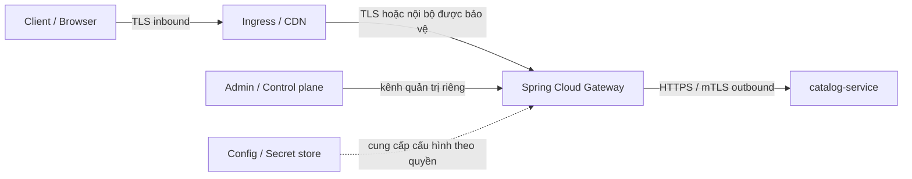
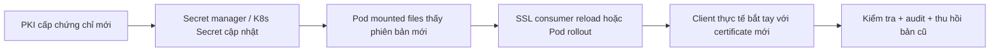
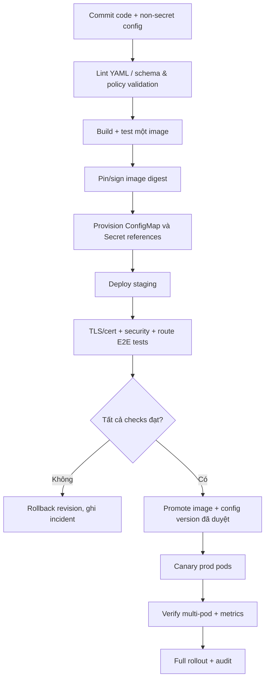

# Quản lý cấu hình, chứng chỉ và bí mật theo môi trường

## 1. Bài toán triển khai Spring Cloud Gateway an toàn qua nhiều môi trường

Khi xây dựng API Gateway với **Spring Cloud Gateway**, chúng ta cấu hình route predicate, filter chain, biến đổi path/header, service discovery, xác thực, rate limit, circuit breaker, retry, TLS và quan sát request. Phần lớn các chức năng này phụ thuộc vào **cấu hình theo môi trường**, và một số phụ thuộc trực tiếp vào **chứng chỉ hoặc bí mật**. Bài toán phát sinh khi cùng một ứng dụng phải vận hành trong ba môi trường:

| Môi trường | Ví dụ URL client → Gateway | Backend đích | Điều kiện vận hành |
|---|---|---|---|
| **dev** | `http://localhost:8080` | `http://127.0.0.1:8081` | Dễ debug, dữ liệu giả, không chứa credential thật |
| **staging** | `https://staging.api.example.test` | `https://catalog.staging.svc.example.test` | TLS/certificate thật của môi trường thử, xác thực/quota, test rollback |
| **production** | `https://api.example.test` | `https://catalog.prod.svc.example.test` | Bí mật do secret manager quản lý, TLS/mTLS, audit, rollout và rotation |

**Mục tiêu không phải ba JAR khác nhau.** Mục tiêu là **một artifact ứng dụng được xây dựng và kiểm thử**, sử dụng cấu hình bên ngoài tương ứng mỗi môi trường, với bí mật được phân phối an toàn và có thể thay/thu hồi mà không phải commit chúng vào mã nguồn.

Một lỗi cấu hình ở Gateway có thể gây hậu quả lớn hơn một ứng dụng đơn lẻ: trỏ route production nhầm sang staging; gửi JWT sang upstream không tin cậy; tắt xác minh TLS; lộ private key qua image; hoặc triển khai chứng chỉ mới nhưng một số pod vẫn dùng chứng chỉ cũ.

### Kết quả học tập

Sau bài thuộc chương **Triển khai**, bạn có thể:

1. Phân loại **configuration**, **certificate**, **private key**, **trusted CA** và **runtime secret**.
2. Dùng Spring Boot **externalized configuration** và profiles `dev`, `staging`, `prod` mà không hard-code bí mật.
3. Phân biệt TLS **client → Gateway**, TLS **Gateway → backend** và TLS **management plane**.
4. Cấu hình Spring Boot **SSL bundles** và Gateway Server WebFlux HTTP-client SSL theo chính xác namespace của bản 5.0.x.
5. Gắn ConfigMap và Secret vào Kubernetes Pod bằng env/volume, hiểu giới hạn cập nhật và `subPath`.
6. Biết khi nào dùng Spring Cloud Config, Spring Cloud Vault hoặc một secret manager bên ngoài.
7. Lập quy trình **kiểm tra, rotation, canary, rollback và audit** cho thay đổi route/certificate/credentials.
8. Chẩn đoán lỗi “route đúng nhưng TLS sai”, “Secret đổi mà Pod chưa dùng” và “config source trùng hoặc ghi đè ngoài ý muốn”.

> **Phạm vi:** Spring Cloud Gateway **Server WebFlux 5.0.x** với Spring Boot **4.x** và Spring Cloud BOM tương thích. Một số tính năng TLS client có namespace khác ở **Gateway Server Web MVC**; không chuyển nguyên YAML WebFlux sang Servlet. Đường dẫn, hostname, secret names và credentials trong bài là **ví dụ giả lập**, không phải thông tin vận hành thực.

## 2. Phân loại trước khi quyết định đặt dữ liệu ở đâu

### 2.1. Cấu hình không bí mật và dữ liệu nhạy cảm

| Loại | Ví dụ của Gateway | Có nên ở Git? | Nguồn/biện pháp phù hợp |
|---|---|---|---|
| **Non-secret config** | route ID, `Path`, `StripPrefix`, `order`, timeout, quota thresholds | **Có**, sau review | YAML/IaC/Git, ConfigMap, Config Server |
| **Tên upstream** | `https://catalog.prod.svc.example.test` | Có thể, nếu policy cho phép | Git/config; không chứa userinfo/password trong URI |
| **Certificate công khai** | Server leaf certificate/fullchain, CA root/intermediate | Có thể lưu **public cert** có kiểm soát | ConfigMap/CA bundle, quản trị tính toàn vẹn |
| **Private key TLS** | `tls.key`, PKCS12 chứa key | **Không** commit vào repo | Secret manager/Kubernetes Secret volume, giới hạn quyền |
| **Trust store password / keystore password** | Password mở PKCS12/JKS có khóa riêng | **Không** | Secret reference/volume/config tree |
| **OAuth2 client secret** | Secret cho TokenRelay/OAuth2 client registration | **Không** | Vault/Secrets, rotation |
| **API key / HMAC shared secret** | Khóa gọi nội bộ hoặc ký request | **Không** | Secret manager/short-lived identity, không log |
| **Token ngắn hạn** | Bearer access token/JWT đang sử dụng | **Không** | Token service/runtime memory; hạn chế propagation |
| **Operational policy** | RBAC, secret expiry SLA, rollout thresholds | Có thể versioned | Git/IaC/policy-as-code và approval |

Một **certificate** không đồng nghĩa **private key**. TLS server public certificate thường có thể được phân phối rộng; **private key tương ứng** là bí mật cần bảo vệ. CA trust certificate chủ yếu là dữ liệu **tin cậy về danh tính**, có thể công khai nhưng không được tự ý thay thế bằng certificate do kẻ tấn công cung cấp.

### 2.2. Một request có ít nhất ba trust boundaries



Trên thực tế TLS có thể **kết thúc ở ingress** hoặc **ngay tại Gateway**. Khi có nhiều hop, mỗi hop có TLS trust, certificate identity, URI scheme và mật khẩu/khóa riêng. Một `https://` phía client **không chứng minh** Gateway → backend đang mã hóa, và một certificate phía Gateway **không tự trở thành CA được dùng bởi HTTP client outbound**.

### 2.3. Ba nguyên tắc thiết kế

1. **Artifact giống nhau, cấu hình khác nhau:** dùng image digest được kiểm duyệt và configuration revision theo môi trường. Không rebuild image chỉ vì đổi hostname.
2. **Secret không nằm trong code/image:** secret manager hoặc volume có quyền hạn hẹp; không nhúng vào JAR, Dockerfile, Helm values đã commit hay output CI.
3. **Fail closed đúng chỗ:** khi thiếu credential/TLS trust cần thiết ở production, **không tự đổi sang HTTP cleartext**, không bật insecure trust manager và không dùng giá trị mặc định giả để tiếp tục khởi động.

## 3. Spring Boot externalized configuration và thứ tự ghi đè

### 3.1. Spring Environment tổng hợp nhiều PropertySources

Spring Boot hỗ trợ `application.yml`, profile-specific files, environment variables, JVM system properties, command-line arguments, Config Data imports và nguồn mở rộng. Trên một deployment thông thường:

```text
application.yml trong JAR         ┐
application-prod.yml trong JAR     │
external application-prod.yml     ├─> Spring Environment
OS env / JVM -D / --arguments      │     └─> Bind @ConfigurationProperties
Config Data / Secret store         ┘          └─> Spring Cloud Gateway
```

Về thứ tự ưu tiên thông dụng, **config data** được đọc trước **OS environment variables**, **JVM system properties**, rồi **command-line options**; source đến sau trong thứ tự ưu tiên có thể ghi đè. Tuy nhiên **imports, profile groups và location groups có các quy tắc riêng**. Đừng coi “file trong ConfigMap luôn thắng env var” hay “file có tên prod chắc chắn thắng mọi config source khác”.

### 3.2. Cấu hình chung không có bí mật

Ví dụ `src/main/resources/application.yml` (trong ứng dụng người học, không phải file học liệu):

```yaml
spring:
  application:
    name: gateway-edge
  cloud:
    gateway:
      server:
        webflux:
          httpclient:
            connect-timeout: 2000
            response-timeout: 5s
          routes:
            - id: catalog
              uri: ${GATEWAY_CATALOG_URI:http://127.0.0.1:8081}
              predicates:
                - Path=/api/catalog/**
              filters:
                - StripPrefix=2

management:
  endpoints:
    web:
      exposure:
        include: health,info
```

Đây là một **default tiện cho dev**, không phải config sản xuất hoàn chỉnh. Trong production, hãy **bắt buộc cấp** `GATEWAY_CATALOG_URI`/route config từ nguồn được kiểm soát và chặn mọi fallback trỏ tới localhost. `spring.cloud.gateway.server.webflux.routes` là namespace WebFlux ở Gateway 5.0.x, không dùng prefix cũ `spring.cloud.gateway.routes` từ hướng dẫn phiên bản trước.

**Chú ý:** placeholder `${NAME:default}` dùng dấu `:` để chỉ giá trị mặc định. Không đặt giá trị mặc định cho **secret bắt buộc** như client secret hoặc private-key password.

### 3.3. Profile-specific configuration

Ở môi trường dev:

```yaml
# application-dev.yml
server:
  port: 8080

spring:
  cloud:
    gateway:
      server:
        webflux:
          httpclient:
            response-timeout: 10s
```

Ở production:

```yaml
# application-prod.yml (non-secret, example)
server:
  port: 8443

spring:
  cloud:
    gateway:
      server:
        webflux:
          httpclient:
            response-timeout: 3s
```

Kích hoạt qua **deployment**, không hard-code profile prod trong code:

```bash
# Dev shell:
SPRING_PROFILES_ACTIVE=dev java -jar gateway-edge.jar

# Prod thường do Deployment env, không nhập tay trên node:
SPRING_PROFILES_ACTIVE=prod java -jar gateway-edge.jar
```

Nếu ứng dụng bật nhiều profiles cùng lúc, **profile khai báo sau có thể ghi đè profile trước** theo quy tắc location groups. Nên chọn **một profile môi trường chính** để tránh pha trộn `dev,prod`. `spring.profiles.active` phải được đặt ở chỗ hợp lệ trong Spring Config Data và nên đến từ orchestrator; không dùng `spring.config.activate.on-profile` để tự kích hoạt profile đó.

### 3.4. Environment variables và tên thuộc tính

Spring Boot relaxed binding ánh xạ các environment variables như:

```text
SPRING_PROFILES_ACTIVE=prod
SERVER_PORT=8443
SPRING_CLOUD_GATEWAY_SERVER_WEBFLUX_HTTPCLIENT_CONNECTTIMEOUT=2000
```

Với các property có dấu gạch ngang, quy tắc canonical của Boot thường là **thay dấu chấm bằng gạch dưới, bỏ dấu gạch ngang và viết hoa**. Tuy nhiên các property dạng **list/map** có quy tắc index/key riêng; khi route list dài, ưu tiên **YAML cấu hình đã versioned** thay vì env vars phức tạp như `...ROUTES_0_PREDICATES_0`, rồi test binding thật.

**Cảnh báo:** command-line `--some.secret=value` và env vars đôi khi bị lộ qua process metadata, debug dumps hoặc quyền của người xem Pod spec; với credential nhạy cảm nên ưu tiên mounted files/secret agent và giới hạn quyền.

### 3.5. `spring.config.location` và `spring.config.additional-location` không giống nhau

```bash
# Giữ cấu hình mặc định và thêm thư mục config của môi trường:
java -jar gateway-edge.jar \
  --spring.config.additional-location=optional:file:./deploy-config/

# Thay tập vị trí tìm kiếm mặc định (cần thiết kế có chủ đích):
java -jar gateway-edge.jar \
  --spring.config.location=file:./deployment-only/
```

`additional-location` thêm nguồn bên ngoài vào các vị trí tìm kiếm mặc định, còn `location` có thể **thay thế** các default locations. Với một thư mục, thường cần dấu `/` cuối. `optional:` cho phép bỏ qua vị trí không tồn tại; **không dùng optional cho secret/critical policy bắt buộc ở prod**.

### 3.6. Tránh “ghi đè một phần list routes” không có kiểm chứng

Route definitions là **danh sách**, ví dụ `routes[0]`, `routes[1]`. Khi môi trường ghi đè cấu hình danh sách, **không giả định mỗi phần tử được merge theo `id`**. Một external `application-prod.yml` chỉ có route `catalog` có thể làm mất routes khác tùy quá trình binding/override. Nên quản lý **toàn bộ route set cần có** theo nguồn config cụ thể và kiểm tra runtime:

```text
expectedRouteIds = {catalog, orders, auth}
actualRouteIds   = GET /actuator/gateway/routes
assert expected == actual  (trong môi trường được kiểm soát)
```

Một phép check config file không thay cho kiểm tra HTTP route thật, nhất là khi có discovery locators hoặc dynamic route store ngoài YAML.

## 4. Thiết kế cây cấu hình tách theo môi trường

### 4.1. Không coi ba môi trường là ba bản sao của một YAML chứa password

Một thiết kế tương đối dễ kiểm toán:

```text
source code / Git:
  application.yml                  # defaults chung, không chứa bí mật
  application-dev.yml              # dev overrides, local only
  deploy/staging/routes.yml        # route snapshot staging, non-secret
  deploy/prod/routes.yml           # route snapshot prod, non-secret
  deploy/prod/values-public.yaml   # image digest, resources, probes...

runtime ngoài image:
  /etc/gateway/config/             # ConfigMap hoặc Config Server config
  /etc/gateway/tls/                # certificate + PRIVATE KEY: Secret volume
  /etc/gateway/trust/              # CA bundles được phê duyệt
  /etc/gateway/secrets/            # OAuth client secret, API key... file
```

**Sơ đồ chỉ minh họa cách phân vùng**, không buộc tổ chức phải có đúng những file này. Điều quan trọng là **dữ liệu bí mật không có mặt trong Git hoặc image** và không bị copy vào artifact build. Ở môi trường thử nghiệm, secret thật vẫn cần bảo vệ; không dùng cùng OAuth client secret, private key hoặc credentials sản xuất trên staging.

### 4.2. Bảng ownership và khả năng thay đổi

| Thành phần | Người/team quản lý | Thay đổi bằng | Sau khi đổi có cần khởi động lại? |
|---|---|---|---|
| Route predicates/filters/URI | Platform/app owner | GitOps/Config Server/RouteDefinition source | Tùy nguồn config và cơ chế refresh; phải xác minh |
| Timeout, pool, metrics configuration | Gateway platform | External YAML/env | Thường áp dụng lúc startup; cần xác định property có hỗ trợ refresh không |
| Inbound TLS key/cert | PKI/SRE | Secret mount + SSL bundle hoặc rollout | Boot 4 hỗ trợ reload bundle ở Netty server khi bật đúng cách; không mặc định |
| Outbound trusted CA | PKI/SRE | CA bundle/secret/config + client SSL bundle | **Không giả định** Netty HttpClient reload live; kiểm tra hoặc rollout |
| OAuth2 client secret | IAM/secret platform | Vault/secret service/Secret volume | Tùy client lifecycle/cache; nhiều trường hợp cần restart |
| RBAC/management exposure | Security/platform | IaC/release | Kiểm tra trước triển khai; không “refresh route” để đổi bảo mật |
| Gateway image | App/platform | CI/CD + digest pin | Cần rollout/pod replacement |

Tính năng **route refresh** không phải tính năng **configuration hot reload toàn JVM**. Đặc biệt, `POST /actuator/gateway/refresh` làm mới **các tuyến**, không tự đọc lại SSL private key hay đổi OAuth2 client secret đã bind vào bean ở startup.

### 4.3. Cách đặt tên và cô lập môi trường

Nên dùng các định danh:

```text
gateway-dev / gateway-staging / gateway-prod      # workloads
gateway-inbound-tls                               # k8s Secret ở mỗi namespace
catalog-upstream-ca                               # CA/trust bundle của mỗi namespace
gateway-oauth-client                              # OAuth2 secret (khi cần)
catalog                                             # route ID giữ ổn định
```

Một Secret có **cùng tên** trong ba Kubernetes namespaces vẫn là **ba objects khác nhau** với quyền và nội dung độc lập. Không dùng route ID dựa trên secret name hoặc nhúng environment password vào route URI. Cùng một route ID `catalog` có thể trỏ tới các hostname khác nhau theo môi trường mà vẫn dễ đối chiếu audit.

### 4.4. Kiểm soát thay đổi: route config không phải data không nguy hiểm

Ngay cả một YAML **không chứa password** cũng có thể rất nhạy cảm:

- `uri: https://malicious.example.test` chuyển traffic/Authorization sai chỗ.
- `Path=/**` có `order` rất thấp chiếm toàn bộ API namespace.
- `RemoveRequestHeader=Authorization` có thể phá security contract.
- `Retry` áp dụng nhầm POST làm nhân đôi các thao tác ghi.
- `RequestRateLimiter` cấu hình sai key resolver có thể từ chối quá mức.
- `httpclient.ssl.use-insecure-trust-manager: true` làm hỏng trust model.

Vì vậy route config cần **code review, policy validation, change owner, signature/provenance, canary và rollback**, dù không nằm trong Secret object.

## 5. TLS ở phía nhận request (client/ingress → Gateway)

### 5.1. Ba topology phổ biến

| Topology | TLS được kết thúc ở đâu? | Gateway listener | Điều cần kiểm chứng |
|---|---|---|---|
| Client HTTPS → Ingress TLS → Gateway HTTPS | Ingress rồi thiết lập TLS mới tới Gateway | HTTPS/TLS | Cả hai certificates, ingress trust và Gateway identity |
| Client HTTPS → Ingress TLS → Gateway HTTP nội bộ | Ingress | HTTP cleartext | Chỉ chấp nhận khi có trust boundary/network/mesh bảo vệ chặng nội bộ |
| Client HTTPS passthrough → Gateway HTTPS | Gateway | HTTPS/TLS | Gateway certificate cho public hostname, SNI/ALPN và ingress passthrough |

Với topology kết thúc TLS ở ingress, `server.ssl.bundle` tại Gateway **không bảo vệ chặng client → ingress**; certificate phía edge thuộc Ingress/CDN. Nếu chặng ingress → Gateway cũng cần TLS/mTLS, phải có **server certificate của Gateway** và cấu hình client trust của ingress.

### 5.2. Spring Boot 4: định nghĩa PEM SSL bundle cho server

Giả sử certificate/private key do secret manager tạo rồi mount vào:

```text
/etc/gateway/tls/tls.crt    # full certificate chain (public cert)
/etc/gateway/tls/tls.key    # PRIVATE KEY, quyền đọc chặt
```

Cấu hình trong một file production external, **không nhúng nội dung private key**:

```yaml
server:
  port: 8443
  ssl:
    bundle: gateway-inbound
  http2:
    enabled: true

spring:
  ssl:
    bundle:
      pem:
        gateway-inbound:
          keystore:
            certificate: "file:/etc/gateway/tls/tls.crt"
            private-key: "file:/etc/gateway/tls/tls.key"
```

Spring Boot tạo bundle tên `gateway-inbound` từ chứng chỉ và khóa riêng; `server.ssl.bundle` yêu cầu web server sử dụng bundle đó. `server.http2.enabled: true` là **cấu hình riêng** cho HTTP/2 ở listener, còn ALPN/TLS/client compatibility phải được kiểm thử. Không đưa `tls.key` vào `src/main/resources` hoặc copy vào Docker layer.

Nếu dùng **JKS/PKCS12**, có thể cấu hình `spring.ssl.bundle.jks.<name>.keystore.location/password/type` và tham chiếu `server.ssl.bundle`; password phải đến từ Secret. Không chọn một PEM bundle và đồng thời cấu hình `server.ssl.key-store` không liên quan mà không kiểm tra quy tắc precedence/validation.

### 5.3. Cấu hình bảo mật TLS client-auth/mTLS inbound

Nếu Gateway phải xác thực certificate của **caller là ingress hoặc service**:

```yaml
server:
  ssl:
    bundle: gateway-mtls
    client-auth: need

spring:
  ssl:
    bundle:
      pem:
        gateway-mtls:
          keystore:
            certificate: "file:/etc/gateway/tls/tls.crt"
            private-key: "file:/etc/gateway/tls/tls.key"
          truststore:
            certificate: "file:/etc/gateway/trust/allowed-client-ca.crt"
```

Bundle `gateway-mtls` gồm certificate của Gateway và CA để xác thực **client certificates**. `client-auth: need` buộc client phải trình chứng chỉ hợp lệ theo TLS engine. Nhưng **certificate hợp lệ không tự xác định quyền gọi mọi route**; authorization còn cần xác định identity/issuer/SAN/policy và quản lý revocation/rotation. Nếu TLS bị ingress kết thúc mà không chuyển mTLS đến Gateway, app không thể suy ra mTLS client identity từ một header do Internet tự gửi.

### 5.4. Test inbound TLS không tắt xác minh chứng chỉ

Với CA của môi trường lab:

```bash
# Kiểm chứng certificate, hostname và HTTP response của Gateway.
curl --noproxy '*' -v \
  --cacert ./certs/lab-root-ca.crt \
  https://localhost:8443/actuator/health

# Xem certificate subject/issuer/dates/chain và ALPN trên listener.
openssl s_client \
  -connect localhost:8443 \
  -servername localhost \
  -alpn h2,http/1.1 \
  -CAfile ./certs/lab-root-ca.crt \
  </dev/null
```

Để phép thử `localhost` thành công, certificate phải chứa **SAN DNS:localhost** (và SAN IP nếu gọi bằng địa chỉ IP) do CA lab tin cậy cấp. Với mTLS `client-auth: need`, `curl`/`openssl` còn cần **client certificate + private key** tương ứng do CA được Gateway tin.

Tránh `curl -k` hoặc `use-insecure-trust-manager=true` trong quy trình kiểm tra production; chúng làm mất bằng chứng certificate được xác minh đúng danh tính.

### 5.5. Quản trị HTTPS là một listener khác

Nếu đặt Spring Boot Actuator trên `management.server.port` riêng, ví dụ `9090`, **đừng mặc định port này dùng cùng chính sách TLS/RBAC như cổng API**. Có các lựa chọn như chặn hoàn toàn ngoài cluster, bind loopback/network riêng, hoặc cấu hình management-specific SSL và Spring Security phù hợp.

`/actuator/env`, `/actuator/configprops` và `/actuator/gateway` có thể lộ topology và cấu hình, hoặc cho phép **thay đổi route** nếu cấp quyền ghi. Thông tin đã được sanitize vẫn không phải lý do để public management endpoints ra Internet.

## 6. TLS phía Gateway gọi backend (outbound)

### 6.1. Phân biệt server SSL và Netty HTTP client SSL

Trong Gateway Server WebFlux:

```text
Client/Ingress             Gateway                     Backend
     |                        |                           |
     +---- TLS inbound ------>|                           |
                              +------ TLS outbound ------>|
                     server.ssl.*              spring.cloud.gateway.
                                               server.webflux.httpclient.ssl.*
```

`server.ssl.bundle` **không tự cấu hình** trust/certificate cho Netty HTTP client outbound. Ngược lại, thêm CA vào Gateway HTTP client **không thay** certificate Gateway trình cho browser.

### 6.2. Outbound HTTPS với một CA riêng

Giả sử backend `catalog.prod.svc.example.test` dùng certificate được ký bởi private PKI. CA được mount tại `/etc/gateway/trust/catalog-ca.crt`. Spring Boot định nghĩa **trust-only PEM SSL bundle**, rồi Gateway HTTP client tham chiếu tên bundle:

```yaml
spring:
  ssl:
    bundle:
      pem:
        catalog-upstream:
          truststore:
            certificate: "file:/etc/gateway/trust/catalog-ca.crt"

  cloud:
    gateway:
      server:
        webflux:
          httpclient:
            connect-timeout: 2000
            response-timeout: 5s
            ssl:
              ssl-bundle: catalog-upstream
              handshake-timeout: 10s
              use-insecure-trust-manager: false
          routes:
            - id: catalog
              uri: https://catalog.prod.svc.example.test
              predicates:
                - Path=/api/catalog/**
              filters:
                - StripPrefix=2
```

Tên thuộc tính **`spring.cloud.gateway.server.webflux.httpclient.ssl.ssl-bundle`** được liệt kê trong bảng configuration properties của Gateway 5.0.x. Nó dành cho **Netty HttpClient** được Gateway Server WebFlux dùng để proxy HTTP traffic; phải kiểm tra cơ chế WebSocket client/LoadBalancer nếu workload có giao thức khác.

**Phạm vi áp dụng:** cấu hình HTTP client ở đây có thể ảnh hưởng **nhiều routes cùng dùng client/pool**, không tự tạo CA trust riêng cho từng route. Với nhiều upstream có trust policies khác nhau, cần thiết kế trust store union/segmented Gateway instances/HTTP clients hoặc custom strategy được review; không gắn nhầm một CA độc hại để “cho mọi backend chạy”.

### 6.3. Khi outbound cần mutual TLS (mTLS)

Một client SSL bundle có thể gồm **cả key material dùng trình danh tính của Gateway** và **trust material dùng xác minh backend**:

```yaml
spring:
  ssl:
    bundle:
      pem:
        catalog-mtls:
          keystore:
            certificate: "file:/etc/gateway/client-tls/client.crt"
            private-key: "file:/etc/gateway/client-tls/client.key"
          truststore:
            certificate: "file:/etc/gateway/trust/catalog-ca.crt"
  cloud:
    gateway:
      server:
        webflux:
          httpclient:
            ssl:
              ssl-bundle: catalog-mtls
              use-insecure-trust-manager: false
```

**Certificate client** trong `client.crt` phải được backend tin; `client.key` phải được bảo vệ như bí mật. Không dùng cùng một private key inbound public Gateway cho outbound mTLS trừ khi đã có thiết kế PKI cụ thể (thường nên dùng **identities và keypairs riêng**).

### 6.4. Kiểm tra TLS outbound từ đúng runtime environment

```bash
# Chạy trong một công cụ debug được phép ở cùng network path với Gateway.
curl --cacert /etc/gateway/trust/catalog-ca.crt \
  -v https://catalog.prod.svc.example.test/health

# Xem certificate chain của backend, giữ nguyên hostname SNI.
openssl s_client \
  -connect catalog.prod.svc.example.test:443 \
  -servername catalog.prod.svc.example.test \
  -CAfile /etc/gateway/trust/catalog-ca.crt \
  </dev/null
```

Nếu backend yêu cầu mTLS, thêm `--cert`/`--key` của **client identity được phê duyệt** và bảo đảm tools không vô tình in private key. Bước thử trực tiếp chứng minh backend có thể truy cập bằng TLS **từ môi trường thử**, chưa chứng minh Gateway HTTP client đã load đúng bundle; cần tiếp tục **gửi request qua Gateway**, quan sát backend và kiểm tra logs/metrics transport.

### 6.5. Những giải pháp nguy hiểm

| Cách “chữa cháy” | Vì sao sai? | Cách đúng |
|---|---|---|
| `use-insecure-trust-manager: true` | Bỏ xác minh chứng chỉ backend | Trust CA/certificate chain và hostname hợp lệ |
| Đổi `https://` sang `http://` | Gửi token/data cleartext nếu không có kênh khác | Sửa TLS handshake/trust/DNS/SNI |
| `curl -k` trong test production | Che lỗi certificate/hostname | Dùng `--cacert` hoặc trust store chuẩn |
| Copy private key vào image | Khó thu hồi, ai có image có thể lấy key | Mount Secret với least privilege |
| Dùng một shared client key mọi environment | Mất cô lập dev/staging/prod và blast radius lớn | Identity/cert/key tách theo môi trường |
| Tin mọi CA không được kiểm duyệt | Tăng bề mặt giả mạo upstream | Chỉ trust CA theo policy và kiểm tra hostname |

**Không xem certificate chỉ là một file configuration bình thường**: thay đổi certificate, CA trust hoặc private key là thay đổi trust boundary, cần audit/approval/rollout/test rollback tương xứng.

## 7. Quản lý bí mật: env vars, mounted files và config tree

### 7.1. Bí mật cần được quản lý theo vòng đời

Một bí mật không chỉ là “chuỗi được ẩn trong YAML”. Với OAuth2 client secret, API key, password PKCS12 hoặc keypair TLS, cần biết:

- **Ai cấp?** IAM, PKI, secret manager hay CI được ủy quyền.
- **Ai được đọc?** ServiceAccount/workload identity, role, namespace và process.
- **Dùng để làm gì?** Đúng upstream/audience, đúng môi trường và phạm vi.
- **Sống bao lâu?** Ngày hết hạn, TTL, kế hoạch rotation và revocation.
- **Có thể lộ ở đâu?** Git, image layer, Helm release metadata, process env, stdout, Actuator, heap dump, trace.
- **Đổi thế nào?** Volume update, client reload, rolling restart, dual-key overlap và smoke tests.

**Mã hóa base64 không biến một giá trị thành bí mật được bảo vệ**. Kubernetes `Secret.data` dùng base64 để biểu diễn bytes trong YAML; ai có quyền đọc Secret sẽ giải mã được. Cần encryption at rest, RBAC, giới hạn API access, audit và bảo vệ backups/CI logs.

### 7.2. Dùng environment variable cho secret khi hạ tầng chấp nhận

Ví dụ một application property **do code ứng dụng tự khai báo**:

```yaml
app:
  integrations:
    partner:
      api-key: ${GATEWAY_PARTNER_API_KEY}
```

Ứng dụng có thể dùng `@ConfigurationProperties(prefix = "app.integrations.partner")` để nhận giá trị, **không ghi vào log** hoặc lộ qua `toString()`. Trong deployment, cấp `GATEWAY_PARTNER_API_KEY` bằng secret reference; **không đặt giá trị thật trong Dockerfile hoặc manifest Git**.

Lưu ý: `app.integrations.partner.api-key` chỉ là **ví dụ custom property**, không phải một Gateway built-in filter tự dùng API key. Nếu cần xác thực tới upstream bằng Spring Security OAuth2 client, phải cấu hình đúng client registration, provider, credentials và policy token relay theo tài liệu Spring Security.

**Giới hạn env vars:** Secret được đưa vào environment khi container khởi động, có thể xuất hiện trong process diagnostics, error dumps hoặc tools có quyền xem môi trường. Thay Secret object Kubernetes **không cập nhật env var trong một Pod đang chạy**. Cần restart/rollout để process nhận giá trị mới.

### 7.3. Config tree cho những Secret đã mount thành từng file

Spring Boot hỗ trợ `spring.config.import=configtree:/path/`. Khi mount:

```text
/etc/gateway/credentials/
  app.integrations.partner.api-key    # nội dung file: <secret-bytes>
  app.integrations.partner.key-id     # nội dung file: <version-label>
```

Cấu hình:

```yaml
spring:
  config:
    import: "configtree:/etc/gateway/credentials/"
```

Mỗi **filename là property key**, nội dung file là value. Vì import này **không có `optional:`**, thiếu directory có thể làm ứng dụng không start. Điều này thường tốt cho cấu hình security-critical, nhưng **cũng cần validation key bắt buộc**: một directory tồn tại mà thiếu file `api-key` có thể không tạo ra giá trị như mong đợi.

Đối với secret files, hãy cấu hình `readOnly`, permissions và owner/group thích hợp cho UID của Java process. Không mount toàn bộ namespace Secret vào Pod chỉ vì một khóa nhỏ. Một `configtree:` load property values **không có nghĩa** code Gateway tự biết rebind/recreate bean khi file thay đổi; cần xác định lifecycle.

### 7.4. File path hay nội dung secret?

Hai dạng khác nhau:

```yaml
spring:
  ssl:
    bundle:
      pem:
        gateway-inbound:
          keystore:
            private-key: "file:/etc/gateway/tls/tls.key"

app:
  integrations:
    partner:
      api-key: ${GATEWAY_PARTNER_API_KEY}
```

- `file:/etc/gateway/tls/tls.key` là **đường dẫn tới file chứa private key**, không phải private key text.
- `${GATEWAY_PARTNER_API_KEY}` là **giá trị được lấy từ environment** vào một property.

Không tự thay một file path cần thiết bằng biến chứa PEM nhiều dòng mà không kiểm tra format và cách Spring Boot parse resource. Tránh in nội dung file/secret vào CI log khi debug.

### 7.5. Khi nào nên dùng Secret manager thay vì Kubernetes Secret trực tiếp?

| Yêu cầu | K8s Secret / mounted files | Vault/cloud secret manager / workload identity |
|---|---|---|
| Bí mật tĩnh, vài keys | Hợp lý khi cluster có RBAC/encryption/audit tốt | Cũng phù hợp |
| Rotation theo TTL ngắn | Cần operator/automation và reload/restart đúng cách | Thường hỗ trợ lifecycle/lease tốt hơn |
| Dynamic DB credentials/token | Cần tích hợp ngoài | Thường có secret engines/identity APIs |
| Tách quyền theo environment | Namespace/RBAC/ServiceAccount | Policies/roles/identity riêng |
| Không muốn lưu giá trị secret trong Kubernetes API | Chỉ mount qua CSI/agent khi thiết kế cụ thể | Có thể cấp trực tiếp qua CSI/agent/service identity |
| Audit truy cập secret | Kubernetes API audit (phạm vi theo access) | Secret manager audit events, policy |

Không có công cụ nào làm bí mật tự động an toàn nếu quyền quá rộng hoặc app log raw values. Dùng **least privilege**, **workload identity**, secret scopes riêng, deny-by-default và kiểm thử thu hồi.

## 8. Spring Cloud Config và Vault: phân biệt nguồn cấu hình với nguồn bí mật

### 8.1. Spring Cloud Config cho versioned config

Spring Cloud Config Client dùng `spring.config.import=configserver:...` để lấy Config Data:

```yaml
spring:
  application:
    name: gateway-edge
  config:
    import: "configserver:https://config.internal.example.test"
  cloud:
    config:
      label: "release-2026-11"
```

Ví dụ import **không có `optional:`**, nên khi không thể lấy cấu hình bắt buộc, ứng dụng có thể **fail startup** thay vì chạy với defaults sai. Tham số `label` có thể gắn với tag/branch/commit trên repository mà Config Server dùng (tùy backend). Đây là **tên ví dụ**, phải đổi thành nguồn version đã được CI/CD phê duyệt.

**Đừng lưu Config Server username/password hoặc OAuth token trong chính Git config**. Nếu Config Server cần credential, cấp bằng secret store/workload identity/env/mTLS riêng; đảm bảo SSL CA và endpoint availability. Nếu môi trường dev có thể chấp nhận thiếu Config Server, dùng `optional:configserver:...` **có chủ đích**, không bật optional mặc định cho production security-critical configuration.

### 8.2. Config Server không phải tự động áp dụng mọi thay đổi trong runtime

Sau khi thay một file trong Git:

1. Config Server phải quan sát/phục vụ revision mới.
2. Gateway client phải **nhận/rebind** những property cần thay.
3. Gateway route definitions phải **được reload hoặc refresh** đúng cơ chế.
4. TLS client, OAuth2 registrations và HTTP connection pools có thể cần recreation/restart.
5. Từng Gateway instance phải nhận **cùng config revision** hoặc rollout có chủ đích.

`POST /actuator/gateway/refresh` chỉ là **route cache refresh**, không cam kết gọi lại Config Server, rebind mọi `@ConfigurationProperties` hoặc xoay SSL key. Khi muốn dynamic config, cần thiết kế cả **config source change notification**, **refresh lifecycle** và **end-to-end tests**.

### 8.3. Spring Cloud Vault import secrets

Spring Cloud Vault tích hợp Spring Boot Config Data:

```yaml
spring:
  config:
    import: "vault://"
  cloud:
    vault:
      uri: "https://vault.internal.example.test"
      # Xác thực nên dùng workload identity/Kubernetes auth
      # hoặc cơ chế được security team chấp thuận;
      # không commit token cá nhân vào YAML.
```

Đây là **trích đoạn ý tưởng**, chưa đủ để chạy Vault Client thực tế. Cần dependency Spring Cloud Vault tương thích BOM, bật đúng secret backends, xác thực, service identity, TLS trust và policy quyền đọc tại đường dẫn thuộc môi trường. `vault://` là Config Data import mechanism; không tự làm gateway HTTP client tin mọi certificate.

**Thực hành production:** ưu tiên workload identity/Kubernetes auth/OIDC và TTL/rotation; không dùng một Vault root token hard-coded. Nếu Vault không sẵn sàng ở startup, chọn fail-closed hoặc có chiến lược cache/lease đã phê duyệt; **không rơi về client secret mặc định**.

### 8.4. Quyền đọc source và quyền thay route là hai việc khác

Một pod được quyền đọc cấu hình không nên mặc nhiên có quyền:

- Ghi mọi route definitions của các nhóm khác.
- Ghi secrets của tenant/environment khác.
- Tạo RouteDefinition với URI bất kỳ đi đến metadata endpoint.
- Bật Actuator Gateway `unrestricted` public.
- Đọc và giải mã mọi certificate private key.

Quyền read-secret/read-config, quyền publish-config và quyền approve/activate route nên tách theo **separation of duties** và có audit.

## 9. Ví dụ Kubernetes: ConfigMap + Secret volumes + một image

### 9.1. Sơ đồ triển khai

```text
GitOps (non-secret config)             PKI/Secret Platform
            |                                   |
            v                                   v
    ConfigMap gateway-prod-config        Secret gateway-inbound-tls
      application-prod.yml               Secret catalog-upstream-ca
            |                                   |
            +----------- Kubernetes ------------+
                             |
                             v
                       Gateway Pod
                       image cố định
                         8443 TLS
                /etc/gateway/config/ (ConfigMap)
                /etc/gateway/tls/    (Secret)
                /etc/gateway/trust/  (Secret/CA)
                             |
                             v
                 HTTPS catalog.prod.svc.example.test
```

**Đây là kiến trúc mẫu**, không phải cơ sở hạ tầng người học đang có. ConfigMap là nơi chứa non-secret YAML, Secret là nơi cung cấp private key và trust material theo chính sách; certificates thường có thể công khai nhưng phải giữ **tính toàn vẹn và nguồn phát hành**.

### 9.2. ConfigMap chỉ có file cấu hình, không chứa khóa riêng

Ví dụ `gateway-prod-config.yaml` trong repository GitOps:

```yaml
apiVersion: v1
kind: ConfigMap
metadata:
  name: gateway-prod-config
  namespace: gateway-prod
data:
  application-prod.yml: |
    server:
      port: 8443
      shutdown: graceful
      ssl:
        bundle: gateway-inbound
    spring:
      lifecycle:
        timeout-per-shutdown-phase: 30s
      ssl:
        bundle:
          pem:
            gateway-inbound:
              reload-on-update: true
              keystore:
                certificate: "file:/etc/gateway/tls/tls.crt"
                private-key: "file:/etc/gateway/tls/tls.key"
            catalog-upstream:
              truststore:
                certificate: "file:/etc/gateway/trust/catalog-ca.crt"
      cloud:
        gateway:
          server:
            webflux:
              httpclient:
                connect-timeout: 2000
                response-timeout: 5s
                ssl:
                  ssl-bundle: catalog-upstream
                  use-insecure-trust-manager: false
              routes:
                - id: catalog
                  uri: https://catalog.prod.svc.example.test
                  predicates:
                    - Path=/api/catalog/**
                  filters:
                    - StripPrefix=2
    management:
      endpoints:
        web:
          exposure:
            include: health,info
      endpoint:
        health:
          probes:
            enabled: true
```

Nội dung `application-prod.yml` ở đây là **một file YAML hoàn chỉnh nằm trong `data` của ConfigMap**. Nó chỉ chứa **đường dẫn** tới Secret volumes. Không đưa private-key PEM, OAuth2 secret hay token vào `data.application-prod.yml`.

Nếu tổ chức dùng Config Server thay ConfigMap, có thể bỏ file này và thay bằng đúng import/credentials policy; tránh tạo hai nguồn cạnh tranh mà không quy định precedence.

### 9.3. Secrets được cấp từ nguồn bảo mật

Các Secret objects dự kiến **đã được cấp bởi PKI/secret platform** trong namespace `gateway-prod`:

| Secret | Kiểu/dữ liệu kỳ vọng | Được mount ở |
|---|---|---|
| `gateway-inbound-tls` | `kubernetes.io/tls` với keys `tls.crt`, `tls.key` | `/etc/gateway/tls/` |
| `catalog-upstream-ca` | Secret generic có key `catalog-ca.crt` | `/etc/gateway/trust/` |

Lệnh **chỉ minh họa trên môi trường lab đã có keypair do CA lab cấp**:

```bash
# KHÔNG chạy với private key thật ngoài môi trường được phê duyệt.
# Không paste nội dung private key vào terminal, shell history hoặc chat.
kubectl -n gateway-dev create secret tls gateway-inbound-tls \
  --cert=./certs/gateway.crt \
  --key=./certs/gateway.key
```

Trong production nên để **cert-manager/PKI/External Secrets Operator/CSI provider** hoặc quy trình bí mật được phê duyệt tạo và cập nhật Secret, không tạo tay bằng credential cá nhân. Việc cấp quyền cho Kubernetes Secret **không tự làm dữ liệu mã hóa end-to-end**; phải kiểm tra encryption-at-rest, RBAC, etcd/backup và quyền của node/workload.

### 9.4. Deployment mount ConfigMap và Secrets theo đường dẫn

Ví dụ trích `gateway-deployment.yaml`, giả định namespace, ServiceAccount, Secrets và image đã được provision:

```yaml
apiVersion: apps/v1
kind: Deployment
metadata:
  name: gateway-edge
  namespace: gateway-prod
spec:
  replicas: 2
  selector:
    matchLabels:
      app: gateway-edge
  template:
    metadata:
      labels:
        app: gateway-edge
    spec:
      serviceAccountName: gateway-edge
      securityContext:
        runAsNonRoot: true
        runAsUser: 10001
        runAsGroup: 10001
        fsGroup: 10001
        seccompProfile:
          type: RuntimeDefault
      terminationGracePeriodSeconds: 45
      containers:
        - name: gateway
          # Thay bằng image digest đã được CI ký/duyệt:
          image: registry.example.test/gateway-edge@sha256:REPLACE_DIGEST
          imagePullPolicy: IfNotPresent
          ports:
            - name: https
              containerPort: 8443
          env:
            - name: SPRING_PROFILES_ACTIVE
              value: prod
            - name: SPRING_CONFIG_ADDITIONAL_LOCATION
              value: "file:/etc/gateway/config/"
          volumeMounts:
            - name: configuration
              mountPath: /etc/gateway/config
              readOnly: true
            - name: inbound-tls
              mountPath: /etc/gateway/tls
              readOnly: true
            - name: backend-ca
              mountPath: /etc/gateway/trust
              readOnly: true
            - name: tmp
              mountPath: /tmp
          securityContext:
            allowPrivilegeEscalation: false
            readOnlyRootFilesystem: true
            capabilities:
              drop: ["ALL"]
          readinessProbe:
            httpGet:
              path: /actuator/health/readiness
              port: https
              scheme: HTTPS
            initialDelaySeconds: 5
            periodSeconds: 5
      volumes:
        - name: configuration
          configMap:
            name: gateway-prod-config
        - name: inbound-tls
          secret:
            secretName: gateway-inbound-tls
            defaultMode: 288
        - name: backend-ca
          secret:
            secretName: catalog-upstream-ca
            defaultMode: 288
        - name: tmp
          emptyDir:
            sizeLimit: 64Mi
```

Giải thích những chi tiết dễ bỏ sót:

- `SPRING_CONFIG_ADDITIONAL_LOCATION=file:/etc/gateway/config/` để Boot nạp **external `application-prod.yml`** cùng profile `prod`; không thay toàn bộ default config search locations.
- `defaultMode: 288` là **thập phân tương ứng 0440 (octal)**. `fsGroup` cho phép process non-root đọc các files được mount phù hợp; kiểm tra thực tế permissions với chính image/cluster security policy.
- Không dùng `subPath` cho TLS Secret trong ví dụ: volume Secret cập nhật theo cơ chế projection, còn `subPath` **không nhận update tự động**.
- `readOnlyRootFilesystem` yêu cầu image không ghi vào filesystem khác; `emptyDir` ở `/tmp` cho các thao tác tạm hợp lệ. Production còn cần resource limits, topology spread, disruption budgets, HPA và network policies theo workload.
- Image digest ở trên là **placeholder không chạy được**, phải được CI/CD thay bằng một digest SHA-256 hợp lệ; không copy literal `REPLACE_DIGEST` vào cluster.
- HTTPS readiness probe giúp kiểm tra HTTP response nhưng **kubelet HTTPS probe không xác thực certificate như một client production đầy đủ**; phải có kiểm thử TLS/SAN/CA riêng từ client thật. Health/readiness thành công cũng không đảm bảo tất cả route/upstream hoạt động.

### 9.5. Cấu hình update không đồng nghĩa JVM update

Kubernetes có thể **project lại** file ConfigMap/Secret sau khi object thay đổi (với độ trễ sync/cache). Tuy nhiên:

| Cách cấp | Khi ConfigMap/Secret object đổi | JVM Gateway tự sử dụng giá trị mới? |
|---|---|---|
| Env var từ `secretKeyRef` | Env của Pod hiện có **không đổi** | **Không**; cần rollout/restart |
| Secret volume trực tiếp | File được cập nhật **eventually** | **Chỉ khi consumer watch/reload** được hỗ trợ |
| Secret volume qua `subPath` | **Không** tự cập nhật nội dung mount | Không nên dùng nếu cần hot rotation |
| ConfigMap file mounted | File có thể được cập nhật eventually | Boot không tự rebind mọi config property |
| Config Server Git revision | Remote repository đổi | Client/beans/caches cần cơ chế nhận lại phù hợp |
| Spring Boot PEM SSL bundle với `reload-on-update` | Khi file key/cert thay và watcher phát hiện | **Có thể reload trên Netty web server**, nếu đúng điều kiện |

**Đừng nhầm Kubernetes file projection với Spring bean reconfiguration.** Một file trên volume có timestamp mới chưa chứng minh Gateway outbound HttpClient đã thay SSL context hoặc đã đóng connection pools cũ.

### 9.6. Đọc và kiểm tra Pod mà không in bí mật

Các lệnh **minh họa** trong môi trường được phép:

```bash
# Kiểm tra Pod/deployment rollout, không in Secret.data.
kubectl -n gateway-prod rollout status deployment/gateway-edge
kubectl -n gateway-prod get pods -l app=gateway-edge

# Xem logs đã được ứng dụng giảm dữ liệu nhạy cảm.
kubectl -n gateway-prod logs deployment/gateway-edge \
  --tail=100

# Đọc metadata của objects, không dump raw Secret YAML.
kubectl -n gateway-prod get configmap gateway-prod-config
kubectl -n gateway-prod get secret gateway-inbound-tls
```

Không khuyến khích dùng `kubectl get secret ... -o yaml`, `printenv` tràn lan, `cat /etc/gateway/tls/tls.key` hoặc `kubectl exec ... env` để debug trên production: những công cụ ấy có thể đưa credentials vào terminal history, logs hoặc kênh điều tra không phù hợp.

### 9.7. Quản lý revision để Pod thay cấu hình một cách rõ ràng

Một cách triển khai GitOps dễ truy dấu là dùng **ConfigMap/Secret names có version**, hoặc lưu checksum/hash **không chứa giá trị secret** ở annotation Pod template để tạo rollout khi source thay đổi:

```yaml
spec:
  template:
    metadata:
      annotations:
        config-revision: "git-commit-or-config-version"
        trust-bundle-revision: "ca-release-id"
```

Đây là **trích đoạn PodTemplate annotations**, không phải một Deployment đầy đủ. Tránh ghi trực tiếp Secret value/hash yếu vào annotations. Mỗi thay đổi cần revision, owner, approval và khả năng rollback. Nếu chứng chỉ được rotate tự động bằng watcher, vẫn cần telemetry xác nhận certificate đang được listener phục vụ.

## 10. Xoay vòng chứng chỉ, CA và khóa bí mật mà không làm gián đoạn

### 10.1. Có ít nhất bốn “đồng hồ” rotation

Một certificate có thể được **cấp mới** tại PKI nhưng vẫn không được **ứng dụng sử dụng**:



Phải chứng minh mỗi bước. Lệnh `kubectl get secret` thấy object đã đổi **chỉ xác nhận bước B**, không chứng minh file projection đã hội tụ hay Netty listener đang phục vụ leaf certificate mới.

### 10.2. Inbound PEM SSL bundle có hỗ trợ reload theo file

Spring Boot 4.x hỗ trợ:

```yaml
spring:
  ssl:
    bundle:
      pem:
        gateway-inbound:
          reload-on-update: true
          keystore:
            certificate: "file:/etc/gateway/tls/tls.crt"
            private-key: "file:/etc/gateway/tls/tls.key"

server:
  ssl:
    bundle: gateway-inbound
```

Tài liệu Boot xác nhận **Netty web server** và **Tomcat web server** thuộc những consumers hỗ trợ SSL bundle reloading. File watcher theo dõi certificate/key files, kể cả symbolic links phù hợp; khi cập nhật có thể xây SSL context mới mà không cần restart **nếu consumer và mode đúng**.

Nhưng cần phân biệt:

- **Tệp private key và certificate phải khớp cặp**, cập nhật bằng cách phối hợp/atomic projection; tránh ghi file bằng nhiều lệnh làm listener thấy một cặp nửa cũ nửa mới.
- **File watch có thời gian trễ** và quiet period; một số connections đang mở vẫn tồn tại qua rotation.
- **Reload thành công không tạo hoặc gia hạn certificate.** Cert-manager/ACME/PKI bên ngoài chịu trách nhiệm issuance/renewal.
- **Kubernetes mounted Secret** có propagation latency; nếu mount qua `subPath` thì không có update tự động.
- **Netty outbound HttpClient** không được mặc định đảm bảo hot reload chỉ vì server PEM bundle có thể reload; phải kiểm thử/rollout client riêng.

### 10.3. Kế hoạch rotation inbound certificate

Một quy trình production tham khảo:

1. **Kiểm kê:** certificate đang dùng, serial number, SAN, issuer, chain, ngày hết hạn, owner và chặng TLS.
2. **Cấp mới:** chứng chỉ cùng identity (hoặc identity mới đã được duyệt) và keypair mới tại PKI; private key không rời secret trust boundary.
3. **Staging:** test chain, SAN/SNI, TLS version, mTLS client cert và HTTP routing bằng certificate mới.
4. **Deploy Secret:** thay Secret/volume từ PKI/automation; đo phiên bản projected files, không in private key.
5. **Activate:** watcher của Boot nếu đã bật hoặc rolling restart/rollout nếu không hỗ trợ reload.
6. **Verify:** từ client **thực** kết nối tới đúng pod/edge, xem certificate serial/expiry và thực hiện HTTP request nghiệp vụ.
7. **Converge:** bảo đảm mọi Gateway instances có certificate version mới, không chỉ một pod.
8. **Revoke/cleanup:** chỉ sau khi xác nhận không còn consumers dùng certificate/key cũ; lưu audit, test rollback plan.

### 10.4. Xoay CA outbound đúng thứ tự để không bị “mất niềm tin”

Khi backend chuyển từ CA-A sang CA-B, trình tự ít gián đoạn thường là:

```text
T0: Gateway trust CA-A; backend dùng cert ký bởi CA-A.
T1: Gateway trust CA-A + CA-B (nếu policy cho phép).
T2: Backend rollout cert mới ký bởi CA-B.
T3: Verify mọi Gateway clients kết nối và xác minh hostname đúng.
T4: Gỡ CA-A sau khi mọi upstream không còn cần nó.
```

Nếu **backend đổi sang CA-B trước** khi Gateway có CA-B, Gateway có thể thất bại TLS handshake. Nếu **gỡ CA-A quá sớm**, các backend chưa rotate có thể đồng loạt unavailable. Nếu chính sách PKI không cho phép trust cả hai CA cùng lúc, cần một kế hoạch phối hợp/canary khác, không cố tắt trust verification.

**Đặc biệt:** TLS outbound có thể giữ connection pools; SSL context/certificates cũ đôi khi chỉ được thay khi tạo kết nối mới hoặc recreation client, tùy implementation. Test một request trên connection có sẵn **không đủ**; đo cả kết nối mới, rolling restarts và long-lived streams.

### 10.5. Secret rotation cho OAuth2/API key

Nhiều hệ thống hỗ trợ **overlap hai credentials** trong thời gian chuyển tiếp:

1. Provider cấp **secret mới** nhưng chưa thu hồi secret cũ.
2. Cập nhật secret manager/K8s Secret với version mới.
3. Buộc Gateway clients thực sự **reload/recreate/restart** để dùng secret mới.
4. Chạy smoke test **lấy token/gọi upstream** bằng identity và scope đúng.
5. Xác nhận tất cả instances đã chuyển.
6. Thu hồi secret cũ, giám sát lỗi 401/403 và audit.

Không phải provider nào cũng cho hai client secrets đồng thời; có nơi rotation là **cutover bắt buộc** và cần maintenance/blue-green. Không dùng secret hết hạn ở fallback config. Khi một secret bị lộ, thực hiện **incident revocation** thay vì đợi lịch rotation thường kỳ.

### 10.6. Các lệnh kiểm tra certificate không in private key

```bash
# Kiểm tra certificate ở file (public cert), không đọc nội dung private key.
openssl x509 -in ./certs/gateway.crt \
  -noout -subject -issuer -serial -dates

# Kiểm tra SAN của certificate.
openssl x509 -in ./certs/gateway.crt \
  -noout -ext subjectAltName

# Kiểm tra certificate thực tế được Gateway trình qua TLS/SNI.
openssl s_client \
  -connect gateway.example.test:443 \
  -servername gateway.example.test \
  -CAfile ./certs/trusted-root.crt \
  </dev/null
```

`gateway.example.test` và paths là ví dụ. Với ingress termination, câu lệnh kiểm tra public endpoint thường thấy **certificate của ingress**, không phải Netty Gateway backend listener. Muốn kiểm tra certificate Gateway thực tế, cần **kết nối đến đúng listener Gateway** qua đường kiểm thử private được phép với SNI phù hợp.

### 10.7. Cảnh báo trước khi certificate hết hạn

Nên theo dõi:

- **Days to expiry** cho certificate public, mTLS client và backend.
- Certificate serial/fingerprint, issuer/SAN và key rotation version.
- TLS handshake failures, unknown CA, expired certificate, hostname mismatch.
- Secret projection lag, file watcher/reload errors, Pod readiness/drain.
- Số instances còn dùng certificate cũ; long-lived connection behavior.
- Alert escalation trước ngày hết hạn theo SLA của tổ chức.

**Không chỉ dùng health endpoint trả 200** để kết luận PKI đã ổn: một Gateway có thể phục vụ `/actuator/health` trên HTTP/localhost khi một route HTTPS outbound đang thất bại do CA đổi.

## 11. Triển khai, kiểm chứng và rollback cấu hình theo revision

### 11.1. Ba revision cần biết trong cùng một release

| Revision | Ví dụ | Vì sao cần lưu |
|---|---|---|
| **App image** | Digest SHA-256 của Gateway JAR/container | Tránh “cùng tag nhưng code khác nhau” |
| **Non-secret config** | Git commit/Config Server label/ConfigMap hash | Biết predicates/filters/URI/TLS paths thực sự được áp |
| **Secret/cert** | Secret version/cert serial/key version (không ghi value) | Xác định pod đang sử dụng credential nào |

Một rollback chỉ đưa image về bản cũ có thể thất bại nếu config hiện tại dùng property không còn được version cũ hỗ trợ. Ngược lại, rollback route config có thể thất bại TLS nếu CA/secret đã bị thu hồi. Cần **compatibility matrix** giữa image, config và secret versions.

### 11.2. Pipeline CI/CD gợi ý



**Chỉ promote khi đã xác minh bằng HTTP traffic thật.** YAML hợp lệ, certificate file tồn tại và Pod Ready không chứng minh request đã được định tuyến tới đúng backend hoặc đã áp dụng Spring Security đúng chính sách.

### 11.3. Bảo đảm các môi trường tách biệt

Một quy trình promote nên kiểm tra:

```text
DEV:
  base URI: http://127.0.0.1:8081
  client auth: test identities only
  certificates: lab CA

STAGING:
  base URI: https://catalog.staging.svc.example.test
  client auth: staging identities only
  certificates: staging PKI

PRODUCTION:
  base URI: https://catalog.prod.svc.example.test
  client auth: prod identities only
  certificates: prod PKI
```

**Không được** để một production pod đọc staging Vault path/namespace hoặc dùng staging CA/client key vì “vẫn kết nối thành công”. Test nên assert hostname, environment marker và authorization audience rõ ràng, không chỉ HTTP 200.

### 11.4. Khi cấu hình route sai, rollback như thế nào?

Nếu route trong YAML/IaC:

1. Xác định **config revision cũ** đã được kiểm chứng, không lấy `GET /actuator/gateway/routes` rồi POST lại như body (GET/runtime JSON khác RouteDefinition JSON).
2. Revert/redeploy/reload config source đúng cơ chế của hệ thống.
3. Refresh Gateway route cache **nếu** runtime/route locator thực sự đã nhận definitions mới; riêng `POST /actuator/gateway/refresh` không đổi YAML đóng trong JAR.
4. Kiểm tra route IDs/predicates/URI/order và actual backend response ở **từng pod**.
5. Theo dõi 401/403/429/5xx, retries, circuit breaker và traffic error ratio.

Nếu route được Actuator quản lý, **không POST đè cùng route ID** mà chưa xóa, theo cảnh báo duplicate route definitions trong docs. Với cấu hình production cần một nguồn route authoritative, versioning và change locks; đặc biệt tránh sửa tay ở một pod rồi quên đồng bộ các pod khác.

### 11.5. Khi secret/certificate sai, rollback khác với route

| Loại lỗi | Cách phục hồi thích hợp | Điều kiện an toàn |
|---|---|---|
| Secret API key sai | Đưa lại version đã hợp lệ hoặc cấp secret mới; reload/rollout consumer | Không tái sử dụng credential đã bị lộ/thu hồi |
| Inbound server cert không khớp key | Rollout cặp cert+key hợp lệ cùng revision | Kiểm tra SAN/chain/SNI và trên từng listener |
| Outbound CA trust sai | Khôi phục trust set hợp lệ; recreate/restart client nếu cần | Không bật insecure trust manager |
| Route URI đi sai môi trường | Revert config version/route source, xác minh traffic | Kiểm tra data exfiltration & audit |
| Secret mount thiếu quyền đọc | Sửa Secret/Pod security ownership và rollout | Không chuyển private key sang world-readable |
| Config Server không sẵn sàng | Fail-closed hoặc chiến lược continuity đã duyệt | Không fallback secret/route production sang dev |

Không “rollback” certificate bị thu hồi vì sự cố bảo mật chỉ để đạt availability. Với identity đã bị lộ, phải cấp identity mới và thay clients/servers có liên quan.

### 11.6. Một Pod thành công chưa chứng minh cả rollout thành công

Ở Gateway nhiều instances, có thể xảy ra:

```text
Pod A: image=v8, config=prod-42, cert=new, client CA=CA-B
Pod B: image=v8, config=prod-42, cert=old, client CA=CA-A
Pod C: image=v7, config=prod-41, cert=old, client CA=CA-A
```

Load balancer có thể khiến cùng một API lúc trả đúng, lúc lỗi TLS hoặc đi nhầm upstream. Cần đo trên **từng instance**, version provenance và readiness routing; một phép `curl` qua public LB thành công **không đủ** kết luận hội tụ.

## 12. Lab tối thiểu: cùng JAR, khác cấu hình theo môi trường

### 12.1. Chuẩn bị

Lab này dùng một Gateway Server WebFlux demo và một backend đơn giản. Nó tập trung vào **property override** và **TLS validation**, không yêu cầu người học phải có Kubernetes/Config Server/Vault thật.

Ví dụ backend `catalog-demo` ở `http://127.0.0.1:8081` trả:

```json
{
  "service": "catalog-demo",
  "environment": "dev",
  "id": 42
}
```

Đây là **body minh họa**; backend cần được chạy bởi người học để thử HTTP end-to-end. Cấu hình route trong `application.yml` ở mục 3 chỉ dùng `GATEWAY_CATALOG_URI` trỏ tới hostname backend.

### 12.2. Chạy dev với environment override

```bash
export SPRING_PROFILES_ACTIVE=dev
export GATEWAY_CATALOG_URI=http://127.0.0.1:8081

# Tên JAR là ví dụ sau khi build ứng dụng người học.
java -jar gateway-edge.jar

# Trong terminal khác:
curl --noproxy '*' -i \
  http://127.0.0.1:8080/api/catalog/items/42
```

Mục tiêu:

1. Request được match route `catalog`.
2. `StripPrefix=2` làm backend nhận `/items/42`.
3. Giá trị `GATEWAY_CATALOG_URI` do môi trường cung cấp được dùng thay cho default.
4. Không có API key/cert/key sản xuất nào được đưa vào dev.

### 12.3. Tạo certificate self-signed cho lab, không dùng production

Nếu muốn thử HTTPS local trên Spring Boot:

```bash
# OpenSSL 1.1.1+; đây là certificate LAB, không được production tin.
mkdir -p certs
openssl req -x509 -nodes -newkey rsa:2048 \
  -days 3 \
  -keyout certs/gateway-local.key \
  -out certs/gateway-local.crt \
  -subj "/CN=localhost/O=Training" \
  -addext "subjectAltName=DNS:localhost,IP:127.0.0.1"
```

Tạo một file cấu hình **dev-https** riêng mà người học có thể sử dụng theo profile hoặc external config, không commit private key `gateway-local.key`:

```yaml
server:
  port: 8443
  ssl:
    bundle: local-inbound

spring:
  ssl:
    bundle:
      pem:
        local-inbound:
          keystore:
            certificate: "file:./certs/gateway-local.crt"
            private-key: "file:./certs/gateway-local.key"
```

Vì self-signed certificate không được hệ thống tin mặc định, hãy dùng nó làm CA cert **trong phạm vi lab**:

```bash
curl --noproxy '*' -v \
  --cacert ./certs/gateway-local.crt \
  https://localhost:8443/api/catalog/items/42
```

**Không dùng `-k` như một phép kiểm chứng TLS**. `--cacert` cho phép kiểm tra chain và SAN trong lab. Certificate tự ký có hạn ba ngày chỉ để thử cấu hình, không phát hành cho Internet. Nếu muốn thử **mTLS**, cần cấp thêm client certificate và truststore phù hợp, không chỉ tạo server self-signed certificate.

### 12.4. Chứng minh thứ tự ưu tiên của environment

Giả sử `application-dev.yml` đặt `server.port: 8080`. Chạy:

```bash
SPRING_PROFILES_ACTIVE=dev SERVER_PORT=8181 \
  GATEWAY_CATALOG_URI=http://127.0.0.1:8081 \
  java -jar gateway-edge.jar
```

Theo quy tắc property sources của Boot, biến `SERVER_PORT` ghi đè file config trong setup này. Khi đó client cần gọi `http://127.0.0.1:8181/...`.

**Kiểm thử đúng:** quan sát listener thực sự hoặc gọi HTTP request, không log nguyên toàn bộ Spring Environment để “xem secret đã bind chưa”.

### 12.5. Tự tạo một lỗi cấu hình và sửa theo đúng nguồn

Trong **dev cô lập**, thử đặt URI đến một backend không chạy:

```bash
SPRING_PROFILES_ACTIVE=dev \
  GATEWAY_CATALOG_URI=http://127.0.0.1:59999 \
  java -jar gateway-edge.jar
```

Route có thể vẫn được nạp hợp lệ, nhưng HTTP request nghiệp vụ sẽ gặp lỗi kết nối/5xx. Đây là khác biệt giữa:

- Config đúng cú pháp.
- Route có mặt trong runtime.
- Backend thực sự sẵn sàng.
- TLS/identity policy của từng hop được đáp ứng.

Nếu URI sai do **env var**, hãy sửa env var và restart/rollout ứng dụng đúng quy trình. **Không** chỉ gọi `POST /actuator/gateway/refresh` rồi kỳ vọng env của một JVM đang chạy đã thay đổi.

## 13. Quan sát cấu hình và certificate mà không làm lộ bí mật

### 13.1. Những telemetry nên có

| Thành phần | Telemetry được phép | Tránh ghi |
|---|---|---|
| Gateway deployment | image digest, config revision, profile name, Pod ID | raw env dump, credentials |
| Routes | route ID, approved backend service, status/latency | route URI có username/password, raw bearer header |
| TLS inbound | certificate serial, issuer, expiry, TLS handshake errors | private key PEM |
| TLS outbound | upstream service name, trust bundle revision, error categories | full sensitive request/response headers |
| Secret rotation | key version/lease TTL, last reload/rollout time | secret values/encoded data |
| Config Server/Vault | source revision, success/failure count, time-to-fetch | auth token, plaintext secrets |
| Security | denied admin actions, unexpected egress attempts | full JWT, cookies, PII |

Một `traceId`/request ID giúp ghép Gateway với backend, nhưng bản thân ID không chứng minh một secret đã dùng phiên bản mới. Hãy ghi **metadata không nhạy cảm** của revision và chứng minh bằng HTTP/TLS end-to-end.

### 13.2. Actuator /env và /configprops: hữu ích nhưng nhạy cảm

Spring Boot có `/actuator/env` và `/actuator/configprops` để chẩn đoán binding. Theo tài liệu Boot, các giá trị nhạy cảm được sanitize mặc định, và cơ chế `show-values`/custom sanitizing có thể thay đổi mức hiển thị.

**Không public hai endpoints này** chỉ vì hiển thị `******`; chúng vẫn tiết lộ tên property, nguồn, cấu trúc và topology. Trong production, exposure chỉ nên tối thiểu (ví dụ `health,info`), management plane tách mạng, authenticated và audit. Đừng đổi `show-values` sang always để debug secret.

### 13.3. Route cache metrics và TLS metrics đo những việc khác nhau

Ví dụ Gateway có route:

```yaml
predicates:
  - Path=/api/catalog/**
filters:
  - StripPrefix=2
uri: https://catalog.prod.svc.example.test
```

Một `GET /actuator/gateway/routes` thành công chỉ chứng minh Gateway đã nạp route **trong cache**. Một `spring.cloud.gateway.requests` metric 200 (nếu đã bật) cho biết xu hướng request; không chứng minh các handshake mới đều sử dụng certificate mới. Để xác nhận TLS rotation, cần **mở kết nối mới** tới đúng listener, kiểm tra certificate/ALPN/hostname và request end-to-end.

### 13.4. Bảo vệ management access

Với Gateway 5.0.x, tránh bật:

```yaml
# KHÔNG triển khai công khai.
management:
  endpoint:
    gateway:
      access: unrestricted
  endpoints:
    web:
      exposure:
        include: "*"
```

Thay vào đó, nếu chỉ cần quan sát route trong control plane private:

```yaml
management:
  endpoint:
    gateway:
      access: read-only
  endpoints:
    web:
      exposure:
        include: health,info,gateway
```

**`read-only` vẫn có thể lộ route metadata/upstream hostnames**, do đó cần auth/RBAC/network restrictions. Không gọi `POST /refresh` khi endpoint chỉ có quyền đọc; nếu cần route management thực, triển khai trên control plane có phân quyền và audit.

### 13.5. Các cảnh báo nên thiết lập

- Inbound certificate còn ít ngày tới hạn, SAN/issuer bất thường.
- Tăng tỷ lệ **SSLHandshakeException**, unknown CA, hostname mismatch.
- Tỷ lệ `401/403` tới OAuth2/token backend sau credential rotation tăng.
- Gateway pod rollout không hội tụ, số pods còn ở config revision cũ.
- Certificate watcher/reload errors, Secret mount/projection errors.
- Route status `5xx`/timeout/connection pool saturation sau config rollout.
- Attempt truy cập bất thường vào Actuator management, URI egress không trong allowlist.

**Đánh giá theo giai đoạn**: một spike ngắn khi drain connections cần phân biệt với lỗi certificate khiến một nửa traffic production không hoạt động. Alert phải gắn deployment/change revision để giảm false positives.

## 14. Troubleshooting: cấu hình đã đổi nhưng Gateway vẫn sai

### 14.1. Bảng lỗi theo tầng

| Triệu chứng | Nguyên nhân thường gặp | Hướng xử lý |
|---|---|---|
| Dev chạy nhưng staging không start | Thiếu profile/Config Data, required secret hoặc file certificate | Kiểm tra active profiles, external location và Secret volume |
| Production đột ngột dùng `localhost:8081` | Placeholder có default dev và env prod không được cấp | Fail closed cho critical config; test whitelist upstream |
| `SERVER_PORT` khác YAML | Env var/CLI property ghi đè file | Xem property-source precedence không in secrets |
| `application-prod.yml` không được nạp | Profile không active, file sai tên/vị trí, thiếu additional-location | Kiểm tra `SPRING_PROFILES_ACTIVE` và config source |
| `spring.config.location` làm mất default routes | Thay default search locations | Dùng `additional-location` nếu muốn giữ mặc định |
| Thêm route trong prod file làm mất route khác | List binding/override không merge như tưởng | Quản lý full route set; assert runtime route IDs |
| `spring.config.import=optional:configserver:` che lỗi cấu hình | Optional cho phép chạy thiếu remote config | Dùng required import cho policy prod, fail closed |
| Spring Config Server trả config revision cũ | Sai label/profile, cache, client chưa fetch | Kiểm tra Config Server revision, client refresh/rollout |
| Pod thấy file Secret mới nhưng app vẫn dùng secret cũ | Bean/client không reload file dù K8s đã update | Recreate/restart consumer, test credential mới |
| Env var secret vẫn cũ sau update Secret | Env vars không update trong Pod hiện có | Rolling restart Pod với secret revision mới |
| Secret mounted qua `subPath` không đổi | Kubernetes không project update vào subPath mount | Mount nguyên volume hoặc rollout |
| Gateway không đọc được `tls.key` | UID/GID/perms, Secret thiếu key, volume mount sai | Fix permissions/Secret projection, không chmod 777 |
| Inbound TLS báo `no suitable certificate` | Bundle thiếu key/cert, format sai, cặp không khớp | Kiểm tra bundle paths và cert/key pair tại PKI |
| HTTPS server start nhưng curl báo hostname mismatch | SAN không khớp host/SNI | Cấp certificate đúng SAN, không dùng `-k` |
| Browser báo certificate expired | Chứng chỉ chưa renew hoặc listener chưa reload | Kiểm tra serial/dates qua network rồi rotate/restart |
| External ingress trình cert cũ, Gateway cert mới | TLS termination nằm ở ingress | Rotate cert **ở ingress**, đo đúng hop |
| Gateway server cert đúng nhưng gọi backend lỗi TLS | Outbound HttpClient trust riêng | Cấu hình `httpclient.ssl.ssl-bundle`/trusted CA |
| `SSLHandshakeException: PKIX path building failed` | Chưa trust CA backend hoặc chain không đủ | Cung cấp CA đúng, verify chain/hostname |
| TLS handshake OK nhưng request 403 | Client identity hợp lệ nhưng thiếu authorization | Kiểm tra authn/authz/audience/scope |
| mTLS inbound fail với client không cert | `server.ssl.client-auth=need` và client chưa gửi cert | Cấp client identity phù hợp và trust CA |
| mTLS outbound fail sau rotate client cert | Backend chưa trust CA/client identity mới | Overlap trust/coordinate backend & Gateway rollout |
| Route HTTPS trỏ nhầm staging | ConfigMap/Config Server label sai hoặc env override | Diff approved revision vs actual URI, fail deployment |
| Một pod 200, một pod TLS 5xx | Certificates/trust/secret revisions lệch | Pin test từng pod; rollout tới khi toàn bộ hội tụ |
| Readiness 200 nhưng catalog 503 | Health group không test upstream TLS/route | Thêm route E2E checks/metrics riêng, không phụ thuộc mỗi readiness |
| HTTP/2 chặng đầu chạy nhưng upstream H1 | ALPN/protocol được chọn riêng mỗi hop | Đo từng chặng; inbound SSL không tự bật H2 outbound |
| Debug log lộ token từ config | App/Actuator/HTTP wiretap log bí mật | Dừng logging, redact, revoke/rotate secret, điều tra |
| Đổi YAML rồi gọi `/actuator/gateway/refresh` nhưng không thay | Config source chưa rebind vào route definitions | Deploy/reload config đúng nguồn, rồi refresh nếu hỗ trợ |
| `GET /actuator/gateway/routes` có route mà HTTP 5xx | Backend offline, path/filter sai, DNS/TLS failure | Test traffic thật và backend identity/transport logs |
| Một chứng chỉ mới gây lỗi ở connection mới nhưng connection cũ OK | Client pool/SSL context vẫn giữ trust cũ | Đo new handshakes, recreate/rollout client |
| CI build image chứa private key | Docker COPY context, generated artifact/cert đưa vào layer | Revoke key, rebuild clean, scan images, điều tra artifact registry |
| Pod thiếu Secret, không start | K8s secret reference bắt buộc chưa tồn tại | Provision Secret đúng namespace trước deploy |
| Deploy đặt TLS key trong ConfigMap | Phân loại sai, ConfigMap không có bảo mật secrecy | Rotate/revoke key; chuyển sang Secret/PKI và audit |

### 14.2. Chẩn đoán sai upstream theo thứ tự

1. Lấy **image digest/config revision/pod identity** của Gateway nhận request.
2. Xác minh **active profile** và nguồn config thực tế; đừng dump secret plaintext.
3. Đọc route runtime hoặc repository đã versioned để kiểm tra `id`, `uri`, predicates/filters, order.
4. Kiểm tra backend DNS, network policy, port và TLS trust từ môi trường Gateway.
5. Kiểm tra gateway HTTP client đã dùng bundle nào, đúng CA và client mTLS cert chưa.
6. Thử GET thật và đối chiếu backend access logs, status/headers/route ID.
7. Nếu các pods khác nhau, lặp lại trên **mỗi instance**, không chỉ public LB.
8. Nếu lỗi sau rotation, so certificate serial/expiry và trust revision giữa cũ/mới.
9. Chọn rollback **đúng loại state**: config, route, cert, CA hoặc credential.
10. Kết thúc bằng regression tests cho cùng failure mode.

### 14.3. Chẩn đoán “certificate file đúng nhưng HTTPS vẫn sai”

Không bắt đầu bằng việc bỏ xác minh TLS. Hỏi theo thứ tự:

- Request kết nối **đến ingress hay Netty Gateway listener**? Có proxy/mesh ở giữa không?
- TLS `server_name`/SNI được gửi là gì? Server phục vụ đúng certificate cho tên đó chưa?
- Certificate có SAN đúng với hostname hoặc IP đã gọi không?
- Issuer/intermediate chain có đầy đủ; CA root được client tin đúng không?
- Server cert còn hạn và keypair có khớp không?
- Đã cập nhật file Secret nhưng **SSL consumer đã reload/restart** chưa?
- Với outbound, Netty HttpClient có dùng `ssl-bundle` mới và kết nối mới không?
- Nếu yêu cầu mTLS, bên client đã trình cert/key và bên server đã trust CA của client chưa?
- Các pods/ingress replicas đang dùng cùng revision chưa?

`openssl s_client` trực tiếp có thể kiểm tra chain, nhưng **chưa chứng minh Gateway đã sử dụng SSL context ấy**. Hãy đo request qua Gateway và quan sát protocol/handshake thực tế khi cần.

### 14.4. Một status 200 không chứng minh dữ liệu không bị gửi sai

Nếu Gateway trỏ route production nhầm sang backend staging, backend staging có thể trả HTTP 200 hoàn toàn hợp lệ. Cần kiểm tra **backend identity/environment marker** (không chứa secrets), authorization audience, audit, expected route IDs và data isolation. Đây là lý do triển khai phải có **environment contract tests**, không chỉ smoke test `GET /health`.

## 15. Checklist triển khai cấu hình và bí mật

### 15.1. Thiết kế trước khi release

- [ ] Có **một artifact/image digest được kiểm chứng**, không rebuild bí mật theo môi trường.
- [ ] Tách rõ `dev`/`staging`/`prod` bằng profiles, namespaces, PKI và workloads.
- [ ] Có inventory RouteDefinition owner/URI/Path/Method/filters/order.
- [ ] Non-secret config được review/version; không có password/token/private key trong Git.
- [ ] Config files có nguồn ưu tiên rõ, tránh env overrides ngẫu nhiên.
- [ ] Không dùng default localhost/insecure certificate cho property sản xuất bắt buộc.
- [ ] Routes lists được kiểm tra toàn bộ sau profile overrides.
- [ ] Remote config import bắt buộc ở prod có chính sách fail-closed/continuity rõ.
- [ ] Config Server/Vault auth dùng workload identity hoặc secret reference an toàn.
- [ ] Quản trị route, config và secret có **owner/approval riêng**.

### 15.2. TLS và identity

- [ ] Đã vẽ đúng các hop TLS: client → ingress → Gateway → backend.
- [ ] Inbound certificate fullchain/SAN/SNI/expiry đúng public/private hostname tương ứng.
- [ ] Private key và certificate được mount bằng source/permissions đúng, không nằm trong image.
- [ ] Inbound SSL bundle `server.ssl.bundle` khác client outbound trust bundle.
- [ ] Gateway HTTP client không bật `use-insecure-trust-manager`.
- [ ] Backend outbound TLS trust CA đúng; client mTLS identity/CA được kiểm chứng nếu dùng.
- [ ] Management endpoint có network restriction và TLS/auth riêng khi cần.
- [ ] Certificate rotation có test reload/rollout, new connection và multiple pods.
- [ ] CA rotation có overlap trust hoặc cutover được thiết kế trước.
- [ ] SSL errors/expiry có alerts trước hạn.

### 15.3. Kubernetes và bí mật

- [ ] ConfigMap chỉ chứa dữ liệu non-secret; Secret object/CSI/agent có quyền tối thiểu.
- [ ] Secret được cấp đúng namespace/ServiceAccount/workload identity.
- [ ] K8s Secrets được mã hóa at rest theo cluster policy và có API audit.
- [ ] Không xem base64 là encryption và không dump Secret data vào logs/CI.
- [ ] Private key mount readonly, UID/GID/mode đúng với non-root process.
- [ ] Không mount `subPath` nếu cần file updates tự động.
- [ ] Env var chứa secret chỉ đổi sau Pod restart/rollout.
- [ ] Consumers có cơ chế reload/restart được kiểm thử; update file không đủ.
- [ ] Config revisions/Secret versions được ghi bằng metadata không nhạy cảm.
- [ ] Có policy TTL/rotation/revocation và giải pháp khi secret manager unavailable.

### 15.4. Xác minh vận hành và rollback

- [ ] Đã kiểm thử response path/status/headers và **backend identity** thật.
- [ ] Đã kiểm thử đúng certificate khi kết nối qua ingress và trực tiếp Gateway private hop.
- [ ] Đã test TLS outbound mới đến đúng backend service/port.
- [ ] HTTP 401/403/5xx sau rotation có dashboard và on-call.
- [ ] Đã xác nhận mọi pods có cùng revision hoặc canary traffic policy rõ.
- [ ] Rollback artifact/config/secret có tính tương thích và không dùng key đã thu hồi.
- [ ] Không public Actuator `/env`, `/configprops` hoặc route management unrestricted.
- [ ] Observability không in bearer token, private key, cookie, plaintext secrets hoặc raw config dump.
- [ ] Audit ghi change ID, actor, revision, timestamp và kết quả.
- [ ] Có runbook xử lý Secret leak, cert expiry và upstream CA migration.

## 16. Ma trận kiểm thử triển khai theo môi trường

### 16.1. Positive, negative và recovery tests

| ID | Điều kiện / thao tác | Assertion cần thực hiện |
|---|---|---|
| T01 | Dev dùng `SPRING_PROFILES_ACTIVE=dev` | Port, route URL và timeout theo dev, không đọc prod Secret |
| T02 | Staging dùng `SPRING_PROFILES_ACTIVE=staging` | Chỉ kết nối staging backend/identity/certificates |
| T03 | Prod dùng `SPRING_PROFILES_ACTIVE=prod` | Không có fallback `localhost`, không có test credentials |
| T04 | OS `SERVER_PORT` ghi đè dev YAML | Listener thực sự đổi cổng theo property source |
| T05 | External `application-prod.yml` được mount | Binding/route set phản ánh đúng config revision |
| T06 | External config thiếu trong chế độ required | Startup fail theo policy, không chạy với config dev |
| T07 | `optional:configserver` ở một lab dev | Không đánh đồng behavior với prod fail-closed |
| T08 | Route list bị external config override | Test bắt thiếu route IDs trước promote |
| T09 | ConfigMap có nhiều route IDs | Mọi route `Path`/`Method`/`order` đúng, backend identity đúng |
| T10 | Private key không mount vào Pod | Startup TLS không thành công; secret không được thay bằng dummy prod |
| T11 | Certificate file thiếu SAN public hostname | TLS client hostname verification thất bại |
| T12 | Certificate đã hết hạn | Client tin CA vẫn phải từ chối cert hết hạn |
| T13 | Inbound TLS bundle PEM đúng | TLS handshake thành công với CA được tin, HTTP request đúng |
| T14 | Inbound mTLS `client-auth: need`, client không gửi cert | TLS handshake/request bị từ chối theo policy |
| T15 | Inbound mTLS với client cert hợp lệ | Handshake thành công, authorization vẫn kiểm tra riêng |
| T16 | Outbound backend HTTPS CA không được tin | Gateway từ chối TLS, không fallback cleartext |
| T17 | Outbound bundle đúng CA/SNI | Gateway gọi backend thành công; không cần insecure trust manager |
| T18 | Outbound mTLS client cert sai identity | Backend từ chối, gateway không tự thay bằng shared prod key |
| T19 | Rotate inbound Secret mounted volume | Files project; listener reload hoặc Pod rollout, đo cert mới |
| T20 | Rotate inbound Secret dùng `subPath` | Test cho thấy không kỳ vọng update tự động; dùng rollout/fix mount |
| T21 | Secret được cấp qua env var bị thay | Pod hiện có vẫn dùng giá trị cũ cho đến restart |
| T22 | Boot PEM bundle `reload-on-update: true` | Netty server trình cert mới khi watcher/consumer hỗ trợ; đo connection mới |
| T23 | Đổi outbound trust bundle file | Không giả định client đã reload; test new connection/pod restart |
| T24 | CA-A → CA-B migration | Gateway trust CA mới trước khi backend leaf cutover |
| T25 | OAuth2 client secret rotation | Token acquisition/gọi upstream OK với key mới, key cũ thu hồi đúng |
| T26 | Secret bị xóa ở namespace | Pod mới không start/ready theo policy, không fallback password yếu |
| T27 | ConfigMap update mà JVM không rebind | Test phát hiện config drift, rollout/refresh đúng consumer |
| T28 | Config Server label sai | Block rollout, không dùng cấu hình của môi trường khác |
| T29 | Management endpoints public | Security/network policy test phải từ chối unauthenticated access |
| T30 | ConfigMap/Secret được mount cho non-root user | Chỉ UID/GID hợp lệ đọc; không cần chmod 777 |
| T31 | Rolling restart với hai Gateway pods | Mọi pod sau rollout có image/config/cert revision đúng |
| T32 | Route valid nhưng backend offline | End-to-end test phát hiện 5xx, không chỉ cấu hình đúng |
| T33 | Tạo `Path=/**` order ưu tiên quá cao | Policy/contract test chặn route chiếm namespace |
| T34 | Client GET vào Gateway sau TLS termination tại ingress | Đo đúng certificate ở edge và internal hop riêng |
| T35 | Log/trace sau incident | Không chứa raw token, private key, Secret.data hoặc PII |
| T36 | Rollback route config | Runtime và traffic trở về backend được duyệt |
| T37 | Rollback certificate đã bị thu hồi | **Không** tái sử dụng key bị lộ; cấp mới theo incident process |
| T38 | App image downgrade với config revision mới | Compatibility test bắt property/feature không được hỗ trợ |

**Tất cả kịch bản đều là đề xuất kiểm thử**, chưa được chạy trong bước viết học liệu. Chọn fixtures/CA test và fake secrets; không cố ý phá TLS hoặc tạo route SSRF trong production.

### 16.2. Smoke test ba tầng: property, TLS và HTTP traffic

Một quy trình release tốt phải chạy:

```text
L1. Configuration:
    đúng profile, đúng revision, đúng route IDs/URI/order,
    required Secrets tồn tại, không có insecure flags.

L2. Transport:
    inbound certificate đúng hostname/SAN/expiry,
    outbound CA + mTLS identity đúng, TLS handshake thành công.

L3. Business traffic:
    client gọi public route, backend instance đúng,
    response body/status/headers và authorization contract đúng.
```

Ví dụ thủ tục kiểm tra **không in bí mật**:

```bash
# 1. Xác minh certificate của public endpoint đúng CA.
curl --noproxy '*' --cacert ./certs/prod-root-ca.crt \
  -sS -o /dev/null \
  -w 'HTTP %{http_code}\n' \
  https://api.example.test/api/catalog/items/42

# 2. Tự kiểm tra dữ liệu cụ thể tại staging với backend marker
#    và công cụ JSON parser của tổ chức (chỉ với test data).
curl --noproxy '*' --cacert ./certs/staging-root-ca.crt \
  -sS https://staging.api.example.test/api/catalog/items/42
```

Đoạn trên **không chạy được trong lab nếu domain/CA/backend chưa được provision**. Không coi `-w HTTP 200` là đủ cho L3: cần assert backend identity, không lộ PII, HTTP headers/auth và response content đúng.

### 16.3. Bộ kiểm thử cấu hình tự động nên kiểm soát điều gì?

Trước khi deploy, CI có thể kiểm tra **non-secret file**:

```text
assert route.uris all in APPROVED_UPSTREAM_HOSTS[environment]
assert routeIds unique
assert route Path/Host/Method conflicts reviewed
assert no gateway.httpclient.ssl.use-insecure-trust-manager == true
assert prod has no default localhost/HTTP outside approved mesh
assert management.gateway.access != unrestricted for public plane
assert image digest pinned and signed as required
assert secret references exist in expected namespace
assert profile == deployment environment
assert certificate target hostname covered by SAN
assert no private-key PEM or token in Git diff/image
```

Đây là **pseudocode policy**, không phải một file YAML/Java tự chạy. Mỗi test phải có failure message dễ hành động nhưng **không in secret values**. Nếu dùng policy-as-code (OPA/Gatekeeper/Kyverno hoặc cơ chế khác), kiểm tra schema và compatibility đúng phiên bản cluster.

### 16.4. Negative tests quan trọng cho secret management

Đừng chỉ test “có secret thì mọi thứ OK”. Thử có kiểm soát:

1. Missing key trong Secret volume → startup/readiness phải báo lỗi rõ và không fallback.
2. Key không đúng loại/PEM format hỏng → TLS listener không phục vụ certificate sai.
3. CA chain sai → backend TLS bị từ chối, không bật insecure trust manager.
4. Token/client secret hết hạn → OAuth2 client không lấy được token, on-call có alert.
5. Pod không có RBAC đọc secret không thuộc namespace → truy cập bị từ chối.
6. Config source staging bị cấu hình nhầm sang prod → policy chống cross-environment chặn trước promote.
7. Cập nhật mounted file nhưng chưa reload app → smoke test phát hiện old revision.
8. Thay secrets trong lúc có long-lived SSE/WebSocket connections → đo behavior theo connection lifecycle, không mong mọi connection đổi identity giữa chừng.

### 16.5. Khi nào test coi là pass?

Một deployment **PASS** chỉ khi:

- **Configuration PASS**: source và revision đúng, không còn fallback dev nguy hiểm.
- **Identity/TLS PASS**: certificate đúng, CA trust đúng, client cert/secret đúng.
- **Gateway traffic PASS**: route ID, predicates/filters và backend response đúng.
- **Security PASS**: admin/secret access chỉ dành cho principal được phép.
- **Consistency PASS**: các instances liên quan hội tụ trước deadline.
- **Recovery PASS**: rollback có thể khôi phục một state hợp lệ mà không tái dùng secret bị thu hồi.

**Một checkbox Pod Ready hoặc `curl 200` không thay được sáu loại bằng chứng này.**

## 17. Bài tập và câu hỏi tự kiểm tra

**Bài 1 — Phân loại dữ liệu.** Một team định commit `catalog-ca.crt`, `gateway-tls.key`, route YAML và OAuth client secret vào Git để deploy nhanh. Phân loại từng thành phần và sửa thiết kế.

**Bài 2 — Cùng một image.** Vì sao nên dùng cùng một image digest Gateway trên dev, staging, prod nhưng cấp config/Secret riêng cho từng môi trường? Khi nào một config revision không tương thích với image cũ?

**Bài 3 — Precedence.** `application-prod.yml` có `server.port: 8443`, trong Pod có `SERVER_PORT=9090`. Listener dùng port nào trong cấu hình Boot thông thường? Cần kiểm tra ở đâu?

**Bài 4 — Profile active.** Một Pod production chạy với `SPRING_PROFILES_ACTIVE=dev,prod`. Rủi ro gì? Vì sao không nên dùng hai environment profiles trộn lẫn?

**Bài 5 — External files.** Phân biệt `spring.config.location` và `spring.config.additional-location`. Trường hợp nào có thể khiến default `application.yml` không được đọc?

**Bài 6 — List route binding.** YAML chung có ba routes; `application-prod.yml` chỉ định một route cùng `id`. Có nên mặc định route list sẽ merge theo ID không? Thiết kế test thế nào?

**Bài 7 — TLS inbound và outbound.** Browser xác minh thành công certificate Gateway khi gọi HTTPS, nhưng Gateway báo `SSLHandshakeException` tới catalog backend. Vì sao hai điều này không mâu thuẫn?

**Bài 8 — SSL bundles.** Nêu khác biệt giữa `server.ssl.bundle` và `spring.cloud.gateway.server.webflux.httpclient.ssl.ssl-bundle`. Một PEM bundle chỉ có `truststore.certificate` thường phục vụ vai trò gì?

**Bài 9 — mTLS.** Gateway server bật `server.ssl.client-auth: need` và client có cert hợp lệ. Điều đó có tự chứng minh client được phép gọi mọi `/admin/**` route không?

**Bài 10 — Trust certificate.** Vì sao certificate CA có thể không phải secret, nhưng vẫn phải được quản lý tính toàn vẹn và nguồn phát hành?

**Bài 11 — ConfigMap và Secret.** Một developer muốn đặt private key dạng base64 vào ConfigMap vì “base64 là mã hóa”. Phân tích rủi ro và lựa chọn phù hợp.

**Bài 12 — Mounted file.** Secret volume đã cập nhật certificate mới, nhưng `openssl s_client` vẫn thấy certificate cũ. Nêu ít nhất bốn nguyên nhân cần kiểm tra.

**Bài 13 — Environment secret.** Pod có env var OAuth client secret từ Kubernetes `secretKeyRef`. Secret object đã rotate. Vì sao process có thể tiếp tục dùng giá trị cũ?

**Bài 14 — subPath.** Vì sao Kubernetes Secret được mount qua `subPath` không thích hợp nếu kỳ vọng file được cập nhật tự động?

**Bài 15 — Cert reload.** Spring Boot có `reload-on-update: true` cho inbound PEM SSL bundle Netty server. Nó có tự cấp/renew certificate không? Có bảo đảm Gateway HTTP client outbound reload CA ngay không?

**Bài 16 — CA migration.** Backend chuyển từ CA-A sang CA-B. Viết thứ tự rollout trust mới, backend leaf certificate và gỡ CA cũ sao cho hạn chế outage.

**Bài 17 — Config Server.** Tại sao `optional:configserver:` có thể không thích hợp với production khi route/security config là bắt buộc? `spring.cloud.config.label` giúp kiểm soát điều gì?

**Bài 18 — Vault.** Nêu khác biệt giữa `vault://` và việc commit token Vault vào `application.yml`. Cơ chế nào nên dùng để xác thực Vault Client chạy trong Kubernetes?

**Bài 19 — Route refresh.** Team đổi private key/TLS client trust bundle rồi gọi `POST /actuator/gateway/refresh` và tuyên bố certificate đã được rotate. Kết luận đó sai ở đâu?

**Bài 20 — Nhiều Gateway pods.** Pod A có certificate mới, Pod B có certificate cũ; public LB trả kết quả thành công lúc có lúc không. Thiết kế bộ test hội tụ có thể kiểm chứng.

**Bài 21 — Lộ token.** API Gateway đang log raw `Authorization` và private-key PEM do bật wiretap/debug. Nêu các hành động xử lý sự cố ưu tiên.

**Bài 22 — Rollback.** Một mTLS client certificate cũ đã bị thu hồi vì lộ khóa. Có được rollback sang certificate ấy để nhanh khôi phục traffic không? Hướng nào tốt hơn?

**Bài 23 — SNI/hostname.** Gateway có truststore chứa CA đúng nhưng vẫn nhận hostname mismatch. Vì sao trust CA không giải quyết được lỗi SAN?

**Bài 24 — Management plane.** Actuator Gateway `unrestricted` đang exposed ra Internet. Tại sao đây là sự cố bảo mật dù mọi request tới API nghiệp vụ đều dùng HTTPS?

**Bài 25 — Kiểm thử production.** Một Pod Ready và `/actuator/health` trả 200. Có đủ bằng chứng route tới backend đúng environment, đúng TLS và đúng auth chưa?

**Bài 26 — Deployment security.** `readOnlyRootFilesystem` và UID non-root khiến ứng dụng không đọc được private key, team đề nghị `chmod 777`. Hãy chỉ ra phương án an toàn hơn.

**Bài 27 — Property secrets.** Config tree mount file `app.integrations.partner.api-key`. Cần thêm điều kiện nào ngoài việc directory tồn tại để chắc chắn ứng dụng chỉ start khi có secret hợp lệ?

**Bài 28 — Design review.** Một Gateway có 15 backend, mỗi backend dùng một private CA khác nhau. Tại sao một SSL bundle đặt ở Netty HttpClient toàn cục có thể không giải quyết isolation trust theo từng route? Nêu các phương án.

### Gợi ý đáp án

1. Route YAML và CA public certificate có thể versioned theo policy; `gateway-tls.key` và OAuth client secret **không commit Git**. Cấp qua PKI/Vault/Secret, RBAC và rotation.
2. Một artifact giảm configuration drift và tăng khả năng tái lập; cấu hình khác môi trường phải được versioned. Image cũ có thể thiếu property/filter mới, nên cần compatibility tests.
3. Thông thường `SERVER_PORT=9090` ghi đè config data `server.port=8443`. Xác minh listener/actual Pod configuration và property-source order, không in secret.
4. Có nguy cơ chồng lấn dev/prod properties và sử dụng upstream/secrets sai môi trường; nên dùng một environment profile chính và các feature flags độc lập.
5. `additional-location` thêm sources bên ngoài bên cạnh default locations; `location` có thể thay default search set. File list ưu tiên và imports phải được kiểm tra.
6. **Không.** List properties có quy tắc binding/override, không phải merge theo route ID mặc định. Quản lý complete route set, assert route IDs/behavior sau startup.
7. TLS inbound và TLS outbound là **hai kết nối và trust policies riêng**. Gateway server cert đúng không làm Netty HttpClient tin backend CA.
8. `server.ssl.bundle` áp dụng cho inbound web server; `httpclient.ssl.ssl-bundle` cho outbound Gateway Netty client. Trust-only bundle xác minh certificate của **peer server**.
9. Không. mTLS xác thực identity ở TLS layer; Spring Security/route authorization vẫn phải quyết định quyền truy cập từng tài nguyên.
10. Nếu CA bị thay bằng CA không được duyệt, một certificate giả mạo upstream có thể được tin. Bảo vệ tính toàn vẹn, provenance và review dù nội dung public.
11. Base64 chỉ biểu diễn bytes, không phải encryption. Private key phải ở Secret/secret manager, mã hóa at rest, RBAC, volume permissions; phải rotate nếu đã lộ.
12. K8s projection chưa hội tụ, `subPath`, watcher/reload chưa bật, app đang dùng SSL context cũ, sai pod/ingress listener, cert/key không khớp hoặc connection đã tồn tại.
13. Env vars trong running Pod không tự đổi sau Secret update; phải restart/rollout để process nhận version mới, rồi xác minh token acquisition.
14. `subPath` không nhận projected Secret updates tự động; mount cả volume hoặc dùng rollout nếu cần thay file.
15. Không. Certificate issuance/renewal thuộc PKI/cert-manager. Netty server reload support **không đồng nghĩa outbound HttpClient reload**; kiểm thử/rollout riêng.
16. Trong policy cho phép: trust CA-A + CA-B ở Gateway → rotate backend leaf sang CA-B → đo mọi clients/pods → gỡ CA-A cuối cùng.
17. `optional` có thể bỏ qua Config Server unavailable, nguy cơ chạy thiếu policy. `label` gắn version/revision của remote config; production nên dùng source đã phê duyệt.
18. `vault://` dùng Config Data để nạp secret theo identity/policy; commit Vault token là lộ credential. Ưu tiên Kubernetes/workload identity/OIDC hoặc auth cơ chế được phê duyệt.
19. `/gateway/refresh` chỉ dành cho route cache; TLS/private key/HTTP client/beans có lifecycle riêng, phải reload/restart consumer và kiểm tra certificate thực tế.
20. Test từng pod qua private path/SNI, so cert serial/issuer/expiry/config revision, gửi HTTP traffic; sau đó test qua LB nhiều lần và quan sát rollout tới khi hội tụ.
21. Tắt raw logging/wiretap, cô lập/chặn truy cập logs, revoke/rotate affected credentials/keys, đánh giá blast radius, điều tra/audit theo policy và thêm regression tests.
22. Không. Credential đã bị lộ/thu hồi phải được thay bằng **identity/keypair mới**. Dùng cutover/CA trust phối hợp thay vì tái kích hoạt khóa nguy hiểm.
23. Truststore xác nhận **chuỗi ký**; hostname verification cần SAN khớp SNI/URL host. Cấp certificate đúng tên, không tắt verification.
24. Attacker có thể tạo/xóa route, redirect traffic, SSRF vào internal resources và phá filter/header policies. Phải khóa management network, authentication/RBAC, audit và read-only mặc định.
25. Chưa. Cần assert route/backend identity, TLS outbound, auth response, target environment và mọi Gateway pods; health probe không phải end-to-end route contract.
26. Chỉnh `fsGroup`/Secret `defaultMode`/mount/UID hợp lý, file read-only, cấp đúng ServiceAccount; không mở khóa cho mọi user.
27. Validation bean/property bắt buộc, kiểm tra không rỗng/format hợp lệ, fail closed khi thiếu hoặc sai key; tránh log giá trị.
28. Bundle client có thể áp dụng nhiều routes. Cần trust bundle được phê duyệt theo chính sách (có thể chứa nhiều CA), phân vùng Gateway/clients, hoặc custom SSL context per upstream đã kiểm chứng; không cài một insecure global trust manager.

## Tài liệu tham khảo chính thức

- [Spring Boot 4.0 — Externalized Configuration](https://docs.spring.io/spring-boot/4.0/reference/features/external-config.html) — property-source order, profile files, `spring.config.additional-location`, `spring.config.import` và `configtree:`.
- [Spring Boot 4.0 — Profiles](https://docs.spring.io/spring-boot/4.0/reference/features/profiles.html) — kích hoạt profile, profile-specific files và cấu hình theo môi trường.
- [Spring Boot 4.0 — SSL](https://docs.spring.io/spring-boot/4.0/reference/features/ssl.html) — PEM/JKS SSL bundles, `server.ssl.bundle`, certificate/private key, truststore và `reload-on-update` cho web servers tương thích.
- [Spring Boot 4.0 — Embedded Web Servers](https://docs.spring.io/spring-boot/4.0/how-to/webserver.html) — HTTP/2, TLS server settings và runtime container behavior.
- [Spring Cloud Gateway 5.0 — Configuration Properties](https://docs.spring.io/spring-cloud-gateway/reference/5.0/configprops.html) — `spring.cloud.gateway.server.webflux.httpclient.ssl.ssl-bundle`, trusted certificates, timeouts, insecure trust manager.
- [Spring Cloud Gateway Server WebFlux — TLS and SSL](https://docs.spring.io/spring-cloud-gateway/reference/spring-cloud-gateway-server-webflux/tls-and-ssl.html) — TLS inbound/outbound và bảo vệ trust manager.
- [Spring Cloud Gateway Server WebFlux 5.0 — Actuator API](https://docs.spring.io/spring-cloud-gateway/reference/5.0/spring-cloud-gateway-server-webflux/actuator-api.html) — route management/refresh và giới hạn API quản trị.
- [Spring Cloud Config Client](https://docs.spring.io/spring-cloud-config/reference/client.html) — `configserver:` imports, `optional`, fail-fast và labels.
- [Spring Cloud Vault — Config Data API](https://docs.spring.io/spring-cloud-vault/reference/config-data.html) — `vault://` import và secret backends.
- [Spring Boot 4.0 — Actuator Endpoints](https://docs.spring.io/spring-boot/4.0/reference/actuator/endpoints.html) — hạn chế access, sanitization của env/configprops và endpoint exposure.
- [Kubernetes — ConfigMaps](https://kubernetes.io/docs/concepts/configuration/configmap/) — cấu hình non-secret, mounted files, update behavior và `subPath`.
- [Kubernetes — Secrets](https://kubernetes.io/docs/concepts/configuration/secret/) — Secret volumes/env vars, update propagation và giới hạn.
- [Kubernetes — Good Practices for Kubernetes Secrets](https://kubernetes.io/docs/concepts/security/secrets-good-practices/) — least privilege, RBAC, encryption at rest và tránh lộ Secret.
- [Kubernetes — Projected Volumes](https://kubernetes.io/docs/concepts/storage/projected-volumes/) — cách K8s project nhiều loại cấu hình/identity vào Pod.
