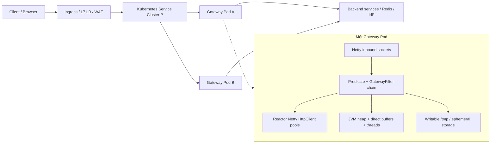
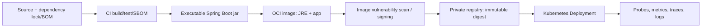
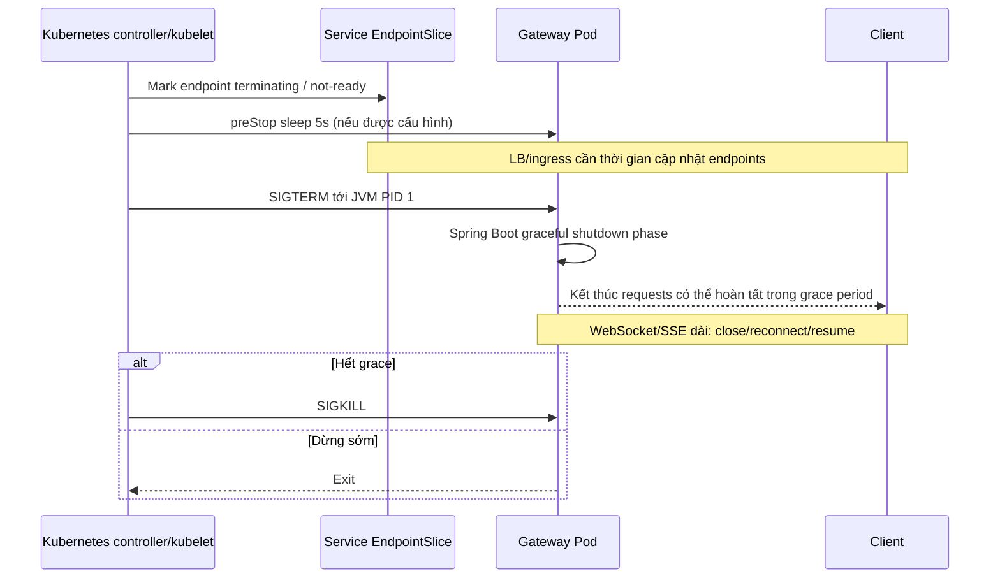
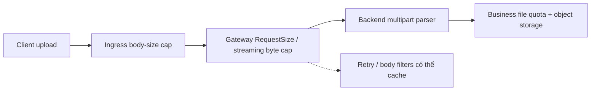

# Triển khai container và cấu hình giới hạn tài nguyên cho Spring Cloud Gateway

## 1. Từ API Gateway chạy local đến một workload vận hành được

**Spring Cloud Gateway** đóng vai trò cổng vào microservices: nhận HTTP request, chọn route bằng **predicate**, chạy **GatewayFilter/GlobalFilter chain**, biến đổi path/header, sử dụng service discovery/load balancing và áp dụng các chính sách xác thực, rate limiting, circuit breaker, retry, TLS, quan sát request. Khi đóng gói Gateway vào container và triển khai lên Kubernetes, một ứng dụng chạy được ở `localhost:8080` mới chỉ giải quyết **một phần nhỏ** yêu cầu production.

Ví dụ, một Gateway đã chạy tốt với 100 request/giây có thể gặp sự cố khi:

- **Container memory limit** quá sát heap, trong khi Reactor Netty còn dùng direct buffers, JVM metaspace, thread stacks, code cache và native libraries.
- **CPU limit** quá thấp gây throttling; p99 latency tăng dù heap và backend vẫn bình thường.
- Một route bật `Retry`/`ModifyResponseBody` và giữ request/response body trong RAM; nhiều upload song song làm pod `OOMKilled`.
- WebSocket và SSE giữ kết nối hàng phút/giờ; rollout xóa pod khiến client disconnect, làm reconnect tăng đột biến.
- `livenessProbe` phụ thuộc Redis/backend đang lỗi, khiến Kubernetes liên tục restart mọi Gateway replicas thay vì chỉ từ chối traffic tạm thời.
- Outbound HTTP connection pool không có giới hạn phù hợp, làm nhiều connections/pending requests hơn backend chịu được.
- Actuator và secrets xuất hiện trong public ingress, image chạy bằng root hoặc container vẫn có quyền ghi filesystem ngoài nhu cầu.

Bài này xây dựng một quy trình **từ OCI image → cấu hình Gateway → giới hạn CPU/memory/ephemeral storage → Kubernetes Deployment/Service → probes → rollout/autoscaling → kiểm thử tải và xử lý sự cố**. Các con số là **ngân sách khởi đầu để học cách tính**, **không** phải preset tối ưu cho mọi hệ thống.

### Kết quả học tập

1. Đóng gói Gateway vào **OCI container image** bằng Dockerfile hoặc Cloud Native Buildpacks.
2. Phân biệt **heap, direct memory, native memory, filesystem cache và cgroup memory limit**.
3. Thiết lập Kubernetes `requests`/`limits` cho CPU, memory và `ephemeral-storage`; hiểu `OOMKilled`, CPU throttling và pod eviction.
4. Tuning Reactor Netty HTTP connection pool, streaming/body filters và giới hạn số kết nối dài.
5. Viết Kubernetes `ConfigMap`, `Deployment`, `Service` có probes, security context, graceful shutdown và cấu hình từ môi trường.
6. Phân biệt **liveness, readiness, startup** và tránh health checks gây vòng restart khi downstream lỗi.
7. Triển khai an toàn với rolling update, PodDisruptionBudget, HPA, NetworkPolicy, Secret/RBAC và phân quyền management.
8. Đo p95/p99, active connections, heap/direct memory, GC, socket/file descriptors và kiểm thử rollback.

> **Phạm vi:** ví dụ chính dùng **Spring Cloud Gateway Server WebFlux 4.3+/5.x** trên Java 21, Spring Boot và Reactor Netty, với prefix `spring.cloud.gateway.server.webflux.*`. Server **Web MVC** dùng Servlet/RestClient, có mô hình thread/connection và properties khác. Với Gateway WebFlux 4.2 trở về trước, prefix thường là `spring.cloud.gateway.*`; phải đối chiếu release train thực tế.

## 2. Sơ đồ phân lớp tài nguyên trong một pod Gateway



Một request JSON ngắn thường đi qua Gateway vài mili-giây, còn một **SSE stream**, **WebSocket session** hoặc **large download** có thể giữ **nhiều tài nguyên cùng lúc**: inbound connection, outbound connection, encoder/decoder state, TLS buffers, kernel sockets, pending writes và application queues.

| Lớp | Tài nguyên cần kiểm soát | Công cụ chính |
|---|---|---|
| Container/JVM | Heap, direct/native memory, CPU, GC, threads | Java flags, cgroups, `JAVA_TOOL_OPTIONS`, profiler |
| Kubernetes pod | CPU/memory, disk tạm, lifecycle, security context | `resources`, `emptyDir`, `securityContext`, probes |
| Gateway Netty | Client connections, acquire queue, response/connect timeout | `spring.cloud.gateway.server.webflux.httpclient.*` |
| Gateway filters | Request body cache, retry, streaming, rate limit, cache | Filter/route policy, bounded queues, body limits |
| Ingress | Tổng connections, TLS handshake, idle timeout, request size | Ingress controller/LB config |
| Backend | Capacity, Redis/DB pools, fallback, service discovery | Per-service quotas và metrics |
| Observability | Cardinality, Prometheus scrape, log retention | Actuator, Micrometer, tracing, dashboards |

**Không có một nút `max-connections` của Gateway bảo đảm mọi giới hạn trên.** Chẳng hạn outbound HTTP client pool không chặn tất cả **inbound** WebSocket/SSE sessions, và `RequestRateLimiter` token bucket theo request/giây không tự đếm **active connections**.

## 3. Chọn đúng starter, Java và cách đóng gói

### 3.1. Dependencies mẫu

```xml
<!-- pom.xml: versions do Spring Boot parent + Spring Cloud BOM tương thích quản lý -->
<dependency>
    <groupId>org.springframework.cloud</groupId>
    <artifactId>spring-cloud-starter-gateway-server-webflux</artifactId>
</dependency>
<dependency>
    <groupId>org.springframework.boot</groupId>
    <artifactId>spring-boot-starter-actuator</artifactId>
</dependency>
<dependency>
    <groupId>io.micrometer</groupId>
    <artifactId>micrometer-registry-prometheus</artifactId>
    <scope>runtime</scope>
</dependency>
```

`spring-boot-starter-actuator` và `micrometer-registry-prometheus` dùng cho health/metrics. Nếu dùng `lb://`, thêm Spring Cloud LoadBalancer và cơ chế cung cấp service instances; Kubernetes DNS HTTP service URI **không tự đòi** Eureka/Consul hay Spring Cloud Discovery. Chỉ thêm Redis/Resilience4j khi thực sự bật rate limiter/circuit breaker tương ứng.

**Không trộn** `spring-cloud-starter-gateway-server-webmvc` và `server-webflux` chỉ để có cả hai cách chạy. Bài này tập trung reactive Server WebFlux, không dùng Servlet Tomcat container thread settings làm giải pháp cho Netty.

### 3.2. Quy trình build image



OCI image nên:

- Dùng Java runtime phù hợp dependency train và **base image được cập nhật bảo mật**.
- Chạy bằng **non-root** user, giảm Linux capabilities; tránh cài compiler, shell và debug tooling trong runtime không cần thiết.
- Tách source build secrets khỏi image: **không chép** `.env`, private keys, JWT secrets hay registry credentials vào layers.
- Ghi version/revision và SBOM trong metadata build; triển khai bằng **image digest bất biến** hoặc tag chỉ được công bố một lần theo policy.
- Không bắt buộc chạy `mvn/gradle` trong **production container**; build/test ở CI, container chỉ chạy app.

## 4. Đóng gói bằng Dockerfile: đơn giản trước, tối ưu layers sau

### 4.1. Dockerfile tối thiểu dùng JRE và user không có đặc quyền

Giả sử CI đã tạo **một executable Spring Boot jar** tại `target/gateway.jar` (tên này do pipeline chủ động đặt; Maven thường sinh jar theo artifact/version):

```dockerfile
# Dockerfile tại thư mục build context chứa target/gateway.jar
# Cố định digest của base image trong pipeline production.
FROM eclipse-temurin:21-jre-jammy

WORKDIR /app
RUN groupadd --gid 10001 gateway && \
    useradd --uid 10001 --gid 10001 --no-create-home --shell /usr/sbin/nologin gateway

COPY --chown=10001:10001 target/gateway.jar /app/app.jar

USER 10001:10001
EXPOSE 8080

# Dùng exec-form để JVM là PID 1 và nhận SIGTERM.
ENTRYPOINT ["java", "-jar", "/app/app.jar"]
```

**Ý nghĩa:**

1. Runtime chỉ cần **JRE**, không dùng JDK đầy đủ nếu không có tính năng thực sự cần JDK.
2. `USER 10001:10001` giảm phạm vi quyền ghi/chỉnh sửa trong container; Kubernetes vẫn cần `securityContext` để thực thi policy.
3. `ENTRYPOINT` dạng JSON exec giúp JVM nhận tín hiệu dừng, tránh shell wrapper không chuyển `SIGTERM`.
4. `EXPOSE` chỉ là metadata, **không công bố port**; Docker `-p` hoặc Kubernetes Service/Ingress mới tạo đường truy cập.
5. Dockerfile giả định base image Debian/Ubuntu có `groupadd`/`useradd`. Với distroless/UBI/một base khác, user provisioning có thể khác; đừng áp nguyên lệnh rồi nghĩ image xây được.

Ví dụ lệnh chạy ở **môi trường thử nghiệm** (không thực thi trong bước viết bài):

```bash
# CI tạo jar theo project; chỉ minh họa câu lệnh.
./mvnw -DskipTests=false package
cp target/gateway-*.jar target/gateway.jar

docker build -t gateway-demo:0.1.0 .
docker run --rm --name gateway-demo \
  --cpus=1 --memory=768m \
  --read-only --tmpfs /tmp:rw,nosuid,nodev,size=64m \
  --cap-drop=ALL --security-opt no-new-privileges \
  -p 8080:8080 \
  -e JAVA_TOOL_OPTIONS='-XX:MaxRAMPercentage=50.0 -XX:+ExitOnOutOfMemoryError' \
  gateway-demo:0.1.0
```

**Cẩn thận khi copy jar:** một project có thể tạo cả `original-*.jar`/thin jar và `repackaged executable jar`; `cp target/gateway-*.jar` chỉ phù hợp nếu tên đã được CI cố định để **chỉ khớp một artifact**. Production nên chỉ định chính xác đường dẫn artifact, kiểm tra signature/SBOM và pin image digest. Nếu image không chạy với read-only root, xác minh ứng dụng/library thực sự cần ghi ở đâu rồi **mount vùng writable riêng**, không mở toàn filesystem để chữa.

### 4.2. Spring Boot layered jar

Để tăng hiệu quả cache layer khi code thay đổi thường xuyên nhưng dependencies ít đổi, Spring Boot hỗ trợ **layered jars** và `jarmode=tools`:

```dockerfile
# Ví dụ minh họa theo Spring Boot layered jar với JRE hỗ trợ tools mode.
FROM eclipse-temurin:21-jre-jammy AS extract
WORKDIR /builder
COPY target/gateway.jar application.jar
RUN java -Djarmode=tools -jar application.jar extract --layers --destination extracted

FROM eclipse-temurin:21-jre-jammy
WORKDIR /app
COPY --from=extract /builder/extracted/dependencies/ ./
COPY --from=extract /builder/extracted/spring-boot-loader/ ./
COPY --from=extract /builder/extracted/snapshot-dependencies/ ./
COPY --from=extract /builder/extracted/application/ ./
USER 10001:10001
EXPOSE 8080
ENTRYPOINT ["java", "-jar", "application.jar"]
```

**Điều kiện:** executable Spring Boot jar cần hỗ trợ layer index/`tools` mode; Boot documentation nêu `jarmode=tools` không dùng với **fully executable archive có launch script**. Cấu trúc `extracted` và launcher có thể thay đổi giữa Boot versions; xem output `list-layers`/docs của chính bản dùng. `USER 10001` dạng numeric hoạt động cả khi image không tạo account, nhưng nếu runtime cần entry trong `/etc/passwd`/HOME thì phải cấu hình tương ứng.

Với gateway thay đổi ít nhưng có nhiều dependency, tách các layers giảm kích thước cần rebuild/pull sau mỗi release. **Layering không thay memory limit hoặc tự tăng throughput**; không hy sinh security patching chỉ để giữ cache.

### 4.3. Cloud Native Buildpacks: không cần tự viết Dockerfile

Spring Boot Maven/Gradle plugins hỗ trợ tạo OCI image qua **Cloud Native Buildpacks**:

```bash
# Maven:
./mvnw spring-boot:build-image \
  -Dspring-boot.build-image.imageName=registry.example.test/platform/gateway:0.1.0

# Gradle (một phương án khác):
./gradlew bootBuildImage \
  --imageName=registry.example.test/platform/gateway:0.1.0
```

Buildpacks thường tạo image chạy bằng **non-root** và quản lý runtime layers/builder theo cấu hình. Muốn build cần OCI image daemon hoặc buildpack platform thích hợp; không coi command này tự push lên registry hay tự làm vulnerability scanning/signing. Trong production, pin builder/run images, scan SBOM, ký và công bố artifact qua CI.

### 4.4. Chống rò bí mật qua image

Không làm:

```dockerfile
# KHÔNG làm trong production:
ARG JWT_SECRET
ENV JWT_SECRET=$JWT_SECRET
COPY ./secrets /app/secrets
```

`ARG`/`ENV`/`COPY` có thể khiến secret tồn tại trong build history/layers hoặc image metadata. Dùng **Kubernetes Secret/secret manager/external secret integration** và quyền truy cập tối thiểu khi runtime. Image registry credentials cũng thuộc CI/workload identity, không ghi vào source Dockerfile.

## 5. Java trong cgroup: container limit không đồng nghĩa `-Xmx`

JDK hiện đại có khả năng nhận diện **cgroup CPU/memory constraints**, nhưng JVM **không chỉ dùng heap**. Đặt `-Xmx` bằng đúng `resources.limits.memory` có thể khiến container bị kernel OOM kill ngay cả khi JVM heap chưa báo `OutOfMemoryError`.

### 5.1. Ngân sách bộ nhớ mẫu cho một pod `1Gi`

Giả sử container được giới hạn ở **1 GiB (1024 MiB)**. Một ngân sách *minh họa*, phải đo khi load test:

| Hạng mục | Dự trù minh họa | Ghi chú |
|---|---:|---|
| JVM heap (Java objects, cached body) | Khoảng 512 MiB | `MaxRAMPercentage=50.0` cho giới hạn 1 GiB nếu JDK nhận diện cgroup đúng |
| Netty direct/off-heap buffers | Tối đa theo `MaxDirectMemorySize=192m` nếu bật | Không phải toàn bộ native memory |
| Metaspace, code cache, thread stacks, JVM native | Ví dụ 180 MiB | Biến động theo classes, threads, TLS và load |
| Temp/tmpfs, OS accounting, runtime headroom | Ví dụ 140 MiB | Cần đo RSS/cgroup thực tế |
| **Tổng budget dự tính** | **1024 MiB** | Chỉ là ví dụ cách phân bổ, **không** bảo đảm mọi khoản đều nằm đúng mốc |

Con số `192m` chỉ giới hạn **Java NIO direct-buffer allocations chịu flag tương ứng**, không phải trần cứng của mọi Netty/native malloc, memory map, kernel socket buffers hay page cache. Hãy coi **cgroup memory.current/working set**, JVM heap/GC, direct-buffer gauges và process RSS là các góc nhìn bổ sung.

### 5.2. JVM flags khi chạy trong container

```yaml
# Một phần env trong Kubernetes container spec:
env:
  - name: JAVA_TOOL_OPTIONS
    value: >-
      -XX:MaxRAMPercentage=50.0
      -XX:MaxDirectMemorySize=192m
      -XX:+ExitOnOutOfMemoryError
```

**Lưu ý:**

- `-XX:MaxRAMPercentage` đặt mức heap tối đa dựa trên bộ nhớ JVM nhìn thấy; `-Xmx` tường minh có thể ghi đè. Đừng cấu hình cả hai một cách mâu thuẫn.
- `-XX:MaxDirectMemorySize` quá thấp có thể gây `OutOfDirectMemoryError` trong gateway với TLS/streaming/upload lớn; không coi `192m` là khuyến nghị cố định.
- `-XX:+ExitOnOutOfMemoryError` giúp JVM thoát khi Java-level OOM, để orchestration restart; **không ngăn** Linux cgroup `OOMKilled` khi tổng bộ nhớ vượt limit.
- `JAVA_TOOL_OPTIONS` nên chứa **flags không bí mật**. Không đưa password, JWT signing key hoặc truststore password vào một biến command-line dễ lộ trong process info/logs.
- Tránh flag đặt `ActiveProcessorCount` nếu chưa cần; nên quan sát JVM/container CPU detection trước khi override.

### 5.3. Phân biệt JVM OOM và Kubernetes `OOMKilled`

| Tình huống | Dấu hiệu | Hướng xử lý |
|---|---|---|
| Java heap OOM | `java.lang.OutOfMemoryError: Java heap space`, heap/GC tăng | Kiểm tra request-body cache, unbounded queues, object leak, sizing heap |
| Direct-buffer pressure | `OutOfDirectMemoryError`/Netty allocation errors | Đo direct memory, HTTP connections, DataBuffer lifecycle, TLS buffers |
| Container cgroup OOM | Pod status `OOMKilled`, thường exit code 137 | RSS/cgroup vượt memory limit; có thể **không thấy** Java heap OOM |
| Node memory pressure/eviction | Pod `Evicted`, node `MemoryPressure` | So request/limit, node capacity, workload colocations |
| Disk pressure/eviction | `EphemeralStorage`/`DiskPressure`, temp/logs lớn | Giới hạn writable layer, `emptyDir`, file uploads/temp và log volume |

Memory limit Kubernetes thường được kernel thực thi bằng OOM mechanism, **khác** CPU limit được thực thi bằng throttling. Đừng chỉ tăng `-Xmx` để chữa `OOMKilled`: cách đó có thể làm cgroup OOM nhanh hơn.

## 6. Kubernetes `requests`, `limits` và chất lượng dịch vụ pod

### 6.1. Phân biệt request với limit

```yaml
# Một đoạn trích trong spec.containers[].resources
resources:
  requests:
    cpu: 500m
    memory: 512Mi
    ephemeral-storage: 256Mi
  limits:
    cpu: "2"
    memory: 1Gi
    ephemeral-storage: 1Gi
```

| Trường | Nghĩa thực tế | Hệ quả khi cấu hình sai |
|---|---|---|
| `requests.cpu: 500m` | Scheduler dự phòng 0,5 CPU và xác định weight khi node tranh CPU | Request quá thấp làm HPA utilization lệch và node dễ oversubscribe |
| `limits.cpu: "2"` | Cgroup áp ceiling 2 CPU theo các khoảng scheduling | CPU throttling làm event loop/GC chậm, latency p99 xấu |
| `requests.memory: 512Mi` | Scheduler tính 512 MiB cho placement; không phải hard cap | Request quá thấp làm pod dễ bị eviction dưới node pressure |
| `limits.memory: 1Gi` | Hard memory boundary theo cgroup, có thể OOMKill khi vượt | Heap + direct/native/tmpfs quá lớn gây restart |
| `requests.ephemeral-storage: 256Mi` | Scheduler dự kiến tiêu thụ local disk tạm | Quá thấp dễ bị node disk pressure tác động |
| `limits.ephemeral-storage: 1Gi` | Kubelet giám sát ephemeral usage và có thể evict pod khi vượt | Logs/temp/multipart staging có thể làm pod `Evicted` |

**CPU limit và memory limit không xử lý quá tải giống nhau**. CPU sử dụng vượt trần thường bị **throttled**, không tự làm container restart. Memory vượt cgroup limit có thể khiến process bị kernel **OOMKilled**. Ephemeral disk limit thường liên quan **eviction**, không mặc nhiên là Java exception.

Kubernetes QoS class cũng liên quan requests/limits: ví dụ trên có `requests != limits` nên thường là **Burstable**. Nếu muốn **Guaranteed**, cần requests và limits tương ứng đầy đủ/bằng nhau cho CPU/memory của mọi container trong pod theo quy tắc QoS; điều đó không tự bảo đảm không OOM. Hãy chọn QoS theo ngân sách node và mục tiêu scheduling, không chỉ để có một nhãn “Guaranteed”.

### 6.2. CPU throttling với Gateway reactive

WebFlux dùng một số event loop threads để xử lý lượng request lớn. Nếu CPU bị throttle:

- Reactive callbacks không được thực thi đúng lúc; p95/p99 latency tăng.
- TLS handshake, JSON encode/decode, JWT verification và GC cạnh tranh CPU.
- Ngay cả route chỉ proxy đến backend khỏe cũng có thể chậm.
- HPA dựa CPU có thể phản ứng muộn vì utilization khác với queuing/active connections.

Tại một số cluster/đơn vị vận hành, có thể **chỉ đặt CPU requests mà không đặt CPU limits** để giảm throttling, nếu namespace policy và capacity planning cho phép. Đây là lựa chọn vận hành cần phê duyệt, không phải quy tắc áp dụng mọi nơi. **Memory limits** vẫn đặc biệt quan trọng vì một body cache/queue lỗi có thể chiếm RAM node.

### 6.3. Một ví dụ tự kiểm tra budget

Với `limits.memory=1Gi`:

```text
Heap cap dự kiến                  ~512 MiB
Direct memory cap (nếu bật)      ~192 MiB
Native/metaspace/thread/GC      đo theo workload
/tmp và memory-backed volumes   đo theo loại volume
OS/cgroup accounting/headroom   phải còn dư
----------------------------------------
Tổng cgroup memory phải thấp hơn 1024 MiB
```

Không coi tổng `512+192` là bằng RSS. Một số thành phần cấp phát khác, file-backed pages/kernel accounting và shared mappings có cách đo riêng. Xác nhận bằng **container memory working set/cgroup metrics** bên cạnh JVM heap, không chỉ `jvm.memory.used{area="heap"}`.

## 7. Cấu hình Spring Cloud Gateway cho pod có giới hạn

### 7.1. Cấu hình riêng cho route JSON ngắn

```yaml
# application.yml dùng cho ví dụ Deployment phần 8.
server:
  port: 8080

spring:
  lifecycle:
    timeout-per-shutdown-phase: 30s
  cloud:
    gateway:
      server:
        webflux:
          httpclient:
            connect-timeout: 2000       # Milliseconds
            response-timeout: 5s
            pool:
              type: fixed
              max-connections: 200
              acquire-timeout: 1000     # Milliseconds, dành cho FIXED pool
              metrics: true
          metrics:
            enabled: true
            path-tags:
              enabled: false
          routes:
            - id: orders-api
              uri: http://orders-api.default.svc.cluster.local:8080
              predicates:
                - Path=/api/orders/**
              filters:
                - StripPrefix=1

management:
  server:
    port: 9090
  endpoint:
    health:
      probes:
        enabled: true
        add-additional-paths: true
  endpoints:
    web:
      exposure:
        include: health,info,metrics,prometheus
```

**Đọc đúng ý nghĩa của từng giới hạn:**

- `connect-timeout: 2000` là **mili-giây**, áp dụng ở kết nối outbound; không giới hạn tổng thời gian backend xử lý.
- `response-timeout: 5s` là `Duration` global cho HTTP client; một stream SSE lâu dài cần **route riêng** và chính sách timeout khác.
- `pool.type: fixed` cho phép dùng `max-connections` và `acquire-timeout` theo tài liệu Gateway. Đây là giới hạn **outbound HTTP client pool**; không phải quota cho mọi inbound requests, WebSocket sessions, Redis connections hay toàn bộ các host/targets cộng lại.
- `max-connections: 200` và `acquire-timeout: 1000` là **giá trị minh họa**; pool exhaustion có thể gây lỗi/latency. Phải đo active/pending connection và capacity backend khi sizing.
- `metrics.path-tags.enabled: false` tránh gắn raw path chứa order IDs vào Gateway metrics, giúp kiểm soát cardinality.
- `management.server.port: 9090` tạo một cổng quản trị riêng. Chỉ cho monitoring/ops truy cập qua network và authentication; không đưa 9090 lên public Service/Ingress.
- `management.endpoint.health.probes.add-additional-paths: true` cho phép `/livez` và `/readyz` **trên cổng ứng dụng 8080**, ngay cả khi Actuator ở cổng khác. Như vậy kubelet kiểm tra đúng web server đang nhận traffic.

`orders-api.default.svc.cluster.local:8080` là **tên backend minh họa**. Bạn phải có một Kubernetes Service DNS tương ứng và policy cho phép Gateway gọi. Nếu dùng `lb://orders-api`, phải thêm dependency/load balancer instance supplier tương ứng; đừng tự coi Kubernetes DNS và `lb://` giống nhau.

### 7.2. `response-timeout` không thay rate limiting

Một pod có thể cho phép 200 outbound connections nhưng tiếp nhận hàng nghìn HTTP requests đang chờ pool. Vì vậy cần:

- Rate limiting **theo client/principal**, không chỉ “bao nhiêu request vào edge”.
- Timeouts và queue limits để tránh giữ request bất tận.
- Circuit breaker/bulkhead phù hợp khi backend lỗi.
- Chính sách retry có **ngân sách tổng số attempts**, nhất là với POST/multipart.
- Ingress/body-size policy để từ chối quá tải **trước** khi body đi vào Gateway.

`RequestRateLimiter` theo token bucket thường giới hạn **tốc độ request**, không giới hạn số WebSocket/SSE connections đang mở hoặc bytes trong body. Muốn giới hạn số long-lived streams phải có **active-session quota** riêng, có thể yêu cầu đồng bộ giữa replicas.

### 7.3. Tránh body buffering không giới hạn

| Tính năng | Nguy cơ tài nguyên | Hướng dùng |
|---|---|---|
| `Retry` cho request có body | Cache request body để phát lại, tăng heap/direct memory | Hạn chế attempts, giới hạn body, idempotency |
| `ModifyRequestBody`/`ModifyResponseBody` | Deserialize/aggregate body, có thể giữ toàn bộ JSON/file | Chỉ dùng cho payload nhỏ có trần |
| `LocalResponseCache` | Chiếm bộ nhớ cache, có TTL/size policy | Chỉ bật với response cacheable/bounded, không SSE |
| `RequestSize` | Nếu chỉ kiểm `Content-Length` ở bản cụ thể, chunked upload có thể vượt | Test cả length/no-length; bổ sung byte-counting ở ingress/backend |
| SSE `text/event-stream` | Connection mở lâu, buffers/queues nếu client chậm | Flush/heartbeat, response timeout riêng, reconnect + replay |
| WebSocket | Inbound/outbound socket lâu dài, frames/queues | Frame size, idle, connection quotas, close/reconnect |
| Netty wiretap | Logging payload/headers và tăng I/O | Chỉ bật ngắn hạn trong sandbox đã redacted |

Với file upload lớn, xem xét **presigned object-storage URL/chunked upload protocol** thay vì proxy toàn bộ body qua Gateway và bật Retry. Backend vẫn phải kiểm tra ownership, checksum, Content-Type thật và giới hạn số phần multipart.

## 8. Kubernetes manifests: ConfigMap, Deployment và Service

### 8.1. ConfigMap tách cấu hình khỏi image

Giả sử namespace `edge` đã được tạo theo chính sách cluster. Sau đây là **ConfigMap mẫu** lấy cấu hình ở mục 7; trong repo production nên quản lý bằng GitOps/Helm/Kustomize và review:

```yaml
apiVersion: v1
kind: ConfigMap
metadata:
  name: gateway-config
  namespace: edge
data:
  application.yml: |
    server:
      port: 8080
    spring:
      lifecycle:
        timeout-per-shutdown-phase: 30s
      cloud:
        gateway:
          server:
            webflux:
              httpclient:
                connect-timeout: 2000
                response-timeout: 5s
                pool:
                  type: fixed
                  max-connections: 200
                  acquire-timeout: 1000
                  metrics: true
              metrics:
                enabled: true
                path-tags:
                  enabled: false
              routes:
                - id: orders-api
                  uri: http://orders-api.default.svc.cluster.local:8080
                  predicates:
                    - Path=/api/orders/**
                  filters:
                    - StripPrefix=1
    management:
      server:
        port: 9090
      endpoint:
        health:
          probes:
            enabled: true
            add-additional-paths: true
      endpoints:
        web:
          exposure:
            include: health,info,metrics,prometheus
```

ConfigMap chỉ chứa **cấu hình không bí mật**. JWT client secrets, Redis passwords, TLS private keys và DB credentials phải đặt trong **Secret/secret manager** với quyền truy cập tối thiểu. ConfigMap thay đổi trên volume có thể được kubelet cập nhật, nhưng **Spring Boot/Gateway không tự bảo đảm refresh mọi thuộc tính/route đã bind**; production nên thay revision/rolling restart theo release workflow rõ ràng, không giả định edit ConfigMap là traffic chuyển ngay.

### 8.2. Deployment giới hạn tài nguyên, probes và quyền filesystem

```yaml
apiVersion: apps/v1
kind: Deployment
metadata:
  name: edge-gateway
  namespace: edge
  labels:
    app: edge-gateway
spec:
  replicas: 3
  revisionHistoryLimit: 5
  minReadySeconds: 5
  strategy:
    type: RollingUpdate
    rollingUpdate:
      maxUnavailable: 0
      maxSurge: 1
  selector:
    matchLabels:
      app: edge-gateway
  template:
    metadata:
      labels:
        app: edge-gateway
    spec:
      automountServiceAccountToken: false
      terminationGracePeriodSeconds: 60
      securityContext:
        runAsNonRoot: true
        runAsUser: 10001
        runAsGroup: 10001
        fsGroup: 10001
        seccompProfile:
          type: RuntimeDefault
      containers:
        - name: gateway
          image: registry.example.test/platform/gateway:0.1.0
          imagePullPolicy: IfNotPresent
          ports:
            - name: http
              containerPort: 8080
            - name: management
              containerPort: 9090
          env:
            - name: JAVA_TOOL_OPTIONS
              value: >-
                -XX:MaxRAMPercentage=50.0
                -XX:MaxDirectMemorySize=192m
                -XX:+ExitOnOutOfMemoryError
            - name: SPRING_CONFIG_ADDITIONAL_LOCATION
              value: optional:file:/etc/gateway/
          resources:
            requests:
              cpu: 500m
              memory: 512Mi
              ephemeral-storage: 256Mi
            limits:
              cpu: "2"
              memory: 1Gi
              ephemeral-storage: 1Gi
          startupProbe:
            httpGet:
              path: /livez
              port: http
            periodSeconds: 2
            failureThreshold: 30
          livenessProbe:
            httpGet:
              path: /livez
              port: http
            periodSeconds: 10
            timeoutSeconds: 2
            failureThreshold: 3
          readinessProbe:
            httpGet:
              path: /readyz
              port: http
            periodSeconds: 5
            timeoutSeconds: 2
            failureThreshold: 3
          lifecycle:
            preStop:
              sleep:
                seconds: 5
          securityContext:
            allowPrivilegeEscalation: false
            readOnlyRootFilesystem: true
            capabilities:
              drop:
                - ALL
          volumeMounts:
            - name: config
              mountPath: /etc/gateway
              readOnly: true
            - name: temp
              mountPath: /tmp
      volumes:
        - name: config
          configMap:
            name: gateway-config
        - name: temp
          emptyDir:
            sizeLimit: 256Mi
```

**Đây là manifest minh họa, cần điều chỉnh trước khi áp production:**

1. `image` là registry/tag **giả định**; production nên pin `@sha256:<digest>` đã được scan/ký, không dùng mutable `latest`. Nếu registry private, cấu hình image pull secret hoặc workload identity theo policy cluster.
2. `namespace: edge` và backend Service phải tồn tại, network policy cho phép. `SPRING_CONFIG_ADDITIONAL_LOCATION` hướng Boot đọc `application.yml` từ ConfigMap mounted directory; cần kiểm tra precedence và các profile khác.
3. `securityContext.runAsNonRoot`, `readOnlyRootFilesystem`, drop capabilities, `seccompProfile: RuntimeDefault` giảm quyền; **không thay JWT/TLS/network authorization**.
4. `emptyDir` không khai báo `medium: Memory` nên mặc định dùng **node local ephemeral storage**. Nó vẫn bị quota/eviction và tự mất khi Pod bị xóa; không lưu tệp nghiệp vụ lâu dài vào đó.
5. `startupProbe` cho phép khoảng 60 giây khởi động trước khi áp dụng liveness/readiness probes; cần tuning theo startup thực và JVM warming.
6. `/livez` và `/readyz` được Boot tạo trên **port 8080** nhờ `add-additional-paths: true` trong ConfigMap. Nếu HTTP Security custom chặn các path này, probe fail; phải có policy truy cập qua kubelet an toàn, không mở toàn bộ `/actuator/**`.
7. `preStop.sleep.seconds` dùng **lifecycle Sleep hook** cần phiên bản Kubernetes hỗ trợ (tài liệu Boot gợi ý **1.32+**). Nếu cluster cũ, dùng hook được hỗ trợ, không phụ thuộc `sh` khi image distroless không có shell.
8. `terminationGracePeriodSeconds: 60` bao gồm thời gian `preStop` và Spring Boot shutdown phase `30s`, cộng dự phòng. Nó **không bảo đảm** mọi WebSocket/SSE streams vô hạn tự hoàn tất; clients phải có reconnect/resume.
9. Cấu hình `JAVA_TOOL_OPTIONS` và resource budget là **điểm bắt đầu**, không phải đề xuất cố định. Test load trước khi đưa lên node có CPU quota/TLS/network setup thật.
10. Nếu Gateway dùng Kubernetes API discovery/ConfigMap watch thay vì service DNS cố định, `automountServiceAccountToken: false` có thể không phù hợp; hãy cấp riêng ServiceAccount/RBAC tối thiểu, không mở quyền cluster-admin.

### 8.3. Service chỉ công bố cổng lưu lượng

```yaml
apiVersion: v1
kind: Service
metadata:
  name: edge-gateway
  namespace: edge
spec:
  type: ClusterIP
  selector:
    app: edge-gateway
  ports:
    - name: http
      port: 80
      targetPort: http
      protocol: TCP
```

Service này **không** công bố `9090`. Ingress controller có thể route HTTPS public tới `edge-gateway:80`, nhưng **chỉ trên hosts/paths đã phê duyệt**; không để public ingress wildcard forward `/actuator/**` nếu management dùng chung port. Trong ví dụ management ở port 9090 riêng, Prometheus/operations phải dùng **đường scrape riêng** có NetworkPolicy và xác thực.

**Không nhầm `containerPort` với firewall:** khai báo container port chỉ là metadata; Pod IP có thể vẫn được truy cập nếu cluster network cho phép. Cần NetworkPolicy/CNI/eBPF policy, service mesh hoặc các lớp ACL tương ứng mới kiểm soát đường mạng thật.

## 9. Probes: `startup`, `liveness` và `readiness` có nhiệm vụ khác nhau

### 9.1. Những câu hỏi riêng biệt

| Probe | Câu hỏi | Nếu thất bại |
|---|---|---|
| **startupProbe** | Ứng dụng đã hoàn thành **quá trình khởi động** chưa? | Sau ngưỡng thất bại, kubelet có thể restart container; bảo vệ liveness/readiness khỏi giết app trong giai đoạn warm-up |
| **livenessProbe** | Process có **khả năng tự phục hồi** không, hay đã treo hỏng cần restart? | Kubelet restart container theo policy |
| **readinessProbe** | Pod hiện **nên nhận traffic mới** từ Service/Endpoints không? | Pod bị loại khỏi endpoints ready, **không mặc nhiên restart** |

Spring Boot Actuator cung cấp `/actuator/health/liveness` và `/actuator/health/readiness` khi probes được bật trong môi trường Kubernetes. Với management port riêng, nên cân nhắc `management.endpoint.health.probes.add-additional-paths: true` để có **`/livez` và `/readyz` trên port 8080**.

### 9.2. Tại sao liveness không nên gọi backend/Redis?

Giả sử Redis của `RequestRateLimiter` gặp outage. Nếu liveness của **mọi Gateway pod** cũng gọi Redis và trả DOWN, Kubernetes restart toàn bộ Gateway, làm traffic đang ổn ở những routes không dùng Redis bị gián đoạn. Redis outage **không được giải quyết bằng việc restart Gateway**.

**Liveness** nên phản ánh trạng thái bên trong của Gateway/process. Với **readiness**, có thể cân nhắc downstream state khi **chính sách vận hành thật sự đòi ngừng nhận mọi traffic**; nhưng mặc định Boot không tự thêm tất cả external dependencies vào readiness group vì dễ tạo cascading failures. Có thể dùng rate limit/circuit breaker/fallback từng route thay vì đưa cả pod ra khỏi Service.

### 9.3. Probes cần được kiểm thử như HTTP client thật

```bash
# Trong sandbox đã cho phép port-forward/cổng nội bộ:
curl -i http://localhost:8080/livez
curl -i http://localhost:8080/readyz

# Khi có quyền truy cập management network:
curl -i http://localhost:9090/actuator/health/liveness
curl -i http://localhost:9090/actuator/health/readiness
```

**Kết quả mong đợi:** status 200 cho healthy và trạng thái khác khi Boot health group bị DOWN/OUT_OF_SERVICE. Đừng hard-code `"status":"UP"` là toàn bộ nội dung cần assert nếu đã thêm custom indicators. Nếu Spring Security chặn `/livez`/`/readyz` bằng 401/403, probes sẽ thất bại; cấu hình Security matcher/path theo **mạng kubelet** và nguyên tắc least privilege, không mở `anyExchange().permitAll()` cho tất cả API.

### 9.4. Không biến probe thành phép đo tải

Probe chỉ cần đủ nhẹ, ổn định, timeout ngắn và **không gây I/O đắt đỏ**. Không cho mỗi probe gọi backend qua một tuyến có retries/circuit breakers tốn tài nguyên. Với một gateway bị CPU throttle, probe timeout có thể dẫn tới restart loop; phải phân biệt **liveness thật sự hỏng** với **pod đang thiếu CPU**.

## 10. Graceful shutdown và rolling update khi có kết nối dài

### 10.1. Thứ tự khi Kubernetes xóa một pod



Spring Boot hỗ trợ graceful shutdown với Reactor Netty. `spring.lifecycle.timeout-per-shutdown-phase: 30s` cho phép **một khoảng thời gian** để các requests đang xử lý hoàn thành trong quá trình dừng application context; không nhận requests mới theo cơ chế của web server. Kubernetes `terminationGracePeriodSeconds: 60` giới hạn thời gian tối đa của **toàn quá trình Pod termination**, gồm `preStop`.

**Kết luận quan trọng:** một WebSocket session có thể giữ trong một giờ, một SSE stream có thể vô hạn. Không có `grace=60s` nào **giữ nguyên TCP connection xuyên pod replacement**. Client phải xử lý close/reconnect, refresh auth, backoff, SSE `Last-Event-ID` và replay từ backend/event store (nếu cần không mất event).

### 10.2. Tác động của `preStop`

Ví dụ ở mục 8 dùng:

```yaml
lifecycle:
  preStop:
    sleep:
      seconds: 5
```

Sleep hook có thể giảm cửa sổ mà ingress/LB vẫn route traffic đến pod đang bị xóa trong lúc endpoint propagation. **Không phải phép màu zero downtime**. Nó tiêu tốn thời gian trong grace period và cần Kubernetes version hỗ trợ; nếu 5 giây không đủ cho hạ tầng của bạn, đo endpoint propagation trước khi điều chỉnh.

Không dùng `preStop: exec sleep` khi image distroless không có shell. Tương tự, **đừng kéo grace lên hàng giờ** để chờ toàn bộ WebSocket sessions; điều đó làm rollout, node drains và capacity management khó kiểm soát.

### 10.3. RollingUpdate `maxUnavailable`/`maxSurge`

Với 3 replicas:

```yaml
strategy:
  type: RollingUpdate
  rollingUpdate:
    maxUnavailable: 0
    maxSurge: 1
```

- `maxUnavailable: 0`: trong rollout bình thường, Deployment không chủ động làm giảm số replicas ready dưới mức mong muốn do update (phụ thuộc capacity/health thực tế).
- `maxSurge: 1`: có thể tạo thêm tối đa một pod mới vượt desired replicas tại một thời điểm của rolling update.
- `minReadySeconds: 5`: đòi pod ready ổn định trong khoảng quy định trước khi tính available, giúp tránh release mất ổn định lúc mới khởi động.

Nếu node pool không còn đủ CPU/memory cho **surge pod thứ tư**, rollout có thể **kẹt Pending**, dù ba pod cũ vẫn hoạt động. Do đó capacity planning phải tính **số pods khi surge**, bao gồm memory/CPU requests và topology constraints.

### 10.4. PodDisruptionBudget bảo vệ những loại sự cố nào?

```yaml
apiVersion: policy/v1
kind: PodDisruptionBudget
metadata:
  name: edge-gateway-pdb
  namespace: edge
spec:
  minAvailable: 2
  selector:
    matchLabels:
      app: edge-gateway
```

Với ba replicas, `minAvailable: 2` muốn giữ ít nhất hai pods available khi thực hiện **voluntary eviction thông qua Eviction API** (ví dụ node drain tôn trọng PDB).

**Giới hạn:** PDB **không ngăn** node crash, kernel OOM, disk pressure hay các involuntary disruptions. Một số hành động như xóa Pod/Deployment trực tiếp cũng có thể bỏ qua PDB, và controller rollout của Deployment **không bị PDB điều khiển giống Eviction API**; `maxUnavailable`/`maxSurge` mới quản lý rolling update.

### 10.5. Phân tán replicas qua node/zone

Ba pod trên một node không cung cấp HA đúng nghĩa khi node đó mất. Có thể dùng **topology spread constraints**:

```yaml
# Đặt dưới Deployment.spec.template.spec khi cluster hỗ trợ topologyKey này.
topologySpreadConstraints:
  - maxSkew: 1
    topologyKey: kubernetes.io/hostname
    whenUnsatisfiable: ScheduleAnyway
    labelSelector:
      matchLabels:
        app: edge-gateway
```

Đây là fragment, **không phải manifest độc lập**. `ScheduleAnyway` ưu tiên phân tán nhưng không cứng rắn chặn scheduling khi thiếu node; `DoNotSchedule` nghiêm ngặt hơn và có thể làm pod Pending. Chọn node/zone topology, capacity và cluster autoscaling phù hợp yêu cầu availability.

## 11. Autoscaling: CPU HPA không đủ để bảo vệ toàn bộ Gateway

### 11.1. HPA theo CPU để có điểm khởi đầu

```yaml
apiVersion: autoscaling/v2
kind: HorizontalPodAutoscaler
metadata:
  name: edge-gateway-hpa
  namespace: edge
spec:
  scaleTargetRef:
    apiVersion: apps/v1
    kind: Deployment
    name: edge-gateway
  minReplicas: 3
  maxReplicas: 10
  metrics:
    - type: Resource
      resource:
        name: cpu
        target:
          type: Utilization
          averageUtilization: 60
  behavior:
    scaleDown:
      stabilizationWindowSeconds: 300
```

HPA cần **Metrics Server/metrics.k8s.io** hoặc pipeline metrics phù hợp. Nếu `requests.cpu: 500m`, target `averageUtilization: 60` nghĩa là khoảng **300m CPU sử dụng trung bình per pod** để đạt target, **không phải 60% của `limits.cpu:2`**. HPA dùng thuật toán/tolerance và điều kiện readiness để quyết định số replicas thực; đây là diễn giải target, không phải ngưỡng scale tức thì.

Khi HPA điều khiển `replicas`, tránh để GitOps controller liên tục ép một giá trị replicas khác với HPA; điều phối field ownership và minimum replicas theo quy trình cluster.

### 11.2. Vì sao WebSocket/SSE có thể quá tải khi CPU không cao?

Một pod đang giữ **8.000 WebSocket connections** có thể vẫn tiêu thụ CPU thấp nếu messages thưa. Nhưng:

- File descriptors/sockets/native buffers tăng.
- Khi burst, send queues và TLS traffic tăng nhanh.
- Memory và backend subscription count có thể chạm trần trước CPU.
- CPU HPA không nhìn thấy **active connections** hoặc queue depth nếu không có custom metrics.

Nếu workload nhiều long-lived streams, hãy đo **active sessions per pod**, HTTP client pool pending, rate of new connections, direct memory, event loop latency và backend lag. HPA có thể sử dụng **custom/external metrics** qua adapter phù hợp, ví dụ active connections trung bình hoặc một composite capacity metric; không mặc định chỉ tăng CPU limits sẽ bảo vệ long-lived workloads.

### 11.3. Scale out không tự bảo đảm scale in không mất kết nối

Khi HPA giảm replicas, các pods bị xóa sẽ đóng WebSocket/SSE connections và client có thể reconnect cùng lúc, gây **reconnect storm**. Nên có:

- `scaleDown.stabilizationWindowSeconds` để tránh scale-in liên tục theo dao động tức thời.
- Minimum replicas/connection headroom; không dùng target CPU quá cao.
- Client reconnect có jitter/backoff/connection caps; SSE browser auto-retry còn cần policy ở ứng dụng.
- Replay/idempotency ở backend cho thông báo quan trọng.
- Không lưu subscription state hoặc route cache **chỉ trong memory một pod** nếu failover cần khôi phục.

### 11.4. Sizing theo throughput và connections

Một phép tính **minh họa**:

\[
N_{\text{RPS}} = \left\lceil \frac{\text{Peak RPS}}{\text{RPS/pod tại SLO}} \right\rceil
\]

Giả sử peak **1.200 requests/s** và load test chứng minh một pod chịu **300 requests/s** ở p99 latency/error target:

\[
N_{\text{RPS}} = \lceil 1200/300 \rceil = 4
\]

Nếu cùng workload còn có **12.000 active SSE/WS connections** và một pod được kiểm thử chịu **2.000 active connections** trong memory/socket budget:

\[
N_{\text{connections}} = \lceil 12000/2000 \rceil = 6
\]

Điểm khởi đầu sẽ là **ít nhất 6 pods** trước khi thêm headroom, failure capacity và phân bố theo zone; **không** dùng 4 pods chỉ vì RPS cho phép. Các số `300 RPS/pod` và `2.000 conns/pod` **phải đến từ benchmark thực**, không phải khả năng mặc định Spring Cloud Gateway.

## 12. Bảo mật container, secrets và đường đi mạng

### 12.1. Container non-root và root filesystem chỉ đọc

Ví dụ Deployment đã có:

```yaml
securityContext:
  runAsNonRoot: true
  runAsUser: 10001
  runAsGroup: 10001
  fsGroup: 10001
  seccompProfile:
    type: RuntimeDefault

# Bên dưới spec.containers[].securityContext:
allowPrivilegeEscalation: false
readOnlyRootFilesystem: true
capabilities:
  drop:
    - ALL
```

Đây là **hai fragment ở hai cấp YAML khác nhau**, không copy thành một `securityContext` trong cùng vị trí. Pod-level cấu hình UID/GID, container-level cấu hình privilege/rootfs/capabilities.

Nguyên tắc kiểm tra:

- JVM có thể đọc JAR và thư viện trong `/app`, nhưng không được tự sửa binary/layer.
- Ứng dụng/library chỉ được ghi tại `/tmp` hoặc các volumes được cho phép, với quota rõ ràng.
- Nếu base image cần tạo file ở `/home`, `/var/log` hoặc thư mục font/native cache, **tìm đúng đường ghi** rồi bổ sung một writable mount có giới hạn; không chuyển `readOnlyRootFilesystem` về `false` theo phản xạ.
- Với Gateway chủ yếu proxy HTTP, không cần capabilities `NET_ADMIN`/`SYS_ADMIN` hoặc chạy root để bind port 8080.
- Nếu có native DNS/TLS/OpenSSL libraries, test với `seccompProfile: RuntimeDefault` và policy thực sự của cluster; không bỏ seccomp chỉ vì một thư viện lỗi mà chưa tìm nguyên nhân.

### 12.2. Secret không nằm trong ConfigMap/Dockerfile

Khi Gateway kết nối Redis có authentication, TLS/mTLS backend hoặc IdP, có thể cần secrets. Một đoạn **Kubernetes Deployment env** tham khảo:

```yaml
env:
  - name: SPRING_DATA_REDIS_PASSWORD
    valueFrom:
      secretKeyRef:
        name: gateway-redis-auth
        key: password
```

Điều kiện: Secret `gateway-redis-auth` đã được tạo **bằng workflow bí mật được phê duyệt** trong cùng namespace và Redis auto-configuration thực sự đọc `spring.data.redis.password`. Không tạo secret thật bằng cách ghi password vào Git, CI logs hoặc ví dụ tài liệu. Secret data trong Kubernetes thông thường **được base64 encode, không tự đồng nghĩa encrypt-at-rest**; cần encryption at rest, RBAC, workload identity/external secret manager và rotation theo tổ chức.

TLS ở hai chặng khác nhau:

```text
Browser --HTTPS/WSS--> Ingress --HTTP/HTTPS--> Gateway
Gateway --HTTPS/mTLS--> backend/Redis/IdP (theo từng service)
```

TLS terminate ở ingress **không chứng minh** Gateway→backend đã dùng TLS. Với Gateway Server WebFlux, cấu hình HTTP client trust/SSL bundle dùng namespace `spring.cloud.gateway.server.webflux.httpclient.ssl.*` theo version; **không** dùng `use-insecure-trust-manager: true` trong production. Chứng chỉ/private keys nên được cấp qua secrets/CSI/projected volumes, với cơ chế rotation và file permissions phù hợp.

### 12.3. NetworkPolicy chỉ cho phép nguồn cần thiết tới từng cổng

Ví dụ **Ingress-only NetworkPolicy** cho Gateway trong namespace `edge`:

```yaml
apiVersion: networking.k8s.io/v1
kind: NetworkPolicy
metadata:
  name: edge-gateway-ingress
  namespace: edge
spec:
  podSelector:
    matchLabels:
      app: edge-gateway
  policyTypes:
    - Ingress
  ingress:
    - from:
        - namespaceSelector:
            matchLabels:
              kubernetes.io/metadata.name: ingress-nginx
      ports:
        - protocol: TCP
          port: 8080
    - from:
        - namespaceSelector:
            matchLabels:
              kubernetes.io/metadata.name: monitoring
      ports:
        - protocol: TCP
          port: 9090
```

**Đây là ví dụ chính sách theo namespace, cần kiểm chứng trước khi áp dụng:**

- Các namespaces `ingress-nginx`/`monitoring` là **giả định**, phải khớp topology của cluster thật.
- `namespaceSelector` trên cho phép **các pods trong namespace đó** tới cổng tương ứng, chưa giới hạn từng pod identity; có thể kết hợp `podSelector` cùng một mục `from` để siết chặt.
- Kubernetes **NetworkPolicy cần CNI hỗ trợ enforcement**; chỉ tạo object mà CNI không hỗ trợ sẽ không chặn traffic.
- Một số ingress dùng `hostNetwork`/node proxy khiến traffic source không mang pod/namespace identity như bạn dự đoán; phải test trên CNI/hạ tầng thật.
- Policy trên chỉ có `Ingress` nên **không đặt egress restrictions**. Production cần chính sách egress riêng cho DNS, các backend đã cho phép, Redis, IdP/OTel collector và dịch vụ chứng chỉ. Default-deny egress mà quên DNS thường làm mọi `lb://`/hostname resolution thất bại.
- Nếu kubelet health probes hoặc monitoring từ node IP không đi qua các selectors dự kiến, xác nhận hành vi CNI và điều chỉnh có kiểm soát; không mở lại toàn bộ `9090`.
- NetworkPolicies **được hợp nhất theo phép OR** giữa các policies cùng chọn pod; một allow-all khác có thể mở rộng quyền truy cập dù policy này hạn chế.

**Đừng công bố quản trị Actuator qua cùng public Ingress** chỉ vì Prometheus cần scrape. Ưu tiên đường riêng từ monitoring namespace hoặc một sidecar/proxy auth theo policy đã được review.

### 12.4. Actuator `/actuator/prometheus` cần xác thực

Management port `9090` không có trong public Service, nhưng vẫn có thể được truy cập từ PodIP theo chính sách cluster. Bảo vệ bằng:

1. NetworkPolicy/mesh policy chỉ cho monitoring và operator traffic.
2. TLS/mTLS khi đi qua mạng không hoàn toàn tin cậy.
3. Identity và authorization dành cho monitoring; nếu dùng Spring Security phải có matcher đúng **management context/port**.
4. Endpoint exposure tối thiểu: `health`, `metrics`, `prometheus` và `info` nếu thật sự cần; `gateway` Actuator route management chỉ nên bật `read-only` khi có mục đích rõ.
5. Audit và redaction, tránh log credentials hay TLS key paths.

Không tự mở `/actuator/env`, `/actuator/heapdump`, `/actuator/loggers` hay `/actuator/gateway/routes` công khai. Dữ liệu route/URI/filter có thể tiết lộ topology nội bộ; heapdump có thể chứa request bodies/tokens.

### 12.5. Không cấp Kubernetes API quyền quá rộng

Ở Gateway chỉ dùng **service DNS URI** và cấu hình tĩnh, nó thường không cần gọi Kubernetes API. Vì vậy `automountServiceAccountToken: false` là baseline tốt.

Nếu thực sự cần **Kubernetes service discovery/config watch**, cấp ServiceAccount riêng với RBAC `get/list/watch` tối thiểu trên services/endpoints ở namespaces cần thiết. Không cấp `cluster-admin` hoặc mounts token mặc định chỉ vì application sử dụng Spring Cloud.

## 13. Giới hạn file tạm, multipart, logs và streaming

### 13.1. `emptyDir` dùng disk hay RAM?

Hai cấu hình khác nhau:

```yaml
# Disk-backed local ephemeral storage (demo Deployment mục 8):
emptyDir:
  sizeLimit: 256Mi
```

```yaml
# Memory-backed tmpfs (cần tránh nếu memory budget đã sát trần):
emptyDir:
  medium: Memory
  sizeLimit: 64Mi
```

- **Disk-backed `emptyDir`** tính vào local ephemeral storage và có thể gây **eviction** khi pod/node vượt quota; tệp biến mất khi pod bị xóa.
- **Memory-backed `emptyDir`** là tmpfs, pages của nó **tính vào cgroup/container memory accounting**, cạnh tranh với heap/Netty direct/native memory và có thể góp phần gây OOM.
- `sizeLimit` là hạn mức volume; tổng writable layer, node logs và các `emptyDir` khác vẫn cần tính vào `ephemeral-storage` budget.
- Không đặt tệp nghiệp vụ, uploaded files bền vững hoặc token cache cần survive restart vào `emptyDir`.

Khi dùng `readOnlyRootFilesystem: true`, hãy tìm mọi đường ghi: `/tmp`, `java.io.tmpdir`, multipart parser, SSL/native libraries, file-based logs, cert rotation. Tốt hơn là **stdout/stderr logs** đi qua collector thay vì ghi file log lớn trong container.

### 13.2. Request body giới hạn ở nhiều lớp



Nếu dùng `RequestSize` trong Spring Cloud Gateway, hãy kiểm thử cả:

- Request có `Content-Length` đúng và vượt ngưỡng.
- Request `Transfer-Encoding: chunked`/HTTP/2 **không có Content-Length**.
- Content-Length sai/không đồng nhất, multipart boundary malformed.
- File vượt hạn mức từng part dù tổng request không quá lớn.
- Nhiều concurrent uploads và client disconnect giữa chừng.

Một số implementations/versions của `RequestSize` tập trung vào `Content-Length`. **Không giả định nó tự đo byte stream đến cuối trong mọi phiên bản**. Cần lớp streaming byte-counting/ingress restriction và backend validation, đồng thời assert backend **không commit file** khi payload vượt policy.

Khi `Retry` hoặc `ModifyRequestBody`/`ModifyResponseBody` giữ toàn bộ body, một file 10 MiB nhân 100 concurrent requests có thể tạo tối thiểu ~**1000 MiB** chỉ tính một bản payload, vượt ngân sách pod `1Gi` trước khi cộng JVM overhead. Các uploads lớn nên dùng object storage direct/presigned flows hoặc protocol upload theo chunk có quota.

### 13.3. WebSocket/SSE không được quản lý chỉ bằng `RequestRateLimiter`

| Luồng | Giữ những tài nguyên nào? | Chính sách cần có |
|---|---|---|
| JSON HTTP ngắn | Worker callback, outbound connection trong thời gian ngắn | Timeouts, request-rate limit, pool cap |
| WebSocket | Inbound/outbound sockets, TLS buffers, frames và pending send queues | Active session cap, frame size, idle ping/pong, reconnect |
| SSE | Một HTTP response sống lâu, producer subscription, response buffers | Connection cap, heartbeat, replay, slow consumer strategy |
| Multipart upload | Inbound body, parser/buffer, temporary file, outbound write | Total/per-part limit, concurrency, disk quota, cancel cleanup |
| File download | Outbound read + inbound write lâu dài, kernel/socket buffers | Concurrency, bandwidth, backpressure, timeout, Range/resume nếu có |

SSE không dùng `ws://`; WebSocket có route `ws/wss` riêng. Khi rollout, **không có cách di chuyển một TCP connection đã mở sang pod khác** mà client không biết. Client phải reconnect; với SSE, `Last-Event-ID` chỉ có ý nghĩa nếu **backend có durable event store/replay logic**, không tự được Gateway bảo đảm.

### 13.4. Netty connection pool không phải mọi socket trong Pod

`httpclient.pool.max-connections: 200` của FIXED pool giới hạn những connections được quản lý trong Reactor Netty HTTP client pool theo cơ chế provider/target. Nó **không** thể đại diện cho:

- Các inbound TCP connections trong Netty HTTP server.
- WebSocket connections và WebSocket protocol-specific client lifecycle.
- Redis reactive client connections, database, ID provider hay OTel exporter.
- Số pending subscribers trong một `Flux` hoặc số queues trong custom filters.
- Toàn bộ file descriptors của process, đặc biệt khi có nhiều backend origins.

Với 1.000 active HTTP/WebSocket connections, số socket/file descriptors có thể cao hơn nhiều so với một giới hạn pool đơn lẻ; cần xem `ulimit -n`, kernel TCP limits, NAT/port exhaustion, memory buffers và load balancer behavior. Không nâng `ulimit` vô hạn nếu chưa có capacity plan.

## 14. Số liệu để quyết định scale và phát hiện rủi ro trước `OOMKilled`

### 14.1. Mỗi lớp có một tín hiệu

| Lớp | Metrics/dấu hiệu cần quan sát | Trả lời câu hỏi gì? |
|---|---|---|
| Kubernetes cgroup | Memory usage/working set so limit, container restarts, `OOMKilled` | Pod có đang chạm limit thực? |
| JVM | Heap used/max, allocation rate, GC pauses, metaspace, thread count | Có object leak, cache body hoặc GC pressure? |
| Netty | Direct buffers/native allocation, event loop latency, active channels | Event loop/socket/buffer có bị nghẽn? |
| Outbound HTTP client | Active/idle/pending pool, acquire time, connect/read errors | Đang chờ connections hay backend? |
| CPU/cgroup | CPU usage, throttling time/ratio | Giới hạn CPU có gây p99 cao? |
| Gateway routes | `spring.cloud.gateway.requests`, route ID, status/outcome, latency | Route nào chịu tải/chặn lỗi? |
| Traffic dài | Active WS sessions, SSE subscriptions, bytes/s, reconnect | Pod có đủ headroom cho connections? |
| Ephemeral disk | Logs, writable layer, `emptyDir` usage, node `DiskPressure` | Upload/temp/logs có thể evict pod? |
| Ingress/backend | 4xx/5xx, 429, TLS errors, upstream latency, retry count | Lỗi bắt đầu ở chặng nào? |

`httpclient.pool.metrics: true` cho phép xuất pool metrics của Gateway khi có Micrometer registry phù hợp. Tên series có thể khác giữa Gateway/Reactor Netty/Micrometer versions; **đọc `/actuator/metrics` và Prometheus exposition thật**, không tự viết dashboard dựa trên tên tự đoán.

### 14.2. Actuator/Prometheus và low-cardinality labels

Khi có Spring Boot Actuator/Prometheus registry và quyền quản trị:

```bash
# Trong network quản trị cho phép (ví dụ port-forward riêng).
curl -sS http://localhost:9090/actuator/metrics
curl -sS http://localhost:9090/actuator/metrics/jvm.memory.used
curl -sS http://localhost:9090/actuator/metrics/spring.cloud.gateway.requests
curl -sS http://localhost:9090/actuator/prometheus
```

**Không đưa** raw `path`, user/tenant ID, token hoặc trace ID vào metric tags. `routeId`/`routeUri` nên ổn định; Prometheus labels `pod`/`zone` từ target discovery có cardinality theo số replicas, còn status/method chỉ có tập hữu hạn. Khi bật histograms, mỗi bucket tạo thêm series, nên phải tính ngân sách.

Một PromQL minh họa để theo dõi request rate, **chỉ khi metric có tên xuất phù hợp**:

```promql
sum by (routeId) (
  rate(spring_cloud_gateway_requests_seconds_count{job="edge-gateway"}[5m])
)
```

`job="edge-gateway"` là tên giả định từ Prometheus scrape config. Metric `spring_cloud_gateway_requests_seconds_count` cũng chỉ xuất hiện khi Gateway request timer thực sự được bật và có request đi qua Gateway filtering chain. Requests bị ingress/Security chặn **trước route match** có thể không xuất hiện dưới cùng route ID.

### 14.3. Container metrics ≠ JVM heap metrics

Một số chỉ số thường thấy trong hệ Kubernetes/Prometheus, tùy exporter:

```promql
# Ví dụ nếu cAdvisor/kubelet metrics được scrape và labels phù hợp:
container_memory_working_set_bytes{namespace="edge",container="gateway"}

# Ví dụ nếu kube-state-metrics được cài:
kube_pod_container_status_last_terminated_reason{
  namespace="edge",container="gateway",reason="OOMKilled"
}
```

`container_memory_working_set_bytes` không hoàn toàn đồng nghĩa cgroup `memory.current` hay RSS, và `jvm_memory_used_bytes{area="heap"}` chỉ phản ánh một nhóm bộ nhớ JVM. Nếu container `OOMKilled` nhưng heap chưa đầy, phải điều tra direct/native/tmpfs/kernel accounting và memory limits, **không kết luận đã sửa lỗi chỉ vì heap graph xanh**.

### 14.4. Dashboard vận hành nên có

1. **Availability:** ready replicas/desired replicas, rollout state, restarts/OOMKilled.
2. **Latency:** p50/p95/p99 Gateway theo route, upstream timing nếu instrumented, ingress latency.
3. **Traffic/errors:** RPS, HTTP 4xx/5xx, 429 rate limiting, circuit breaker state, retry attempts.
4. **Resources:** CPU usage/throttling, memory working set vs limit, heap/direct/native indicators, GC pause.
5. **Connections:** active inbound/outbound, pool acquire pending, WebSocket/SSE sessions, file descriptors.
6. **Disk:** ephemeral storage, temp directory, node disk pressure và log throughput.
7. **Security:** unauthorized rejects, WAF/body-size rejects, certificate expiry, egress denies.

Không alert chỉ dựa vào CPU trung bình. Một Gateway có CPU thấp nhưng 95% connections budget đã dùng hoặc pending acquire queue tăng mạnh vẫn có thể sắp lỗi. Cảnh báo nên gắn với **headroom và SLO** đã chứng minh bằng load test.

## 15. Runbook triển khai và rollback có kiểm chứng

### 15.1. Trước khi deploy

Một workflow production tối thiểu:

1. **Chốt dependency train**: Spring Boot, Spring Cloud Gateway, Java, Reactor Netty và Kubernetes/CNI versions.
2. **CI build/tests**: unit, Gateway integration tests cho route/filters, WebSocket/SSE/multipart, body-size, JWT/TLS.
3. **Kiểm tra image**: vulnerability scan, SBOM, non-root user, không có secrets, base image đã được vá.
4. **Công bố bằng digest**: một revision ứng với một artifact bất biến, có thể rollback.
5. **Validate manifest**: YAML/schema, namespaces, ConfigMap/Secret refs, resources, probes, NetworkPolicy, immutable fields.
6. **Kiểm tra node headroom**: đếm `replicas + maxSurge`, CPU/memory requests và phân tán node/zone.
7. **Chạy preproduction load test** theo cùng route mix, duration và TLS topology.
8. **Canary/rolling deploy** có theo dõi HTTP errors, p99, OOM/restarts và số sessions.

### 15.2. Lệnh thao tác mẫu trên namespace sandbox

Các lệnh sau **chỉ là hướng dẫn**, giả định bạn đã lưu các manifest ở đường dẫn riêng trong workspace của mình và cluster/test namespace `edge` đã tồn tại. **Không chạy trên production nếu chưa được cấp quyền và có change window.**

```bash
# Validate YAML/server schema và diff qua kubeconfig có quyền.
kubectl -n edge diff -f k8s/gateway-configmap.yaml
kubectl -n edge diff -f k8s/gateway-deployment.yaml
kubectl -n edge diff -f k8s/gateway-service.yaml

# Apply theo release workflow được phê duyệt.
kubectl -n edge apply -f k8s/gateway-configmap.yaml
kubectl -n edge apply -f k8s/gateway-service.yaml
kubectl -n edge apply -f k8s/gateway-deployment.yaml

# Kiểm tra rollout, Pods và nguyên nhân readiness fail.
kubectl -n edge rollout status deployment/edge-gateway --timeout=180s
kubectl -n edge get pods -l app=edge-gateway -o wide
kubectl -n edge describe deployment edge-gateway
kubectl -n edge get events --sort-by=.lastTimestamp

# CPU/memory tức thời cần Metrics Server/metrics.k8s.io.
kubectl -n edge top pods -l app=edge-gateway
```

Đường dẫn `k8s/*.yaml` ở đây là **tên file ví dụ do người học tự tạo**, không có nghĩa bài viết này sinh sẵn các files đó. ConfigMap/Deployment/Service phải được tách thành manifests tương ứng hoặc kết hợp thành một YAML multi-document đúng chuẩn, và **Secret/PDB/HPA/NetworkPolicy** được quản lý theo quy trình riêng.

`kubectl top` chỉ cho snapshot CPU/memory, không đủ chứng minh non-heap budget an toàn hay p99 đạt SLO. Dùng Prometheus/JVM/Netty metrics và load generator để đo trong đủ thời gian.

### 15.3. Kiểm tra probes và route từ bên trong cluster

Khi port-forward được RBAC cho phép, ví dụ dùng `kubectl` trong một terminal sandbox:

```bash
# Mở một session port-forward để kiểm tra API port.
kubectl -n edge port-forward deployment/edge-gateway 18080:8080

# Trong terminal khác:
curl -i http://127.0.0.1:18080/livez
curl -i http://127.0.0.1:18080/readyz
curl -i http://127.0.0.1:18080/api/orders/42
```

Đây không phải kiểm thử ingress/TLS public: port-forward **bỏ qua một số hop và chính sách mạng ở đường client thực**. Cần thêm test client→ingress→Gateway, đặc biệt CORS/Host/forwarded headers, timeout và rate limiting.

Nếu muốn xem management `9090`, mở **một port-forward khác theo RBAC/runbook**, và vẫn dùng xác thực quản trị của ứng dụng. `kubectl port-forward` không phải lý do để tắt authentication hay đưa Actuator ra ngoài.

### 15.4. Phát hiện rollout kẹt

| Dấu hiệu | Nguyên nhân hay gặp | Xử lý |
|---|---|---|
| Pod `Pending`, `Insufficient memory/cpu` | Không đủ requests capacity khi `maxSurge=1` | Thêm node/headroom hoặc thay chiến lược đã review |
| `ImagePullBackOff` | Registry/auth/tag/digest sai | Kiểm tra image reference, registry policy/credentials |
| `CrashLoopBackOff` ngay khi start | JVM flags, app config, certificate, missing Secret | Xem `kubectl logs --previous`, startup failures |
| `startupProbe` fail | Boot khởi động chậm, config path sai, Security chặn `/livez` | Đo startup, sửa path/auth hoặc ngưỡng hợp lý |
| `readinessProbe` fail nhưng liveness pass | App chưa ready hoặc đã refuse traffic | Kiểm tra availability state, route config, resource saturation |
| Pod bị `OOMKilled` | Tổng cgroup memory vượt limit | Đo heap/direct/native, `/tmp` và body caches |
| Pod `Evicted` vì disk | Logs/temp/writable layer vượt ephemeral budget | Kiểm tra `emptyDir`/log collector, node `DiskPressure` |
| Rolling update không tiến | New Pod không ready đủ `minReadySeconds` | Xem events, probes, network, CPU throttling |

### 15.5. Rollback không chỉ là đổi image tag

```bash
# Xem history và trạng thái của Deployment trong sandbox.
kubectl -n edge rollout history deployment/edge-gateway
kubectl -n edge rollout status deployment/edge-gateway

# Ví dụ rollback khi đã xác nhận release mới gây lỗi:
kubectl -n edge rollout undo deployment/edge-gateway
```

**Lưu ý:** `rollout undo` có thể khôi phục **Pod template/image revision**, nhưng **không tự rollback** ConfigMap/Secret/database schema/route source ngoài Deployment nếu bạn đã thay chúng độc lập. Production cần **revert đúng release GitOps/Helm**, điều phối backend compatibility và xác nhận từng Pod mới nhận cấu hình mong muốn.

Nếu lỗi bắt nguồn từ JWT audience/Redis trust/NetworkPolicy, rollback image đơn lẻ có thể không chữa. Sau rollback vẫn phải kiểm tra p99/5xx/reconnect rate và route inventory trên **từng replica**.

## 16. Kiểm thử giới hạn tài nguyên trước production

### 16.1. Ma trận bài thử

| Ca thử | Cách tạo trong sandbox có quyền | Điều kiện PASS |
|---|---|---|
| Startup cold/warm | Khởi động pod với resource requests/limits thật | Startup probe không false-restart; readiness chỉ lên khi thực sự phục vụ được |
| JSON requests | Tăng RPS dần, giữ backend healthy | p95/p99, CPU, pool pending và error rate trong SLO |
| Backend chậm | Delay/stop backend **test** | Timeout/fallback hợp đồng; không giữ pending requests vô hạn |
| CPU throttling | Mô phỏng CPU tải và quan sát cgroup | Biết ngưỡng p99 suy giảm; HPA/limits được lựa chọn có lý do |
| Bộ nhớ/GC | Load route có JSON/body transformations nhỏ được phép | Heap/direct/native và working set nằm trong budget |
| Large upload | Gửi file nhỏ→gần limit→vượt limit, cả chunked | 413/validation hợp đồng, backend không commit file trái policy |
| SSE streams | Mở 10, 20,... streams rồi đóng | Active subscriptions và buffers trở về baseline |
| WebSocket sessions | Mở/đóng sessions, test ping/close/payload | Không leak file descriptors; reconnect đúng |
| Slow consumers | Client đọc SSE/download chậm | Queue không tăng vô hạn, có cancellation/backpressure policy |
| Backend outage | Restart backend test hoặc chặn egress test | Gateway không crash/restart hàng loạt; policy fail-safe |
| Rollout | Thay image/config revision test | New Pods ready trước khi giảm capacity; clients reconnect đúng |
| Node drain | Evict pod trong test cluster theo PDB | Số replicas available theo chính sách, không lệch readiness |
| Quota temp disk | Multipart temp files/logs trong ngưỡng nhỏ | Không chiếm toàn bộ local ephemeral storage, cleanup đúng |
| Redis/IdP outage | Dùng failure fixture | Auth/rate limiting behavior an toàn, liveness không phụ thuộc ngoài vô tội vạ |

### 16.2. Thiết kế phép thử theo tải hỗn hợp

Giả sử production có:

```text
75% GET JSON ngắn
15% POST JSON có xác thực và body nhỏ
 5% multipart uploads trong limit
 3% SSE long-lived subscriptions
 2% WebSocket sessions
```

Đây là **tỷ lệ ví dụ**; hãy thay bằng phân bố thu được từ telemetry đã loại PII. Đo ít nhất:

1. p95/p99 latency và 4xx/5xx theo route.
2. CPU utilization/throttling, GC pause và working set vs limit.
3. Netty HTTP pool active/pending/acquire timeout và TLS handshake.
4. Active SSE/WS sessions, reconnect rate, memory per connection.
5. Body-size rejections, multipart buffer/temp disk, số requests backend thật nhận.
6. Startup/rollout time, graceful close và PodDisruptionBudget behavior.

Chỉ đo `wrk` HTTP GET ngắn sẽ **không** chứng minh Gateway chịu được đồng thời hàng nghìn sessions dài, body-cache hay TLS/mTLS.

### 16.3. Tính tải trong lúc rollout và node mất

Giả sử đang có 3 pods, mỗi pod xử lý bình quân 300 RPS trong một khoảng peak. Nếu một pod mất, hai pods còn lại phải chịu thêm traffic; nếu không có headroom hoặc HPA phản ứng chậm, p99 có thể vượt SLO.

Khi thiết kế availability, cân nhắc **N-1 capacity**: số replicas còn lại sau mất một pod/node phải chịu được peak trong thời gian khôi phục. Với multi-zone, còn cần đánh giá mất **cả một zone** chứ không chỉ một pod.

**Không nhầm HPA tăng pods với backend tăng capacity**: Gateway scale-out có thể tăng mạnh số request vào service/Redis/DB, nhất là khi retry. Backend admission control, rate limiting và circuit breaker phải được thiết kế cùng nhau.

### 16.4. Phép thử OOM phải an toàn và có giới hạn

Không tạo upload vô hạn hoặc tăng tốc độ kết nối vô hạn để “chờ pod OOM”. Trong sandbox cô lập, có thể giảm memory budget theo kế hoạch và chạy một tải bounded, rồi quan sát **độ dốc bộ nhớ**, GC, direct buffer usage, denied requests và restart behavior. Mục tiêu là phát hiện **ngưỡng mất headroom trước sự cố**, không phải gây cạn tài nguyên toàn cluster.

### 16.5. Tiêu chí ký duyệt triển khai

Một release chưa đạt nếu:

- Cấu hình resource/probes chưa được bind đúng.
- Một replica bị `OOMKilled` trong tải đã được dự kiến.
- Liveness probe restart Gateway khi **backend/Redis** đơn lẻ gặp outage không liên quan.
- Logs/Actuator/secret bị lộ ra public ingress.
- `maxUnavailable=0` nhưng cluster không đủ headroom để tạo surge pod.
- HPA scale-in làm hàng nghìn SSE/WS clients reconnect mà hệ không có quota/backoff.
- Upload vượt limit vẫn được backend commit qua đường chunked/no Content-Length.
- Gateway phải dùng `use-insecure-trust-manager` hoặc chạy root mới hoạt động.

Các điều kiện trên là **định hướng acceptance**; nhóm vận hành phải bổ sung SLO, traffic profile và compliance policy phù hợp hệ thống thật.

## 17. Ma trận xử lý sự cố khi triển khai container

| Triệu chứng | Nguyên nhân có thể | Kiểm tra và xử lý có cơ sở |
|---|---|---|
| `CrashLoopBackOff` sau khi chạy image | Jar không executable, Java mismatch, thiếu ConfigMap/Secret, JVM flags sai | Xem logs lần chạy trước, image entrypoint, Java version, config mount và startup exception |
| `ImagePullBackOff` | Sai registry/digest, thiếu image pull credentials hoặc registry unreachable | `describe Pod`, image ref, registry auth và network |
| Pod `Pending` | `requests` vượt node allocatable, taint/toleration, affinity/topology hoặc thiếu volume | `describe Pod` Events, node headroom, surge capacity |
| `OOMKilled` exit 137 | Heap + direct/native/tmpfs/page accounting vượt cgroup memory limit | So container working set/limit, heap, Netty direct buffers, logs/temp, body cache |
| Java `OutOfMemoryError: Java heap space` | Full-body cache, high-cardinality meters, unbounded queue/object leak | Heap histogram/GC, meter counts, request body policy |
| Netty `OutOfDirectMemoryError` | Direct buffers thiếu budget hoặc `DataBuffer` leak, quá nhiều sockets | Direct memory gauges, pending writes, buffer release/cancel, max direct flag |
| CPU cao và p99 tăng | TLS/JWT processing, body transforms, GC hoặc load vượt target | CPU profiling, GC logs, HPA behavior, throttling metrics |
| CPU thấp nhưng latency tăng | Outbound pool pending, DNS/backend chậm hoặc active connections cap | Pool acquire time, connect/read timing, backend traces |
| HPA không scale | Metrics Server vắng, CPU requests thiếu, metrics unavailable hoặc target không phù hợp | `kubectl get/describe hpa`, target metrics, adapters |
| HPA scale lên nhưng p99 xấu hơn | Backend/Redis/DB quá tải hoặc reconnect storm | Backend capacity, retries, rate limiter, circuit breaker |
| Readiness 401/403 | Spring Security chặn `/readyz` hoặc sai port/path | Health group config, Security matchers, main server port |
| Probes xanh nhưng API không phục vụ | Chỉ probe management context khỏe, main Netty listener lỗi | Bật `add-additional-paths`, probe main port, test route thực |
| Liveness fail khi Redis down | Health group liveness phụ thuộc external service | Loại external checks khỏi liveness, xem policy readiness/fallback |
| Rolling update kẹt 3 pods | `maxUnavailable:0` và không đủ capacity cho surge | CPU/memory requests/node pool, topology constraints |
| WebSocket clients disconnect khi rollout | Pod termination đóng TCP connections | Client reconnect/jitter, grace/PDB, quota active sessions |
| SSE mất events sau pod restart | Chỉ lưu cursor/events trong memory backend/pod | Durable event store + `Last-Event-ID`/replay |
| Response bị cắt sau 5 giây | Global response timeout áp nhầm SSE/streaming route | Per-route policy, ingress idle timeout, heartbeat |
| `readOnlyRootFilesystem` làm app không start | Library cố ghi `/tmp`/HOME hoặc file log | Mount writable volume giới hạn đúng path, không mở rootfs toàn bộ |
| Pod `Evicted` vì ephemeral storage | Logs/temp upload/`emptyDir`/writable layer đầy | Temp cleanup, ephemeral limits, node DiskPressure, log rotation |
| JWT/TLS thất bại khi đổi môi trường | Sai Secret/CA bundle, DNS name/SAN hoặc clock drift | TLS chain/hostname, issuer/audience, secret mount/rotation |
| Gateway route 404 trong Kubernetes | Sai DNS service URI, `StripPrefix`, route predicate/Host hoặc NetworkPolicy | `GET` backend direct trong test, route inventory, Service endpoints |
| Gateway 503 khi `lb://` | Không có instance hoặc discovery/RBAC sai | LoadBalancer dependencies, instances, DNS, service selectors |
| Outbound pending queue đầy | FIXED pool quá nhỏ hoặc backend quá chậm | Active/pending/timeout metrics; tuning pool **và backend capacity** |
| Prometheus không scrape được | `9090` không có Service discovery hoặc NetworkPolicy/security chặn | Scrape targets, port, network flow, auth/tls |
| Actuator lộ công khai | Sai ingress/service mapping hoặc management network | Bỏ public exposure, NetworkPolicy, Security review |
| Mất routes sau đổi ConfigMap | App không tự refresh config, pod cũ vẫn chạy config cũ | Release revision/rollout, profile precedence, per-pod readback |
| CPU limit tăng nhưng OOM không hết | Memory issue độc lập CPU, body cache/native buffers | Đo memory path và cgroup thay vì chỉ CPU tuning |

### 17.1. Cách phân loại `OOMKilled` khác `Evicted`

- `OOMKilled` thường xuất hiện trong **container last termination state**; container restart trong cùng pod khi restart policy cho phép. Có thể không có Java heap dump vì kernel đã kill process.
- `Evicted` là **Pod phase/reason** do kubelet loại pod, ví dụ node memory/disk pressure hoặc ephemeral-storage limit. Container có thể không mang cùng lý do `OOMKilled`.
- `CrashLoopBackOff` là trạng thái **restart backoff**, không phải root cause; xem logs `--previous` và `Last State`.
- `Pending` không phải CPU throttling: scheduler chưa đặt được pod, thường do `requests`/constraints/volume.

Đừng đổi tất cả ba trạng thái thành nhãn “memory error”. Mỗi tình huống yêu cầu đo và quyết định khác nhau.

### 17.2. Những lệnh chẩn đoán chỉ đọc trong sandbox

```bash
kubectl -n edge get pods -l app=edge-gateway -o wide
kubectl -n edge describe pods -l app=edge-gateway
kubectl -n edge logs deployment/edge-gateway --tail=100
kubectl -n edge get deployment edge-gateway -o yaml
kubectl -n edge describe hpa edge-gateway-hpa
kubectl -n edge get pdb edge-gateway-pdb
kubectl -n edge top pods -l app=edge-gateway
```

Nếu pod vừa restart, log trước đó có thể cần:

```bash
# Thay POD_NAME bằng tên pod đã xác minh từ kubectl get pods.
kubectl -n edge logs POD_NAME -c gateway --previous --tail=100
```

Không chép raw logs chứa tokens/cookies/PII vào issue/public chat. Với bảo mật cao, chỉ lấy các trường đã redacted: exception class, route ID, pod/revision, resource usage và timestamps.

## 18. Checklist trước khi công bố một Gateway production

### 18.1. Image và supply chain

- [ ] Dùng đúng starter Gateway Server WebFlux và BOM/version tương thích.
- [ ] Image có JRE phù hợp, chạy non-root, không chứa build tool/debug secrets.
- [ ] Runtime image được scan, có SBOM/signature và version/digest bất biến.
- [ ] ENTRYPOINT chuyển `SIGTERM` tới JVM; không shell wrapper giữ PID1 sai.
- [ ] Chứng chỉ, mật khẩu, JWT signing material không nằm trong Docker layers/ConfigMap/command line.

### 18.2. Resource budget

- [ ] CPU/memory requests phù hợp **scheduler capacity**, có headroom khi surge/zone failure.
- [ ] Memory limit lớn hơn **heap + direct/native + tmpfs/headroom** đã được load test.
- [ ] CPU limit/throttling được đo và chọn theo SLO, không chỉ copy preset.
- [ ] Ephemeral-storage request/limit, `emptyDir.sizeLimit` và log collector có quota.
- [ ] HTTP client FIXED pool/timeout, pending acquire, Redis/DB pools và connection quota có owner.
- [ ] SSE/WS active connections, file descriptors, body cache và slow consumers được giới hạn.

### 18.3. Traffic và bảo mật

- [ ] Ingress TLS/host/path/size/timeout hợp lệ, Backend TLS/mTLS theo trust boundary.
- [ ] Request predicate/StripPrefix/route URI đã được kiểm tra từng replica.
- [ ] Gateway/Backend kiểm tra JWT issuer/audience/scope/resource ownership.
- [ ] NetworkPolicy/egress chỉ cho nguồn/đích cần thiết; CNI hỗ trợ policy thực tế.
- [ ] Management 9090 ở private network, chỉ các endpoints read-only cần thiết, có auth.
- [ ] `RequestSize` được kiểm thử **có và không Content-Length**; backend có quota thực.
- [ ] Không log raw token, PII, query/body; metric labels `routeId` ổn định, path raw tắt.

### 18.4. Độ sẵn sàng và vận hành

- [ ] `startupProbe`, `livenessProbe`, `readinessProbe` có chính sách và timeout rõ.
- [ ] Liveness không phụ thuộc backend outage không liên quan.
- [ ] Probes chính chạy **trên main API port** khi management port tách riêng.
- [ ] Graceful shutdown và `terminationGracePeriodSeconds` tương thích `preStop`/ingress propagation.
- [ ] RollingUpdate maxSurge/maxUnavailable và node/zone placement được capacity plan.
- [ ] HPA có minimum replicas, anti-flap/cooldown và metrics phản ánh WS/SSE khi cần.
- [ ] PDB bảo vệ voluntary evictions phù hợp; hiểu nó không chống involuntary outage.
- [ ] Có load test mixed traffic, outage drill, rollback plan cho **image và config**.
- [ ] Có cảnh báo OOM/restarts, CPU throttle, Netty pool pending, disk usage, p99/5xx và reconnect storm.

## 19. Câu hỏi luyện tập có đáp án

**Bài 1 — Phân biệt heap và giới hạn pod.** Một pod `limits.memory=1Gi` và JVM `-Xmx1g`. Có an toàn không?

**Đáp án:** thường không. Heap gần bằng toàn bộ memory limit, trong khi Netty direct buffers, metaspace, code cache, thread stacks và native allocations vẫn cần RAM. Phải giữ headroom theo load test.

**Bài 2 — CPU limit.** Gateway bị p99 cao và CPU `throttling` dù backend trả lời nhanh. Tăng memory limit có giải quyết gốc?

**Đáp án:** không chắc. Cần kiểm tra CPU quota, CPU requests/limits, TLS/JWT processing, GC và node contention. Memory là tài nguyên khác.

**Bài 3 — Requests.** `requests.cpu: 500m` và `limits.cpu: "2"` nghĩa là Kubernetes bảo đảm pod luôn chạy đúng 2 CPUs?

**Đáp án:** không. Request 500m dùng scheduling/weight; limit 2 CPUs là trần CPU theo enforcement, không phải lượng CPU được cấp cố định.

**Bài 4 — Memory request.** `requests.memory: 512Mi`, `limits.memory: 1Gi`. Pod có thể dùng 800 MiB không?

**Đáp án:** có thể nếu node còn tài nguyên, vì request chủ yếu dùng scheduling còn limit là ranh giới cgroup; khi node pressure, vượt request có thể tăng nguy cơ eviction.

**Bài 5 — Trạng thái sự cố.** `OOMKilled` và `Evicted` có phải cùng một lỗi JVM không?

**Đáp án:** không. OOMKilled do kernel/cgroup memory limit thường được ghi ở container termination; Evicted do kubelet loại Pod vì node/resource pressure/ephemeral usage theo cơ chế khác.

**Bài 6 — Direct memory.** Có `-XX:MaxDirectMemorySize=192m` thì tổng native memory chắc chắn không quá 192 MiB?

**Đáp án:** không. Flag giới hạn một số loại direct buffer allocations, không phải toàn bộ malloc, metaspace, code cache, thread stacks hay kernel memory.

**Bài 7 — Readiness vs liveness.** Redis bị outage tạm nhưng Gateway còn có nhiều route HTTP không dùng Redis. Có nên cho liveness DOWN ở tất cả pods?

**Đáp án:** thường không. Điều đó có thể gây restart storm, không sửa được Redis. Sử dụng circuit breaker/fallback, route-specific policy và cân nhắc readiness theo yêu cầu.

**Bài 8 — Health port.** Cổng management 9090 khỏe nhưng cổng Gateway 8080 không nhận traffic. Cần làm gì?

**Đáp án:** expose `/livez`/`/readyz` trên **main port 8080** bằng `management.endpoint.health.probes.add-additional-paths=true` và test ở đó.

**Bài 9 — PDB.** Có PDB `minAvailable: 2` trên 3 pods, node chứa cả 3 bị mất điện. PDB có ngăn được sự cố không?

**Đáp án:** không. PDB chủ yếu quản lý voluntary evictions qua Eviction API; không ngăn node crash, OOM hoặc involuntary disruptions. Phải phân tán pods qua node/zone và có failover capacity.

**Bài 10 — Surge.** Deployment có 3 replicas, `maxSurge:1`, `maxUnavailable:0`. Cluster cần headroom cho tối đa bao nhiêu pods khi rollout?

**Đáp án:** có thể cần capacity cho **4 pods** cùng lúc (chưa tính overhead/sidecars và constraints), vì một pod mới được tạo thêm trước khi có thể giảm pod cũ.

**Bài 11 — Shutdown.** Đặt `terminationGracePeriodSeconds=60` có giúp một WebSocket session sống 4 giờ tiếp tục qua pod mới không?

**Đáp án:** không. Kết nối TCP cũ gắn với pod cũ; khi dừng sẽ đóng. Client cần reconnect/backoff và backend cần lưu state/replay theo contract.

**Bài 12 — HPA.** Với `requests.cpu:500m` và target `averageUtilization:60`, 60% được tính trên 2 CPU limit hay 500m request?

**Đáp án:** tính theo **CPU request**; target tương đương mức ~300m dùng trung bình, không phải 1.2 CPU.

**Bài 13 — SSE scale.** Gateway có 10.000 SSE connections, CPU chỉ 15%. CPU HPA không scale. Hệ có chắc an toàn?

**Đáp án:** chưa chắc. Connections, socket buffers, direct memory, file descriptors và subscriptions có thể gần trần. Cần active-connections/custom metrics và headroom.

**Bài 14 — Temp volume.** Thay `emptyDir` disk-backed bằng `medium: Memory` để upload nhanh. Memory limit pod có bị ảnh hưởng?

**Đáp án:** có. `emptyDir.medium: Memory` dùng tmpfs, memory usage tính vào container/pod memory accounting; có thể gây OOM nếu giữ nhiều tệp.

**Bài 15 — K8s Service.** Deployment khai báo `containerPort:9090` nhưng Service chỉ có port 80→8080. Cổng 9090 đã bị firewall chặn hoàn toàn chưa?

**Đáp án:** chưa. Service không công bố 9090 qua **Service đó**, nhưng PodIP có thể truy cập nếu network cho phép. Cần NetworkPolicy/mesh/ACL và Security để bảo vệ.

**Bài 16 — HTTP pool.** `httpclient.pool.max-connections:200` có chặn tối đa 200 WebSocket/SSE clients trên pod?

**Đáp án:** không. Đây là config cho Reactor Netty outbound HTTP client FIXED pool theo cơ chế provider; inbound sessions và các clients khác cần giới hạn riêng.

**Bài 17 — Content size.** `RequestSize` trả 413 với upload có `Content-Length`. Có chứng minh chunked upload không thể vượt hạn mức?

**Đáp án:** chưa. Cần kiểm thử request **không Content-Length**/HTTP chunked và xác minh backend không commit dữ liệu trái chính sách.

**Bài 18 — Image.** Dockerfile ghi `ENV JWT_SECRET=...` có an toàn nếu code không in secret?

**Đáp án:** không. Secret có thể lưu trong image layers/metadata/build history và được đọc bởi người có quyền image. Dùng Secret/secret manager, RBAC/rotation.

**Bài 19 — Rolling update.** `kubectl rollout undo` có tự khôi phục một ConfigMap đã sửa ngoài Deployment không?

**Đáp án:** không. Rollback của Deployment revision không tự revert mọi tài nguyên ngoài Pod template. Cần GitOps/Helm release rollback cho config/secrets/routes tương ứng.

**Bài 20 — Capacity.** Benchmark một pod đạt 300 RPS ở SLO, peak 1.200 RPS; đồng thời mỗi pod tối đa 2.000 kết nối dài, peak 12.000. Chọn ít nhất bao nhiêu pods trước headroom?

**Đáp án:** RPS yêu cầu 4 pods, connections yêu cầu 6 pods, nên điểm khởi đầu là **ít nhất 6 pods** trước khi tính N-1/zone failure, rollout surge và dự phòng.

## 20. Tài liệu tham khảo chính thức

- [Spring Cloud Gateway Server WebFlux – Configuration Properties](https://docs.spring.io/spring-cloud-gateway/reference/5.1/configprops.html): route prefix, `httpclient.pool`, connect/response timeout, metrics, WebSocket flags.
- [Spring Cloud Gateway Server WebFlux – Global Filters](https://docs.spring.io/spring-cloud-gateway/reference/spring-cloud-gateway-server-webflux/global-filters.html): Netty routing, filter chain và Gateway metrics.
- [Spring Cloud Gateway – HTTP Timeouts Configuration](https://docs.spring.io/spring-cloud-gateway/reference/spring-cloud-gateway-server-webflux/http-timeouts-configuration.html): global/per-route timeouts và đơn vị.
- [Spring Cloud Gateway – RequestSize](https://docs.spring.io/spring-cloud-gateway/reference/spring-cloud-gateway-server-webflux/gatewayfilter-factories/requestsize-factory.html): body-size policy và 413.
- [Spring Boot – Dockerfiles](https://docs.spring.io/spring-boot/reference/packaging/container-images/dockerfiles.html): OCI image, layered jar và `jarmode=tools`.
- [Spring Boot – Packaging OCI Images with Buildpacks](https://docs.spring.io/spring-boot/maven-plugin/build-image.html): `spring-boot:build-image`, Cloud Native Buildpacks và non-root images.
- [Spring Boot – Kubernetes probes](https://docs.spring.io/spring-boot/reference/actuator/endpoints.html#actuator.endpoints.kubernetes-probes): liveness/readiness groups, `add-additional-paths`.
- [Spring Boot – Graceful Shutdown](https://docs.spring.io/spring-boot/reference/web/graceful-shutdown.html): graceful lifecycle và `spring.lifecycle.timeout-per-shutdown-phase`.
- [Spring Boot – Deploying to the Cloud/Kubernetes](https://docs.spring.io/spring-boot/how-to/deployment/cloud.html): Pod lifecycle, `preStop`, termination grace.
- [Kubernetes – Resource Management](https://kubernetes.io/docs/concepts/configuration/manage-resources-containers/): requests/limits, CPU throttling, OOM và memory-backed `emptyDir`.
- [Kubernetes – Local Ephemeral Storage](https://kubernetes.io/docs/concepts/storage/ephemeral-storage/): writable layer, container logs, `emptyDir` và eviction.
- [Kubernetes – Termination of Pods](https://kubernetes.io/docs/concepts/workloads/pods/pod-termination/): SIGTERM/SIGKILL, `preStop` và `terminationGracePeriodSeconds`.
- [Kubernetes – Deployments](https://kubernetes.io/docs/concepts/workloads/controllers/deployment/): RollingUpdate, `maxUnavailable`, `maxSurge` và revision.
- [Kubernetes – Pod Disruptions](https://kubernetes.io/docs/concepts/workloads/pods/disruptions/): PDB, voluntary vs involuntary disruptions.
- [Kubernetes – Horizontal Pod Autoscaling](https://kubernetes.io/docs/tasks/run-application/horizontal-pod-autoscale-walkthrough/): `autoscaling/v2`, CPU utilization theo requests và Metrics Server.
- [Kubernetes – Network Policies](https://kubernetes.io/docs/concepts/services-networking/network-policies/): namespace/pod selectors, CNI enforcement, ingress/egress isolation.
- [Kubernetes – Secrets](https://kubernetes.io/docs/concepts/configuration/secret/): bí mật, RBAC, encryption at rest và volume mounts.
- [Kubernetes – Volume Types / emptyDir](https://kubernetes.io/docs/concepts/storage/volumes/#emptydir): disk-backed và memory-backed `emptyDir`.

**Ghi nhớ:** Triển khai Spring Cloud Gateway bằng container không chỉ là `docker build` và đặt `replicas:3`. Cần **OCI image an toàn**, JVM memory budget có **heap + direct/native headroom**, Kubernetes `requests/limits` chính xác, Netty pool và body/connection quotas độc lập, **probes trên main port**, private Actuator, lifecycle/rollout có grace, HPA theo tải thực và quan sát cả **container resources lẫn Gateway request/connection metrics**. Một pod không `OOMKilled` trong bài test JSON ngắn chưa chứng minh nó chịu được WebSocket, SSE, multipart, backend outage và rolling deployment; hãy kiểm tra đủ các tải đó trên sandbox trước khi vận hành production.
