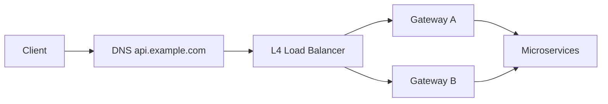
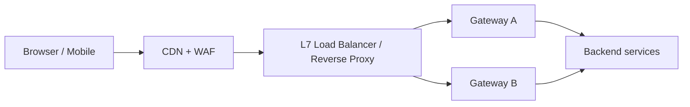
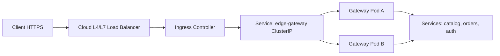
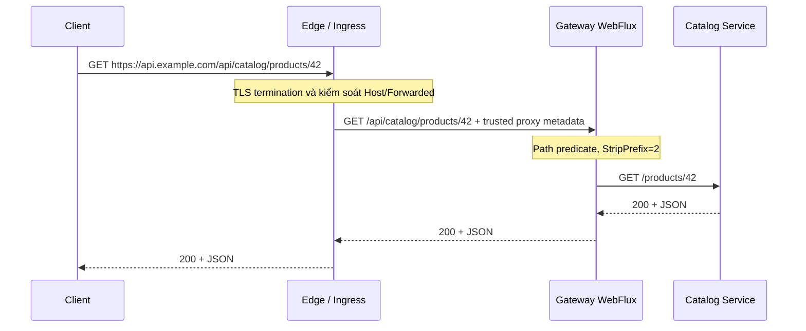
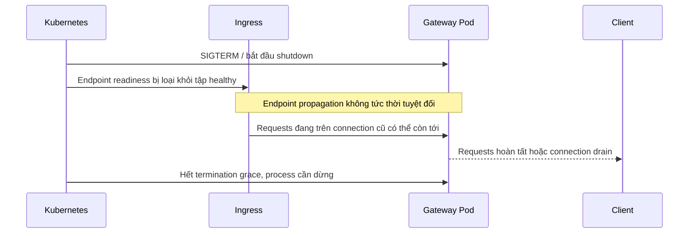
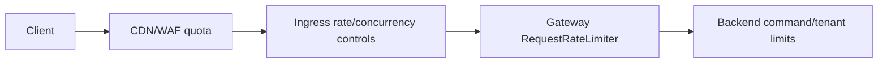
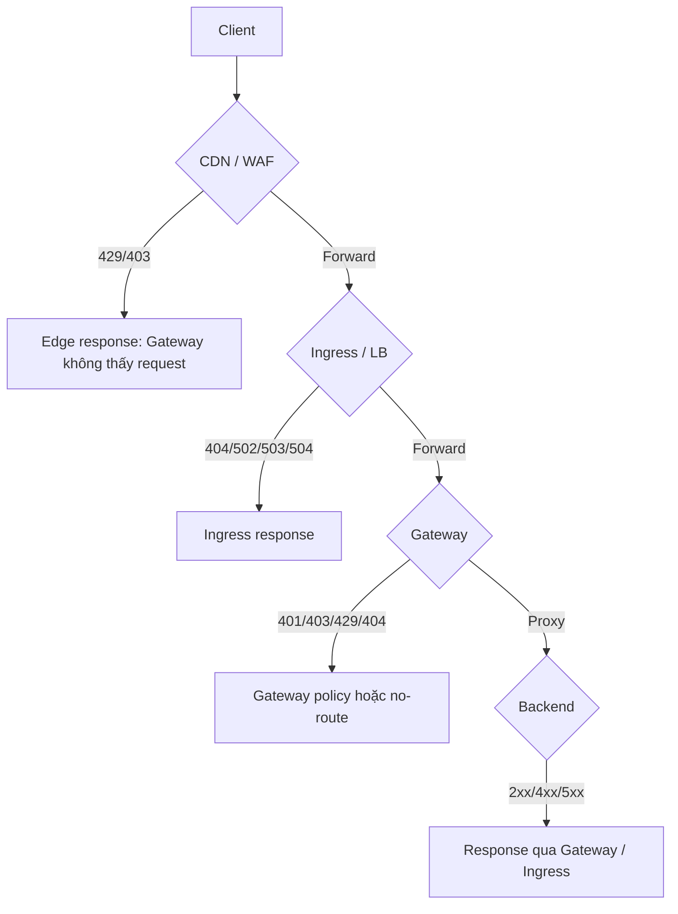

# Đặt gateway sau load balancer, ingress hoặc reverse proxy trong Spring Cloud Gateway

Khi phát triển cục bộ, một ứng dụng **Spring Cloud Gateway** thường nghe trực tiếp trên cổng `8080`:

```text
Client → http://localhost:8080 → Gateway → Catalog / Orders / Payments
```

Trong production, client hiếm khi kết nối trực tiếp đến một Gateway instance. Một đường đi phổ biến là **DNS → CDN/WAF → load balancer hoặc ingress/reverse proxy → nhiều Gateway replicas → microservices**. Các tầng phía trước có thể kết thúc TLS, cân bằng kết nối, kiểm tra health, thay đổi path, bổ sung headers, giới hạn kích thước request và điều khiển thời gian chờ.

Đặt Gateway sau những tầng này không chỉ là “mở thêm một port”. Nếu cấu hình sai, Gateway có thể tạo redirect từ HTTPS về HTTP, phân biệt sai địa chỉ IP client, tin một header do attacker tự khai, trả 404 do **rewrite path hai lần**, mất WebSocket Upgrade, ngắt SSE sau một khoảng idle, hoặc bị expose endpoint Actuator quản trị ra Internet.

Bài thuộc chương **Triển khai** của module `SPRING_CLOUD_GATEWAY`. Nội dung gắn với API Gateway định tuyến bằng route predicates và filter chain, biến đổi path/header, service discovery; bảo vệ lưu lượng bằng authentication, rate limiting, circuit breaker, retry, TLS và quan sát request để vận hành microservices an toàn.

**Sau bài này, bạn sẽ biết:**

1. Khi nào dùng **L4 load balancer**, **L7 load balancer**, **Kubernetes Ingress** hoặc **reverse proxy** phía trước Spring Cloud Gateway.
2. Thiết kế đường đi TCP/TLS/HTTP, chọn điểm kết thúc hoặc mã hóa lại TLS.
3. Giữ đúng public `Host`, scheme, client IP và path với `Forwarded`/`X-Forwarded-*` có ranh giới tin cậy.
4. Cấu hình một ví dụ **Ingress → ClusterIP Service → Gateway WebFlux Deployment**, có readiness/liveness và bảo vệ management endpoints.
5. Hiểu tác động của proxy tới JWT/CORS, rate limiting, redirects, cookies, WebSocket/SSE, retry và kết nối lâu dài.
6. Theo dõi lỗi 404/401/429/502/503/504 theo từng hop và xây dựng checklist kiểm thử/rollout.

> **Phạm vi:** Ví dụ ưu tiên **Spring Cloud Gateway Server WebFlux** với Spring Boot và Kubernetes. Gateway Server Web MVC là Servlet-based, có các namespace và API filter khác. Các tên properties như `spring.cloud.gateway.server.webflux.*` thuộc nhánh Gateway mới; các nhánh cũ có prefix khác. Kubernetes YAML/NGINX snippets chỉ minh họa cho ingress controller tương ứng, **không phải manifest đã được deploy hoặc benchmark trong dự án thực tế**. Các địa chỉ `example.com` và IP dành cho tài liệu đều là giả định.

## 1. Vì sao vẫn cần load balancer/ingress khi đã có API Gateway?

Spring Cloud Gateway có thể:

- Match request theo `Path`, `Host`, `Method`, `Header` và route predicates khác.
- Chuyển tới `lb://service-id` qua Spring Cloud LoadBalancer và service discovery.
- Viết lại path, query, headers và status.
- Thực hiện JWT/resource server policy, RequestRateLimiter, Retry, CircuitBreaker và response filters.
- Ghi metrics/traces theo route để theo dõi request.

Tuy nhiên, nó không mặc nhiên thay mọi chức năng của **edge load balancer, ingress controller, CDN và WAF**. Các hệ thống phía trước Gateway có nhiệm vụ khác:

| Thành phần | Vai trò chủ yếu | Điều dễ nhầm |
| --- | --- | --- |
| **DNS/CDN/WAF** | Chọn edge, caching, lọc lưu lượng nguy hiểm, TLS và bot/DDoS protection tùy dịch vụ. | Cache ở CDN không phải Spring Cloud Gateway cache. |
| **L4 load balancer** | Phân phối **TCP/UDP connections** theo IP/port; có thể passthrough hoặc TLS termination tùy sản phẩm. | Không tự hiểu route predicate Spring Cloud Gateway. |
| **L7 load balancer** | Đọc HTTP host/path/header, có thể TLS termination, HTTP routing, redirects và health checks. | Quy tắc rewrite L7 có thể xung đột Gateway filters. |
| **Kubernetes Ingress controller** | Implement các quy tắc Ingress HTTP(S), thường nằm sau cloud LB hoặc Service. | Resource `Ingress` không tự hoạt động nếu thiếu controller phù hợp. |
| **Reverse proxy** | Chuyển tiếp request, load balance, bảo vệ TLS/headers, buffering/timeouts. | Có thể tạo thêm một tầng proxy và timeout. |
| **Spring Cloud Gateway** | API-level routing, filter chain, chính sách bảo mật/resilience theo route. | Không thay hẳn lớp network ingress hoặc mọi backend authorization. |
| **Service discovery/LoadBalancer sau Gateway** | Chọn instance upstream cho `lb://catalog-service`. | Là chặng cân bằng tải **khác** LB phía trước Gateway. |

Một hệ thống có cả hai hướng load balancing:

```text
Client
  ↓
Cloud Load Balancer cân bằng tới Gateway pods
  ↓
Spring Cloud Gateway chọn route và upstream service ID
  ↓
Spring Cloud LoadBalancer chọn một backend instance
```

LB **phía trước** chia request/kết nối giữa các Gateway replicas. LB **phía sau** (qua discovery) chọn microservice instance. Chúng có phạm vi và SLO khác nhau.

## 2. Các topology triển khai thường gặp

### 2.1. Một L4 LB trực tiếp trước các Gateway instances



**Phù hợp khi:** nền tảng không cần thêm tầng L7 hoặc tổ chức muốn Gateway làm HTTP routing chính.

**Cần quyết định:**

- TLS terminate ở LB hay Gateway? Nếu **TCP passthrough**, Gateway cần TLS certificate và xử lý HTTPS trực tiếp.
- Nếu L4 LB kết thúc TLS, Gateway có nhận HTTP nội bộ hay TLS lại không?
- Làm thế nào giữ source IP? SNAT và Proxy Protocol nếu dùng phải được cấu hình **đồng bộ ở cả hai đầu**.
- Health check L4 có xác minh readiness HTTP không, hay chỉ TCP port mở?
- Một TCP connection lâu dài được ghim về instance; LB L4 không chia lại từng HTTP request bên trong connection một cách tự động.

### 2.2. CDN/WAF + L7 LB hoặc reverse proxy + Gateway



**Phù hợp khi:** cần kiểm soát edge-level TLS, WAF, domain routing, CDN caching, ingress observability và các chính sách dùng chung.

**Rủi ro:** nhiều tầng có thể tự thêm `X-Forwarded-For`, viết lại `Host` hoặc path, áp idle timeout và sinh response riêng. Phải có **hợp đồng rõ tầng nào sở hữu chính sách nào**, nếu không sẽ gặp hiện tượng “Gateway đúng khi gọi trực tiếp nhưng sai qua Internet”.

### 2.3. Kubernetes: cloud LB → Ingress controller → Gateway Service



`Ingress` khai báo host/path/TLS trong Kubernetes API. **Ingress controller** như ingress-nginx, HAProxy hoặc một nhà cung cấp cloud cụ thể mới thực thi quy tắc đó. Những annotation đặc thù của ingress-nginx **không áp dụng tự động** cho tất cả controllers.

### 2.4. L4 passthrough so với HTTP-aware ingress

| Chủ đề | TCP/L4 passthrough | L7 HTTP reverse proxy |
| --- | --- | --- |
| Đọc Host/path để route | Thường không (có ngoại lệ với SNI/TLS routing tùy sản phẩm). | Có. |
| TLS có thể kết thúc ở Gateway | Có. | Có thể termination tại proxy rồi re-encrypt. |
| Forwarded headers | Nếu chỉ TCP passthrough thì không tự có `X-Forwarded-*` từ HTTP proxy. | Thường có, cần chính sách trust. |
| WebSocket HTTP Upgrade | Frames đi qua TCP nếu passthrough; Gateway xử lý Upgrade. | Proxy phải hỗ trợ Upgrade/tunnel theo protocol. |
| HTTP caching/redirect | Không có ở pure L4. | Có thể ở L7. |
| Dấu vết lỗi | Transport/TCP/TLS. | HTTP 4xx/5xx, upstream metrics và logs. |

**Đừng đặt nhiều lớp HTTP router chỉ vì “nhiều tầng an toàn hơn”.** Mỗi lớp tăng độ phức tạp latency, headers, timeouts và khả năng chẩn đoán.

## 3. Hợp đồng request đi từ Internet đến upstream

Giả sử public API:

```text
https://api.example.com/api/catalog/products/42
```

Ta muốn:

```text
Client URL:       https://api.example.com/api/catalog/products/42
Ingress:          giữ nguyên path /api/catalog/products/42
Gateway route:    Path=/api/catalog/**
Gateway filter:   StripPrefix=2
Backend catalog:  GET /products/42
```

Dòng chảy:



**Hợp đồng phải ghi rõ ở từng hop:**

1. URL/scheme/host/port công khai.
2. Địa chỉ và protocol từ ingress tới Gateway.
3. Path **trước** và **sau** mỗi lớp rewrite.
4. Những headers nào được giữ, ghi đè, xóa, cho phép chuyển tiếp.
5. Client IP được xác nhận từ đâu.
6. Error status do layer nào phát sinh và ai chịu trách nhiệm logs/metrics.
7. Deadline/timeout/connection lifetime.
8. Mã hóa TLS và danh tính giữa các hops.
9. Nơi xác thực, phân quyền và rate limit.
10. Retry/reconnect semantics.

Đây là cách tránh tình trạng nhiều đội cùng sửa “một đường dẫn” nhưng mỗi bên hiểu nghĩa khác nhau.

## 4. TLS termination: chọn điểm dừng và bảo vệ chặng nội bộ

Có ba mô hình phổ biến.

### 4.1. TLS termination tại edge/ingress

```text
Client --HTTPS--> Ingress --HTTP--> Gateway --HTTP/HTTPS--> Backend
```

Ingress giữ certificate của `api.example.com`, giải mã HTTPS và chuyển HTTP vào cluster. Ưu điểm: quản lý chứng chỉ tập trung, dễ dùng WAF/redirect/domain policies. Nhưng:

- Chặng Ingress–Gateway **không được mã hóa** trong mô hình này.
- Gateway có thể thấy request nội bộ là `http://` nếu không xử lý trusted forwarded scheme đúng.
- NetworkPolicy/namespace isolation và trust boundary phải được đánh giá.
- Các yêu cầu compliance/zero-trust có thể không cho phép HTTP plaintext nội bộ.

**Không nói “end-to-end encrypted” chỉ vì client–ingress dùng HTTPS.**

### 4.2. TLS termination rồi mã hóa lại

```text
Client --HTTPS--> Ingress --HTTPS/mTLS--> Gateway --HTTPS/mTLS--> Backend
```

Ưu điểm: bảo vệ hop-to-hop và có thể xác thực identity qua mTLS. Đổi lại:

- Cần CA/trust store, cert rotation, SNI và hostname verification.
- Proxy/Gateway đều có TLS handshake/connection pool overhead.
- Nếu edge terminate rồi re-encrypt, client certificate mTLS của user **không tự truyền nguyên vẹn** đến Gateway như một peer certificate trực tiếp; cần cơ chế identity propagation đã xác minh.
- Có thể xuất hiện lỗi `502` do chứng chỉ upstream không tin cậy dù Gateway logic hoàn toàn đúng.

### 4.3. TLS passthrough

```text
Client --TLS xuyên qua L4--> Gateway (TLS termination)
```

Gateway giữ certificate public và xử lý TLS trực tiếp. Phù hợp khi Gateway cần nắm handshake, nhưng:

- L4 phía trước không nhìn thấy HTTP path/headers nếu không terminate.
- Gateway chịu chi phí TLS tại mỗi replica và cần cert rotation.
- Nếu dựa vào Proxy Protocol để giữ client IP thì listener/ingress phải cùng hỗ trợ, không tự bật một phía.
- Các chức năng WAF/L7 HTTP routing ở lớp passthrough có thể không hoạt động.

### 4.4. Ma trận chọn TLS

| Yêu cầu | Lựa chọn có thể hợp lý | Cần kiểm chứng |
| --- | --- | --- |
| Chứng chỉ public do edge quản lý | Edge TLS termination. | Chặng sau edge có bảo vệ phù hợp. |
| Mã hóa mọi hop | Edge termination + re-encrypt/mTLS. | CA, SNI, trust store, rotation. |
| Gateway bắt buộc nhận TLS client trực tiếp | L4 passthrough. | Certificate management và LB behavior. |
| WAF cần đọc HTTP | L7 TLS termination. | Security headers, forwarded metadata. |
| Ingress/service mesh quản lý mTLS | Hop-specific TLS. | Không double terminate sai hoặc vô hiệu hostname verification. |

Tuyệt đối không vô hiệu **certificate validation** chỉ để “khắc phục nhanh 502” trong production.

## 5. `Host`, scheme, port: nguồn của redirect và URL tuyệt đối

Khi Gateway nhận HTTP từ ingress, thông tin socket nội bộ có thể là:

```text
Connection to Gateway: http://edge-gateway.default.svc.cluster.local:8080
Public client URL:     https://api.example.com/
```

Nếu một filter hoặc backend tạo redirect từ scheme/host nội bộ mà không dùng trusted external origin, người dùng có thể nhận:

```http
HTTP/1.1 302 Found
Location: http://edge-gateway.default.svc.cluster.local:8080/login
```

Redirect này vừa sai chức năng vừa có thể gây lộ topology nội bộ.

### 5.1. Các thông tin thường cần giữ

- **`Host`:** public domain `api.example.com` hoặc host backend theo policy.
- **`X-Forwarded-Host`:** host gốc mà client nhìn thấy theo chain do proxy đáng tin quản lý.
- **`X-Forwarded-Proto`:** scheme ngoài edge, thường `https`.
- **`X-Forwarded-Port`:** external port khi cần, không mặc định mọi request dùng 443.
- **`Forwarded` chuẩn RFC 7239:** có thể gồm `for=...;proto=https;host=...`.
- **`X-Forwarded-Prefix`:** prefix path bên ngoài khi upstream được publish dưới một base path khác.

Không nên vừa tin tất cả `Forwarded` vừa tin tất cả `X-Forwarded-*` mà không có quy tắc precedence. Một attacker có thể cố gửi hai bộ giá trị mâu thuẫn.

### 5.2. Cookie, absolute URL và `Location`

Khi external scheme là HTTPS:
- Redirect nên dùng public HTTPS origin hoặc đường dẫn tương đối phù hợp.
- Cookie đăng nhập cần `Secure`, `HttpOnly` và `SameSite` theo use case.
- Các cookie `Domain`/`Path` phải đúng public domain/base path.
- Một `Location` do backend trả có thể cần rewrite theo filter/hợp đồng; không tự phản chiếu host nội bộ.
- Open redirect risk xuất hiện nếu ứng dụng tin `X-Forwarded-Host` do client tự khai.

**Không dùng raw `Host` hoặc `X-Forwarded-Host` làm URL redirect/allowlist quyết định bảo mật nếu chưa validate.**

## 6. `Forwarded` và `X-Forwarded-*`: ranh giới tin cậy quan trọng nhất

Một header trông “hệ thống” vẫn là **HTTP data**, có thể do client tự gửi. Ví dụ attacker kết nối Internet có thể gửi:

```http
GET /api/orders HTTP/1.1
Host: api.example.com
X-Forwarded-For: 127.0.0.1
X-Forwarded-Proto: https
X-Forwarded-Host: admin.internal
```

Nếu Gateway lấy ngay giá trị đó làm client identity, attacker có thể:
- Né rate limit theo IP.
- Truy cập endpoint chỉ cho phép “localhost”.
- Tạo URL redirect/password reset sai host.
- Làm hỏng audit log hoặc IP allowlist.
- Đánh lừa Security filter dựa vào scheme/host.

**Ranh giới tin cậy không phải “có header thì tin”, mà là “header đến từ proxy nào, proxy ấy đã kiểm soát nguồn và ghi đè giá trị chưa”.**

### 6.1. Một chain địa chỉ có thể gồm nhiều hops

```text
Client:          203.0.113.10
CDN:             198.51.100.20
Ingress:         10.10.0.5
Gateway peer:    10.10.0.5

Header được quản lý đúng có thể như:
X-Forwarded-For: 203.0.113.10, 198.51.100.20
```

Đọc “IP đầu tiên bên trái” chỉ an toàn nếu **edge entrypoint đã làm sạch nguồn không tin cậy** và toàn bộ chain trusted proxies được xác định đúng. Nếu Internet client được phép đưa `X-Forwarded-For: 1.2.3.4` rồi CDN append, IP đầu tiên có thể bị giả mạo.

### 6.2. Quy trình trust đúng

1. Chọn **điểm vào HTTP đầu tiên được kiểm soát** (CDN hoặc edge LB/ingress).
2. Xóa hoặc ghi đè incoming `Forwarded`/`X-Forwarded-*` không đáng tin từ public clients.
3. Chỉ chấp nhận danh sách CDN/LB proxy IP ranges được quản lý theo cơ chế nhà cung cấp.
4. Quy định một format/header family chính và thứ tự đọc chuỗi IP.
5. Giới hạn network để client **không thể đi thẳng vào Gateway** ngoài ingress.
6. Với ứng dụng, cấu hình xử lý forwarded headers đúng server variant.
7. Test spoofed headers, host poisoning, redirect và rate limiting.

### 6.3. Không dùng `X-Forwarded-For` thô làm key rate limit

Với `RequestRateLimiter` hoặc custom IP KeyResolver:

```java
// MẪU KHÔNG AN TOÀN: client có thể tự khai header nếu edge không lọc.
String key = exchange.getRequest()
    .getHeaders()
    .getFirst("X-Forwarded-For");
```

Một resolver an toàn cần lấy **effective client IP đã được một trusted-proxy algorithm xác minh**, không lấy chuỗi thô có nhiều IP. Khi không thể xác minh, nên dùng authenticated principal/API key hoặc lựa chọn fail-safe theo threat model.

### 6.4. `X-Forwarded-Prefix` không đồng nghĩa `StripPrefix`

`X-Forwarded-Prefix: /api` có thể nói rằng bên ngoài request đi qua một base path. Nó **không tự thực thi** việc xóa `/api` trong request-target mà upstream nhận. Trách nhiệm rewrite path và trách nhiệm mô tả public prefix là hai việc riêng.

## 7. Spring Boot WebFlux xử lý Forwarded Headers

Trong Spring Boot có cấu hình chung để quyết định cách ứng dụng sử dụng forwarded headers. Với **WebFlux**, một ví dụ:

```yaml
server:
  forward-headers-strategy: framework
```

Tùy Spring Boot version và runtime, các giá trị có thể gồm `none`, `native` và `framework`:

| Chiến lược | Ý tưởng | Lưu ý |
| --- | --- | --- |
| `none` | Không tự dùng proxy-forwarded metadata để sửa view của request. | Có thể sai public scheme/host khi đứng sau TLS terminator. |
| `native` | Dựa vào xử lý của web server/native adapter. | Semantics và support khác giữa Netty/Tomcat/Undertow. |
| `framework` | Spring Framework xử lý forwarded metadata (ví dụ WebFlux `ForwardedHeaderTransformer`). | **Chỉ bật với trusted proxy boundary đã kiểm soát**. |

`framework` có thể giúp ứng dụng nhìn thấy URI bên ngoài như HTTPS dù socket Gateway nhận từ ingress là HTTP. Nhưng **đây không phải cơ chế tự xác minh proxy đáng tin**: nếu Gateway nhận request trực tiếp hoặc edge không loại bỏ header giả, việc đọc forwarded values có thể nguy hiểm.

### 7.1. Hai việc không được nhập làm một

- **Spring Boot `server.forward-headers-strategy` / WebFlux `ForwardedHeaderTransformer`:** ảnh hưởng tới **cách request được diễn giải trong ứng dụng**.
- **Spring Cloud Gateway `ForwardedHeadersFilter` / `XForwardedHeadersFilter`:** tham gia **tạo/chuyển tiếp headers ra outbound proxy request** theo route và config.

Tên giống nhau, nhưng scope khác nhau. Đừng giả định bật một property sẽ tự bảo vệ mọi trường hợp spoofing, hoặc mọi header ở downstream đều mang cùng ý nghĩa.

### 7.2. Gateway prefix và chính sách trusted proxies theo phiên bản

Một số nhánh Gateway mới dùng `spring.cloud.gateway.server.webflux.trusted-proxies` (regular expression cho địa chỉ proxy đáng tin trong các tính năng forward-header tương ứng), trong khi những nhánh trước dùng namespace cũ và có các cấu hình bật/tắt header filter riêng.

**Điều phải làm:** xem tài liệu và configuration metadata của **Spring Cloud Gateway Server WebFlux version đang chạy**, cấu hình proxy trust theo đúng implementation, và kiểm tra headers thực tế ở upstream. Không tự copy một regex từ môi trường khác rồi coi mọi loại forwarded headers đều đã được xác minh.

### 7.3. Kiểm tra sau deploy

```text
Public URL:       https://api.example.com/api/catalog/42
Ingress → GW:     http://edge-gateway:8080/api/catalog/42
Trusted proto:    https
Trusted host:     api.example.com
Public redirect:  https://api.example.com/...
Client IP:        từ trusted-proxy policy, không từ raw client header
```

Không để raw `X-Forwarded-Host` trở thành nguồn quyền truy cập hay URL bảo mật.

## 8. NGINX làm reverse proxy phía trước Gateway

Một NGINX được đặt trực tiếp trên Internet có thể terminate TLS rồi proxy vào Gateway:

```nginx
# map thuộc ngữ cảnh http {} trong nginx.conf
map $http_upgrade $connection_upgrade {
    default upgrade;
    ''      '';
}

upstream gateway_pool {
    server gateway-a.internal:8080;
    server gateway-b.internal:8080;
    keepalive 32;
}

server {
    listen 443 ssl;
    server_name api.example.com;

    ssl_certificate     /etc/nginx/certs/fullchain.pem;
    ssl_certificate_key /etc/nginx/certs/privkey.pem;

    location / {
        proxy_pass http://gateway_pool;
        proxy_http_version 1.1;

        proxy_set_header Host $host;
        proxy_set_header X-Forwarded-Host $host;
        proxy_set_header X-Forwarded-Proto $scheme;
        proxy_set_header X-Forwarded-Port $server_port;

        # Chỉ ở public entrypoint nơi $remote_addr thật sự là client.
        # GHI ĐÈ incoming XFF, không append header do client tự gửi.
        proxy_set_header X-Forwarded-For $remote_addr;
        # Loại metadata proxy do Internet client có thể tự khai.
        proxy_set_header Forwarded "";
        proxy_set_header X-Forwarded-Prefix "";

        proxy_set_header Upgrade $http_upgrade;
        proxy_set_header Connection $connection_upgrade;

        proxy_connect_timeout 3s;
        proxy_read_timeout 60s;
        proxy_send_timeout 60s;
    }
}
```

**Cảnh báo cho config fragment:**

- `map` phải nằm đúng context `http`; các `server` và `upstream` cũng đặt ở context tương ứng.
- `$remote_addr` ở ví dụ chỉ đại diện client IP **nếu NGINX là HTTP entrypoint trực tiếp**. Nếu có CDN/LB phía trước, nó có thể là IP proxy; phải cấu hình **Real IP / trusted-proxy policy** phù hợp và chỉ tin các IP nguồn được phép.
- `proxy_set_header X-Forwarded-For $remote_addr` là chiến lược **overwrite ở first trusted edge**. Ở các proxy nội bộ tiếp theo có thể append chuỗi đáng tin theo quy ước; không nối nguyên input Internet chưa lọc.
- `proxy_set_header Host $host` cần `server_name`/host allowlist rõ; tránh chấp nhận Host bất kỳ để tạo redirect.
- Khi không có Upgrade, map đặt `Connection` thành giá trị rỗng để không ép `close` với mọi HTTP/1.1 request; upstream keep-alive còn phụ thuộc cấu hình NGINX và backend. Header `Forwarded` và `X-Forwarded-Prefix` không được chuyển tiếp từ nguồn public không tin cậy trong ví dụ này.
- NGINX không tự cho proxy HTTP/2 hay WebSocket hoạt động theo cùng một cú pháp ở mọi phiên bản. `Upgrade`/`Connection` ở đây mô tả HTTP/1.1 Upgrade.
- `keepalive 32` là một phần caching upstream connections trong NGINX, **không phải** giới hạn số lượng kết nối của Reactor Netty outbound pool bên trong Gateway.
- Timeouts `60s` là **ví dụ**; API ngắn và SSE/WebSocket cần profile khác.

### 8.1. Không rewrite path hai lần

Với `proxy_pass http://gateway_pool;` không có URI path phía sau, NGINX có thể chuyển nguyên request URI theo semantics config tương ứng. Nếu dùng `proxy_pass http://gateway_pool/;` trong một `location /api/`, việc thay đổi URI theo quy tắc NGINX có thể làm path khác trước khi vào Gateway.

Vì vậy:
- Xác định **một tầng sở hữu path rewrite**.
- Ingress giữ nguyên `/api/catalog/42` nếu Gateway dựa vào `Path=/api/catalog/**`.
- Chỉ Gateway dùng `StripPrefix=2`, trừ khi hai tầng đã thống nhất rõ.
- Test upstream path thật, không chỉ đọc YAML/nginx.conf.

## 9. Kubernetes Ingress → Gateway: ví dụ manifest

Ví dụ sau mô tả một workload Gateway WebFlux có ba replicas, một Service nội bộ và một Ingress TLS. Các image, hostname, namespace, cert secret và resources cần thay theo môi trường.

### 9.1. Gateway Deployment

```yaml
apiVersion: apps/v1
kind: Deployment
metadata:
  name: edge-gateway
  namespace: gateway
spec:
  replicas: 3
  revisionHistoryLimit: 5
  selector:
    matchLabels:
      app: edge-gateway
  strategy:
    type: RollingUpdate
    rollingUpdate:
      maxSurge: 1
      maxUnavailable: 0
  template:
    metadata:
      labels:
        app: edge-gateway
    spec:
      terminationGracePeriodSeconds: 45
      containers:
        - name: gateway
          image: registry.example.com/platform/edge-gateway:1.0.0
          ports:
            - name: http
              containerPort: 8080
          env:
            - name: SERVER_PORT
              value: "8080"
          readinessProbe:
            httpGet:
              path: /actuator/health/readiness
              port: http
            initialDelaySeconds: 5
            periodSeconds: 5
            timeoutSeconds: 2
            failureThreshold: 3
          livenessProbe:
            httpGet:
              path: /actuator/health/liveness
              port: http
            initialDelaySeconds: 15
            periodSeconds: 10
            timeoutSeconds: 2
            failureThreshold: 3
          resources:
            requests:
              cpu: 200m
              memory: 256Mi
            limits:
              cpu: "2"
              memory: 1Gi
```

**Điều kiện:** Ứng dụng có Spring Boot Actuator, health probes đã bật và phản hồi qua **cổng 8080**. Không áp y nguyên số requests/limits/thời gian probe cho một Gateway có WebSocket hàng giờ hoặc workload 20.000 connections. Cần load test, graceful shutdown và capacity planning.

### 9.2. Service ClusterIP

```yaml
apiVersion: v1
kind: Service
metadata:
  name: edge-gateway
  namespace: gateway
spec:
  type: ClusterIP
  selector:
    app: edge-gateway
  ports:
    - name: http
      port: 80
      targetPort: http
      protocol: TCP
```

Điều này tạo một địa chỉ nội bộ cho Ingress controller chuyển traffic tới **Gateway pods**. Nó **không** trực tiếp expose Gateway qua NodePort/LoadBalancer, trừ khi bạn cố ý cấu hình một đường khác.

### 9.3. Ingress dùng TLS

```yaml
apiVersion: networking.k8s.io/v1
kind: Ingress
metadata:
  name: public-api
  namespace: gateway
spec:
  ingressClassName: nginx
  tls:
    - hosts:
        - api.example.com
      secretName: api-example-com-tls
  rules:
    - host: api.example.com
      http:
        paths:
          - path: /
            pathType: Prefix
            backend:
              service:
                name: edge-gateway
                port:
                  name: http
```

**Giải thích:**

- `ingressClassName: nginx` chỉ phù hợp nếu cluster có **IngressClass**/controller tương ứng.
- TLS secret phải tồn tại và được quản trị/rotate đúng namespace và quy trình.
- `path: /` với `Prefix` chuyển mọi path của host tới Gateway, giữ việc phân route chi tiết cho Gateway.
- Ingress controller có thể dùng thêm Service loại LoadBalancer do cloud cấp; manifest Ingress **không tự tạo hoặc định nghĩa** mọi thành phần network.
- Cổng `80` của Service ánh xạ tới Pod `8080`.
- Nếu một public path không match Gateway route, Gateway có thể trả 404; đó khác 404 do ingress không match host/rule.

### 9.4. Spring Boot health probes

Một fragment cấu hình ứng dụng:

```yaml
management:
  endpoint:
    health:
      probes:
        enabled: true
  endpoints:
    web:
      exposure:
        include: health,info,metrics,prometheus

server:
  shutdown: graceful

spring:
  lifecycle:
    timeout-per-shutdown-phase: 30s
```

Đây là config ví dụ cho những phiên bản Spring Boot hỗ trợ; hãy xác minh active probes/path/port thực tế.

`server.shutdown: graceful` thường được viết dưới dạng hai dòng YAML `server:` → `shutdown: graceful` như trên (hoặc `server.shutdown=graceful` ở properties). Nó giúp Spring Boot thực hiện graceful shutdown theo lifecycle, nhưng không bảo đảm mọi WebSocket session được giữ mãi.

**Bảo mật quan trọng:** Ingress `path: /` có thể cho public client **đến đường dẫn `/actuator/*** trên cùng application port** nếu Spring Security/network policy không chặn. Cấu hình `exposure.include` không phải cơ chế authorization. Trong production, chỉ expose endpoints thật sự cần thiết, chặn management paths tại public edge/ứng dụng và ưu tiên management network/port riêng có auth.

### 9.5. Ingress-nginx không giống mọi Ingress controller

Nếu cần annotation timeout chuyên biệt cho community **ingress-nginx**:

```yaml
metadata:
  annotations:
    nginx.ingress.kubernetes.io/proxy-read-timeout: "300"
    nginx.ingress.kubernetes.io/proxy-send-timeout: "300"
```

Đây là **fragment metadata**, không phải full Ingress manifest. Các giá trị `300` là **giây** theo annotation ingress-nginx thường dùng, chỉ minh họa khi vận hành stream dài. Một cloud ingress controller hoặc NGINX Inc controller có tên annotation/semantics **khác**.

Không tăng mọi route thành 300 giây chỉ để hỗ trợ WebSocket: API JSON ngắn nên có deadline riêng, đồng thời cần giới hạn số active streams và connection resources.

## 10. Đặt Gateway route sau Ingress: giữ hợp đồng path rõ ràng

Ví dụ route Gateway Server WebFlux phiên bản dùng namespace mới:

```yaml
spring:
  cloud:
    gateway:
      server:
        webflux:
          routes:
            - id: catalog-api
              uri: lb://catalog-service
              predicates:
                - Path=/api/catalog/**
              filters:
                - StripPrefix=2
                - AddRequestHeader=X-Gateway-Route,catalog-api

            - id: orders-api
              uri: lb://order-service
              predicates:
                - Path=/api/orders/**
              filters:
                - StripPrefix=2
```

Kết quả dự kiến:

| Client request | Ingress chuyển tới Gateway | Backend nhận |
| --- | --- | --- |
| `GET /api/catalog/products/42` | `/api/catalog/products/42` | `/products/42` |
| `GET /api/orders/123` | `/api/orders/123` | `/123` |
| `GET /unknown` | `/unknown` | Không có upstream nếu không route nào match. |

**Nhớ rằng:** `StripPrefix=2` xóa đúng hai segment đầu của path, không phải hai ký tự hay hai host components. Nếu ingress cũng xóa `/api`, route `Path=/api/catalog/**` có thể không match và trả 404.

### 10.1. Prefix rewriting chỉ nên có một chủ sở hữu

Hai phương án đều hợp lệ nếu nhất quán:

**Phương án A (thường dễ quản lý):** Ingress giữ nguyên đường dẫn public; Gateway match và rewrite.

**Phương án B:** Ingress rewrite thành internal prefix; Gateway routes được viết theo **path đã rewrite** và có metadata/headers về external prefix nếu cần.

**Không dùng A trên staging nhưng B trên production mà giữ nguyên bộ test route.** Các path/security matchers, CORS policy và metrics có thể bị ảnh hưởng.

### 10.2. Host predicate sau ingress

Gateway có thể có:

```yaml
predicates:
  - Host=api.example.com
  - Path=/api/orders/**
```

Nếu ingress ghi đè `Host` thành `edge-gateway.gateway.svc` thì `Host` predicate không match. Cần quyết định giữ host gốc hay cố ý sửa, và kiểm tra trusted proxy/scheme forwarding.

**Không tin Host bất kỳ** để tự cấp quyền vào admin route; Host predicate chỉ là routing, không phải authentication.

## 11. Cân bằng giữa nhiều Gateway replicas: tính chất stateless

Khi có ba Gateway pods:

```text
Ingress/LB
   ├── Gateway A
   ├── Gateway B
   └── Gateway C
```

Tốt nhất, request của cùng một user có thể tới bất kỳ Gateway instance nào mà **quyền và hành vi nghiệp vụ vẫn nhất quán**.

Điều đó đòi hỏi:

- Route definitions/config được đồng bộ hoặc quản lý từ một nguồn phát hành đáng tin.
- Authentication/JWT validation tương đương trên các instances.
- Shared state cho quota toàn cụm khi dùng RedisRateLimiter, không dựa vào rate limiter in-memory độc lập.
- Các secrets/certificates/issuer/JWK được cấp theo policy nhất quán.
- Không giữ business session state hoặc idempotency state quan trọng chỉ trong RAM của một Gateway pod.
- Các custom filters không phụ thuộc dữ liệu singleton mutable của một request khác.

### 11.1. Có bắt buộc sticky session không?

**Không** đối với phần lớn API HTTP stateless. Sticky/session affinity có thể có lý do trong ứng dụng legacy hoặc stateful protocols, nhưng nó **không thay thế shared state**.

Với HTTP/1.1 keep-alive, một TCP connection có thể được LB ghim tới một Gateway; điều đó không có nghĩa mọi request của user trên nhiều connections luôn vào cùng replica.

### 11.2. Một Gateway pod chết thì sao?

Ingress/LB cần:
1. Ngừng đưa **kết nối/request mới** tới pod không ready.
2. Cho requests đang chạy thời gian hoàn tất theo termination grace.
3. Đóng/drain sockets hợp lý.
4. Cho client retry/reconnect theo hợp đồng.
5. Tránh retry POST có side effects nếu không có idempotency.

**Rate limiting, retries và resilience của từng Gateway replica** phải được tính trong capacity của toàn cụm, nhất là khi một pod chết và phần còn lại phải chịu tải.

## 12. Readiness, liveness và startup: đừng tự tạo sự cố

Ba loại probe có mục đích khác nhau:

| Probe | Câu hỏi | Hành động Kubernetes thường dùng |
| --- | --- | --- |
| **Startup** | Ứng dụng đã qua giai đoạn khởi động chưa? | Trì hoãn liveness/readiness cho tới khi startup thành công. |
| **Readiness** | Pod có sẵn sàng nhận request **mới** không? | Loại khỏi Service endpoints khi not ready. |
| **Liveness** | Process có bị kẹt đến mức cần restart không? | Khởi động lại container nếu probe thất bại liên tục. |

### 12.1. Không dùng toàn bộ upstream health làm liveness

Nếu Gateway liveness phụ thuộc Catalog Service, khi Catalog chết mọi Gateway pod có thể bị restart đồng loạt. Đây là **cascading failure** không cần thiết.

Liveness nên phản ánh Gateway process có thể phục hồi bằng restart hay không. Readiness có thể phản ánh khả năng nhận traffic mới theo policy, nhưng cũng cần cẩn thận không gắn mọi downstream vào một điều kiện chung làm toàn cụm Gateway không ready.

### 12.2. Readiness và 503

Nếu Gateway pods đều not-ready, Ingress có thể trả 503 vì Service không có healthy endpoints. Lỗi đó xảy ra **trước khi request vào Gateway route chain**, nên Gateway route metrics có thể không tăng.

Khi thấy 503, kiểm tra cùng lúc:
- Kubernetes pod readiness.
- Service endpoints/EndpointSlices.
- Ingress controller upstream health.
- Gateway route/LoadBalancer service discovery phía sau.
- Backend thật trả 503 hay không.

### 12.3. Phải test startup probe khi ứng dụng khởi động chậm

Một Gateway tải nhiều route definitions hoặc khởi tạo TLS/JWK/connection pool có thể cần thời gian warm-up. Nếu liveness timeout quá gắt, Kubernetes có thể liên tục restart pod trước khi ứng dụng kịp ready. Dùng startup probe hoặc điều chỉnh thresholds có căn cứ đo, không chỉ tăng delay ngẫu nhiên.

## 13. Graceful shutdown và rolling deployments

Một rollout an toàn cần tính đường đi request lúc pod bị terminate:



Thực tế thứ tự/độ trễ endpoint update, hooks và SIGTERM phụ thuộc Kubernetes runtime. **Không giả định readiness update đến mọi L7 LB ngay lập tức**; LB có health interval, endpoint cache và keep-alive connections.

### 13.1. Các việc nên có trong quy trình rollout

- `replicas >= 2` hoặc topology HA phù hợp.
- `maxUnavailable: 0` và `maxSurge` có capacity thật, không gây OOM.
- Startup/readiness/liveness theo mục tiêu khác nhau.
- Graceful shutdown với `terminationGracePeriodSeconds` đủ cho requests quan trọng.
- Một giai đoạn drain/propagation phù hợp nếu cần và được thiết kế có kiểm soát.
- PDB/topology spread và resource budget để giảm mất đồng thời replicas.
- Canary rollout và rollback khi 5xx/latency tăng.
- Client retry policy có backoff và idempotency.

### 13.2. WebSocket/SSE không thể “đợi mãi cho xong”

Một WebSocket session có thể kéo dài hàng giờ. `terminationGracePeriodSeconds=45` **không cho phép giữ vô hạn** tất cả sessions trong rolling deploy.

Cần:
- Thông báo maintenance/reconnect khi protocol hỗ trợ.
- Đóng long-lived sessions có kiểm soát.
- Client tự reconnect tới pod khác với jitter.
- Replay cursor/event offset để tránh mất dữ liệu.
- Không giữ user online vô hạn sau pod crash; dùng lease/TTL cho presence.

## 14. WebSocket qua ingress hoặc reverse proxy

WebSocket bắt đầu bằng HTTP/1.1 Upgrade handshake, server trả **101 Switching Protocols**, sau đó là frame exchange. NGINX/Ingress HTTP proxy cần hỗ trợ chuyển tiếp Upgrade đúng và có timeout dành cho kết nối lâu dài.

```text
Browser --wss://api.example.com/realtime/events-->
Ingress --ws://edge-gateway:8080/realtime/events-->
Gateway --lb:ws://realtime-service-->
Realtime Service
```

Trong ví dụ, **WSS chỉ bảo đảm client–Ingress TLS**. Chặng Gateway–Realtime backend dùng `ws`; nếu cần mã hóa mọi hop phải chọn `wss` hoặc mesh TLS/mTLS theo hạ tầng/version.

### 14.1. Cấu hình proxy timeout

Với NGINX, `proxy_read_timeout` là thời gian giữa các lần đọc từ upstream, **không phải tổng thời lượng kết nối**. Nếu server không gửi bất kỳ dữ liệu nào tới proxy trong khoảng đó, tunnel có thể bị đóng dù client vẫn gửi message lên.

Một ví dụ policy:

```text
NGINX proxy_read_timeout: 300 giây
Application heartbeat:    30 giây
Heartbeat response TTL:   15 giây
Connection maximum age:   theo hạ tầng / security policy
```

Đây là ví dụ để thảo luận. Cần đo idle limit thấp nhất ở **mọi hop** (CDN, LB, ingress, Gateway, backend). Một số proxy có **hard maximum connection lifetime**, heartbeat không làm thời lượng tối đa biến mất.

### 14.2. Ping/Pong không đồng nghĩa thông điệp nghiệp vụ khỏe

- Protocol-level Ping/Pong chỉ kiểm tra peer/hop tùy implementation.
- Browser native WebSocket không expose API gửi control Ping tùy ý; có thể cần application message `PING:<id>` và `PONG:<id>`.
- Gateway WebFlux có những cấu hình liên quan proxy Ping frame theo version, **không phải** một bộ phát heartbeat tự động.
- Kết nối còn OPEN không chứng minh backend đang xử lý đúng business events.

### 14.3. Session affinity và reconnect

Một WebSocket session đã nối thường được gắn với Gateway/backend instance cho tới khi đóng. Khi pod chết, client phải reconnect; load balancing mới chọn endpoint khác. Sticky session có thể giúp một số trường hợp, nhưng **không giải quyết sự cố pod crash hoặc state chỉ nằm trong RAM**.

Kiểm thử:
- HTTP 101.
- Trao đổi frames hai chiều bằng WebSocket client thật.
- Idle timeout/heartbeat.
- Close codes và reconnect.
- Graceful shutdown, browser background, network switch.
- Backend state replay sau reconnect.

## 15. SSE/streaming: buffering và idle timeout

SSE dùng HTTP response `text/event-stream` kéo dài, **không dùng WebSocket Upgrade**. NGINX hoặc ingress có thể buffer response, khiến backend đã gửi event nhưng browser nhận rất muộn.

Với ingress-nginx community, một annotation thường dùng trên **Ingress chuyên SSE** là:

```yaml
metadata:
  annotations:
    nginx.ingress.kubernetes.io/proxy-buffering: "off"
    nginx.ingress.kubernetes.io/proxy-read-timeout: "300"
```

**Caveat:** Annotation theo controller/version. Việc tắt buffering có tác động tới hiệu năng, memory và một số loại response; **không bật toàn cục** cho mọi route nếu chưa đo.

Một SSE server có thể gửi comment heartbeat:

```text
: keep-alive

id: event-103
event: notification
data: {"message":"ready"}

```

- Heartbeat giúp giữ hoạt động HTTP stream qua một số idle proxy.
- `id:` và `Last-Event-ID` chỉ hữu ích khi backend có durable event replay.
- `proxy_read_timeout` không tự giải quyết maximum connection age.
- Đừng áp response timeout ngắn của JSON API lên SSE mà không hiểu stream lifecycle.

## 16. Client IP, WAF và rate limiting theo nhiều tầng

Rate limiting có thể tồn tại ở:



Chúng không thay nhau:

| Tầng | Thường bảo vệ | Key/semantics cần biết |
| --- | --- | --- |
| CDN/WAF | Bot/DDoS/abusive IP patterns. | Client IP theo provider/ASN/rule, không mặc định user identity. |
| Ingress | Upstream availability, connection/RPS caps. | IP, host hoặc header đã được kiểm soát. |
| Gateway | Route/user/tenant/API-key quota. | JWT principal, verified tenant, Redis shared state. |
| Backend | Business command cost, payment/order quotas. | Authorization và idempotency theo nghiệp vụ. |

### 16.1. Đừng dùng RemoteAddress predicate tùy tiện sau reverse proxy

Ở Gateway, remote peer có thể là IP Ingress. Nếu rate limit hoặc `RemoteAddr` route predicate dùng địa chỉ này, tất cả clients có thể bị gom thành một nhóm, hoặc chính sách IP allowlist hoạt động sai.

Một số Gateway versions cung cấp `XForwardedRemoteAddressResolver` với chiến lược theo `maxTrustedIndex`; khi dùng phải đếm **đúng số proxy hops đáng tin** và lọc spoofed headers ở edge. Không coi `trustAll()` hay “lấy phần tử đầu tiên” là an toàn trong môi trường public.

### 16.2. RedisRateLimiter cần shared state nếu quota toàn cụm

Nếu ba Gateway replicas dùng bucket local độc lập, mỗi user có thể nhận quota nhân ba. Khi muốn cùng key có cùng quota toàn cụm, cần storage/limiter hỗ trợ distributed coordination như Redis và cấu hình namespace/KeyResolver nhất quán.

Đặc biệt:
- Rate limit **handshake** không tự giới hạn mọi WebSocket frame sau 101.
- Rate limit per-request không tự giới hạn số upstream Retry attempts.
- Ingress có thể trả 429 **trước Gateway**, khiến Gateway route metrics không nhìn thấy nó.

### 16.3. Trả 429 đúng nguồn

Nếu edge trả 429, client nhận HTTP 429 dù Gateway chưa có request. Nếu Gateway trả 429 sau match route, có thể xuất hiện trong Gateway route timer theo filter semantics/version. Nếu backend trả 429, Gateway có thể chuyển tiếp mã đó.

Để debug, dùng ingress request logs, Gateway route ID, limiter decision metrics và backend logs. Không lấy một status 429 làm bằng chứng “RedisRateLimiter hoạt động đúng”.

## 17. JWT, cookies và CORS sau TLS-terminating ingress

Khi client truy cập `https://api.example.com` và Gateway nhận HTTP nội bộ:

- Spring Security Resource Server vẫn cần verify JWT issuer/signature/audience/expiration.
- TLS termination không tự làm JWT hợp lệ hoặc vô hiệu.
- Cookie `Secure` của browser gắn với public HTTPS origin, không phải Gateway pod address.
- CORS policy xét **public Origin** từ browser và headers/methods theo security policy.
- Redirect/login callback URI phải dùng public HTTPS URL đã được kiểm soát.
- Không tin `X-User-Id`, `X-Role`, `X-Tenant-Id` do client tự khai để xác thực.
- Nếu auth proxy chuyển identity, phải có trust boundary/mTLS/signed claims và strip headers từ Internet.

### 17.1. CORS preflight ở tầng nào?

Browser có thể gửi `OPTIONS` preflight tới public API. Ingress, Spring Security WebFilter và Gateway CORS handler có thể xử lý ở các điểm khác nhau.

Một lỗi phổ biến:

```text
Preflight OPTIONS → 401/403 trước khi tới route
Request thật POST không được gửi
Browser báo "CORS error"
```

Cần cho preflight hợp lệ đi theo policy, bảo đảm response 401/403/429/5xx có CORS headers phù hợp để frontend đọc mã lỗi. **Không bật wildcard origin với credentials chỉ để che lỗi.**

### 17.2. WebSocket Origin không phải CORS preflight HTTP thông thường

WebSocket handshake có `Origin` header từ browser nhưng không tuân CORS preflight `OPTIONS` như `fetch`. Phải cấu hình **allowed origins** đúng WebSocket server/route version, ngoài authentication. Client ngoài browser có thể giả `Origin` nên Origin không thể thay JWT/cookie authorization.

## 18. Retry, timeout và circuit breaker xuyên nhiều hops

Một client request có thể chịu nhiều deadlines:

```text
Client timeout
  ↓
CDN response timeout
  ↓
Ingress proxy_read_timeout
  ↓
Gateway pool acquire / connect / response timeout
  ↓
Backend service deadline
```

**Mỗi tầng đo thời gian khác nhau.** Một ingress `proxy_read_timeout=60s` không đồng nghĩa Gateway có 60 giây để mở socket hoặc backend luôn nhận đúng 60 giây.

### 18.1. Quy tắc ngân sách timeout

Với JSON API ngắn, nên thiết kế:

1. Client deadline lớn hơn latency mục tiêu và chi phí network hợp lý.
2. Gateway có connect/response budgets rõ; retry count và backoff phải nằm trong end-to-end deadline.
3. Ingress timeout không cắt request hợp lệ trước Gateway theo contract, nhưng cũng không giữ vô hạn.
4. Backend có deadline/cancellation cleanup và bounded queues.
5. Streaming/WebSocket được cấu hình riêng.

Không có công thức “Ingress timeout = Gateway timeout + 1s” áp cho mọi protocol, vì semantics của timeout có thể là idle, connect, first-byte hoặc whole response.

### 18.2. Retry ở hai tầng có thể khuếch đại tải

Nếu ingress retry tối đa 2 attempts và Gateway cũng retry tối đa 3 attempts, một client request có thể tạo **tới 6 upstream attempts** trong trường hợp thực thi policy theo các lớp tương ứng.

```text
1 client request
  × tối đa 2 Ingress upstream attempts
  × tối đa 3 Gateway attempts mỗi lượt
= tối đa 6 backend attempts theo kịch bản đó
```

Đây chỉ là ví dụ toán học; khả năng retry thực tế còn phụ thuộc method, body, response committed, route/filter semantics và policy của từng proxy.

**Không bật retry POST thanh toán/đơn hàng một cách mù quáng.** Cần idempotency key và backend dedup; circuit breaker/rate limiter không tự chống double-write.

### 18.3. CircuitBreaker có thể làm Gateway trả fallback

Nếu Gateway trả 200 từ fallback khi backend đang 503, edge có thể ghi 200 dù downstream health đang xấu. Hãy đo **circuit breaker state/rejections, retry attempts và upstream errors**, không chỉ status cuối.

### 18.4. Header size, body size và buffering

Ingress có thể áp:
- Max request body size (thường từ chối bằng 413).
- Max HTTP header size (ví dụ cookie/JWT lớn).
- Request/response buffering.
- Connection idle/read/write timeout.

Gateway cũng có riêng max body/memory limits và filters. Hai tầng cần budgets nhất quán; một upload bị 413 ở ingress sẽ **không** xuất hiện trong Gateway route metrics.

## 19. Security hardening: tránh bypass Gateway qua đường nội bộ

Một kiến trúc dễ bị lỗi là:

```text
Internet → Ingress → Gateway → Services
             ╲        ╱
              Đường NodePort/LoadBalancer khác vào Gateway
```

Nếu client đi thẳng tới Gateway, nó có thể **tự gửi `X-Forwarded-*`**, bỏ qua CDN/WAF/ingress policies và khai gian client IP.

### 19.1. Các biện pháp cốt lõi

- Gateway Service ưu tiên `ClusterIP` nếu chỉ Ingress được phép gọi.
- NetworkPolicy cho phép inbound Gateway từ **Ingress controller namespaces/pods** và các nguồn nội bộ được ủy quyền.
- Backend services không expose public đường bypass chính sách Gateway nếu nghiệp vụ bắt buộc qua Gateway.
- Quản trị Actuator endpoints trên network/port hạn chế, có authorization.
- Chỉ chấp nhận hostnames và SNI phù hợp, chặn unknown Host.
- Sanitize forwarded headers tại first trusted edge.
- TLS/mTLS phù hợp ở từng hop, secrets lưu trong secret manager/Kubernetes Secret với access control.
- Chặn SSRF/unsafe `http(s)://` routes động nếu có Actuator CRUD/API control plane.
- Bảo vệ egress từ Gateway tới metadata endpoints, local/private services ngoài allowlist.
- Không log full JWT/cookie/Authorization hoặc dữ liệu thanh toán.

### 19.2. NetworkPolicy không tự bảo đảm tuyệt đối

Hiệu lực Kubernetes NetworkPolicy phụ thuộc CNI hỗ trợ và cách selector/namespace traffic đi qua. Ingress controller có thể ở namespace khác hoặc cloud LB connect trực tiếp theo mode triển khai. Cần test network path thật (được phép/không được phép) và rules của platform.

### 19.3. Không nhầm IngressClass với policy bảo mật

`ingressClassName: nginx` chỉ chọn controller phù hợp; nó không chứng minh WAF/TLS/cert validation/rate limiting/headers đã được cấu hình an toàn. Bảo mật phụ thuộc controller settings, cloud LB, certificates, network policies và Gateway Security.

## 20. Quan sát theo từng hop khi có lỗi

Một request có thể bị chặn hoặc lỗi ở bất kỳ tầng nào:



Một status code đơn lẻ không chỉ ra nguồn sinh lỗi. Hãy đối chiếu:

| Triệu chứng | Nơi nên kiểm tra đầu tiên |
| --- | --- |
| Ingress trả 404, Gateway không có request logs. | Host/path/TLS rule, IngressClass, controller config. |
| Gateway 404, upstream không nhận request. | Route predicate, path bị ingress rewrite, Host/header. |
| Gateway 404, upstream có request. | Backend resource/route/path mapping. |
| 401/403 trước route matching. | Spring Security, CORS, cookies/JWT, forwarded scheme. |
| 429 ở CDN nhưng Gateway không có metrics. | WAF/CDN quota/IP determination. |
| 429 ở Gateway. | RequestRateLimiter key/quota, redis health, route filter order. |
| 502 khi kết nối tới Gateway sau TLS change. | Ingress upstream scheme, certificate, trust, Service port. |
| 503 từ Ingress và không healthy endpoints. | Pod readiness, Service selector/EndpointSlice. |
| 503 từ Gateway `lb://`. | Backend discovery/LoadBalancer instances hoặc upstream 503. |
| 504 sau đúng khoảng timeout. | Hop timeout budgets, backend slowness, proxy read timeout. |
| Redirect sang `http://` hoặc host nội bộ. | Trusted `X-Forwarded-Proto/Host`, `Location` rewrite. |
| WebSocket ngắt sau khoảng cố định. | Idle/read timeout CDN/Ingress, heartbeat/maximum age. |
| SSE event đến theo lô. | Proxy buffering/compression hoặc backend flush. |
| Chỉ một số Gateway pods lỗi. | Route config drift, readiness, env/JWK/Redis khác nhau. |

### 20.1. Metrics của Gateway không nhìn thấy mọi request ở edge

Gateway WebFlux có timer `spring.cloud.gateway.requests` với route tags theo version. Nhưng request bị CDN/WAF/Ingress từ chối hoặc bị Security chặn **trước khi match route** có thể không nằm trong Gateway route-timer.

Bổ sung:
- CDN/WAF request/rate-limit metrics.
- Ingress/LB requests/status/latency/upstream target metrics.
- Spring Boot HTTP server observations.
- Gateway route metrics: `routeId`, `httpStatusCode`, `outcome`, latency.
- Gateway HTTP client/LoadBalancer/Retry/CircuitBreaker metrics.
- Backend metrics và traces.
- Kubernetes Service endpoint/readiness/deployment events.

### 20.2. Correlation ID và trace propagation

Mỗi tầng nên có một correlation/trace mechanism, nhưng:
- Không dùng raw trace/request ID làm Prometheus label có cardinality cao.
- Không tin một `X-Request-ID` do client tự gửi để cấp quyền hoặc truy cập log riêng tư.
- Nếu header từ client được phép dùng, cần sanitize/validate length/format và chống header injection.
- OpenTelemetry/W3C `traceparent` cho distributed tracing theo chuẩn; sampled tracing có thể thiếu một số requests.
- Redact Authorization, cookies, PII trong logs và traces.

Một ingress log 502 cùng Gateway log 200 có thể là các request/attempt khác nhau nếu không có correlation; đừng kết luận chỉ bằng timestamp gần nhau.

## 21. Thực hành kiểm thử từ ngoài vào trong

Giả sử staging domain `api.staging.example.com` trỏ tới Ingress. Test theo các bước, **không mở một cổng public thử nghiệm ngoài policy**.

### 21.1. Kiểm tra TLS/public hostname

```bash
curl -i \
  "https://api.staging.example.com/api/catalog/products/42"
```

Cần kiểm tra:
- TLS cert hợp lệ với hostname.
- Response status/header/JSON mong đợi.
- Không redirect xuống HTTP hoặc internal `*.svc`.
- CORS headers chỉ xuất hiện theo allowed origin policy.
- Response có correlation ID nếu hệ thống triển khai.

Nếu dùng local test CA, phải cấu hình client trust store đúng; **không dùng `curl -k` như biện pháp khắc phục production**.

### 21.2. Kiểm tra origin/host không hợp lệ

Gửi request có Host không thuộc allowlist tới test ingress bằng công cụ phù hợp; kỳ vọng bị từ chối hoặc vào default backend, **không** chuyển tới privileged Gateway route.

Đừng giả định mọi controller trả cùng một status 404/400/421 cho bad Host; test policy theo controller.

### 21.3. Kiểm tra path thật tới backend

Một mock Catalog Service ghi nhận incoming path, với request:

```text
Public:   /api/catalog/products/42
Ingress:  /api/catalog/products/42
Gateway:  StripPrefix=2
Backend:  /products/42
```

Nếu backend nhận `/catalog/products/42`, có thể ingress đã strip một segment hoặc Gateway filter config khác. Đừng sửa đồng thời cả ingress và Gateway mà chưa có request trace.

### 21.4. Kiểm tra spoofed forwarded headers

Gửi request public thử nghiệm:

```bash
curl -i \
  "https://api.staging.example.com/api/debug/whoami" \
  -H "X-Forwarded-For: 127.0.0.1" \
  -H "X-Forwarded-Host: admin.internal" \
  -H "X-Forwarded-Proto: http"
```

`/api/debug/whoami` chỉ là **endpoint test được bảo vệ trong staging**, không tạo public debug endpoint lộ identity/cookies trong production.

Kỳ vọng: client IP/public origin **được suy từ trusted edge**, không bị thay bởi spoofed inputs. Nếu debug URL hoặc rate-limit key đổi theo header giả, phải sửa trust boundary.

### 21.5. Kiểm tra no-route và readiness

Gửi một path Gateway không có route match: có thể nhận 404 từ Gateway. Đồng thời kiểm tra Ingress Service endpoints và readiness của Gateway pods. Nếu Service không có endpoints, ingress có thể trả 503 trước khi Gateway có cơ hội trả 404.

### 21.6. Kiểm tra trạng thái sau rollout

Trong staging có nhiều replicas:
- Thay đổi route/Ingress config từng bước.
- Kiểm tra requests thành công ở tất cả Gateway pods.
- Restart một pod trong thời gian gửi traffic có kiểm soát.
- Xác minh p95/5xx/retry không tăng bất thường.
- Kiểm tra WebSocket/SSE reconnect, session cleanup và replay.
- Rollback nếu TLS/Host/path/security regressions xuất hiện.

## 22. Ma trận lỗi thường gặp và cách khắc phục

| Triệu chứng | Nguyên nhân khả dĩ | Cách xác minh |
| --- | --- | --- |
| Chạy trực tiếp Gateway được, qua Ingress 404. | Ingress rewrite, Host predicate hoặc path prefix sai. | Compare public URI, Gateway input URI, backend path. |
| Redirect từ HTTPS sang HTTP. | Gateway không thấy trusted external scheme. | `server.forward-headers-strategy`, edge overwrite, `Location`. |
| Gateway trả URL `*.svc.cluster.local`. | Internal Host/scheme lọt vào URL generation. | Validate Host/XFH/XFP, absolute Location rewrite. |
| RateLimit theo IP chặn tất cả users. | Gateway thấy IP ingress/edge thay vì client. | Trusted client IP chain và KeyResolver. |
| Client giả XFF để né quota. | Edge append header bẩn hoặc app trust raw XFF. | Spoofed headers test, sanitize at first edge. |
| Ingress không nhận TLS certificate. | Sai Secret namespace/host/format. | Ingress events/controller logs, cert SAN. |
| Ingress 502 sau bật HTTPS upstream. | Backend Service vẫn HTTP, SNI/CA mismatch hoặc port sai. | Controller upstream scheme/TLS logs. |
| Ingress 503 sau rollout. | Không có ready endpoints, selectors sai. | Pod readiness/Service EndpointSlices. |
| Gateway trả 503 `lb://`. | Không có service instances, không phải Ingress lỗi. | Discovery/LoadBalancer metadata và backend health. |
| 429 không thấy trong Gateway route metrics. | CDN/WAF hoặc Ingress từ chối trước. | Edge logs và origin request counts. |
| 413 khi upload file. | Ingress/Gateway body-size limit nhỏ. | Response source, body size policy. |
| Browser báo CORS error khi thực tế 401/429. | Preflight/error response thiếu allowed origin headers. | OPTIONS và actual HTTP response. |
| WebSocket không nhận 101. | Controller không chuyển Upgrade, Security/Origin chặn. | Ingress config, Gateway ws route, handshake status. |
| WebSocket rớt sau khoảng 60s. | Proxy idle timeout/heartbeat không đến upstream. | Timeline ở từng hop, Ping/Pong. |
| SSE đến theo đợt. | Proxy buffering/flush/compression. | Test `text/event-stream` và controller buffering. |
| 5xx tăng khi một Gateway pod chết. | Endpoint propagation/draining chưa đủ. | Ingress logs, termination timeline. |
| 200 từ Gateway nhưng backend không khỏe. | Retry hoặc CircuitBreaker fallback che lỗi. | Upstream attempts và breaker metrics. |
| Sticky session làm user “ổn” nhưng pod chết thì mất state. | Dựa vào in-memory sessions. | Reconnect sang pod khác, shared state/replay. |
| Management endpoint xuất hiện qua public Ingress. | Catch-all `/` và security thiếu policy. | External auth tests, ingress deny rules, network paths. |

## 23. Bài tập thực hành có đáp án

### Bài 1 — Phân biệt LB trước và sau Gateway

Một cloud load balancer phân phối request đến ba Gateway pods, sau đó Gateway route `lb://orders-service` chọn hai backend pods. Hai cơ chế cân bằng này có giống nhiệm vụ không?

**Đáp án:** Không. LB trước Gateway chia client connections/requests giữa Gateway replicas; LoadBalancer sau Gateway chọn **upstream service instances** theo route.

### Bài 2 — TLS termination

Client dùng HTTPS tới ingress, ingress dùng HTTP tới Gateway. Có thể gọi đường đi là mã hóa end-to-end không?

**Đáp án:** Không. Chặng ingress–Gateway đang HTTP plaintext. Nếu threat model yêu cầu, cần re-encrypt hoặc mTLS/mesh TLS.

### Bài 3 — Redirect HTTP

Client gọi `https://api.example.com/login` nhưng nhận `Location: http://edge-gateway:8080/auth`. Nhóm cấu hình nào đáng kiểm tra?

**Đáp án:** Public Host/scheme, trusted forwarded headers, Spring Boot `server.forward-headers-strategy` và response Location rewrite. Không ép mọi client tự sửa URL.

### Bài 4 — Header IP giả

Internet client gửi `X-Forwarded-For: 127.0.0.1`. Gateway có thể tin đây là IP client thật không?

**Đáp án:** Không. Chỉ dùng trusted-proxy chain đã được edge sanitize và xác minh.

### Bài 5 — Rewrite hai lần

Ingress xóa `/api`, Gateway vẫn match `Path=/api/catalog/**`. Kết quả thường là gì?

**Đáp án:** Route có thể không match vì Gateway chỉ thấy `/catalog/**`, dẫn tới 404 hoặc match nhầm route khác. Chọn một tầng sở hữu rewrite.

### Bài 6 — Service ClusterIP

Vì sao Gateway Service phía sau Ingress thường dùng `ClusterIP`?

**Đáp án:** Giảm bề mặt expose trực tiếp, Ingress có thể gọi Service nội bộ. Còn cần NetworkPolicy và security, ClusterIP không phải bức tường bảo mật tuyệt đối.

### Bài 7 — Readiness và liveness

Catalog Service chết khiến Gateway liveness cũng fail, Kubernetes restart mọi Gateway pods. Có hợp lý không?

**Đáp án:** Thường không. Liveness không nên phụ thuộc tất cả downstream; nếu backend lỗi, restart Gateway hàng loạt sẽ gây cascading failure.

### Bài 8 — Ingress 503

Ingress trả 503, Gateway không có request logs. Nên kiểm tra gì?

**Đáp án:** Gateway Pod readiness, Service selectors/EndpointSlices, Ingress upstream endpoints và controller logs trước khi sửa Gateway route.

### Bài 9 — `Host` predicate

Ingress đổi Host thành `edge-gateway.svc`, route Gateway có `Host=api.example.com`. Điều gì có thể xảy ra?

**Đáp án:** Host predicate không match. Cần giữ/định nghĩa public Host đúng cùng trust policy, hoặc sửa route theo contract đã thống nhất.

### Bài 10 — Rate limiting qua proxy

RateLimiter Gateway lấy key từ `getRemoteAddress()` và tất cả requests dường như từ một IP. Vì sao?

**Đáp án:** Remote TCP peer có thể là ingress. Cần trusted-client-IP resolver hoặc quota theo authenticated user/API key, không lấy raw XFF.

### Bài 11 — WebSocket 101

WebSocket nhận HTTP 101 nhưng rớt sau 60 giây. Có chứng minh Gateway route không đúng không?

**Đáp án:** Không. Handshake đã thành công; có thể idle timeout ở CDN/Ingress/proxy hoặc thiếu heartbeat. Đo timeouts ở từng hop.

### Bài 12 — SSE

SSE server gửi event mỗi giây nhưng browser chỉ nhận mỗi 30 giây thành một lô. Điểm đầu tiên cần kiểm tra?

**Đáp án:** Response buffering/compression tại ingress/reverse proxy hoặc ứng dụng chưa flush; không dùng WebSocket Ping để chữa SSE.

### Bài 13 — Retry khuếch đại

Ingress retry tối đa 2 attempts, Gateway retry tối đa 3 attempts. Một client request có thể tạo tối đa bao nhiêu upstream attempts trong ví dụ đơn giản?

**Đáp án:** Tối đa \(2 \times 3 = 6\) attempts theo kịch bản các tầng đều áp policy, còn giới hạn method/body/timeouts thực tế có thể làm ít hơn.

### Bài 14 — Rollout WebSocket

Gateway pod bị terminate nhưng có 2.000 WebSocket sessions chưa đóng. Tăng terminationGracePeriodSeconds vô hạn có phải giải pháp?

**Đáp án:** Không. Cần drain/reconnect có kiểm soát, backoff/jitter và durable event replay/presence TTL.

### Bài 15 — 429 mất khỏi Gateway metrics

CDN WAF đang chặn một đợt bot bằng 429, nhưng Gateway timer không thấy 429. Có mâu thuẫn không?

**Đáp án:** Không. CDN trả response **trước** khi request tới Gateway. Cần edge metrics và correlation.

### Bài 16 — Client IP sau CDN

Ingress nằm sau CDN, `$remote_addr` là IP CDN. Có nên lập tức đổi `X-Forwarded-For` sang giá trị client tự gửi?

**Đáp án:** Không. Cấu hình trusted CDN IP ranges/Real IP algorithm và làm sạch header ở first trusted edge; không tin raw input Internet.

### Bài 17 — Actuator lộ ra ngoài

Ingress catch-all `/` trỏ tới Gateway, client public truy cập `/actuator/gateway`. Có phải do IngressClass chưa an toàn?

**Đáp án:** Vấn đề là **route exposure và authorization/network policy**, không phải chỉ do tên IngressClass. Cần chặn endpoints quản trị tại edge và Security.

### Bài 18 — Sticky session và state

Ingress dùng sticky cookie để đưa user về Gateway A. A restart thì cookie có giữ được in-memory quota/session không?

**Đáp án:** Không. Sticky routing không bảo đảm state sống sau crash. Cần shared/distributed state hoặc thiết kế stateless.

### Bài 19 — 502 do upstream TLS

Sau khi bật re-encryption từ ingress tới Gateway, HTTP requests bắt đầu trả 502. Có nên tắt verify TLS trên ingress?

**Đáp án:** Không. Kiểm tra certificate SAN/CA, upstream SNI, port và scheme đúng; giữ validation.

### Bài 20 — Định nghĩa smoke test đủ mạnh

Hãy đưa ra ít nhất bốn bằng chứng rằng `https://api.example.com/api/catalog/products/42` được triển khai đúng.

**Đáp án:** (1) Public TLS certificate hợp lệ; (2) client response status/body đúng; (3) mock backend nhận `/products/42` sau rewrite; (4) public Host/scheme/redirect và trusted client IP không bị spoof; có thể bổ sung readiness/route metrics và 401/429 negative tests.

## 24. Checklist trước khi triển khai production

- [ ] Đã vẽ topology thực gồm DNS, CDN/WAF, L4/L7 LB, Ingress, Gateway và backend services.
- [ ] Mỗi tầng có owner cho TLS termination, HTTP Host/path rewrite, proxy headers, auth/rate-limit và timeout.
- [ ] Gateway chỉ expose qua đường được phép; Service `ClusterIP`/NetworkPolicy phù hợp topology.
- [ ] Không còn NodePort/LoadBalancer/public service bypass ingress mà không có security tương đương.
- [ ] Public hostname và TLS cert/SNI/trust chain được xác minh; rotation có kế hoạch.
- [ ] Các hop yêu cầu TLS/mTLS được mã hóa và **verify certificate**, không dùng insecure bypass.
- [ ] Đã chọn chính sách `Forwarded`/`X-Forwarded-*` đáng tin và sanitize tại first controlled edge.
- [ ] Không dùng raw XFF/XFH/XFP để xác thực, rate limit hay tạo redirect.
- [ ] `server.forward-headers-strategy` đúng Spring Boot/WebFlux version và được kiểm thử qua public URL.
- [ ] Các ForwardedHeaders/XForwardedHeadersFilter của Gateway được đánh giá riêng với Boot transformer.
- [ ] Ingress giữ/đổi Host đúng với `Host` predicates của Gateway.
- [ ] Path rewriting có một contract rõ, không `StripPrefix`/rewrite kép.
- [ ] CORS, CSRF, JWT/cookie và WebSocket Origin kiểm thử qua ingress, không chỉ gọi Gateway nội bộ.
- [ ] Quota/rate limiting theo user/tenant có shared state nếu Gateway có nhiều replicas.
- [ ] Client IP resolver sử dụng trusted proxy chain; `RemoteAddr` không bị dùng sai.
- [ ] Gateway route config, secrets và feature flags nhất quán giữa replicas.
- [ ] `IngressClass`, Ingress TLS secret, Service selectors/ports/EndpointSlices đúng.
- [ ] Startup, readiness, liveness probes có phạm vi đúng; không để downstream outage restart mọi Gateway pods.
- [ ] Rolling deployment/draining không làm tăng 502/503/504 bất thường.
- [ ] WebSocket Upgrade/heartbeat/close/reconnect đã test; SSE buffering/timeouts đã test riêng.
- [ ] Client/ingress/Gateway/backend timeout budgets và retry attempts được thống nhất.
- [ ] POST có tác dụng phụ không bị proxy/Gateway retry nếu thiếu idempotency.
- [ ] HTTP body/header limits, compression, caching và max connection counts có capacity budgets.
- [ ] Actuator health/metrics/probes được expose có kiểm soát; **write/admin endpoints không public**.
- [ ] Có ingress/Gateway/backend metrics và tracing; biết request bị chặn trước Gateway không có route ID.
- [ ] Dashboard phân biệt edge 429, Gateway 429, ingress 503/no endpoints, Gateway `lb://` no instance và backend 503.
- [ ] Đã test spoofed forwarded headers, Host poisoning, absolute redirect/cookie path và TLS negative cases.
- [ ] Có load test canary, rollback manifest/config, quan sát p95/p99, RPS, 5xx và ready endpoint counts.
- [ ] Đã đối chiếu ingress controller flavor/version cùng Spring Cloud Gateway Server variant/BOM đang chạy.
- [ ] Không coi manifest demo là đã kiểm thử hệ thống production hay là kết quả Content QA học thuật.

## 25. Nguồn tham khảo và lưu ý version

Những tài liệu chính thức nên dùng để đối chiếu khi triển khai:

1. **Spring Cloud Gateway Server WebFlux** — Routing, GatewayFilter factories, Forwarded Headers và Global Filters:  
   https://docs.spring.io/spring-cloud-gateway/reference/spring-cloud-gateway-server-webflux/
2. **Spring Cloud Gateway configuration properties** — các prefix/version cụ thể:  
   https://docs.spring.io/spring-cloud-gateway/reference/configprops.html
3. **Spring Boot — HTTP Server Forward Headers** — `server.forward-headers-strategy` và cách sử dụng forwarded metadata:  
   https://docs.spring.io/spring-boot/reference/how-to/webserver.html
4. **Spring Framework WebFlux — Forwarded Headers** — `ForwardedHeaderTransformer`:  
   https://docs.spring.io/spring-framework/reference/web/webflux/forwarded-headers.html
5. **Kubernetes — Ingress**:  
   https://kubernetes.io/docs/concepts/services-networking/ingress/
6. **Kubernetes — Liveness, Readiness, Startup Probes**:  
   https://kubernetes.io/docs/concepts/configuration/liveness-readiness-startup-probes/
7. **NGINX — Reverse proxy and WebSocket proxying**:  
   https://nginx.org/en/docs/http/ngx_http_proxy_module.html  
   https://nginx.org/en/docs/http/websocket.html
8. **Ingress-nginx controller — Annotations** (chỉ áp cho controller community tương ứng):  
   https://kubernetes.github.io/ingress-nginx/user-guide/nginx-configuration/annotations/
9. **Spring Boot Actuator — Kubernetes Probes**:  
   https://docs.spring.io/spring-boot/reference/actuator/endpoints.html#actuator.endpoints.kubernetes-probes

**Lưu ý:** Một số ingress controllers dùng Gateway API hoặc custom resources thay vì Ingress. Kubernetes `Ingress` không bao quát mọi TCP/UDP/TLS passthrough use case; những tính năng ấy phụ thuộc controller hoặc resource API chuyên biệt. Không tự chuyển ví dụ `ingressClassName: nginx` sang ALB, Traefik, Kong hoặc một controller khác mà bỏ qua tài liệu tương ứng.

## 26. Tổng kết

Đặt **Spring Cloud Gateway** sau **load balancer, ingress hoặc reverse proxy** là thiết kế phổ biến để có HA, TLS/certificate management, traffic distribution và edge security. Nhưng mỗi tầng bổ sung làm tăng khả năng xung đột về **Host, path rewrite, TLS scheme, client IP, forwarded headers, timeout và retries**. Muốn vận hành đúng cần một hợp đồng per-hop rõ ràng và một chuỗi trust được kiểm soát từ public edge tới Gateway.

Với Kubernetes, một topology dễ quản trị là **TLS Ingress → ClusterIP Service → nhiều Gateway WebFlux pods**, có readiness/liveness, graceful drain và network/security policies. Ingress có thể giữ nguyên public path, Gateway dùng `Path`/`StripPrefix` để route tới `lb://service-id`; song tất cả replicas phải nhất quán về route config, JWT, rate limiting và observability. Những trường hợp WebSocket/SSE cần timeout, buffering và reconnect semantics riêng, không thể dùng một profile HTTP JSON cho tất cả.

Điểm then chốt không phải số tầng proxy, mà là **đặt đúng trách nhiệm cho từng tầng, không tin các header do client giả mạo và đo được nguồn của mọi 401/403/404/429/502/503/504**. Khi TLS, Host, Forwarded, path, health và rollout được kiểm chứng qua request thật, `SPRING_CLOUD_GATEWAY` sẽ phát huy vai trò cổng vào microservices an toàn và đáng tin cậy.
