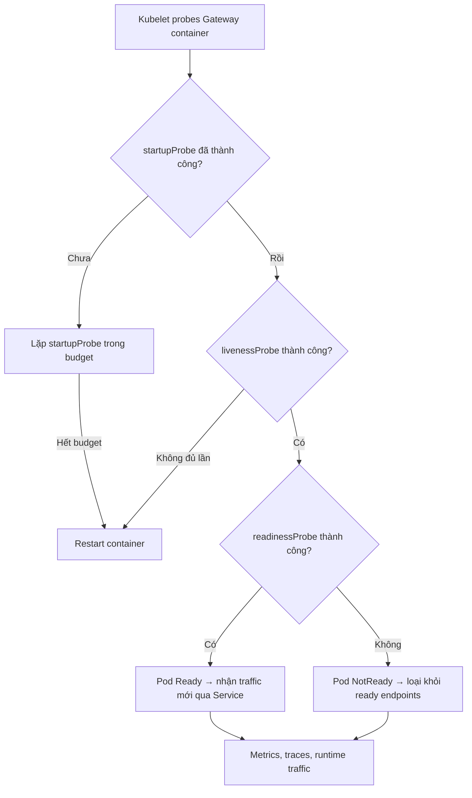
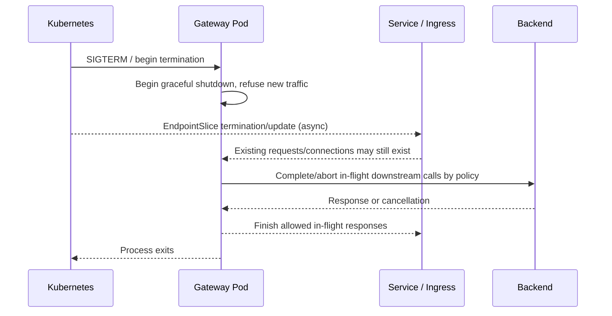
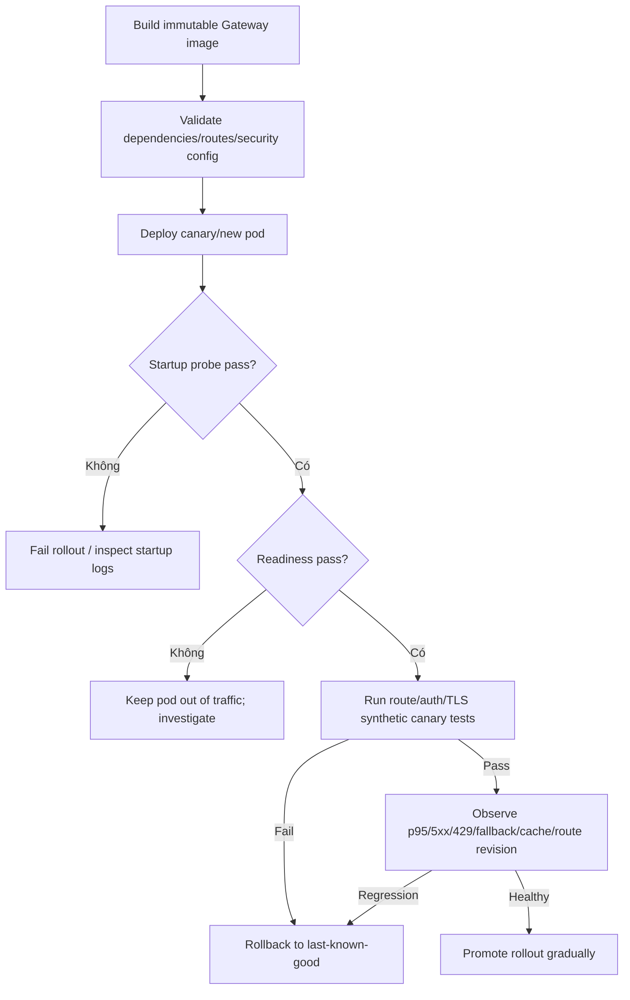

# Readiness, liveness và phụ thuộc cần kiểm tra

Khi **Spring Cloud Gateway** đứng ở cổng vào của hệ thống microservices, một Gateway process có thể **vẫn chạy** nhưng **chưa đủ điều kiện nhận lưu lượng**: route definitions chưa nạp xong, backend cần thiết không có instance, chứng chỉ TLS sai, Redis dùng cho giới hạn lưu lượng không sẵn sàng, hoặc một phiên bản cấu hình mới chưa được xác minh. Ngược lại, Gateway cũng có thể **đang hoạt động bình thường** dù một backend không khỏe; nếu liveness probe phụ thuộc backend đó, Kubernetes sẽ liên tục restart những Gateway pods khỏe và khiến sự cố lan rộng.

Bài thuộc chương **Triển khai** trong module **SPRING_CLOUD_GATEWAY**, với phạm vi xây dựng API Gateway bằng route predicate/filter chain, chuyển đổi path/header, khám phá dịch vụ, xác thực, rate limiting, circuit breaker, retry, TLS và observability. Mục tiêu là biết **khi nào pod được đưa vào Service endpoints**, **khi nào cần restart**, **những phụ thuộc nào nên kiểm tra**, và **cách nghiệm thu/quan sát các quyết định này khi triển khai thật**.

**Luận điểm cốt lõi:** *Process alive* không đồng nghĩa *application ready*; *readiness fail* không có nghĩa *restart sẽ sửa được lỗi*; và *mọi phụ thuộc đều quan trọng* không có nghĩa *mọi phụ thuộc đều phải đưa vào readiness hoặc liveness*.

> **Phạm vi phiên bản:** Ví dụ dùng **Spring Cloud Gateway Server WebFlux**, Spring Boot Actuator và Kubernetes. Với Gateway Server Web MVC, Proxy Exchange hoặc các dòng Spring Boot/Spring Cloud khác, cấu hình, probe path và Security filter chain có thể khác. Đối chiếu đúng **Spring Boot + Spring Cloud release train** trước khi sao chép YAML/Java. Những trạng thái/timings trong ví dụ là mô hình thiết kế, không phải số liệu đo trên một cluster cụ thể.

## 1. Ba câu hỏi vận hành khác nhau

| Tín hiệu | Câu hỏi | Kubernetes làm gì khi probe fail? | Có nên phụ thuộc dịch vụ ngoài? |
| --- | --- | --- | --- |
| **Liveness** | Tiến trình này có còn hoạt động để có thể tự phục vụ request về sau không? | Sau đủ lần fail, **kubelet restart container** theo policy. | **Thông thường không.** Phụ thuộc ngoài hỏng không nhất thiết làm process Gateway hỏng. |
| **Readiness** | Instance này có nên **nhận request mới** lúc này không? | Pod được đánh dấu NotReady; thường không nằm trong EndpointSlice endpoints **ready** được Service dùng để gửi traffic mới. | **Chỉ phụ thuộc thiết yếu** mà thiếu nó thì instance không thể phục vụ chức năng bắt buộc theo contract. |
| **Startup** | Tiến trình đã qua giai đoạn khởi động chưa? | Trong lúc startup probe chưa thành công, liveness/readiness probes chưa có hiệu lực; nếu vượt budget, container có thể bị restart. | Tập trung vòng đời khởi động; không dùng làm monitoring backend lâu dài. |

Một HTTP health endpoint trả **200** chỉ nói rằng *health indicator/group ở endpoint đó* đang cho kết quả cho phép. Nó **không phải bằng chứng** toàn bộ backend APIs, authorization, route matching và TLS đều hoạt động.

### Phân biệt các trạng thái thường gặp

```text
Pod process is running ───────────────┐
                                     ▼
                          Liveness = CORRECT?
                         /                  \
                       yes                  no
                       /                     \
          Readiness = ACCEPTING?          Liveness fail
               /           \                 → restart
             yes            no
             /               \
       Service can       Exclude from
       send new traffic  new Service traffic
```

Đây là **mô hình khái niệm**. Kubernetes còn có readiness gates, EndpointSlice `terminating`/`serving` conditions, network/ingress/service-mesh logic và kết nối đã mở; **NotReady không đồng nghĩa mọi TCP connection cũ lập tức bị đóng**.

## 2. Ví dụ Gateway khởi động nhưng chưa sẵn sàng

Giả sử Gateway có:

```text
GET /api/catalog/**  -> lb://catalog-service
GET /api/orders/**   -> lb://orders-service
POST /api/payments/** -> lb://payment-service
```

Trong 15 giây đầu của rollout:

- JVM và Reactor Netty đã bind cổng `8080`.
- Route definitions có thể đang được nạp hoặc refresh.
- Discovery client chưa nhận danh sách service instances mới.
- TLS trust store của downstream đã được mount nhưng chưa xác minh.
- Redis limiter có thể chưa kết nối được.

Hỏi:

1. **Liveness?** Nếu Gateway còn chạy và quản lý được lifecycle, thường nên **UP**.
2. **Readiness?** Nếu cấu hình tối thiểu/điều kiện bắt buộc để phục vụ chưa đạt, nên **REFUSING_TRAFFIC** hoặc readiness health **DOWN/OUT_OF_SERVICE** theo policy.
3. **Startup?** Nếu app chưa hoàn tất bootstrap, startup probe có thể fail trong startup budget được cấp.

Khi sau đó backend `payment-service` bị lỗi 503 nhưng Gateway vẫn xử lý `catalog` và `orders`, không có câu trả lời chung rằng cả pod phải NotReady. Phải dựa vào **API contract** và tác động của việc loại pod khỏi toàn bộ traffic.

## 3. Kubernetes dùng probes để quyết định gì?



### Kubernetes không tự hiểu “business readiness”

Kubelet chỉ biết **probe result**: HTTP response code, TCP connect hay process exit status. Nó không tự biết:

- Có bao nhiêu Gateway routes hợp lệ.
- Backend `lb://catalog-service` có instance có thể phục vụ không.
- Redis limiter đang fail-open hay fail-closed.
- Spring Security/JWT audience có hợp đồng đúng không.
- Chứng chỉ mTLS có thể kết nối được backend không.
- Route một người dùng thật đang trả 401/403/429/502 vì nguyên nhân gì.

Các kiểm tra đó phải được đặt vào đúng tầng: **health group**, **startup/rollout smoke test**, **synthetic request**, **metrics/alerts** hoặc **backend-level monitoring**, chứ không nhất thiết ép vào một endpoint liveness.

### Các lỗi cấu hình phổ biến

| Cấu hình sai | Hậu quả |
| --- | --- |
| Liveness kiểm tra Redis/Consul/Eureka | Mất Redis/registry → mọi Gateway containers có thể restart đồng loạt. |
| Readiness kiểm tra mọi backend kể cả optional | Một microservice lỗi → toàn bộ Gateway bị loại khỏi Service endpoints. |
| Không có startupProbe, liveness fail trong bootstrap | JVM khởi động chậm → restart loop trước khi hoàn tất. |
| Probe qua public ingress thay vì trực tiếp pod | Kết quả phụ thuộc DNS/LB/Ingress, không phản ánh đúng pod; vòng lặp routing. |
| Probe đến management port riêng | Actuator còn chạy nhưng main HTTP listener không nhận request, tạo false positive. |
| Probe timeout quá thấp | Một GC pause/CPU throttle ngắn khiến probe fail, gây restart churn. |
| Probe fail quá chậm | Gateway lỗi kéo dài nhưng vẫn nhận traffic hoặc không được restart kịp. |
| Public health endpoint lộ details | Rò IP/host nội bộ, Redis/registry identifiers, stack traces. |

## 4. Spring Boot Actuator: health và availability states

Spring Boot cung cấp **Actuator health endpoint** và **ApplicationAvailability** với hai kiểu trạng thái:

- **`LivenessState`**: `CORRECT` hoặc `BROKEN`.
- **`ReadinessState`**: `ACCEPTING_TRAFFIC` hoặc `REFUSING_TRAFFIC`.

Spring Boot kết hợp các availability states này thành **`livenessState`/`readinessState` health indicators** và có thể công bố qua health groups:

```text
GET /actuator/health/liveness
GET /actuator/health/readiness
```

Theo chính sách health groups thông thường:

- Khi liveness state là `CORRECT`, liveness group có health `UP`.
- Khi liveness state là `BROKEN`, liveness group phản ánh health không khỏe.
- Khi readiness state là `ACCEPTING_TRAFFIC`, readiness group có health `UP`.
- Khi readiness state là `REFUSING_TRAFFIC`, readiness group thường có `OUT_OF_SERVICE`.

**Phải phân biệt** availability state với Kubernetes Pod condition: Spring Boot `ReadinessState` là trạng thái **trong ứng dụng**, Kubernetes xác lập Pod `Ready` từ probe kết quả và readiness gates. Một bên không tự làm bên kia thay đổi nếu chưa được nối đúng endpoint/cấu hình.

### Default readiness không tự ping mọi dependencies

Spring Boot có **liveness/readiness probe health groups** khi chạy trong môi trường thích hợp như Kubernetes; có thể bật rõ bằng property. **Readiness group mặc định không tự bao gồm tất cả health indicators** như Redis, DB, Eureka hoặc custom external service. Đây là thiết kế có chủ đích để tránh mọi phụ thuộc bên ngoài biến thành điều kiện phục vụ toàn ứng dụng.

Nếu một dependency thật sự là *hard requirement* của toàn pod, có thể **chủ động thêm health indicator của dependency vào readiness group**. Không phải thêm một dependency vào `HealthIndicator` là nó tự nằm trong readiness group theo mọi cấu hình.

## 5. Cấu hình Spring Boot Actuator probes

### Dependencies

Trong Gateway Server WebFlux dùng Spring Boot/Cloud BOM tương thích:

```xml
<dependencies>
    <dependency>
        <groupId>org.springframework.cloud</groupId>
        <artifactId>spring-cloud-starter-gateway-server-webflux</artifactId>
    </dependency>
    <dependency>
        <groupId>org.springframework.boot</groupId>
        <artifactId>spring-boot-starter-actuator</artifactId>
    </dependency>
</dependencies>
```

Đây là **dependency excerpt**, không phải POM độc lập. Các dòng cũ có thể dùng `spring-cloud-starter-gateway`. WebMVC và Proxy Exchange có starter khác, và không nên kết hợp cả MVC/WebFlux server stacks thiếu chủ đích.

### application.yml mẫu

```yaml
server:
  port: 8080

management:
  endpoint:
    health:
      probes:
        enabled: true
        add-additional-paths: true
      show-details: never
  endpoints:
    web:
      exposure:
        include: health,info
```

Với các Spring Boot versions hỗ trợ `management.endpoint.health.probes.add-additional-paths`, hai URL bổ sung mặc định thường là:

```http
GET /livez
GET /readyz
```

được phục vụ trên **main server port**, bên cạnh các health group paths ở Actuator. **Hãy kiểm tra đúng Spring Boot version/config binding**. Khi `add-additional-paths` không có trong dòng đang dùng, dùng cấu hình group additional path hỗ trợ phiên bản đó hoặc thiết kế probe port/path khác đã nghiệm thu.

### Vì sao cần probes trên main port?

Nếu cấu hình:

```yaml
management:
  server:
    port: 9090
```

thì request `GET :9090/actuator/health/readiness` chỉ chứng minh **management server** trả lời. Main listener `:8080` có thể không thể nhận HTTP traffic do connection pool/event-loop/resource issues khác, nhưng management listener vẫn phản hồi. Đặt `/readyz` trên main port giúp probe đi qua **main web server infrastructure**, dù vẫn không thay được synthetic business request.

**Không mặc định main port và management port dùng chung WebFilter/Security/routing chain**. Kiểm tra Spring Security configuration cho từng context và giới hạn network access của health endpoints.

## 6. HTTP status của health groups và tác động Kubernetes

Spring Boot Actuator phân loại health statuses như `UP`, `DOWN`, `OUT_OF_SERVICE` và `UNKNOWN`, rồi áp một **HTTP status mapping**. Mặc định, `DOWN`/`OUT_OF_SERVICE` thường dẫn đến HTTP **503**, còn `UP` dẫn đến HTTP **200**.

```http
GET /readyz

HTTP/1.1 200 OK
Content-Type: application/vnd.spring-boot.actuator.v3+json

{"status":"UP"}
```

Khi readiness chưa đạt:

```http
GET /readyz

HTTP/1.1 503 Service Unavailable
Content-Type: application/vnd.spring-boot.actuator.v3+json

{"status":"OUT_OF_SERVICE"}
```

Các response là **minh họa**; media type có thể thay đổi theo content negotiation/Actuator version. Health endpoint cần trả **non-2xx/3xx** khi fail để Kubernetes `httpGet` đánh giá đúng; nếu custom `HttpCodeStatusMapper`/security redirect biến DOWN thành HTTP 200 hoặc 302, probe có thể báo success sai. **Kubernetes HTTP probe coi HTTP status từ 200 đến 399 là thành công**, nên 301/302 login redirect không phải cơ chế auth thích hợp cho kubelet.

### Không để health endpoint bị chuyển sang Gateway route

`/livez` và `/readyz` cần được trả bởi local application/Actuator health group, không forward sang backend hay thêm vào route predicate catch-all (`Path=/**`) một cách vô ý. Đặt internal endpoints ở main server và test chúng **ngay trên pod port**; kiểm chứng Security/WebFilter order và Gateway route matching ở release thực tế.

## 7. Kubernetes Deployment: mẫu startup, liveness và readiness

Ví dụ dưới đây dùng **3 Gateway replicas** và Spring Boot Actuator additional paths trên **main HTTP port 8080**. TLS termination cho public traffic được thực hiện tại một ingress/load balancer tin cậy trong lab; nếu hệ thống dùng TLS đến tận pod, probe `scheme`/port phải được điều chỉnh và kiểm thử riêng.

```yaml
apiVersion: apps/v1
kind: Deployment
metadata:
  name: api-gateway
  labels:
    app: api-gateway
spec:
  replicas: 3
  minReadySeconds: 10
  progressDeadlineSeconds: 600
  strategy:
    type: RollingUpdate
    rollingUpdate:
      maxSurge: 1
      maxUnavailable: 0
  selector:
    matchLabels:
      app: api-gateway
  template:
    metadata:
      labels:
        app: api-gateway
    spec:
      terminationGracePeriodSeconds: 45
      containers:
        - name: gateway
          image: registry.example.invalid/platform/api-gateway:REPLACE_WITH_IMMUTABLE_TAG
          imagePullPolicy: IfNotPresent
          ports:
            - name: http
              containerPort: 8080
          resources:
            requests:
              cpu: 250m
              memory: 512Mi
            limits:
              memory: 1Gi
          startupProbe:
            httpGet:
              path: /livez
              port: http
              scheme: HTTP
            periodSeconds: 2
            timeoutSeconds: 2
            failureThreshold: 60
          livenessProbe:
            httpGet:
              path: /livez
              port: http
              scheme: HTTP
            periodSeconds: 10
            timeoutSeconds: 2
            failureThreshold: 3
          readinessProbe:
            httpGet:
              path: /readyz
              port: http
              scheme: HTTP
            periodSeconds: 5
            timeoutSeconds: 2
            failureThreshold: 2
            successThreshold: 1
```

Đây là **mẫu cần điều chỉnh**, không phải manifest production copy-paste:

- `registry.example.invalid` là placeholder, phải dùng image registry và immutable tag/digest đã được phê duyệt. Không tự tải image lạ.
- `requests` và `limits` chỉ là giá trị minh họa; đo CPU, heap/direct memory, Netty buffers, throughput và JVM headroom.
- Port `8080` là HTTP nội bộ; production bắt buộc có TLS/trust boundary thích hợp ở chặng public hoặc tới pod.
- Không hardcode JWT secrets, keystore passwords, Redis credentials hay mTLS private keys trong manifest.
- Chưa có Service, ConfigMap/Secrets, ServiceAccount/RBAC, NetworkPolicy, anti-affinity/topology spread, PDB hoặc HPA. Những phần đó tùy cluster và SLO.
- Các giá trị `periodSeconds`/`failureThreshold` phải được tính từ thời gian bootstrap và fault detection thực đo.

### Vì sao đặt `startupProbe` trước?

Spring Boot có thể cần thời gian:

- Khởi tạo JVM/JIT và Reactor Netty.
- Nạp configuration/route definitions, validate beans và Spring Security chain.
- Đọc trust store, khởi tạo HTTP client/connection pools.
- Đăng ký service discovery hoặc chờ config được cung cấp trước bootstrap.
- Warm-up theo chính sách ứng dụng (nếu bắt buộc).

Kubelet **không chạy liveness/readiness probes** cho đến khi startup probe thành công. Với ví dụ `failureThreshold=60` và `periodSeconds=2`, thời gian ngân sách kiểm tra xấp xỉ **120 giây**; cách tính thực tế có phụ thuộc timeout/scheduling. Nếu startup liên tục không thành công, container bị restart. **Startup probe không xác nhận backend hoạt động tốt mãi mãi** và không thay readiness.

### Vì sao liveness chậm hơn readiness?

Readiness fail có thể nhanh chóng rút pod ra khỏi traffic mới, không cần kill. Liveness fail thường dẫn tới restart, một hành động mạnh có thể làm mất in-flight requests hoặc tăng áp lực cold-start. Vì vậy, liveness nên có **độ chịu lỗi tạm thời hợp lý**, còn readiness có thể phát hiện instance không nên nhận request mới nhanh hơn.

## 8. Kubernetes Service, EndpointSlice và triển khai không mất toàn bộ capacity

### Service để chuyển traffic tới Gateway ready pods

```yaml
apiVersion: v1
kind: Service
metadata:
  name: api-gateway
spec:
  selector:
    app: api-gateway
  ports:
    - name: http
      port: 80
      targetPort: http
      protocol: TCP
  type: ClusterIP
```

Với topology này, Service thường định tuyến đến pod endpoints có trạng thái **ready** tương ứng; controller EndpointSlice cập nhật thông tin pod và kube-proxy/mesh/ingress tiêu thụ dữ liệu đó theo cơ chế riêng. Pod **NotReady** thường không được chọn cho **kết nối mới** qua Service.

Tuy nhiên:

- EndpointSlice cập nhật **không đồng bộ tức thì** với thay đổi trạng thái ứng dụng.
- Kết nối giữ lâu, HTTP/2 multiplexing, WebSocket/SSE và connection pooling có thể còn sống sau khi pod bị đánh dấu NotReady.
- Một client có thể gọi trực tiếp Pod IP hoặc bypass Service.
- Các ingress/service meshes có thể có thời gian drain và policy khác.

Vì thế, **readiness không thay graceful shutdown và connection draining**.

### RollingUpdate và availability budget

Trong ví dụ `replicas: 3`, `maxUnavailable: 0` và `maxSurge: 1` cho phép Kubernetes tạo pod mới trước khi giảm số lượng pods available theo Deployment controller semantics. `minReadySeconds: 10` yêu cầu pod Ready ổn định một khoảng thời gian trước khi được tính available.

**Không có bảo đảm zero-downtime tuyệt đối** chỉ từ ba trường này: nếu tất cả pods cùng phụ thuộc Redis và readiness cùng DOWN, Service có thể không còn endpoints sẵn sàng. Nếu application fail đúng lúc có connection draining, request dài hạn vẫn có thể thất bại.

### PodDisruptionBudget tham khảo

```yaml
apiVersion: policy/v1
kind: PodDisruptionBudget
metadata:
  name: api-gateway-pdb
spec:
  minAvailable: 2
  selector:
    matchLabels:
      app: api-gateway
```

PDB nhằm hạn chế **voluntary disruptions** trong những trường hợp được Kubernetes hỗ trợ. Nó **không ngăn node crash, process crash hay liveness-triggered restart**, và không tự tạo thêm capacity khi các pods cùng NotReady.

### Chọn số replicas theo workload

Nếu một Gateway pod có thể đáp ứng ~`N` RPS trong SLO, thì ba pods không nhất thiết có tổng capacity chính xác `3N`: còn network/LB, hotspot, Redis, backend contention, TLS/CPU throttling và phân phối traffic. Cần capacity test khi mất một pod, không chỉ khi ba pods khỏe.

## 9. Phụ thuộc nào nên kiểm tra bằng liveness?

**Quy tắc mặc định: liveness chỉ phản ánh trạng thái có thể khắc phục bằng restart của chính Gateway instance.** Một dependency bên ngoài lỗi thường **không** phải lý do restart Gateway.

| Thành phần | Có cho vào liveness không? | Giải thích |
| --- | --- | --- |
| JVM/application lifecycle nội bộ | **Có**, qua `livenessState`. | Khi tiến trình không thể duy trì hoạt động, restart có thể hữu ích. |
| Reactor Netty main listener không phản hồi | Probe trên main port giúp phát hiện một số lỗi. | Nhưng một 200 không chứng minh mọi route đều khỏe. |
| RedisRateLimiter/Redis server | **Không**, mặc định. | Redis outage không được khiến tất cả Gateway pods restart. |
| Eureka/Consul registry | **Không**. | Registry outage là lỗi hạ tầng chung, restart có thể xóa cache đang hữu ích. |
| Một backend catalog/order/payment | **Không**. | Backend lỗi không chứng minh Gateway process hỏng. |
| DNS bên ngoài | **Không**. | DNS outage toàn cluster không giải quyết bằng restart Gateway đồng loạt. |
| OAuth2/JWKS/Identity Provider | **Không**. | Auth provider chậm không tự chứng minh process Gateway cần restart. |
| External Config Server | **Không**. | Nếu config đã load hợp lệ, outage về sau không nhất thiết làm JVM hỏng. |
| LocalResponseCache cold/miss | **Không**. | Cold cache bình thường sau rollout. |
| Prometheus/log/tracing collector | **Không**. | Observability outage không được gây vòng lặp restart traffic path. |

### Một anti-pattern nguy hiểm

```java
// Pseudocode anti-pattern: đừng đưa vào liveness.
Health liveness() {
    return pingRedis()
        && pingConsul()
        && pingEveryBackend()
        ? Health.up().build()
        : Health.down().build();
}
```

Nếu một dịch vụ chung bị mất 10 giây, hàng trăm Gateway pods có thể đồng loạt fail liveness và restart, khiến cold-start/caches/connection pools tăng tải phục hồi.

### Liveness không phải watchdog thần kỳ

Một liveness HTTP probe chỉ xác nhận application trả lời một endpoint tại thời điểm đo. Nó không phát hiện mọi deadlock nếu health endpoint dùng luồng/stack khác với request path đang lỗi, không phát hiện route predicate sai và không xác minh certificate upstream. Đối với sự cố phức tạp cần **synthetic requests, metrics, tracing, JFR/profiling, Netty pool metrics và alerts**.

## 10. Phụ thuộc nào nên kiểm tra bằng readiness?

**Readiness** có thể bao gồm dependency nếu sự vắng mặt của nó khiến **instance này không thể phục vụ phần hợp đồng bắt buộc**. Nhưng Gateway thường có **nhiều routes** và dependencies khác nhau, nên quyết định global NotReady cần cẩn thận.

### Ma trận quyết định

| Dependency/điều kiện | Liveness | Readiness | Kiểm tra ngoài probe |
| --- | --- | --- | --- |
| Spring Boot `readinessState` | Không | **Có**. | Rollout, availability events. |
| Route definitions bắt buộc chưa được nạp/verify | Không | Có thể **Có**, nếu instance chưa có minimum valid route set. | Route snapshot/revision, targeted smoke tests. |
| Route dynamic store tạm mất nhưng last-known-good còn dùng được | Không | Thường **không fail ngay** nếu routing còn đúng. | Config freshness, audit, drift. |
| Redis chung cho mọi route và policy fail-closed | Không | **Cân nhắc kỹ**, tùy toàn bộ hợp đồng. | Redis errors, limiter outcomes, backend protection. |
| Redis chỉ cần cho một nhóm routes | Không | Thường **không** cho toàn Gateway. | Alerts/route-level 429/503. |
| Eureka/Consul không liên lạc được | Không | Thường **không** chỉ vì registry outage. | Cache age, instance health, routing success. |
| Không tìm được instance cho một optional backend | Không | Thường **không**. | Route-level 503/synthetic. |
| Không tìm được instance cho backend duy nhất của Gateway | Không | **Có thể Có**, tùy policy và ảnh hưởng rút pod. | LB/discovery metrics, probe fail reason. |
| TLS inbound key material thiếu hoặc listener chưa bind | Không cần ping external | Có thể làm app chưa sẵn sàng/ngay cả startup fail. | TLS handshake synthetic, cert monitoring. |
| Downstream mTLS cert hết hạn cho một route | Không | Cân nhắc theo route importance, không mass NotReady theo mặc định. | TLS synthetic and cert expiry alert. |
| JWKS endpoint tạm không phản hồi, cached keys còn hợp lệ | Không | Thường **không** vì một lỗi ping. | Auth 401/5xx and cache refresh outcomes. |
| JWT config/audience sai cho toàn API | Không | Có thể ngừng rollout nếu **đã xác minh**; health alone khó phát hiện. | Auth contract integration/synthetic tests. |
| Metrics/tracing collector không sẵn sàng | Không | Thường **không**. | Telemetry alerts; compliance policy riêng nếu bắt buộc. |
| LocalResponseCache chưa warm | Không | Thường **không**. | Hit/miss/backend load during warm-up. |
| Database backend tạm ngưng | Không | Không mặc định cho Gateway đang còn routes khác. | Backend-specific health/circuit breaker. |

### Câu hỏi quyết định trước khi thêm dependency vào readiness

1. Dependency hỏng có ảnh hưởng **tất cả routes** hay chỉ một phần?
2. Gateway có **last-known-good route config** hoặc cache cho phép tiếp tục phục vụ an toàn không?
3. Dependency là **shared regional/global**; nếu tất cả Gateway pods đồng thời NotReady, có làm tình hình xấu hơn không?
4. Một Gateway instance khác có khả năng phục vụ request khi instance này fail không?
5. Có chính sách **fail closed** bắt buộc khi thiếu dependency, hay có degradation path đã được phê duyệt?
6. Probe có cần thực hiện network call mỗi 5 giây/pod không? Điều đó có thể tạo tải và phụ thuộc vòng lặp.
7. Tình huống này có phù hợp **rollout gate/synthetic test/alert** hơn readiness không?

**Không có quy tắc “càng nhiều health checks trong readiness càng an toàn”.** Mục tiêu là điều khiển traffic **đúng** dựa trên khả năng phục vụ thực, không biến một dependency outage thành full-cluster outage.

## 11. Readiness của route definitions và bản cấu hình bắt buộc

Spring Cloud Gateway chọn tuyến theo `RoutePredicateHandlerMapping`, lấy runtime routes từ `RouteLocator` và các `RouteDefinitionLocator`/`RouteDefinitionRepository` tùy nguồn cấu hình. Trong môi trường triển khai, route definitions có thể đến từ:

- `application.yml`/cấu hình được đóng gói.
- Config Server hoặc cơ chế config injection trước lúc app start.
- Service discovery dynamic routes.
- Database/Redis/custom `RouteDefinitionRepository`.
- API quản trị/dynamic route publishing có kiểm soát.

### Một Gateway “đã start” có thể chưa nạp route

Nếu ứng dụng khởi động với route store trống hoặc chưa có bản route **đã được approve**, health của Reactor Netty và `readinessState` có thể đều UP. Nhưng việc đưa instance vào Service endpoints có thể làm một phần requests trả **404** dù backend khỏe.

Giải pháp không phải là ping mọi downstream trong liveness. Thay vào đó, định nghĩa một **minimum viable route snapshot**:

```text
Required at startup for this Gateway deployment:
  route IDs:
    catalog-public
    orders-public
    auth-public

  approved route revision:
    >= required release revision

  required security policy:
    validated and enabled

  target URI:
    allowed schemes and service IDs
```

Các giá trị là **ví dụ chính sách**, không phải Gateway tự kiểm tra. Khi startup chưa đáp ứng, readiness có thể fail cho đến khi load/verify snapshot. Nếu route store tạm unavailable **sau** khi đã có last-known-good snapshot, Gateway vẫn có thể phục vụ requests an toàn; không cần fail readiness ngay lập tức nếu chính sách cho phép stale config trong giới hạn được kiểm soát.

### Đếm route không đủ

```text
routes.size() == 3
```

không chứng minh route đúng; ba routes có thể trùng `Path=/**`, sai `order`, trỏ đến host ngoài allowlist hoặc thiếu filter authentication. Với startup gate, nên có:

1. **Syntactic/binding validation**: route definitions bind thành runtime routes với factories/args thực.
2. **Policy validation**: scheme/host/service ID allowlist, predicates scope, auth/rate-limit filters.
3. **Revision validation**: route snapshot được approve và đúng version yêu cầu.
4. **Targeted smoke tests**: chạy ngoài health probe để xác minh request mẫu đi đúng backend/status.
5. **Rollback**: giữ last-known-good để tránh một revision mới lỗi làm mọi pods NotReady đồng loạt.

### Không chặn readiness bởi mọi lỗi route phụ

Ví dụ route `GET /api/experimental/reports/**` của tính năng beta bị disable. Nếu tất cả route production quan trọng vẫn đúng và beta không nằm trong SLA, readiness toàn pod không nhất thiết fail. Dùng **route-level monitoring và release gate** cho beta để hạn chế blast radius.

## 12. Một ReactiveHealthIndicator cho điều kiện nội bộ

Trong Spring Cloud Gateway **Server WebFlux**, nếu Gateway cần xác nhận **route snapshot nội bộ đã được kiểm chứng**, ta có thể viết một `ReactiveHealthIndicator`. Ví dụ dùng trạng thái local (không thực hiện HTTP request đến registry/backend trên mỗi probe):

```java
package com.example.gateway.health;

import java.util.concurrent.atomic.AtomicBoolean;

import org.springframework.boot.actuate.health.Health;
import org.springframework.boot.actuate.health.ReactiveHealthIndicator;
import org.springframework.stereotype.Component;
import reactor.core.publisher.Mono;

@Component("routeBootstrap")
public class RouteBootstrapHealthIndicator
        implements ReactiveHealthIndicator {

    private final AtomicBoolean verified = new AtomicBoolean(false);

    @Override
    public Mono<Health> health() {
        return Mono.fromSupplier(() -> verified.get()
            ? Health.up().build()
            : Health.outOfService().build());
    }

    public void markVerified() {
        verified.set(true);
    }

    public void markInvalid() {
        verified.set(false);
    }
}
```

Đây là **một thành phần trạng thái**, không tự làm route validation. Một thành phần khác của ứng dụng phải gọi `markVerified()` **chỉ sau khi** route snapshot và security policy được kiểm tra thành công; gọi `markInvalid()` nếu cấu hình bắt buộc đã trở nên không an toàn hoặc mất hiệu lực theo policy. **Không gọi `markVerified()` ngay ở constructor hoặc chỉ vì event `ApplicationReadyEvent` mà chưa thực sự kiểm chứng routing**.

### Gắn indicator vào readiness group

```yaml
management:
  endpoint:
    health:
      probes:
        enabled: true
        add-additional-paths: true
      group:
        readiness:
          include: readinessState,routeBootstrap
      show-details: never
```

Trong hệ thống có group config tương ứng, `/readyz` chỉ trả UP khi:

- Spring Boot `readinessState` cho phép nhận traffic, **và**
- `routeBootstrap` indicator ở trạng thái UP.

Điều này **không tự động kích hoạt** khi class indicator được tạo; phải triển khai component quản lý lifecycle route snapshot và test auto-configuration/bean name. Nếu cấu hình readiness group include một indicator **không tồn tại**, Spring Boot có thể fail startup vì health contributor không hợp lệ (tùy version/config validation), nên cần đảm bảo bean được scan và đúng tên.

### Ưu điểm và giới hạn

| Ưu điểm | Giới hạn |
| --- | --- |
| Probe nhanh, non-blocking, không gọi mạng ở mỗi lần. | Chỉ tin vào **quy trình cập nhật cờ** đã được thiết kế đúng. |
| Tránh Redis/registry timeout biến health endpoint thành dependency nặng. | Cờ có thể stale nếu dynamic route refresh không cập nhật trạng thái. |
| Giúp startup gate chỉ mở sau khi snapshot được approve. | Không chứng minh backend đang sống, auth contract đúng theo mỗi request. |
| Có thể kết hợp `readinessState`. | Không đủ để phát hiện lỗi chỉ xảy ra sau khi app đã nhận traffic. |

### Không đưa thông tin nhạy cảm vào health details

Không trả route URIs có tokens, credentials, private hostnames hoặc full error stacks trong health body. Với probe, phần lớn trường hợp chỉ cần health status. Thông tin như route revision, số routes, thời điểm refresh và nguyên nhân invalid phải có metrics/logs **được bảo vệ và redacted**, không expose qua public health endpoint.

## 13. Readiness và ApplicationAvailability events

Ngoài custom indicator, Spring Boot cho phép thay đổi readiness state bằng `AvailabilityChangeEvent`. Ví dụ minh họa **lệnh nội bộ của lifecycle component**, không phải HTTP endpoint cho người dùng:

```java
import org.springframework.boot.availability.AvailabilityChangeEvent;
import org.springframework.boot.availability.ReadinessState;
import org.springframework.context.ApplicationContext;

public final class GatewayReadinessSwitch {

    private final ApplicationContext context;

    public GatewayReadinessSwitch(ApplicationContext context) {
        this.context = context;
    }

    public void pauseNewTraffic() {
        AvailabilityChangeEvent.publish(
            context, ReadinessState.REFUSING_TRAFFIC);
    }

    public void allowNewTrafficAfterValidation() {
        AvailabilityChangeEvent.publish(
            context, ReadinessState.ACCEPTING_TRAFFIC);
    }
}
```

Đoạn này là **class minh họa**, không tự đăng ký thành bean, không có endpoint để gọi từ Internet. Trên một ứng dụng thật, inject vào lifecycle/route controller được xác thực và có audit. Không publish `ACCEPTING_TRAFFIC` khi những điều kiện bắt buộc (ví dụ route snapshot) vẫn chưa đạt.

### Tránh race condition khi có nhiều nguồn điều khiển readiness

Nếu có hai thành phần:

1. Route snapshot controller cho phép traffic.
2. Security policy validator vừa phát hiện cấu hình không hợp lệ.

Một event `ACCEPTING_TRAFFIC` muộn từ thành phần thứ nhất có thể **ghi đè** trạng thái REFUSING từ thành phần thứ hai nếu không có điều phối rõ. Nên có **một readiness coordinator** tính trạng thái tổng từ nhiều điều kiện đã định nghĩa, rồi phát availability state; hoặc dùng nhiều indicators trong health group với semantics AND của aggregate health.

**Không biến readiness thành một công tắc tùy tiện** mà các threads/callbacks thay đổi ngẫu nhiên; cần state machine, ownership, logs/audit và runbook.

### Startup timing

Trong Spring Boot, quá trình boot chuyển qua các lifecycle phases rồi readiness thường được bật sau khi application hoàn tất startup. Nếu bạn chủ động dùng readiness coordinator thì phải xác nhận thứ tự của `ApplicationReadyEvent`, availability events và custom validation để tránh pod nhận traffic sớm trước khi route snapshot đã được kiểm tra.

## 14. RedisRateLimiter: giữ Gateway UP hay rút khỏi Service?

Giả sử API Gateway dùng `RequestRateLimiter` với `RedisRateLimiter`. Redis lỗi có thể ảnh hưởng policy quota; nhưng việc phản ứng cần dựa trên mô hình bảo mật/availability:

| Trường hợp | Liveness | Readiness | Hành động khác |
| --- | --- | --- | --- |
| Redis chậm ngắn hạn, quota vẫn xử lý theo policy | UP. | Thường vẫn UP. | Alert Redis latency, theo dõi p95/p99. |
| Redis unavailable, limiter **fail-closed** cho một route public | UP. | Không mặc định rút toàn Gateway. | Endpoint lỗi/deny có kiểm soát; route-specific alert, upstream impact. |
| Redis unavailable, limiter fail-open có chủ đích | UP. | Có thể UP nếu bảo vệ dự phòng đủ. | Theo dõi burst/backend load, cảnh báo policy degraded. |
| Redis là điều kiện không thể thiếu cho **toàn bộ** routes và không có safe fallback | UP. | **Có thể** NotReady theo policy đã đánh giá blast radius. | Release/synthetic gate, fail-safe, phụ thuộc cluster-level. |

### Không kiểm tra Redis ở mọi liveness request

Với 100 Gateway pods, mỗi pod liveness 10 giây một lần sẽ tạo khoảng **10 health checks Redis/giây** chỉ từ liveness, chưa tính readiness, client/limiter Redis commands và other services. Nếu Redis đang quá tải, những health checks có thể làm tình trạng xấu hơn; liveness fail còn khiến pods restart theo cụm.

Nếu cần đo Redis, sử dụng:

- Reactive Redis health/metrics đúng version và timeout.
- Error rate/latency của quyết định limiter thực.
- Kết quả route-level 429/5xx, không gán mọi 429 cho lỗi Redis.
- Synthetic quota tests có kiểm soát ngoài main probes.
- Health group riêng phục vụ vận hành nếu phù hợp; không nhất thiết gắn group đó vào liveness/readiness.

### Đừng suy fail-open/fail-closed bằng lý thuyết

Behavior Redis outage phụ thuộc Gateway/RedisRateLimiter version, `KeyResolver`, exception handling và custom filters. **Thử thực tế** trên artifact đã chọn: tắt kết nối Redis trong lab, gửi request hợp lệ, ghi HTTP status, backend calls, CPU, retry/connection pool và thời gian hồi phục.

## 15. Eureka/Consul, DiscoveryClient và LoadBalancer

`lb://catalog-service` thường chọn downstream `ServiceInstance` thông qua Spring Cloud LoadBalancer, có thể dùng Eureka, Consul, Kubernetes Service Discovery hoặc nguồn phù hợp. Có **hai câu hỏi khác nhau**:

1. Registry còn online/đang trả lời HTTP requests?
2. Gateway còn đủ **service instances hợp lệ** để định tuyến requests của route?

Một registry outage có thể xảy ra khi Gateway vẫn giữ cache instances còn dùng được; ngược lại registry khỏe nhưng catalog-service có **0 ready instances** cho một route.

### Ma trận ứng xử

| Tình huống | Liveness Gateway | Readiness Gateway | Nên theo dõi |
| --- | --- | --- | --- |
| Eureka/Consul tạm unreachable, cache instance còn hợp lệ | UP. | Thường UP. | Registry reconnect, instance freshness, route success. |
| Không có `ServiceInstance` cho optional route | UP. | Thường UP. | Route 503, discovery resolution errors. |
| Không có instance cho service cốt lõi duy nhất | UP. | Cân nhắc policy; NotReady tất cả pods có thể không cải thiện. | Synthetic critical route, upstream health. |
| Discovery returning stale instance/connection refused | UP. | Không quyết định chỉ từ registry ping. | Backend connect errors, LB retries, TTL. |
| Service IDs sai hoặc trỏ sai trust boundary | UP. | Chặn rollout, cân nhắc NotReady nếu config bắt buộc sai. | Config audit, URI allowlist, security incident. |

### Không truy vấn registry bằng HTTP mỗi lần kubelet probe

Readiness poll thường xuyên không phải là chỗ để gửi network calls tới mọi Eureka/Consul registry, chọn từng instance rồi ping hàng chục backend. Điều đó:

- Tăng dependency graph của health path.
- Làm health check chậm hơn và dễ timeout.
- Tạo nhiều traffic không liên quan đến traffic thực.
- Có thể kích hoạt thundering herd khi registry chập chờn.

Thay vào đó, đo **discovery client state/cached revision** với bounded freshness, có synthetic checks per route ngoài probe, và chỉ đưa kiểm tra bắt buộc vào readiness khi đã phân tích blast radius.

## 16. TLS, JWKS, Config Server và phụ thuộc khởi động

### Inbound TLS certificate/key store

Nếu Gateway dùng TLS trực tiếp:

- Keystore/private key phải tồn tại, đọc được, có format/password hợp lệ.
- Server listener phải bind được HTTPS port.
- Certificate SAN/hostname và expiry phải phù hợp client.
- mTLS policy/trust roots phải có thể xác minh client identities nếu yêu cầu.

Một keystore **không hợp lệ khi startup** thường gây startup failure; Kubernetes startupProbe có thể fail vì app không bind port. Nhưng một liveness HTTP 200 **không đủ chứng minh** client TLS handshake với hostname production thành công—đặc biệt khi TLS terminate ở ingress.

**Cần synthetic TLS handshake/certificate-expiry monitoring ngoài probe**, có nguồn tin cậy và không log private key.

### Downstream TLS/mTLS

Nếu Gateway gọi `https://payment-service` và client trust store sai, Gateway có thể vẫn sống và các routes khác vẫn khỏe. Cần test downstream TLS hostname/SNI/CA/client certificate theo **route-criticality**, không ping mọi backend bằng liveness.

### OAuth2/JWT và JWKS

Gateway có thể xác minh JWT bằng public keys được tải/cached từ JWKS. Khi identity provider tạm unavailable:

- Cached keys có thể vẫn cho phép xác minh tokens phù hợp.
- Chưa có key/refresh key fail có thể khiến requests bị 401/5xx tùy implementation.
- `TokenRelay` có thể phụ thuộc authorized client/token refresh khác với JWT validation.

**Không dùng “IdP ping thành công” như định nghĩa liveness.** Dùng JWT contract/synthetic auth checks ngoài probe và theo dõi auth failures, JWKS refresh errors, token expiry/trust correctness. Nếu toàn bộ authentication contract không thể thỏa mãn an toàn, rollout gate/readiness policy có thể phản ánh điều đó nhưng phải có thiết kế và blast-radius review.

### Config Server và external secrets

External configuration/Secrets có thể là **startup prerequisite**. Khi một cấu hình bắt buộc chưa có hoặc signature/revision chưa đạt, nên fail startup hoặc giữ readiness REFUSING cho đến khi config được kiểm tra. Nhưng **Config Server bị mất kết nối sau startup** không nhất thiết buộc Gateway tự ngừng nhận traffic nếu đã có một last-known-good config được phê duyệt.

Quản lý route/security config theo revision, audit và rollback; đừng tự dùng “config server ping” làm liveness indicator. Nếu secrets/cert rotation không thành công, alert và chặn rollout thay vì âm thầm downgrade TLS hoặc tắt signature verification.

## 17. Security cho `/livez`, `/readyz` và Actuator

Probe của kubelet cần truy cập đúng health endpoint nhưng **không có nghĩa toàn bộ `/actuator/**` được phép public**. Endpoint health có thể được gọi thường xuyên bởi hệ thống tự động; một chính sách xác thực quá phức tạp có thể làm probe phụ thuộc vào IdP/Redis. Ngược lại, mở mọi endpoint quản trị là nguy hiểm.

### Nguyên tắc phân vùng

| Endpoint | Caller dự kiến | Chính sách |
| --- | --- | --- |
| `/livez` | Kubelet hoặc node/cluster health subsystem. | Trả status tối thiểu; có thể permit unauthenticated **trong mạng nội bộ tin cậy**, nhưng không expose public. |
| `/readyz` | Kubelet hoặc trusted traffic management. | Tương tự; chỉ trả kết quả, không lộ danh sách host/tokens. |
| `/actuator/health` | Internal observability/operator. | Bảo vệ details/components theo policy. |
| `/actuator/metrics`, `/actuator/prometheus` | Metrics scraper nội bộ. | Network isolation + authentication phù hợp. |
| `/actuator/gateway` và endpoints thay đổi route | Operator/automation có phân quyền cao. | Không expose công khai, audit và hạn chế khả năng ghi. |

### Ví dụ SecurityWebFilterChain cho WebFlux

```java
package com.example.gateway.security;

import org.springframework.context.annotation.Bean;
import org.springframework.context.annotation.Configuration;
import org.springframework.http.HttpMethod;
import org.springframework.security.config.annotation.web.reactive.EnableWebFluxSecurity;
import org.springframework.security.config.web.server.ServerHttpSecurity;
import org.springframework.security.web.server.SecurityWebFilterChain;

@Configuration
@EnableWebFluxSecurity
public class GatewaySecurityConfig {

    @Bean
    SecurityWebFilterChain apiSecurity(ServerHttpSecurity http) {
        return http
            .authorizeExchange(exchanges -> exchanges
                .pathMatchers(HttpMethod.GET, "/livez", "/readyz")
                    .permitAll()
                .anyExchange()
                    .authenticated())
            .oauth2ResourceServer(oauth2 -> oauth2.jwt())
            .build();
    }
}
```

**Đây là cấu hình khung**, không phải Security configuration hoàn chỉnh cho mọi hệ thống. Ứng dụng cần Resource Server/JWT issuer/validator, các matcher cho OPTIONS/CORS, OAuth2 login/session/CSRF nếu sử dụng và đường đi đến Actuator management context chính xác. Dòng Spring Security khác nhau có thể thay đổi DSL/chữ ký API. Không dùng `anyExchange().permitAll()` chỉ để làm probe trả 200.

### Một nguy cơ khi health path nằm trên main listener

Nếu ingress có catch-all forward mọi path đến Gateway, `/livez`/`/readyz` cũng có thể bị người dùng Internet gọi dù Spring Security cho phép. **Phải chặn ở public ingress/WAF/routing hoặc network trust boundary**. Có thể cấu hình health group trên management port nội bộ khác nếu topology bắt buộc, nhưng cần cân bằng rủi ro management listener false-positive bằng kiểm tra main port riêng.

### Không dùng bearer token giả cho kubelet

Không hardcode admin token trong `httpHeaders` của Kubernetes probe rồi commit manifest. Nếu hệ thống bắt buộc authenticated health access, cần thiết kế kubelet auth, secret rotation và bounded dependency thực tế. Trong đa số deployment, **internal network-only, status-minimal probe** đơn giản và tin cậy hơn một probe cần liên lạc OAuth2 IdP.

## 18. Kubelet HTTP probe và main port — ranh giới quan sát

Kubernetes `httpGet` probes thường được kubelet thực hiện đến **Pod IP + container port**, không qua client-facing public ingress. Probe HTTP status:

```text
200–399  = HTTP probe success
Other    = HTTP probe failure
```

Đường probe có thể khác đường người dùng:

```text
Kubelet -> Pod IP:8080 /readyz

Public client -> CDN/Ingress/LB
              -> Gateway Service -> Pod:8080
              -> route predicates/filters -> backend
```

**Một `/readyz` 200 không test toàn bộ tuyến public.** Nó không tự xác minh DNS, ingress TLS/cert, Service endpoint propagation, CORS, OAuth2 token relay, downstream mTLS hay backend response.

### TCP probe và gRPC probe

- `tcpSocket` chỉ xác nhận kết nối TCP có thể mở; không biết Spring readiness group hoặc route state.
- `httpGet` đến Actuator thường phù hợp Gateway HTTP server vì có thể phản ánh readiness/liveness states.
- Kubernetes có **gRPC probes** cho gRPC servers hỗ trợ gRPC health checking protocol; nhưng Spring Cloud Gateway HTTP/Actuator liveness **không tự trở thành gRPC health service** chỉ vì có route gRPC.
- `exec` probes chạy command trong container, có chi phí/failure modes riêng; không dùng chỉ để gọi một endpoint khi HTTP probe đã đủ.

**Đừng dùng TCP probe duy nhất để đánh giá Gateway application readiness.** Một socket mở chưa chứng minh route/security/config đã sẵn sàng.

### HTTPS probe

Nếu main container port chỉ có TLS, Kubernetes `httpGet.scheme: HTTPS` có thể kiểm tra HTTPS. Điều đó **không thay kiểm chứng certificate/hostname của public clients**; TLS validation semantics của kubelet probe không giống hoàn toàn browser/gRPC client. Hãy dùng synthetic TLS handshake độc lập và không coi health probe HTTPS thành mTLS policy enforcement test.

## 19. Graceful shutdown, SIGTERM và readiness khi rolling deploy

Kubernetes rollout/scale-down gửi tín hiệu kết thúc pod theo lifecycle. Nếu Gateway dừng listener ngay khi nhận SIGTERM, những requests đang in-flight có thể thất bại; nếu Gateway tiếp tục nhận request mới quá lâu, pod có thể bị kill trước khi xử lý xong.

### Spring Boot graceful shutdown

```yaml
server:
  shutdown: graceful

spring:
  lifecycle:
    timeout-per-shutdown-phase: 30s
```

Trên các dòng Spring Boot hỗ trợ, graceful shutdown giúp web server ngừng nhận requests mới theo semantics của runtime và cố gắng để requests đang xử lý hoàn tất trong thời hạn. **Kết quả còn phụ thuộc Reactor Netty, HTTP/2/WebSocket/SSE, ingress/mesh và ứng dụng**; không bảo đảm một stream vô hạn được hoàn thành trong 30 giây.

### Phân biệt ba mốc



**Mốc 1:** ứng dụng biết sắp shutdown. **Mốc 2:** data plane nhận cập nhật pod terminating/not-ready. **Mốc 3:** in-flight requests và connections được drain/đóng. Ba mốc **không đồng bộ tuyệt đối**.

### `terminationGracePeriodSeconds` phải đủ

Trong mẫu Kubernetes, `terminationGracePeriodSeconds: 45`, còn Spring Boot `timeout-per-shutdown-phase: 30s`; phần chênh dành cho các bước termination, propagation và process overhead. Đây là **giá trị ví dụ**, phải đo ở workload thật.

Nếu có:

- WebSocket connections sống nhiều giờ.
- HTTP/2/gRPC streams dài.
- SSE stream với hàng nghìn clients.
- Upload/download lớn.

thì cần **drain protocol, client reconnect, backend cancellation và timeout policy** riêng. Không thể giữ tất cả streams mở vô hạn trong termination window.

### Có cần `preStop sleep`?

Một số hệ thống dùng `preStop` để đợi ingress/endpoints cập nhật trước khi process ngừng, ví dụ sleep ngắn. Nhưng **sleep chỉ tiêu tốn termination grace budget và không cam kết endpoint propagation hoàn tất**. Không copy giá trị ngủ tùy ý vào mọi deployment; đo integration giữa kubelet, EndpointSlice consumer, ingress/mesh và Spring Boot graceful shutdown trước khi quyết định.

### Readiness không phải remote shutdown command

Không expose API public để caller đặt `ReadinessState.REFUSING_TRAFFIC` hoặc `LivenessState.BROKEN`. Một endpoint như vậy có thể trở thành công cụ DoS nếu thiếu xác thực. Nếu cần operator drain, quản lý qua deployment/operator/RBAC hoặc một control plane xác thực/audited, giới hạn phạm vi.

## 20. Phát hành Gateway không downtime: readiness là một phần

Quy trình rollout khuyến nghị:



**Readiness 200 là điều kiện cần để thêm pod vào traffic**, nhưng chưa đủ để phát hành an toàn. Sau readiness còn phải kiểm tra:

- **Route matching/path rewrite**: `/api/catalog/products/42` có đi đúng `catalog-service` không?
- **Authentication/authorization**: 401/403 đúng cho token invalid/thiếu scope và 200 cho token hợp lệ.
- **Rate limiting**: Redis limiter đúng quota key, không 429 nhầm khách hàng hợp lệ.
- **CircuitBreaker/Retry**: không khuếch đại backend attempts ngoài budget.
- **TLS**: ingress certificate/hostname, downstream trust/SNI/mTLS.
- **Service discovery**: `lb://service-id` có instance đúng.
- **Observability**: routeId, status, p95, backend attempts và trace context xuất hiện.

### Các điều kiện rollback

Không chỉ rollback khi liveness fail. Một rollout có thể liveness/readiness đều UP nhưng:

- Route mới trả 404 cho nhiều request hợp lệ.
- 401/403 tăng do JWT audience/scope config sai.
- 429 tăng bất thường do KeyResolver dùng chung quota key.
- Gateway trả 502/503 vì downstream TLS trust sai.
- Retry tạo storm làm backend CPU tăng.
- LocalResponseCache trả response sai tenant/freshness.

Những trường hợp đó cần **release gate, canary metrics hoặc synthetic checks** ngoài probe.

## 21. Bài thực hành A: xác minh probes trên cluster lab

### Điều kiện đầu vào

Sử dụng namespace thử nghiệm, Gateway image đã được build từ source/config **được phê duyệt** và có Actuator `/livez`/`/readyz` trên cổng 8080. Các ví dụ `kubectl` dưới đây là **lệnh người học có thể chạy trong cluster lab được phép**, không phải lệnh đã được thực thi trong bài.

### 21.1. Kiểm tra Deployment và pods

```bash
kubectl -n gateway-lab get deployment api-gateway
kubectl -n gateway-lab get pods -l app=api-gateway -o wide
kubectl -n gateway-lab describe deployment api-gateway
```

Tìm:

- `replicas: 3`, pods đang tiến tới Ready/Available.
- Container ports và probe paths `/livez`, `/readyz`.
- Events nếu pod bị restart, probe HTTP 503, timeout hoặc connection refused.
- CPU/memory requests/limits.

Không kết luận chỉ từ Pod phase `Running`. Một pod có thể **Running nhưng container chưa Ready**; cần xem `READY` column và Pod conditions.

### 21.2. Kiểm tra một pod trực tiếp

Trong một terminal, chọn tên pod thực (không dùng placeholder nguyên xi):

```bash
kubectl -n gateway-lab port-forward \
  pod/REPLACE_WITH_POD_NAME 18080:8080
```

Từ terminal thứ hai:

```bash
curl -i http://localhost:18080/livez
curl -i http://localhost:18080/readyz
```

Kỳ vọng ở pod khỏe sau startup:

```text
/livez  -> HTTP 200, {"status":"UP"} (theo media type/version)
/readyz -> HTTP 200, {"status":"UP"} (theo group cấu hình)
```

Nếu custom `routeBootstrap` chưa `markVerified()`, `/readyz` có thể trả **503 OUT_OF_SERVICE** trong khi `/livez` vẫn trả **200 UP**. Đây là hành vi **đúng** cho một pod đang sống nhưng chưa có route snapshot hợp lệ.

### 21.3. So trạng thái pod với EndpointSlice

```bash
kubectl -n gateway-lab get pods -l app=api-gateway
kubectl -n gateway-lab get endpointslices \
  -l kubernetes.io/service-name=api-gateway -o yaml
```

EndpointSlice có `conditions.ready` và các fields liên quan termination/serving tùy Kubernetes version. Quan sát Pod Ready condition, EndpointSlice update và thực tế request đến Service. **Đừng coi output một snapshot là bằng chứng không có delay propagation**; ghi timestamps khi thử chuyển trạng thái.

### 21.4. Test qua Service

Từ một pod/client trong cluster có quyền truy cập:

```text
GET http://api-gateway.gateway-lab.svc.cluster.local/api/catalog/products/42
```

Đây là **URL minh họa** theo Service/namespace và API route của môi trường lab. Probe `/readyz` không xác minh route đó: cần gửi request thật, kiểm tra status/body, backend access log, routeId và trace.

## 22. Bài thực hành B: startup chậm nhưng liveness không restart sớm

### Thiết kế bài thử

Trong một phiên bản test app cô lập, tạo giai đoạn bootstrap cần **45 giây** (ví dụ chờ dữ liệu cấu hình mock hoặc sử dụng test lifecycle hook **không block Reactor event loop**). Startup probe đã cấu hình budget ~120 giây:

```yaml
startupProbe:
  httpGet:
    path: /livez
    port: http
  periodSeconds: 2
  timeoutSeconds: 2
  failureThreshold: 60
```

Kịch bản:

1. Pod được tạo, process bắt đầu nhưng Actuator listener chưa phục vụ.
2. Startup probe fail vài lần, **liveness chưa restart app chỉ vì startup chậm**.
3. Khi app phục vụ `/livez` và trả thành công, startup probe pass.
4. Readiness probe bắt đầu có hiệu lực; chỉ khi readiness UP pod mới nhận traffic mới.
5. Nếu app treo quá budget, startupProbe thất bại đủ ngưỡng và kubelet restart container.

### Tiêu chí nghiệm thu

| Tín hiệu | Kỳ vọng |
| --- | --- |
| Container restart count trong bootstrap 45s | Không tăng chỉ vì startupProbe đang chờ trong budget. |
| Startup probe | Ban đầu fail/connection refused, sau đó success. |
| Readiness trong bootstrap | Pod chưa được đưa vào ready endpoints. |
| Inbound route traffic | Không đi đến pod trước readiness pass, trừ đường đi bypass Service. |
| Sau startup | `/livez` và `/readyz` theo chính sách đã cấu hình. |

**Không dùng `Thread.sleep(45000)` trên Reactor Netty event loop hoặc cố tình làm treo production**. Chọn một mock startup dependency/hook chỉ chạy trong lab và phục hồi được.

### Phân biệt startupProbe và readiness

Nếu app đã phục vụ `/livez` nhưng route snapshot vẫn chưa verified, **startupProbe có thể pass trong khi readiness fail**. Đây là điều bình thường: startup trả lời “process qua bootstrap”, readiness trả lời “nhận traffic ngay bây giờ có an toàn không?”.

## 23. Bài thực hành C: custom routeBootstrap làm readiness fail có chủ đích

Sử dụng `RouteBootstrapHealthIndicator` tại mục 12 và readiness group `include: readinessState,routeBootstrap`.

### Trạng thái kiểm thử

| Bước | `routeBootstrap` | `readinessState` | `/livez` | `/readyz` |
| --- | --- | --- | --- | --- |
| Khởi động, chưa verify snapshot | OUT_OF_SERVICE | Có thể chuyển ACCEPTING sau boot | 200 nếu process đúng | 503 theo custom indicator. |
| Route snapshot đã validate | UP | ACCEPTING_TRAFFIC | 200 | 200. |
| Candidate route mới invalid nhưng last-known-good còn active | Chính sách quyết định giữ UP nếu live route set an toàn | ACCEPTING | 200 | 200 nếu giữ traffic an toàn. |
| Live route set không còn đáp ứng hợp đồng bắt buộc | OUT_OF_SERVICE | ACCEPTING/REFUSING theo coordinator | 200 | 503. |
| Snapshot hợp lệ được phục hồi | UP | ACCEPTING | 200 | 200. |

Đừng thay cờ qua endpoint public. Trong lab có thể gắn test hook vào lifecycle component đã được xác thực hoặc dùng test-specific configuration. Mục tiêu là chứng minh:

1. Readiness fail **không** làm liveness fail.
2. Kubelet rút pod khỏi ready endpoints thay vì restart container.
3. Khi khôi phục snapshot, readiness pass và pod có thể nhận traffic.
4. Không có request hợp lệ bị trả 404 do route snapshot chưa nạp.

### Khi nào không nên fail readiness sau dynamic update lỗi?

Nếu candidate revision không hợp lệ **chưa được publish**, active route snapshot vẫn đúng thì **không** làm toàn bộ pod NotReady. Quản lý deployment theo snapshot last-known-good và alert/rollback candidate; readiness nên phản ánh **khả năng phục vụ hiện tại**, không phải việc một request quản trị cấu hình đã thất bại.

## 24. Bài thực hành D: Redis/registry outage không kích hoạt restart storm

### Điều kiện

- 3 Gateway replicas chạy với `/livez` độc lập Redis/registry.
- Một route có `RedisRateLimiter` và một route dùng `lb://catalog-service`.
- Redis và registry ở **môi trường thử nghiệm riêng**, có thể chủ động mô phỏng lỗi mà không ảnh hưởng workloads khác.

### Kịch bản Redis lỗi

1. Ghi baseline `/livez`, `/readyz`, Gateway restart count, 429/5xx, Redis latency.
2. Gây mất kết nối Redis **chỉ trong lab**.
3. Gọi các routes đã chọn, ghi HTTP response và backend load.
4. Xác minh liveness vẫn UP và restart count **không tăng do Redis**.
5. Xác minh readiness phản ánh policy được thiết kế; không mặc nhiên fail toàn Gateway.
6. Khôi phục Redis, quan sát error recovery và quota state.

### Kịch bản discovery lỗi

1. Giữ `catalog-service` backend đang chạy.
2. Cô lập registry mock/Eureka/Consul chỉ trong lab.
3. Quan sát route `lb://` có tiếp tục dùng cached instances hay bắt đầu trả 503.
4. Kiểm tra Gateway liveness không fail chỉ vì registry không ping được.
5. Đo ảnh hưởng route-level, cache freshness và phục hồi registry.

### Bảng kỳ vọng thiết kế

| Quan sát | Mong đợi | Nếu khác |
| --- | --- | --- |
| Liveness sau Redis outage | 200. | Có thể đã đưa dependency ngoài vào liveness. |
| Container restart count | Không tăng vì lỗi Redis/registry riêng. | Kiểm tra probe composition/logs/conditions. |
| Route limiter | Fail-open/fail-closed theo chính sách **đã thử**. | Kiểm tra KeyResolver, RedisRateLimiter, exception handling. |
| Route `lb://` | Có thể OK/503 tùy cached instance & version. | Không tự cho “registry outage = 503 tức thì”. |
| Observability | Có dependency error metrics/alerts. | Nếu chỉ có readiness 200, còn thiếu route-level monitoring. |

**Tuyệt đối không tắt Redis/Consul/Eureka production để học bài**. Thử bằng mock, sandbox namespace, fault injection có giới hạn và quyền rõ ràng.

## 25. Bài thực hành E: graceful drain khi rollout

### Mục tiêu

Chứng minh một Pod Gateway đang xử lý request không làm mất traffic hợp lệ không cần thiết khi Kubernetes rollout thay thế pod.

### Thiết lập

- 3 replicas, `maxSurge=1`, `maxUnavailable=0`.
- `server.shutdown=graceful` và Spring shutdown phase timeout tương thích termination grace.
- Backend mock có request hoàn tất sau một khoảng delay ngắn, ví dụ 3–5 giây, không block event loops của WebFlux.
- Load generator liên tục gửi GET idempotent có request IDs **không chứa PII**.

### Tiến hành

Khi đủ điều kiện trong namespace lab, thay đổi image/tag **đã được kiểm soát** để tạo rolling update:

```bash
kubectl -n gateway-lab rollout status deployment/api-gateway
kubectl -n gateway-lab get pods -l app=api-gateway -w
```

Hai lệnh trên chủ yếu dùng để **quan sát**. Việc tạo deployment revision nên được thực hiện qua CI/GitOps hoặc manifest đã được phê duyệt; không cần dùng một lệnh cập nhật image tùy ý trong ví dụ.

### Ghi những gì?

- New pods startup/readiness transitions.
- `minReadySeconds` và Available replicas trong Deployment rollout.
- EndpointSlice ready/terminating conditions theo thời gian.
- Existing connections/in-flight requests trên old pods.
- Gateway 502/503/504, client disconnects, dropped requests, p95/p99.
- Backend cancellation/timeout, retry attempts và duplicate side effects nếu có.
- Pod exit timing so với `terminationGracePeriodSeconds`.

### Trường hợp long-lived streams

Thử riêng WebSocket/SSE/gRPC bidirectional stream nếu Gateway thực sự proxy chúng. Có thể cần client reconnect/resume protocol và HTTP/2 GOAWAY/mesh drain support theo stack, vì một stream kéo dài nhiều giờ **không thể được giữ mãi** trong termination grace 45 giây.

**Không kết luận rollout zero-downtime chỉ từ `kubectl rollout status` thành công**. Cần số liệu request-level/connection-level và kiểm chứng backend effects.

## 26. Khi một Gateway phục vụ nhiều routes: hạn chế blast radius

Một Gateway có thể phục vụ:

```text
api-gateway
├── /api/catalog/**  → catalog-service
├── /api/orders/**   → orders-service
├── /api/payments/** → payment-service
└── /api/search/**   → search-service
```

Nếu `search-service` không sẵn sàng, việc cho **toàn bộ Gateway NotReady** sẽ loại cả đường vào catalog, orders và payments vốn đang khỏe. Ở cấp độ Gateway shared entry point, readiness thông thường biểu thị **khả năng phục vụ nền tảng và cấu hình bắt buộc**, còn lỗi một backend thường được xử lý bằng:

- HTTP status phù hợp như 503/502 và tracing theo route.
- Circuit breaker/timeout/retry có budget.
- Fallback được phê duyệt nếu phù hợp hợp đồng.
- Service discovery health/instance selection.
- Alerts và synthetic checks cho **route cụ thể**.
- Release/canary gate trước khi thay route config.

### Khi nào nên tách Gateway deployments?

Nếu payment routes có **mTLS, Redis quota, authorized client hoặc dependency bắt buộc** hoàn toàn khác catalog, có thể cân nhắc **gateway workloads tách biệt** thay vì ép một global readiness phải đồng thời phản ánh cả hai domain.

| Kiến trúc | Lợi ích | Đánh đổi |
| --- | --- | --- |
| Một Gateway cho mọi routes | Ít deployments, policy chung, đơn giản entry point. | Readiness khó thể hiện partial outages, blast radius lớn hơn. |
| Gateway theo nhóm API/service criticality | Readiness/security/quota phù hợp từng nhóm, blast radius nhỏ. | Thêm deployments, routing ở ingress, observability/cost. |
| Một Gateway + route-level resilience/monitoring | Giữ entry point thống nhất, phát hiện lỗi từng route. | Không mọi dependency có thể cô lập ở cùng process. |

**Không có lựa chọn luôn tốt nhất**. Dựa trên SLO, security boundary, quota dependencies, thay đổi độc lập và capacity test. Nếu một dependency thiếu là lỗi nghiêm trọng với 100% traffic, global readiness có thể phù hợp; nếu nó chỉ phục vụ 5% routes, global NotReady có thể là quyết định gây hại.

### Không dùng readiness để “chọn đường” theo tenant

Readiness là tín hiệu **mức pod**, không có cơ chế mặc định biểu đạt:

```text
Pod Ready for /api/catalog
Pod NotReady for /api/payments
```

Một Service readiness probe không tự biết HTTP path/service/method mà request sắp tới sẽ gọi. Nếu cần per-route availability, dùng routing architecture, backend health policy hoặc tách ingress/gateway workloads, thay vì gắn trạng thái phụ thuộc một route vào pod toàn cục.

## 27. Observability: health endpoint không thay metrics và traces

Kubernetes quyết định traffic/restart từ probe, nhưng đội vận hành cần biết **vì sao** readiness fail và lỗi ảnh hưởng ai. Tối thiểu theo dõi ba lớp:

1. **Orchestration**: Pod Ready, restart count, rollout progress, EndpointSlice ready/terminating.
2. **Gateway runtime**: HTTP route traffic, 401/403/429/502/503/504, p95/p99, JVM/Netty resource, retry/circuit/fallback/cache.
3. **Dependencies**: Redis latency/errors, Eureka/Consul discovery freshness, backend availability, TLS/JWKS/config validity.

### Những metrics hữu ích

| Tín hiệu | Nguồn thường gặp | Tác dụng |
| --- | --- | --- |
| `kube_pod_status_ready` | kube-state-metrics nếu được cài và cấu hình. | Tỷ lệ Gateway pods Ready. |
| `kube_pod_container_status_restarts_total` | kube-state-metrics. | Phát hiện restart loops. |
| `kube_deployment_status_replicas_available` | kube-state-metrics. | Rollout có đủ available replicas không. |
| `spring.cloud.gateway.requests` | Gateway Metrics Filter + Micrometer/Actuator nếu bật. | Status/latency theo `routeId`, không thay readiness state. |
| `http.server.requests` | Spring Boot/Micrometer. | Main server request latency/status, có thể gồm health probes. |
| Reactor Netty client pool | Reactor Netty/Micrometer theo config. | Chẩn đoán connection pool contention. |
| Redis errors/latency | Reactive Redis client metrics/instrumentation. | Quota dependency health theo thực tế. |
| Gateway route revision/drift | **Custom metric** từ control plane. | Biết pod đang chạy snapshot nào. |
| Critical synthetic checks | Script/monitor đã được phê duyệt. | Xác minh path/auth/TLS/backend thực sự đúng. |

Các series names có thể đổi theo exporter/version. **Không mặc định** mọi metric trên tồn tại chỉ vì đã thêm Actuator; kube-state-metrics và Prometheus cần được deploy/scrape riêng, còn route revision là custom.

### PromQL ví dụ: số Gateway pods ready

Giả sử Prometheus thực sự có `kube_pod_status_ready` và namespace/label được scrape:

```promql
sum(
  kube_pod_status_ready{
    namespace="gateway-lab",
    condition="true",
    pod=~"api-gateway-.*"
  }
)
```

Query này **dựa vào tên pod trong lab**, không phải cách selector production lý tưởng; tên pod có thể khác và biến động khi rollout. Trong môi trường thực, join với `kube_pod_labels` hoặc dùng owner/deployment metrics để lọc chính xác, tránh regex quá rộng.

### PromQL ví dụ: available deployment replicas

```promql
kube_deployment_status_replicas_available{
  namespace="gateway-lab",
  deployment="api-gateway"
}
```

So với `kube_deployment_spec_replicas` hoặc minimum availability mục tiêu; chú ý lúc rolling update `maxSurge` có thể khiến tổng số pods lớn hơn desired replicas tạm thời.

### Restart-rate alarm

```promql
sum(
  increase(kube_pod_container_status_restarts_total{
    namespace="gateway-lab",
    container="gateway",
    pod=~"api-gateway-.*"
  }[15m])
)
```

Nếu tăng nhiều, đối chiếu Pod events, `lastState.terminated.reason`, OOMKilled, health probe failures và rollout. **Restart count tăng không mặc định do liveness**: container có thể crash, OOM hoặc node bị thay.

### Đừng tạo metrics có cardinality cao

Tránh gắn raw URL path, user ID, JWT, request ID, full backend hostname hoặc lỗi stack trace vào metric tags. Dùng route ID hữu hạn, health group, dependency class và error category; logs/traces có kiểm soát để điều tra chi tiết.

## 28. Alert nào đáng đánh thức người trực vận hành?

| Cảnh báo | Điều kiện khái niệm | Hướng xử lý ban đầu |
| --- | --- | --- |
| **Gateway available replicas dưới ngưỡng** | `available < minimum` trong thời gian phù hợp. | Kiểm tra rollout/probe/cluster capacity. |
| **Gateway readiness fail đồng loạt** | Nhiều pods NotReady cùng thời điểm. | Xác minh shared dependency/health group, tránh restart hàng loạt. |
| **Gateway restart loop** | Restart count tăng bất thường. | Phân biệt OOM, crash, startup/liveness failures. |
| **Gateway route 503 tăng** | 503 theo `routeId`/API class vượt SLO. | Check service discovery, backend, TLS, Redis/CB. |
| **Readiness UP nhưng synthetic critical route fail** | Health phản ánh app up nhưng contract sai. | Chặn canary/rollback config, điều tra Security/routes. |
| **Redis limiter errors** | Redis errors/latency và 429/5xx thay đổi. | Dựa fail policy, bảo vệ backend và xử lý Redis. |
| **Route revision drift** | Một Gateway pod ở revision không được approve. | Đánh giá security impact, isolate/rollback theo runbook. |
| **Certificate sắp hết hạn** | Expiry threshold gần, đặc biệt mTLS/ingress. | Rotate cert/trust, test hostname/SNI/handshake. |
| **High connection pool pending** | Netty acquire queue/timeout tăng, p99 cao. | Xem backend latency, pool sizing, capacity. |
| **Rollout stalled** | `progressDeadlineSeconds` vượt hoặc pods mãi NotReady. | Đọc logs/events, giữ last-known-good, rollback nếu cần. |

Ngưỡng và thời gian cảnh báo phải dựa vào SLO/baseline thực. **Không alert mọi readiness 503 trong vài giây đầu startup như incident** nếu startup probe/rollout đang hoạt động đúng. Ngược lại, nếu pods Ready nhưng 30% requests bị 502, phải có route-level alert dù kubelet không restart gì.

### Không thay đổi liveness theo alert bên ngoài

Đừng viết automation “Redis lỗi → publish LivenessState.BROKEN để kubelet restart pods”. Đó thường là phản ứng sai với shared dependency failure. Nếu gateway instance bị hỏng nội tại không thể khôi phục thì liveness có thể phát hiện, nhưng **cần bằng chứng lỗi process**, không phải chỉ thấy dependency alert.

## 29. Runbook chẩn đoán probe fail trong production

### Tình huống 1 — Pod Running nhưng NotReady

**Triệu chứng:** container vẫn chạy, `/livez` 200, `/readyz` 503 và Deployment thiếu available replicas.

Thứ tự điều tra:

1. Kiểm tra **Pod conditions/events** và `kubectl describe pod`; xác minh probe HTTP 503 hay timeout.
2. Kiểm tra `/readyz` ở pod main port, không đi qua public Ingress.
3. Xem readiness group components tại nguồn quan sát nội bộ đã được bảo vệ; xác định `readinessState`, `routeBootstrap` hoặc dependency indicator nào đang không UP.
4. Kiểm tra active route snapshot/revision và thời điểm validate, không chỉ số routes.
5. Nếu component là Redis/registry, hỏi nó có thật sự là điều kiện bắt buộc **toàn Gateway** không.
6. Xem route-specific synthetic/metrics: requests có thể phục vụ an toàn trên pod không?
7. Nếu cấu hình rollout mới sai, **rollback** thay vì lặp lại restart.

Không mặc định “readiness 503 → xóa pod”. Pod mới thay có thể fail readiness cùng lý do; vòng lặp churn có thể hủy cache và làm mất capacity.

### Tình huống 2 — Liveness fail, container restart nhiều lần

**Triệu chứng:** restart count tăng, kubelet events báo `Liveness probe failed`.

Điều tra:

- Probe đang gọi `/livez` trên **đúng container port/path** chưa?
- Có Security redirect 302, 401/403 hoặc ingress rewrite sai không?
- Main Netty listener có trả response không? Event-loop stalls/CPU throttle/OOM?
- Custom liveness health group có vô tình include Redis/registry/backend health indicators không?
- JVM crash/OOMKilled có xuất hiện trước kubelet liveness event không?
- StartupProbe đã cho phép đủ thời gian warm-up chưa?

Nếu process thật sự bị deadlock/không thể khôi phục, liveness-triggered restart có thể đúng. Nhưng nếu tất cả pods cùng restart khi Redis mất kết nối, **sửa health group design**, không tăng `failureThreshold` mãi để che lỗi kiến trúc.

### Tình huống 3 — Pods Ready nhưng request API trả 503

**Triệu chứng:** `/readyz` 200, nhưng `GET /api/catalog/products` trả 503.

Điều tra:

1. Route ID/selected service ID có đúng không?
2. `DiscoveryClient`/`ServiceInstance` có instance không; service registration/health đúng không?
3. TLS trust/SNI/hostname/port có chính xác không?
4. RedisRateLimiter/KeyResolver có từ chối/lỗi không?
5. CircuitBreaker `OPEN` hoặc backend trả 503?
6. Retry có làm backend attempts tăng, timeout, pool saturation không?
7. Kết quả synthetic có giống tất cả pods hay chỉ một pod?

**Không vội đưa mọi Gateway pods thành NotReady** chỉ vì một backend route đang hỏng. Nếu các routes khác phục vụ tốt, xử lý route-level failure hoặc cô lập deployment topology.

### Tình huống 4 — Pods Ready, ingress không gửi traffic

**Triệu chứng:** direct Pod IP health tốt nhưng public request timeout/502.

Điều tra:

- Service selector và `targetPort` có đúng label/port không?
- EndpointSlice có ready endpoints không?
- Ingress/controller/service mesh đã nhận cập nhật endpoints chưa?
- NetworkPolicy, service account, mTLS giữa ingress và Gateway?
- HTTP/1.1/HTTP/2/TLS negotiation và connection draining?
- DNS, LoadBalancer listener health check, security group/firewall?

Kubelet health **không** thay ingress/data-plane monitoring.

### Tình huống 5 — Gateway restart khi Redis down

**Triệu chứng:** tất cả pods tăng restart count cùng sự kiện Redis outage.

Nguyên nhân cần tìm: Redis `HealthIndicator` bị đưa vào liveness group, liveness endpoint thực hiện network check blocking hoặc app crash vì exception không xử lý. Hành động:

- Khôi phục phiên bản/health group an toàn nếu cấu hình mới gây vòng lặp.
- Loại shared Redis dependency khỏi liveness.
- Tách Redis alert/fail policy khỏi quyết định restart container.
- Kiểm thử lại với Redis outage trong sandbox và nhiều replicas.
- Giữ backend load trong ngân sách nếu limiter fail-open.

### Tình huống 6 — Rollout stuck vì tất cả new pods NotReady

**Triệu chứng:** `progressDeadlineSeconds` chạm ngưỡng, bản cũ còn phục vụ nhưng bản mới không được promoted.

Xem route revision, Security config, dependency versions, property namespace, cert/Secret mounts, startup bootstrap timeout và readiness group include IDs. Nếu custom indicator `routeBootstrap` không được đăng ký hoặc mã không bao giờ `markVerified()`, new pods sẽ không pass. **Dùng last-known-good config/rollback**; không xóa readiness probe để “ép rollout thành công”.

## 30. Ma trận nghiệm thu deployment và fault injection

Các ca dưới đây là **test plan**, không phải kết quả đã chạy. Chỉ thử trên lab/staging được cấp phép, có quyền kiểm soát tác động và khả năng rollback.

| ID | Tình huống | Điều cần chứng minh |
| --- | --- | --- |
| P01 | Startup bình thường | `/livez`/`/readyz` UP đúng thời điểm; new pod chỉ Ready sau bootstrap. |
| P02 | Startup chậm trong budget | startupProbe chờ, không restart do liveness quá sớm. |
| P03 | Startup quá budget | Kubelet restart/container event rõ; alert và logs đủ điều tra. |
| P04 | Route snapshot chưa verify | Liveness UP, readiness fail, không nhận traffic mới. |
| P05 | Route snapshot được approve | Readiness pass và pod được thêm endpoints theo độ trễ chấp nhận. |
| P06 | Dynamic route candidate lỗi nhưng active snapshot đúng | Không loại Gateway đang khỏe vì candidate chưa publish. |
| P07 | Active route snapshot bắt buộc invalid | Readiness fail hoặc release blocked theo policy, có rollback. |
| P08 | Redis outage ngắn | Liveness không fail/restart; limiter fail policy được xác minh. |
| P09 | Redis latency tăng | Đo Redis decision p99/Gateway p99, probe không gây tải đột biến. |
| P10 | Registry Eureka/Consul outage | Liveness UP, route-level behavior theo cached instances và policy. |
| P11 | Một optional backend có 0 instances | Không mặc định khiến toàn pod NotReady, có 503/alert route-specific. |
| P12 | Hard critical dependency fail | Readiness action đúng theo SLO/blast-radius policy đã phê duyệt. |
| P13 | JWT/JWKS endpoint tạm unavailable | Cached key behavior/401/5xx được đo, không gây restart storm. |
| P14 | Inbound TLS certificate sai/hết hạn | Startup/synthetic handshake alert, không che bởi health HTTP plain. |
| P15 | Downstream mTLS trust sai | Route 502/503 và synthetic alert, không ảnh hưởng tùy tiện các routes khác. |
| P16 | Config Server mất sau startup | Last-known-good policy rõ, không liveness fail vô cớ. |
| P17 | Health endpoint trả 302 redirect | Kubelet HTTP probe không bị đánh giá success giả; fix Security mapping. |
| P18 | `/actuator/**` bị public expose | Chặn endpoint quản trị, health minimal chỉ trong trust boundary. |
| P19 | Main port hỏng nhưng management port còn | Probe trên main port phát hiện lỗi, không false Ready. |
| P20 | Application thread/event loop tắc nghẽn | Main-port probe timeout có tín hiệu, capacity alert và xử lý đúng. |
| P21 | One Gateway pod NotReady | Service không gửi connections mới qua ready endpoint của pod đó. |
| P22 | All Gateway pods NotReady | Alert no ready endpoints, không tự restart toàn cụm vô hạn. |
| P23 | RollingUpdate với 3 replicas | Minimum available theo strategy, readiness gate trước promote. |
| P24 | Graceful SIGTERM với in-flight GET | Drain/cancellation theo budget, không mất requests không cần thiết. |
| P25 | WebSocket/SSE/HTTP2 stream khi rollout | Có reconnect/drain policy, không giả định stream bất tử. |
| P26 | Container OOM | Crash/OOMKilled được phân biệt với liveness probe failure. |
| P27 | Readiness 503 do custom indicator | Diagnostics/metrics chỉ ra nguyên nhân nhưng health body không lộ secret. |
| P28 | HPA scale out/cold cache | Readiness sau warm-up đúng, backend load spikes được đo. |
| P29 | Probe CPU/network overload | Không quá nhạy gây false-negative, không quá chậm gây route outage kéo dài. |
| P30 | Service selector/port sai | Pod Ready nhưng Service không route; synthetic/EndpointSlice test bắt lỗi. |
| P31 | Canary route 401/429 tăng | Rollout rollback dù liveness/readiness đều 200. |
| P32 | Drift giữa Gateway pod revisions | Phát hiện qua route revision/custom metrics, cô lập/rollback. |
| P33 | No ready endpoints của một availability zone | Failover/capacity budget được nghiệm thu theo zone. |
| P34 | Prometheus mất scrape một pod | Probe vẫn hoạt động; có observability alert riêng, không mass restart. |

### Đánh giá một ca bằng nhiều lớp bằng chứng

Ví dụ `P11` khi `catalog-service` không có instance nhưng `orders-service` còn khỏe:

```text
Gateway /livez:                HTTP 200
Gateway /readyz:               HTTP 200  (policy shared Gateway)
GET /api/catalog/products:    HTTP 503  (no healthy service instance)
GET /api/orders/123:          HTTP 200  (mock backend healthy)
Gateway container restarts:   unchanged
Route-level catalog 503:      increases
Prometheus alert catalog:     fires under defined SLO
```

Đây là **expected outcome giả lập** nếu policy quy định catalog là partial outage và routes được mô phỏng tương ứng. Nếu Gateway chỉ phục vụ catalog hoặc quy định toàn bộ entry point phải có catalog, readiness policy có thể khác. Mấu chốt là **giải thích lựa chọn và hậu quả**, không chỉ so HTTP status.

## 31. Checklist production trước khi phát hành Gateway

### A. Spring Boot/Actuator

- [ ] Có `spring-boot-starter-actuator`, xác minh version Boot/Cloud/Gateway tương thích.
- [ ] `management.endpoint.health.probes.enabled` và additional paths khớp release thực tế.
- [ ] `/livez`, `/readyz` trả HTTP status phù hợp ngay trên **main listener** hoặc topology tương đương đã kiểm chứng.
- [ ] Health details tối thiểu; không lộ credentials, routes, backend hostnames, stack traces.
- [ ] Readiness group có `readinessState` và chỉ những **hard prerequisites** được phê duyệt.
- [ ] Liveness group không gọi Redis, Eureka/Consul, backend, JWKS/IdP, metrics exporter hoặc Config Server qua mạng.
- [ ] Nếu có custom `ReactiveHealthIndicator`, không blocking event loop và có timeout/bounded state.
- [ ] Không có public endpoint có thể thay `ReadinessState`/`LivenessState`.

### B. Kubernetes lifecycle

- [ ] Có startupProbe đủ bootstrap budget, không khởi động restart loop khi JVM warm-up bình thường.
- [ ] Liveness failure thresholds không quá nhạy với tạm thời CPU/GC pauses.
- [ ] Readiness phản ánh khả năng nhận traffic mới và được kiểm tra trên đúng path/port.
- [ ] Service selector/ports/EndpointSlice matches đúng Pod labels.
- [ ] RollingUpdate maxSurge/maxUnavailable/minReadySeconds được chọn theo capacity/SLO.
- [ ] `terminationGracePeriodSeconds` lớn hơn shutdown/drain budget thực đo.
- [ ] `server.shutdown: graceful` hoặc lifecycle strategy khác được test trên runtime thật.
- [ ] WebSocket/SSE/gRPC/HTTP2 long-lived connections có reconnection/draining policy.
- [ ] PDB/HPA/topology spread/zone failover được thiết kế theo mức rủi ro, không chỉ dựa số replicas.
- [ ] Có resource requests/limits phù hợp JVM heap, Netty direct memory, sockets và Redis/observability overhead.

### C. Phụ thuộc và routing

- [ ] Route definitions/route ID/order/predicates/auth/security policy tối thiểu được validate theo revision.
- [ ] Dynamic route publish không làm tất cả pods NotReady khi candidate mới lỗi nhưng active snapshot còn đúng.
- [ ] RedisRateLimiter/KeyResolver outage có fail policy đã kiểm tra và backend protection.
- [ ] Registry outage khác no-service-instance và khác actual backend failures; metrics/alerts riêng.
- [ ] TLS trust/hostname/SNI, mTLS và cert rotation được synthetic test, không tắt verification.
- [ ] JWKS/IdP outages được xử lý theo cached keys/auth contract; không đưa vào liveness.
- [ ] Config Server/Secrets startup requirements rõ, last-known-good/revision/rollback được quản lý.
- [ ] Gateway dùng nhiều routes không bị rút khỏi traffic toàn bộ chỉ vì một optional backend lỗi.
- [ ] CircuitBreaker/Retry/timeouts/rate limiting phản ứng theo route và SLO, không gây retry storm.

### D. Bảo mật và quan sát

- [ ] Probe paths chỉ có thể được gọi bởi cluster/trusted network hoặc policy tương đương; Actuator admin endpoints bị khóa.
- [ ] SecurityWebFilterChain không redirect kubelet sang login và không để health authentication phụ thuộc IdP.
- [ ] Metrics cho Pod Ready/restarts, Gateway 5xx/429/p95/p99, Redis errors, discovery, TLS expiry và route revision tồn tại.
- [ ] Có synthetic tests cho critical paths, auth, path rewrite, TLS và discovery sau readiness pass.
- [ ] Không dùng raw URL/token/tenant ID làm public health details hoặc high-cardinality metrics tags.
- [ ] Runbook phân biệt liveness fail, readiness fail, startup fail, route partial outage và ingress routing lỗi.
- [ ] Canary/rollback thresholds có khả năng chặn 401/403/429/502 và data correctness incidents.
- [ ] Toàn bộ fault injection chỉ chạy trong sandbox hoặc staging được phép, không tắt shared production dependencies.

## 32. Câu hỏi tự kiểm tra

1. **Liveness** và **readiness** trả lời hai câu hỏi khác nhau nào? Vì sao fail readiness thường không nên restart container?
2. **Startup probe** ảnh hưởng thời điểm chạy liveness/readiness probes như thế nào?
3. Nếu một Gateway JVM đang khởi động 45 giây và liveness fail trước lúc bind port, có nhất thiết phải restart ứng dụng không?
4. Spring Boot `LivenessState.CORRECT` và `ReadinessState.ACCEPTING_TRAFFIC` có tương ứng trực tiếp với Kubernetes Pod condition `Ready` không?
5. `/actuator/health/liveness` và `/actuator/health/readiness` dựa vào health groups nào?
6. Vì sao readiness group mặc định không nên luôn include Redis/DB/Consul/Eureka?
7. `management.endpoint.health.probes.add-additional-paths` giúp gì khi Actuator đang chạy ở management port riêng?
8. Tại sao management listener trả 200 không chứng minh main port Gateway đang phục vụ request bình thường?
9. Kubernetes HTTP probe coi khoảng status nào là thành công? Security login redirect có thể gây false positive ra sao?
10. Vì sao `tcpSocket` health probe không đủ để chứng minh route definitions và authorization đã đúng?
11. Khi RedisRateLimiter gặp Redis outage, tại sao liveness không nên fail?
12. Với Redis outage và fail-closed policy cho chỉ một route, nên đo những gì trước khi quyết định cho toàn Gateway NotReady?
13. Eureka/Consul registry unavailable và không có `ServiceInstance` cho một backend là hai lỗi khác nhau như thế nào?
14. `lb://catalog-service` có tự bảo đảm registry HTTP ping phải thành công ở mọi request không?
15. Một `payment-service` có 0 ready instances có nên khiến Gateway phục vụ cả catalog và orders NotReady không? Những điều kiện nào làm thay đổi câu trả lời?
16. Vì sao active route snapshot đã được approve cần được phân biệt với candidate revision mới bị lỗi?
17. `RouteDefinitionLocator`/`RouteLocator` liên quan thế nào đến việc xác minh readiness của dynamic routes?
18. Một custom `ReactiveHealthIndicator` chỉ đọc `AtomicBoolean` có ưu/nhược điểm gì so với ping backend ở mỗi probe?
19. Khi nào nên publish `ReadinessState.REFUSING_TRAFFIC` bằng `AvailabilityChangeEvent`, và vì sao không để nhiều components thay đổi state độc lập?
20. Vì sao không nên dùng event `ApplicationReadyEvent` như bằng chứng đã xác thực đúng route/security config nếu chưa chạy validation?
21. JWKS/IdP tạm unreachable nhưng cached signing keys vẫn hợp lệ có nhất thiết làm Gateway NotReady không?
22. Một TLS certificate của ingress sắp hết hạn có được phát hiện đầy đủ bởi `/readyz` HTTP probe không?
23. Tại sao `server.shutdown: graceful` vẫn cần `terminationGracePeriodSeconds`, EndpointSlice update và drain policy?
24. `maxUnavailable: 0`/`maxSurge: 1` có bảo đảm tuyệt đối không mất request khi deploy không?
25. `PodDisruptionBudget` ngăn được các trường hợp node crash hoặc liveness-triggered restart không?
26. Vì sao endpoint `/livez` và `/readyz` thường cần status-minimal/cluster-only dù không yêu cầu bearer token?
27. Khi Kubernetes service có 3 pods nhưng chỉ 2 Ready, ingress có tiếp tục gửi request trên các kết nối cũ đến pod NotReady không?
28. Một response 503 của Gateway có thể phát sinh từ những cơ chế nào ngoài readiness probe?
29. Vì sao route-level synthetic test sau readiness cần thử 401/403/429, TLS, path rewrite và service discovery?
30. `spring.cloud.gateway.requests` giúp đo những gì và những gì nó không thể chứng minh về Kubernetes health?
31. Những metric nào giúp phân biệt crash/OOMKilled với restart do liveness probe?
32. Nếu tất cả Gateway pods NotReady khi Redis lỗi, bạn sẽ xử lý health group trước hay tăng replica count trước? Vì sao?
33. Một route nhận HTTP 200 sau fallback nhưng dữ liệu stale có phải full-service readiness thành công không?
34. Khi rollout đứng vì custom `routeBootstrap` không bao giờ trở thành UP, cần kiểm tra lifecycle component nào?
35. Vì sao Kubelet probe qua Pod IP và client synthetic request qua public ingress có thể cho hai kết quả khác nhau mà cả hai đều “đúng”?

## 33. Tài liệu tham khảo và giới hạn theo phiên bản

Đây là các nguồn **chính thức hoặc reference của dự án** để đối chiếu cấu hình. Tên property, API và behavior cần được kiểm chứng trên đúng Spring Boot/Gateway/Kubernetes phiên bản đang chạy; các liên kết không thay thế integration tests:

- [Spring Boot — Actuator Endpoints, Kubernetes Probes](https://docs.spring.io/spring-boot/reference/actuator/endpoints.html#actuator.endpoints.kubernetes-probes) — `ApplicationAvailability`, health groups, `/actuator/health/liveness`/`readiness`, additional paths.
- [Spring Boot — SpringApplication / Application Availability](https://docs.spring.io/spring-boot/reference/features/spring-application.html#features.spring-application.application-availability) — `LivenessState`, `ReadinessState` và `AvailabilityChangeEvent`.
- [Spring Boot — Graceful Shutdown](https://docs.spring.io/spring-boot/reference/web/graceful-shutdown.html) — `server.shutdown` và lifecycle shutdown timeout.
- [Spring Boot — Actuator Health Indicators](https://docs.spring.io/spring-boot/reference/actuator/endpoints.html) — `ReactiveHealthIndicator`, health status mapping và security.
- [Spring Cloud Gateway Server WebFlux — How It Works](https://docs.spring.io/spring-cloud-gateway/reference/spring-cloud-gateway-server-webflux/how-it-works.html) — route matching/`FilteringWebHandler`.
- [Spring Cloud Gateway Server WebFlux — Global Filters](https://docs.spring.io/spring-cloud-gateway/reference/spring-cloud-gateway-server-webflux/global-filters.html) — Netty routing, Gateway metrics/filter chain.
- [Spring Cloud Gateway Server WebFlux — RequestRateLimiter](https://docs.spring.io/spring-cloud-gateway/reference/spring-cloud-gateway-server-webflux/gatewayfilter-factories/requestratelimiter-factory.html) — Redis token bucket, KeyResolver và denied status.
- [Spring Cloud Gateway — Configuration Properties](https://docs.spring.io/spring-cloud-gateway/reference/configprops.html) — version-specific namespace, HTTP client, timeouts, discovery, metrics.
- [Spring Cloud LoadBalancer — Reference](https://docs.spring.io/spring-cloud-commons/reference/spring-cloud-commons/loadbalancer.html) — `lb://`, service instance selection, caching/discovery integration.
- [Spring Security — Reactive Authorization](https://docs.spring.io/spring-security/reference/reactive/authorization/authorize-http-requests.html) — WebFlux `SecurityWebFilterChain` và endpoint security.
- [Kubernetes — Liveness, Readiness and Startup Probes](https://kubernetes.io/docs/concepts/configuration/liveness-readiness-startup-probes/) — semantics và các loại probes.
- [Kubernetes — Configure Liveness, Readiness and Startup Probes](https://kubernetes.io/docs/tasks/configure-pod-container/configure-liveness-readiness-startup-probes/) — HTTP/TCP/gRPC probes và thresholds.
- [Kubernetes — Pod Lifecycle](https://kubernetes.io/docs/concepts/workloads/pods/pod-lifecycle/) — Pod conditions/termination/availability.
- [Kubernetes — EndpointSlices](https://kubernetes.io/docs/concepts/services-networking/endpoint-slices/) — endpoint `ready`, `serving`, `terminating` conditions.
- [Kubernetes — Deployments](https://kubernetes.io/docs/concepts/workloads/controllers/deployment/) — RollingUpdate, `maxUnavailable`, `maxSurge`, `minReadySeconds` và rollout status.
- [Kubernetes — PodDisruptionBudgets](https://kubernetes.io/docs/tasks/run-application/configure-pdb/) — giới hạn voluntary disruptions.
- [Prometheus — Query Functions](https://prometheus.io/docs/prometheus/latest/querying/functions/) — `rate`, `increase` và counters.

### Tóm tắt nhanh ba tình huống

| Tình huống | Liveness | Readiness | Quyết định vận hành |
| --- | --- | --- | --- |
| JVM/Gateway process không thể phản hồi, lỗi nội tại không tự khôi phục | Có thể FAIL. | Có thể FAIL. | Kubelet restart theo threshold, điều tra crash/CPU/GC/port. |
| Route snapshot bắt buộc chưa được verify nhưng app vẫn chạy | PASS. | FAIL. | Giữ pod ngoài new traffic, sửa/rollback config, **không restart loop**. |
| Redis/Consul hoặc một backend ngoài gặp sự cố | Thường PASS. | Theo hợp đồng **toàn Gateway** và blast radius, không mặc định FAIL. | Route-level resilience, dependency alerts, fallback/quota policy và synthetic checks. |

**Ghi nhớ:** **Liveness** giúp kubelet quyết định *restart tiến trình hỏng*; **readiness** quyết định *Gateway instance có được nhận traffic mới hay không*; **startup probe** bảo vệ giai đoạn bootstrap. Trong **Spring Cloud Gateway**, health probes phải phục vụ đúng mục tiêu của chúng, không biến mọi lỗi Redis, Eureka/Consul, backend, JWKS hoặc TLS downstream thành lý do restart toàn cụm. Dùng **Spring Boot Actuator availability states**, readiness group có điều kiện bắt buộc, Kubernetes probes trên đúng port, route snapshot đã kiểm chứng, graceful shutdown và readiness-aware rollout. Cuối cùng, hãy nghiệm thu bằng **request thật, metrics, traces và fault injection trong môi trường được phép**: một pod `/readyz` trả 200 vẫn có thể có route 503, và một route 503 không tự chứng minh pod nên bị restart.


