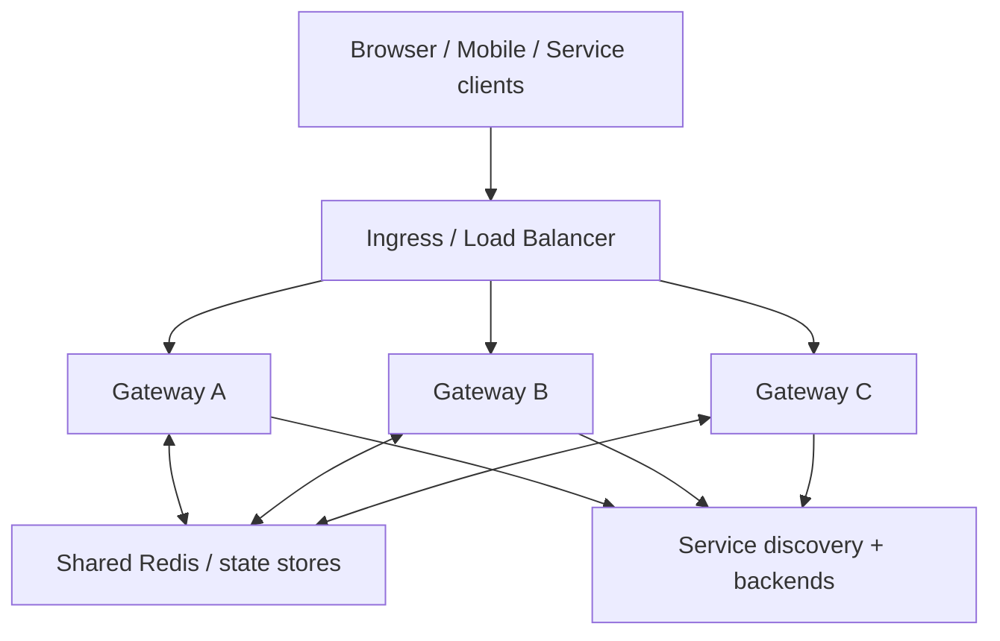
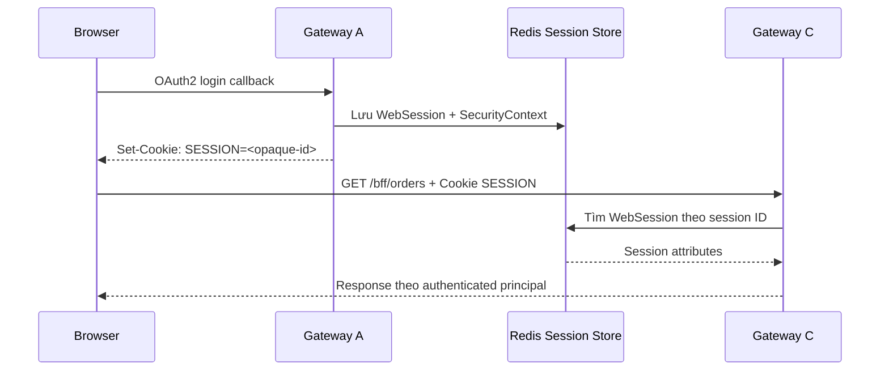
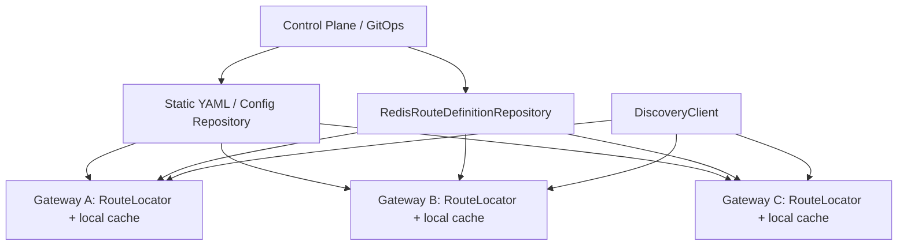

# Chạy nhiều bản sao và chia sẻ session, hạn mức hoặc tuyến

## Mục tiêu bài học

Trong chương **Triển khai** của module **SPRING_CLOUD_GATEWAY**, bài này hướng dẫn đưa **Spring Cloud Gateway** từ một tiến trình độc lập thành một hệ thống **nhiều bản sao (replicas)** có khả năng nhận lưu lượng qua load balancer, thay thế pod khi bảo trì và phục vụ microservices ổn định. Trọng tâm không chỉ là tăng `replicas: 3`; đó là bảo đảm các request đến bất kỳ bản sao nào vẫn có **trạng thái đăng nhập**, **chính sách hạn mức** và **định nghĩa tuyến** nhất quán theo hợp đồng.

Spring Cloud Gateway đảm nhiệm route predicates, filter chain, biến đổi path/header, khám phá dịch vụ, xác thực và TokenRelay, rate limiting, retry, circuit breaker, TLS và quan sát request. Khi nhân Gateway thành nhiều tiến trình, các thành phần vốn nằm trong RAM của một JVM **không tự biến thành trạng thái dùng chung**. Cần trả lời câu hỏi: *Cái gì phải chia sẻ, cái gì nên giữ tại từng instance, và điều gì xảy ra khi một pod chết đúng lúc request đang chạy?*

Sau bài này, bạn có thể:

- Phân biệt **stateless routing plane**, **session/authentication state**, **rate-limit state**, **usage quota**, **dynamic route definitions** và **runtime route cache**.
- Triển khai nhiều Gateway Server WebFlux replicas phía sau một Kubernetes `Service`/Ingress và hiểu readiness, liveness, rolling update, termination/draining.
- Dùng **Spring Session + Redis** chia sẻ `WebSession` cho OAuth2 Login, nhưng đồng thời nhận biết **OAuth2 authorized client / TokenRelay store** có thể là một kho trạng thái khác.
- Sử dụng **`RedisRateLimiter`** để nhiều Gateway replicas dùng chung token bucket thay vì tự đếm riêng từng JVM; thiết kế `KeyResolver` từ danh tính đã xác minh.
- Phân biệt rate limiting ngắn hạn với **monthly usage quota** và **in-flight concurrency limits**, vốn không tự được RedisRateLimiter bảo vệ.
- Phân phối **route definitions** bằng cùng cấu hình được triển khai, `DiscoveryClient` hoặc **`RedisRouteDefinitionRepository`** khi cần; hiểu vì sao cập nhật kho route không đồng nghĩa mọi instance đã refresh route cache.
- Thiết kế kế hoạch **rollout, rollback, Redis failover, session expiry, rate-policy change, route publication và quan sát drift**.
- Viết ma trận kiểm thử hai hoặc nhiều Gateway instances, luân phiên request A/B và chứng minh state được chia sẻ thực sự.

> **Phạm vi kỹ thuật:** ví dụ chính dành cho **Spring Cloud Gateway Server WebFlux / Reactor Netty**. Các bản Gateway Server Web MVC dựa trên Servlet có APIs/configuration khác; `ProxyExchange` là một cơ chế khác nữa. Cấu hình mẫu sử dụng namespace Gateway mới `spring.cloud.gateway.server.webflux.*`; các dòng cũ có thể dùng `spring.cloud.gateway.*`. Trước khi áp dụng, đối chiếu Spring Boot/Spring Cloud Gateway/Redis/Kubernetes versions đang chạy. Con số capacity, timeout và replica count chỉ dùng để minh họa, **không phải SLO production mặc định**.

## 1. Vì sao một Gateway chạy tốt ở một pod có thể hỏng ở ba pod?

Ban đầu:

```text
Browser
  └── Gateway A
       ├── route definitions A
       ├── session map A
       ├── local rate counter A
       └── HTTP connection pools A
```

Khi triển khai ba bản sao:



Một browser có thể gửi:

```text
Request 1: POST /login       → Gateway A
Request 2: GET  /bff/orders  → Gateway B
Request 3: GET  /bff/orders  → Gateway C
```

Nếu thông tin đăng nhập chỉ nằm trong RAM của A, request thứ hai có thể bị xem là chưa đăng nhập. Nếu mỗi pod tự giới hạn 10 request/giây thì ba pod có thể cho phép nhiều request hơn hạn mức chung. Nếu quản trị viên cập nhật route trên A nhưng B/C chưa nhận thay đổi, cùng một URL có thể lúc trả 200, lúc trả 404.

**Nhân bản compute không đồng nghĩa nhân bản state.** Giải pháp là phân loại đúng những trạng thái cần thiết, tránh “đưa tất cả vào Redis” mà không hiểu semantics.

### 1.1. Bảng phân loại state khi chạy nhiều bản sao

| Trạng thái | Thường nằm ở đâu | Có cần nhất quán giữa replicas? | Thiết kế khuyến nghị |
| --- | --- | --- | --- |
| Route predicates/filters định nghĩa bằng YAML | Cấu hình ứng dụng | **Có**, theo rollout version | Cùng image/config revision |
| Dynamic route definitions | RAM/DB/Redis/control plane | **Có**, theo hợp đồng publication | Shared repository + refresh tất cả instances |
| Route cache đã biên dịch/matched | JVM từng instance | Cần hội tụ, không nhất thiết đọc Redis mỗi request | Local cache + invalidation/refresh |
| `WebSession` cho OAuth2 Login | RAM hoặc session repository | **Có** nếu không phụ thuộc sticky sessions | Spring Session với shared store |
| OAuth2 authorized client/access/refresh token | In-memory service hoặc repository | **Có** nếu BFF/TokenRelay đa pod | Persistent secure authorized-client store |
| JWT bearer validation | Không cần session nếu stateless | Cùng chính sách issuer/JWKS/keys | Mỗi pod xác minh JWT độc lập |
| Token bucket rate limiter | RAM hoặc Redis | **Có** nếu áp hạn mức tổng | `RedisRateLimiter` + stable `KeyResolver` |
| Monthly API quota/credits | DB/ledger | **Có**, thường cần bền vững và idempotent | Atomic reservation + durable ledger |
| In-flight concurrency counter | JVM mỗi pod | Tùy giới hạn per-pod hay global | Local bulkhead hoặc distributed lease/semaphore |
| Load-balanced service instances cache | JVM/registry | Cần cập nhật đủ nhanh | Shared discovery source + health signals |
| Connection pool / TCP/TLS sockets | JVM từng instance | **Không**, không thể di chuyển socket | Local pool và graceful drain |
| CircuitBreaker metrics/state | JVM từng instance | Không tự đồng bộ; policy tùy kiến trúc | Per-instance state + fleet metrics, hoặc cơ chế chuyên biệt |
| Trace IDs / logs / metrics | Trong request hoặc collector | Cần correlation, không phải Redis shared map | OpenTelemetry/Micrometer + centralized telemetry |

**Một Redis cluster có thể phục vụ nhiều mục đích**, nhưng **session, limiter và routes vẫn là ba giao thức lưu trữ khác nhau**, với namespace, TTL, consistency và failure policy riêng. Không được coi “đã thêm Redis dependency” là chúng tự hoạt động đồng bộ.

## 2. Những tầng của một Gateway cluster

Một kiến trúc triển khai có thể tách thành:

```text
Data plane:
  Ingress → Gateway replicas → HTTP/WebSocket backends

Control plane:
  GitOps/Config Store/Route Admin → Route repository / rollout / refresh

Shared runtime state:
  Redis WebSession
  OAuth2AuthorizedClient repository
  Redis token-bucket counters
  Usage quota DB / ledger

Observability plane:
  Metrics + traces + structured logs + alerts
```

### 2.1. Data plane nên gần như stateless

Một Gateway replica có thể nhận bất kỳ request mới nào mà không cần hiểu lịch sử TCP connection của replica khác, **nếu**:

- Authentication dựa vào bearer JWT hợp lệ hoặc shared session repository.
- Tất cả route/filter configurations phù hợp với version đã công bố.
- Rate limiter dùng chung state nếu giới hạn phải tổng toàn fleet.
- Backend resources không dựa vào local memory của riêng một Gateway.

Nhưng **mỗi HTTP request đang thực thi** vẫn có state tạm: `ServerWebExchange`, Reactor Context, body buffers, open sockets, connection pools và timeout/cancellation state. Những thứ này **không được chuyển qua pod khác** khi pod chết.

### 2.2. Control plane không nên nằm trên public API port

API dùng để tạo/xóa route hoặc điều chỉnh rate policy là **tác vụ quản trị**. Không expose `/actuator/gateway` có quyền ghi ra Internet với cùng security assumptions như một public API.

Đưa route changes qua GitOps/CI/CD hoặc một private admin service có:

- Authentication/authorization mạnh.
- Audit actor/change/revision.
- Validation chính sách route URI, predicates, filters.
- Staged rollout/canary/rollback.
- Khả năng so sánh effective state trên tất cả pods.

### 2.3. Shared state cần topology riêng

Nếu cả WebSession, RedisRateLimiter và route definitions đều dùng một Redis instance duy nhất, nó có thể thành **single point of failure** hoặc bị một workload traffic cao gây saturation.

Production cần cân nhắc:

- Redis HA (replication/sentinel/managed failover/cluster phù hợp).
- TLS/ACL/network policies và secret rotation.
- Namespaces tách biệt để tránh xóa nhầm.
- Latency, memory, eviction policy và key TTL.
- Persistence và recovery requirements **khác nhau** cho session, limiter, routes và quota.
- Lỗi Redis phải có chính sách fail-open/fail-closed **theo tính chất route**.

## 3. Triển khai nhiều Gateway pods bằng Kubernetes

Ví dụ triển khai minh họa ba replicas sử dụng một image **đã build và kiểm tra**. Giả sử image chạy Spring Boot Server WebFlux trên cổng 8080, có Spring Boot Actuator cùng application port.

```yaml
apiVersion: apps/v1
kind: Deployment
metadata:
  name: spring-cloud-gateway
spec:
  replicas: 3
  revisionHistoryLimit: 5
  strategy:
    type: RollingUpdate
    rollingUpdate:
      maxUnavailable: 0
      maxSurge: 1
  selector:
    matchLabels:
      app: spring-cloud-gateway
  template:
    metadata:
      labels:
        app: spring-cloud-gateway
    spec:
      terminationGracePeriodSeconds: 60
      containers:
        - name: gateway
          image: registry.example.test/platform/gateway:2026-11-24-01
          imagePullPolicy: IfNotPresent
          ports:
            - name: http
              containerPort: 8080
          readinessProbe:
            httpGet:
              path: /actuator/health/readiness
              port: http
            periodSeconds: 5
            timeoutSeconds: 2
            failureThreshold: 3
          livenessProbe:
            httpGet:
              path: /actuator/health/liveness
              port: http
            periodSeconds: 10
            timeoutSeconds: 2
            failureThreshold: 3
          startupProbe:
            httpGet:
              path: /actuator/health/liveness
              port: http
            periodSeconds: 5
            failureThreshold: 24
          resources:
            requests:
              cpu: "250m"
              memory: "512Mi"
            limits:
              memory: "1Gi"
---
apiVersion: v1
kind: Service
metadata:
  name: spring-cloud-gateway
spec:
  type: ClusterIP
  selector:
    app: spring-cloud-gateway
  ports:
    - name: http
      port: 80
      targetPort: http
```

**Đây là khung deployment**, không bảo đảm chạy độc lập: cần image thực, namespace, ingress/controller, secret management, Spring Boot readiness/liveness support, security policy và capacity sizing của hệ thống. Image host `example.test` là placeholder, không phải image để pull. CPU/memory/replica count phải được chọn bằng load test và resource budgets; Spring Gateway là network-intensive, nên còn phải kiểm tra sockets, direct memory, event-loop pressure và upstream capacity.

### 3.1. Cấu hình Actuator health phù hợp

```yaml
management:
  endpoint:
    health:
      probes:
        enabled: true
  endpoints:
    web:
      exposure:
        include: health,info,prometheus

server:
  shutdown: graceful

spring:
  lifecycle:
    timeout-per-shutdown-phase: 45s
```

Một số Boot versions/platforms tự bật Kubernetes probes; ví dụ cấu hình rõ để diễn giải. Nếu management endpoints chạy **port khác**, phải sửa probe port/path. Chỉ expose metrics qua private monitoring ingress/network policy; không mở Actuator quản trị ra public Internet.

**Readiness** trả lời “pod có nên nhận traffic mới không?”, không phải “mọi downstream API hiện đều 100% khỏe?”. **Liveness** trả lời “tiến trình có cần được restart không?”. Nếu liveness phụ thuộc Redis/backend tạm thời, một sự cố dependency có thể restart đồng loạt mọi Gateway replicas và làm outage nặng hơn.

### 3.2. Startup probe tránh restart quá sớm

Khi JVM đang khởi động/JIT, Spring context chưa ready hoặc config/discovery đang nạp, startup probe cho ứng dụng thêm thời gian trước khi liveness bắt đầu phán xét. Không dùng liveness threshold quá gắt làm pod reset vòng lặp khi cold start.

### 3.3. Rolling update và availability

Với:

```yaml
replicas: 3
maxUnavailable: 0
maxSurge: 1
```

Kubernetes cố duy trì số pods khả dụng trong quá trình cập nhật theo các điều kiện readiness và capacity. Nhưng **không bảo đảm tuyệt đối zero-downtime** nếu:

- Không đủ node capacity để schedule pod mới.
- Readiness báo OK quá sớm.
- Routing/endpoint propagation chậm.
- Pod cũ vẫn nhận connection keep-alive/WebSocket trong lúc drain.
- Redis/session/route configuration bị lỗi chung.
- Có thay đổi schema/state không backward-compatible.

Deployment rollout là một cơ chế orchestration, không tự xử lý mọi tầng giao thức.

### 3.4. Load balancer upstream và downstream là hai lớp

**Lớp vào:**

```text
Client → Ingress/LB → Gateway A/B/C
```

**Lớp ra:**

```text
Gateway A/B/C → Spring Cloud LoadBalancer → Order Service instances
```

`replicas: 3` của Gateway không có nghĩa Order Service cũng có ba instances, và `lb://order-service` là **dịch vụ backend**, không phải cân bằng traffic giữa Gateway pods. Cả hai lớp cần riêng health checks, capacity planning và timeout budgets.

## 4. Sticky session: lợi ích và giới hạn

Một Ingress có thể dùng **session affinity** để cố gửi các requests cùng browser về cùng Gateway pod. Đây có thể là giải pháp chuyển tiếp tạm thời cho session lưu RAM, nhưng **không thay shared state** khi cần high availability.

```text
Browser session X → Gateway A
Browser session Y → Gateway B
```

### 4.1. Sticky session giúp gì?

- Giảm tần suất cross-pod access đối với một số cache/session local.
- Có thể hỗ trợ tạm hệ thống legacy cần server-local state.
- Giảm thay đổi lớn trong giai đoạn migration với traffic được kiểm soát.

### 4.2. Sticky session không giải quyết gì?

- Pod A chết → session X có thể mất nếu state chỉ ở RAM.
- Rolling update thay Pod A → browser được chuyển pod khác.
- Horizontal Pod Autoscaler tạo pod mới → phân phối lại affinity.
- OAuth2 authorized client/access token có thể vẫn nằm trong local memory.
- Mỗi Gateway pod đếm rate limit riêng → tổng hạn mức bị vượt.
- Route được sửa trên A không tự xuất hiện trên B/C.
- Một WebSocket connection đã mở **không thể di chuyển nguyên socket** sang pod khác.

**Khuyến nghị:** với Gateway cần trạng thái đăng nhập xuyên replica, ưu tiên **shared session store**; sticky affinity nếu dùng là tối ưu phụ, không phải nguồn duy nhất bảo đảm đúng.

## 5. Chia sẻ `WebSession` bằng Spring Session và Redis

Đối với Gateway WebFlux dùng **OAuth2 Login/BFF**, trạng thái principal và security context thường liên quan `WebSession`. Spring Session có integration với WebFlux để dùng một `ReactiveSessionRepository` được Redis backing, thay vì session trong RAM từng pod.

### 5.1. Luồng đăng nhập đa pod



**Cookie `SESSION` chỉ chứa identifier**, không nên chứa raw access/refresh token. Session ID phải khó đoán và được xử lý bằng `Secure`, `HttpOnly`, `SameSite`, Domain/Path phù hợp. Shared Redis store giúp Gateway C đọc session tạo ở A, nếu A và C thực sự dùng **cùng namespace, serialization format, timeout và Redis cluster**.

### 5.2. Phụ thuộc Spring Boot cho WebFlux Redis session

Với Spring Boot mới, dependency thường dùng:

```xml
<dependency>
    <groupId>org.springframework.boot</groupId>
    <artifactId>spring-boot-starter-session-data-redis</artifactId>
</dependency>
```

Spring Boot có thể tự cấu hình Redis-backed reactive sessions cho WebFlux khi dependencies phù hợp. Spring Session cũng hỗ trợ cách cấu hình tường minh `@EnableRedisWebSession`. **Không vừa dùng Boot auto-config vừa thêm cấu hình thủ công chồng chéo không cần thiết**; kiểm tra bean `WebSessionManager`, `ReactiveSessionRepository` và Boot/Session versions thực tế.

> **Phân biệt MVC:** Spring Session cho Servlet có `HttpSession`, filter và repository khác. Đừng lấy `@EnableRedisHttpSession` làm ví dụ WebFlux. Với WebFlux, `@EnableRedisWebSession` và `ReactiveRedisSessionRepository` là các thành phần tương ứng.

### 5.3. Cấu hình minh họa

```yaml
spring:
  data:
    redis:
      host: ${REDIS_HOST}
      port: ${REDIS_PORT:6379}
      password: ${REDIS_PASSWORD}
      ssl:
        enabled: true

  session:
    timeout: 30m
    data:
      redis:
        namespace: gateway:websession:prod
```

Tùy Boot version, các thuộc tính `spring.session.*` và `spring.data.redis.*` có thể có chi tiết khác; kiểm tra bảng properties chính thức. `ssl.enabled: true` đòi Redis endpoint hỗ trợ TLS và trust configuration hợp lệ. Dùng **Kubernetes Secret/secret manager**, không commit giá trị thật `REDIS_PASSWORD` vào git.

**Namespace là quyết định cách ly dữ liệu.** Không chia một namespace session cho staging và production hoặc cho các ứng dụng không chia cùng security context. Nếu đổi namespace khi rollout, người dùng có thể bị đăng xuất hàng loạt vì pods mới không tìm thấy session cũ.

### 5.4. Test A login, B đọc session

Một test đáng tin:

```text
1. Gateway A, B chạy cùng version và Redis test.
2. Browser/HTTP test client thực hiện OAuth2 login qua Gateway A.
3. Lấy cookie SESSION từ response thật.
4. Gọi /bff/orders trên Gateway B với cùng cookie.
5. B khôi phục đúng authenticated principal.
6. Không có redirect lại login/401 ngoài policy.
7. Restart A; request qua B vẫn hợp lệ nếu session chưa hết hạn.
```

Không dùng `mockOAuth2Login()` để tuyên bố multi-pod cookie/session đã được xác minh: mock chỉ cài authentication vào test context, **không chứng minh Redis session persistence và browser cookie lifecycle**.

### 5.5. CSRF, logout, expiry và session fixation

Với browser cookie tự gửi, cần kiểm thử:

- `POST/PUT/PATCH/DELETE` yêu cầu CSRF token đúng theo session policy.
- Logout invalidates session và các trạng thái liên quan theo chính sách.
- Session ID thay đổi đúng lúc authentication theo chống session fixation.
- Expiry/TTL được enforced nhất quán giữa A/B/C.
- Session cookie `Secure` khi public HTTPS, `HttpOnly` nếu JS không cần đọc ID.
- `SameSite` được chọn theo topology OAuth2 redirects và cross-site browser behavior.
- Session attributes không chứa dữ liệu cá nhân vượt nhu cầu, không log session IDs.

Redis replication/failover không làm các hành vi trên **tự đúng**; chúng cần cấu hình/test Spring Security và Spring Session.

## 6. `TokenRelay` và OAuth2 authorized client là **state khác với WebSession**

Một lỗi rất phổ biến: đã cài Spring Session Redis, login trên A và request tới B khôi phục `Authentication`, nhưng `TokenRelay` trên B **không tìm thấy OAuth2 access token**.

### 6.1. Vì sao?

OAuth2 login/session và OAuth2 authorized client thường là hai lớp:

```text
WebSession / SecurityContext:
  Tôi là user-42, đã authenticated.

ReactiveOAuth2AuthorizedClientService:
  Với user-42 và registration "portal",
  tôi có access token nào? expiry/refresh ra sao?
```

Theo tài liệu Spring Cloud Gateway `TokenRelay`, implementation mặc định của `ReactiveOAuth2AuthorizedClientService` có thể dùng **in-memory store**. Vì vậy:

```text
Gateway A: session user-42 = Redis       OAuth2 client = RAM A
Gateway B: session user-42 = Redis       OAuth2 client = RAM B (không có)
```

Kết quả: B biết user đã login, nhưng không có authorized client phù hợp để relay access token.

### 6.2. Hướng xử lý

- Cung cấp implementation/repository **bền vững, dùng chung** cho authorized client theo API Spring Security reactive của version đang dùng.
- Bảo vệ access/refresh tokens bằng encryption-at-rest, TLS, RBAC/ACL, retention và secret rotation.
- Chọn stable key theo **principal + clientRegistrationId + tenant boundary** nếu ứng dụng multi-tenant.
- Kiểm tra refresh token concurrency khi nhiều pods cố refresh cùng một access token hết hạn.
- Không coi lưu token vào một Redis key text đơn giản là thiết kế an toàn.
- Thiết kế logout/revocation và token expiry/refresh failure theo hợp đồng.

### 6.3. Phân biệt 3 nguồn credential

| Credential | Browser/Gateway dùng cho | Có nên forward nguyên xuống backend? |
| --- | --- | --- |
| Browser `SESSION` cookie | Tìm WebSession ở Gateway | Không, trừ khi kiến trúc thực sự có cùng session boundary |
| OIDC ID token | Xác nhận login với OAuth2 client | Không dùng thay API access token |
| OAuth2 access token | Gọi resource API theo audience/scope | Có thể relay bằng `TokenRelay` khi đã xác minh contract |

`TokenRelay` đặt access token vào **outbound Authorization header**. Backend Resource Server vẫn cần xác minh issuer, audience, scope và quyền truy cập tài nguyên; một header xuất hiện không tự chứng minh người dùng được phép thực hiện mọi thao tác.

### 6.4. Khi dùng JWT bearer-only thì sao?

Một Gateway chỉ nhận:

```http
Authorization: Bearer <access-JWT>
```

và không tạo stateful session có thể **không cần Spring Session** cho authentication. Mỗi replica xác minh JWT bằng cùng issuer/JWKS/trust policy. Nhưng những state như **revocation, nonce/replay prevention, per-user quota** vẫn có thể cần chia sẻ tùy security design.

**Không** đưa session vào kiến trúc chỉ vì deploy nhiều pods nếu API thật sự hoạt động stateless và không có yêu cầu session.

## 7. Hạn mức lưu lượng: local limiter và shared RedisRateLimiter

Nếu mỗi pod dùng một limiter trong RAM:

```text
Hạn mức mong muốn cho user-42: 10 request/giây trên toàn Gateway

Gateway A: 10 request/giây
Gateway B: 10 request/giây
Gateway C: 10 request/giây
```

Với request được phân phối, tổng có thể **tiến tới 30 request/giây** trước khi local counters chặn, dù policy toàn hệ thống muốn 10. Việc dùng sticky sessions **không bảo đảm** một user luôn chỉ đi một pod trong suốt mọi tình huống.

### 7.1. RedisRateLimiter giải quyết phần nào?

`RequestRateLimiter` với `RedisRateLimiter` trong Spring Cloud Gateway Server WebFlux dùng **token bucket** lưu trạng thái trong Redis. Nhiều Gateway instances trỏ tới cùng Redis/key có thể cùng kiểm tra một bucket thay vì ba buckets local.

Các tham số:

| Tham số | Ý nghĩa |
| --- | --- |
| `replenishRate` | Tốc độ nạp tokens theo thời gian |
| `burstCapacity` | Sức chứa tối đa của bucket |
| `requestedTokens` | Số tokens một request tiêu thụ |
| `KeyResolver` | Danh tính của bucket (user, tenant, plan, IP đã xác minh...) |

Ví dụ:

```text
replenishRate = 10 token/giây
burstCapacity = 20 tokens
requestedTokens = 1
```

Một user có thể có **burst ngắn** nhờ bucket tích lũy đến 20 tokens, nhưng **steady rate** chỉ khoảng 10 tokens/giây theo cấu hình. Đây không phải “đúng 10 requests trong mọi cửa sổ 1 giây”: token bucket cho phép burst và có ranh giới thời gian riêng.

### 7.2. Dependencies

Với Server WebFlux Redis rate limiter:

```xml
<dependency>
    <groupId>org.springframework.boot</groupId>
    <artifactId>spring-boot-starter-data-redis-reactive</artifactId>
</dependency>
```

Cần cấu hình Redis reactive connection phù hợp, có TLS/ACL/timeout. Không dùng `RedisTemplate` blocking trực tiếp trên Netty event loop để tự viết limiter đồng bộ.

### 7.3. Route rate limiting mẫu

```yaml
spring:
  cloud:
    gateway:
      server:
        webflux:
          routes:
            - id: orders-rate-limited
              uri: lb://order-service
              predicates:
                - Path=/api/orders/**
              filters:
                - name: RequestRateLimiter
                  args:
                    key-resolver: "#{@authenticatedPrincipalKeyResolver}"
                    redis-rate-limiter.replenishRate: 10
                    redis-rate-limiter.burstCapacity: 20
                    redis-rate-limiter.requestedTokens: 1
                - StripPrefix=1
```

`lb://order-service` cần discovery/LoadBalancer tương ứng. `RequestRateLimiter` phải nằm trong filter chain thật của route; nếu một route khác không có limiter, caller có thể đi đường bypass.

### 7.4. `KeyResolver` phải ổn định giữa các pod

Ví dụ chọn authenticated principal name:

```java
import org.springframework.cloud.gateway.filter.ratelimit.KeyResolver;
import org.springframework.context.annotation.Bean;
import org.springframework.context.annotation.Configuration;

@Configuration
class RateLimitIdentityConfig {

    @Bean
    KeyResolver authenticatedPrincipalKeyResolver() {
        return exchange -> exchange.getPrincipal()
            .map(principal -> "user:" + principal.getName());
    }
}
```

**Giới hạn của ví dụ:**

- Chỉ an toàn khi `getPrincipal()` thực sự do Spring Security xác thực, không phải một `X-User` client tự gửi.
- Principal name phải thuộc namespace đủ độc nhất; ở hệ thống multi-issuer/multi-tenant, có thể cần key dạng `issuer:tenant:user:plan` được canonicalize từ **verified claims**.
- Nếu không có principal, resolver trả empty `Mono`; mặc định `RequestRateLimiter` thường **từ chối empty key** theo policy, cần test chính xác. Không thay bằng một giá trị `anonymous` chung để vô tình cho toàn Internet chung một bucket trừ khi đó là thiết kế.
- Mọi pod phải dùng **cùng thuật toán key, cùng policies và cùng Redis namespace**.

**Không** lấy raw `X-Forwarded-For` làm user identity: client có thể giả IP nếu ingress chưa sanitize. Nếu giới hạn theo IP, chỉ dùng địa chỉ đã được trusted-proxy-aware resolver xác minh.

### 7.5. Kỳ vọng khi có ba replicas

Giả sử cùng một user gửi 60 requests qua A/B/C trong một khoảng ngắn:

```text
All pods → same KeyResolver output → same Redis token bucket
```

Kỳ vọng các quyết định được áp theo **một token bucket logic**, không phải ba bucket độc lập. Tuy nhiên số lượng được cho phép trong một cửa sổ đo rất ngắn còn phụ thuộc tokens tích lũy, timing, burst và concurrent request order. Test nên dựa trên **cấu hình token bucket và giới hạn tổng**, không hard-code một con số 10 ở mọi giây lịch.

## 8. RedisRateLimiter không đồng nghĩa usage quota hoặc concurrency limit

**Ba đại lượng không được đánh đồng:**

| Chính sách | Ví dụ | Cơ chế thông thường |
| --- | --- | --- |
| **Rate limiting** | Tối đa steady 10 req/s/user | Token bucket Redis |
| **Concurrent in-flight limit** | Tối đa 50 request đang xử lý/user trên **toàn fleet** | Distributed semaphore/leases hoặc backend admission |
| **Usage quota** | Tối đa 1 triệu API calls/tháng/tenant | Durable atomic counters + usage ledger/billing |

### 8.1. Vì sao một local semaphore không trở thành global limit?

Nếu mỗi pod có:

```java
new Semaphore(50);
```

và chạy ba pods, có thể có tới **150 in-flight requests** nếu traffic phân phối đủ. Đây là **per-instance concurrency limit**, có ích để bảo vệ từng JVM nhưng không đáp ứng hợp đồng global 50.

Một distributed concurrency controller cần:

- Atomic acquisition và release.
- Lease/TTL khi pod chết giữa request.
- Xử lý fencing/ownership để release muộn không giải phóng nhầm slot.
- Timeout/cancellation được phản ánh vào phép release.
- Tránh contention quá cao trên key nóng.

Không tự lấy `INCR` khi vào, `DECR` khi ra rồi gọi đó là distributed semaphore an toàn; pod chết có thể khiến counter rò vĩnh viễn.

### 8.2. Quota theo kỳ tính tiền cần durability

Ví dụ:

```text
Tenant ACME: 1.000.000 requests hợp lệ / tháng
```

Một Redis token bucket không quản lý tự nhiên:

- Reset đúng calendar month/time zone.
- Billable vs non-billable requests.
- Duplicate retries và idempotency.
- Reservation trước khi xử lý rồi finalize/refund khi lỗi.
- Reconciliation/audit và sửa sai sau incident.

Với usage quota quan trọng, dùng một **durable ledger hoặc cơ chế tính usage đáng tin**, cùng atomic reservation/counter update theo tenant+period. Redis có thể là cache/fast-path nhưng cần xử lý durability, idempotency và failover theo yêu cầu nghiệp vụ.

### 8.3. Các lớp giới hạn có thể phối hợp

```text
Ingress/WAF coarse limit
  ↓
Gateway RedisRateLimiter theo user/tenant
  ↓
Gateway/pod concurrency limit để bảo vệ threads/connections
  ↓
Backend distributed quota/billing enforcement
  ↓
Backend resource ownership/authorization
```

**Không** lấy 429 ở Gateway làm bằng chứng người dùng đã dùng hết quota tháng: rate limiter chỉ phản ánh bucket hiện tại theo key và policy.

## 9. Redis là shared state, không phải lời bảo đảm HA tự động

Từ góc nhìn nhiều Gateway replicas, Redis có thể được dùng cho nhiều mục đích:

```text
Redis
  ├── namespace gateway:websession:prod
  ├── rate-limiter keys (theo implemention)
  ├── route-definition keys (nếu dùng Redis repository)
  └── các application-specific keys đã thiết kế
```

**Không tự suy** key prefix/format nội bộ của Spring Cloud Gateway limiter/repository. Các keys đó thuộc framework và có thể thay đổi theo phiên bản; không xóa Redis keys bằng wildcard nếu chưa biết tác động tới các subsystem.

### 9.1. Cần tách consistency và durability

| State | Cần độ bền | Khi mất dữ liệu |
| --- | --- | --- |
| Session | Trung bình tới cao theo sản phẩm | Người dùng bị đăng xuất, OAuth2 flow lỗi |
| Authorized client/refresh token | Cao + bảo mật | Bị mất khả năng relay/refresh, phải login lại |
| Rate-limit token bucket | Thường thiên về availability/short-term | Bucket reset → có thể allow quá hoặc block quá |
| Dynamic route definitions | Cao | Mất route/routing policy, outage/sai đích |
| Usage ledger | **Rất cao** nếu liên quan billing | Sai hóa đơn/quota/credits |

Không đặt Redis `maxmemory-policy` dễ evict session/routes mà không đánh giá hiệu ứng; một rate counter hết TTL đúng policy thì khác hoàn toàn một route record bị evict.

### 9.2. Failure policy theo route

Khi Redis mất kết nối:

- **Public informational API:** có thể chọn degraded behavior/fail-open cho một lớp limiter nếu rủi ro thấp và có lớp bảo vệ khác.
- **Payment/admin/expensive API:** có thể cần fail-closed hoặc một policy chặt hơn để tránh quota abuse.
- **Session-required BFF:** nếu không đọc session an toàn, không được tự coi request là đã authenticated.
- **Routes:** nếu shared store tạm mất, local cache có thể tiếp tục phục vụ cấu hình cuối nhưng phải có freshness/expiry policy và cảnh báo drift.
- **Billing quota:** không tự cho phép unlimited nếu không có reconciliation/compensating controls được duyệt.

Một số filter có failure behavior cụ thể theo code/version. **Không tuyên bố RedisRateLimiter mặc định fail-open hay fail-closed cho mọi phiên bản**; fault-injection tests phải xác minh production policy.

### 9.3. Cấu hình và bảo mật Redis

Ưu tiên:

- TLS đến Redis, verify CA/certificate.
- Redis ACL giới hạn commands/keys theo chức năng nếu kiến trúc cho phép.
- Secrets từ secret manager, rotation và audit.
- Private network/Kubernetes NetworkPolicy, không expose Redis public.
- HA/replication/managed failover và backup cho state cần durability.
- Connection pool/timeouts, metrics latency/error, memory/eviction và keyspace TTL.
- Phân vùng capacity hoặc tách clusters khi limiter traffic gây ảnh hưởng session latency.

Redis Cluster có lưu ý về **atomic multi-key operations và hash slots**. Nếu viết script tùy chỉnh, các keys cần hỗ trợ same-slot/hashing theo kiến trúc; đừng giả định có thể atomically xử lý nhiều keys trên nhiều shards. Dùng implementation RedisRateLimiter chính thức và kiểm thử Redis topology/version tương ứng.

## 10. Chia sẻ route definitions: ba lựa chọn cần phân biệt

Trong Spring Cloud Gateway, **route definitions** không cùng khái niệm với **route cache runtime** hay **service discovery instance list**.



### 10.1. Lựa chọn A — cùng YAML/image/config revision

Nếu routes ít thay đổi, cách dễ vận hành nhất:

```yaml
spring:
  cloud:
    gateway:
      server:
        webflux:
          routes:
            - id: orders-v1
              uri: lb://order-service
              predicates:
                - Path=/api/orders/**
              filters:
                - StripPrefix=1
```

Tất cả pods được triển khai từ **cùng Git commit/config revision**. Khi đổi route, chạy rolling update qua GitOps/CI/CD.

**Ưu điểm:** dễ code review, rollback, audit, versioning; ít phụ thuộc runtime control plane.

**Giới hạn:** trong rolling update có một khoảng thời gian **old pods và new pods cùng tồn tại** với route versions khác nhau. Khi thay route backward-incompatible, phải có kế hoạch compatibility/canary, không đòi atomic update toàn fleet chỉ từ RollingUpdate.

### 10.2. Lựa chọn B — DiscoveryClient route locator

Nếu cần tạo routes từ service registry, Gateway có `DiscoveryClient` route definition locator. `lb://service-name` điều hướng request đến instances do Spring Cloud LoadBalancer chọn.

Ví dụ mô hình:

```text
Registry:  order-service → [10.0.0.11, 10.0.0.12]
Gateway:  /order-service/** → lb://order-service
```

**Quan trọng:** discovery có thể cập nhật **danh sách instances** mà không yêu cầu thay **route definition**. Chẳng hạn `Path=/api/orders/**` vẫn vậy nhưng instance pod phía backend thay đổi.

Đừng bật discovery locator public cho mọi service trong registry nếu không muốn tự expose administrative/internal APIs. Xác định explicit route allowlist và security policy; tránh vô tình có route đến `admin-service` hoặc `secrets-service`.

### 10.3. Lựa chọn C — `RedisRouteDefinitionRepository`

Spring Cloud Gateway tài liệu hóa hai implementation:

- `InMemoryRouteDefinitionRepository`: state nằm trong RAM của **một Gateway instance**.
- `RedisRouteDefinitionRepository`: có thể lưu route definitions trong shared Redis để **nhiều instances đọc cùng repository**.

Trong những dòng Gateway Server WebFlux mới, bảng configprops có thuộc tính:

```text
spring.cloud.gateway.server.webflux.redis-route-definition-repository.enabled
```

Một số tài liệu mô tả sharing routes dùng tên cũ:

```text
spring.cloud.gateway.redis-route-definition-repository.enabled
```

**Kiểm tra đúng release train và property binding thực tế.** Không suy từ tên tài liệu cũ rằng prefix cũ có hiệu lực trong Gateway 5.x, cũng không tự dựa vào một giá trị default trong configprops mà bỏ qua dependencies/conditions thực tế.

### 10.4. Ví dụ dùng Redis route repository trong lab

```yaml
spring:
  cloud:
    gateway:
      server:
        webflux:
          redis-route-definition-repository:
            enabled: true
```

Phải có Redis reactive dependency/connection và xác minh repository bean được tạo. Nếu application cùng dùng static YAML routes và dynamic Redis routes, cần xác định **route ID collisions, source precedence và deletion semantics**; không tự giả định route từ Redis sẽ “ghi đè an toàn” một route từ YAML.

## 11. Shared repository **không** tự refresh route cache mọi replica

Đây là điểm dễ nhầm nhất khi scale-out.

```text
T0: Gateway A/B/C dùng route cache version 1
T1: Route definition version 2 được ghi vào Redis
T2: Gateway A refresh local route cache
T3: Gateway B/C chưa refresh
```

Khi đó:

```text
Client → Gateway A → version 2
Client → Gateway B → version 1
Client → Gateway C → version 1
```

Việc dùng chung `RedisRouteDefinitionRepository` làm các instances có thể đọc **cùng nguồn định nghĩa**; nó không phải cam kết rằng bộ nhớ đệm đã lập tức được invalidated ở mọi JVM sau một write.

### 11.1. `RefreshRoutesEvent` và `/actuator/gateway/refresh`

Gateway có route cache và cơ chế refresh. Tài liệu Actuator mô tả:

```http
POST /actuator/gateway/refresh
```

để làm mới route cache. **Call trên Gateway A chỉ tác động A** nếu không có cơ chế broadcast/distribution bổ sung. Nếu request điều khiển đi qua Service load balancing ngẫu nhiên, POST lặp ba lần không bảo đảm đã chạm cả A/B/C.

`RefreshRoutesEvent` trong application context là event **cục bộ JVM**; không phải distributed message bus theo mặc định.

### 11.2. Thiết kế một cơ chế phân phối refresh đáng tin

Các hướng:

1. **GitOps rolling rollout** nếu route policy thay đổi hiếm khi.
2. **Control plane fan-out** gửi refresh đến từng instance qua private admin network, có acknowledgments và retries.
3. **Event bus/pub-sub** truyền version thay đổi; mỗi pod nhận event rồi refresh local cache.
4. **Periodic reconciliation** để chữa trường hợp pod bỏ lỡ event hoặc vừa restart.

Pub/sub message là **tín hiệu**, không phải source of truth. Khi một pod không nhận message, nó vẫn phải có đường **reconcile từ repository** dựa trên revision/freshness.

### 11.3. Phải có route revision và xác minh convergence

Một contract có thể là:

```text
Desired route revision:  v42

Gateway A applied:       v42
Gateway B applied:       v42
Gateway C applied:       v41  ← drift
```

Route revision ở đây là **metadata/control-plane convention do ứng dụng vận hành định nghĩa**, không phải thuộc tính mặc định bảo đảm sẵn của Gateway Actuator. Muốn biết revision, bạn phải ghi nhận nó trong config/route metadata hoặc một endpoint kiểm soát riêng.

Flow:

```text
1. Validate route definitions.
2. Persist desired revision.
3. Notify pods hoặc rollout.
4. Mỗi pod refresh + validate routes.
5. Poll/observe effective route ID, URI, predicates, filters, revision.
6. Khi mọi pod đạt desired state → đánh dấu publication thành công.
7. Nếu chưa đạt → giữ canary/rollback hoặc ngừng rollout theo policy.
```

**Không gọi một HTTP 200 từ `/actuator/gateway/refresh` là bằng chứng tất cả routes đã hội tụ.** Tài liệu Actuator cũng lưu ý lỗi trong asynchronous refresh có thể khiến routes cũ được giữ lại. Cần readback/route inspection.

### 11.4. Cập nhật route có nhiều bước không mặc định atomic toàn cluster

Giả sử đổi:

```text
OLD: /api/orders/** → order-service-v1
NEW: /api/orders/** → order-service-v2
```

Nếu đổi route trong khi v2 chưa ready hoặc có pod Gateway còn route cũ, users có thể thấy kết quả khác nhau giữa requests. Có thể dùng:

- Backward-compatible backend deploy trước.
- Versioned paths `/v1`/`/v2`.
- Canary theo header/traffic percentage có policy nhất quán.
- Feature flags/routing metadata có lifecycle.
- Commit/rollback đã thử nghiệm.

Không đặt niềm tin vào “Redis update là atomic nên toàn bộ request tức thì dùng route mới”; **route cache và requests đang chạy** vẫn có lifecycle riêng.

## 12. Bảo vệ Gateway Actuator khi có nhiều instances

Tài liệu Actuator Gateway mới mô tả endpoint `/gateway` mặc định **không mở quyền truy cập**. Để chỉ đọc thông tin routes:

```yaml
management:
  endpoint:
    gateway:
      access: read-only
  endpoints:
    web:
      exposure:
        include: health,info,gateway
```

**Đây là một cấu hình quan sát/read-only**, không cho quản trị viên tùy ý tạo/xóa/refresh routes. Khi cần mutation, `management.endpoint.gateway.access=unrestricted` hoặc cơ chế enable tương ứng chỉ nên chạy **trong admin plane được bảo vệ**, tùy Boot/Gateway version.

### 12.1. Vì sao endpoint write rất nhạy cảm?

Một route bị tạo sai có thể:

- Trỏ tới `http://internal-admin:8080`.
- Bypass authentication predicates.
- Chuyển credential tới host không đáng tin.
- Tạo route ưu tiên cao che một path đã bảo vệ.
- Phát động SSRF hoặc route to metadata endpoints.

Do đó không expose writable actuator qua public ingress. Cần authentication/authorization, network isolation, audit, rate controls và validation route destinations. Có thể chọn **admin controller riêng** với approval workflow thay vì cho service operators gọi thẳng actuator writes.

### 12.2. Đừng nhầm introspection với mutation

```text
GET /actuator/gateway/routes          → kiểm tra route state
POST /actuator/gateway/refresh         → thao tác quản trị state
POST/DELETE /actuator/gateway/routes/* → mutation route definitions
```

Tên và method chính xác phụ thuộc phiên bản; không hard-code quyền trên URL đơn thuần nếu có actuator base-path tùy chỉnh. Kiểm tra security filter chain của management context và thực tế HTTP mapping.

## 13. Phối hợp static, dynamic và discovery routes

Nhiều hệ thống dùng cả ba nguồn:

```text
Static YAML:
  /api/orders/** → lb://order-service

Dynamic routes:
  /partner/{partnerId}/** → selected service

Discovery:
  logical order-service → healthy backend instances
```

### 13.1. Route definition và backend instances là hai lớp khác nhau

Một route có thể không đổi:

```text
uri: lb://order-service
```

trong khi service instances thay liên tục:

```text
10.2.0.11 → terminating
10.2.0.12 → ready
10.2.0.13 → ready
```

**Không cần tạo lại route chỉ vì pod backend thay IP** nếu LoadBalancer/discovery đã cập nhật. Ngược lại, việc registry đã có order-service không bảo đảm public path được expose — route/predicate phải tồn tại và match.

### 13.2. Cẩn thận route order và path overlap

Ví dụ:

```text
/api/orders/** → order-service
/api/**        → generic-backend
```

Đôi khi hai routes cùng match một request; `order` và predicate semantics quyết định route được chọn. Nếu một pod có route order khác pod khác trong rolling update, cùng request có thể đi tới hai upstreams khác nhau.

Test phải xác nhận:

- Route ID được chọn.
- Upstream path sau `StripPrefix`/`RewritePath`.
- Authentication và authorization filter chain.
- CORS/CSRF/rate limit policy.
- Response status và headers.

### 13.3. Rollout route change và policy change đồng bộ

Đổi route để thêm:

```yaml
filters:
  - name: RequestRateLimiter
    args:
      ...
```

trong khi một pod chưa cập nhật có thể khiến requests đi qua pod cũ **không chịu limiter**. Cần coi **route revision và policy revision** là cùng một đơn vị rollout khi chúng có ý nghĩa bảo mật.

Không chỉ kiểm tra tất cả pods “có route”; phải kiểm tra **filter definitions, order và policy version**.

## 14. CircuitBreaker, retry và connection pools trong môi trường đa replica

Không phải mọi trạng thái runtime cần chuyển vào Redis.

### 14.1. CircuitBreaker state thường là per-process

Giả sử:

```text
Gateway A: circuit OPEN
Gateway B: circuit CLOSED
Gateway C: circuit HALF_OPEN
```

Nếu circuit breakers được tạo và ghi metrics trong từng JVM, sự khác biệt trên có thể xảy ra. Một Gateway có thể reject nhanh, Gateway khác vẫn thử gọi backend.

Điều này **không luôn là lỗi**: circuit breaker local bảo vệ mỗi client instance, trong khi health/service-level load shedding xử lý tổng thể. Nếu sản phẩm yêu cầu một **global circuit state**, cần một cơ chế được thiết kế rõ, không mặc định Resilience4j CircuitBreaker sẽ share state chỉ vì Redis có mặt.

### 14.2. Retry amplification nhân với số pods

Giả sử:

```text
3 Gateway pods
× mỗi pod 100 incoming req/s
× tối đa 3 outbound attempts
= có thể tới 900 attempts/s
```

Đây là **cận minh họa** dưới điều kiện mọi request đều retry đủ; thực tế còn tùy lỗi và policy. Khi backend chậm, retries từ nhiều pods có thể tạo **thundering herd** và làm outage trầm trọng.

Giới hạn:

- Retry chỉ transient errors.
- Idempotent operations hoặc idempotency key.
- Max attempts + backoff/jitter.
- End-to-end timeout budget.
- Concurrency/pool bounds và circuit breaker.
- Một retry owner khi có nhiều hops.

### 14.3. Connection pool là local

Mỗi Gateway pod có HTTP client connection pool riêng:

```text
Gateway A maxConnections = 200
Gateway B maxConnections = 200
Gateway C maxConnections = 200
```

Tối đa tiềm năng **600 outbound connections** nếu cùng target và cấu hình tương ứng, chưa kể nhiều backends. Tăng replicas làm tăng **tổng connection fan-out** và có thể vượt backend file descriptors, DB pool hoặc Envoy limits.

Tính capacity:

```text
Total upstream connection pressure
≈ số Gateway replicas × per-pod max connections
```

Đây là xấp xỉ để planning; thực tế pools có thể được chia theo remote authority/proxy, HTTP/2 multiplexing và nhiều routes, nên phải đo metrics active/idle/pending theo backend.

### 14.4. Timeout phải có thứ tự

Khi scale-out, client → ingress → Gateway → backend → DB đều có timeout riêng. Kết hợp:

- Client deadline.
- Ingress request/idle timeout.
- Gateway outer request budget.
- Netty connect/response/pool acquire.
- Resilience4j TimeLimiter nếu dùng.
- Backend/DB timeouts.

Không đơn giản tăng tất cả timeouts vì số pods tăng. Cần đo p95/p99 theo route, queue saturation, retry ratios và tail latency.

## 15. WebSocket, SSE và kết nối dài khi rollout

HTTP request nhỏ có thể retry/reconnect tương đối dễ. **WebSocket và SSE** là kết nối dài, thường gắn với một Gateway pod cụ thể trong suốt lifetime.

### 15.1. WebSocket qua nhiều Gateway replicas

```text
Browser WebSocket ──▶ Ingress ──▶ Gateway B ──▶ Chat Service
```

Một WebSocket connection đã nâng cấp không tự “chuyển” sang Gateway A khi B bị terminate. Client phải **reconnect**, có thể được cân bằng lại sang A/C. Do đó:

- Handshake authentication phải làm lại hợp lệ.
- Subscription/presence state cần phục hồi từ nguồn phù hợp, không chỉ RAM của Gateway B.
- Nếu protocol hỗ trợ resume, dùng durable message IDs/offsets.
- Reconnect có exponential backoff/jitter, không gây reconnect storm.
- Graceful drain đủ thời gian cho request ngắn, nhưng không thể giữ một WebSocket vô hạn trong rolling update.

### 15.2. SSE cũng cần reconnect

SSE client có thể dùng `Last-Event-ID` theo contract nếu backend hỗ trợ replay. Pod terminate giữa stream thì client phải reconnect; backend/pub-sub phải có cơ chế khôi phục state nếu yêu cầu không mất events.

### 15.3. Sticky affinity không cứu được socket khi pod chết

Ingress affinity chỉ quyết định **request/kết nối mới** nên tới pod nào; khi B đã biến mất, connection cũ vẫn bị đóng. Không coi sticky sessions là giải pháp HA cho realtime connections.

### 15.4. Graceful shutdown và drain

Một quá trình an toàn:

```text
1. Pod bị đánh dấu Terminating.
2. Endpoint/Ingress dừng gửi traffic mới (có propagation delay).
3. Spring Boot/Netty bắt đầu graceful shutdown theo cấu hình.
4. In-flight short requests được phép hoàn tất trong grace period.
5. Long-lived streams/WebSockets theo policy bị đóng và clients reconnect.
6. Pod thoát; Kubernetes cưỡng chế dừng nếu quá grace period.
```

Kubernetes `terminationGracePeriodSeconds` **bao gồm cả thời gian preStop hook**. Nếu dùng preStop sleep quá dài, bạn có thể tiêu hết thời gian cần để ứng dụng xử lý in-flight requests. Vì vậy thiết kế grace, ingress propagation và Spring shutdown budgets cùng nhau; không mặc định thêm `sleep 60` là “zero downtime”.

## 16. Readiness/health khi Redis gặp sự cố

Một câu hỏi quan trọng: “Redis down thì mọi Gateway pods có nên bị loại khỏi Service không?”

**Câu trả lời tùy các route và authentication contract.**

Nếu Redis chỉ phục vụ một vài routes cần session còn bearer-only routes vẫn chạy tốt, việc readiness của toàn Gateway phụ thuộc Redis có thể loại **toàn bộ Gateway pods** khỏi traffic, dù một phần dịch vụ vẫn còn dùng được. Ngược lại, nếu mọi request đều yêu cầu một Redis-backed security session, nhận traffic khi Redis unavailable có thể chỉ tạo 500/401 và tải vô ích.

### 16.1. Phân biệt dependency health và process health

| Probe/tín hiệu | Câu hỏi |
| --- | --- |
| Liveness | JVM/event-loop còn hoạt động đủ để phục vụ? |
| Readiness | Instance có nên nhận requests mới? |
| Redis health indicator | Shared state dependency có sẵn? |
| Backend service health | Instance downstream có nhận calls? |
| Business-level availability | Những API nào thực sự còn dùng được? |

**Không** đưa mọi downstream dependencies vào liveness nếu một lỗi mạng thoáng qua sẽ làm cả fleet restart. Dùng health groups, metrics, degraded mode và admission strategy theo nhu cầu thật.

### 16.2. Redis failover không miễn phí

Trong failover có thể có:

- Thời gian reconnect.
- In-flight commands lỗi.
- Replica lag và write loss theo durability mode.
- Session reads fail hoặc token bucket bị reset/đi lùi.
- Route repo chưa cập nhật ở pod vừa restart.
- CircuitBreaker ở từng Gateway pod nhìn thấy lỗi khác nhau.

Fault-injection test cần đo hành vi A/B/C khi Redis failover, không chỉ thử reconnect từ một pod.

## 17. Chiến lược rollout và rollback đa bản sao

### 17.1. Các bước trước rollout

1. Đóng băng **route/policy revision** đã duyệt.
2. Xác nhận Spring Boot/Spring Cloud Gateway/Redis dependencies tương thích.
3. Kiểm tra network policies và TLS trust của Redis/backend/ingress.
4. Kiểm tra WebSession serializer và versioned session attributes **backward-compatible** giữa old/new pods.
5. Kiểm tra OAuth2 authorized-client serialization/token refresh behavior.
6. Tính tổng rate/pool/concurrency sau khi HPA scale-up.
7. Chạy test hai pods: session, limiter, route convergence.
8. Có dashboards theo pod/route, alert và rollback plan.

### 17.2. Cẩn thận session serialization trong rolling update

Một pod version N có thể ghi session attributes bằng kiểu class mới mà pod version N−1 **không đọc được**. Trong rolling update khi hai versions đồng thời chạy:

```text
Gateway N writes session
Gateway N−1 reads session → deserialization error
```

Không tự lưu một Java object graph bất kỳ vào shared Redis sessions rồi coi nó ổn định khi đổi package/class/serialVersionUID. Ưu tiên schema dữ liệu tối giản, có version, tương thích nhiều phiên bản và test migration/rollback.

### 17.3. Canary route changes

Khi đổi path/filter/security, phát thử một phần traffic có kiểm soát tới version mới và so sánh:

- Selected route IDs và actual upstream paths.
- CORS/CSRF/JWT/TokenRelay outcomes.
- 401/403/429/502/503/504.
- Rate limiter behavior theo user/tenant.
- Session reads và authorized-client lookup.
- p95/p99, retry attempts, pool pending.

Không chỉ nhìn tổng 200 rate: một route mới có thể trả 200 từ **backend sai** hoặc thiếu một security filter.

### 17.4. Rollback không chỉ rollback image

Nếu control plane đã ghi Redis route definitions revision mới, rollback image **không tự rollback Redis routes**. Tương tự, thay session namespace/serializer hoặc rate limiter key format có thể làm old version không tương thích.

Rollback plan phải nói rõ:

```text
Application image revision
Route repository desired revision
Redis session/schema version
OAuth2 client store version
Rate policy/key revision
Feature flags
```

Nên có backup/snapshot hoặc versioned migration cho shared state quan trọng, không chỉ Git revert.

## 18. Observability khi Gateway có nhiều replicas

Metrics của từng pod có thể đẹp nhưng fleet đang lỗi một phần; cần nhìn cả **instance** và **global aggregates**.

### 18.1. Các metrics tối thiểu

| Tín hiệu | Mục đích |
| --- | --- |
| Inbound RPS theo route + pod | Phân phối traffic/imbalance |
| HTTP statuses 2xx/4xx/5xx | Phân loại security/rate/backend errors |
| Gateway request latency p50/p95/p99 | User experience |
| Redis commands latency/errors | Shared limiter/session/route store availability |
| `RequestRateLimiter` 429 count | Hạn mức từ chối theo policy |
| Session lookup failures/expiry | Multi-pod auth continuity |
| OAuth2 authorized-client lookup/refresh errors | `TokenRelay` health |
| Route revision per pod | Phát hiện configuration drift |
| Route refresh duration/failures | Control-plane convergence |
| LB instance selection/outbound attempts | Backend routing |
| Active/idle/pending HTTP connections | Saturation do replicas tăng |
| CircuitBreaker state/rejections theo pod | Fail-fast behavior |
| Client disconnect, response committed | Graceful drain/stream errors |
| Redis memory/evictions/failover | Nguồn state chung có an toàn? |

Tên metrics cụ thể tùy Gateway/Micrometer/Netty/Redis versions. Dùng `spring.cloud.gateway.requests` nếu Gateway version expose timer đó, nhưng kiểm chứng tên/tags trong `/actuator/metrics` thực tế; không invent metric names như thể framework tự có đầy đủ mọi mục bảng.

### 18.2. Đừng dùng user/session ID làm metric labels

Metrics labels nên là:

```text
routeId=orders-read
pod=gateway-abc123
status=429
limiterOutcome=denied
```

Không nên là:

```text
Authorization=<JWT>
sessionId=<SESSION-ID>
userId=<arbitrary-user>
requestPath=/api/orders/real-customer-id
```

Raw user/session IDs tạo **cardinality cao** và rủi ro privacy. Nếu cần điều tra một request, dùng trace/span IDs với bảo mật và retention phù hợp; không bật Netty wiretap trên production để xem token/cookie.

### 18.3. Quan sát drift giữa A/B/C

Một kiểm tra định kỳ có thể thu qua **private admin plane**:

```text
Pod A: routeRevision=v42, sessionStore=redis, limiter=redis
Pod B: routeRevision=v42, sessionStore=redis, limiter=redis
Pod C: routeRevision=v41, sessionStore=redis, limiter=local  ← nguy cơ
```

Những trường này là **telemetry convention được hệ thống tự định nghĩa**, không phải mặc định Spring Cloud Gateway phát ra theo đúng cấu trúc trên.

Khi có drift, điều tra:

- Deployment revision/image/config sources.
- Redis route repository bind/bean availability.
- Route refresh success.
- KeyResolver/limiter policy.
- Spring Session/authorized-client repository beans.

## 19. Kiểm thử end-to-end cho nhiều Gateway instances

Một bài test một pod **không đủ** chứng minh HA hoặc state-sharing. Nên chạy ít nhất hai Gateway processes/containers ở hai cổng hoặc hai Kubernetes pods riêng.

### 19.1. Test harness

```text
Test client
  ├── direct Gateway A :8081
  ├── direct Gateway B :8082
  └── through Ingress :443

Shared test Redis (isolated namespace)
Test OAuth2/OIDC provider
Test backend echo server
Test route config/control-plane
```

Không dùng production Redis, JWT private keys, real user sessions hoặc API keys. Gắn unique test namespaces để tránh đụng state khi các test chạy song song.

### 19.2. Scenario A — session continuity

```text
Given:
  A, B dùng chung Spring Session Redis.

When:
  Login qua A, nhận cookie SESSION.
  GET /bff/orders qua B với cùng cookie.

Then:
  B khôi phục đúng principal.
  Không redirect sang login nữa.
  Backend nhận request đúng.
```

Tăng độ khó:

- Restart A trước request qua B.
- Expire session rồi thử cả A/B.
- Logout qua B, kiểm tra session không còn hợp lệ trên A.
- Thử cookie bị sửa hoặc khác tenant.

### 19.3. Scenario B — authorized client và TokenRelay

```text
Given:
  A login và có OAuth2 access token cho registration "portal".
  B chia sẻ WebSession và authorized-client store.

When:
  GET /bff/orders qua B.

Then:
  Backend echo nhận đúng OAuth2 access token trong Authorization.
  Không phải ID token hoặc browser SESSION cookie.
```

Nếu session pass nhưng TokenRelay fail, kiểm tra **ReactiveOAuth2AuthorizedClientService** thay vì chỉ nhìn Redis WebSession keys.

### 19.4. Scenario C — rate limit dùng chung

```text
Given:
  user-42, RedisRateLimiter shared, same KeyResolver.
  replenishRate=5, burstCapacity=5, requestedTokens=1.
  Fresh bucket / Redis test state sạch.

When:
  Gửi 10 requests nhanh, luân phiên A và B.

Then:
  Các quyết định dùng chung một bucket.
  Số thành công không thể tăng độc lập theo mỗi pod.
  Các requests quá budget nhận 429 theo policy.
```

Vì token bucket nạp token liên tục, **không assert đúng một tổng 5 tuyệt đối** khi requests cách nhau đủ lâu để bucket được refill. Dùng burst đồng thời/clock kiểm soát, hoặc một test window có dung sai xác định và kiểm tra Redis operations/keys qua integration harness nếu được phép.

### 19.5. Scenario D — route publication

```text
Given:
  A/B/C đang dùng route revision v1.

When:
  Control plane publish v2 vào shared repository.
  Trigger refresh/reconciliation cho A/B/C.

Then:
  Từng pod readback selected route ID/URI/filter version = v2.
  Không có pod stale sau deadline convergence đã định.
  Backend nhận path/header đúng v2.
```

Negative test: cố ý không gửi refresh cho B, xác nhận **B vẫn có thể stale**, rồi chạy periodic reconciliation để sửa. Đây là minh chứng rằng Redis repository không tự bằng route cache hội tụ.

### 19.6. Scenario E — lỗi Redis

```text
Given:
  A/B dùng Redis session + limiter + route repository.

When:
  Cắt Redis connectivity hoặc giả lập failover.

Then:
  Session-required routes fail theo auth policy, không tự authenticated.
  Rate-limit routes dùng fail policy đã duyệt.
  Cache routes tồn tại theo freshness contract.
  Logs/metrics phân biệt Redis errors và backend errors.
  Redis trở lại → reconnect/reconcile không rò state.
```

Không chỉ assert “Gateway vẫn sống”. Phải kiểm chứng **không bypass authorization và không unlimited quota** khi shared state unavailable.

### 19.7. Scenario F — rollout và traffic drain

```text
1. Bắt đầu 50 requests đồng thời qua Ingress.
2. Chọn Gateway B để terminate khi requests đang chạy.
3. Xác nhận endpoint ngừng nhận traffic mới sau propagation.
4. Requests ngắn đang chạy hoàn tất trong grace theo hợp đồng.
5. WebSocket/SSE clients reconnect và recover state.
6. Ingress không tiếp tục gửi traffic mới vào terminated pod.
```

Đo lỗi client, response truncation, retry attempts, circuit state và backend duplicate operations. Đừng test bằng cách kill production pod nếu chưa có change window/authorization.

### 19.8. Scenario G — tăng replicas và capacity

Tăng 2 → 4 → 8 pods trong môi trường benchmark:

- Tổng throughput có tăng hay backend saturation trước?
- Redis limiter latency có trở thành bottleneck?
- Total outbound connections có vượt backend capacity?
- CPU/GC/Netty event-loop delay có ổn?
- HPA tăng pods có làm p99 xấu vì cold connections/retry?
- 429 rate chung có giữ policy hay nhân theo pod?

Không suy rằng throughput tăng tuyến tính theo replicas; shared Redis, backend, DB và network là các bottlenecks chung.

## 20. Troubleshooting thực tế

### 20.1. User login A, request sang B bị 401/redirect

**Nguyên nhân khả dĩ:** dùng in-memory `WebSession`, Redis session namespace khác nhau, cookie Domain/Path sai, serialization không tương thích, TTL/expiry, session store unavailable.

**Xử lý:** kiểm tra Spring Session WebFlux repository beans và HTTP cookie/session lifecycle qua A/B; không sửa bằng cách cho `/bff/**` `permitAll`.

### 20.2. A/B cùng nhận session nhưng B không có access token

**Nguyên nhân:** `ReactiveOAuth2AuthorizedClientService` vẫn local memory; token refresh/persistence không chia sẻ.

**Xử lý:** xây shared secure authorized-client repository và test TokenRelay tại backend stub, không chuyển nguyên browser cookie hoặc ID token.

### 20.3. Rate limiter trên ba pods cho phép gấp ba policy

**Nguyên nhân:** limiter local mỗi pod, key khác nhau, các pods dùng Redis instances/namespaces khác hoặc route cũ chưa có limiter.

**Xử lý:** kiểm tra effective route filter, KeyResolver từ verified principal, Redis connectivity và bucket keys theo kiểm thử được phê duyệt; test load luân phiên A/B/C.

### 20.4. User bị 429 không ổn định giữa A và B

**Nguyên nhân:** policy config drift, KeyResolver khác, token-bucket refill/burst, burst timing, Redis fail behavior.

**Xử lý:** so sánh config revision/route policy, identity key normalization và Redis response, không chỉ đổi 429 thành 200.

### 20.5. Route mới hoạt động trên A nhưng B trả 404

**Nguyên nhân:** route mutation ghi local InMemory repo hoặc shared repo đã cập nhật nhưng B chưa refresh local route cache.

**Xử lý:** phân biệt source of truth và effective route cache; kiểm tra revision, fan-out refresh/reconciliation, validate backend paths.

### 20.6. `/actuator/gateway/refresh` 200 nhưng một số pods vẫn cũ

**Nguyên nhân:** POST đã đi qua load balancing chỉ tới một pod, asynchronous refresh lỗi hoặc other pods bỏ lỡ signal.

**Xử lý:** dùng private per-pod admin connectivity, acknowledgment và readback sau refresh. Không coi 200 trên một pod là cluster convergence.

### 20.7. Redis down kéo theo toàn bộ Gateway pods NotReady

**Nguyên nhân:** readiness health group phụ thuộc Redis trong khi mọi pods cùng chịu outage, hoặc app thực sự không phục vụ được route quan trọng nếu Redis không có.

**Xử lý:** thiết kế readiness/degraded mode theo traffic contract; không đưa Redis vào liveness nếu dẫn tới restart storm.

### 20.8. Rolling update khiến browser mất session

**Nguyên nhân:** thay session namespace/cookie name, serializer/class incompatibility, session TTL hoặc authorized-client repo không tương thích.

**Xử lý:** kiểm tra old/new coexistence, migration plan, backward compatibility, token store version và rollback data.

### 20.9. Rolling update làm WebSocket ngắt

**Nguyên nhân:** pod giữ connection bị terminate; long-lived sockets không thể migrate.

**Xử lý:** handshake/heartbeat/close/reconnect, durable stream offsets/subscriptions nếu cần, ingress drain/grace và reconnection jitter.

### 20.10. Gateway có nhiều replicas nhưng backend vẫn 503

**Nguyên nhân:** backend không đủ capacity, LB không thấy healthy instances, pool connections tăng quá nhanh, retry amplification hoặc DB bottleneck.

**Xử lý:** đo end-to-end p99, pool pending, backend saturation, Retry/CircuitBreaker, HPA capacity. Thêm Gateway pods không tạo thêm capacity cho Order Service.

### 20.11. Cùng URL lúc vào backend v1 lúc v2

**Nguyên nhân:** old/new route revisions cùng tồn tại, per-pod route cache stale hoặc canary config không nhất quán.

**Xử lý:** kiểm tra selected route ID/upstream instance/version theo trace, route publication revision và compatibility rollout.

### 20.12. Logout rồi cookie cũ vẫn hoạt động ở pod khác

**Nguyên nhân:** session invalidation không shared, caching/replication lag hoặc logout chỉ xóa cookie phía browser mà server-side session vẫn sống.

**Xử lý:** invalidate shared session, kiểm tra token revocation/authorized-client lifecycle theo contract và negative tests A/B.

## 21. Checklist production

| Nhóm | Câu hỏi |
| --- | --- |
| **Replicas** | Mọi pods dùng cùng image/config/security policy revision? |
| **Ingress/LB** | Có health checks, endpoint propagation, TLS và timeout phù hợp? |
| **Readiness** | Chỉ báo pod nhận traffic mới chính xác, không phụ thuộc nhầm mọi backends? |
| **Liveness** | Không tạo restart storm khi Redis/backend tạm outage? |
| **Graceful drain** | `terminationGracePeriodSeconds`, Spring shutdown, preStop và stream reconnect được test? |
| **Session** | WebFlux `WebSession` lưu ở shared repository, cookie flags/TTL/CSRF đúng? |
| **TokenRelay** | Shared `ReactiveOAuth2AuthorizedClientService` và token refresh/logout policy? |
| **JWT** | Mọi pod cùng issuer/JWKS/audience/scope và TLS trust? |
| **Rate limiting** | `RedisRateLimiter` dùng Redis/key/policy nhất quán; không còn local bypass? |
| **Concurrency** | Per-pod semaphore hay global lease được phân biệt rõ? |
| **Quota** | Monthly credits/billing có atomic durable ledger/idempotency? |
| **Redis HA** | TLS/ACL/namespace/TTL/memory/eviction/replication/failover được review? |
| **Routes** | Static vs Redis vs Discovery source rõ; route revisions có audit? |
| **Cache convergence** | Mọi pod refresh/readback route cache sau publication? |
| **Actuator** | Gateway route mutations không expose public, read-only introspection an toàn? |
| **Canary/Rollback** | Old/new session serialization/route policy/Redis keys compatible? |
| **Retries** | Attempt amplification khi replicas tăng được giới hạn? |
| **Pool** | Tổng outbound connections không vượt backend resource budgets? |
| **Streaming** | WebSocket/SSE reconnect và state resume theo contract? |
| **Observability** | Fleet metrics, per-pod drift, Redis errors và request traces? |
| **Privacy** | Không log cookies, access/refresh tokens, JWT, raw headers/body? |
| **Tests** | Có test login A/call B, shared 429, route version, Redis failover, rollout drain? |

## 22. Bài luyện tập có đáp án

### Bài 1 — Hạn mức nhân lên

Ba Gateway pods, mỗi pod dùng local token bucket `replenishRate=10`. Một user gửi requests đều tới ba pods.

**Hỏi:** có bảo đảm giới hạn 10 requests/giây trên toàn fleet không?

**Đáp án:** **Không.** Mỗi pod có bucket riêng, tổng có thể lên đến khoảng 30 requests/giây theo thời gian và burst. Nếu cần fleet-wide limit, dùng shared Redis bucket với cùng KeyResolver/policy.

### Bài 2 — Redis Session không đủ cho TokenRelay

Login qua A, cookie/session được Redis lưu. Gọi `/bff/orders` qua B vẫn authenticated nhưng backend nhận thiếu `Authorization`.

**Hỏi:** cần kiểm tra gì?

**Đáp án:** `ReactiveOAuth2AuthorizedClientService` hoặc authorized-client repository ở B. Shared `WebSession` không tự bảo đảm access/refresh token được chia sẻ; cần store đúng và test TokenRelay ở backend.

### Bài 3 — Route đã lưu Redis mà B không thấy

Control plane ghi route `/api/new/**` vào shared Redis repo. Gateway A refresh, B vẫn dùng route cache cũ.

**Đáp án:** trạng thái đó có thể xảy ra. Repository và route cache khác nhau; cần refresh/reconcile từng pod và xác minh revision đã áp dụng.

### Bài 4 — Sticky session có thay Redis không?

**Đáp án:** không. Sticky affinity giúp giảm chuyển pod cho requests mới, nhưng pod chết/rollout/HPA vẫn khiến request sang pod khác; local session/authorized-client data bị mất.

### Bài 5 — Redis mất kết nối

**Hỏi:** có nên auto-allow mọi request khi Redis limiter không hoạt động?

**Đáp án:** không có đáp án chung. API công khai ít rủi ro có thể degraded mode khác payment/admin API. Cần fail-open/closed policy theo route, test hành vi thực của version và giám sát lỗi.

### Bài 6 — Per-pod concurrency

Ba pods, mỗi pod dùng semaphore `50` in-flight.

**Hỏi:** fleet có bị giới hạn đúng 50 không?

**Đáp án:** không. Có thể đạt tới **150** in-flight nếu mỗi pod dùng hết slots. Global concurrency cần distributed lease/bulkhead hoặc service-side admission.

### Bài 7 — Rollback image

Deployment rollback từ image v2 sang v1 nhưng Redis routes vẫn ở revision v2.

**Đáp án:** rollback chưa hoàn chỉnh. Cần rollback/reconcile route repository, config/schema/serializer và token/rate policy keys theo compatibility plan.

### Bài 8 — Backend quá tải

Tăng Gateway từ 3 lên 6 pods và tổng upstream connections tăng, Order Service bắt đầu 503.

**Đáp án:** bottleneck ở backend/DB/pool capacity; tăng Gateway replicas không tăng downstream capacity. Xem connection counts, retries, bulkheads và backend autoscaling.

### Bài 9 — WebSocket sau pod termination

**Hỏi:** vì sao user bị reconnect dù ingress dùng sticky affinity?

**Đáp án:** connection cũ không thể được chuyển sang pod mới. Phải reconnect và phục hồi subscription/message state theo protocol, kết hợp drain/grace và backoff/jitter.

### Bài 10 — Admin sửa route từ Internet

**Hỏi:** có nên đặt `management.endpoint.gateway.access=unrestricted` và expose `/actuator/gateway` qua public API không?

**Đáp án:** **Không.** Route mutation là control-plane privilege có nguy cơ SSRF/routing bypass; dùng private admin plane, RBAC, auditing và validation.

### Bài 11 — JWT bearer-only API

**Hỏi:** có bắt buộc Redis WebSession để chạy 5 replicas không?

**Đáp án:** không nếu authentication hoàn toàn stateless và không dùng session. Nhưng các state khác như rate limit, revocation hay quota có thể cần store theo contract.

### Bài 12 — Đếm 429 ở hai pods

**Hỏi:** nếu A trả 200, B trả 429 trong cùng một thời điểm, có chắc RedisRateLimiter hỏng không?

**Đáp án:** chưa chắc. Token bucket có concurrency, burst, refill timing và request ordering. Cần kiểm tra key/policy/config versions và test tổng buckets thay vì chỉ một cặp requests.

## 23. Kế hoạch thực hành từng bước

### Bước 1 — Chạy hai Gateway instances

Khởi động A/B trên hai ports riêng trong môi trường test. Cả hai dùng cùng image/config revision, backend echo và Redis test.

### Bước 2 — Chứng minh local state là vấn đề

Tạm sử dụng một local rate counter hoặc local session test fixture; gửi request xen kẽ A/B và quan sát sai lệch. **Chỉ làm ở lab với dữ liệu giả.**

### Bước 3 — Thêm Spring Session Redis

Thêm WebFlux session starter, cấu hình Redis TLS/test namespace; kiểm tra bean `WebSessionManager`. Login qua A, gọi B với cookie.

### Bước 4 — Hoàn thiện OAuth2 authorized-client persistence

Nếu dùng BFF/TokenRelay, thêm authorized-client repository dùng chung và test backend nhận access token đúng khi request đến B.

### Bước 5 — Thêm RedisRateLimiter

Dùng KeyResolver từ verified identity; cấu hình token bucket ở route; gửi burst requests xen kẽ A/B. Test anonymous, missing key và Redis unavailable.

### Bước 6 — Chọn chiến lược chia sẻ routes

Nếu routes static, GitOps cùng config revision. Nếu dynamic, cấu hình shared repository/route admin; thêm refresh/reconciliation và readback per pod.

### Bước 7 — Chạy fault injection

Kill pod A giữa nhiều requests, Redis network partition/test failover, route refresh event bị mất, bearer 401, session expiry, WebSocket reconnect.

### Bước 8 — Đưa vào CI/CD

Gắn các tests quan trọng vào pipeline trước khi tăng replicas: session A→B, TokenRelay B→backend, fleet rate bucket, route convergence và graceful drain.

### Bước 9 — Canary và quan sát

Triển khai lần lượt, so per-pod metrics/route versions/Redis errors, theo dõi 401/403/429/503 và p95/p99; có rollback image **và** shared state/config.

## 24. Tài liệu tham khảo chính thức

- [Spring Cloud Gateway Server WebFlux — Sharing Routes between multiple Gateway instances](https://docs.spring.io/spring-cloud-gateway/reference/spring-cloud-gateway-server-webflux/sharing-routes.html): `InMemoryRouteDefinitionRepository`, `RedisRouteDefinitionRepository`, Redis reactive dependency.
- [Spring Cloud Gateway Server WebFlux — RequestRateLimiter GatewayFilter Factory](https://docs.spring.io/spring-cloud-gateway/reference/spring-cloud-gateway-server-webflux/gatewayfilter-factories/requestratelimiter-factory.html): token bucket, `RedisRateLimiter`, `KeyResolver`.
- [Spring Cloud Gateway Server WebFlux — TokenRelay GatewayFilter Factory](https://docs.spring.io/spring-cloud-gateway/reference/spring-cloud-gateway-server-webflux/gatewayfilter-factories/tokenrelay-factory.html): OAuth2 access token forwarding và authorized-client store.
- [Spring Cloud Gateway Server WebFlux — Actuator API](https://docs.spring.io/spring-cloud-gateway/reference/spring-cloud-gateway-server-webflux/actuator-api.html): routes, refresh và bảo vệ management endpoints.
- [Spring Cloud Gateway — Configuration Properties](https://docs.spring.io/spring-cloud-gateway/reference/configprops.html): namespace Gateway WebFlux và Redis repository properties theo version.
- [Spring Cloud Gateway Server WebFlux — DiscoveryClient Route Definition Locator](https://docs.spring.io/spring-cloud-gateway/reference/spring-cloud-gateway-server-webflux/the-discoveryclient-route-definition-locator.html): service discovery + `lb://`.
- [Spring Session — WebSession Integration](https://docs.spring.io/spring-session/reference/web-session.html): WebFlux `WebSession`, `ReactiveSessionRepository`, `@EnableRedisWebSession`.
- [Spring Session — Redis Configuration](https://docs.spring.io/spring-session/reference/configuration/redis.html): Redis session repositories, TTL và customization.
- [Spring Boot — Spring Session](https://docs.spring.io/spring-boot/reference/web/spring-session.html): Redis session starter, auto-configuration và timeout.
- [Spring Boot — Actuator Endpoints](https://docs.spring.io/spring-boot/reference/actuator/endpoints.html): health/management exposure và access control.
- [Kubernetes — Liveness, Readiness and Startup Probes](https://kubernetes.io/docs/concepts/configuration/liveness-readiness-startup-probes/): ý nghĩa của các probes và giới hạn.
- [Kubernetes — Termination of Pods](https://kubernetes.io/docs/concepts/workloads/pods/pod-termination/): graceful termination, preStop và grace period.

## Tổng kết

**Chạy nhiều Spring Cloud Gateway replicas** giúp tăng khả năng phục vụ và giảm rủi ro khi một pod phải restart, nhưng **không tự đồng bộ state**. Tách rõ **`WebSession`**, **OAuth2 authorized-client tokens**, **rate-limit token buckets**, **usage quotas**, **dynamic route definitions** và **local route caches**. Dùng Spring Session Redis cho WebFlux sessions khi cần; dùng shared authorized-client repository khi TokenRelay phải chạy xuyên pod; dùng `RedisRateLimiter` và KeyResolver ổn định cho hạn mức tổng, nhưng xây cơ chế khác cho quota tháng và concurrency toàn fleet. Nếu routes động, chọn shared repository/control plane phù hợp và **refresh/reconcile từng replica**, không mặc định một Redis write hay một `/actuator/gateway/refresh` trên một pod làm toàn bộ cluster hội tụ.

Cuối cùng, thành công của deployment không đo bằng `replicas: 3` đơn thuần. Cần **health probes đúng, rolling update tương thích, drain/reconnect kết nối dài, Redis HA/failure policy, route revision audit, test A/B/C thực tế, per-pod và fleet metrics**. Khi những lớp này cùng được kiểm chứng, Gateway mới thực sự vận hành như một cổng vào microservices có định tuyến, xác thực, giới hạn lưu lượng và khả năng quan sát **nhất quán, an toàn và chịu lỗi**.
