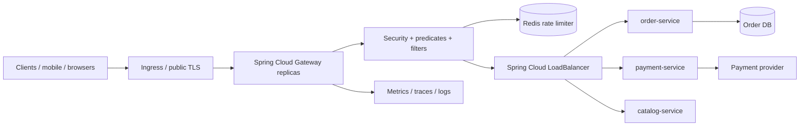
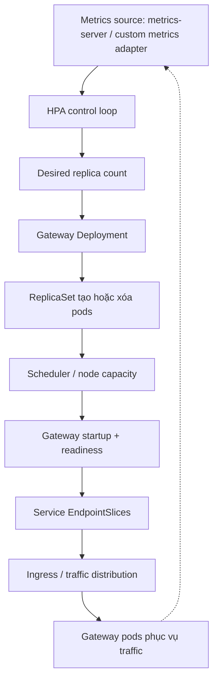
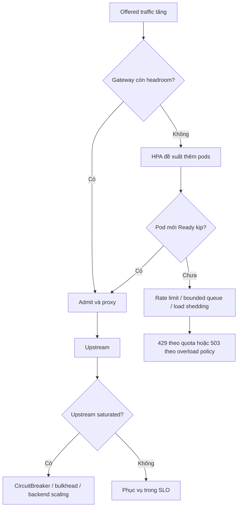
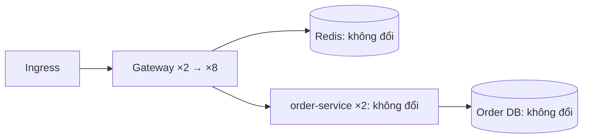
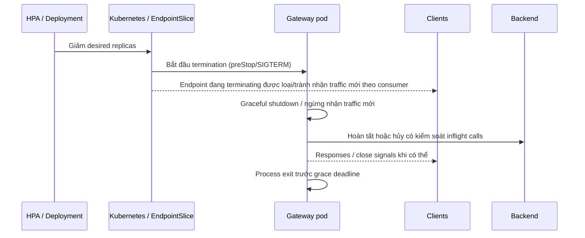
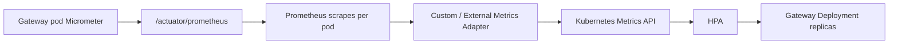

# Tự động mở rộng theo tải và tín hiệu bão hòa

Khi đưa **Spring Cloud Gateway** vào môi trường nhiều microservices, câu hỏi triển khai không chỉ là “chạy mấy Gateway pods?”, mà là **khi nào phải tăng/giảm số bản sao, dựa vào chỉ số nào, và làm sao để thay đổi đó không gây gián đoạn**. Một Gateway có thể xử lý tốt 500 request/giây trên hai pods nhưng trở nên chậm dưới 2.000 request/giây vì CPU, Reactor Netty event loop, outbound connection pool, Redis rate limiter hoặc chính backend đã chạm trần. Tăng pods có thể hữu ích trong trường hợp đầu, nhưng cũng có thể làm một backend đang nghẽn chịu thêm tải.

Bài thuộc chương **Triển khai**, với chủ đề **tự động mở rộng theo tải và tín hiệu bão hòa** cho hệ thống **Spring Cloud Gateway**. Nội dung đặt trong toàn bộ luồng xây dựng API Gateway: route predicate và filter chain, biến đổi đường dẫn/header, khám phá dịch vụ `lb://`, Spring Security/JWT, Redis rate limiting, Retry, CircuitBreaker, TLS và quan sát request để vận hành cổng vào microservices an toàn.

Trọng tâm là **Spring Cloud Gateway Server WebFlux với Reactor Netty triển khai trên Kubernetes**. Các ví dụ dùng HPA, metrics-server, Micrometer/Prometheus và lựa chọn KEDA nếu môi trường đã cài đặt. **Server Web MVC** chạy trên Servlet stack có chỉ số và cơ chế graceful shutdown khác; không bê nguyên các metric Reactor Netty hay reactive-specific filters sang MVC. Cú pháp property Gateway, metric names và hành vi startup/readiness còn tùy Spring Boot/Spring Cloud/Kubernetes/KEDA version được pin.

> **Ranh giới thực hành:** Ví dụ chỉ dành cho staging/lab hoặc hệ thống mà người triển khai được cấp phép quản trị. Không áp dụng trực tiếp resource limits, HPA hoặc stress test lên production khi chưa có SLO, budget và kế hoạch rollout/rollback. Các số RPS, CPU, số pods, thời gian chờ trong bài đều **minh họa** để đọc hiểu công thức, không phải mức khuyến nghị dùng chung.

## 1. Vấn đề: traffic tăng nhưng không phải bottleneck nào cũng nằm ở Gateway

Giả sử Gateway đang đứng trước ba dịch vụ:



Một đợt flash sale có thể tạo ba kịch bản hoàn toàn khác nhau:

1. **Gateway CPU-bound:** JWT verification, JSON/body transformation hoặc custom filter xử lý CPU nhiều; thêm Gateway pods có thể phân phối tải CPU.
2. **Gateway I/O-bound:** Outbound pool pending tăng vì connections hoặc Netty event loop bị block; thêm Gateway pods *có thể* giúp nếu nguyên nhân là giới hạn **mỗi pod**, nhưng có thể làm backend nghẽn hơn.
3. **Backend/Redis-bound:** Order database, Redis hoặc payment provider đã saturated; nhân Gateway pods thường **không làm tăng capacity thực** của dependency chung.

Do đó, autoscaling cần đi kèm câu hỏi:

**“Tài nguyên nào đang bão hòa, thêm một Gateway pod có làm tăng thông lượng hữu dụng mà vẫn giữ độ trễ và dữ liệu đúng không?”**

## 2. Các thuật ngữ cần phân biệt

| Thuật ngữ | Ý nghĩa | Ví dụ |
| --- | --- | --- |
| **Replica** | Một tiến trình/pod Gateway độc lập | `gateway-7c8f6f-abc12` |
| **Horizontal scaling** | Tăng/giảm số replicas | 2 → 4 Gateway pods |
| **Vertical scaling** | Thay CPU/memory của pod | request CPU 300m → 500m |
| **HPA** | Kubernetes HorizontalPodAutoscaler điều chỉnh replica count từ metrics | CPU utilization target 65% |
| **Cluster Autoscaler/Karpenter** | Bổ sung/thu hẹp node capacity khi cần | Thêm node để đặt pod Pending |
| **Saturation** | Một resource gần hoặc vượt capacity hữu dụng | Pool active gần max, queue tăng |
| **Autoscaling signal** | Metric dùng ra quyết định scale | CPU utilization hoặc custom metric |
| **SLI/SLO** | Chỉ số/mục tiêu chất lượng dịch vụ | p95 300 ms, 99,9% availability |
| **Load shedding** | Từ chối nhanh phần tải không thể phục vụ | 429 theo quota, 503 theo overload policy |
| **Graceful shutdown/drain** | Ngừng nhận tải mới, hoàn thành/hủy có kiểm soát công việc đang mở | Readiness off, đợi connections |
| **Scale-out lag** | Thời gian từ cần thêm capacity đến pod mới Ready/được route traffic | Metric lag + scheduling + startup |
| **Scale-in** | Giảm replicas | 8 → 4 pods, phải bảo vệ inflight sessions |

**Autoscaling không thay thế rate limiting hay circuit breaker.** HPA thường mất thời gian tổng hợp metrics, xác định replica count, schedule pod và khởi động JVM. Một spike 10 giây có thể kết thúc trước khi pod mới sẵn sàng.

## 3. Khung tư duy: tín hiệu nhu cầu, tín hiệu bão hòa và tín hiệu kết quả

Một dashboard tự mở rộng đáng tin có ba nhóm:

| Nhóm | Câu hỏi | Chỉ số ví dụ |
| --- | --- | --- |
| **Demand** | Bao nhiêu tải đang muốn đi vào? | Incoming RPS, request arrivals, active sessions |
| **Saturation** | Tài nguyên nào chạm giới hạn? | CPU throttling, pending acquire, event loop lag, memory pressure |
| **Outcome** | Người dùng nhận trải nghiệm ra sao? | p95/p99, 5xx, timeout, 429, completed RPS |

Nếu chỉ có demand: bạn thấy 1.000 RPS nhưng không biết 2 pods còn dư hay thiếu capacity.

Nếu chỉ có CPU: bạn thấy 30% CPU nhưng không biết requests đang chờ outbound connections và hết deadline.

Nếu chỉ có p95: bạn biết chậm nhưng không biết thêm Gateway pods có tác dụng hay chỉ làm backend chậm hơn.

**Đề xuất vận hành:** Chọn scaling signal đã chứng minh tương quan với **bottleneck mà replica mới giải quyết được**, đồng thời dùng các metric khác làm **guardrail, alert và chẩn đoán**.

## 4. HPA vận hành như thế nào?

Kubernetes **HorizontalPodAutoscaler** là một controller điều chỉnh `scale` subresource của target như Deployment dựa trên metric mà Kubernetes có thể đọc.



Chu kỳ khái quát:

1. Metrics infrastructure thu số liệu từ pods.
2. HPA đọc metric hiện tại và so với target.
3. Controller tính số replicas mong muốn.
4. HPA áp min/max, stabilization và scaling policies.
5. Deployment tạo/xóa pods.
6. Pods mới qua scheduling, image pull, JVM startup, health checks.
7. Service/Ingress bắt đầu định tuyến traffic đến các endpoints Ready.
8. Autoscaler tiếp tục điều chỉnh khi số liệu mới xuất hiện.

**HPA chỉ tính replica count, không cấp CPU thực tế cho node.** Nếu cluster không còn node capacity, nhiều pods sẽ nằm Pending. Cần quan sát Kubernetes Scheduler và cơ chế node autoscaler riêng.

### Công thức HPA để hình dung

Ở mức cơ bản:

\[
R_{\text{desired}} \approx
\left\lceil
R_{\text{current}}\times
\frac{M_{\text{current}}}{M_{\text{target}}}
\right\rceil
\]

Giả sử:

- Có 2 Gateway pods.
- CPU utilization trung bình là 130% so với CPU request.
- Target CPU utilization là 65%.

\[
\left\lceil 2\times\frac{130}{65}\right\rceil=4
\]

Controller *có thể* đề xuất 4 replicas. Nhưng **đây là mô hình đơn giản hóa**, không phải kết quả luôn chính xác. HPA thực tế áp tolerance, xử lý thiếu metrics, pods chưa Ready, stabilization windows, policies, min/max replicas và trạng thái controller.

## 5. Chọn CPU utilization làm bước đầu có thể kiểm soát

CPU là tín hiệu cơ bản vì Kubernetes thường hỗ trợ sẵn qua **metrics-server**.

Trong HPA resource metric:

- `averageUtilization: 65` nghĩa CPU usage bình quân tương ứng **65% của CPU requests** trên các pods hợp lệ.
- **Không** phải 65% của số CPU vật lý trên node.
- **Không** phải 65% của CPU limit.
- **Không** tự đo được HTTP latency hoặc outbound pool pressure.

Ví dụ container có:

```yaml
resources:
  requests:
    cpu: 300m
    memory: 512Mi
  limits:
    cpu: "1"
    memory: 1Gi
```

Khi HPA target 65% CPU utilization, mốc tham chiếu là khoảng:

\[
300m\times0{,}65=195m
\]

Tức trung bình ~195 millicores CPU được dùng trên mỗi pod theo phép đo tương ứng. Đây không phải quy định rằng pod không thể dùng hơn 195m; nó là **điểm mục tiêu** để HPA điều chỉnh số bản sao.

**CPU requests cần có** để tính resource utilization tương ứng. Nếu requests không được khai báo hoặc metrics-server không cung cấp số liệu, HPA có thể không tính được tỷ lệ đúng.

### Vì sao không dùng CPU limit làm target?

CPU limit có thể gây **throttling** khi container cố sử dụng nhiều hơn limit trong các chu kỳ cgroup. Khi CPU bị throttled, p95/p99 có thể tăng dù JVM không có exception. CPU request quyết định scheduling guarantee và mẫu số HPA; CPU limit đặt upper bound riêng.

Nếu mục tiêu là response time chặt, theo dõi **CPU usage + throttling + client p95**, không chỉ % utilization.

## 6. Deployment mẫu: CPU/memory requests, probes và shutdown

Dưới đây là manifest **minh họa** cho Gateway WebFlux. Cần thay image, labels, secrets, service account và cấu hình mạng theo môi trường đã được phê duyệt.

```yaml
apiVersion: apps/v1
kind: Deployment
metadata:
  name: api-gateway
  labels:
    app: api-gateway
spec:
  replicas: 2
  strategy:
    type: RollingUpdate
    rollingUpdate:
      maxSurge: 1
      maxUnavailable: 0
  selector:
    matchLabels:
      app: api-gateway
  template:
    metadata:
      labels:
        app: api-gateway
    spec:
      terminationGracePeriodSeconds: 60
      containers:
        - name: gateway
          image: registry.example.invalid/platform/api-gateway:1.2.3
          ports:
            - name: http
              containerPort: 8080
          resources:
            requests:
              cpu: 300m
              memory: 512Mi
            limits:
              cpu: "1"
              memory: 1Gi
          startupProbe:
            httpGet:
              path: /livez
              port: http
            periodSeconds: 5
            failureThreshold: 30
          readinessProbe:
            httpGet:
              path: /readyz
              port: http
            periodSeconds: 5
            failureThreshold: 3
          livenessProbe:
            httpGet:
              path: /livez
              port: http
            periodSeconds: 10
            failureThreshold: 3
```

Các đặc điểm:

- **Hai replicas ban đầu** để có ít nhất hai Gateway endpoints khi ổn định.
- **RollingUpdate** với `maxUnavailable: 0` cho phép rollout tránh chủ động giảm số pod sẵn có, với điều kiện cluster đủ resources để tạo pod mới.
- `startupProbe` cho phép JVM có thời gian startup ban đầu trước khi liveness/readiness probes tác động theo chính sách Kubernetes.
- `readinessProbe` quyết định pod có nằm trong tập endpoints để nhận traffic mới hay không.
- `livenessProbe` phát hiện process kẹt cần restart, không phải điều khiển backend routing.
- `terminationGracePeriodSeconds` chừa ngân sách cho shutdown, nhưng **không tự bảo đảm** mọi HTTP/WebSocket session sẽ được xử lý hết.
- Resource requests cho phép scheduler đặt pods và làm cơ sở CPU HPA.

**Không để `/livez` và `/readyz` trỏ vào endpoint không có thật.** Cần cấu hình Actuator health probes và kiểm tra GET trực tiếp trên cổng ứng dụng, nếu không Deployment sẽ mãi NotReady hoặc crash-loop.

### Khi bật HPA, ai sở hữu trường `replicas`?

HPA sẽ cập nhật số bản sao của Deployment. Nếu GitOps/Helm liên tục áp lại `spec.replicas: 2`, hai controller có thể giằng co. Cần thiết kế ownership rõ: giá trị bootstrap/minReplicas và chính sách đồng bộ manifests, tránh để pipeline deployment ghi đè HPA scale decisions sau mỗi reconcile.

## 7. Spring Boot readiness/liveness và graceful shutdown

Một cấu hình ứng dụng có thể là:

```yaml
server:
  port: 8080
  shutdown: graceful

spring:
  lifecycle:
    timeout-per-shutdown-phase: 30s

management:
  endpoint:
    health:
      probes:
        enabled: true
        add-additional-paths: true
  endpoints:
    web:
      exposure:
        include: "health,info,metrics,prometheus"
```

Trong các dòng Spring Boot hỗ trợ `add-additional-paths`, health probe paths như `/livez` và `/readyz` có thể được expose trên **main server port**. Kiểm tra actual route mappings/Actuator output ở version đang chạy.

**Vì sao dùng main port?** Nếu management server chạy cổng riêng, management probe có thể vẫn báo UP trong khi main application listener không nhận requests. Probes trên main port giúp giảm nguy cơ false-ready. Tuy nhiên health probe chỉ kiểm tra phạm vi mà nó được cấu hình, không chứng minh mọi route/backend phục vụ được.

### Liveness và readiness có nhiệm vụ khác nhau

**Liveness:**

- Tín hiệu “process này còn khả năng tự hoạt động không?”.
- Không nên phụ thuộc vào mọi backend/Redis/Identity Provider, vì dependency shared outage có thể khiến **tất cả Gateway pods restart liên tục**.
- Chỉ restart khi process thực sự không tự phục hồi.

**Readiness:**

- Tín hiệu “có nên đưa traffic mới đến pod này không?”.
- Phản ánh lifecycle startup/shutdown và một số dependency cần thiết theo chính sách.
- Tránh đánh dấu tất cả Gateway pods NotReady chỉ vì một backend không khỏe nếu Gateway còn có thể phục vụ các routes khác, fallback hoặc 429 chính đáng.

**Health=UP không có nghĩa tất cả route predicates, Redis limiters, TLS outbound và backends đều khỏe.** Cần metric/trace theo route.

### Không biến readiness thành hệ thống cân bằng tải theo từng route

Kubernetes Service readiness là cấp **pod**, trong khi Gateway phục vụ nhiều routes. Nếu `payment-service` lỗi nhưng `catalog-service` khỏe, đánh dấu cả Gateway NotReady có thể làm **catalog** cũng ngừng phục vụ. Readiness nên bám khả năng nhận traffic chung của pod, và dùng circuit breaker/route-specific fallback/rate limit cho dependency lỗi.

## 8. HPA v2 cơ bản theo CPU

```yaml
apiVersion: autoscaling/v2
kind: HorizontalPodAutoscaler
metadata:
  name: api-gateway
spec:
  scaleTargetRef:
    apiVersion: apps/v1
    kind: Deployment
    name: api-gateway
  minReplicas: 2
  maxReplicas: 10
  metrics:
    - type: Resource
      resource:
        name: cpu
        target:
          type: Utilization
          averageUtilization: 65
  behavior:
    scaleUp:
      stabilizationWindowSeconds: 0
      selectPolicy: Max
      policies:
        - type: Percent
          value: 100
          periodSeconds: 60
        - type: Pods
          value: 2
          periodSeconds: 60
    scaleDown:
      stabilizationWindowSeconds: 300
      selectPolicy: Min
      policies:
        - type: Pods
          value: 1
          periodSeconds: 60
```

Giải thích:

- `minReplicas: 2`: không giảm dưới hai pods khi HPA đang quản lý và cluster triển khai bình thường.
- `maxReplicas: 10`: giới hạn số pods HPA có thể đề xuất; đây **không phải tổng capacity bảo đảm**.
- `averageUtilization: 65`: target CPU của resource metric.
- Scale-up `Percent 100` hoặc `Pods 2` với `selectPolicy: Max`: trong khung policies, chọn mức tăng lớn hơn theo các ràng buộc.
- Scale-down với `stabilizationWindowSeconds: 300` và giới hạn một pod/60s: giảm từ từ để tránh dao động và mất capacity đột ngột.

**Các behavior fields là tùy chọn của HPA v2 trên các Kubernetes versions hỗ trợ; semantics chính xác do controller áp dụng.** Các giá trị này chỉ là ví dụ; lựa chọn thật phụ thuộc startup time, burst, backend capacity, node headroom và SLO.

### Tại sao scale up nhanh nhưng down chậm?

- Scale-up chậm làm thiếu capacity khi traffic tăng.
- Scale-down quá nhanh làm mất warm pools, cache locality và active connections, sau đó HPA lại tăng vì latency/CPU.
- Rolling deploy và scale-down đồng thời có thể tạo nhiều terminations.
- WebSocket/SSE hoặc requests kéo dài làm ngừng pod có rủi ro hơn GET ngắn.

**Scale-down stabilization là điều kiện cần, không đủ.** Vẫn phải làm readiness/draining/shutdown đúng.

## 9. Điều kiện để HPA thực sự hoạt động

Trước khi chờ tự động scale:

1. Cluster có `metrics-server` hoặc metrics pipeline hỗ trợ CPU/memory resource metrics.
2. Deployment target tồn tại và HPA có quyền đọc/cập nhật scale subresource.
3. Container có CPU requests hợp lệ.
4. Replica pods chạy và metrics mới xuất hiện.
5. Min/max và scaling policies không chặn mong muốn.
6. Kubernetes Scheduler có resources để đặt pods mới.
7. Container image có thể pull, secrets/config có mặt và JVM khởi động được.
8. Readiness probe phản ánh đúng trạng thái phục vụ.
9. Gateway Service/Ingress định tuyến đến endpoints mới.
10. Quan sát được `desiredReplicas` và `readyReplicas`, không nhầm hai số này.

Các lệnh kiểm tra ở **namespace test được cấp phép**:

```bash
kubectl -n gateway-test get deployment api-gateway
kubectl -n gateway-test get hpa api-gateway
kubectl -n gateway-test describe hpa api-gateway
kubectl -n gateway-test top pods -l app=api-gateway
kubectl -n gateway-test get pods -l app=api-gateway -o wide
kubectl -n gateway-test rollout status deployment/api-gateway
```

Nếu `kubectl top` không hiện dữ liệu, xem metrics-server/API availability. Nếu `desiredReplicas` tăng nhưng pods Pending, xem Scheduler/node capacity; đó không phải Gateway filter issue.

## 10. HPA status: desired, current, ready và conditions

Bốn con số giúp tránh kết luận sai:

| Tín hiệu | Ý nghĩa | Sai lầm phổ biến |
| --- | --- | --- |
| **Current replicas** | Số replicas Deployment đang quản lý/ghi nhận | Cho rằng tất cả đều nhận traffic |
| **Desired replicas** | Số replicas controller mong muốn | Cho rằng đã có capacity mới |
| **Ready replicas** | Số pods qua readiness và được Deployment xem là Ready | Cho rằng mọi endpoint đang phục vụ đúng mọi route |
| **Available replicas** | Số pods đạt điều kiện availability của Deployment | Cho rằng backend/dependency đã đủ capacity |
| **HPA conditions** | Vì sao HPA có thể/có được scale | Bỏ qua missing metrics hoặc max limit |

Một HPA có thể báo `desired=8`, nhưng chỉ `ready=3` do node không có đủ CPU. Lúc đó không nên tiếp tục tăng `maxReplicas` mà bỏ qua scheduling bottleneck.

Một số HPA condition names hữu ích gồm `AbleToScale`, `ScalingActive` và `ScalingLimited`; kiểm tra phiên bản Kubernetes và mô tả thực trong `kubectl describe hpa`.

## 11. CPU scaling không phù hợp với mọi kiểu Gateway saturation

Một Gateway WebFlux có thể CPU thấp nhưng:

- Outbound connection pool **active≈max**, `pending acquire` tăng.
- Backend trả chậm hoặc TCP/TLS connections gặp timeout.
- Netty event loop bị block trong custom filter.
- Redis rate limiter command latency tăng.
- DNS/DiscoveryClient không có instance khỏe.
- WebSocket connections tồn tại lâu, direct memory tăng.
- Một route response cache/streaming giữ buffers và khách hàng đọc chậm.

**Thêm replicas chỉ hữu ích nếu bottleneck thật có thể chia theo pod** và dependency chung chưa saturated.

### Các tình huống cần phân biệt

| Quan sát | Scale Gateway có khả năng giúp? | Điều tra trước |
| --- | --- | --- |
| Gateway CPU cao, backend/Redis còn headroom | **Có thể** | CPU throttling, per-pod RPS, filter CPU |
| Per-pod connection limit chạm trần, backend còn dư | **Có thể** | Pool scope, acquire duration, backend capacity |
| Upstream p95/DB pool đã saturated | **Thường không** | Backend scaling, DB tuning, load shedding |
| Redis command latency cao toàn cụm | **Thường không** | Redis capacity/latency, rate decision volume |
| Event loop bị block bởi code | **Chỉ che bớt triệu chứng** | Sửa blocking filter, dùng async |
| Một backend instance lỗi trong `lb://` | **Không trực tiếp** | Readiness/discovery/instance drainage |
| Gateway direct memory gần container limit do leak | **Không sửa leak** | Buffer lifecycle, caching, replay |
| Kết nối WebSocket dày và đều trên mọi pods | **Có thể cho kết nối mới** | Drain/stickiness, active sessions |
| HPA muốn scale nhưng pods Pending | **Chưa** | Node autoscaler, quotas, images, topology |

Không “scale để chữa `404`” khi `RewritePath` sai. Correctness, auth và route matching phải được kiểm tra độc lập với capacity.

## 12. Metrics Gateway nên có trước khi chọn scale signal

| Nhóm | Chỉ số | Mức độ tin cậy/đặc điểm |
| --- | --- | --- |
| Inbound HTTP | RPS, 429/401/403/5xx, client p95 | Biểu diễn demand/outcome, không tự chỉ bottleneck |
| Route metrics | `spring.cloud.gateway.requests` theo route ID, status, duration | Chỉ những requests instrumentation thấy |
| HTTP client | Outbound attempts/latency/connect errors | Có Retry và selected instance effects |
| Pool | Active, idle, pending, max, pending acquire time | Có thể theo provider/remote address |
| Event loop | Pending tasks/lag, CPU, thread dumps | Blocking thường cần thêm JFR/logs |
| JVM/process | CPU usage/throttling, heap, GC, direct allocator, RSS | Nhiều nguồn bộ nhớ không trùng |
| Redis | Decision latency/errors, CPU, used memory, key count | Có thể là bottleneck chung |
| Resilience4j | CircuitBreaker OPEN/rejections, Retry attempts | Cần binder/instrumentation |
| Deployment | Ready pods, desired pods, startup/readiness time | Xác nhận autoscaling tạo capacity thật |
| Backend | Per-instance latency/errors/DB pool | Xác định có thể tiếp nhận thêm tải không |

**Không phải tất cả meter tự xuất hiện.** Spring Cloud Gateway Server WebFlux, Reactor Netty và Micrometer có enablement/naming riêng theo version. Hãy liệt kê `/actuator/metrics` và raw `/actuator/prometheus` từ ứng dụng thật.

### Từ Actuator đến Prometheus

Một cấu hình management (giới hạn access bằng network/security) có thể expose:

```yaml
management:
  server:
    port: 9090
  endpoints:
    web:
      exposure:
        include: "health,info,metrics,prometheus"
  metrics:
    tags:
      application: api-gateway
```

Cần dependency `spring-boot-starter-actuator` và `micrometer-registry-prometheus` trong bản hỗ trợ. Chạy management port tách mạng, không đưa `/actuator/prometheus` ra public chỉ để HPA có metrics.

**HPA CPU resource metrics không yêu cầu Prometheus.** Nhưng HPA custom metrics/Prometheus-based KEDA cần metrics adapter/scaler để chuyển số liệu vào API Kubernetes. **Prometheus server một mình không làm HPA đọc được custom RPS.**

## 13. CPU, memory và custom metrics: chọn cái nào?

| HPA metric type | Nguồn | Ưu điểm | Rủi ro |
| --- | --- | --- | --- |
| **Resource CPU** | metrics-server | Phổ biến, ít phức tạp | Bỏ sót I/O-bound/pool saturation |
| **Resource memory** | metrics-server | Phát hiện memory use theo pod | Pooled direct memory/caches không giảm khi down, không luôn tương quan capacity |
| **Pods custom metric** | Custom Metrics API adapter | Ví dụ in-flight hoặc admitted RPS/pod | Cần adapter đúng label/pod mapping |
| **Object metric** | Metric gắn Kubernetes object | Dùng cho object-level signal | Cần adapter/schema phù hợp |
| **External metric** | External Metrics API/KEDA | Redis queue, Prometheus aggregate, traffic demand | External metric outage, cardinality, query lag |
| **Multiple HPA metrics** | Resource + custom/external | Có thể phản ánh nhiều giới hạn | Metric xấu có thể gây scale thừa/chặn downscale |

Không thêm cả CPU, memory, RPS, p95, pool pending vào cùng HPA mà không định nghĩa **tín hiệu nào scale được**. Trong HPA đa metric, controller thường tính desired replicas theo từng metric và chọn mức đề xuất lớn nhất phù hợp; một metric không hợp lệ có thể ảnh hưởng scale-down. Chi tiết cần xem Kubernetes HPA semantics của cluster.

### Vì sao memory HPA thường khó cho Gateway WebFlux?

Netty pooled direct buffers và JVM heap có thể giữ memory để tái sử dụng sau burst. Memory usage không giảm tức thì khi traffic giảm. Nếu HPA dựa hoàn toàn vào memory, có thể **không scale down** dù pods không còn bận. Ngược lại, khi memory đã gần OOM, scale-up có thể đến quá muộn. Dùng memory trước hết như **budget/alert**, rồi kiểm tra liệu nó thực sự là tín hiệu scaling phù hợp.

## 14. Chọn tín hiệu bão hòa theo causal chain

Một chuỗi quá tải outbound HTTP có thể là:

```text
Backend response chậm
  -> Gateway outbound active connections giữ lâu
  -> active gần max
  -> pending acquire tăng
  -> acquire wait/p95 tăng
  -> timeout/5xx tăng
```

Nhìn riêng `pending_connections` **không đủ** để ra lệnh scale Gateway. Cần xác định backend chậm là nguyên nhân hay pool per-pod quá nhỏ. Nếu backend còn 50% headroom nhưng Gateway một pod quá ít slots, scale-out có thể tăng tổng pool capacity. Nếu DB đã full, tăng Gateway pods sẽ tạo thêm outbound attempts và có thể làm hệ thống sụp đổ.

### Phân biệt chỉ số kích hoạt với chỉ số guardrail

- **Trigger:** Một metric được xác thực có quan hệ với capacity mỗi Gateway pod, ví dụ CPU hoặc in-flight admitted requests/pod.
- **Guardrail:** Backend 5xx/DB saturation, Redis latency, breaker state để tránh tuyên bố scaling thành công khi downstream suy giảm.
- **Alarm:** p95/p99 hoặc user-visible errors tăng; cần người/kịch bản xử lý.
- **Debug signal:** Pending acquire theo remote pool, event loop lag, DNS/TLS error để định vị sự cố.

Một hệ thống có thể dùng CPU HPA ban đầu, còn pool pending là **alert quyết định cần điều tra**. Chỉ sau controlled test chứng minh quan hệ mới nâng pending/in-flight thành custom HPA metric.

## 15. Không scale theo raw p95 mà không kiểm tra hành vi

p95 latency rất quan trọng cho SLO, nhưng dùng trực tiếp làm tín hiệu HPA thường khó:

- p95 biến động mạnh khi traffic ít.
- p95 có thể tăng vì backend/Redis chung; thêm Gateway không sửa.
- p95 có thể giảm giả khi nhiều requests bị 429 rất nhanh.
- Percentile theo pod **không thể lấy trung bình** thành p95 cluster.
- Histogram buckets/scrape window tạo độ trễ phản hồi.
- Scaling thay traffic distribution và làm đường percentile dao động.

Để đánh giá p95, tổng hợp Prometheus histogram đúng theo `le`, ví dụ khi có `spring_cloud_gateway_requests_seconds_bucket`:

```promql
histogram_quantile(
  0.95,
  sum by (le, routeId) (
    rate(spring_cloud_gateway_requests_seconds_bucket[5m])
  )
)
```

Không dùng một graph p95 làm cơ chế autoscaling mà không gắn **workload, error rate, upstream headroom và windows**.

## 16. RPS trên mỗi pod: đơn giản nhưng cần điều kiện

Nếu benchmark chứng minh mỗi Gateway pod phục vụ tối đa khoảng 400 **admitted** RPS dưới SLO cho traffic mix hiện tại, có thể chọn target thấp hơn để giữ headroom, ví dụ 280 RPS/pod.

Một ước lượng capacity:

\[
R_{\text{needed}} \approx
\left\lceil \frac{\lambda_{\text{offered}}}
{\lambda_{\text{safe per pod}}}\right\rceil
\]

Với 1.100 admitted RPS và target 280 RPS/pod:

\[
R_{\text{needed}} \approx \lceil 1100/280\rceil =4
\]

**Đây là estimate ban đầu**, không phải HPA thuật toán chuẩn hoặc cam kết throughput. Cần load test với backend đủ capacity, traffic mix, JWT validation, TLS, cache hit, body size và retries đúng thực tế.

### Dùng “offered” hay “admitted” RPS?

- **Offered RPS** bao gồm request đi vào, kể cả bị Security/RateLimiter chặn.
- **Admitted RPS** là request đã qua admission đi tới một phần pipeline/proxy.
- **Completed RPS** là số response hoàn tất trong cửa sổ.

Nếu đo chỉ admitted RPS, một đợt tấn công 20.000 RPS bị RateLimiter deny nhanh có thể không làm scaling metric tăng; điều đó có thể **đúng policy** nếu lượng denied không làm nghẽn Gateway.

Nếu đo offered RPS, HPA có thể scale nhiều pod chỉ vì một client liên tục bị `429`, trong khi quota không thay đổi. Cần xét **chi phí xử lý denied traffic**, security threats và policy (Ingress/WAF phải cắt tải sớm).

Không có một RPS metric phù hợp cho mọi route.

## 17. CPU thấp nhưng event loop bị block

Một reactive Gateway có custom `GatewayFilter` gọi API đồng bộ:

```java
// ANTI-PATTERN: Có thể block thread xử lý WebFlux.
public Mono<Void> filter(ServerWebExchange exchange,
                         GatewayFilterChain chain) {
    legacyClient.fetchBlocking();
    return chain.filter(exchange);
}
```

Khi callback bị block, nhiều requests có thể bị trì hoãn dù CPU không cao. Thêm pods có thể tạm giảm phần tải mỗi pod nhưng **không sửa lỗi non-blocking** và dễ làm kết quả khó dự đoán khi traffic tăng tiếp.

Giải pháp ưu tiên:

- Thay blocking client bằng asynchronous/reactive client nếu có.
- Nếu buộc phải dùng blocking, cô lập vào scheduler phù hợp với concurrency/timeout budget.
- Đo event loop pending tasks, JFR thread stack, client p95, CPU và call durations.
- Kiểm thử dưới tải và qua cancellation.
- Giữ circuit breaker/bulkhead cho dependency blocking.

**HPA không phải công cụ sửa bug event loop.**

## 18. Connection pool là giới hạn per pod hay per backend?

Reactor Netty `HttpClient` có `ConnectionProvider` để tái sử dụng outbound connections. Những metric quen thuộc ở nhiều phiên bản:

```text
reactor.netty.connection.provider.active.connections
reactor.netty.connection.provider.idle.connections
reactor.netty.connection.provider.pending.connections
reactor.netty.connection.provider.max.connections
reactor.netty.connection.provider.pending.connections.time
```

Chúng có thể phân theo provider name/remote address, không tự có `routeId`. Một route `lb://order-service` có thể chọn nhiều instances và nhiều pools. Vì vậy khi so:

```text
Gateway-A:
  backend-1 pool active=100/max=100, pending=80
  backend-2 pool active=10/max=100, pending=0
```

Không lấy tổng active 110/tổng max 200 rồi kết luận chỉ 55% utilization và mọi thứ ổn. **Một remote pool đã saturated**.

### Khi scale Gateway làm pool capacity tăng

Nếu mỗi pod được phép 100 connections tới cùng backend và số Gateway pods tăng 2 → 8, tổng connections *có thể* tăng từ khoảng 200 lên 800. Điều này giúp nếu backend có thể tiếp nhận, nhưng cũng có thể gây **file descriptor exhaustion, DB pool saturation, TLS handshake pressure** ở backend.

Cần đối chiếu backend connection/concurrency budget trước khi tăng `maxReplicas`.

## 19. Scale-out lag và lý do phải có headroom

Tổng độ trễ scale có thể gồm:

```text
Metrics sampling/scrape
+ HPA reconciliation
+ ReplicaSet/Deployment reconciliation
+ Kubernetes scheduling
+ Node provisioning (nếu thiếu)
+ Image pull
+ JVM class loading + caches
+ Spring Boot startup
+ readiness probe
+ Service/Ingress endpoint propagation
```

Một spike 20 giây có thể xảy ra **trước khi pod mới Ready**. Dù `scaleUp` stabilization bằng 0, startup JVM, cold connection pool, JWT JWK cache và pod scheduling vẫn tốn thời gian.

**Vì vậy:** Autoscaling xử lý **tải kéo dài** và phần nào traffic ramp, nhưng không thay thế:

- Capacity headroom tối thiểu.
- Pre-warming/MinReplicas trước sự kiện đã biết.
- Rate limits ở Ingress/Gateway.
- Bulkheads/concurrency bounds.
- Bounded queues và request deadlines.
- CDN/cache khi đúng tính riêng tư.
- Retry budget/circuit breakers.

### Ví dụ tính scale lag

Giả sử Gateway đang có hai pods, mỗi pod chạy an toàn 300 admitted RPS. Traffic nhảy từ 400 lên 1.800 RPS trong 15 giây. Để phục vụ đủ tải cần khoảng sáu pods, nhưng nếu pods mới chỉ Ready sau 45 giây thì **không thể trông cậy HPA để hấp thụ 15 giây đầu**.

Đây là lý do nên chuẩn bị `minReplicas`/scheduled pre-scale cho giờ bán hàng hoặc launch event đã được dự đoán.

## 20. Admission control và autoscaling phải phối hợp



Sơ đồ là một **quy trình ra quyết định khái niệm**; không phải HPA tự gọi GatewayFilter hoặc biết backend headroom. Các cơ chế phải được cấu hình và kiểm thử độc lập.

### Vì sao queue không giới hạn nguy hiểm?

Mỗi pending request có thể giữ headers, buffers, auth context, retries và connection state. Nếu client deadline là 2 giây nhưng request phải chờ 15 giây mới tới backend, dù cuối cùng được gửi, kết quả có thể đã vô nghĩa đối với client.

Thay vì queue vô hạn, nên:

1. Định nghĩa accepted throughput và maximum in-flight.
2. Đặt pending acquire/concurrency limits.
3. Đặt total deadline và per-attempt timeout phù hợp.
4. Shed/deny theo chính sách khi vượt budget.
5. Giám sát rejected requests và user-visible 5xx/429.
6. Scale-out có kiểm soát khi **thêm pod thực sự giúp**.

## 21. Redis rate limiter khi tăng số Gateway replicas

Nếu Gateway dùng `RequestRateLimiter` + `RedisRateLimiter`, một quota per-user/per-tenant cần **được chia sẻ trên mọi Gateway replicas**, khi đó:

- Cùng Redis cluster/namespace.
- Cùng effective route ID nếu RedisRateLimiter phân bucket theo route ID.
- Cùng `KeyResolver` lấy identity **đã xác thực**.
- Cùng `replenishRate`, `burstCapacity` và `requestedTokens`.
- Cùng fail policy và Redis client connectivity.
- Route refresh/deploy config hội tụ giữa replicas.

```text
Trước scale:
  Gateway A + B -> shared Redis bucket (Alice)

Sau scale:
  Gateway A + B + C + D -> VẪN cùng bucket (Alice)
```

Nếu dùng local in-memory buckets per Gateway, HPA scale 2 → 8 có thể **nhân hạn mức hiệu dụng** cho một user theo số pods. Với Redis chung đúng cách, số Gateway replicas không nên làm tăng quota của một subject/route chỉ vì có thêm pods.

### Không coi RedisRateLimiter là giới hạn concurrency toàn backend

Token bucket giới hạn lưu lượng trung bình/burst **theo key**, không phải tổng requests đồng thời. 10.000 users, mỗi user 10 RPS, vẫn có thể tạo 100.000 requests/s vượt khả năng backend.

Cần cân nhắc global admission, bulkheads, backend capacity và WAF/Ingress throttling. Nếu 429 tăng do quota intentional, autoscaling Gateway dựa **mọi 429** có thể chỉ tốn thêm pods mà không tăng số request được phục vụ.

## 22. Retry và CircuitBreaker quyết định tải hiệu dụng

Một client request có thể tạo nhiều upstream attempts:

```text
Client GET /api/orders/42
  -> attempt 1 tới backend-A: 503
  -> attempt 2 tới backend-B: 503
  -> attempt 3 tới backend-C: 200
Client nhận 200 nhưng backend đã nhận 3 attempts
```

Nếu 600 client requests/s nhưng trung bình 2 attempts/request:

\[
\text{upstream attempts/s}\approx 600\times 2=1.200
\]

Backend chịu gấp đôi tải dù HPA chỉ thấy 600 Gateway logical requests/s.

**Scale Gateway có thể vô tình làm Retry storm trầm trọng hơn** nếu nhiều pods mới cùng tạo outbound attempts tới service đã saturated.

Cần đo:

- Client-visible 5xx/timeout.
- Retry attempts per logical request.
- Upstream attempts per backend instance.
- CircuitBreaker state/rejections/fallback activations.
- Total request deadline và backoff time.
- Accepted/rejected traffic theo rate limiter.
- Tỷ lệ request vẫn hoàn tất trong SLO.

**Không bật Retry cho non-idempotent POST chỉ vì có thêm Gateway pods.** Dùng idempotency key và backend enforcement nếu nghiệp vụ cần retry writes.

### CircuitBreaker OPEN có cần scale Gateway không?

Nếu một service down, breaker OPEN có thể chặn calls trước outbound pool và trả fallback/503 nhanh. Gateway CPU có thể thấp, nhưng user-visible availability đang giảm. Scale Gateway **không sửa backend**. Cần alert và phục hồi dependency; HPA vẫn phục vụ theo trigger riêng nhưng không được xem đó là remediation của backend outage.

## 23. Tính replica count từ kiểm thử capacity, không từ RPS “lý tưởng”

Một bài test cho thấy:

```text
Traffic mix:
  70% GET, 20% POST, 10% streaming
  JWT verification + RedisRateLimiter + TLS
  Backend đủ headroom

Một Gateway pod:
  200 RPS: p95=120ms
  300 RPS: p95=180ms
  400 RPS: p95=330ms
  500 RPS: p95=850ms + pool pending tăng
```

Nếu SLO là p95 ≤300 ms, sustainable per-pod throughput **có thể** gần mức 300 RPS trong môi trường đó. Chọn headroom thêm vì measurement noise, spike và deployment.

Định cỡ sơ bộ:

```text
Expected sustained admitted traffic = 900 RPS
Safe operating target per pod      = 225 RPS
Estimated replicas                 = ceil(900 / 225) = 4
```

Đây mới là estimate. Cần kiểm thử 4 pods thật vì:

- Redis/Ingress/backend có thể thành bottleneck chung.
- Connection pooling và CPU scheduling thay đổi khi nhiều pods.
- Traffic distribution không cân tuyệt đối.
- HPA scale lag và readiness ảnh hưởng transient capacity.
- JVM warmup và GC overhead thay đổi.
- Long-lived WebSocket/SSE sessions không cân theo HTTP RPS.

## 24. Scale-out Gateway không tự scale microservices

Giả sử Gateway từ 2 tăng lên 8 replicas, nhưng `order-service` vẫn có 2 pods và một database pool chung:



Gateway capacity có thể tăng, nhưng backend bottleneck vẫn tồn tại. Nếu chưa có rate limit, tăng Gateway có thể tăng concurrency tới `order-service`, khiến p95 backend và 503 nặng thêm.

**Scaling strategy phải xem cả chuỗi phụ thuộc**, gồm:

- Gateway Replica/HPA.
- Ingress capacity/TLS termination.
- Redis RateLimiter throughput/latency.
- DiscoveryClient và LoadBalancer instance availability.
- Backend HPA/circuit breaker.
- Database connection pool/IOPS.
- Network bandwidth/NAT/file descriptors.
- Monitoring pipeline capacity.

Không yêu cầu tất cả services cùng scale tự động; cần xác định **bottleneck đầu tiên** và giới hạn an toàn ở mỗi hop.

## 25. Tách scaling policy cho route có chi phí khác nhau

Một Gateway có thể phục vụ:

- `catalog-read`: GET, public, response caching.
- `orders-read`: authenticated GET và LB.
- `payments-create`: POST, xác thực/authorization mạnh, latency nghiêm ngặt, không retry vô tội vạ.
- `reports-download`: response nhiều MiB, bandwidth/direct memory nặng.
- `websocket-chat`: kết nối sống lâu và queues.

Nếu dùng một HPA CPU chung, các routes này chia sẻ capacity pool. Khi báo cáo tải lớn kéo CPU/bandwidth, payment requests có thể chịu ảnh hưởng.

Các lựa chọn kiến trúc:

1. Một Gateway deployment với **rate limits/bulkheads/priority classes** rõ.
2. Tách Gateway deployments theo **workload/criticality** nếu ownership, security và vận hành cho phép.
3. Thiết kế scale signals riêng cho public traffic và streaming.
4. Giữ backend quotas để một route không dùng hết tài nguyên hệ thống.
5. Không bypass authentication/tenant authorization khi phân luồng.

**Tách deployment không phải giải pháp mặc định**: tăng chi phí config và route management. Nên có bằng chứng về interference/SLO trước khi chia.

## 26. Deployment phù hợp cho autoscaling phải stateless ở mức cần thiết

Khi HPA thêm/xóa pods, requests mới có thể tới pod bất kỳ. Vì vậy Gateway cần tránh lưu state bắt buộc trong memory của từng replica nếu state đó phải được chia sẻ.

Ví dụ:

- JWT validation qua public keys/caches có cấu hình nhất quán.
- Rate limiter quota dùng shared Redis khi cần toàn cụm.
- Route definitions được phân phối đến các replicas/refresh đồng bộ.
- Spring Security policy và trusted proxy handling nhất quán.
- Session nếu có phải có policy/namespace/store phù hợp với affinity/durability.
- Cache response local chỉ dùng cho dữ liệu đủ điều kiện, không giả định cache toàn cụm được invalidated đồng thời.
- WebSocket connection là **state sống trên pod**, không thể tự “di chuyển” sang pod mới khi scale-down.
- Correlation/tracing được propagate qua mọi Gateway replicas.

**Sticky sessions không tự giải quyết nhất quán quota hoặc authorization.** Chúng có thể giảm connection churn cho một số workloads nhưng tạo hotspot và làm scale-down khó hơn.

## 27. Readiness khi scale-out: pod Ready có thật sự phục vụ được request?

Để một pod mới tham gia traffic, kiểm tra:

1. JVM/Spring Boot đã startup xong.
2. HTTP listener trên main port nhận request.
3. Route predicates/filter definitions quan trọng đã được nạp.
4. JWT keys/issuer metadata có thể được sử dụng theo chính sách (không nhất thiết đồng bộ bắt buộc mọi JWK trước Ready).
5. Redis connection/resilience policy đã được xác định.
6. DiscoveryClient/LoadBalancer có instance list thích hợp hoặc ứng xử no-instance đúng.
7. TLS outbound truststore/cert config hợp lệ.
8. CPU/memory headroom không bị startup spike chiếm hết.
9. Metrics/tracing tags/deployment version đúng.
10. Chính sách local cache warm-up không làm pod trả dữ liệu sai.

Không nên nhồi mọi downstream health vào readiness nếu một backend lỗi sẽ làm **mọi Gateway pods NotReady**. Thay vào đó có thể dùng **synthetic route checks/canaries** và circuit breaker để kiểm tra chức năng từng tuyến.

### Startup readiness không phải “đợi 20 giây là đủ”

`initialDelaySeconds` cố định có thể sai trên nodes lạnh hoặc khi image pull dài. `startupProbe` và `readinessProbe` phù hợp thường đáng tin hơn, cùng với log/tracing startup events và load tests.

## 28. Scale-in: tránh cắt inflight HTTP và WebSocket

Scale-down không đơn giản là xóa một pod. Khi Kubernetes gửi tín hiệu terminate:



**Sơ đồ mô tả ý định, không phải lịch trình tuyệt đối của mọi kube-proxy/Ingress controller.** Endpoint propagation có độ trễ; client keep-alive và long-lived connections có thể tiếp tục đi qua đường cũ. Vì vậy cần kiểm thử trên **Ingress/Service mesh version cụ thể**, không chỉ đặt `terminationGracePeriodSeconds` rồi kỳ vọng tất cả requests drain.

### Các thành phần cần đồng bộ

- HPA scale-down stabilization.
- Deployment rollout strategy/PodDisruptionBudget (PDB).
- Readiness transitions và EndpointSlice propagation.
- `server.shutdown: graceful`.
- `terminationGracePeriodSeconds` đủ cho thời gian drain có giới hạn.
- Ingress connection draining/keep-alive/timeout settings.
- Long-lived WebSocket/SSE close/reconnect policy.
- Client retry/idempotency và cancellation cleanup.
- Service discovery cache/connection pool của upstream nếu Gateway route cũng thay đổi.

**Không hứa phục vụ vô hạn WebSocket connection khi terminating.** Với connection rất dài, ứng dụng cần chủ động thông báo close/migration hoặc để client reconnect với jitter/authorization lại.

## 29. `preStop` và shutdown: giải thích đúng giới hạn

Một số deployment dùng lifecycle hook:

```yaml
lifecycle:
  preStop:
    exec:
      command:
        - /bin/sh
        - -c
        - "sleep 10"
```

Mục đích của “sleep” trong một số kiến trúc là chừa thời gian để endpoint removal lan tới proxies trước khi process thoát. Nhưng:

- **Sleep không tự làm process chuyển sang NotReady.**
- Không bảo đảm Ingress đã ngừng gửi traffic.
- Tốn một phần `terminationGracePeriodSeconds`.
- Không drain được WebSocket/SSE đúng semantics.
- Shell có thể không tồn tại trong distroless images.
- Pod bị force-kill khi hết termination grace.
- Thứ tự/timing preStop vs SIGTERM phải được kiểm chứng thực tế.

**Không xem sleep 10 giây là công thức bắt buộc hoặc đủ.** Thiết kế shutdown ở ứng dụng/proxy, kiểm thử pod termination dưới lưu lượng thật và xác định ngân sách 60 giây chỉ là ví dụ.

## 30. PodDisruptionBudget và topology spread

Một Deployment có `minReplicas=2` nhưng cả hai pods cùng nằm trên một node vẫn có rủi ro mất toàn bộ Gateway khi node lỗi.

Các biện pháp:

- `topologySpreadConstraints`/pod anti-affinity để phân bố pods qua nodes/zones khi cluster hỗ trợ.
- **PodDisruptionBudget (PDB)** để hạn chế một số voluntary disruptions.
- `maxUnavailable` trong rolling update.
- Resource requests/quota bảo đảm scheduler có thể đặt pods.
- Cluster/node autoscaling.
- Observability và network routing tới nhiều endpoints.

Ví dụ PDB:

```yaml
apiVersion: policy/v1
kind: PodDisruptionBudget
metadata:
  name: api-gateway-pdb
spec:
  minAvailable: 2
  selector:
    matchLabels:
      app: api-gateway
```

**PDB không ngăn mọi loại mất pod**: node crash, OOMKilled hoặc lỗi phần cứng là disruptions không được PDB bảo đảm như voluntary eviction. PDB cũng không phải cơ chế scale-down của HPA; HPA/Deployment controllers có semantics riêng. Đừng đặt PDB quá chặt khiến bảo trì cluster bị kẹt, nhất là khi minReplicas thấp.

## 31. Cấu hình topology spread (khi cluster hỗ trợ)

```yaml
spec:
  template:
    spec:
      topologySpreadConstraints:
        - maxSkew: 1
          topologyKey: kubernetes.io/hostname
          whenUnsatisfiable: ScheduleAnyway
          labelSelector:
            matchLabels:
              app: api-gateway
```

Đây là **mảnh cấu hình Deployment**, không phải manifest đầy đủ. `ScheduleAnyway` là soft constraint; scheduler có thể vẫn gom pods nếu cần. Nếu yêu cầu high availability theo zones, cần topology labels, node availability và policy phù hợp.

Không nhân replicas một cách mù quáng nếu cluster chỉ có một node hoặc tất cả pods vẫn nằm một failure domain.

## 32. Khi nào nên dùng custom metrics?

CPU HPA phù hợp nếu Gateway bottleneck chính là CPU và đã được load test xác nhận. Khi Gateway chủ yếu xử lý **network I/O**, CPU có thể thấp trong khi admitted concurrency hoặc pool queue đã chạm giới hạn per pod.

Những custom metrics có thể cân nhắc:

| Custom metric | Khi hữu ích | Cạm bẫy |
| --- | --- | --- |
| **In-flight admitted requests/pod** | Request cost khá đồng nhất, per-pod queue tăng trước CPU | Backend chậm làm in-flight tăng dù thêm Gateway không giúp |
| **Admitted RPS/pod** | Pod capacity đã được benchmark theo route mix | RPS không phản ánh body size hoặc slow streams |
| **Pending outbound acquire/pod** | Chứng minh pool per-pod là điểm giới hạn và backend còn capacity | Tăng pods có thể làm backend overload |
| **Event loop lag/pending tasks** | Phát hiện scheduling saturation | Blocking code cần sửa, không chỉ scale |
| **Active WebSocket sessions/pod** | Long-lived sockets là tài nguyên chính | Không thể reassign sessions sẵn có khi scale-up |
| **Queue depth của workload ngoài** | Gateway đóng vai trò consumer/worker liên quan | Gateway không nhất thiết là consumer; dễ chọn sai metric |
| **Composite demand metric** | Nhiều route types có cost khác nhau | Cần xây, đo và bảo trì định nghĩa rõ ràng |

Một metric chỉ phù hợp với autoscaling khi nó:

1. Đo **một tải có liên hệ với năng lực từng replica**.
2. Có unit, nhãn và phạm vi rõ ràng.
3. Có giá trị đủ kịp thời để quyết định.
4. Không mất hoặc méo khi một pod crash/restart.
5. Có test chứng minh scaling giải quyết saturation chứ không đẩy tải sang một shared bottleneck.
6. Không chứa high-cardinality user IDs/URLs.
7. Có behavior rõ ràng khi metric unavailable.

**Không dùng raw Redis error count hoặc backend DB latency làm chỉ tiêu scale Gateway nếu nó không phản ánh capacity của Gateway pods.**

## 33. Expose in-flight gauge: instrumentation mẫu

Nếu muốn thử nghiệm một custom metric `gateway.inflight.requests` theo Gateway process, một `GlobalFilter` có thể ghi số luồng request đang thực thi:

```java
@Configuration
public class GatewayInflightMetricsConfiguration {

    private final AtomicInteger inFlight = new AtomicInteger();

    public GatewayInflightMetricsConfiguration(
            MeterRegistry registry) {
        registry.gauge(
            "gateway.inflight.requests",
            Tags.of("component", "gateway"),
            inFlight
        );
    }

    @Bean
    GlobalFilter inflightGaugeFilter() {
        return (exchange, chain) -> Mono.defer(() -> {
            inFlight.incrementAndGet();
            return chain.filter(exchange)
                .doFinally(signal -> inFlight.decrementAndGet());
        });
    }
}
```

Đây là **mẫu instrumentation cần hoàn thiện imports và kiểm thử**, không phải copy là có ngay scaling metric hợp lệ. Nó đếm một phạm vi của **Gateway GlobalFilter chain**: có thể không bao gồm Security denials trước routing, route misses, hoặc requests ở các tầng ngoài filter. Với Retry/custom filters, cần xác minh có đúng **một lần tăng/giảm trên mỗi logical routed request** và xử lý cancellation/error.

**Lưu ý:**

- `Mono.defer` đặt tăng counter vào lúc subscription để tránh tăng trước khi pipeline thực sự chạy.
- `doFinally` xử lý completion/error/cancel theo reactive lifecycle, nhưng unit/integration test vẫn cần kiểm tra counter không âm hoặc tồn tại sau cancellation.
- Một HTTP SSE response sống hàng giờ có thể được đếm là in-flight; phải biết có muốn như vậy không.
- Metric được expose bởi Micrometer/Actuator, nhưng **Kubernetes HPA chưa đọc được** nếu thiếu Prometheus Adapter/Custom Metrics API.
- Đây là một per-process gauge; Prometheus scrape cần giữ label pod/instance.

Đối với request đã bị Security từ chối trước GlobalFilter, gauge này **không đo** chi phí xử lý Security; nếu route cần bảo vệ anonymous bursts, phải instrument tầng sớm hơn hoặc dùng ingress metrics/WAF.

## 34. HPA dùng `Pods` custom metric — một lựa chọn khác CPU

Nếu Custom Metrics API adapter đã được cấu hình để xuất metric tên `gateway_inflight_requests` cho từng pod, HPA có thể dùng:

```yaml
apiVersion: autoscaling/v2
kind: HorizontalPodAutoscaler
metadata:
  name: api-gateway
spec:
  scaleTargetRef:
    apiVersion: apps/v1
    kind: Deployment
    name: api-gateway
  minReplicas: 2
  maxReplicas: 10
  metrics:
    - type: Pods
      pods:
        metric:
          name: gateway_inflight_requests
        target:
          type: AverageValue
          averageValue: "120"
  behavior:
    scaleDown:
      stabilizationWindowSeconds: 300
```

**Đây là một policy THAY THẾ HPA CPU ví dụ**, không áp cả hai HPA objects cùng quản lý một Deployment.

Để chạy được cần:

- Meter thực `gateway.inflight.requests` có unit/tags đúng.
- Prometheus scrape từng Gateway pod.
- Prometheus Adapter (hoặc Custom Metrics API provider) mapping metric tới Kubernetes pods.
- HPA thấy metric `gateway_inflight_requests` dưới `custom.metrics.k8s.io`.
- Test nhận diện pod đã Ready/chưa Ready và thiếu metric.
- Target `120` có bằng chứng từ load test, không phải giá trị suy từ Java code.

**Custom metric name trong HPA không tự tương ứng với Prometheus metric name** nếu adapter rename hoặc resource association khác. Kiểm tra API output của adapter thay vì chỉ xem `/actuator/prometheus`.

### In-flight là phản hồi, không phải nguyên nhân

Nếu backend đột nhiên chậm gấp 10, số in-flight của Gateway cũng tăng. HPA có thể thêm Gateway pods nhưng DB vẫn nghẽn, khiến thêm requests được admitted. Khi đó đúng giải pháp thường là backend repair/scale, circuit breaker, bulkhead và load shedding. Đừng xem in-flight HPA là thuốc chữa mọi latency.

## 35. Prometheus không tự biến thành HPA custom metrics

Chuỗi thành phần khi scaling theo Prometheus:



HPA resource CPU thường đi qua `metrics.k8s.io` (metrics-server). Với Prometheus-based custom Pods/Object/External metrics, cần một provider cho `custom.metrics.k8s.io` hoặc `external.metrics.k8s.io`.

Một lựa chọn khác là **KEDA**, dùng trigger/scaler để tạo và quản lý HPA phù hợp. **Không cài cả standalone HPA và KEDA ScaledObject cùng điều khiển cùng target** trừ khi kiến trúc/owner đã được thiết kế và hỗ trợ rõ ràng; thường chỉ có **một controller HPA owner** cho một Deployment.

### Nhãn metrics cần đúng

Prometheus cần giữ thông tin định danh pod/instance của mỗi series. Nếu scrape qua một Service load-balanced có thể luân phiên Gateway A/B, một counter sẽ nhảy không nhất quán và một gauge không đại diện đúng pod.

**Luôn kiểm tra** metric có pod labels, unit và đủ scrapes trong query window trước khi cung cấp cho autoscaler.

## 36. KEDA: lựa chọn khi cần external metrics

**KEDA** là một thành phần bổ sung cho Kubernetes, có thể scale workload dựa trên metrics từ Prometheus, queues và những event sources khác. KEDA không phải thành phần cài sẵn của Spring Cloud Gateway hoặc Kubernetes cơ bản.

Một ScaledObject ví dụ cho **RPS tổng của một nhóm routes**:

```yaml
apiVersion: keda.sh/v1alpha1
kind: ScaledObject
metadata:
  name: api-gateway-traffic
spec:
  scaleTargetRef:
    name: api-gateway
  minReplicaCount: 2
  maxReplicaCount: 10
  pollingInterval: 15
  cooldownPeriod: 300
  triggers:
    - type: prometheus
      metadata:
        serverAddress: http://prometheus.monitoring.svc.cluster.local:9090
        query: >-
          sum(rate(
            spring_cloud_gateway_requests_seconds_count{
              routeId=~"orders-read|catalog-read"
            }[2m]
          ))
        threshold: "250"
```

**Điều kiện để dùng:**

1. KEDA CRDs/operator đã cài và được phép truy cập Prometheus.
2. Query trả về **một giá trị scalar/vector một phần tử** có unit requests/giây như dự định.
3. Tên series/labels có thật trong exporter của Gateway version được dùng.
4. `threshold: "250"` là ngưỡng ví dụ cần hiệu chỉnh bằng per-pod capacity test và semantics của KEDA scaler.
5. Không có HPA độc lập khác đang điều khiển `api-gateway`.
6. Quyền truy cập metrics endpoint và Prometheus có auth/TLS nếu hạ tầng yêu cầu; không mở public tùy tiện.
7. Query theo route có thể **bỏ sót 401/404 trước route** và có thể đếm 429 theo filter instrumentation; cần xem actual scope.

**Quan trọng:** `cooldownPeriod` của KEDA có semantics phụ thuộc việc scale-to-zero/activation và phiên bản; không coi nó tương đương hoàn toàn với `behavior.scaleDown.stabilizationWindowSeconds` của HPA khi `minReplicaCount > 0`. Khi muốn kiểm soát downscale giữa N replicas dương, cấu hình/đo HPA behavior do KEDA tạo theo tài liệu version đang dùng.

### Có nên scale Gateway về 0?

Đối với API Gateway là **điểm vào công khai** phục vụ HTTP requests bất kỳ, scale-to-zero không tự nhận request mới để đánh thức process nếu không có kiến trúc activation/HTTP interception phù hợp. Một Prometheus query dựa trên **Gateway requests** cũng không có samples khi không có pods.

Ví dụ chọn `minReplicaCount: 2` để giữ Gateway luôn Ready. Chỉ cân nhắc scale-to-zero trong kiến trúc có event source/wake-up cơ chế được thiết kế riêng, không coi nó là lựa chọn miễn phí để tiết kiệm chi phí.

## 37. Khi nào KEDA theo RPS cho kết quả sai?

Một số tình huống:

| Kịch bản | RPS metric nhìn thấy | Điều cần xem |
| --- | --- | --- |
| Security chặn trước route | Gateway route RPS có thể thấp | Incoming HTTP RPS, CPU JWT |
| Redis trả nhiều 429 | Route RPS có thể cao, accepted throughput thấp | Có nên tăng pods hay không? |
| Cache hit 95% | RPS cao nhưng backend calls ít | Gateway CPU/bandwidth là bottleneck? |
| Backend xử lý chậm | RPS thấp nhưng in-flight cao | Backend/DB saturation |
| WebSocket sessions nhiều | HTTP handshake RPS thấp | Active sessions, memory/queues |
| Large response downloads | RPS thấp nhưng network bytes cao | Bandwidth, active streams |
| Prometheus scrape gap | Query trả no data | Fail-safe scaling / metrics availability |
| Canary route IDs thay đổi | Regex query bỏ sót route mới | Version/route naming governance |

Do đó không nên định nghĩa `threshold` chỉ từ “số RPS backend có thể chịu”. Đây là **Gateway scaling signal**, không thay thế admission/bulkhead của backend.

## 38. RPS metric nào và có cần trừ 429?

Trong những dòng Gateway WebFlux quen thuộc, timer `spring.cloud.gateway.requests` có thể xuất như:

```text
spring_cloud_gateway_requests_seconds_count
```

Query tổng RPS của hai routes:

```promql
sum(
  rate(
    spring_cloud_gateway_requests_seconds_count{
      routeId=~"orders-read|catalog-read"
    }[2m]
  )
)
```

Nếu muốn đếm riêng outcomes có status code (chỉ khi exporter thực có label `httpStatusCode`):

```promql
sum by (routeId, httpStatusCode) (
  rate(
    spring_cloud_gateway_requests_seconds_count{
      routeId=~"orders-read|catalog-read"
    }[2m]
  )
)
```

Không tự động coi mọi `2xx` là **admitted upstream request**: fallback/cache có thể trả 2xx không tạo outbound call. Nếu scale signal cần count requests *thực được admit*, hãy instrument một metric có semantics rõ ngay sau admission decision và không tạo high-cardinality labels.

### Tác động của 429

Nếu tăng pods không đổi rate limit per subject, thì việc HPA scale chỉ vì 429 tăng có thể làm chi phí và CPU tăng mà không tăng useful throughput. Tuy nhiên một 429 storm vẫn tốn CPU/network/Redis; có thể cần WAF/Ingress để cắt tải sớm.

Chọn giữa **offered demand**, **admitted throughput** và **resource saturation** theo mục tiêu, không chỉ vì có sẵn một PromQL dễ viết.

## 39. Những PromQL cần để kiểm tra autoscaling

Các query dưới đây là **mẫu** với tên meter/labels thường gặp; cần xác minh raw `/actuator/prometheus` và Kubernetes observability exporter.

### Gateway RPS theo pod

```promql
sum by (pod) (
  rate(spring_cloud_gateway_requests_seconds_count[2m])
)
```

Nếu label `pod` không tồn tại, dùng nhãn target thực tế (ví dụ `instance`), không giả sử Prometheus tự thêm.

### HPA desired replicas (khi có kube-state-metrics)

```promql
kube_horizontalpodautoscaler_status_desired_replicas{
  horizontalpodautoscaler="api-gateway"
}
```

### Deployment available replicas (khi có kube-state-metrics)

```promql
kube_deployment_status_replicas_available{
  deployment="api-gateway"
}
```

**Các metric `kube_*` không phải do Spring Cloud Gateway tạo**, mà thường từ kube-state-metrics. Nếu thiếu addon hoặc labels khác, query sẽ rỗng.

### Outbound pending connections

```promql
reactor_netty_connection_provider_pending_connections
```

### Event loop pending tasks

```promql
reactor_netty_eventloop_pending_tasks
```

### Gateway p95 latency (khi bật histogram)

```promql
histogram_quantile(
  0.95,
  sum by (le, routeId) (
    rate(spring_cloud_gateway_requests_seconds_bucket[5m])
  )
)
```

### JVM heap used và GC pressure

```promql
sum by (instance) (
  jvm_memory_used_bytes{area="heap"}
)
```

```promql
sum by (instance) (
  rate(jvm_gc_pause_seconds_sum[5m])
)
```

**Không lấy `rate()` trên gauge như pending connections hay memory used** để xem “RPS”. Gắn units và chú ý pod labels, metric scope và histogram enablement.

## 40. Đọc “scale thành công” bằng kết quả, không chỉ replica count

Một đợt autoscaling có thể nhìn:

```text
12:00  2 pods, 300 RPS, p95=150 ms
12:05  2 pods, 900 RPS, p95=650 ms, CPU tăng
12:06  HPA desired=4, ready=2
12:07  HPA desired=4, ready=4
12:09  4 pods, 900 RPS, p95=230 ms, CPU bình thường
```

Đây là tình huống scale-out có thể được xem là **hữu ích** nếu backend/Redis vẫn khỏe, số retries không tăng, total HTTP errors không tăng và traffic phân bố đều.

Ngược lại:

```text
12:00  2 pods, 300 RPS, backend p95=100 ms
12:05  2 pods, 900 RPS, backend p95=3 s
12:07  6 pods, 900 RPS, backend p95=5 s, 503 tăng
```

Có thể Gateway scale-out chỉ **tăng số connections/attempts** tới backend bottleneck. Cần điều tra/tune backend và admission, không tuyên bố autoscaling thành công vì đã đạt 6 pods.

### Success criteria

- Request **được chấp nhận** có p95/p99 trong vùng SLO công bố.
- Throughput hữu ích tăng hoặc được bảo vệ khi pod count tăng.
- Client-visible 5xx/timeout không tăng không kiểm soát.
- Redis/backend load không vượt budget.
- Retry amplification và queue length có giới hạn.
- Pod mới Ready, route/authorization policies đúng.
- Traffic/connection distribution không tạo hotspot.
- Sau khi giảm tải, HPA không thrash và scale-in không gây outage.

## 41. HPA scaling và Pod resource requests: ví dụ capacity planning

Giả sử một Gateway pod khai báo:

```text
CPU request    = 300m
Memory request = 512 MiB
CPU limit      = 1 vCPU
Memory limit   = 1 GiB
HPA max        = 10 pods
```

Ở max, riêng Gateway có thể cần khoảng:

```text
10 pods × 300m CPU request = 3 vCPU reserved capacity
10 pods × 512 MiB request  = 5 GiB memory requests
10 pods × 1 GiB limit      = 10 GiB memory possible usage
```

Đây là estimate cho container chính, **chưa tính** sidecars, DaemonSets, node overhead, rollout `maxSurge`, persistent observability hay những pods khác.

Không đặt `maxReplicas=100` nếu cluster quota/nodes không thể đặt chúng. HPA desired tăng mà pods vẫn Pending **không giúp giảm latency**.

### Cluster node capacity và scale-out lag

Nếu phải provision node mới, thêm thời gian:

- Autoscaler phát hiện unschedulable pods.
- Cloud provider tạo node và node Ready.
- CNI/CSI/DaemonSets chuẩn bị.
- Pod image pull, startup và readiness.

Đợt traffic đột biến có thể qua đi trước khi node mới tham gia. Có thể cần reserved nodes/headroom hoặc scheduled pre-scaling cho sự kiện có thể dự đoán.

## 42. Memory pressure và OOM: không dùng HPA để chữa mọi leak

Một Gateway WebFlux có:

- JVM heap.
- Netty direct/native buffers.
- Metaspace/code cache và thread stacks.
- TLS/network memory.
- Response/body caches.
- Request/response streams và retry body buffering.

Container có thể OOMKilled khi RSS đạt limit dù JVM heap used còn thấp. Nếu do `DataBuffer` retain/release sai trong custom filter, tăng replicas chỉ làm **mỗi replica có thêm một bản leak**.

Khi memory cao, xem:

1. RSS/working set vs container limit.
2. JVM heap used/committed/max và GC pauses.
3. Netty direct allocator used/active memory khi có metrics.
4. Active HTTP/WebSocket sessions.
5. Request/response body sizes và concurrent buffering.
6. Response cache size/TTL và eligibility.
7. Retry body replay, cancellation cleanup.
8. Memory plateau qua nhiều load–idle cycles.

**Memory-based HPA có thể hữu ích** khi per-pod workload memory tăng tương đối tuyến tính và giảm khi workload giảm; không phù hợp nếu memory là pool/cache giữ lâu hoặc memory leak.

## 43. HPA scale-down: latency spike vì cold pools và GC

Khi HPA giảm replicas:

- Phần lưu lượng còn lại chuyển sang ít pods hơn.
- Các remaining pods có thể phải mở thêm TCP/TLS connections.
- JVM heap và Netty buffers/caches thay đổi.
- Backend may observe connection churn.
- Pod bị terminate có thể còn HTTP requests/WebSockets đang xử lý.
- Prometheus time series của pod cũ ngừng cập nhật.
- Nếu giảm quá nhanh, HPA có thể lập tức scale up lại.

Cần quan sát **số request bị reset/cancel**, latency trong lúc scale-in, connection reuse/handshake rate và số pod Ready, không chỉ số replicas cuối.

### Scale-down theo WebSocket sessions

Nếu Gateway có 2.000 WebSocket connections phân bố không đều:

```text
gateway-a: 1.500 active sessions
gateway-b:   300 active sessions
gateway-c:   200 active sessions
```

Scale từ ba xuống hai pods có thể terminate gateway-a nếu không có chính sách selection/termination phù hợp; 1.500 clients phải reconnect dù toàn cụm vẫn đủ tổng capacity. HPA **không mặc định chọn pod ít WebSocket connections nhất** để xóa. Cần connection-aware drain/reconnect design, không chỉ CPU HPA.

Một lựa chọn vận hành là duy trì `minReplicas` cao hơn hoặc tách streaming Gateway deployment khi workload/SLO yêu cầu.

## 44. Scale-up và cold-start TLS/JWT/Redis

Pod mới Ready chưa chắc đã “warm” ở mọi tầng:

- JWT/JWK cache mới.
- DNS/DiscoveryClient caches mới.
- Redis Lua script caching/connection pool mới.
- Outbound TLS session/connection pool mới.
- JVM JIT compilation còn tiếp diễn.
- LocalResponseCache rỗng.
- Class loading/config initialization có thể chưa gặp lần đầu của một route ít dùng.

Nếu HPA tạo 8 pods cùng lúc, chúng có thể gây **connection/handshake burst** tới Redis/IdP/backends. Điều này có thể làm latency tăng tạm thời dù tổng capacity cuối tăng.

### Kiểm thử warmup và readiness đúng

- Warm-up bằng traffic thử được cho phép trong staging.
- Đo thời gian từ pod Created → Ready → thực sự phục vụ route.
- Không thực hiện health check có side effect kinh doanh.
- Ghi metric theo pod age/deployment revision.
- So cold pod p95 với warm pod p95.
- Dùng startupProbe thay vì một sleep cố định.
- Nếu prewarming cần thiết, thực hiện bằng cơ chế tránh lộ secrets và không gọi production APIs sai mục đích.

## 45. Route definitions và security policies phải hội tụ khi scale

HPA sinh pods từ Deployment template. Nếu Gateway dùng **dynamic routes** hoặc remote config, mỗi pod có thể thấy route version khác nhau trong thời gian rollout/refresh.

Ví dụ:

```text
gateway-a:
  routeId=orders-read
  Path=/api/orders/**
  StripPrefix=1

gateway-b:
  routeId=orders-v2
  Path=/api/orders/**
  StripPrefix=2

client:
  GET /api/orders/42
```

Một pod gửi `/orders/42`, pod khác gửi `/42`. Người dùng có thể thấy 200/404 xen kẽ sau khi scale up. Autoscaling không gây ra bug path nhưng có thể **bộc lộ config drift**.

Kiểm tra:

- Route ID/predicate/filter/order.
- Gateway Server WebFlux vs MVC variant.
- Spring Security matcher trên incoming path.
- RedisRateLimiter KeyResolver và quota scope.
- `lb://` service IDs, discovery namespace.
- Header forwarding, CORS/TLS/trusted proxy policy.
- Dynamic route refresh và rollback semantics.
- Deployment/image/config revision cho từng pod.

**Mỗi pod mới phải dùng policy đã xác thực**, không chỉ có container Healthy. Điều này đặc biệt quan trọng với quyền tenant, authentication và các tuyến thanh toán.

## 46. Canary rollout và HPA: phân biệt hai loại thay đổi

**Canary deploy** thay tỷ lệ traffic giữa hai phiên bản ứng dụng. **HPA** thay số replicas trong một workload. Hai cơ chế tương tác nhưng không đồng nghĩa.

Nếu chỉ có một HPA cho một Deployment trộn hai versions, không thể đảm bảo tỷ lệ canary dựa trên số pods tương đương tỷ lệ requests khi:

- Một phiên bản có latency khác.
- Sessions/WebSockets dài.
- Ingress connection reuse hoặc session affinity.
- Readiness/startup khác.
- HPA thêm pods vào một ReplicaSet khác tùy Deployment rollout.

Nên định nghĩa canary với traffic routing/rollout controller phù hợp, đồng thời theo dõi metrics theo **version, route ID, pod**. Nếu hai Gateway deployments độc lập với HPAs riêng, cần đảm bảo Redis quota/route config vẫn nhất quán nếu đó là yêu cầu policy.

### Một nguy cơ với RedisRateLimiter khi canary

Phiên bản v1 route ID `orders-read`, v2 route ID `orders-read-canary` có thể tạo **hai Redis buckets** cho cùng user nếu RedisRateLimiter gắn key với route ID. Có Redis chung không đủ để bảo đảm quota toàn cụm. Kiểm thử key/route ID parity trong canary.

## 47. Autoscaling và hoạt động của DNS, Service discovery, connection pools

Một pod Gateway mới có:

- Netty HttpClient connection pools mới.
- DNS caches mới.
- Instance suppliers/LoadBalancer caches mới.
- Routes/filter chain mới được load.
- Backend TLS connections mới.

Nếu một backend instance được remove khỏi service discovery, pod cũ có thể giữ stale connections, trong khi pod mới thấy danh sách endpoints khác. Một lần scale-out có thể làm tỷ lệ lỗi thay đổi mà không chứng minh HPA đã chữa đúng nguyên nhân.

Khi chẩn đoán:

- So selected ServiceInstance theo Gateway pod.
- Kiểm tra backend readiness/termination.
- Kiểm tra discovery refresh and cache.
- So connect/TLS errors, pending pools và backend p95.
- Không dùng chính HPA để thay thế lifecycle quản lý backend instances.

## 48. Service, Ingress và gateway pods

Một Kubernetes `Service` giúp các clients/Ingress chọn Gateway pods Ready. Một manifest mẫu:

```yaml
apiVersion: v1
kind: Service
metadata:
  name: api-gateway
spec:
  type: ClusterIP
  selector:
    app: api-gateway
  ports:
    - name: http
      port: 80
      targetPort: http
```

Service này **không tự cấp TLS hay Ingress public**. Với production cần Ingress/Gateway API/LoadBalancer và network security theo kiến trúc.

**Lưu ý khi scale-in:** Kết nối keep-alive/WebSocket đang mở có thể vẫn gắn với pod cũ ngay cả khi EndpointSlice đã thay đổi. Do đó readiness và Service chỉ điều khiển lựa chọn endpoints **cho kết nối mới theo semantics của consumer**, không tự di chuyển mọi connection đã mở.

### Kiểm tra EndpointSlices

```bash
kubectl -n gateway-test get endpointslices \
  -l kubernetes.io/service-name=api-gateway
```

Nếu HPA báo 8 pods nhưng Service chỉ có 3 endpoints Ready, hãy điều tra startup/readiness, pod labels/selectors, EndpointSlice propagation và Ingress routing trước khi khẳng định đã tăng capacity.

## 49. Quan sát theo từng pod: đừng chỉ tổng hợp cluster

Một dashboard toàn cụm có thể hiển thị:

```text
4 pods, average CPU utilization=48%
Gateway p95=230ms
```

Nhưng theo từng pod:

```text
gateway-a: CPU=96% req, pool pending=150, p95=1.2s
gateway-b: CPU=30% req, pool pending=0, p95=130ms
gateway-c: CPU=30% req, pool pending=0, p95=140ms
gateway-d: CPU=36% req, pool pending=0, p95=135ms
```

Nếu traffic distribution skew, một pod vẫn nghẽn dù trung bình cluster “đẹp”.

Nguyên nhân có thể là:

- Long-lived keep-alive/WebSocket affinity.
- Ingress weighted routing/stickiness.
- Hot DNS/client source distribution.
- Route config drift.
- One pod JVM GC/direct memory leak.
- Node CPU throttling/noisy neighbor.
- Backend instance affinity/hotspot.

**HPA dựa average CPU có thể bỏ qua một hotspot nếu phần còn lại quá nhàn.** Phải đo per-pod/route/instance và xử lý phân phối traffic.

## 50. Autoscaling không cứu được lỗi do raw path/URI và TLS

Một Gateway route có thể sai:

```yaml
filters:
  - StripPrefix=2
```

trong khi backend chỉ chấp nhận `/orders/**` sau khi client gọi `/api/orders/42`. Khi load tăng, số 404 có thể tăng; tăng replicas chỉ tạo **nhiều HTTP 404 hơn**.

Tương tự:

- `lb://order-service` trỏ service ID không tồn tại.
- TLS outbound certificate SAN/SNI không khớp.
- Authorization token audience sai.
- CORS policy làm browser requests thất bại.
- Retry POST gây duplicate writes.
- Cache key sai phục vụ dữ liệu khác tenant.

Những vấn đề **correctness và security** phải có integration tests riêng. HPA chỉ điều chỉnh capacity của pods, không sửa route/filter/auth policy.

## 51. Capacity budgeting với requests, limits và termination surge

Khi Deployment có `maxSurge: 1`, trong rollout có thể có **nhiều pods hơn HPA desired** tạm thời. Cần chừa resource budget cho rollout và disruption.

Ví dụ HPA max 10 pods nhưng rollout tạo thêm một pod, tổng container memory **potential usage** có thể cao hơn 10 × limit trong thời gian ngắn. Node quotas, PodDisruptionBudget và cluster autoscaler cần được xem cùng nhau.

**Không đặt toàn bộ node memory request bằng đúng 100% capacity** nếu muốn rolling update có chỗ thêm pods. Độ sẵn sàng thực tế còn tùy kubelet reservations, daemonsets, fragmentation và topology.

### Node autoscaler cũng có cooldown/lag

Ngay cả khi HPA đề xuất đủ replicas, node autoscaler cần thời gian. Khi kiểm thử, tách:

- HPA desired tăng.
- ReplicaSet tạo pods.
- Pods được schedule hay Pending.
- Nodes mới Ready.
- Image pull/startup/readiness.
- Endpoints nhận traffic.

Bước nào chậm thì sửa đúng bước đó.

## 52. Alert autoscaling nên có hai lớp

**Lớp 1 — User impact**

- p95/p99 accepted requests vượt SLO.
- HTTP 5xx/timeout tăng.
- Successful throughput giảm khi offered traffic tăng.
- Client 429 vượt mức chính sách dự kiến.
- WebSocket handshake/reconnect failures.

**Lớp 2 — Scaling/control plane**

- HPA `desiredReplicas=maxReplicas` kéo dài trong lúc saturation tăng.
- Desired replicas > Ready replicas nhiều phút.
- Pods Pending/Unschedulable/ImagePullBackOff/CrashLoopBackOff.
- HPA missing metrics/ScalingLimited.
- Node autoscaler chậm hoặc bị quota.
- Scale up/down liên tục (thrashing).
- Backend/Redis saturation tăng sau scale-out.
- Pod termination reset nhiều inflight connections.

Không dùng một alert “CPU > 65%” mà không gắn user impact và khoảng thời gian, bởi HPA target CPU 65% chỉ là cơ chế điều khiển.

### Alert nên có hành động

| Alert | Điều đầu tiên cần xem |
| --- | --- |
| HPA at max + high p95 | Có đúng Gateway CPU/pool bottleneck? Backend/Redis? |
| Desired > Ready | Scheduling, image, readiness, quotas |
| HPA metrics unavailable | metrics-server/adapter/Prometheus |
| Scale thrashing | Stabilization, metric noise, startup latency |
| 429 spike, backend khỏe | Quota/user distribution, abuse, không mặc định scale |
| 503 sau scale-out | Backend no-instance/saturation, Retry, TLS |
| OOMKilled pods | Heap/direct/RSS, body buffering/leaks, limits |
| WebSocket disconnects during downscale | Termination/reconnect/drain |
| Redis errors after new pods Ready | Connection storm, shared Redis capacity |
| One pod overloaded | Load skew, sticky sessions, config drift |

## 53. Runbook: HPA không tự tăng replicas

1. Xác nhận workload target đúng `Deployment/api-gateway` và namespace.
2. `kubectl describe hpa`: metric hiện tại/target có xuất hiện không?
3. Nếu CPU metric “unknown”, kiểm tra metrics-server và CPU requests.
4. Nếu custom metric unavailable, kiểm tra adapter/KEDA/Prometheus query.
5. Xem HPA min/max, behavior policies và scaling conditions.
6. Xem offered RPS và CPU thật: có thật metric vượt target lâu đủ không?
7. Kiểm tra pods chưa Ready và metrics missing.
8. Xác minh không có controller khác (GitOps/another HPA/KEDA) ghi đè `replicas`.
9. Nếu desired đã tăng nhưng ready chưa tăng, chuyển sang runbook scheduling/readiness.
10. Chạy một controlled load profile trong staging, quan sát desired → pod Ready → traffic distribution.

**Không chỉnh `maxReplicas` cao tùy tiện** khi metric không hoạt động hoặc cluster không có capacity.

## 54. Runbook: HPA muốn scale nhưng pods Pending

1. Xem `kubectl get pods -o wide`: pods Pending/unschedulable?
2. `kubectl describe pod` để đọc Scheduler events.
3. Kiểm tra CPU/memory requests có vượt free allocatable resources không.
4. Kiểm tra namespace ResourceQuota/LimitRange.
5. Kiểm tra node selectors, affinity/topologySpreadConstraints và taints/tolerations.
6. Kiểm tra PodDisruptionBudget/rollout constraints (đặc biệt khi còn deployment khác).
7. Kiểm tra cluster autoscaler/node provisioning và cloud quotas.
8. Nếu node mới có nhưng image pull lâu, xem image registry/network/auth.
9. Khi pod Running, kiểm tra startupProbe/readiness và endpoint selector.
10. Sau khi khắc phục, xác nhận **ReadyReplicas** tăng và client p95/5xx cải thiện.

**Không coi HPA desired=10 là đã có 10 pods phục vụ.**

## 55. Runbook: pods tăng nhưng Gateway vẫn chậm

1. Tách accepted RPS/429/5xx và client p95.
2. So per-pod CPU, throttling, event loop pending và memory.
3. Xem outbound pool active/pending/acquire time theo remote.
4. Xem backend p95/DB pool/errors: có shared bottleneck không?
5. Xem Redis command latency/errors/connection count.
6. Xem Retry attempts và breaker state.
7. Kiểm tra traffic distribution: pods mới có nhận tải không?
8. Kiểm tra cold-start effect, JWT/JWK/connection pools của pods mới.
9. Kiểm tra RouteDefinition/filters/identity key của từng pod.
10. Nếu backend saturated, giảm admission/scale backend hoặc sửa DB; không tiếp tục nhân Gateway pods vô hạn.
11. Nếu Gateway event loop bị block, sửa filter; không chỉ tăng CPU.
12. Sau sửa, chạy lại load test với cùng traffic mix và đo useful throughput.

## 56. Runbook: giảm replicas gây lỗi hoặc mất WebSocket

1. Xem HPA scaleDown stabilization và policies; có giảm quá nhanh không?
2. Xem Kubernetes pod termination events, SIGTERM và graceful shutdown logs.
3. Xem `server.shutdown`, `spring.lifecycle.timeout-per-shutdown-phase` và grace period.
4. Xem readiness/EndpointSlice và Ingress drain timing.
5. Kiểm tra số inflight HTTP requests bị connection reset.
6. Kiểm tra WebSocket close codes/reconnect storm và session affinity.
7. Với POST, xác nhận idempotency và kết quả backend, không retry mù.
8. Xem connection pools, TLS handshakes và cold-start spikes trên remaining pods.
9. Điều chỉnh scaleDown window/minReplicas/policies và app drain nếu có evidence.
10. Test lại controlled scale-in khi có HTTP short, long, SSE và WebSocket traffic.

**PreStop sleep không phải giải pháp duy nhất**, và PDB không bảo đảm không bao giờ terminate WebSocket connections.

## 57. Runbook: HPA scale thrashing

**Triệu chứng:** Replicas tăng/giảm liên tục, không ổn định hơn sau nhiều vòng.

Nguyên nhân thường gặp:

- CPU metric dao động quanh threshold.
- Scaling quá nhanh trước khi pod mới ấm.
- Scale-down window quá ngắn.
- Tải phân bố lệch khi pods thay đổi.
- Cold-start/JWT/connection pool cache làm CPU spike.
- Custom metric query dùng cửa sổ quá ngắn hoặc nhiều outliers.
- Metric thiếu/không ổn định do Prometheus scrape gaps.
- Retry storm làm metric phản hồi chậm và oscillate.
- RPS offered vs admitted có tính điều khiển ngược khác mong đợi.

Biện pháp:

1. Vẽ time series **CPU/RPS/replicas/p95** cùng timeline.
2. Kiểm tra HPA conditions và scale events.
3. Giảm noise, đặt window và policies dựa startup time.
4. Xác định pod mới có thực nhận traffic khi Ready không.
5. Sử dụng minReplicas/headroom cho baseline.
6. Không xử lý thrashing bằng cách tăng maxReplicas vô hạn.
7. Test load ramp, constant high load và recovery riêng.
8. Với custom metric, xác nhận đơn vị, pod mapping và query window.

## 58. Kiểm thử scale-out bằng tải đại diện

Một kịch bản staging:

```text
Warm-up:       200 RPS × 3 phút
Baseline:      300 RPS × 5 phút
Ramp:          300 → 900 RPS × 4 phút
Plateau:       900 RPS × 7 phút
Spike:        1800 RPS × 20 giây
Recovery:      250 RPS × 5 phút
```

Các mốc chỉ là lab. Với Gateway public production có thể khác hoàn toàn; cần đưa backend test đủ capacity và không ảnh hưởng shared systems.

**Ghi cả ba timeline:**

- **Offered RPS từ load generator**.
- **HPA desired và Ready replicas theo thời gian**.
- **Client latency/error + backend/Redis/resource usage**.

Một test đạt mục tiêu không chỉ vì replicas 2→6, mà vì p95 accepted traffic trở lại target, 5xx không tăng mất kiểm soát, backend không bị đẩy vào overload và recovery ổn định.

## 59. k6 open-loop để quan sát scale lag

Một ví dụ dùng `ramping-arrival-rate` trong **môi trường thử nghiệm có phép**:

```javascript
import http from "k6/http";
import { check } from "k6";

export const options = {
  scenarios: {
    gateway_scale_out: {
      executor: "ramping-arrival-rate",
      startRate: 100,
      timeUnit: "1s",
      preAllocatedVUs: 200,
      maxVUs: 700,
      stages: [
        { target: 100, duration: "2m" },
        { target: 400, duration: "2m" },
        { target: 900, duration: "3m" },
        { target: 900, duration: "5m" },
        { target: 150, duration: "2m" },
        { target: 150, duration: "4m" },
      ],
    },
  },
  thresholds: {
    http_req_duration: ["p(95)<1000"],
  },
};

export default function () {
  const base = __ENV.GATEWAY_URL || "http://127.0.0.1:8080";
  const token = __ENV.TEST_TOKEN;

  const headers = token
    ? { Authorization: "Bearer " + token }
    : {};

  const response = http.get(
    base + "/api/orders/42",
    {
      headers,
      tags: { operation: "orders-read" },
      timeout: "3s",
    }
  );

  check(response, {
    "expected contract status": (r) =>
      r.status === 200 || r.status === 429,
  });
}
```

Ví dụ chạy:

```bash
GATEWAY_URL=http://127.0.0.1:8080 \
TEST_TOKEN="$TEST_TOKEN" \
k6 run gateway-scale.js
```

Caveats:

- Không dùng production JWT hoặc lưu secret trong logs/CI artifacts.
- k6 threshold 1 giây chỉ minh họa, không phải SLO.
- `200 hoặc 429` không có nghĩa “thành công nghiệp vụ” nếu API phải phục vụ tất cả eligible requests; **phân loại** allowed/rejected.
- Arrival-rate executor cố phát đúng lịch nhưng có thể không đạt target khi thiếu VUs/CPU/network. Theo dõi `dropped_iterations`, achieved starts và load generator saturation.
- Nếu một Redis quota per-user chỉ cho 100 RPS, gửi 900 RPS với **một user** chỉ đo limiter, không đo Gateway scale capacity. Dùng identities và quotas phù hợp mục tiêu test, không bỏ Security bừa bãi.
- Test này không có retry phía client; mô hình production mobile SDK có thể khác.

## 60. Đo kết quả: target arrivals ≠ served throughput

Một cửa sổ 60 giây:

```text
Target load generator:     900 RPS
Actual request starts:    880 RPS
Gateway 429 responses:    180 RPS
Backend accepted calls:   700 RPS
Client 5xx/timeout:        20 RPS
Completed success:        680 RPS
```

Các con số minh họa có thể chịu thêm in-flight/reties và khác nhau tùy measurement boundary. Không tính:

```text
Gateway capacity = Target load generator = 900 RPS
```

Thay vào đó:

- Offered load = requests thực gửi theo schedule.
- Admitted load = requests qua admission.
- Useful completed throughput = operations hoàn thành đúng contract.
- Rejected traffic = 429/503/other shed theo policy.
- Upstream attempts = có thể nhiều hơn admitted requests do Retry.
- Latency accepted requests và rejected responses phải tách.

### Dùng Little's Law để hiểu concurrency tăng

Ở steady state:

\[
L = \lambda W
\]

Nếu 700 admitted RPS và upstream latency trung bình 0,5 giây, in-flight upstream operations trung bình khoảng:

\[
L \approx 700 \times 0{,}5 = 350
\]

Nếu backend chậm lên 2 giây mà vẫn admit 700 RPS, concurrency có thể lên khoảng 1.400, gây pool/memory pressure. **HPA Gateway thêm pods không làm giảm số operations tổng hệ thống đang chờ backend**, trừ khi admission/routing/response time thay đổi.

## 61. Test scale-out phải đi kèm test scale-in

Để chứng minh hệ thống xử lý trọn lifecycle:

1. Bắt đầu 2 Gateway pods dưới baseline.
2. Tăng traffic, chờ HPA scale-out trong giới hạn đo.
3. Xác nhận pods mới **Ready và nhận traffic thật**.
4. Hạ traffic về baseline.
5. Chờ scale-down policy thực thi, quan sát pod terminations.
6. Kiểm tra HTTP requests in-flight và WebSocket/SSE sessions.
7. Kiểm tra client reconnection và retry/side-effect policy.
8. Xác nhận HPA không thrash và không để pods Pending.
9. Xác nhận response latency/5xx quay về baseline.
10. Đảm bảo direct memory/Redis/connection pool metrics ổn định sau recovery.

**Một test chỉ quan sát scale-out không chứng minh deployment an toàn khi HPA giảm số pods.**

## 62. Test kịch bản backend saturation: chống scale sai chỗ

Thiết lập:

- Gateway 2 pods, CPU còn headroom.
- `order-service` stub cố tình tăng latency 100 ms → 3 giây.
- Redis rate limiting và Retry được kiểm soát.
- Load generator giữ arrival RPS ổn định.
- Theo dõi Gateway CPU, outbound pool, backend p95 và HPA desired.

Kỳ vọng chẩn đoán:

1. Client p95 tăng.
2. Outbound active/pending có thể tăng.
3. Gateway CPU không nhất thiết tăng.
4. Backend p95/saturation tăng.
5. HPA CPU không bắt buộc scale; điều này có thể **đúng**, vì nút nghẽn ở backend.
6. Nếu custom in-flight HPA scale mạnh, có nguy cơ thêm backend pressure; cần guardrail/bulkhead/circuit breaker.
7. Sau khi backend phục hồi, queue drain và latency trở lại baseline.

**Đừng sửa bằng cách tăng Gateway maxReplicas vô hạn.**

## 63. Test kịch bản Gateway CPU saturation

Thiết lập:

- Backend stub khỏe, response ổn định.
- Redis test đủ headroom, JWT fixture hợp lệ.
- Thực hiện filter workload CPU-heavy **an toàn trong staging**, không cố tình gây denial-of-service ở shared environment.
- Tăng admitted RPS theo từng nấc.

Kỳ vọng:

1. Gateway CPU usage/throttling tăng khi RPS tăng.
2. p95 tăng khi mỗi pod tới knee point.
3. HPA desired tăng theo CPU target.
4. Node có resources; pods mới Ready.
5. Client accepted RPS được phân bổ sang nhiều pods.
6. CPU/pod và p95 giảm hoặc ổn định theo SLO.
7. Backend/Redis không phải bottleneck.
8. Sau giảm tải, scaleDown ổn định.

Nếu CPU/pod không giảm dù replicas đã Ready, xem Ingress traffic skew, sticky sessions, connection reuse và deployment selectors.

## 64. Test Redis shared quota sau autoscaling

Kịch bản:

```text
2 Gateway pods -> 6 Gateway pods
1 shared Redis
routeId = orders-limited
KeyResolver = validated tenant/user ID
quota = fixed by policy
```

Để kiểm thử:

1. Chọn một principal test với Redis bucket mới.
2. Gửi burst qua ít nhất hai pods, rồi sáu pods.
3. Tổng allowed requests không được nhân theo số pods chỉ do scale.
4. Verify 429 denials **không tới upstream**.
5. Kiểm tra route ID/KeyResolver/parameters thống nhất sau rollout.
6. Đo Redis command p95, CPU và connection count khi 6 pods cùng hoạt động.
7. Redis outage: fail policy phải rõ, không silent bypass.
8. Không dùng raw user ID/token làm Prometheus labels.

**Token bucket có refill theo thời gian**: test phải kiểm soát thời đoạn và expected upper bound, không assert cứng một count nếu chạy lâu đủ để bổ sung token.

## 65. Test readiness và drain bằng rollout có kiểm soát

Không chờ HPA scale-down ngẫu nhiên mới kiểm tra termination. Trong staging:

1. Có ít nhất hai Gateway pods và một backend stub ghi request journal.
2. Tạo các HTTP requests ngắn và một số requests chậm có giới hạn.
3. Nếu workload có WebSocket/SSE, mở test sessions có thể reconnect.
4. Thực hiện **rollout hoặc controlled termination** theo quy trình được cấp phép.
5. Ghi timestamp pod termination, readiness/EndpointSlice, SIGTERM, connection close.
6. Xem HTTP 5xx/reset và số requests hoàn tất/hủy.
7. Với writes, đối chiếu idempotency key và backend state.
8. Đo reconnect storm và auth/Redis load sau termination.
9. Xác minh process thoát trước grace deadline và không OOM.
10. Điều chỉnh shutdown/Ingress timeouts/scaleDown policy dựa evidence.

**Không chạy pod delete/fault injection trên production** nếu không có sự phê duyệt và kế hoạch khôi phục.

## 66. Ma trận kiểm thử autoscaling và bão hòa

| ID | Điều kiện | Kết quả phải được quan sát |
| --- | --- | --- |
| A01 | CPU vượt HPA target ở baseline staging | Desired tăng khi metric hợp lệ |
| A02 | CPU thấp, pool pending cao vì backend chậm | Không tự kết luận scale Gateway sẽ giúp |
| A03 | metrics-server unavailable | HPA condition/error có thể chẩn đoán |
| A04 | CPU requests thiếu | Resource utilization HPA không tính như dự định |
| A05 | Custom metric adapter missing | HPA không thấy metric, không giả pass |
| A06 | Prometheus query trả nhiều series | KEDA/custom scaler handling đúng hoặc báo lỗi |
| A07 | `minReplicas=2` | Không xuống một pod chỉ vì idle |
| A08 | `maxReplicas` đạt trần | ScalingLimited và user impact được alert |
| A09 | HPA desired tăng, pods Pending | Node quota/scheduler được chẩn đoán |
| A10 | New pods Running nhưng NotReady | Startup/readiness/mapping được chẩn đoán |
| A11 | Pod Ready nhưng Ingress không phân tải | Endpoint/selector/Ingress test |
| A12 | Scale-out 2→6 với traffic mix chuẩn | p95/throughput thực cải thiện |
| A13 | Backend DB saturated | Scale Gateway không che lỗi dependency |
| A14 | Redis RTT cao | Đo limiter latency/error và fail policy |
| A15 | 429 tăng vì một user vượt quota | Không tự tạo pod storm |
| A16 | 1000 users mỗi user dưới quota | Aggregate backend capacity được bảo vệ |
| A17 | Một gateway pod có sticky WebSockets | Per-pod hotspot nhận diện |
| A18 | Route version drift trên pod mới | Functional/security tests phát hiện |
| A19 | Redis route ID drift | Quota không bị chia ngoài ý muốn |
| A20 | Retry upstream 503 | Attempts budget và backend load có giới hạn |
| A21 | CircuitBreaker OPEN | Fallback/status đúng, scaling không giả chữa |
| A22 | JWT/JWK cache cold start | New pod latency/CPU và error được đo |
| A23 | TLS/connect burst sau scale-out | Trust/SNI/handshake/FD budget đúng |
| A24 | Scale-down với HTTP inflight | Graceful completion/cancel theo contract |
| A25 | Scale-down với WebSocket/SSE | Close/reconnect và session auth đúng |
| A26 | Pod OOMKilled dưới body rewrite | Heap/direct/RSS đúng nguồn |
| A27 | Cluster node autoscaler chậm | Scale lag được đo riêng |
| A28 | PDB và rolling update đồng thời | Availability không giảm ngoài budget |
| A29 | HPA scale thrashing | Stabilization và metric windows được đánh giá |
| A30 | Recovery sau spike | Queue drain và SLO trở lại baseline |
| A31 | Prometheus scrape qua LB ngẫu nhiên | Test phát hiện time-series sai target |
| A32 | Load generator đạt max VUs | Không báo capacity sai |
| A33 | Blue/green/canary release | Version/route/limit không split policy |
| A34 | WebFlux vs MVC variant | Không dùng metric/filters sai stack |
| A35 | Public Actuator URL | Bị chặn theo management security policy |
| A36 | High-cardinality metric tags | Không dùng raw path/user/token |
| A37 | Manual `kubectl scale` trong HPA | Ownership/rollback không bị conflict |
| A38 | Long soak với scale cycles | Không memory leak/pool churn bất thường |
| A39 | Scale-in ngay sau scale-out | Stabilization giữ an toàn |
| A40 | Ingress trả 503 trước Gateway | Phân biệt status nguồn |

Không chạy cả A01–A40 như một stress test duy nhất không thể phân tích. Chia **functional policy**, **HPA control**, **saturation**, **dependency failure**, **rollout/drain** và **security** thành các test suites có điều kiện riêng.

## 67. Runbook: “Gateway CPU thấp nhưng p95 rất cao”

1. Xác nhận p95 đo client hay Gateway route timer, có bao gồm 429 không.
2. Tách routes: một route hay tất cả routes chậm.
3. Xem backend p95/DB capacity và selected instances.
4. Xem Reactor Netty outbound pool active/pending/acquire time.
5. Xem event loop pending tasks, thread dump/JFR; có blocking code không.
6. Xem Redis command p95/errors.
7. Xem Retry attempts/deadline/CB state/fallback.
8. Xem TLS connect/handshake, DNS/discovery.
9. Xem response body size/slow consumers/direct memory.
10. Quyết định scale Gateway chỉ khi chứng minh thêm pod giải quyết per-pod bottleneck.
11. Thử điều chỉnh admission/backend trước nếu dependency chung bão hòa.
12. So accepted RPS, p95 và 5xx trước/sau thay đổi.

**CPU thấp không đồng nghĩa Gateway còn đủ capacity cho mọi workload I/O**.

## 68. Runbook: “Autoscaling làm backend tệ hơn”

Triệu chứng: Gateway pods 2→8, Gateway CPU giảm nhưng backend p95/503 tăng.

1. Đo upstream attempts/s và Retry amplification.
2. So per-backend instance concurrency, DB connection pool, CPU/IOPS.
3. Xem số connections mới từ tám Gateway pods, HTTP/2 behavior.
4. Kiểm tra Redis global quota và aggregate admission.
5. Xem circuit breaker scope, fallback và load balancing distribution.
6. Có route bypass rate limit hoặc admission không?
7. Thực hiện controlled mitigation: giảm inflight/limit attempts, tăng backend capacity nếu hợp lệ, không chỉ chỉnh Gateway HPA.
8. Đo lại accepted throughput và user SLO.
9. Thêm guardrail alert backend saturation trước khi cho Gateway scale-out quá mạnh.
10. Ghi postmortem tách “Gateway demand” và “dependency capacity”.

## 69. Runbook: “Redis quota tăng gấp đôi sau scale”

1. Xác định policy: per-user, per-tenant, per-route hay global?
2. Kiểm tra Redis endpoint/DB/namespace giữa các Gateway pods.
3. So effective route ID/KeyResolver/limiter parameters.
4. Kiểm tra token/tenant identity đã xác thực và normalization.
5. Gửi burst xen kẽ tới pod A/B với một test subject mới.
6. Gửi concurrent requests qua nhiều pods, verify total allowed và backend calls.
7. Kiểm tra Redis errors/fail-open custom policy/clock skew.
8. Nếu canary/route refresh, xem route ID mới có tạo bucket mới không.
9. Sửa policy đồng bộ và retest scale-out 2→N.
10. Không thay Redis key structure tùy tiện trên production mà không có migration plan.

## 70. Runbook: “Pods OOMKilled sau scale-out hoặc spike”

1. Xem `kubectl describe pod` và termination reason.
2. So container memory limit với RSS/working set.
3. Xem JVM heap used/committed/max, GC pauses.
4. Xem Reactor Netty direct allocator memory.
5. Kiểm tra body rewrite, request size, Retry body caching, response cache.
6. Xem active WebSocket/SSE sessions và slow client queues.
7. Xem connection pool/FD count và cold TLS connections.
8. Chạy load–idle soak trong staging; kiểm tra memory plateau.
9. Fix `DataBuffer` lifecycle/limits; không chỉ tăng `-Xmx`.
10. Tính lại pod requests/limits, HPA max và node capacity.
11. Tạo alert memory pressure và load tests khi thay filter/body behavior.

## 71. Báo cáo autoscaling có thể tái lập

Một kết quả “HPA hoạt động” nên có các thông tin sau:

```text
Environment:
  Kubernetes version:
  Gateway Server WebFlux version:
  Spring Boot/JDK/Reactor Netty versions:
  Ingress/Service mesh:
  Node types / allocatable resources:
  Gateway resource requests/limits:
  Deployment/Service/PDB/probe config:
  HPA/KEDA/adapter versions & configs:
  Metrics-server/Prometheus scrape intervals:
  Redis/backend topology and capacity:
  TLS and token verification mode:

Workload:
  Load generator/version:
  Traffic mix by route/method:
  Body/response sizes:
  Authenticated identities distribution:
  Offered arrival schedule:
  Warm-up/plateau/spike/recovery windows:
  Client timeout/retry behavior:

Results:
  Desired/current/ready replicas timeline:
  Pod startup/readiness/scale lag:
  Actual arrivals / completed throughput:
  Accepted vs 429 vs 5xx/timeout:
  p50/p95/p99 accepted latency:
  CPU/throttling, pool pending, event loop:
  Heap/direct/RSS and GC:
  Redis p95/error/keys/commands:
  Backend attempts/latency/errors:
  Shutdown/reconnect/scale-in failures:
  Recovery time:
  PASS/FAIL, root causes, unresolved risks:
```

Không viết một con số “autoscale từ 2 lên 10 pods thành công” rồi bỏ qua latency và error budget. **Tăng replica count chỉ là một hành động điều khiển; tăng useful throughput dưới SLO mới là kết quả.**

## 72. Bài tập tổng hợp: Gateway trước orders, catalog và payments

Một nền tảng SaaS có:

- Spring Cloud Gateway Server WebFlux chạy trên Kubernetes.
- Ba routes: `orders-read` (GET, LB), `catalog-public` (GET, response cache đúng eligibility) và `payments-create` (POST, bắt buộc idempotency).
- JWT Resource Server, `RedisRateLimiter` per-user hoặc per-tenant.
- `order-service` có HPA riêng; Redis/DB dùng shared infrastructure.
- CircuitBreaker bảo vệ backend và Retry giới hạn cho idempotent GET.
- Public HTTPS qua Ingress, backend HTTPS theo chính sách TLS.
- Có WebSocket route phục vụ một nhóm users.
- Gateway ban đầu hai pods; HPA tối đa mười pods.

### Nhiệm vụ A — Benchmark

Chạy k6 arrival-rate với 70% orders GET, 20% catalog GET, 10% payments POST (POST dùng idempotency keys và test backend). Đo per-pod CPU/p95 và tìm sustainable per-pod throughput, tránh benchmark chỉ một cached GET.

### Nhiệm vụ B — HPA CPU

Tạo Deployment với resource requests/limits, startup/readiness/liveness probes và graceful shutdown. Thêm HPA `autoscaling/v2` CPU 65% (lab), min 2 max 10. Giải thích ý nghĩa CPU target tương đối với `resources.requests.cpu`.

### Nhiệm vụ C — Tín hiệu bão hòa

Đưa `order-service` vào tình trạng chậm trong test để xem pool pending tăng trong khi CPU Gateway thấp. Giải thích vì sao HPA CPU không nhất thiết tăng là đúng; cân nhắc bulkhead/backend scaling thay vì ép HPA theo p95.

### Nhiệm vụ D — Shared Redis quota

Scale Gateway từ 2 lên 6 pods, gửi requests cùng subject qua nhiều pods. Tổng quota không được nhân theo replica count. Nếu route IDs giữa các pods khác nhau, test phải phát hiện.

### Nhiệm vụ E — Scale-in/WebSocket

Giảm traffic và quan sát HPA scale-down, đồng thời giữ các WebSocket sessions thử nghiệm. Đo close codes/reconnect, JWT authorization sau reconnect, HTTP inflight resets và recovery của Redis/JWT traffic.

### Nhiệm vụ F — Đánh giá đạt/không đạt

Định nghĩa các ngưỡng theo hợp đồng thử nghiệm:

- p95 accepted requests dưới SLO tại offered load được công bố.
- HPA scale-out trong ngân sách lag cho ramp tải.
- Pods mới Ready và nhận traffic.
- Không có retry storm vào backend.
- 429 hợp lệ không đi tới upstream.
- Backend/Redis không bị đẩy vào quá tải sau scale-out.
- Không OOM/direct memory leak.
- Scale-in không tạo lỗi kết nối vượt ngưỡng.
- Sau recovery, queue/p95/replica count ổn định.
- Không bypass auth, cross-tenant cache leaks hay lộ token trong telemetry.

## 73. Câu hỏi tự kiểm tra

1. Horizontal scaling khác vertical scaling ra sao?
2. HPA khác Cluster Autoscaler ở phạm vi điều khiển nào?
3. Vì sao desired replicas không đồng nghĩa Ready replicas?
4. HPA CPU averageUtilization dựa trên CPU requests hay CPU limits?
5. Vì sao container không khai báo CPU requests có thể làm CPU HPA không hoạt động như mong đợi?
6. Khi CPU usage trung bình vượt target gấp đôi, công thức HPA đơn giản dự kiến điều gì?
7. Vì sao HPA thực tế không luôn tuân công thức đơn giản tuyệt đối?
8. StartupProbe, readinessProbe và livenessProbe khác nhau ra sao?
9. Vì sao liveness không nên phụ thuộc vào mọi backend?
10. Khi management server ở port riêng, probe cần chú ý điều gì?
11. Vì sao pod Ready chưa chắc mọi route/backend đã sẵn sàng?
12. `server.shutdown: graceful` và `terminationGracePeriodSeconds` có vai trò gì khác nhau?
13. Một `preStop sleep` có tự bảo đảm WebSocket drain đúng không?
14. Vì sao HPA scaleDown stabilization quan trọng khi có keep-alive và WebSocket?
15. PDB có ngăn được OOMKilled/node crash không?
16. Vì sao nên dùng topology spread/anti-affinity cho nhiều Gateway replicas?
17. Tại sao CPU thấp nhưng Gateway vẫn có thể chậm?
18. Pool active/max và pending acquire phản ánh điều gì?
19. Vì sao pool pending cao chưa chắc nên tăng Gateway pods?
20. Event loop bị block có được sửa tận gốc bằng HPA không?
21. JVM heap used thấp có loại trừ direct memory OOM không?
22. Khi nào nên dùng HPA custom in-flight requests metric?
23. Vì sao cần custom metrics adapter/KEDA thay vì chỉ cài Prometheus?
24. Tại sao không nên tạo hai HPAs cùng điều khiển một Deployment?
25. Khi nào scale theo RPS có thể làm tăng chi phí vô ích vì 429?
26. Khi backend chậm, in-flight gauge có thể khiến HPA ra quyết định sai thế nào?
27. Vì sao không dùng p95 làm HPA metric mà không phân tích dependency?
28. `minReplicaCount=0` cho public API Gateway có rủi ro gì nếu không có HTTP activator?
29. KEDA `cooldownPeriod` có luôn tương đương HPA scaleDown stabilization không?
30. Vì sao Prometheus nên scrape từng Gateway pod?
31. HPA scale-out lag gồm những bước nào?
32. Một traffic spike 15 giây có thể vượt qua HPA ra sao?
33. Vì sao minReplicas/headroom là bổ sung cần thiết cho autoscaling?
34. Token bucket Redis chung có giúp quota không nhân khi tăng replicas không?
35. Chỉ cùng Redis endpoint có đủ bảo đảm shared quota không?
36. Vì sao rate limiter per-user không giới hạn aggregate backend concurrency?
37. Retry có thể tạo upstream attempts nhiều hơn client requests thế nào?
38. CircuitBreaker OPEN có tự làm Gateway CPU bottleneck biến mất không?
39. Vì sao tăng Gateway pods có thể làm backend DB pool quá tải hơn?
40. Làm thế nào phân biệt saturation ở Redis, Gateway CPU/pool và upstream?
41. Khi 6 Gateway pods Ready mà Service chỉ thấy 3 endpoints, phải kiểm tra gì?
42. Sticky sessions/WebSocket ảnh hưởng scale-in như thế nào?
43. Vì sao route config drift dễ xuất hiện khi autoscaling/dynamic routes?
44. Canary thay route ID có thể ảnh hưởng quota Redis ra sao?
45. Khi HPA ở maxReplicas nhưng pods Pending, cần điều tra tầng nào?
46. Vì sao có thể cần node headroom cho RollingUpdate maxSurge?
47. Làm thế nào đo useful throughput thay vì target arrival rate của load generator?
48. Có thể tính p95 toàn cluster bằng trung bình p95 từng pod không?
49. Vì sao 429 nhanh có thể làm latency graph tổng trông tốt giả?
50. Điều gì chứng minh HPA scale-out thực sự giúp SLO?
51. Một scale-down an toàn phải kiểm tra những tín hiệu gì ngoài số pods?
52. Tại sao HPA scale thrashing có thể do metric noise và warmup lag?
53. Có nên dùng raw userId/tenantId/path làm metric tags cho HPA không?
54. Khi Redis unavailable, Gateway có mặc định tự fail-open không?
55. Với pod bị OOMKilled, cần so những loại memory nào?
56. Test nào chứng minh tính nhất quán policy khi HPA tăng từ 2 lên 6 pods?
57. Nếu CPU giảm sau scale nhưng p95/backend 503 tăng, cần làm gì?
58. Làm sao lựa chọn scale signal dựa trên causal bottleneck thay vì đồ thị dễ nhìn?
59. Vì sao acceptance criteria phải bao gồm phục hồi sau spike và graceful scale-in?
60. Một báo cáo autoscaling có thể tái lập cần ghi những config/metric nào?

**Ghi nhớ:** **Tự động mở rộng Spring Cloud Gateway** không phải công thức “CPU cao thì thêm pods”. Hãy xác định **tải đến, tài nguyên bão hòa và kết quả người dùng**, dùng **HPA/KEDA** trên metric có quan hệ với capacity của chính Gateway, luôn tách bottleneck của **Gateway, Redis, LoadBalancer và upstream**, rồi phối hợp **readiness, resource requests, graceful scale-in, Redis quota chung, retry budget, circuit breaker và load shedding**. Một triển khai tốt được chứng minh bằng **useful throughput dưới SLO, không có config/security drift, scale-out kịp lúc khi có thể và hồi phục an toàn khi tải giảm**.


