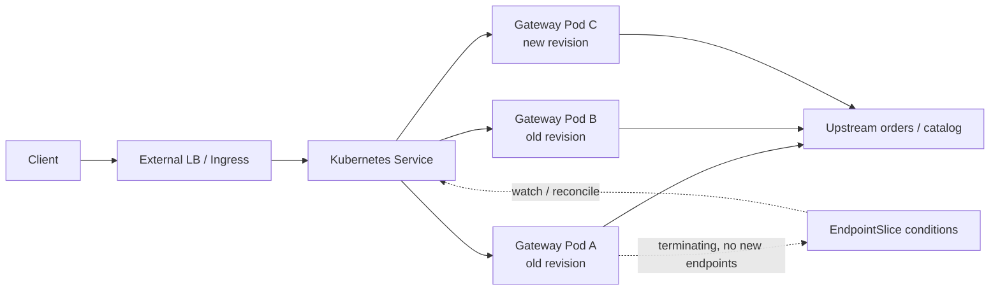
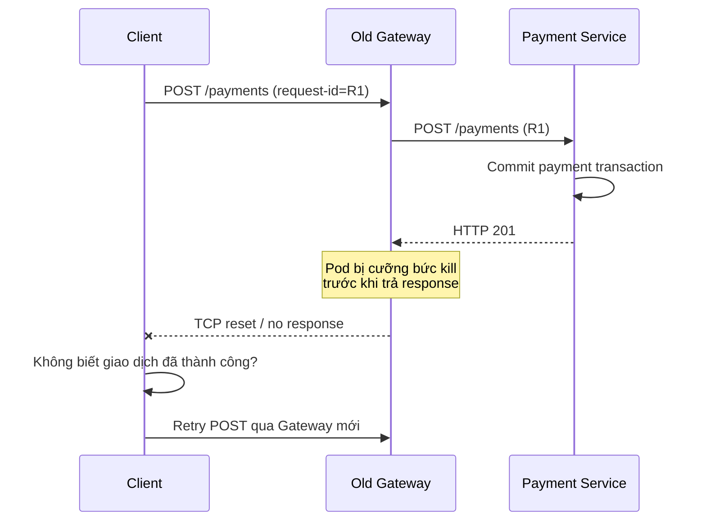
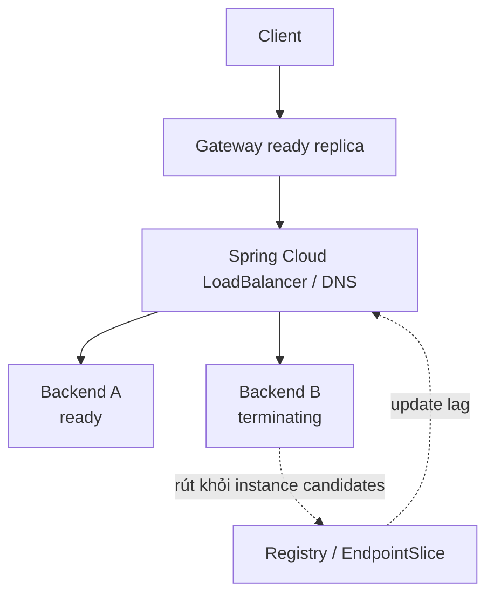
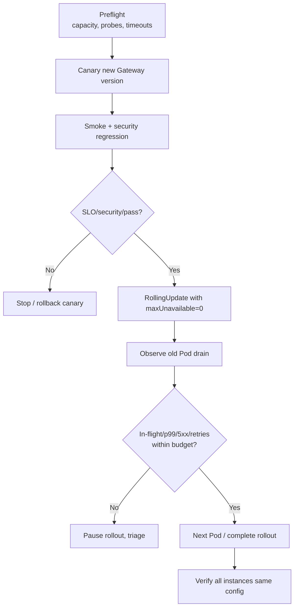

# Dừng an toàn, rút lưu lượng và xử lý kết nối đang hoạt động

Một bản phát hành mới của **Spring Cloud Gateway** được triển khai bằng Kubernetes rolling update. Pod cũ nhận `SIGTERM` và kết thúc sau vài giây; đúng lúc đó khách hàng đang tải một response lớn, một lệnh `POST /payments` đã tới backend nhưng chưa trả lời, và hàng trăm kết nối keep-alive vẫn trỏ tới Pod cũ. Nếu pod chết ngay, client có thể thấy `connection reset` hoặc `502/503/504`; nếu client retry không đúng cách, một số nghiệp vụ có thể bị ghi hai lần. Nếu pod tiếp tục nhận request mới trong lúc chuẩn bị chết, việc chờ hết kết nối có thể kéo dài mãi.

**Graceful shutdown** (*dừng an toàn*) và **traffic draining** (*rút lưu lượng*) giải quyết hai nửa khác nhau của vấn đề: **ngừng gửi công việc mới đến instance sắp rời cụm** và **cho công việc đang xử lý hoàn tất trong một ngân sách thời gian có giới hạn**. Trong thực tế còn phải xử lý HTTP keep-alive, WebSocket/SSE, outbound connection pools, thứ tự Spring lifecycle và thời gian Kubernetes cưỡng bức dừng.

Bài học thuộc chương **Triển khai** của module **SPRING_CLOUD_GATEWAY**, trong bối cảnh xây API Gateway với route predicates, filter chain, biến đổi đường dẫn/header, service discovery, xác thực/phân quyền, rate limiting, circuit breaker, retry, TLS và observability. Mục tiêu là triển khai, cập nhật hoặc giảm số replicas mà không làm đứt các yêu cầu đang hoạt động một cách không cần thiết, đồng thời biết chính xác khi nào **không thể** hứa zero dropped requests.

**Sau bài học, bạn có thể:**

1. Phân biệt **readiness**, **draining**, **graceful application shutdown**, **connection close** và **forced kill**.
2. Mô tả thứ tự thực tế của **Kubernetes Pod termination**, `preStop`, EndpointSlice, `SIGTERM`, Spring Boot và `SIGKILL`.
3. Cấu hình Spring Boot Gateway WebFlux/MVC với timeout phù hợp và triển khai rolling update an toàn.
4. Xử lý các trường hợp **HTTP/1.1 keep-alive, HTTP/2, upload/download, SSE và WebSocket**.
5. Ngăn **retry storm** và ghi trùng request có side effects khi Pod bị thay.
6. Viết bài kiểm thử có tải, fault injection, backend stub, metrics và quy tắc PASS/FAIL/INCONCLUSIVE cho quy trình drain.

> **Phạm vi phiên bản:** Bài dùng ví dụ chính cho **Spring Cloud Gateway Server WebFlux + Spring Boot + Kubernetes**; phần riêng so sánh Gateway Server Web MVC (Servlet/Tomcat hoặc Jetty). Tài liệu Spring Boot hiện hành mô tả graceful shutdown được bật mặc định trên các embedded servers được hỗ trợ; **Spring Boot 3.x cũ có thể yêu cầu cấu hình `server.shutdown=graceful` để bật rõ**. Để dễ tái lập, các ví dụ luôn khai báo tường minh. Kubernetes `lifecycle.preStop.sleep` đã ổn định từ **Kubernetes v1.34**; với cluster cũ cần xác minh API hoặc dùng phương án hook tương thích. Mọi số giây và số pod trong ví dụ chỉ là **giá trị thực hành**, không phải mặc định phù hợp cho mọi hệ thống.

## 1. Bốn việc thường bị gọi chung là “graceful”

| Khái niệm | Câu hỏi cần giải quyết | Điều **không** được bảo đảm |
| --- | --- | --- |
| **Readiness** | Pod còn được xem là ứng viên nhận traffic mới không? | Không đóng các TCP/WebSocket connections đang tồn tại. |
| **Traffic draining** | Ingress/Service/LB đã ngừng chọn pod cho request/connection mới chưa? | Không tự hoàn thành các requests đang chạy; propagation không tức thời. |
| **Graceful application shutdown** | Server có đợi các requests đang xử lý hoàn tất trước khi đóng không? | Không chờ mãi; time budget và transport semantics có giới hạn. |
| **Connection/session draining** | TCP keep-alive, HTTP/2 streams, WebSocket/SSE và outbound resources được xử lý như thế nào? | Không tự bảo đảm long-lived sessions kết thúc trước hạn. |
| **Forced shutdown** | Nếu deadline hết, khi nào hệ điều hành/container runtime chấm dứt tiến trình? | Không thể bảo toàn những công việc chưa hoàn tất sau `SIGKILL`. |

Hãy phân biệt **request**, **TCP connection** và **business operation**:

- **Một HTTP/1.1 keep-alive connection** có thể phục vụ nhiều HTTP requests tuần tự.
- **Một HTTP/2 connection** có thể có nhiều streams đồng thời.
- **Một WebSocket connection** có thể tồn tại hàng giờ, mỗi message không phải một HTTP request thông thường.
- **Một business operation** có thể đã được backend ghi thành công nhưng Gateway/client không nhận được response, khiến retry có nguy cơ ghi trùng.

Vì vậy, “đóng cổng TCP” không đồng nghĩa “mọi giao dịch đã hoàn tất”; và “không nhận request mới” cũng không đồng nghĩa “mọi connection đã biến mất”.

### 1.1. Ba kết quả một yêu cầu có thể gặp trong lúc rollout

1. **Kết thúc thành công:** Client đã gửi request trước drain; Gateway giữ pipeline đủ lâu để backend trả lời và client nhận response đầy đủ.

2. **Bị từ chối hoặc cần chuyển sang instance khác:** Request mới đến sau khi Pod được rút khỏi load balancing; ingress/client có thể chọn Gateway khác hoặc trả lỗi tùy cấu hình. Không nên giả định server luôn trả một HTTP status; có thể là TCP reset/refused.

3. **Bị ngắt khi đang xử lý:** Grace budget hết, container bị kill, client/network bị ngắt, backend quá chậm hoặc stream không có điểm kết thúc. Cần observability và retry/idempotency policy để xử lý.

Một hệ thống triển khai tốt cố **giảm xác suất trường hợp 3** và làm trường hợp 2 trở nên có thể phục hồi, chứ không hứa tuyệt đối không có lỗi mạng.

## 2. Kiến trúc rút lưu lượng qua nhiều lớp



Trong một rollout, **nhiều hệ thống kiểm soát traffic khác nhau** cần hội tụ:

1. Deployment controller quyết định tạo Pod mới và ngừng Pod cũ.
2. Kubernetes API Server ghi trạng thái Pod bắt đầu termination.
3. EndpointSlice controller cập nhật điều kiện endpoint.
4. kube-proxy và/hoặc ingress controller, service mesh, load balancer nhận các cập nhật qua watch/reconciliation.
5. Client hoặc upstream proxy còn có thể giữ các TCP connections tới pod cũ trong cache/pool.
6. Kubelet tiến hành `preStop`, gửi stop signal và cuối cùng cưỡng bức dừng nếu còn process.

**Các thành phần này không đồng bộ tức thời theo một transaction chung.** Vì vậy luôn tồn tại một cửa sổ mà trạng thái membership, routing và process lifecycle chưa đồng nhất. Thiết kế drain phải chịu được cửa sổ đó.

### 2.1. Traffic ở hai hướng khác nhau

Gateway có **hai phía HTTP**:

```text
           Inbound                                  Outbound
Client ----> Ingress ----> Gateway ----> HTTP client/pool ----> Backend
                     [accept/drain]      [finish/cancel/close]
```

- **Inbound drain:** Không cho thêm kết nối/yêu cầu mới vào Gateway đang rời cụm.
- **Outbound drain:** Không phá hủy sớm kết nối Gateway đang dùng để chờ kết quả backend.
- **Backend drain:** Nếu backend cũng đang rollout, cần kết hợp service discovery/endpoint readiness để Gateway không chọn backend đã rời cụm.

Đặt một hook đóng HTTP client ngay khi nhận `SIGTERM` có thể làm hỏng phần **outbound** dù embedded server vẫn đang cho các inbound requests cũ hoàn tất.

## 3. Trình tự Pod termination của Kubernetes

Theo tài liệu Kubernetes hiện hành, xóa một Pod bằng cơ chế graceful sẽ thiết lập **thời điểm hết hạn grace period**. Kubelet, EndpointSlice controller và các thành phần định tuyến phản ứng song song; không có bảo đảm cập nhật routing hoàn thành trước signal.

```mermaid
sequenceDiagram
    participant D as Deployment / API Server
    participant K as Kubelet
    participant E as EndpointSlice + Ingress
    participant P as Gateway process
    participant B as Backend
    D->>D: Pod deletionTimestamp, grace deadline
    par Endpoint update
        D->>E: Pod terminating; ready=false
        E->>E: Propagate to Service/LB
    and Node termination
        D->>K: Terminate Pod
        opt preStop configured
            K->>P: Run preStop hook / sleep
        end
        K->>P: Send SIGTERM (usually PID 1)
        P->>P: Spring context closing
        P->>P: Stop accepting new HTTP
        P->>B: Complete in-flight upstream requests
        B-->>P: Backend responses
        P->>P: Close remaining resources
    end
    alt Exit before grace deadline
        P-->>K: Process exits
    else Grace period expires
        K->>P: SIGKILL; remaining work interrupted
    end
```

### 3.1. Các mốc chính

| Mốc | Diễn biến | Hệ quả đối với Gateway |
| --- | --- | --- |
| **T0 — yêu cầu xóa Pod** | Kubernetes đặt `deletionTimestamp` và grace deadline. | Pod sắp rút khỏi cụm. |
| **T0+ — cập nhật EndpointSlice** | Endpoint `terminating=true` và `ready=false`; thông tin vẫn có thể còn trong EndpointSlice. | LB/Service nên tránh dùng cho **traffic thường mới** khi đã quan sát được. |
| **T0+ — preStop** | Kubelet chạy hook nếu có; thời gian hook **được tính trong grace**. | Process thường còn đang chạy; có thể dành thời gian cho routing propagation. |
| **Sau preStop — SIGTERM** | Runtime gửi tín hiệu dừng (mặc định thông dụng tới PID 1). | Spring bắt đầu đóng context và graceful server stop nếu signal được chuyển đúng. |
| **Graceful phase** | Embedded web server cố cho requests đang xử lý hoàn tất và ngăn requests mới. | In-flight work tiếp tục trong giới hạn. |
| **Deadline** | Grace hết mà process còn sống → `SIGKILL`. | Các requests/sessions còn lại có thể đứt; không có cleanup Java lúc bị kill. |

**Lưu ý:** Giá trị mặc định `terminationGracePeriodSeconds` của Kubernetes là **30 giây**. Thời gian này được tính từ lúc quy trình termination bắt đầu, **bao gồm cả preStop**, không phải 30 giây sau khi hook xong. Khi preStop gần hết thời hạn, tiến trình có thể chỉ còn rất ít thời gian để tự dừng.

### 3.2. EndpointSlice terminating và serving

Trong các phiên bản Kubernetes hiện đại:

- Endpoint đang được terminate có `terminating=true`.
- Vì tương thích ngược, `ready=false` đối với endpoint terminating.
- `serving` có thể phản ánh tình trạng phục vụ trong lúc drain để các consumers hỗ trợ logic phức tạp hơn.

**Không tự diễn giải `serving=true` là “pod phải tiếp tục nhận traffic production mới”**. Thông thường chỉ dùng endpoint ready/non-terminating cho requests mới; các proxy hỗ trợ drain có thể dùng `serving` để xử lý connections đang tồn tại.

Đồng thời, một ingress bên ngoài Kubernetes Service có thể có **deregistration delay/connection draining riêng**. Phải đo hành vi của đúng LB controller và môi trường mạng, không suy luận chỉ từ thuộc tính Pod.

### 3.3. Readiness probe không đóng kết nối

Readiness trả thất bại giúp **rút pod khỏi lựa chọn endpoint trong tương lai**, nhưng:

- Các requests hiện đang xử lý không tự bị hủy.
- HTTP keep-alive connections cũ có thể còn trên ingress/proxy.
- Một số proxy có thể tiếp tục gửi trên pooled connection cho đến khi bảng endpoint cập nhật.
- Browser WebSocket kết nối đã nâng cấp không bị buộc rời chỉ vì readiness đổi.

Vì vậy không nên chỉ thêm `readinessProbe` rồi bỏ qua `SIGTERM` và Spring graceful shutdown.

## 4. Spring Boot graceful shutdown trong Gateway

Spring Boot hiện hành hỗ trợ graceful shutdown trên **Reactor Netty, Tomcat, Jetty** cho cả reactive và Servlet applications. Khi ApplicationContext đóng, embedded server ngừng nhận requests mới theo hành vi của server và **cho các requests đang xử lý một khoảng thời gian để hoàn tất**. Cơ chế này tham gia vào Spring `SmartLifecycle` shutdown phases.

### 4.1. Cấu hình tối thiểu

```yaml
server:
  port: 8080
  shutdown: graceful

spring:
  application:
    name: edge-gateway
  lifecycle:
    timeout-per-shutdown-phase: 40s
```

Ý nghĩa:

- `server.shutdown: graceful`: khai báo rõ mong muốn graceful HTTP server stop, đặc biệt hữu ích khi dùng Boot versions khác nhau.
- `spring.lifecycle.timeout-per-shutdown-phase: 40s`: thời gian chờ **mỗi shutdown phase** của Spring LifecycleProcessor, **không phải bảo đảm tổng thời gian toàn bộ process chỉ tối đa 40 giây**.
- Với Gateway Server WebFlux chuẩn, embedded server thường là **Reactor Netty**.
- Với Gateway Server Web MVC, embedded Servlet server thường là **Tomcat/Jetty**; cùng property Spring Boot được sử dụng, nhưng cách từ chối request, connection reuse và threading khác nhau.

**Không dùng `server.shutdown: immediate`** rồi mong các in-flight HTTP requests sẽ hoàn tất. Trong Spring Boot mới, graceful có thể là mặc định, nhưng khai báo tường minh giúp review/kiểm thử và tránh nhầm với nhánh cũ.

### 4.2. “Từ chối request mới” phụ thuộc HTTP server

Tài liệu Spring Boot giải thích rằng cơ chế reject requests trong grace khác nhau theo server và **persistent connections có thể ảnh hưởng hành vi**. Với các server Tomcat/Jetty/Reactor Netty, graceful shutdown thường dừng nhận requests mới ở tầng network. Nhưng đừng coi điều đó là cam kết tất cả requests **trên connection đã tồn tại** đều lập tức nhận HTTP 503: một số trường hợp client thấy socket close/reset, handshake fail hoặc request đến server khác.

| Runtime | Điều cần quan sát khi drain | Bẫy thường gặp |
| --- | --- | --- |
| **Gateway Server WebFlux / Reactor Netty** | Event loops, HTTP/1.1 keep-alive, HTTP/2 streams, in-flight reactive response. | Một stream kéo dài ngăn drain hoặc bị hủy khi deadline hết. |
| **Gateway Server Web MVC / Tomcat** | Servlet worker threads, connections, async dispatch, response write. | Blocking backend call giữ worker thread đến khi timeout. |
| **Gateway Server Web MVC / Jetty** | Jetty connectors, async I/O, thread pool, HTTP upgrades. | Dùng nhầm cấu hình Tomcat và nghĩ đã tune Jetty. |
| **Ingress proxy/LB** | Lựa chọn endpoint và pooled upstream connections. | LB còn route tới pod sau khi ứng dụng đã dừng listener. |

**Đừng dùng Netty event-loop metrics để kiểm tra một Gateway MVC chạy Tomcat**, hoặc lấy thuộc tính `server.tomcat.*` áp cho Reactor Netty. Chọn đúng tài liệu runtime và quan sát cả inbound/outbound.

### 4.3. SmartLifecycle, @PreDestroy và thứ tự dừng

Spring context đóng qua nhiều lifecycle phases. Không nên tự tạo bean:

```java
// Anti-pattern: đóng outbound HTTP client ngay khi bắt đầu context close
// khi embedded web server còn đang đợi in-flight requests.
@PreDestroy
void closeClientsImmediately() {
    // httpClient.disposeNow();
}
```

Nếu pool/client bị đóng sớm, một request vốn có thể hoàn tất sẽ lỗi giữa đường. Với HTTP client do Spring/Gateway quản lý, ưu tiên **để framework quản lý lifecycle** và chỉ viết custom lifecycle nếu đã hiểu thứ tự `SmartLifecycle`/dependencies.

Một custom background worker có thể cần dừng nhận job mới nhưng vẫn cho job đang chạy hoàn tất; logic này phải có **deadline và error handling riêng**. Không làm blocking sleep vô hạn trong `@PreDestroy`, và không gọi `System.exit(0)` ngay từ preStop handler.

### 4.4. App shutdown khác HTTP response timeout

Các mốc thường tồn tại độc lập:

- **Connect timeout:** Thời gian chờ mở kết nối outbound tới backend.
- **Response timeout:** Thời gian chờ phản hồi backend theo semantics client/filter.
- **Circuit breaker timeout:** Deadline do resilience layer quy định.
- **Graceful server timeout:** Khoảng cho requests đang có hoàn tất khi đóng server.
- **Kubernetes termination deadline:** Giới hạn tối đa trước khi container bị kill.

Nếu response timeout là 120 giây nhưng termination budget còn 40 giây, **không thể bảo đảm** request được chờ đủ 120 giây. Phải thiết kế một **time budget nhất quán**.

## 5. Readiness, liveness và startup probe trên Spring Boot

**Spring Boot Actuator** có khái niệm `ApplicationAvailability` với hai nhóm:

- **Liveness:** tiến trình có ở trạng thái hoạt động đúng hay cần được restart?
- **Readiness:** instance có sẵn sàng nhận traffic mới không?

Khi ở Kubernetes, Boot cung cấp health groups `/actuator/health/liveness` và `/actuator/health/readiness` nếu có Actuator và probes được bật. Thông thường readiness mặc định **không kiểm tra tất cả external dependencies**; việc đưa Redis, backend hoặc registry chung vào readiness phải được quyết định thận trọng, vì nếu tất cả pod cùng đánh unready khi Redis lỗi, dịch vụ Gateway có thể mất toàn bộ endpoints.

### 5.1. Các trạng thái Boot khi bắt đầu và kết thúc

| Giai đoạn | Liveness | Readiness | Cách hiểu |
| --- | --- | --- | --- |
| Đang khởi động | Có thể `BROKEN` | `REFUSING_TRAFFIC` | Chưa nhận traffic. |
| App đã start nhưng chưa ready | `CORRECT` | `REFUSING_TRAFFIC` | Chờ startup tasks, warm-up… |
| App ready | `CORRECT` | `ACCEPTING_TRAFFIC` | Ứng viên cho Service/LB. |
| Spring graceful shutdown | Thường còn `CORRECT` | `REFUSING_TRAFFIC` | HTTP server đang dừng nhận request mới và đợi in-flight. |
| Context đã đóng | Không còn health endpoint | Không còn | Process đã dừng. |

**Readiness không phải một công tắc đóng socket.** Trong lúc shutdown, HTTP probes có thể không gọi được vì server đang đóng listener. Để nhận biết tiến trình đã vào giai đoạn drain, kết hợp logs/lifecycle metrics và Kubernetes Pod/EndpointSlice events, không chỉ gọi `/readyz` lặp lại sau `SIGTERM`.

### 5.2. Cấu hình probes trên **cùng web server port**

```yaml
spring:
  application:
    name: edge-gateway
  lifecycle:
    timeout-per-shutdown-phase: 40s

server:
  port: 8080
  shutdown: graceful

management:
  endpoint:
    health:
      probes:
        enabled: true
        add-additional-paths: true
  endpoints:
    web:
      exposure:
        include: health,info
```

Các endpoint `/livez` và `/readyz` được Boot cung cấp trên **main server port** khi dùng cấu hình additional paths tương ứng. Đây là lựa chọn hữu ích nếu Actuator chạy ở port riêng: một management context vẫn có thể trả health OK ngay cả khi main HTTP connector gặp lỗi; probe trên main port giúp phát hiện lỗi listener thực tế.

**Không tự biến `/readyz` thành endpoint chứa thông tin secrets**. Chỉ trả mức health status phù hợp, giữ các diagnostics như `env`, `heapdump` và Gateway route-write API khỏi public network.

### 5.3. Khi nào cần startupProbe?

Nếu Gateway mất nhiều thời gian để khởi tạo TLS resources, RouteDefinitionRepository hoặc dependency metadata, `startupProbe` giúp kubelet **không giết app sớm do liveness** trong giai đoạn hợp lệ. Sau khi startupProbe thành công, readiness/liveness probes mới có thể thực hiện theo bình thường.

**Không dùng liveness probe để kiểm tra Redis/IdP/backend có khỏe không**: khi một dependency chia sẻ bị lỗi, Kubernetes có thể restart đồng loạt Gateway pods, khuếch đại sự cố. Readiness cũng không nên phụ thuộc mọi backend nếu Gateway có circuit breaker/fallback và vẫn phục vụ các route độc lập.

### 5.4. Đánh dấu unready có chủ đích trước khi xóa Pod

Trong những nền tảng cần **hai bước drain có điều phối** (rút traffic trước, rồi mới ra lệnh terminate), Spring Boot hỗ trợ sự kiện availability:

```java
import org.springframework.boot.availability.AvailabilityChangeEvent;
import org.springframework.boot.availability.ReadinessState;
import org.springframework.context.ApplicationContext;

// Mã minh họa trong một thành phần đã được quản lý bởi Spring:
AvailabilityChangeEvent.publish(
    applicationContext, ReadinessState.REFUSING_TRAFFIC);
```

Sau đó orchestrator đợi các load balancers xác nhận không còn gửi new traffic rồi mới yêu cầu Pod termination. **Điều kiện bắt buộc:** Cơ chế kích hoạt phải thuộc management/control plane được bảo vệ; không tạo một `POST /drain` public cho người dùng Internet gọi, và không dùng event này làm phương thức thay thế việc dừng tiến trình thực sự.

Nếu chỉ dùng Kubernetes native deletion, endpoint terminating/ready=false được cập nhật riêng, không nhất thiết phải tự tạo drain API. Hãy chọn **một chiến lược rõ** và test thay vì có nhiều filters/hook cùng can thiệp trạng thái readiness.

## 6. Kubernetes Deployment mẫu: rolling update và preStop

Ví dụ sau dùng Kubernetes **v1.34+** để có `preStop.sleep.seconds` ổn định. Mục tiêu demo:

- 3 Gateway replicas, còn capacity khi thay một pod.
- Chỉ route tới pod đã ready.
- Chờ 10 giây trước signal để endpoint updates có cơ hội lan tới ingress/LB.
- Khi nhận `SIGTERM`, Spring Boot có khoảng 40 giây **cho mỗi lifecycle phase**.
- Kubernetes cấp tổng cộng **120 giây** để process cleanup, cho phép thêm thời gian cho phases khác và một phần an toàn.

### 6.1. Deployment YAML

```yaml
apiVersion: apps/v1
kind: Deployment
metadata:
  name: edge-gateway
  labels:
    app: edge-gateway
spec:
  replicas: 3
  minReadySeconds: 5
  progressDeadlineSeconds: 600
  selector:
    matchLabels:
      app: edge-gateway
  strategy:
    type: RollingUpdate
    rollingUpdate:
      maxSurge: 1
      maxUnavailable: 0
  template:
    metadata:
      labels:
        app: edge-gateway
    spec:
      terminationGracePeriodSeconds: 120
      containers:
        - name: gateway
          image: registry.example.test/edge-gateway:1.0.0
          imagePullPolicy: IfNotPresent
          ports:
            - name: http
              containerPort: 8080
          lifecycle:
            preStop:
              sleep:
                seconds: 10
          startupProbe:
            httpGet:
              path: /livez
              port: http
            periodSeconds: 2
            timeoutSeconds: 1
            failureThreshold: 60
          livenessProbe:
            httpGet:
              path: /livez
              port: http
            periodSeconds: 10
            timeoutSeconds: 2
            failureThreshold: 3
          readinessProbe:
            httpGet:
              path: /readyz
              port: http
            periodSeconds: 2
            timeoutSeconds: 1
            failureThreshold: 2
          resources:
            requests:
              cpu: 500m
              memory: 512Mi
            limits:
              cpu: "1"
              memory: 1Gi
---
apiVersion: v1
kind: Service
metadata:
  name: edge-gateway
spec:
  type: ClusterIP
  selector:
    app: edge-gateway
  ports:
    - name: http
      port: 80
      targetPort: http
```

**Đây là mẫu minh họa, không phải manifest đã apply.** Giá trị `registry.example.test/edge-gateway:1.0.0` là placeholder; trước khi triển khai cần có image thật, security context, TLS ingress, security/network policies, quotas và cấu hình Spring Cloud Gateway tương ứng. Các limits CPU/memory chỉ cho thấy cấu trúc; phải đo tải rồi mới chọn.

### 6.2. Giải thích từng phần quan trọng

| Trường | Lý do | Cảnh báo |
| --- | --- | --- |
| `replicas: 3` | Có instances khác nhận traffic khi một pod rời cụm. | 3 replicas không bảo đảm đủ capacity nếu tất cả đã sát ngưỡng. |
| `maxUnavailable: 0` | Không chủ động giảm số pod available theo RollingUpdate khi thay pods. | Không ngăn mọi lỗi workload hoặc thất thoát capacity do node crash. |
| `maxSurge: 1` | Cho phép tạo một pod mới trước khi dừng pod cũ. | Cần tài nguyên cluster cho pod dư. |
| `minReadySeconds: 5` | Pod mới phải ready ổn định trong một khoảng trước khi coi available. | Không tự chứng minh mọi route/IdP/backend đã sẵn sàng. |
| `startupProbe` | Tránh liveness restart sớm trong cold start. | Không nên có cửa sổ startup vô hạn. |
| `readinessProbe` | Loại pod chưa sẵn sàng khỏi traffic mới. | Không thay draining kết nối. |
| `livenessProbe` | Khởi động lại pod không còn khả năng tự phục hồi. | Không lấy sức khỏe Redis chung làm liveness. |
| `preStop.sleep: 10` | Cho endpoint/LB propagation thêm thời gian trước SIGTERM. | Cũng tiêu thụ 10s của termination grace; không tự đánh unready qua app. |
| `terminationGracePeriodSeconds: 120` | Giới hạn thời gian hoàn tất process shutdown trước kill. | Phải lớn hơn tổng thời gian khả dĩ của hook và shutdown phases. |

### 6.3. Vì sao preStop sleep có thể hữu ích — và giới hạn

Khi Kubernetes đánh dấu Pod terminating, EndpointSlice controller bắt đầu rút endpoint cho new traffic. Nhưng ingress/load balancer có thể chưa đồng bộ. `preStop.sleep` giữ ứng dụng còn chạy trong một khoảng ngắn để các cập nhật có cơ hội tới nơi **trước khi Spring đóng HTTP listener**.

Tuy nhiên:

- Trong lúc sleep, Spring **chưa nhận SIGTERM**, nên readiness nội bộ có thể vẫn là `ACCEPTING_TRAFFIC` dù endpoint đã terminating ở Kubernetes.
- Những load balancers chưa hội tụ **vẫn có thể gửi request mới** tới Pod trong khoảng này.
- Một số ingress bên ngoài Kubernetes có deregistration timer dài hơn 10 giây.
- Hook không tự biết khi nào mọi proxy đã ngừng chọn Pod. **10 giây là giá trị cần đo**, không phải bảo đảm.

Nếu cluster/network yêu cầu kiểm soát mạnh hơn, dùng **điều phối hai pha**: chuyển readiness sang refusing (qua control plane tin cậy), chờ sự hội tụ thực tế, sau đó terminate. Đổi lại, quy trình thêm state/time budget và phải xử lý trường hợp fail giữa hai pha.

### 6.4. preStop trên cluster cũ

Trước khi áp dụng `preStop.sleep`, xác nhận Kubernetes API/server của cluster hỗ trợ action này; tính năng stable từ v1.34. Một phương án tương thích ở các cluster cũ là:

```yaml
lifecycle:
  preStop:
    exec:
      command:
        - /bin/sh
        - -c
        - sleep 10
```

**Chỉ dùng khi container image có `/bin/sh` và `sleep`.** Distroless/minimal images thường **không có shell**, khi đó hook này sẽ lỗi. Ưu tiên native sleep action ở cluster đủ mới hoặc sử dụng cơ chế drain tại control plane không phụ thuộc shell. Không tự thêm shell vào production image chỉ để chạy một `sleep` nếu việc đó tăng attack surface trái chính sách.

### 6.5. Không đợi termination grace để loại endpoint

Một sai lầm là dùng:

```text
Pod terminating
  -> SIGTERM ngay
  -> embedded server đóng listener
  -> 30 giây sau ingress mới nhận biết pod không còn
  -> hàng loạt connection refused
```

Mục tiêu của một khoảng **propagation/drain trước khi server đóng** là giảm race này. Nhưng nếu ingress luôn mất 40 giây mới cập nhật mà preStop chỉ 10 giây, vẫn sẽ có lỗi. Phải test **LB cụ thể, idle connection reuse và ingress update latency** trước khi chọn con số.

## 7. Tính time budget theo từng lớp

Không thể chọn các số `10s`/`40s`/`120s` chỉ vì ví dụ trên rồi xem như production-ready. Hãy lập ngân sách:

```text
T_kubernetes_grace
  >= T_preStop_propagation
   + T_application_shutdown
   + T_additional_cleanup_phases
   + T_margin
```

Trong đó:

- `T_preStop_propagation`: thời gian preStop/hệ thống rút endpoint.
- `T_application_shutdown`: thời gian embedded server cho in-flight work hoàn tất.
- `T_additional_cleanup_phases`: các Spring lifecycle phases, exporters, consumer jobs, close pools và signal overhead khác.
- `T_margin`: phần dự phòng cho jitter/scheduling/network và đo đạc chưa hoàn hảo.

**Chi tiết quan trọng:** `spring.lifecycle.timeout-per-shutdown-phase` là **thời gian chờ trên mỗi phase**. Nếu có nhiều phases hoặc custom SmartLifecycle beans đợi hết timeout, tổng process shutdown có thể **vượt giá trị của một phase**. Cần đo stop duration thực tế thay vì coi phương trình trên với một giá trị 40 giây là cận trên tuyệt đối.

### 7.1. Ví dụ lập ngân sách

| Thành phần | Giá trị thực hành | Ghi chú |
| --- | ---: | --- |
| preStop | 10s | Cho EndpointSlice/ingress propagation. |
| HTTP graceful shutdown mục tiêu | 40s | `spring.lifecycle.timeout-per-shutdown-phase`, không đại diện mọi phase khác. |
| Các cleanup phases khác | 30s | Giá trị ước lượng; cần đo thực tế. |
| Buffer | 40s | Chừa cho jitter/điều kiện bất thường. |
| **Kubernetes grace** | **120s** | Tổng trên để minh họa budgeting. |

Nếu request p99 thường 15 giây và timeout tối đa 45 giây, HTTP graceful budget 40 giây có thể phù hợp với **phần lớn** request nhưng **không bảo đảm** request hợp lệ 45 giây hoàn tất khi vừa bắt đầu drain. Cân nhắc điều chỉnh deadline/application contract hoặc chấp nhận retry/recovery có kiểm soát.

### 7.2. Những timeout không thể cộng tùy ý

| Timeout | Chủ thể | Ý nghĩa |
| --- | --- | --- |
| `preStop.sleep.seconds` | Kubelet | Đợi trước khi gửi signal. |
| `terminationGracePeriodSeconds` | Kubelet/container runtime | Hạn chót trước forced kill. |
| `spring.lifecycle.timeout-per-shutdown-phase` | Spring ApplicationContext | Cho một lifecycle phase hoàn thành. |
| Gateway response timeout | Gateway outbound client/filter | Giới hạn đợi backend cho một request. |
| Ingress idle/read timeout | External LB / ingress | Giới hạn kết nối hoặc request không hoạt động. |
| HTTP keep-alive idle timeout | HTTP connection | Giới hạn **idle connection**, không phải thời gian request tổng. |
| WebSocket/SSE session lifetime | Application/protocol/LB | Có thể vượt xa HTTP graceful budget. |

**Không đặt ingress idle timeout=5s rồi mong Gateway giữ SSE connection 30 phút**, hoặc đặt Kubernetes grace 20s nhưng Spring cần 60s. Time budgets phải được kiểm thử **theo loại request**.

### 7.3. Dự phòng capacity trong rollout

Giả sử 3 replicas đang chia 900 RPS, trung bình mỗi pod 300 RPS, trong khi mỗi pod có thể phục vụ bền vững 400 RPS ở SLO mục tiêu.

- Khi một pod drain trước khi pod mới available, **2 pods** phải chịu 900 RPS → 450 RPS/pod, vượt capacity.
- Nếu `maxSurge: 1` và pod mới được nhận traffic **trước** khi pod cũ rút, ta vẫn có 3 pods ready, có thể giữ ~300 RPS/pod (phân bố thực phụ thuộc LB).

**Rollout không downtime đòi hỏi capacity đủ và readiness chính xác**, không chỉ grace period dài. Nếu cluster hết tài nguyên không thể tạo surge pod, rollout có thể bị kẹt thay vì mất traffic; đó là failure mode cần monitor.

## 8. SIGTERM phải đến được tiến trình Java thật

Trong container, nhận tín hiệu đúng quan trọng ngang cấu hình Spring. Nếu container runtime gửi `SIGTERM` cho một shell wrapper nhưng shell không chuyển nó tới JVM, Spring Boot **không nhận được cơ hội đóng context graceful**.

### 8.1. Dockerfile với exec-form ENTRYPOINT

```dockerfile
# JDK/runtime/image chỉ là ví dụ; chọn base image được bảo trì.
FROM eclipse-temurin:21-jre

WORKDIR /app
COPY target/edge-gateway.jar /app/edge-gateway.jar

# Các best practices về non-root, filesystem và image signing
# cần được bổ sung theo môi trường triển khai.
ENTRYPOINT ["java", "-jar", "/app/edge-gateway.jar"]
```

Với exec form, `java` là tiến trình chính và thường nhận stop signal trực tiếp. Nếu dùng wrapper script, hãy kết thúc bằng **`exec java ...`**:

```sh
#!/bin/sh
set -eu
exec java -jar /app/edge-gateway.jar
```

Không dùng một shell chỉ khởi động Java rồi tiếp tục chờ riêng mà không chuyển signal, ví dụ mẫu:

```dockerfile
# Anti-pattern: shell-form ENTRYPOINT không bảo đảm Java nhận SIGTERM.
ENTRYPOINT java -jar /app/edge-gateway.jar
```

Một số entrypoint/launcher có signal handling riêng; cần xác minh bằng **thử nghiệm gửi tín hiệu**, không đoán chỉ từ Dockerfile. Nếu dùng distroless image, không có shell để chạy `/bin/sh -c sleep` trong preStop; native Kubernetes sleep action sẽ phù hợp hơn trên cluster hỗ trợ.

### 8.2. Kiểm tra PID 1 trong môi trường lab

Trong container test có công cụ process inspection, kiểm tra:

```sh
# Chỉ là ví dụ lệnh trong container Linux có ps.
ps -o pid,ppid,command -p 1
```

Kết quả mong muốn thường là tiến trình Java hoặc một init process quản lý signal đúng; **không phải cứ PID 1 không phải java là lỗi**, bởi `tini` hoặc init wrapper có thể chuyển signal và reaping zombies rất tốt.

Đo đúng hơn bằng hành vi:

1. Mở request chậm có ID nhận diện riêng.
2. Gửi `SIGTERM` tới main process/container theo cơ chế được phép.
3. Quan sát Spring log graceful shutdown và in-flight response.
4. Xem JVM có thoát trước forced deadline hay không.

### 8.3. Thử Docker stop trên máy lab

```bash
# Không chạy với container production.
docker stop --time 120 edge-gateway-test
```

Tùy engine/OS, runtime gửi stop signal rồi đợi khoảng đã cấu hình trước khi kill. Đây là bài test **container lifecycle**, không thay được test Kubernetes EndpointSlice/ingress drain vì Docker local không có những tầng đó.

### 8.4. Những trường hợp graceful không thể cứu

- OOM kill hoặc node mất nguồn điện.
- `SIGKILL` cưỡng bức/termination deadline bằng 0.
- Kernel/network partition làm socket ngắt.
- JVM deadlock/blocking code không phản hồi tới signal/cleanup.
- Một crash trong native/JNI code hoặc filesystem critical failure.

Vì thế **phục hồi client, idempotency, durable state và nhiều replicas** vẫn cần thiết. Graceful shutdown chỉ giảm lỗi khi **quá trình dừng có chủ đích và được dự báo**.

## 9. Quan sát in-flight HTTP requests thực sự

Khi Pod bắt đầu drain, cần biết:

- Có bao nhiêu HTTP requests đang xử lý?
- Bao nhiêu requests đã hoàn thành hay bị cancel/error?
- Có bao nhiêu inbound TCP connections còn mở?
- Bao nhiêu outbound HTTP connections đang active/pending/idle?
- Có bao nhiêu WebSocket/SSE sessions kéo dài?
- Bao nhiêu retry attempts vẫn được tạo khi shutdown bắt đầu?

**Không dùng một số đếm connection thay cho in-flight request count.** HTTP/1.1 keep-alive có thể idle, HTTP/2 có thể multiplex nhiều streams, và WebSocket handshake có thể hoàn tất trong khi session tiếp tục sống lâu.

### 9.1. Một WebFilter chỉ để đo in-flight HTTP

Ví dụ dưới đây minh họa **Spring WebFlux**, không dành cho Servlet Web MVC:

```java
package com.example.gateway.observability;

import java.util.concurrent.atomic.AtomicInteger;

import io.micrometer.core.instrument.Gauge;
import io.micrometer.core.instrument.MeterRegistry;
import org.springframework.stereotype.Component;
import org.springframework.web.server.ServerWebExchange;
import org.springframework.web.server.WebFilter;
import org.springframework.web.server.WebFilterChain;
import reactor.core.publisher.Mono;

@Component
public final class InFlightHttpWebFilter implements WebFilter {

    private final AtomicInteger inFlight = new AtomicInteger();

    public InFlightHttpWebFilter(MeterRegistry registry) {
        Gauge.builder("gateway.inflight.http.requests",
                inFlight, AtomicInteger::get)
            .description("Subscribed inbound HTTP exchanges in progress")
            .register(registry);
    }

    @Override
    public Mono<Void> filter(
            ServerWebExchange exchange,
            WebFilterChain chain) {

        return Mono.defer(() -> {
            inFlight.incrementAndGet();

            return chain.filter(exchange)
                .doFinally(signal ->
                    inFlight.decrementAndGet());
        });
    }
}
```

Giải thích:

1. `Mono.defer(...)` tăng bộ đếm **khi publisher được subscribe**, tránh tăng sớm lúc chỉ xây chuỗi reactive.
2. `doFinally(...)` giảm khi publisher **complete, error hoặc cancel**, giúp không giữ số in-flight vô thời hạn chỉ vì client hủy request.
3. Gauge được Micrometer đăng ký một lần, không thêm userId/correlationId làm metric tags.
4. Filter được áp dụng ở mức **WebFlux HTTP chain**, do đó có thể đo cả requests không match Gateway route, tùy thứ tự cấu hình filters.
5. Số này là **requests đang được xử lý theo reactive subscription**, không phải mọi socket hay tác vụ nghiệp vụ đã “chạy ngầm” sau khi có detached async work.

**Không dùng bộ đếm này làm một điều kiện chờ vô hạn trong `@PreDestroy`.** Nếu cần block tới khi về zero, phải có deadline, cancellation policy và tránh tự deadlock với Spring lifecycle. Thực tế tốt hơn là để server graceful shutdown phối hợp HTTP pipeline và dùng gauge để **quan sát/chẩn đoán**.

### 9.2. Tại sao in-flight có thể bằng 0 nhưng vẫn còn kết nối?

Một HTTP keep-alive socket đang idle không có request active. WebSocket session đã upgrade có thể tiếp tục truyền frames, còn tính năng đếm theo WebFilter có thể không phản ánh **toàn bộ** đời sống session tùy runtime/handler. HTTP/2 connection có thể không có stream active nhưng vẫn mở.

Vì vậy khi cần xử lý long-lived sessions, bổ sung **connection/session registry hoặc protocol metrics** tại tầng phù hợp, không cố dùng mỗi HTTP request gauge.

### 9.3. Quan sát Spring Cloud Gateway/Netty outbound pool

Trong Gateway Server WebFlux, cấu hình outbound pool metrics có thể bật theo namespace mới:

```yaml
spring:
  cloud:
    gateway:
      server:
        webflux:
          httpclient:
            connect-timeout: 3000
            response-timeout: 20s
            pool:
              type: FIXED
              max-connections: 200
              acquire-timeout: 2000
              metrics: true
```

Các con số là **ví dụ để đo trong staging**, không phải tối ưu mặc định. Đơn vị `connect-timeout`/`acquire-timeout` ở các Gateway properties này là **mili giây**; `response-timeout` có thể được viết dưới dạng Duration. Kiểm tra version/configprops của Gateway đang dùng vì dòng 4.x cũ còn có prefix `spring.cloud.gateway.httpclient.*`.

Các metrics Reactor Netty thường gặp:

| Metric logical name | Ý nghĩa |
| --- | --- |
| `reactor.netty.connection.provider.active.connections` | Connections đã acquire và đang dùng. |
| `reactor.netty.connection.provider.idle.connections` | Connections trong pool chưa dùng. |
| `reactor.netty.connection.provider.pending.connections` | Các acquires đang chờ connection. |
| `reactor.netty.connection.provider.total.connections` | Active + idle theo pool. |
| `reactor.netty.connection.provider.pending.connections.time` | Thời gian chờ acquire. |
| Gateway route request metrics | Latency/status theo route, nếu đã bật tương ứng. |

Đặt **cùng time window** cho in-flight HTTP, outbound pool, backend latency và Kubernetes events khi debug. Không suy luận “Gateway chưa drain” chỉ vì outbound idle connections vẫn tồn tại trong lúc context đang đóng.

### 9.4. Không chủ động dispose outbound pool quá sớm

Reactor Netty `ConnectionProvider.dispose()` hoặc `HttpResources.disposeLoopsAndConnections()` có thể đóng tài nguyên dùng chung. Nếu tự gọi khi vẫn còn in-flight request, các HTTP client attempts có thể lỗi.

Nếu bạn sở hữu một **custom ConnectionProvider**, phải định nghĩa lúc nào nó không nhận acquisitions mới, lúc nào đóng pending/active resources và thời hạn cleanup. Reactor Netty còn có API cho phép một khoảng grace khi dispose pool tùy phiên bản; **không nhầm nó với Spring Boot server graceful timeout**.

Với Spring Cloud Gateway HTTP client auto-configured, không cần thêm code dispose thủ công nếu không có yêu cầu đặc biệt; test behaviour thực tế là quan trọng nhất.

### 9.5. Log khi drain không nên làm gián đoạn drain

Một log hữu ích:

```json
{
  "event": "gateway.shutdown.requested",
  "service.name": "edge-gateway",
  "instance": "edge-gateway-pod-a",
  "remainingGraceMs": 120000,
  "inFlightHttp": 38,
  "outboundActive": 22,
  "release": "1.0.0"
}
```

Đây là **schema/log mong muốn**, không phải output mặc định mà Spring phát ra. `remainingGraceMs` cần được đo từ deadline thực (có thể không biết trực tiếp trong process); nếu không có nguồn đúng, **bỏ trường** thay vì bịa số. Không log Authorization/Cookie/raw payloads và không gắn correlation ID làm label metrics high-cardinality.

## 10. Những trạng thái HTTP đặc biệt khi drain

### 10.1. HTTP/1.1 keep-alive

Client và ingress có thể mở một TCP connection rồi gửi nhiều requests. Lúc Pod đang drain:

- Một request đã tới Gateway trước graceful stop có thể hoàn tất.
- Một request mới được gửi **qua connection cũ** có hành vi phụ thuộc server/HTTP client và thời điểm shutdown.
- Nếu connection đã bị đóng, client có thể thấy `EOF`, `connection reset` hoặc `connection refused`, **không nhất thiết HTTP 503**.
- Một reverse proxy có thể chọn instance khác và retry request an toàn trước khi trả response.

**Không tự gửi `Connection: close` cho mọi response từ lúc app start**: điều đó vô hiệu hóa pooling và tăng TCP/TLS overhead. Chỉ điều khiển connection close trong giai đoạn drain nếu runtime/LB implementation yêu cầu, và phải test.

### 10.2. HTTP/2 multiplexing

Với HTTP/2, **một TCP connection có thể mang nhiều streams đồng thời**. Đóng connection đột ngột có thể ảnh hưởng nhiều requests. Các cơ chế graceful HTTP/2 thường liên quan đến **GOAWAY** và xử lý streams đã mở, nhưng chi tiết phụ thuộc Reactor Netty/Jetty/Tomcat/ingress và phiên bản.

Không tự tuyên bố “Boot luôn gửi GOAWAY trước mọi shutdown” nếu chưa kiểm tra stack thực tế. Test cần:

1. Một kết nối HTTP/2 có nhiều streams đang chạy.
2. Trigger drain.
3. Kiểm tra streams được hoàn tất hay bị cancel theo time budget.
4. Kiểm tra client ngừng tạo streams mới trên connection đã rút và mở kết nối tới pod khác.
5. Kiểm tra HTTP/2 connection/stream metrics nếu runtime hỗ trợ.

**Số TCP connections ≠ số HTTP/2 streams đang hoạt động**; capacity planning/drain phải đếm đúng đơn vị.

### 10.3. Request upload/download lớn

Một request download vài GiB hoặc upload với client chậm có thể vượt thời gian graceful:

- Response timeout phải xét semantics (idle timeout khác total deadline).
- Proxy/client không nên giữ toàn bộ body trong RAM nếu có thể stream.
- Nếu client hủy upload, backend request có được cancel đúng không?
- Nếu TCP connection đứt sau khi backend đã xử lý POST, retry có thể tạo side effects.
- Nếu có `Retry`/body caching, kiểm tra lượng memory và replay semantics.

**Không tăng `terminationGracePeriodSeconds` lên vài giờ chỉ để phục vụ một upload vô hạn**. Thiết kế chunked upload/resumable upload, pre-signed object storage URLs hoặc job-based API với checkpoint khi workload yêu cầu.

### 10.4. WebSocket

Spring Cloud Gateway Server WebFlux hỗ trợ proxy WebSocket qua `ws://`/`wss://` route và WebSocket routing filter. Sau HTTP upgrade, một session có thể sống hàng giờ. Kubernetes readiness và HTTP request completion **không đủ** để bảo đảm WebSocket tự chuyển sang pod mới.

Một chính sách drain thực dụng:

1. **Ngừng nhận WebSocket handshakes mới** trên instance đang drain.
2. Để những sessions đang tồn tại tiếp tục tới **deadline định trước**.
3. Gửi thông báo application-level “server restarting” nếu protocol có hỗ trợ.
4. Close sessions có điều khiển bằng **WebSocket close frame/code phù hợp**, rồi client reconnect với backoff/jitter.
5. Client khôi phục subscription/session state qua token hoặc cursor được xác minh, không tin thông điệp client giả mạo.
6. Kết thúc/buộc đóng ở hard deadline và đo số sessions bị cắt.

**Không khẳng định Gateway có sẵn một bộ đếm hay API “drain mọi WebSockets” thống nhất cho WebFlux/MVC**. Tùy framework và app/ingress, cần server session registry/connection policy hoặc thiết kế reconnect ở client. Với WebSocket chỉ proxy qua Gateway, phần xử lý close/reconnect có thể nằm ở ingress hoặc backend.

### 10.5. Server-Sent Events (SSE)

Một SSE response là một HTTP stream có thể mở lâu. Nếu stream không kết thúc, graceful timeout không thể đợi mãi. Thiết kế:

- Event IDs/`Last-Event-ID` hoặc cursor để client có thể nối lại.
- Heartbeats để phát hiện dead connection.
- Giới hạn session lifetime tối đa nếu phục vụ qua Gateway hay rollout thường xuyên.
- Reconnect backoff/jitter tránh đồng loạt hàng vạn clients kết nối lại khi một pod chết.
- Không để application-level session state chỉ nằm trong memory của một pod đang bị xóa.

Nếu SSE stream được điều khiển ở backend, Gateway không tự biết checkpoint cuối cùng đã được client nhận. Test cần chứng minh client reconnect **không bỏ sót hoặc xử lý trùng sự kiện trái hợp đồng**.

### 10.6. gRPC và các stream dài

Nếu hệ thống dùng gRPC qua HTTP/2, cần **xác minh Gateway flavor/protocol/ingress có thực sự hỗ trợ route gRPC theo thiết kế**. Không mặc định một HTTP path proxy thông thường chuyển tiếp được mọi gRPC semantics, metadata/trailers hoặc long-lived bidirectional streams.

Khi drain, gRPC clients cần tuân thủ reconnect/deadline/status và retry policy riêng; đối với streaming RPC, check resume/checkpoint hoặc idempotent replay. **Chỉ áp dụng hướng dẫn này khi stack hỗ trợ gRPC được triển khai và kiểm thử**.

## 11. Retry, idempotency và request đang dở: vấn đề không thể chỉ giải bằng shutdown

Giả sử:



**Gateway graceful shutdown không thể biến một HTTP response thất lạc thành bằng chứng transaction chưa commit**. Client có thể nhận lỗi transport trong khi backend đã hoàn thành nghiệp vụ. Đây là bài toán **at-least-once retry** và tính đúng đắn của tác dụng phụ.

### 11.1. Idempotency key cho POST có side effects

Với operation tạo thanh toán/đơn hàng:

```http
POST /api/payments HTTP/1.1
Authorization: Bearer <TEST_TOKEN>
Idempotency-Key: pay-7d1a906e-1
Content-Type: application/json

{"orderId":"order-42","amount":100000}
```

Trong thiết kế đúng:

1. Backend xác thực principal/tenant và validate payload.
2. Backend ghi idempotency key **theo phạm vi đúng** (principal/tenant/operation) với kết quả transaction hoặc trạng thái đang xử lý.
3. Khi client retry cùng key, backend **không trừ tiền lần hai**.
4. Nếu cùng key nhưng payload khác, backend phải có contract từ chối/conflict an toàn.
5. Kết quả retry có status/body được định nghĩa rõ, không phụ thuộc Gateway instance cũ.

Idempotency thường phải được thực hiện bằng **dữ liệu bền vững ở backend**, không chỉ cache trong Gateway Pod — pod đó có thể bị xóa giữa lúc rollout.

### 11.2. Tính toán retry amplification khi rollout

Nếu có 200 requests/s đang đi qua Gateway và client/ingress/Gateway đều có cơ chế retry, một lỗi connection reset đồng loạt có thể làm backend nhận số lần gọi vượt xa 200/s.

Hãy đặt:

- **Một ngân sách attempts end-to-end** rõ ràng, tránh mỗi tầng retry thêm 3 lần.
- Retry chỉ cho status/transport errors được cho phép và **operations an toàn**.
- Exponential backoff + jitter, tổng deadline và concurrency limit.
- Khi shutdown, hạn chế tạo thêm outbound attempts **sau khi phần lớn grace budget đã hết**.
- Circuit breaker để tránh tiếp tục đưa traffic đến backend đã suy yếu.
- Observability cho `requestId/correlationId`, `attempt` và backend call counts.

**Không tự bật Retry Filter cho mọi POST khi triển khai để “che” lỗi lúc Pod bị kill**. Có thể chuyển từ vài lỗi network thành lỗi ghi trùng nghiệp vụ.

### 11.3. Rate limiter và security vẫn phải có hiệu lực khi draining

Đổi trạng thái readiness không có nghĩa bỏ auth/rate limiter:

- Một request mới còn tới pod cũ trong cửa sổ propagation **vẫn phải xác thực và áp quota** nếu được xử lý.
- Một request đã được chấp nhận và đang chạy **không được tự động nâng quyền** chỉ vì pod sắp dừng.
- Fallback sau circuit breaker không được bypass scope/tenant/object ownership.
- Nếu dùng RedisRateLimiter, không xóa/reinitialize quota keys khi pod chuyển phiên bản.
- Client thấy 401/403/429 phải được phân biệt với network reset do shutdown; **không retry không giới hạn** các phản hồi bảo mật.

Nếu đội ngũ viết custom drain filter trả 503 cho request mới, phải đặt nó đúng vị trí so với Spring Security/metrics và không làm lộ endpoint quản trị. **Đừng phản hồi “200 OK” giả cho request đã mất** chỉ để làm biểu đồ rollout đẹp.

## 12. Gateway cũng phải chịu được backend đang được thay thế

Không chỉ Gateway pods mới cần graceful shutdown. Nếu `lb://order-service` được resolve thành một backend instance vừa bắt đầu termination, Gateway có thể gặp:

- TCP connect timeout/refused vì backend listener đã dừng;
- Connection reset do pooled connection trỏ tới backend cũ;
- Response timeout vì backend đang graceful wait hoặc quá tải;
- 503/404 do instance chưa ready hoặc route/backend version mismatch;
- mTLS/TLS handshake fail nếu cert bị thay trong lúc rollout.

### 12.1. Readiness/service discovery hai chiều



Gateway cần xem **thực tế danh sách service instances và health/readiness policy**. Không suy luận một Kubernetes Service VIP tự giải quyết mọi kết nối đã tồn tại: DNS/LB/connection pooling có cache và thời gian cập nhật.

### 12.2. Connection pool giữ stale backend connections

Một outbound keep-alive connection có thể còn trong pool khi backend đã đóng. Kết nối stale sẽ bị phát hiện khi tái sử dụng hoặc qua idle/health/eviction policy tùy client.

Tài liệu Gateway WebFlux hiện hành có các cấu hình:

```yaml
spring:
  cloud:
    gateway:
      server:
        webflux:
          httpclient:
            pool:
              type: FIXED
              max-connections: 200
              max-idle-time: 30s
              max-life-time: 5m
              eviction-interval: 30s
              metrics: true
```

Các giá trị trên là **mẫu tuning theo bối cảnh**, không có nghĩa phải dùng trong mọi project. Trên một số release, duration properties có đơn vị/kiểu được quy định riêng, hãy xác nhận bằng configprops. Việc đóng idle connection cũ giúp giảm một loại lỗi, nhưng **không thể bảo đảm loại bỏ mọi reset** nếu server chết giữa lúc request đang hoạt động.

### 12.3. HTTP pool sizing và deadline

Ví dụ 200 RPS tới backend, latency trung bình 300 ms:

\[
\text{in-flight trung bình} \approx 200 \times 0.3 = 60
\]

Đó là số requests trung bình đang chờ theo Little's Law khi hệ thống ổn định, **không tự bằng số TCP connections** (HTTP/2 multiplexing, keep-alive, concurrent hosts và pool design ảnh hưởng). Một pool `max-connections=20` có thể tạo pending queue lớn khi backend chậm; tăng pool lên 500 mà backend không có capacity lại có thể gây overload.

Tại shutdown, nếu bạn cho in-flight requests tiếp tục, cần **giữ outbound capacity đủ lâu** và thống nhất timeout; không hạ max-connections đột ngột hoặc force-close pool chỉ vì readiness đã false.

### 12.4. HTTP client errors và các mã status khác nhau

| Triệu chứng phía client | Có thể là | Cần phân biệt |
| --- | --- | --- |
| `connection refused` | Gateway listener đã dừng nhưng LB vẫn route | Drain/propagation race. |
| `connection reset` | TCP bị cắt giữa chừng | Gateway hoặc backend forced close. |
| HTTP 502 | Proxy/upstream transport fail, tùy mapping | Không mặc định backend trả 502. |
| HTTP 503 | Không có instances/circuit breaker/overload, tùy cấu hình | Lỗi routing, discovery hay policy? |
| HTTP 504 | Đợi upstream quá hạn, tùy ingress/Gateway mapping | Timeout xảy ra ở hop nào? |
| HTTP 200 sau retry | Client/proxy đã tự phục hồi | Có bao nhiêu upstream attempts/side effects? |

**Không gán một mã 503 cố định cho mọi graceful shutdown**: khi listener đã đóng có thể **không có HTTP response nào cả**.

## 13. Load balancer, ingress và service mesh có timeout drain riêng

Một Gateway trong Kubernetes có thể đứng sau:

```text
Internet
  -> Cloud L7 Load Balancer (connection draining / deregistration)
  -> Ingress controller
  -> Service / kube-proxy / CNI
  -> Envoy/Istio sidecar (nếu dùng)
  -> Spring Cloud Gateway
```

Các tầng có thể có cấu hình:

- Backend health checks và số lần fail trước deregistration.
- Keep-alive TTL, TCP idle timeouts.
- Max connections/max requests trên một upstream connection.
- Deregistration/drain delay cho instance bị rút.
- HTTP/2 GOAWAY/stream drain policy.
- Request retries/hedging và retry budgets.
- Proxy worker shutdown timeout, Envoy drain period/sidecar ordering.

### 13.1. Tại sao 10 giây preStop có thể không đủ?

Nếu external LB cần 30 giây để rút instance nhưng preStop chỉ 10 giây:

```text
T0       pod terminating
T0+10s   Spring nhận SIGTERM và đóng listener
T0+30s   External LB mới chắc chắn không chọn Pod
         ^^^^^^^^^^^^^^^^^^^^^^^^^^^^^^^^^^^^^^^
         20 giây có thể còn routing tới listener đã đóng
```

Giải pháp không phải **luôn thêm 30 giây sleep**. Cần:

1. Đo propagation/deregistration thực tế theo LB/controller.
2. Kiểm tra có API or hooks cho target deregistration trước Pod termination không.
3. Chọn preStop window/2-phase drain và total grace budget phù hợp.
4. Giảm keep-alive reuse đến pod sắp drain theo proxy policy.
5. Kiểm thử requests mới, đã active và sessions dài.
6. Duy trì đủ replicas/capacity trong rollout.

### 13.2. Đừng vừa rút backend vừa đóng Gateway listener ngay

Quy trình tốt:

```text
Stop selecting Pod for NEW work
    -> Allow LB/ingress tables to converge
    -> Deliver termination signal
    -> Stop new server requests
    -> Complete in-flight work within budget
    -> Flush/close resources
    -> Process exits
```

Nhưng trong Kubernetes default termination, **endpoint updates và preStop diễn ra song song**. Đây là mô hình mục tiêu, không phải một chuỗi được Kubernetes bảo đảm tuyệt đối về thứ tự giữa các controllers. Nếu tổ chức cần strict ordering, phải thêm orchestration riêng và chịu chi phí vận hành của nó.

### 13.3. Service mesh sidecar cũng tham gia termination

Khi một Pod có Envoy/service-mesh sidecar:

- Outbound traffic của Gateway có thể cần proxy sidecar **còn sống** cho đến khi HTTP requests hoàn tất.
- Inbound connections có thể đi qua sidecar và có drain timers riêng.
- Nếu sidecar dừng quá sớm, Gateway vẫn chờ backend nhưng đường mạng đã bị cắt.
- Sidecar containers được Kubernetes quản lý với lifecycle ordering đặc thù trên các phiên bản hỗ trợ; các containers thường có thể nhận signals không theo thứ tự nhất định.

**Không tự thiết kế preStop sleep cho từng container mà chưa xem phiên bản Kubernetes và mesh injector**. Với sidecar lifecycle chuẩn của Kubernetes, kubelet có quy tắc thứ tự riêng; với injected sidecars kiểu cũ, phải đối chiếu tài liệu mesh/cluster.

### 13.4. PodDisruptionBudget bổ sung, không thay RollingUpdate

Nếu Gateway có 3 replicas, có thể khai báo PDB:

```yaml
apiVersion: policy/v1
kind: PodDisruptionBudget
metadata:
  name: edge-gateway-pdb
spec:
  minAvailable: 2
  selector:
    matchLabels:
      app: edge-gateway
```

PDB điều khiển các **voluntary evictions thông qua Eviction API**, ví dụ một số hoạt động bảo trì nodes. Nó **không phải cơ chế bảo đảm zero downtime cho mọi Deployment rollout**, không ngăn OOM/node crash, và không thay `maxUnavailable/maxSurge` hoặc readiness. Cần xem cả node placement/topology spread để tránh 3 replicas cùng một node bị mất.

### 13.5. Autoscaling và scale-down

HPA có thể tăng/giảm replicas theo CPU, RPS hoặc custom metrics. Một scale-down cũng gây Pod termination và drain như rollout.

- Không đặt minReplicas thấp đến mức một pod đang drain khiến các pod còn lại vượt SLO.
- HPA metrics cần tránh dao động nhanh khi vừa scale up/down.
- Session-heavy Gateway nên đo cả **active WebSockets/streams**, không chỉ CPU trung bình.
- Không kết hợp aggressive scale-down với WebSocket sessions không có reconnect/resume policy.
- Test cluster autoscaler/node drain và HPA scale-down cùng workload vì chúng có thể xảy ra gần nhau.

**Graceful shutdown không phải một tính năng chỉ dành cho release mới**; nó cần hoạt động đúng cả khi autoscaler, operator hoặc quản trị viên yêu cầu giảm instances.

## 14. Tình huống thay route động trong khi đang drain

Spring Cloud Gateway có thể lấy route definitions từ config/service discovery/Redis và refresh routes mà **không restart app**. Điều này làm phát sinh một đường thay đổi khác ngoài Kubernetes rollout.

Các tình huống:

1. Pod A đang drain, route definition cập nhật từ revision 10 sang 11.
2. Pod B đang ready nhưng chưa refresh route mới.
3. Client requests đi vào hai revisions trong lúc một pod rời cụm.
4. Backend deployment cùng lúc thay API version/URI.

**Không giả định `RefreshRoutesEvent` hoặc route cache refresh là một cách graceful shutdown/connection drain**. Refresh thay bảng chọn route; nó **không tự dời** in-flight HTTP requests đang dùng một backend connection sang target khác.

### 14.1. Điều phối version và rút traffic

Một chiến lược an toàn khi cùng lúc thay config/deploy:

- Đóng băng các thay đổi routes chưa cấp thiết trong lúc rollout nhạy cảm hoặc tổ chức commit/version rollout chung.
- Lưu desired/published/observed route revision per instance.
- Trước khi drain, xác minh các Gateway pods còn lại có route set + security policy đã được phê duyệt.
- Khi rút pod cũ, kiểm tra traffic thực tế đã chuyển sang pods mới/đúng version.
- Nếu route mới bất thường, rollback **revision cấu hình** và/hoặc **image** theo runbook riêng, không trộn hai lần rollback thiếu audit.

### 14.2. Không coi log “route refreshed” là đã hội tụ

Trong multi-instance Gateway, route update cần được kiểm chứng qua effective route definitions và các HTTP probes. Một node báo refresh success chưa chắc hết cache stale, chưa chắc đã có cùng security filters hoặc cùng backend routes như các nodes còn lại.

**Draining chỉ an toàn nếu các nodes còn lại có thể nhận traffic đúng và được bảo vệ tương đương**.

## 15. Kiểm thử graceful shutdown trong môi trường staging

Một thay đổi cấu hình chỉ được xem là đáng tin khi kiểm chứng qua **một request đang chạy**, **một luồng request mới liên tục** và **một lần terminate thực tế**. Test bằng việc khởi động rồi dừng ứng dụng khi không có traffic chỉ chứng minh tiến trình có thể thoát, không chứng minh giữ được công việc đang xử lý.

### 15.1. Dựng backend chậm có thể điều khiển

Trong **một ứng dụng Spring Boot test riêng** ở cổng 9091, tạo backend stub:

```java
package com.example.slowbackend;

import java.time.Duration;
import org.springframework.http.ResponseEntity;
import org.springframework.web.bind.annotation.GetMapping;
import org.springframework.web.bind.annotation.RequestParam;
import org.springframework.web.bind.annotation.RestController;
import reactor.core.publisher.Mono;

@RestController
public class SlowBackendController {

    @GetMapping("/slow/ping")
    public Mono<ResponseEntity<String>> slow(
            @RequestParam(defaultValue = "8") int delaySeconds) {
        // Giới hạn delay để tránh test vô tình giữ tài nguyên quá lâu.
        int delay = Math.max(0, Math.min(delaySeconds, 20));

        return Mono.delay(Duration.ofSeconds(delay))
            .map(tick -> ResponseEntity.ok(
                "slow-backend-completed-after-" + delay + "s"));
    }
}
```

Backend phải có Spring WebFlux dependency và reactive web runtime phù hợp. `Mono.delay(...)` cho phép trì hoãn không blocking event loop; **không dùng `Thread.sleep(8000)` trong Reactor Netty handler** để giả lập backend chậm vì sẽ làm thay đổi đặc tính của server test. Với Gateway MVC, có thể dùng stub HTTP bên ngoài tương tự, nhưng không sao chép reactive controller vào một Servlet app mà không có điều chỉnh.

### 15.2. Route Gateway tới backend chậm

```yaml
spring:
  application:
    name: edge-gateway-test
  lifecycle:
    timeout-per-shutdown-phase: 40s
  cloud:
    gateway:
      server:
        webflux:
          routes:
            - id: slow-api
              uri: http://localhost:9091
              predicates:
                - Path=/api/slow/**
              filters:
                - StripPrefix=1

server:
  port: 8080
  shutdown: graceful
```

Ví dụ sử dụng **một** khóa top-level `spring` với cả `lifecycle` và `cloud.gateway`. Không lặp khóa `spring` trong cùng YAML mapping, bởi tùy parser một phần cấu hình có thể bị ghi đè hoặc YAML bị từ chối.

Trong lab Kubernetes, `localhost:9091` bên trong Gateway container **không trỏ đến backend Pod khác**. Thay URI bằng **DNS của một Kubernetes Service test**, ví dụ `http://slow-backend.gateway-staging.svc.cluster.local:9091`, hoặc dùng một backend sidecar trong cùng Pod nếu đó là topology có chủ đích. Đây là điểm rất dễ khiến test “lỗi mạng” bị hiểu nhầm là “graceful shutdown lỗi”.

### 15.3. Một request chậm trước khi terminate

Trong môi trường Gateway đang chạy đúng:

```bash
# Chỉ chạy trên ứng dụng test đã được phép.
# --max-time là deadline PHÍA CLIENT; phải lớn hơn delay/backend target.
curl -i --max-time 45 \
  "http://localhost:8080/api/slow/ping?delaySeconds=8"
```

Kỳ vọng backend trả:

```http
HTTP/1.1 200 OK
Content-Type: text/plain

slow-backend-completed-after-8s
```

Mục tiêu tiếp theo là **bắt đầu request này**, rồi trigger termination sau khi backend đã nhận request và **trước khi 8 giây trôi qua**. Test cần có công cụ điều phối hoặc backend stub log sự kiện started; không dựa vào người bấm terminal “chắc là đúng lúc”.

### 15.4. Có ba quan sát cần chụp

1. **Client:** HTTP response hoàn tất hay bị socket reset, latency và error type.
2. **Gateway:** Log nhận SIGTERM, shutdown requested, in-flight gauge, thời gian đóng context, exit reason.
3. **Kubernetes/Ingress:** Pod deletionTimestamp, EndpointSlice ready/terminating, LB deregistration, thời điểm traffic mới ngừng vào pod cũ.

Nếu client qua Service nhận HTTP 200, chưa chắc chính Pod được terminate đã xử lý request đó. Dùng **correlation ID và test-only instance marker** để biết Pod đích, không chỉ nhìn status. Marker không nên tiết lộ node/internal topology cho public production clients.

### 15.5. Phân biệt kết quả test

| Kết quả quan sát | Diễn giải |
| --- | --- |
| Request đã vào Pod cũ trước shutdown, client nhận body đầy đủ | Bằng chứng tốt cho in-flight completion của case đó. |
| Request mới sau drain được LB chuyển sang Pod khác | Bằng chứng endpoint routing/drain hoạt động cho case đó. |
| Client kết nối tới Pod cũ đã đóng listener, nhận refused/reset | Có thể là race ingress/endpoint propagation hoặc direct-to-Pod test. |
| Request 8s bị kill dù grace 120s | Kiểm tra signal, app timeout, outbound client, ingress timeout, custom lifecycle. |
| Pod không thoát dù không còn HTTP requests | Có thể worker thread/session/background jobs/chưa cleanup. |
| In-flight gauge về 0 nhưng WebSocket còn mở | Metric đang đếm HTTP subscriptions, không đếm sessions. |

**Không lấy một lần GET 200 làm bằng chứng zero-downtime tuyệt đối.** Chạy test lặp lại, cả warm/cold connections và theo nhiều replica.

## 16. Kiểm thử liên tục bằng k6 trong lúc rolling update

Một bài tạo arrival rate ổn định giúp phát hiện khoảng thời gian ingress vẫn chọn Pod cũ sau khi listener đã đóng.

### 16.1. Kịch bản k6 minh họa

```javascript
import http from 'k6/http';
import { check } from 'k6';
import { Rate } from 'k6/metrics';

const BASE_URL = __ENV.BASE_URL || 'http://127.0.0.1:8080';
const unexpected = new Rate('gateway_drain_unexpected');

export const options = {
  scenarios: {
    slow_get: {
      executor: 'constant-arrival-rate',
      exec: 'slowGet',
      rate: 5,
      timeUnit: '1s',
      duration: '4m',
      preAllocatedVUs: 60,
      maxVUs: 90,
      gracefulStop: '30s',
    },
  },
  thresholds: {
    gateway_drain_unexpected: ['rate<0.01'],
    'http_req_duration{scenario:slow_get}': ['p(95)<12000'],
    dropped_iterations: ['count<1'],
  },
};

export function slowGet() {
  const response = http.get(
    BASE_URL + '/api/slow/ping?delaySeconds=8',
    {
      timeout: '45s',
      tags: { operation: 'slow-read-during-rollout' },
    },
  );

  const passed = check(response, {
    'complete successful response': (r) =>
      r.status === 200 &&
      String(r.body || '').includes(
        'slow-backend-completed-after-8s'),
  });

  unexpected.add(!passed);
}
```

Giải thích:

- `constant-arrival-rate` cố bắt đầu khoảng **5 iterations/s** độc lập với request duration; với delay 8s có thể cần ~40+ requests in-flight.
- `preAllocatedVUs` phải đủ cao để tránh `dropped_iterations`; nếu k6 không đạt arrival rate, kết quả capacity là **INCONCLUSIVE**.
- `http_req_duration` đo thời gian phía client; p95 threshold 12s chỉ là ví dụ cho backend chậm 8s.
- `gateway_drain_unexpected` chỉ ra tỉ lệ response sai contract (missing body/status khác 200) đối với **GET thử nghiệm đã được phép**.
- `gracefulStop: 30s` là thời gian k6 cho **iterations của chính load generator** hoàn thành sau khi test duration kết thúc, **không liên quan đến Kubernetes terminationGracePeriodSeconds**.
- Trên một bài chạy có backend khác hoặc network latency cao, phải điều chỉnh VUs, workload, thresholds và thời gian test.

**Kết quả kỳ vọng là điều kiện để đo**, không phải kết quả đã được thực thi khi viết bài. Với production workload, GET có thể nhận 404/401 hợp lệ theo contract khác; không mặc định mọi API phải trả 200.

### 16.2. Quy trình chạy trên staging

Trong **môi trường đã có quyền test**, một phiên thao tác gồm:

```bash
# Terminal A: k6 chạy liên tục qua ingress của môi trường test.
k6 run \
  --env BASE_URL=https://gateway.staging.example.test \
  drain-load.js

# Terminal B: khi tải đã ổn định, thực hiện rollout có kiểm soát.
kubectl -n gateway-staging rollout restart deployment/edge-gateway

# Terminal B: theo dõi rollout đến khi kết thúc hoặc timeout.
kubectl -n gateway-staging rollout status \
  deployment/edge-gateway --timeout=10m

# Terminal C: xem Pods chuyển sang Terminating / Ready.
kubectl -n gateway-staging get pods \
  -l app=edge-gateway -w
```

Các lệnh trên là **hướng dẫn lab**, không được chạy trong quá trình tạo bài. `gateway.staging.example.test` là placeholder; phải có một ingress test thật được phép. **Không chạy `kubectl rollout restart` lên deployment production** nếu chưa được phân quyền và đánh giá tác động.

Khi k6 kết thúc, thu số liệu:

```text
Deployment revision/image: ...
Gateway replicas before / during / after: ...
Target started RPS: 5/s
Achieved HTTP RPS: ...
Dropped iterations: ...
Unexpected response rate: ...
p50 / p95 / p99: ...
Connection refused/reset count: ...
Incomplete responses count: ...
Old-Pod in-flight requests completed: ...
Old-Pod sessions still open at deadline: ...
Average/p99 drain duration: ...
EndpointSlice propagation duration (nếu đo được): ...
```

**Không tự điền các dấu “...” bằng số 0**. Nếu không có instrumentation để biết số in-flight completed, ghi `NOT_MEASURED` chứ không coi là 0 lỗi.

### 16.3. K6 và zero downtime

Một kết quả `gateway_drain_unexpected < 1%` có thể phù hợp SLO minh họa, nhưng nếu mục tiêu là **0 errors trong rollout** thì threshold phải diễn đạt đúng và test đủ mẫu. **0 lỗi quan sát được không chứng minh xác suất lỗi thực bằng 0**, nhất là khi số requests nhỏ hoặc probe chưa trúng race window.

Chọn:

- **Acceptance criteria** theo sản phẩm/SLO, ví dụ lỗi mới dưới mức X.
- **Hard security criteria**, như không lộ token/quyền quản trị; một vi phạm là FAIL.
- **Statistical confidence** theo tổng requests đã gửi, số replicas và thời gian bao phủ rollout.
- **Recovery criteria**: sau rollout, p99 và error rate trở về baseline, không có leak/queue tồn đọng.

### 16.4. Negative control: kill ngay để so sánh

Trong **sandbox riêng**, có thể chủ động thử một forced stop để so sánh:

- Graceful shutdown bằng SIGTERM/rolling update.
- Abrupt termination / expired grace với in-flight request.

Mục tiêu là quan sát sự khác biệt: graceful thường cho nhiều requests hoàn tất hơn, abrupt stop có thể làm mất socket ngay. **Đây không phải bài yêu cầu dùng `SIGKILL` trên production**. Đối với test automation, tạo Pod stub riêng có thể xóa, không dùng chung hệ thống lưu trạng thái thật.

## 17. Kiểm thử WebSocket, SSE và HTTP/2 khi thay Pod

HTTP GET 8 giây chỉ là một kiểu in-flight request. Những **long-lived connections** cần ma trận riêng.

### 17.1. WebSocket test

1. Mở WebSocket qua Gateway A trong cluster test, ghi instance ID và session ID giả.
2. Gửi heartbeat/message mỗi vài giây.
3. Bắt đầu Pod A termination.
4. Xác minh không có **new handshakes** tới A sau khi drain đã hội tụ.
5. Quan sát A có gửi close frame/service restart signal theo design hay connection bị reset ở deadline.
6. Client reconnect với exponential backoff/jitter, được route tới B/C.
7. Khôi phục subscription/state và kiểm tra không mất quyền hoặc bị lặp side effects.

**Không yêu cầu một WebSocket đang mở nhiều giờ hoàn tất như HTTP GET**. Chính sách cần thời hạn session drain, server close/reconnect và khả năng resume của protocol.

### 17.2. SSE test

Một client SSE ghi:

```text
id: 420
event: update
data: {"sku":"BOOK-1"}

id: 421
event: update
data: {"sku":"BOOK-2"}
```

Khi connection đứt trong rollout, client gửi lại `Last-Event-ID: 421` nếu contract cho phép. Backend cần hỗ trợ resume/cursor và giải quyết semantics **at-least-once**: có thể thấy lại event 421, vì vậy consumer phải xử lý idempotently nếu yêu cầu. Không coi việc Gateway giữ connection lâu thêm 10 giây là giải pháp thay cho resumable streaming.

### 17.3. HTTP/2 multiplex test

Dùng một HTTP/2 client test/benchmark có thể tạo nhiều concurrent streams trên một connection:

- Tạo 20 streams với delay khác nhau.
- Trigger termination một Gateway pod.
- Đếm streams completed, reset, retried và deadline exceeded.
- Quan sát HTTP/2 GOAWAY/connection close behavior nếu instrumentation cho phép.
- Xác minh client không tiếp tục đặt streams mới lên một connection đã được rút.

**Không kết luận từ `netstat` chỉ thấy một TCP connection rằng “chỉ còn một request đang chạy”**.

### 17.4. TLS/mTLS rotation trong lúc draining

Nếu đồng thời rolling Gateway pods và thay chứng chỉ:

- Cert mới phải được backend/ingress trust trước hoặc theo trình tự an toàn.
- Gateway mới có đúng keystore/truststore/SNI identity.
- Requests cũ trên kết nối TLS được phép hoàn tất theo policy.
- Không tắt certificate validation để vượt qua handshake errors.
- Quan sát handshake failures không bị nhầm là graceful shutdown failures.

Đặc biệt, cùng lúc đổi CA, route destinations và deploy image sẽ khiến phân tích sự cố rất khó. Nên tách các thay đổi rủi ro cao thành các pha có kiểm chứng khi có thể.

## 18. Nếu Gateway sử dụng Server Web MVC thay vì WebFlux

Các nguyên tắc Kubernetes, readiness, preStop và termination budget **không đổi**, nhưng Spring Cloud Gateway Server Web MVC dùng **Servlet stack** trên Tomcat/Jetty thay vì reactive Reactor Netty. Do đó:

| Mối quan tâm | Gateway Server WebFlux | Gateway Server Web MVC |
| --- | --- | --- |
| HTTP runtime | Reactor Netty, WebFlux | Servlet/Tomcat hoặc Jetty, WebMvc.fn |
| Spring Boot graceful property | `server.shutdown: graceful` | **Cùng property** |
| Timeout một lifecycle phase | `spring.lifecycle.timeout-per-shutdown-phase` | **Cùng property** |
| Readiness/liveness Actuator | WebFlux health endpoints | Servlet health endpoints |
| In-flight measurement | WebFilter, Reactor signals | Servlet Filter / async request lifecycle |
| Thread/concurrency | Reactive event loop, non-blocking pipeline | Servlet workers, async dispatch, virtual threads nếu hỗ trợ |
| Outbound connections | Gateway HTTP client thường là Reactor Netty | HTTP proxy client của Gateway MVC theo version |
| WebSocket | Reactive WebSocket proxy | Servlet WebSocket proxy; tài nguyên khác |
| Lỗi do worker quá tải | Blocking trên event loop | Cạn Servlet threads/connector queues |

### 18.1. Servlet Filter không tương đương WebFlux WebFilter

Trong Web MVC, một `OncePerRequestFilter` có thể đếm requests với `AtomicInteger`, nhưng phải chú ý **async request processing** và các dispatch types; nếu chỉ đếm mỗi lần vào `doFilterInternal` mà giảm ngay sau `chain.doFilter(...)`, một async request có thể **chưa hoàn tất** khi filter method quay về.

Ví dụ một controller Spring MVC có thể trả `DeferredResult` hoặc sử dụng Servlet async I/O. Muốn biết in-flight chính xác, cần dùng Servlet async listener/observation phù hợp hoặc metrics của container, chứ không sao chép trực tiếp:

```java
// Đoạn dưới KHÔNG đủ để đo hết đời sống Servlet async request.
inFlight.incrementAndGet();
try {
    chain.doFilter(request, response);
} finally {
    inFlight.decrementAndGet();
}
```

Trên Spring WebFlux, `doFinally` của reactive subscription có semantics khác. **Chọn cách đếm theo runtime**, và xác nhận với request chậm/async trong bài test.

### 18.2. Servlet worker threads phải có ngân sách

Một Gateway MVC route chờ HTTP backend có thể chiếm Servlet thread, tùy proxy handler và client implementation. Nếu backend chậm, nhiều requests đồng thời có thể làm cạn worker pool trước khi `SIGTERM`, khiến những requests đang đợi không hoàn tất đúng hạn.

Cần đo:

- Active/busy Servlet worker threads.
- Queue/accept backlog, active connections, keep-alive reuse.
- Backend HTTP client pool active/pending, response/connect timeouts.
- Spring Security Servlet FilterChain và trạng thái sessions.
- CPU, GC, blocked threads và JVM shutdown duration.

Không tăng `server.tomcat.threads.max` vô điều kiện; nhiều threads hơn không giúp nếu backend không có capacity, và có thể tăng memory/CPU scheduling.

### 18.3. WebSocket MVC

Tài liệu Gateway Server Web MVC mô tả WebSocket proxy bằng Servlet APIs. Sau handshake, việc relay WebSocket frames có giới hạn buffering và backpressure khác WebFlux. **Request filters như StripPrefix, TokenRelay** thường được áp dụng trong handshake; nhiều filters dành cho response body, Retry và CircuitBreaker **không áp dụng cho các frames sau handshake**.

Do đó muốn drain WebSockets phải test **session lifecycle/reconnect riêng**, không chỉ trông vào timeout của HTTP handler. Nếu dùng Gateway MVC với hàng nghìn WebSockets mở đồng thời, capacity planning cần xem Servlet container và phiên bản Gateway, không áp trực tiếp cấu hình Netty event-loop.

### 18.4. WAR/external Servlet container

Nếu ứng dụng Gateway MVC nằm trong một Servlet container bên ngoài, cơ chế stop/deploy có thể do **app server** quản lý thay vì embedded Boot server. Phải kiểm tra graceful undeploy, connector draining, app classloader/session lifecycle và quyền gửi signal. Những ví dụ `server.shutdown` ở embedded Boot **không tự bảo đảm** một external container xử lý WAR rolling restart như vậy.

Trong môi trường container hóa, executable JAR + embedded Tomcat/Jetty thường giúp xác định lifecycle rõ hơn, nhưng vẫn cần tests.

## 19. Observability: thế nào là “drain thành công”?

Một dashboard sau rollout nên trả lời được:

1. Trong khoảng bắt đầu drain, **có bao nhiêu requests đang active**?
2. **Bao nhiêu requests hoàn tất** trước khi Pod thoát?
3. **Có bao nhiêu requests/streams bị cancel/reset/timeout** và ở hop nào?
4. **Ingress có tiếp tục gửi new work tới pod terminating** không, trong bao lâu?
5. Outbound HTTP pool có bị đóng sớm, pending queue có tăng không?
6. WebSocket/SSE sessions có được reconnect/resume ở pod mới không?
7. Time-to-exit thực tế là bao lâu, và đã chạm Kubernetes grace deadline chưa?
8. Sau rollout, 5xx/p99/retry rate có trở về mức bình thường không?

### 19.1. Bộ sự kiện log nên chuẩn hóa

| Event do hệ thống tự instrument | Khi nào | Trường khuyến nghị |
| --- | --- | --- |
| `gateway.drain.requested` | Được control plane yêu cầu rút traffic | instance, revision, reason, deadline khi biết. |
| `gateway.readiness.refusing` | App chủ động đổi readiness hoặc chuẩn bị dừng | instance, status, timestamp. |
| `gateway.shutdown.context.closing` | Spring context nhận close event | instance, uptime, active gauges. |
| `gateway.shutdown.inflight.waiting` | Đang đợi in-flight completion | inFlight, outboundActive, remainingBudget nếu đo được. |
| `gateway.shutdown.completed` | Process cleanup xong (nếu còn ghi log được) | shutdownDurationMs, remainingSessions. |
| `gateway.shutdown.forced` | Thường phải suy ra từ Kubernetes events, vì SIGKILL không cho JVM log | pod reason/events, exit code 137 khi phù hợp. |
| `gateway.request.failed` | Request bị cancel/reset/timeout | correlationId, routeId, errorType, attempt. |
| `gateway.websocket.closed` | Session đóng ở drain | session duration, close reason, reconnect policy marker. |

**Những event names trên là đề xuất schema**, không phải logs mà Spring Boot tự phát ra. Một JVM bị `SIGKILL` **không có cơ hội tự ghi** sự kiện `shutdown.forced`, nên cần lấy bằng chứng từ kubelet/Kubernetes/container runtime và đối chiếu timestamps.

### 19.2. Một Spring event listener để log close request

```java
package com.example.gateway.observability;

import org.slf4j.Logger;
import org.slf4j.LoggerFactory;
import org.springframework.context.event.ContextClosedEvent;
import org.springframework.context.event.EventListener;
import org.springframework.stereotype.Component;

@Component
public final class ShutdownLogListener {

    private static final Logger log =
        LoggerFactory.getLogger(ShutdownLogListener.class);

    @EventListener
    public void onContextClosed(ContextClosedEvent event) {
        log.atInfo()
            .addKeyValue("event",
                "gateway.shutdown.context.closing")
            .log("Gateway application context is closing");
    }
}
```

Đây là **mốc Spring context**, không bảo đảm toàn bộ Kubernetes proxies đã stop forwarding. Không chạy I/O blocking dài, network log export đồng bộ hoặc `Thread.sleep` ở listener. Nếu cần log pod name/revision, lấy từ metadata môi trường đã được kiểm duyệt thay vì raw client header.

### 19.3. Chỉ số tối thiểu

| Nhóm metric | Ví dụ quan sát | Tránh điều gì? |
| --- | --- | --- |
| Gateway requests | Rate theo route/status, p95/p99 | Không gắn full URI/user ID vào labels. |
| In-flight HTTP | Gauge đang xử lý, duration/histogram | Không xem connection count là số request. |
| Outbound pool | active/idle/pending connections, pending acquire time | Không mở rộng pool mù quáng khi backend yếu. |
| TCP/network | reset/refused/timeout rates ở client/ingress | Không suy từ HTTP 5xx rằng có TCP response. |
| Pod lifecycle | ready/terminating, restart/OOM kill, exit reason | Không dùng mỗi Pod status mà bỏ ingress stats. |
| LB/ingress | active connections per target, deregistration delay, retry rate | Không coi EndpointSlice update tức thì tới mọi proxy. |
| WebSocket/SSE | open sessions, reconnects, resume failures, forced closes | Không coi long-lived sessions là “treo HTTP” đơn giản. |
| Resilience | retry attempts, circuit breaker state, rate limiter 429 | Không gộp intentional 429 với unexpected 5xx. |

Với Spring Cloud Gateway WebFlux, có thể dùng Gateway request metrics và Reactor Netty pool metrics; muốn route-specific tags, nên giới hạn cardinality ở `routeId`, status, method, environment. Correlation IDs cần ở **logs/traces**, không làm Prometheus labels.

### 19.4. Correlation ID xuyên rollout

Một request đi qua Gateway A và backend B trong lúc rollout nên dùng cùng correlation ID theo hợp đồng. Khi client retry qua Gateway C, có thể giữ **business idempotency key** và dùng **request attempt ID** riêng; tracing có thể tạo span/trace context khác tùy client/retry boundary.

**Không ép mọi retry vào cùng spanId**: span là một operation cụ thể. Muốn xác định một backend transaction đã commit, phải tra business transaction/idempotency state, không chỉ xem log HTTP 200/503.

### 19.5. Phân tích logs phải nhận biết clock skew

Kubernetes events, ingress logs, Gateway logs và backend logs có thể có timestamp khác nhau do clock skew, buffering và ingest latency. Khi dựng timeline:

- Chuẩn hóa về UTC, dùng timestamp phát sinh và ingest timestamp khi có.
- Ghi pod instance ID, rollout revision và correlation ID.
- Ưu tiên tracing spans cho parent-child causal relationships khi instrumentation hoạt động.
- Khi không chắc request nào bị reset, dùng network/client logs và backend request markers thay vì kết luận theo vài milliseconds.

## 20. Runbook triển khai và rollback an toàn

### 20.1. Trước khi bắt đầu

1. Xác nhận release image có version/BOM/config hash đã phê duyệt.
2. Kiểm tra bản hiện tại có readiness/liveness/startup probes hoạt động.
3. Kiểm tra Spring Boot graceful shutdown đang bật và timeout phù hợp.
4. Xác minh container entrypoint chuyển stop signal đúng.
5. Xác minh grace period bao gồm preStop và có margin cho các phases.
6. Kiểm tra ingress/LB drain behavior và HTTP keep-alive reuse trên staging.
7. Đảm bảo surge capacity, resource quotas và node capacity đủ.
8. Xem HPA min/max, PDB, topology spread và node disruptions đang dự kiến.
9. Kiểm tra backend tương thích cả phiên bản Gateway cũ và mới trong rollout window.
10. Kiểm tra authz, JWT/mTLS, secrets, Redis limiter, routes và dynamic config không có drift.
11. Có dashboard/k6/security regression suite và người chịu trách nhiệm dừng rollout.
12. Xác nhận known-good image/config revision và rollback procedure có thể thực hiện.

### 20.2. Thực hiện canary rồi rolling update

Quy trình mục tiêu:



**Không tự động rollback chỉ dựa trên một Pod xuất hiện `Terminating`**: đó là trạng thái bình thường. Triggers nên gắn với data: unexpected 5xx, reset rate, security violation, error budget hoặc rollout không hội tụ.

### 20.3. Lệnh tham khảo trên staging

```bash
# Đọc trạng thái deployment và các Pods trong namespace test.
kubectl -n gateway-staging get deployment edge-gateway
kubectl -n gateway-staging get pods -l app=edge-gateway -o wide

# Rollout đã được phê duyệt, ví dụ thay image/cấu hình bằng
# quy trình GitOps/CI trước khi theo dõi trạng thái:
kubectl -n gateway-staging rollout status \
  deployment/edge-gateway --timeout=10m

# Khi cần quan sát lý do Pod không thoát:
kubectl -n gateway-staging describe pod <test-pod-name>

# Nếu cần rollback image revision theo quy trình CI/GitOps:
kubectl -n gateway-staging rollout undo \
  deployment/edge-gateway
```

Những lệnh này là **ví dụ để người học chạy ở môi trường họ có quyền**, không được thực thi trong lúc soạn tài liệu. Với GitOps, thao tác `rollout undo` thủ công có thể bị controller reconcile trở lại trạng thái desired; phải **điều chỉnh source of truth** theo runbook của tổ chức.

### 20.4. Khi nào dừng rollout?

Chọn tiêu chí cụ thể, ví dụ:

- Tăng `connection reset/refused` vượt baseline và không giảm sau propagation window.
- p95/p99 hoặc error rate vượt SLO trong nhiều cửa sổ đo.
- Các requests đã vào pod cũ bị cắt trước grace mục tiêu.
- Pod cũ bị `SIGKILL` lặp lại khi workload bình thường.
- Nhiều WebSockets/SSE sessions không reconnect hoặc mất trạng thái.
- Rate limiter/authz/CORS/security behavior khác giữa revisions.
- New pods không ready, rollout kẹt vì thiếu surge capacity.
- Cấu hình route hoặc TLS trust mismatch giữa Gateway replicas.

**Security regression** như route admin bất ngờ public hoặc bỏ qua tenant authz có thể là trigger chặn rollout ngay, không đợi đủ số mẫu latency.

### 20.5. Rollback không chữa tất cả

Nếu pod mới có bug, rollback image có thể khôi phục code. Nhưng:

- Client có thể đã bị gián đoạn và cần retry/resume.
- Backend transaction có thể đã commit một phần.
- Redis rate-limit/connection state có thể tồn tại qua rollback.
- Một route config đã publish ở repository dùng chung không tự rollback theo image.
- Cert/secret đã rotate có thể không tương thích image cũ.

Khi rollback, test **backward compatibility** và security policy, xác minh các pods cũ/new trong rolling rollback cũng phải drain bình thường.

## 21. Ma trận kiểm thử dừng an toàn và rút lưu lượng

Một bộ kiểm thử production-grade không chỉ có một `SIGTERM` test. Cần xác định rõ tầng cần chứng minh: **Kubernetes readiness/endpoint convergence, HTTP in-flight behavior, long-lived connection policy, backend state và bảo mật**.

### 21.1. Pod lifecycle và traffic steering

| ID | Tình huống | Kỳ vọng có thể kiểm chứng |
| --- | --- | --- |
| D01 | Pod mới chưa ready | Service/LB chưa chọn pod cho traffic mới. |
| D02 | Pod đã ready ổn định | Sau `minReadySeconds`, Deployment coi pod available theo policy. |
| D03 | Pod bắt đầu Terminating | EndpointSlice biểu diễn terminating; `ready=false` sau khi controller reconcile. |
| D04 | preStop sleep 10s | SIGTERM được gửi **sau hook**, không phải lúc bắt đầu hook. |
| D05 | Grace = 120s | Tổng termination có deadline; hook cũng ăn vào 120s. |
| D06 | Entrypoint exec-form | JVM thực sự nhận stop signal, Spring log context close. |
| D07 | Shell wrapper không dùng exec | Phát hiện signal không tới Java hoặc Java bị kill đột ngột. |
| D08 | Distroless image với exec preStop `/bin/sh` | Phát hiện hook fail; dùng native sleep trên cluster hỗ trợ. |
| D09 | Readiness false | Ingress không tiếp tục chọn pod cũ sau propagation window đã đo. |
| D10 | preStop ngắn hơn LB delay | Test phát hiện refused/reset trong race window. |
| D11 | `maxUnavailable: 0` + `maxSurge: 1` | New pod sẵn sàng trước khi old pod bị scale down theo policy. |
| D12 | Cluster thiếu surge capacity | Rollout kẹt/alert, không tự tuyên bố thành công. |
| D13 | Pod bị SIGKILL do hết grace | Ghi nhận forced termination, active work có thể mất. |
| D14 | Node crash/OOM kill | Hệ thống chịu được non-graceful failure theo SLO riêng. |
| D15 | HPA scale-down giữa tải | Pod vẫn drain, không làm mất quá nhiều capacity. |
| D16 | Node eviction có PDB | Voluntary eviction được kiểm soát; không nhầm PDB với rollout guarantee. |

### 21.2. HTTP in-flight và connection draining

| ID | Tình huống | Kỳ vọng |
| --- | --- | --- |
| H01 | GET 8s đã vào Pod trước SIGTERM | Trả body đầy đủ nếu đủ grace/timeouts. |
| H02 | GET mới tới Pod đã dừng listener | LB chọn Pod khác hoặc lỗi rõ; đo reset/refused. |
| H03 | HTTP/1.1 keep-alive đang idle | Được đóng/evict phù hợp, không giữ pod vô hạn. |
| H04 | Client gửi request mới trên keep-alive cũ | Hành vi theo server/LB, không giả định status 503. |
| H05 | 20 HTTP/2 streams trên một connection | Đếm completion/reset theo stream, không theo TCP socket. |
| H06 | Download lớn với client chậm | Không bị cắt nếu trong budget; nếu vượt thì có error/recovery policy. |
| H07 | Upload lớn khi client cancel | Backend/caches/buffers được xử lý đúng, không rò resources. |
| H08 | Outbound connection đang chờ backend | HTTP client không bị custom dispose quá sớm. |
| H09 | Pending acquisition trên connection pool | Không tăng vô hạn hoặc giữ requests qua deadline. |
| H10 | Backend timeout dài hơn shutdown budget | Fail/recovery policy rõ, không chờ vô hạn. |
| H11 | Client deadline ngắn hơn backend delay | Phân biệt lỗi phía client với lỗi graceful. |
| H12 | Cùng request qua nhiều Gateway replicas | Correlation ID/traces xác định đúng Pod đã xử lý. |

### 21.3. Streams, resilience và bảo mật

| ID | Tình huống | Kỳ vọng |
| --- | --- | --- |
| S01 | WebSocket session đang mở trên Pod cũ | Có close/reconnect/drain deadline policy rõ. |
| S02 | New WebSocket handshake sau convergence | Không tạo session mới trên Pod đang drain. |
| S03 | SSE với `Last-Event-ID` | Client reconnect và resume không sai contract. |
| S04 | gRPC streaming (nếu hỗ trợ) | GOAWAY/stream cancellation/retry semantics được test theo stack. |
| S05 | POST commit backend nhưng response bị mất | Idempotency key ngăn ghi trùng khi retry. |
| S06 | GET retry sau connection reset | Bounded retry, backend attempts trong budget. |
| S07 | Circuit breaker OPEN trong rollout | Không tạo retry storm hoặc fallback bypass auth. |
| S08 | JWT token hết hạn khi rollout | Request vẫn bị từ chối đúng policy, không bypass. |
| S09 | Rate limiter trên multi-replica | Quota không được nhân lên khi tạo surge pod. |
| S10 | Gateway dùng stale backend instance | Phát hiện 502/503/reset; backend readiness + pool policy rõ. |
| S11 | Backend và Gateway cùng rollout | Kiểm tra version compatibility và independent drain budgets. |
| S12 | mTLS certificate rotation | Không trust-all; cả kết nối cũ và mới theo policy. |
| S13 | Actuator/management access khi drain | Endpoint ghi route/shutdown không public, authz không bị nới. |
| S14 | Sidecar proxy dừng trước Gateway | Phát hiện outbound requests bị đứt, sửa lifecycle ordering. |
| S15 | Dynamic routes refresh trong rollout | Không kết luận refresh=drain; kiểm tra effective route revisions. |
| S16 | Retry từ ingress + Gateway đồng thời | Tổng số attempts không bùng nổ ngoài policy. |

### 21.4. Metrics và recovery sau rollout

| ID | Tình huống | Kỳ vọng |
| --- | --- | --- |
| M01 | Steady load k6 qua ingress | Achieved rate đạt mục tiêu, không dropped iterations đáng kể. |
| M02 | Gateway chuyển revision nhiều lần | P95/p99/5xx không vi phạm SLO được phê duyệt. |
| M03 | Observed EndpointSlice chậm | Propagation window được đo và budget phản ánh thực tế. |
| M04 | In-flight gauge giảm về zero | Không còn HTTP requests theo metric scope; sessions dài đo riêng. |
| M05 | Outbound pool active/pending khi drain | Pool còn sống đủ lâu, không leak sau exit. |
| M06 | 100+ WebSockets đồng thời reconnect | Jitter/capacity giữ reconnect storm trong giới hạn. |
| M07 | Forced kill trong test sandbox | Có so sánh baseline abrupt vs graceful. |
| M08 | Rollback sau lỗi Canary | Bản known-good cùng security/route policy phục hồi, RTO được ghi. |
| M09 | Log/tracing bị sampling | Không mặc định mọi span/log xuất hiện; có metrics bổ sung. |
| M10 | Sau rollout 30 phút | Memory/connections/p99/backend retries trở về baseline. |

**Chú ý:** Bảng trên là **test specification**, không phải số liệu đã đo hoặc các tests đã được thực thi. Mỗi test phải có owner, fixture, environment, expected/actual, timestamp, log/trace và cách cleanup.

## 22. Chẩn đoán sự cố thường gặp

### 22.1. “SIGTERM đến nhưng requests vẫn bị cắt ngay”

Kiểm tra theo thứ tự:

1. `server.shutdown` có bị đặt `immediate` hoặc bị profile/env override không?
2. Spring Boot version có hỗ trợ graceful và property đã được bind đúng không?
3. Request có thực sự đang ở **Pod nhận SIGTERM** hay được gửi qua một pod khác?
4. Có custom `@PreDestroy` / `SmartLifecycle` đóng HTTP client/backend pool quá sớm không?
5. Có ingress timeout hoặc client deadline ngắn hơn server grace không?
6. JVM có bị `SIGKILL`/OOM kill ngay vì grace quá ngắn không?
7. Có không đủ tài nguyên CPU để hoàn tất in-flight work khi 2 pods còn lại bị quá tải không?

Không tăng timeout bừa trước khi phân biệt **HTTP request bị cắt bởi tầng nào**. Correlation ID và backend markers giúp xác định request đã tới backend chưa.

### 22.2. “preStop sleep 30s nhưng vẫn có connection refused”

Có thể:

- Ingress hoặc external LB mất hơn 30 giây mới deregister.
- Pooled upstream connections còn trỏ tới Pod cũ.
- Pod đang terminate vì một nguyên nhân khác, không được chạy hook như mong đợi.
- Hook sleep không thực thi do container image thiếu shell.
- App crash/OOM trước khi preStop hoàn thành.
- Traffic đi trực tiếp Pod IP (bỏ qua Service/ingress), nên endpoint updates không giúp.

Test thông qua ingress **thật** và quan sát EndpointSlice/LB target health, không chỉ tăng preStop sleep. Hỏi rõ: sau khi Gateway listener đóng, còn traffic mới tới pod trong bao lâu?

### 22.3. “Pod mất 120s rồi mới thoát, Kubernetes kill”

Khả năng:

- Spring lifecycle phase chạm timeout.
- Có nhiều phases, mỗi phase có timeout riêng.
- WebSocket/SSE hoặc requests dài không kết thúc.
- Worker/background job giữ resources hoặc không phản hồi interrupt.
- Thread deadlock, blocking I/O hoặc custom close hooks.
- Sidecar/mesh/container khác khiến toàn Pod kéo dài termination.

Đo từng phase/request/session, thread dump khi còn quyền và deadline, log context events, Kubernetes container events. **Không tự đặt grace thành 3.600 giây** khi nguyên nhân thật là resource leak/deadlock.

### 22.4. “Readiness trả 200 nhưng mọi request tới Gateway đều timeout”

Nếu health endpoint chạy trên **management port riêng**, web infrastructure có thể còn hoạt động trong khi main Gateway listener/event loop hoặc route processing lỗi. Xem xét `management.endpoint.health.probes.add-additional-paths: true` để đặt `/readyz`/`/livez` trên main port, sau đó test cả actual proxy request.

Ngoài ra, readiness mặc định không chứng minh mọi backend đã khỏe. Một Gateway có thể ready nhưng chỉ một service phía sau bị timeout; cần SLO theo route và circuit breaker.

### 22.5. “Đổi readiness sang false mà WebSockets không ngắt”

Đây không nhất thiết là lỗi: readiness điều khiển **new endpoint selection**, không đóng sessions đang mở. Cần session close/reconnect policy, hoặc giới hạn WebSocket connection lifetime và đo active session count.

### 22.6. “Có HTTP/2 stream reset dù chỉ một TCP connection”

Một connection có thể chứa nhiều streams. Nếu connection bị đóng đột ngột, nhiều operations có thể fail đồng thời. Kiểm tra client/server HTTP/2 graceful behavior, GOAWAY/close semantics, ingress connection drain và stream-level retries/deadlines.

### 22.7. “Gateway shutdown êm nhưng backend vẫn nhận POST trùng”

Nguyên nhân có thể là retry từ client hoặc ingress khi response bị mất; Gateway không thể chứng minh backend chưa commit. Kiểm tra idempotency key, transaction log, số backend attempts và retry policy mọi tầng.

### 22.8. “Số 5xx tăng khi rolling update dù replica count không giảm”

Có thể:

- New pods ready nhưng chưa load routes/keystore/IdP keys.
- Readiness quá nông, thiếu kiểm tra khả năng proxy trên critical route.
- Backend incompatible giữa hai API versions.
- Cache cold/connection warmup/JIT làm p99 tăng.
- Route discovery khác nhau hoặc network policy của pod mới sai.
- Surge pod bị CPU throttling dù đã báo Ready.

Kiểm tra actual Gateway canary route probes, new-vs-old metrics, readiness startup tasks và backend compatibility. **Không xem maxUnavailable=0 là lời hứa không lỗi**.

### 22.9. “Thêm preStop sleep khiến rolling deploy kéo dài quá lâu”

Hook sleep là thời gian **cộng thêm trên mỗi pod terminate**, và có thể ảnh hưởng rollout duration. Nếu service có nhiều replicas, thay tuần tự từng pod và preStop 60s có thể kéo dài deploy.

Điều chỉnh bằng cách đo LB propagation thực tế, chọn preStop ngắn đủ hiệu quả, maxSurge/rollout parallelism phù hợp và capacity. Không tối ưu bằng cách cắt grace khiến requests đang chạy mất.

### 22.10. “Readiness phụ thuộc Redis khiến tất cả Gateway pods unready”

Khi Redis dùng chung bị lỗi, một readiness check bắt buộc Redis có thể loại **tất cả** Gateway endpoints cùng lúc dù nhiều routes không cần Redis hoặc có fallback. Đây là quyết định cần cân nhắc theo nghiệp vụ. Có thể giữ readiness độc lập cho core HTTP liveness và dùng **route-level metrics/circuit breaker** để cô lập lỗi, thay vì restart hoặc rút cả hệ thống.

### 22.11. “Outbound pool pending tăng khi drain”

Nguyên nhân có thể là:

- Những requests chưa dừng hẳn vẫn chờ connection tới backend.
- Backend đang rollout, latency tăng, stale connections.
- Retry thêm attempts sau khi nhiều connections đã bận.
- Custom shutdown đóng/khóa pool quá sớm.
- Số replicas còn ready không đủ gánh tải chuyển tới.

So sánh active/pending acquire, backend response times, retry attempts, in-flight requests và Pod lifecycle events. Không chỉ tăng `max-connections` khi chưa biết backend capacity.

### 22.12. “Log có shutdown.completed nhưng pod bị SIGKILL”

Kiểm tra event name là **custom instrumentation** nào, nó được ghi trước khi process thật thoát hay sau một riêng component cleanup. Java context closing event không đồng nghĩa mọi threads/connections/sidecars đã kết thúc. Xác minh kubelet exit code, Pod events, runtime logs và thời điểm cuối cùng.

### 22.13. “Bản rollback vẫn lỗi sau khi khôi phục image”

Có thể route repository/config/Redis/secret đã thay, backend schema không tương thích, certificate CA đã rotate hoặc previous pods chưa hội tụ. Rollback cần cả **effective config/version** và **security contracts**, không phải chỉ đổi image tag.

### 22.14. “Request trả 200 nhưng client tải thiếu body”

Không chỉ assert HTTP status. Với streaming/download, phải kiểm tra:

- Byte count/checksum/content-range theo hợp đồng.
- Server/client disconnect/cancel event.
- Response headers như `Content-Length`, `Transfer-Encoding`, `ETag` không sai sau rewrite.
- Backend đã gửi hết bytes chưa, Gateway có flush hoàn tất không.
- Có retries hay partial responses bị trộn lẫn không.

Một response đã bắt đầu gửi status 200 vẫn có thể bị ngắt **sau khi headers được commit**, client nhận body không hoàn chỉnh. Đây là lý do test phải xác minh body/trailers/stream termination.

### 22.15. “Gateway được drain nhưng 401/403/429 thay đổi”

Rà soát security filters/rate limiter order, config drift giữa replicas, JWT issuer/JWKS cache, clock skew, key resolver và các custom drain filters. **Không bỏ xác thực hoặc rate limit trong shutdown** chỉ để giảm lỗi 4xx. Nếu rate limiter có Redis shared, tạo surge pod không nên tự nhân quota principal.

## 23. Bài tập tình huống có đáp án định hướng

### Bài A — Grace budget không đủ

Một Gateway có:

```text
terminationGracePeriodSeconds = 60s
preStop.sleep = 20s
Spring shutdown phase budget = 40s
Custom logging/resource cleanup = 15s
```

**Câu hỏi:** Có thể hứa không bị kill khi requests cũ mất 35 giây mới hoàn tất không?

**Đáp án:** Không. 20s preStop + 40s phase + 15s cleanup đã có thể thành 75s, vượt 60s, chưa tính overhead và nhiều lifecycle phases. Ngoài ra các phases có thể chồng lấn/được thực thi khác nhau, nên cần **đo process shutdown thực tế**. Tăng Kubernetes grace có margin hoặc giảm từng giai đoạn theo bằng chứng; không cố tình cắt requests hợp lệ chỉ để ép process thoát nhanh.

### Bài B — Tính số pod còn đủ capacity

Cluster có 3 Gateway pods, mỗi pod chịu được **400 RPS** tại SLO đã kiểm chứng. Tổng traffic là **900 RPS**, không có surge pod sẵn sàng; một pod bị drain.

**Đáp án:** Còn 2 pods chịu 900 RPS, trung bình 450 RPS/pod, cao hơn mức 400. **Cần surge capacity, giảm tải hoặc số replicas lớn hơn**, không thể chỉ tăng graceful timeout để bảo đảm availability. Với 3 pods sẵn sàng trong lúc thay thế, trung bình 300 RPS/pod có dư địa hơn, nhưng vẫn phải đo phân bố thực tế.

### Bài C — Readiness false nhưng WebSocket vẫn mở

Một pod không còn trong Ready endpoints nhưng vẫn có 1.200 WebSocket sessions tồn tại.

**Đáp án:** Readiness điều khiển new traffic selection, không tự đóng sessions. Cần application-level close/reconnect policy, session lifetime, heartbeat, resume/cursor và hard deadline. Nếu 1.200 clients reconnect cùng lúc, phải thêm jitter/backoff và đủ capacity ở các pod còn lại.

### Bài D — Backend đã nhận POST, client thấy reset

Một client tạo đơn hàng qua Gateway cũ; backend commit rồi Gateway bị forced kill trước khi trả HTTP 201.

**Đáp án:** Không được kết luận request chưa thực hiện. Client có thể retry với **idempotency key**, backend dùng durable deduplication/result store. Gateway timeout/graceful không tạo exactly-once delivery.

### Bài E — preStop hook báo “file not found”

Deployment dùng distroless image, hook `exec: ["/bin/sh", "-c", "sleep 10"]`.

**Đáp án:** Image thiếu shell. Trên Kubernetes hỗ trợ, dùng `lifecycle.preStop.sleep.seconds`; nếu không, dùng một phương án drain khác đã được xác minh. Không mặc định mọi image có shell.

### Bài F — Boot 4 đã có graceful mặc định

Một nhóm muốn xóa property `server.shutdown: graceful` vì trên bản Boot hiện tại graceful đã bật theo mặc định.

**Đáp án:** Có thể về mặt behavior của đúng version, nhưng giữ property tường minh có giá trị review/tài liệu và tương thích khi đọc bài. Điều bắt buộc là **test signal thực**, `spring.lifecycle.timeout-per-shutdown-phase` và Kubernetes time budget; property không đủ để đạt graceful nếu PID 1 không chuyển SIGTERM.

### Bài G — Ingress còn route 25 giây sau EndpointSlice update

PreStop chỉ sleep 10 giây, Spring đóng listener ở giây 10. Client bắt đầu nhận nhiều connection refused đến giây 25.

**Đáp án:** Cửa sổ 15 giây do propagation/deregistration. Đo cụ thể ingress/LB target draining, điều chỉnh preStop hoặc điều phối two-phase readiness/drain, cân đối total grace; không chỉ tăng retry trên POST.

### Bài H — Một HTTP/2 socket có 30 requests

Metric `active.connections=1`; đội ngũ kết luận chỉ còn một in-flight request.

**Đáp án:** Sai. HTTP/2 multiplex nhiều streams trên connection; cần stream/request metrics và test GOAWAY/close semantics. Tương tự, idle keep-alive connection có thể không có request active.

### Bài I — Gateway vừa drain vừa Redis lỗi

Rate limiter phụ thuộc Redis; Redis mất kết nối làm toàn Gateway pods unready vì readiness check phụ thuộc Redis chung.

**Đáp án:** Đây có thể gây mất toàn bộ endpoints trong cụm. Đánh giá liệu Redis thực sự là điều kiện instance-local để phục vụ mọi route hay nên dùng circuit breaker/fail-open/fail-closed theo security policy và alert. Không đưa dependency chung vào liveness.

### Bài J — Log ContextClosedEvent rồi container bị kill

Team cho rằng shutdown đã hoàn thành vì thấy log `gateway.shutdown.context.closing`.

**Đáp án:** Log đó chỉ chứng minh context **bắt đầu đóng**, không có nghĩa các phases, outbound pools và process/sidecars đã dừng. Xem Kubernetes exit reason, process lifetime, remaining requests và lifecycle metrics.

### Bài K — Gateway và backend cùng đổi phiên bản

Gateway mới trỏ tới path/backend API version mới; trong rolling update một số backend pods vẫn còn version cũ.

**Đáp án:** Cần thiết kế **backward/forward compatible API contract**, rollout theo thứ tự an toàn, route revisions rõ và probes ở cả old/new Gateway/backends. Graceful shutdown không sửa incompatibility giữa hai versions.

### Bài L — Probe main port và management port

Actuator readiness ở 9090 trả 200, nhưng client tới Gateway port 8080 timeout vì listener đã lỗi.

**Đáp án:** Cân nhắc bật additional health probe paths trên main port (`/readyz`, `/livez`), kiểm tra security/exposure và chạy end-to-end route smoke test. Readiness trên management port riêng không kiểm tra hết HTTP routing infrastructure.

### Bài M — Zero 5xx trên dashboard, nhưng người dùng bị gián đoạn

Ingress reset TCP trước khi response tới Gateway; dashboard `spring.cloud.gateway.requests` không ghi HTTP 5xx cho mọi failure.

**Đáp án:** HTTP metrics một tầng có thể không nhìn thấy connection reset/timeout **không có HTTP response**. Kết hợp client-side errors, ingress/LB logs và transport metrics, đồng thời kiểm tra body hoàn chỉnh.

### Bài N — Tăng grace từ 120s lên 900s

Một đội tăng termination grace rất dài để tránh 10 WebSocket sessions không chịu kết thúc.

**Đáp án:** Đây không phải giải pháp bền vững. Nên có max session lifetime, close/reconnect protocol, backoff, resume và active-session metrics; graceful period nên có **deadline thực tế** chứ không giữ pods cũ hàng chục phút sau mỗi rollout.

### Bài O — Cùng correlation ID, hai Gateway attempts

Client nhận reset và retry sang Pod mới. Backend logs có hai attempts cùng correlation ID nhưng khác span IDs.

**Đáp án:** Đây có thể là behavior đúng của retry; cần kiểm tra idempotency, attempt numbers và backend transaction state. Không yêu cầu spans có cùng spanId, và không coi hai attempts là hai business operations đã hoàn tất.

## 24. Checklist kiểm chứng trước production

1. **Đúng Gateway flavor:** Server WebFlux/Reactor Netty hoặc Server Web MVC/Servlet; không dùng sai runtime tuning.
2. **Đúng Boot/Cloud BOM:** Graceful shutdown, Actuator probes và Gateway properties được xác minh theo version.
3. **Spring graceful bật rõ:** `server.shutdown: graceful`.
4. **Per-phase timeout có căn cứ:** `spring.lifecycle.timeout-per-shutdown-phase` đo với requests p99 và các lifecycle beans.
5. **PID 1/signal path đã test:** JVM nhận SIGTERM qua container runtime/wrapper.
6. **Kubernetes grace đủ:** preStop + HTTP drain + cleanup phases + margin.
7. **preStop tương thích cluster/image:** Native sleep khi hỗ trợ; không giả định distroless có shell.
8. **Readiness trên main port:** Health groups/probes chính xác và không phơi diagnostics nhạy cảm.
9. **Liveness không phụ thuộc shared backend:** Không gây simultaneous restarts khi Redis/IdP lỗi.
10. **EndpointSlice/ingress convergence đã đo:** Không lấy một sleep duration mặc định.
11. **RollingUpdate có surge/capacity:** `maxUnavailable`, `maxSurge`, replicas và node capacity phù hợp.
12. **PDB/topology/evictions được tính đến:** Không nhầm PDB với bảo đảm zero downtime cho mọi loại disruption.
13. **Backend drain đã có:** Service discovery/LoadBalancer và outbound keep-alive phù hợp.
14. **Không dispose outbound pool sớm:** In-flight requests còn HTTP client resources.
15. **HTTP connection tests đủ loại:** Keep-alive, HTTP/2 streams, large bodies và cancellation.
16. **WebSocket/SSE có lifecycle:** Close/reconnect/resume/jitter, session metrics và bounded deadline.
17. **TLS/mTLS đúng trust boundary:** Không disable certificate validation trong rollout.
18. **JWT/authz/rate limiter không bị bypass:** Ngay cả khi Pod bắt đầu drain hoặc fallback.
19. **Retry có ngân sách:** Không retry POST nhạy cảm thiếu idempotency.
20. **Không lưu nghiệp vụ quan trọng chỉ ở Gateway Pod:** State/cursors/idempotency bền vững ở backend/store thích hợp.
21. **Metrics phân biệt request và connection:** In-flight, outbound pool, sessions và LB resets riêng.
22. **Correlated logs/traces:** Route ID, instance, release revision và request/attempt IDs.
23. **Test tải trong lúc rollout:** k6 đạt RPS mục tiêu và ghi dropped iterations.
24. **Kiểm thử forced kill trong sandbox:** Biết đường phục hồi khi không có graceful.
25. **Có runbook canary/rollback:** Ghi owner, alert thresholds và source of truth của config.
26. **Có khả năng giám sát sau rollout:** p95/p99, 5xx, resets, retries, session reconnects và memory/leaks.
27. **Không tuyên bố thành công dựa trên một HTTP 200:** Phải kiểm tra response body đầy đủ, đúng backend và side effects.
28. **Có security regression gates:** Actuator, forwarded headers, token validation, route permission và TLS.

## 25. Những điều cần ghi nhớ

1. **Draining và graceful shutdown là hai công việc khác nhau:** Một việc ngăn traffic mới, một việc cố hoàn tất những gì đang chạy.
2. **Kubernetes preStop, EndpointSlice update và SIGTERM không phải một giao dịch đồng bộ**, nên phải đo propagation window.
3. **`terminationGracePeriodSeconds` gồm cả preStop**, và hết hạn sẽ có forced kill nếu container còn sống.
4. **Spring Boot `server.shutdown: graceful`** cho phép embedded server xử lý in-flight requests trong giới hạn; `timeout-per-shutdown-phase` áp dụng **từng lifecycle phase**, không phải tổng deadline cho cả JVM.
5. **Readiness không đóng TCP/WebSocket connections**; liveness không nên phụ thuộc shared Redis/backend.
6. **HTTP requests, TCP connections, HTTP/2 streams và WebSocket/SSE sessions là các đơn vị khác nhau** khi đo drain.
7. **Không đóng outbound HTTP pool quá sớm**, vì Gateway có thể vẫn đang đợi backend trả lời cho request hợp lệ.
8. **Zero transport errors không được bảo đảm tuyệt đối** trước node crash, OOM, forced kill hoặc network partition; cần recovery/idempotency.
9. **POST với side effects cần idempotency và retry policy rõ** khi response có thể bị mất giữa backend commit và client nhận kết quả.
10. **Rollout an toàn cần đủ capacity, probes đúng, time budgets nhất quán, security giữ nguyên và quan sát từng tầng**, không chỉ kéo dài thời gian shutdown.

**Kết luận thực hành:** Với **Spring Cloud Gateway**, một Pod muốn rời cụm đúng cách phải **được ngừng lựa chọn cho requests mới**, **còn đủ thời gian và HTTP client resources để hoàn tất những requests đã nhận**, sau đó **đóng các connections/sessions theo chính sách có deadline** và **thoát trước Kubernetes forced-kill**. Những trường hợp WebSocket/SSE và giao dịch POST có side effects đòi hỏi thiết kế thêm khả năng reconnect/resume và idempotency. Chỉ khi kết quả được đo xuyên **client → ingress → Gateway → backend**, thử lặp trong rolling updates và có runbook rollback, mới có cơ sở nói rằng hệ thống đang triển khai an toàn.

### Tài liệu tham khảo chính thức

- [Spring Boot — Graceful Shutdown](https://docs.spring.io/spring-boot/reference/web/graceful-shutdown.html): embedded Tomcat/Jetty/Reactor Netty, `server.shutdown` và `spring.lifecycle.timeout-per-shutdown-phase`.
- [Spring Boot — Actuator, Kubernetes Probes và Application Availability](https://docs.spring.io/spring-boot/reference/actuator/endpoints.html): readiness/liveness, `/readyz`, `/livez`, shutdown availability states và cảnh báo management port riêng.
- [Spring Boot 3.3 — Graceful Shutdown](https://docs.spring.io/spring-boot/3.3/reference/web/graceful-shutdown.html): cấu hình bật graceful cho các dòng Boot cũ.
- [Kubernetes — Termination of Pods](https://kubernetes.io/docs/concepts/workloads/pods/pod-termination/): thứ tự Pod deletion, preStop, signal, termination grace, EndpointSlice terminating/serving và forced kill.
- [Kubernetes — Explore Termination Behavior for Pods and Their Endpoints](https://kubernetes.io/docs/tutorials/services/pods-and-endpoint-termination-flow/): minh họa EndpointSlice/endpoint conditions trong quá trình Pod shutdown.
- [Kubernetes v1.34 Release — Container Lifecycle Sleep Action](https://kubernetes.io/blog/2025/08/27/kubernetes-v1-34-release/): `preStop.sleep` stable từ v1.34.
- [Kubernetes — Container Lifecycle Hooks](https://kubernetes.io/docs/concepts/containers/container-lifecycle-hooks/): `preStop`, `exec` và `sleep` actions.
- [Kubernetes — Update a Deployment Without Downtime](https://kubernetes.io/docs/tasks/run-application/update-deployment-rolling/): RollingUpdate, `maxUnavailable`, `maxSurge` và theo dõi tiến trình.
- [Kubernetes — PodDisruptionBudget](https://kubernetes.io/docs/tasks/run-application/configure-pdb/): vai trò PDB cho voluntary disruptions.
- [Spring Cloud Gateway Server WebFlux — Global Filters](https://docs.spring.io/spring-cloud-gateway/reference/spring-cloud-gateway-server-webflux/global-filters.html): HTTP routing, websocket routing, Gateway metrics và filter chain.
- [Spring Cloud Gateway — Configuration Properties](https://docs.spring.io/spring-cloud-gateway/reference/configprops.html): outbound HTTP client pool/timeouts/metrics và namespace WebFlux theo phiên bản.
- [Reactor Netty — HTTP Client](https://projectreactor.io/docs/netty/release/reference/http-client.html): connection pooling, dispose semantics và HTTP client resources.
- [Reactor Netty — TCP Client Metrics](https://projectreactor.io/docs/netty/release/reference/tcp-client.html): active/idle/pending connection pool metrics.
- [Reactor Netty — HTTP Server](https://projectreactor.io/docs/netty/release/reference/http-server.html): connection limits, HTTP protocol support và server lifecycle.
- [Spring Cloud Gateway Server Web MVC — WebSockets](https://docs.spring.io/spring-cloud-gateway/reference/spring-cloud-gateway-server-webmvc/websockets.html): Servlet WebSocket proxy behavior, filters tại handshake và buffering.
- [Grafana k6 — Constant Arrival Rate](https://grafana.com/docs/k6/latest/using-k6/scenarios/executors/constant-arrival-rate/): load test độc lập với response duration và dropped iterations.
- [Grafana k6 — Thresholds](https://grafana.com/docs/k6/latest/using-k6/thresholds/): ngưỡng pass/fail cho latency và error rates khi CI đo rollout.
