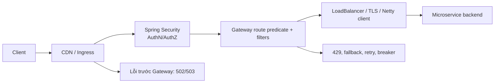
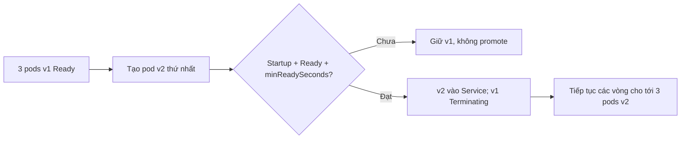
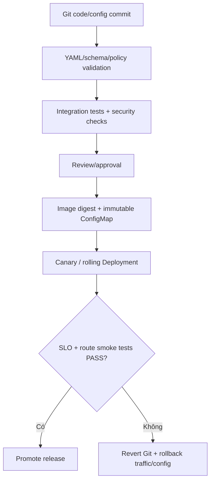

# Nâng cấp cuốn chiếu và phục hồi cấu hình

Trong một kiến trúc microservices, **Spring Cloud Gateway** là cổng vào của nhiều dịch vụ. Một thay đổi tưởng nhỏ — sửa `Path` predicate, `RewritePath`, URI `lb://`, `KeyResolver`, OAuth2 issuer, circuit breaker, retry hoặc TLS — có thể tác động đồng thời đến hàng trăm endpoints. Nếu thay toàn bộ Gateway instances một lần và không có phiên bản cấu hình để quay lại, lỗi khó được khoanh vùng và khôi phục.

**Nâng cấp cuốn chiếu (rolling upgrade)** là thay thế dần các instances Gateway trong khi giữ một phần instances cũ đang phục vụ. **Phục hồi cấu hình (configuration recovery)** là đưa các route definitions, filter parameters, secret references và nguồn cấu hình liên quan về một **trạng thái đã được kiểm chứng**. Hai hoạt động này có liên hệ nhưng **không phải một**: một lệnh rollback Deployment không tự sửa Redis/Config Server, và một lệnh refresh cache routes không tự sửa cấu hình nguồn đang sai.

Bài thuộc chương **Triển khai** của module **SPRING_CLOUD_GATEWAY**, kết hợp kiến thức route predicates, filter chain, biến đổi đường dẫn/header, khám phá dịch vụ, xác thực, giới hạn lưu lượng, circuit breaker, retry, TLS và quan sát request để vận hành API Gateway an toàn.

**Mục tiêu bài học:**

- Giải thích `RollingUpdate`, `maxSurge`, `maxUnavailable`, canary, blue-green, rollback và config revision.
- Dùng readiness/liveness/startup probes, Spring Boot graceful shutdown và Kubernetes termination grace đúng mục đích.
- Chuẩn bị nâng cấp mà không làm gián đoạn bất ngờ HTTP, WebSocket, SSE, SockJS và requests đang chạy.
- Quản lý route config bằng image, immutable ConfigMap, Spring Cloud Config hoặc dynamic route repository.
- Phân biệt `POST /actuator/gateway/refresh` với restore cấu hình nguồn và reconcile nhiều Gateway pods.
- Xây runbook rollback **image + config + secrets references + traffic policy**, không chỉ một lệnh.
- Đo hiệu quả nâng cấp bằng route smoke tests, 404/401/429/5xx, p95/p99, retry, breaker và TLS errors.
- Diễn tập failure scenarios có thể tái hiện trên staging trước khi triển khai production.

> **Phạm vi phiên bản:** Các ví dụ chính cho **Spring Cloud Gateway Server WebFlux 5.x** trên Kubernetes, dùng namespace `spring.cloud.gateway.server.webflux.routes`. Ở Gateway WebFlux 4.3.x, namespace thường là `spring.cloud.gateway.routes`. **Gateway Server Web MVC** có Servlet stack/filter semantics khác. Với Spring Boot 4, graceful shutdown đã được bật mặc định; với Spring Boot 3.x, nên cấu hình `server.shutdown=graceful` tường minh khi cần. Kiểm tra đúng dependency BOM/release train và configuration properties trước khi đưa ví dụ lên production.

## 1. Rollback ứng dụng không đồng nghĩa rollback cấu hình

Một Gateway pod không chỉ chứa Java bytecode. Nó phụ thuộc nhiều lớp trạng thái:

| Thành phần | Ví dụ | Nơi lưu | Khôi phục bằng cách nào? |
| --- | --- | --- | --- |
| Application image | `edge-gateway:1.8.2` | Registry, Deployment Pod template | Chọn lại image **digest** ổn định |
| Static routes | `Path=/api/orders/**` | `application.yaml` hoặc ConfigMap | Chọn lại **route revision** cũ |
| Filter settings | `StripPrefix`, `Retry`, `RequestRateLimiter` | Config và custom code | Khôi phục code/config tương thích |
| Config Server | `spring.config.import=configserver:...` | Git/backend Config Server | Pin label/commit phiên bản trước |
| Dynamic routes | `RedisRouteDefinitionRepository` | Redis/external repository | Restore snapshot routes có kiểm soát |
| Secrets/certificates | OAuth client secret, TLS trust | Secret manager/K8s Secret | Chọn version/alias hợp lệ |
| Backend instances | `orders-service` qua LoadBalancer | Service discovery | Đảm bảo endpoint Ready và đúng contract |
| RedisRateLimiter state | Token buckets và keys | Redis | Thường **không** rollback cả Redis |
| Circuit breaker state | OPEN/CLOSED | JVM từng pod | Hiểu trạng thái reset khi restart |
| Ingress/canary policy | 5% traffic cho bản mới | Ingress/service mesh | Đưa traffic về revision ổn định |

**Ví dụ:** `kubectl rollout undo deployment/edge-gateway` có thể đưa image quay lại v1.8.1. Nhưng nếu route `orders-read` đã bị sửa trực tiếp trong Redis hoặc ConfigMap cùng tên, Gateway v1.8.1 vẫn có thể nạp **cấu hình sai mới**.

Ngược lại, nếu mỗi release dùng **ConfigMap bất biến có tên theo revision** và Deployment cũ trỏ đúng ConfigMap cũ còn tồn tại, rollback Pod template có thể khôi phục **tham chiếu** về cấu hình cũ. Chính vì thế, release nên là **một bộ phiên bản nhất quán**, không chỉ tag image.

## 2. Release manifest: biết chính xác trạng thái nào đang chạy

Hãy theo dõi một deployment unit:

```text
release: edge-gateway-2026-11-24-v17
image: registry.example.org/platform/edge-gateway@sha256:<verified-digest>
app-version: 1.8.2
spring-boot/spring-cloud: compatible release train
static-routes: routes-v17 (Git commit/content hash)
dynamic-routes: snapshot-v6 (nếu dùng)
oauth2-config: identity-v3 (reference, không chứa secret)
tls-trust-bundle: trust-v5
ingress-canary-policy: edge-v9
last-known-good: edge-gateway-v16
```

Khi xảy ra lỗi, runbook phải trả lời được:

1. Pod A, B, C đang chạy **image digest** nào?
2. Mỗi pod đã nạp **effective routes** revision nào?
3. Phần route đó đến từ **file, ConfigMap, Config Server hay Redis**?
4. Secret/TLS/OAuth2 references còn tương thích với image cũ không?
5. Những request đang qua bản mới có tỷ lệ 401/404/429/503 khác bản cũ không?
6. Có đủ old image, config snapshots và quyền deploy để rollback ngay không?

**Không ghi giá trị JWT, private key, refresh token hay client secret vào manifest/audit log**. Chỉ ghi reference, revision và quyền truy cập được kiểm soát.

## 3. Tại sao nâng cấp Gateway nhạy cảm hơn một REST service?

Gateway thường xử lý **trước** backend:



Một lỗi ở Gateway có thể:

- Match nhầm route vì `Host`/`Path`/`Method` hoặc `order`.
- Chuyển đường dẫn sai do `StripPrefix`/`RewritePath`, tạo `404` từ backend.
- Vô tình bỏ header `Authorization` hoặc thêm header nhận dạng không tin cậy.
- Trả `401/403` do issuer/JWK/scopes hoặc CORS khác phiên bản.
- Trả `429` vì RedisRateLimiter hoặc key resolution thay đổi.
- Trả `502/504` vì TLS, connection pool, timeout hoặc URI upstream sai.
- Trả `503` khi `lb://` không tìm được instances hoặc circuit breaker OPEN.
- Ngắt kết nối **WebSocket/SSE** khi pod cũ bị terminate.

Vì vậy, **“Pod Ready” không bằng “mọi route nghiệp vụ đúng”**. Rollout cần cả probes ở runtime và smoke tests qua đường đi HTTP thực.

## 4. RollingUpdate, maxSurge và maxUnavailable

Kubernetes `Deployment` hỗ trợ `RollingUpdate` để thay pods cũ bằng pods mới một cách dần dần.

- `replicas`: số pods mong muốn.
- `maxSurge`: số pods phụ trội tạm thời vượt replicas trong quá trình rollout.
- `maxUnavailable`: số pods tối đa được phép không Available khi rollout.
- `minReadySeconds`: thời gian pod phải duy trì Ready trước khi tính Available.
- `progressDeadlineSeconds`: giới hạn tiến độ trước khi Deployment bị đánh dấu không tiến triển.

Ví dụ **3 replicas**, max surge một và không cho chủ động giảm số Available:

```yaml
spec:
  replicas: 3
  minReadySeconds: 10
  progressDeadlineSeconds: 300
  strategy:
    type: RollingUpdate
    rollingUpdate:
      maxSurge: 1
      maxUnavailable: 0
```



**Đây không phải bảo đảm tuyệt đối “zero downtime”.** Rollout vẫn có thể gây lỗi nếu pod mới báo Ready quá sớm, surge không đủ CPU/RAM, ingress chưa rút endpoints cũ, long-lived sockets bị cắt hoặc route/config không đúng. Ngoài ra, `maxUnavailable=0` bảo vệ tiến độ Deployment do controller quản lý; nó không thể ngăn node failure, mất backend hoặc lỗi network ngoài ý muốn.

## 5. Kiểm tra capacity trước khi tạo surge pod

Một cluster có 3 Gateway pods, mỗi pod tiêu thụ 600 MiB memory khi cao tải. Với `maxSurge=1`, phải có khoảng trống để chạy **pod thứ tư** cùng các thành phần liên quan.

Trước rollout:

- Kiểm tra allocatable CPU/RAM trên nodes và resource quotas.
- Kiểm tra ingress/LB target capacity, service endpoints và network policy.
- Kiểm tra HPA đang scale hay cố điều chỉnh replicas cùng lúc.
- Kiểm tra Outbound HTTP client pools và Redis connections khi số pods tăng tạm thời.
- Kiểm tra backend capacity: thêm Gateway pods **không** tạo thêm năng lực DB/backend.
- Kiểm tra topology spread/anti-affinity để tránh cả pods vào một node/zone.

**Không sửa rollout stall vì thiếu capacity bằng cách tùy tiện đổi `maxUnavailable=3`**. Cách đó có thể loại toàn bộ bản cũ trước khi bản mới sẵn sàng.

## 6. Spring Boot graceful shutdown và deadline của Pod

Spring Boot hỗ trợ graceful shutdown với Reactor Netty và các embedded servers tương ứng. Cấu hình tường minh:

```yaml
server:
  port: 8080
  shutdown: graceful

spring:
  lifecycle:
    timeout-per-shutdown-phase: 30s
```

- `server.shutdown=graceful`: yêu cầu tiến hành shutdown cho các requests đang xử lý có thời gian hoàn tất. Spring Boot 4 đã bật mặc định; khai báo giúp thể hiện policy.
- `spring.lifecycle.timeout-per-shutdown-phase=30s`: thời gian tối đa cho shutdown phase theo Spring lifecycle, **không** phải timeout cho một HTTP upstream request.
- Kubernetes `terminationGracePeriodSeconds`: ngân sách **toàn bộ** cho `preStop`, truyền tín hiệu stop, shutdown và overhead.
- Khi hết grace, kubelet có thể gửi SIGKILL làm rớt connections còn lại.

Ví dụ:

```yaml
spec:
  terminationGracePeriodSeconds: 60
```

Có thể dành một khoảng ngắn để ingress rút endpoint, sau đó cho Spring khoảng 30 giây hoàn tất HTTP requests. Không kỳ vọng một **WebSocket sống hàng giờ** có thể hoàn thành trong 60 giây; cần protocol-aware reconnect.

## 7. Pod Terminating, EndpointSlice và preStop

Quy trình Kubernetes Pod termination về cơ bản:

1. Pod được đánh dấu Terminating.
2. Control plane cập nhật EndpointSlice; terminating endpoints có `ready=false` cho traffic thường mới.
3. Kubelet chạy `preStop` nếu được cấu hình và còn grace.
4. Container thường nhận SIGTERM; Spring Boot bắt đầu graceful shutdown.
5. Hết grace thì workload còn chạy có thể bị force kill.

Nếu ingress/LB bên ngoài cập nhật endpoints chậm, đôi khi thêm `preStop` ngắn giúp giảm kết nối mới vào pod cũ:

```yaml
spec:
  terminationGracePeriodSeconds: 60
  containers:
    - name: gateway
      lifecycle:
        preStop:
          exec:
            command: ["/bin/sh", "-c", "sleep 8"]
```

**Cảnh báo:** Ví dụ này chỉ hoạt động khi container image có `/bin/sh` và `sleep`. Distroless image có thể không có shell. Thời gian `preStop` **ăn vào** termination grace; `sleep 60` với grace 30s có thể khiến Spring không được dừng gracefully. Nên đo EndpointSlice/ingress propagation thay vì mặc định thêm sleep vào mọi cluster.

**Readiness=false không có nghĩa mọi socket cũ đã đóng.** HTTP keep-alive, WebSocket và SSE connections có thể vẫn sống tới lúc shutdown; cần kiểm tra client retry/reconnect.

## 8. Readiness, liveness và startup probes là ba hợp đồng khác nhau

| Probe | Câu hỏi | Hành vi Kubernetes khi fail |
| --- | --- | --- |
| Startup | Ứng dụng đã khởi động chưa? | Trì hoãn liveness/readiness; có thể restart khi vượt ngưỡng |
| Readiness | Pod có nên nhận traffic mới không? | Loại khỏi Ready Service endpoints |
| Liveness | Process có còn có khả năng phục hồi không? | Restart container sau ngưỡng |
| Synthetic API probe | Route và backend nghiệp vụ có hoạt động end-to-end? | Thường là tín hiệu CI/monitoring, không trực tiếp thay K8s probe |

**Không phụ thuộc liveness vào sự khỏe mạnh của mọi backend**, vì một Redis/backend chung bị lỗi có thể khiến **toàn bộ Gateway pods bị restart**, làm sự cố lan rộng.

Khi management port chạy riêng, kiểm tra health chỉ qua port đó có thể cho kết quả “xanh” dù main traffic listener bị nghẽn. Spring Boot hỗ trợ xuất thêm các đường dẫn probe ở **port ứng dụng chính**:

```yaml
management:
  server:
    port: 9090
  endpoint:
    health:
      probes:
        enabled: true
        add-additional-paths: true
```

Khi dùng cấu hình này trên phiên bản hỗ trợ, **`/livez` và `/readyz`** xuất trên main server port, ví dụ `8080`. Readiness theo lifecycle **không tự xác minh** mọi route definition; cần thêm smoke tests qua ingress.

## 9. Manifests mẫu: Deployment WebFlux rolling an toàn hơn

Ví dụ dưới đây giả định đã có ConfigMap version hóa tên `edge-routes-v17`, container image và Service riêng:

```yaml
apiVersion: apps/v1
kind: Deployment
metadata:
  name: edge-gateway
  namespace: edge
  labels:
    app: edge-gateway
spec:
  replicas: 3
  revisionHistoryLimit: 10
  minReadySeconds: 10
  progressDeadlineSeconds: 300
  strategy:
    type: RollingUpdate
    rollingUpdate:
      maxSurge: 1
      maxUnavailable: 0
  selector:
    matchLabels:
      app: edge-gateway
  template:
    metadata:
      labels:
        app: edge-gateway
        app.kubernetes.io/version: "1.8.2"
      annotations:
        config-revision: "routes-v17"
    spec:
      terminationGracePeriodSeconds: 60
      containers:
        - name: gateway
          image: registry.example.org/platform/edge-gateway:1.8.2
          imagePullPolicy: IfNotPresent
          ports:
            - name: http
              containerPort: 8080
            - name: management
              containerPort: 9090
          env:
            - name: SPRING_PROFILES_ACTIVE
              value: prod
            - name: SPRING_CONFIG_ADDITIONAL_LOCATION
              value: "optional:file:/etc/edge-config/"
          volumeMounts:
            - name: routes
              mountPath: /etc/edge-config
              readOnly: true
          startupProbe:
            httpGet:
              path: /livez
              port: http
            periodSeconds: 2
            failureThreshold: 30
          readinessProbe:
            httpGet:
              path: /readyz
              port: http
            periodSeconds: 5
            timeoutSeconds: 2
            failureThreshold: 2
          livenessProbe:
            httpGet:
              path: /livez
              port: http
            periodSeconds: 10
            timeoutSeconds: 2
            failureThreshold: 3
          resources:
            requests:
              cpu: 250m
              memory: 512Mi
            limits:
              memory: 1Gi
      volumes:
        - name: routes
          configMap:
            name: edge-routes-v17
```

**Điều kiện triển khai:**

- Image tag `1.8.2` chỉ an toàn khi registry cấm ghi đè; trong production ưu tiên **pin image digest**.
- Cần ConfigMap đúng namespace, Service/Ingress, RBAC, NetworkPolicy, image pull credentials và đủ node capacity.
- `SPRING_CONFIG_ADDITIONAL_LOCATION` thêm thư mục config ngoài vào Spring Boot startup; kiểm tra property precedence với config đóng gói trong image.
- `minReadySeconds` giúp rollout chờ pod Ready ổn định, nhưng không chứng minh route semantics.
- `management.server.port` và additional probe paths phải đúng như app config.
- `revisionHistoryLimit` giữ một số ReplicaSets để có thể rollback Deployment; nó **không** backup Config Server/Redis.
- Phải kiểm tra resource requests/limits bằng load test thực, không copy các số lab vào production.

## 10. application.yaml mẫu: route, timeout và read-only Actuator

```yaml
spring:
  application:
    name: edge-gateway
  lifecycle:
    timeout-per-shutdown-phase: 30s
  cloud:
    gateway:
      server:
        webflux:
          routes:
            - id: orders-read
              uri: lb://orders-service
              predicates:
                - Path=/api/orders/**
                - Method=GET
              filters:
                - StripPrefix=1
              metadata:
                connect-timeout: 1000  # milliseconds
                response-timeout: 3000 # milliseconds

server:
  port: 8080
  shutdown: graceful

management:
  server:
    port: 9090
  endpoint:
    health:
      probes:
        enabled: true
        add-additional-paths: true
    gateway:
      access: read-only
  endpoints:
    web:
      exposure:
        include: health,info,metrics,prometheus,gateway
```

**Lưu ý về routing:**

- URI `lb://orders-service` cần Spring Cloud LoadBalancer và nguồn ServiceInstances; nếu không, có thể gặp `503`.
- `StripPrefix=1` bỏ segment `api`, backend nhận `/orders/**`.
- Metadata `response-timeout=3000` nghĩa là **3.000 ms**, khác global Duration syntax `3s`.
- Route GET chỉ match GET; không tự thêm retry vào POST nghiệp vụ.
- Một nâng cấp thay `Path`/`StripPrefix`/`lb` có thể gây 404/503 dù readiness xanh.

**Lưu ý về Actuator:**

- `management.endpoint.gateway.access=read-only` cho phép kiểm tra routes khi được expose, **không** cho phép write/refresh.
- `/actuator/gateway` có thể lộ topology/URI nội bộ; bảo vệ management port bằng authentication/authorization, TLS và network isolation.
- `management.endpoints.web.exposure.include` **không tự cấp RBAC**. Tránh public 9090 ra Internet.

## 11. Versioned immutable ConfigMap để rollback dễ kiểm chứng

Không nên sửa tại chỗ một ConfigMap có tên cố định nếu cần phục hồi phiên bản cũ. Thay vào đó dùng:

```text
edge-routes-v16  # last-known-good
edge-routes-v17  # candidate
edge-routes-v18  # future revision
```

Ví dụ:

```yaml
apiVersion: v1
kind: ConfigMap
metadata:
  name: edge-routes-v17
  namespace: edge
  labels:
    app: edge-gateway
    config-revision: routes-v17
immutable: true
data:
  application.yaml: |
    spring:
      cloud:
        gateway:
          server:
            webflux:
              routes:
                - id: orders-read
                  uri: lb://orders-service
                  predicates:
                    - Path=/api/orders/**
                    - Method=GET
                  filters:
                    - StripPrefix=1
```

Deployment mount ConfigMap này vào `/etc/edge-config/application.yaml`. Một revision mới dùng ConfigMap tên mới; trong Pod template cũng thay `config-revision` và `volumes.configMap.name`. Mỗi Pod mới đọc một snapshot được chỉ định khi startup.

### Hai chi tiết dễ nhầm

1. ConfigMap được dùng làm **environment variables**: giá trị trong pod **không được cập nhật tự động** khi ConfigMap thay; cần pod mới/rollout.
2. ConfigMap được mount thành **volume**: file có thể được cập nhật *eventually*, nhưng Spring Boot/Gateway không nhất thiết tự reload cấu hình đã đọc khi startup. Mount kiểu `subPath` còn có hành vi cập nhật khác.

**Quyết định khuyến nghị:** Dùng **immutable ConfigMap + rolling restart** cho routes tĩnh để giảm config drift. Nếu cần hot reload thật, phải thiết kế và kiểm thử cơ chế update/refresh riêng, không mặc định thay file có nghĩa route cache được cập nhật.

## 12. GitOps là nguồn chân lý; không dùng hotfix thủ công dài hạn

Một quy trình quản trị release:



**Validation route cần có ít nhất:**

- Unique route IDs và ownership rõ.
- `Host`/`Path`/`Method` predicates không overlap ngoài chủ đích.
- Route `order` chính xác khi nhiều route có thể match cùng request.
- `lb://` service ID thực, URI scheme/host được allowlist.
- `StripPrefix`/`RewritePath` đúng hợp đồng backend.
- Filter header biến đổi không xóa/mạo danh identity sai.
- Security/WebFilter và CORS không mở API nhạy cảm.
- RateLimiter KeyResolver dùng identity đã verify.
- Retry/CB/timeouts có budget, không gây POST side effects bị retry.
- Cấu hình TLS/issuer/client registration được tạo từ secret references.
- Namespace cấu hình đúng **Gateway Server WebFlux 5.x** hoặc release đang chạy.
- Có cách quay lại config/source rõ ràng.

**Không sửa `kubectl edit configmap` trong production rồi bỏ qua source-of-truth.** GitOps reconcile có thể ghi đè hotfix sau đó, làm lỗi lặp lại.

## 13. Config Server và phiên bản Git label

Nếu dùng Spring Cloud Config Client, có thể pin một config label:

```yaml
spring:
  application:
    name: edge-gateway
  config:
    import: "configserver:https://config.internal.example"
  cloud:
    config:
      label: "gateway-release-v17"
```

Spring Cloud Config có thể dùng **Git branch/tag/commit** làm label tùy backend. Với release quan trọng, label hoặc commit được kiểm soát/bất biến giúp JVM mới đọc một cấu hình có thể dự đoán.

- `configserver:...` không có `optional:` thường được chọn khi cần **fail startup** nếu source không thể truy cập (theo Config Client behavior).
- `optional:configserver:...` cho phép startup trong một số tình huống source không sẵn sàng, nhưng có thể khiến Gateway chạy **thiếu critical routes** nếu không có nguồn dự phòng đã xác minh.
- `spring.cloud.config.label` nên nằm trong deployment unit; rollback phải khôi phục label phù hợp image.
- Nếu Config Server dùng floating branch thay revision, restart pod có thể nạp một config khác dù image không đổi.
- Các properties thay bean construction/security behavior có thể cần **restart** chứ không chỉ refresh.
- Native/AOT deployments có giới hạn refresh riêng, cần đối chiếu tài liệu.

**Không nhầm Config Server `/actuator/refresh` với Gateway route cache `/actuator/gateway/refresh`**: hai cơ chế làm việc ở những tầng khác nhau.

## 14. Gateway Actuator: xem route, làm mới cache, sửa repository

Spring Cloud Gateway Server WebFlux có Gateway Actuator API (khi bật và được cấp quyền):

| Endpoint/operation | Dùng để | Không tự làm |
| --- | --- | --- |
| `GET /actuator/gateway/routes` | Xem các active routes | Không sửa source |
| `GET /actuator/gateway/routes/{id}` | Xem một route | Không xác minh backend contract |
| `POST /actuator/gateway/refresh` | Làm mới/clear route cache | Không sửa route sai trong Redis/Git |
| Actuator POST/DELETE route definitions (khi cho phép) | Mutate một nguồn route theo API | Không thay thế GitOps/backup |
| `/actuator/refresh` của Spring Cloud Context | Rebind/refresh Environment theo cơ chế Spring Cloud | Không đảm bảo mọi route caches đã đồng bộ |

Tài liệu Gateway 5.x khuyến nghị **`management.endpoint.gateway.access=read-only`**. Để thực hiện POST refresh/mutation, cần cấu hình quyền `unrestricted` tương ứng **và** RBAC/TLS/network isolation/audit. Không mở write endpoint public.

### HTTP 200 của refresh chưa phải thành công toàn cụm

Tài liệu Gateway nêu `POST /actuator/gateway/refresh` có thể trigger **asynchronous refresh**. Nó trả 200 nghĩa là thao tác đã được chấp nhận theo API, **không chứng minh** các routes trên mọi pods đã đổi.

Nếu `/actuator/gateway/refresh` được gọi qua Kubernetes Service, request chỉ vào **một pod được load-balanced**, không broadcast tự động đến các pods khác. Cần reconcile/refresh toàn cụm hoặc **rolling restart** có kiểm chứng.

## 15. Khi ba Gateway pods có route cache khác nhau

Một tình huống:

```text
Trước thay đổi:
  Pod A -> orders-read, routes-v16
  Pod B -> orders-read, routes-v16
  Pod C -> orders-read, routes-v16

Sau khi source được đổi v17, chỉ pod B refresh:
  Pod A -> routes-v16
  Pod B -> routes-v17
  Pod C -> routes-v16
```

User có thể nhận lúc `200`, lúc `404`, tùy request đi pod nào. Đây là **mixed route state** trong quá trình cập nhật, không nhất thiết là lỗi mạng.

**Cách giảm nguy cơ:**

1. Gắn config revision trong deployment metadata và telemetry.
2. Dùng immutable config + rolling pod replacement khi phù hợp.
3. Với dynamic routes, phát event/reconcile đáng tin tới từng instance.
4. Đo *convergence time* giữa các pods.
5. Kiểm tra effective route ID, URI, predicate, filter list, order, metadata trên **từng pod**.
6. Đừng mark release successful chỉ vì một pod trả route mới.
7. Thiết kế route changes **backward compatible** trong giai đoạn hai revisions cùng tồn tại.

Nếu cần tính nhất quán gần như atomic trên route set, cân nhắc **blue-green**: chuẩn bị toàn bộ nhóm mới và chỉ chuyển traffic sau khi các Gateway pods xanh đã được kiểm thử.

## 16. Repository routes động trong Redis

Gateway WebFlux cung cấp các RouteDefinitionRepository với tính chất khác nhau:

- `InMemoryRouteDefinitionRepository` chỉ có state trong JVM hiện tại; **không chia sẻ** route definitions giữa Gateway replicas.
- `RedisRouteDefinitionRepository` cho phép chia sẻ route definitions qua Redis khi cấu hình/dep tương thích.

Tài liệu Gateway đưa một property dạng:

```yaml
spring:
  cloud:
    gateway:
      redis-route-definition-repository:
        enabled: true
```

Cấu hình cụ thể cần đối chiếu release train và reactive Redis dependency. **RedisRouteDefinitionRepository không đồng nghĩa RedisRateLimiter**: Redis có thể đồng thời lưu route definitions, token buckets hoặc nhiều dữ liệu khác.

### Phục hồi Redis routes an toàn

1. Đóng các nguồn route mutations khác; xác định ai/automation đang sửa.
2. Sao lưu current route definitions để giữ evidence.
3. Lấy last-known-good **route snapshot** đã duyệt, gồm IDs, predicates, filters, URIs, metadata.
4. Validate snapshot: không duplicate IDs, không host/URI không tin cậy, không bỏ auth filter ngoài ý muốn.
5. Restore **những key/route IDs thuộc repository** theo API được hỗ trợ.
6. Không xoá toàn bộ Redis hoặc quota/session keys để “reset”.
7. Reconcile/refresh tất cả Gateway instances.
8. So active routes từng pod và chạy authenticated smoke tests.
9. Gỡ manual override sau khi source-of-truth đã thống nhất.

**Không giả định Redis update và toàn bộ Gateway cache refresh tạo thành một giao dịch phân tán atomic.** Phải thiết kế khả năng đồng thời tồn tại hai revisions ngắn hạn.

## 17. Tĩnh, động và externalized config: chọn cơ chế phù hợp

| Nguồn | Ưu điểm | Rủi ro cần xử lý | Cách rollback khuyến nghị |
| --- | --- | --- | --- |
| `application.yaml` trong image | Image/config gắn nhau, startup deterministic | Đổi route phải build image | Rollback image digest |
| Immutable ConfigMap | Config revision rõ, không rebuild image | Cần rollout, precedence source | Revert Pod template tới ConfigMap cũ |
| Spring Cloud Config | Config tập trung/Git labels | Config Server outage, floating label | Pin/revert label/commit + reconcile |
| Redis dynamic repository | Routes động không restart toàn bộ | Redis dependence, cache drift | Restore route snapshot + refresh pods |
| Actuator route mutation | Khắc phục khẩn cấp nhanh | Control plane nguy hiểm, dễ drift | Audit, restore source và xóa override |
| Runtime feature flag/route policy | Giảm blast radius | Nhầm state/ownership và stale caches | Version flag policy và rollout |

**Nguyên tắc:** Cấu hình càng “hot”, càng cần **thẩm quyền, audit, rollback và cơ chế đồng bộ** tốt. Khi vận hành cổng vào nhiều microservices, một thay đổi route quá dễ nhưng không có nguồn chân lý thường rủi ro hơn một rollout chậm có kiểm soát.

## 18. Cần bảo vệ route config như một control plane

Người có quyền ghi route definitions có thể khiến Gateway:

- Gửi request sang URI không được phép (open proxy/SSRF).
- Bắt traffic của route khác bằng `Path`/`Host` overlap.
- Bỏ rate limiter, retry budget, circuit breaker hoặc header security.
- Chuyển `Authorization`/`Cookie` sang backend sai audience.
- Đổi `RewritePath` sang endpoint quản trị của backend.
- Làm `POST` bị retry và nhân side effects.
- Gây `502` bằng cách trỏ URI tới TLS server không có trust/SNI đúng.

Vì vậy:

- RBAC least-privilege cho GitOps, Redis route writer, Config Server và Actuator.
- Tách quyền **read routes** và **mutate routes**.
- Xác minh dest URI allowlist, service IDs, filter order và static analysis/config policy.
- Network egress chỉ tới backends được phép.
- Bảo vệ management port bằng TLS/RBAC/network isolation, không đưa ra public.
- Review, audit và thu hồi emergency overrides có hạn.
- Không log Bearer tokens, private keys, route secrets trong test/dashboard.

**Route configuration cũng là security-sensitive code**, không chỉ “YAML vận hành”.


## 19. Chuẩn bị nâng cấp: kiểm tra cả binary và route contract

Trước mỗi lần rollout, thực hiện **preflight checklist** theo thứ tự:

1. **Đóng băng release unit**: image digest, Spring Boot/Cloud BOM, config revision, dynamic route snapshot, secret references.
2. **Kiểm tra compatibility**: Java, Spring Security, Reactor Netty, Redis, LoadBalancer, GatewayFilter factories và API backend.
3. **So sánh route diffs**: có thay `Path`, `Host`, `Method`, `order`, `StripPrefix`, `RewritePath`, `uri`, `KeyResolver` không?
4. **Chạy unit/config tests**: validate route IDs, URI schemes, filter names, policy authorization và response contracts.
5. **Chạy integration tests** với Gateway WebFlux HTTP port thực, WireMock/Testcontainers, bao gồm 404/401/429/503 và TLS.
6. **Chạy backend compatibility tests**: bản Gateway cũ và mới có cùng giao tiếp được với backend đang chạy không?
7. **Xác minh cluster capacity**: node resources đủ cho surge pod; backend và Redis có đủ headroom.
8. **Xác minh probes**: startup/readiness/liveness đúng, không restart storm vì dependency chung.
9. **Xác minh drain**: SIGTERM, preStop (nếu dùng), timeouts, WebSocket/SSE reconnect.
10. **Chuẩn bị rollback**: old image digest, ConfigMap/Config Server label, Redis routes snapshot và thao tác ingress.
11. **Chuẩn bị metrics**: 5xx, 404, 401/403, 429, p95, Retry, breaker OPEN và pool pending theo revision.
12. **Phê duyệt stop conditions**: ai quyết định dừng, sau bao lâu và khi nào rollback ngay.

Một checklist không có **người chịu trách nhiệm** hoặc **đường quay lại** vẫn là checklist thiếu. Với API critical, gắn runbook/owner vào route metadata hoặc catalog quản lý dịch vụ, không dựa vào trí nhớ của người trực.

## 20. RollingUpdate, canary và blue-green khác nhau

| Chiến lược | Cách đưa traffic vào phiên bản mới | Ưu điểm | Rủi ro |
| --- | --- | --- | --- |
| **RollingUpdate** | Thay pods dần trong cùng Deployment | Tích hợp Kubernetes, đơn giản | Old/new cùng phục vụ, tỷ lệ traffic không chính xác |
| **Canary Deployment** | Ingress/mesh đưa tỷ lệ nhỏ vào Deployment mới | Kiểm soát blast radius và so sánh SLI theo version | Cần L7 routing và đủ samples |
| **Blue-green** | Dựng nhóm “green” đầy đủ rồi chuyển traffic | Có thể thử toàn bộ green trước switch | Cần capacity gấp đôi tạm thời; persistent connections vẫn cần drain |
| **Recreate** | Dừng tất cả pods cũ rồi tạo mới | Không có mixed-version traffic | Có downtime, thường không phù hợp HA Gateway |
| **Feature flag/route flag** | Bật tính năng/route mới theo policy | Khoanh vùng thay đổi logic | Cần control plane, audit và convergence |

**Đừng nhầm `Weight` route predicate của Spring Cloud Gateway với canary của chính Gateway binary.** `Weight` trong Gateway thường giúp chia traffic **tới các backend routes**. Muốn canary phiên bản Gateway, traffic phải được chia **trước Gateway**, chẳng hạn ở ingress, service mesh hoặc edge load balancer.

### Canary gate mẫu

Một chiến lược có thể đi qua 1%, 5%, 25% rồi 100% traffic, nhưng phải đo **traffic thực** vào canary:

- 1–5%: kiểm tra route, TLS, authentication và quota.
- 10–25%: theo dõi 5xx, 401/403/404, p95/p99, HTTP pool và retries.
- Full rollout: kiểm tra config convergence, pod health và long-lived sessions.
- Post-release: theo dõi ít nhất một cửa sổ traffic đủ ý nghĩa.

**Nếu canary nhận 10 requests trong 30 phút và cả 10 đều thành công, không được xem đó là bằng chứng thống kê đủ mạnh**. Thêm synthetic tests và targeted load tests cho những routes ít traffic.

## 21. Lệnh kubectl theo trình tự triển khai

Các câu lệnh sau là **mẫu tham khảo dành cho môi trường bạn quản lý**, không được tự chạy trên production nếu chưa có phê duyệt:

```bash
# Trước release: xem state và lịch sử.
kubectl -n edge get deployment edge-gateway
kubectl -n edge get pods -l app=edge-gateway -o wide
kubectl -n edge rollout history deployment/edge-gateway

# Sau khi pipeline/GitOps cập nhật Deployment:
kubectl -n edge rollout status deployment/edge-gateway \
  --timeout=300s

# Điều tra rollout kẹt:
kubectl -n edge describe deployment edge-gateway
kubectl -n edge get events --sort-by=.lastTimestamp

# Tạm dừng khi phát hiện regression.
kubectl -n edge rollout pause deployment/edge-gateway

# Chỉ tiếp tục nếu đã quyết định promote/reconcile tiếp:
kubectl -n edge rollout resume deployment/edge-gateway

# Rollback Deployment Pod template (thực hiện theo runbook).
kubectl -n edge rollout undo deployment/edge-gateway
kubectl -n edge rollout status deployment/edge-gateway \
  --timeout=300s
```

**Cảnh báo về GitOps:** Nếu một GitOps controller quản lý Deployment, thao tác `kubectl rollout undo` thủ công có thể bị **reconcile ghi đè** bằng manifest vẫn trỏ v17. Phải **revert source-of-truth** theo quy trình rồi cho controller sync; lệnh `undo` chỉ là một biện pháp tác động Kubernetes cần phối hợp.

**Cảnh báo về pause:** Không để Deployment ở trạng thái paused rồi kỳ vọng mọi hành động rollback/promotion hoạt động như bình thường. Kiểm tra trạng thái và resume/reconcile theo runbook khi quyết định hướng xử lý.

`rollout status` kiểm tra trạng thái của Kubernetes Deployment controller, **không** xác nhận đúng filter chain hoặc business API. Luôn xem active routes và làm synthetic tests.

## 22. WebSocket, SSE, SockJS và các kết nối dài

Một API Gateway có thể proxy:

| Loại traffic | Khi pod được terminate | Điều kiện phục hồi |
| --- | --- | --- |
| HTTP GET ngắn | Có thể hoàn tất trong grace | Timeout và retry có backoff |
| POST/PUT | Backend có thể đã commit trước khi client mất response | Idempotency key và trạng thái giao dịch |
| WebSocket | Kết nối dài bị đóng khi pod cũ kết thúc | Client reconnect, xác thực lại, resubscribe |
| SSE | Stream đang mở bị ngắt | Reconnect, `Last-Event-ID` và replay nếu server hỗ trợ |
| SockJS XHR polling | Nhiều HTTP requests thuộc một logical session | Session affinity/shared state hoặc recreate session |
| Download/upload dài | Body hoặc response có thể đã gửi một phần | Resume/range/checkpoint protocol riêng |

### Vì sao WebSocket không “tự chuyển” sang pod mới?

WebSocket sau handshake gắn với **một connection đang sống** qua Gateway cũ. `Ready=false` chỉ điều hướng traffic mới; nó không di chuyển TCP connection sang pod khác. Khi JVM cũ dừng, session phải được thiết lập lại.

Một thiết kế production cần:

1. Client reconnect với **exponential backoff + jitter**.
2. Authentication/token refresh hợp lệ ở lần reconnect.
3. STOMP/SockJS client resubscribe theo protocol.
4. Message replay/ack qua durable broker nếu không được mất dữ liệu.
5. Giới hạn reconnect attempts/handshakes tránh thundering herd.
6. Active sessions/WS close codes/reconnect rate metrics khi rollout.

**Không bật Retry GatewayFilter mù quáng cho WebSocket frames hoặc HTTP streaming response đã commit.** Khi response đã bắt đầu gửi bytes, không thể thay thế bằng một fallback JSON như HTTP GET bình thường.

## 23. HTTP keep-alive và terminationGracePeriodSeconds

HTTP keep-alive có thể tiếp tục dùng connection tới một pod cũ dù Kubernetes đã bắt đầu rút Pod khỏi endpoints. Ingress hoặc L7 proxy còn có thể cache endpoint trong một khoảng propagation lag.

Kiểm thử trong staging:

- Mở nhiều keep-alive requests qua Gateway cũ.
- Tạo một long-running request ngắn hơn grace period.
- Trigger rolling upgrade.
- Đếm responses bị `502`, premature close hoặc client timeout.
- Kiểm tra Pod Terminating, EndpointSlice readiness và ingress target updates.
- Xác nhận request đang chạy được hoàn tất đúng khi đủ grace.
- Xác minh client mới không tiếp tục bị gửi tới pod terminating sau propagation.

**Không coi `terminationGracePeriodSeconds=60` là một timeout cho mọi request**. Đó là ngân sách Pod shutdown; Spring lifecycle, ingress timeouts và Netty client timeouts là các đồng hồ riêng.

Nếu có `preStop sleep 8s` và Spring shutdown phase 30s thì tổng cần đủ **8s + 30s + overhead**. Một Pod grace 20s là không phù hợp với cấu hình đó. Ngược lại, grace rất dài có thể làm rollout kéo dài và giữ tài nguyên cũ, nên chọn theo workload đo được.

## 24. OAuth2/JWT, TLS và Redis trong giai đoạn hai phiên bản cùng tồn tại

Trong rolling update, **v16 và v17 có thể xử lý request cùng lúc**. Một thay đổi breaking ở policy sẽ làm kết quả phụ thuộc vào pod.

| Thành phần | Rủi ro khi đổi | Cách giảm |
| --- | --- | --- |
| OAuth2 issuer/JWKS | Pods mới chấp nhận token khác pods cũ | Key overlap, trust migration và auth smoke tests |
| Scope/role mapping | `403` xen kẽ giữa pod versions | Security contract tương thích |
| TokenRelay | Authorized-client state chỉ tồn tại trên pod cũ | Shared persistence/session hoặc affinity được kiểm tra |
| TLS truststore | WSS/HTTPS outbound chỉ lỗi trên pods mới | Trust overlap, kiểm tra cert chain/SNI |
| RateLimiter `KeyResolver` | Một user được quota khác nhau theo revision | Migration key policy và test 429 |
| RedisRouteDefinitionRepository | Pods cache route definition khác nhau | Reconcile per pod + config revision |
| CircuitBreaker | Pod mới bắt đầu CLOSED, pod cũ có thể OPEN | Theo dõi state per instance |
| Retry policy | Pods mới có nhiều attempts hơn | Retry budget/capacity gate |
| Service discovery | New `lb://service` chưa Ready | Validate registry/contract trước rollout |

**Không “sửa” 502 do TLS bằng cách tắt certificate validation**. **Không “sửa” 401 bằng cách bỏ xác thực hoặc mở wildcard Origin**. Canaries phải giúp phát hiện đúng lỗi và rollback về trust/config tương thích.

### OAuth2 key rotation

Nếu IdP thay key và Gateway cache JWK theo TTL, hai pods có thể giữ cache khác nhau trong một khoảng ngắn. Nên có giai đoạn **overlapping keys**, không xóa key cũ quá sớm, và xác minh tokens của cả clients hợp lệ trong quá trình migration. Không log JWT hoặc bearer credentials khi điều tra.

## 25. Retry/CircuitBreaker và năng lực backend trong rollout

Trong Spring Cloud Gateway:

- **Retry** có thể tạo nhiều outbound attempts cho một client request.
- **CircuitBreaker** có thể OPEN theo lỗi backend, nhưng state thường nằm trong mỗi JVM.
- **RedisRateLimiter** có thể có state chia sẻ qua Redis dù Gateway pod restart.
- **LoadBalancer** phân phối backend instances nhưng không tạo thêm năng lực backend.
- **HTTP client pool** có thể tăng tổng số connections khi thêm surge Gateway pods.

Ví dụ: một backend chịu ổn định 400 attempts/s, hệ thống đang có 320 logical GET/s và 25% requests bị retry thêm một lần:

\[
320 \times (1+0{,}25)=400\ \text{attempts/s}.
\]

Nếu during rollout p95 tăng, retry fraction lên 50%, tải backend có thể thành:

\[
320 \times 1{,}5=480\ \text{attempts/s}.
\]

**Đây là quá tải do amplification**, không thể chữa chỉ bằng tăng số Gateway replicas. Khi có dấu hiệu này, giảm retry budget, bảo vệ backend bằng rate/concurrency limits, và kiểm tra upstream bottleneck.

**Không dự đoán breaker OPEN của pod A sẽ tự đồng bộ cho pod B**. Resilience4j circuit breakers thường có sliding-window state local; phải đo per-pod state.

## 26. Compatibility: cho phép phiên bản cũ và mới cùng phục vụ

| Thay đổi | Vấn đề khi mixed-version | Chiến lược |
| --- | --- | --- |
| `Path=/api/v1/**` → `/api/v2/**` | Một nhóm pods trả 404 | Giữ cả hai paths trong overlap |
| `StripPrefix=1` → `StripPrefix=2` | Backend nhận path khác | Route contract tests trước promote |
| `lb://orders-service` → `lb://orders-v2` | 503 nếu service mới chưa Ready | Deploy backend trước |
| Route ID đổi | Metric/quota key/session consistency thay | Giữ ID ổn định, migration có kiểm soát |
| Thêm `RemoveRequestHeader=Authorization` | Backend không còn auth token | Security regression test |
| Đổi `KeyResolver` | Quota không nhất quán | Dual-key hoặc migration policy |
| Đổi TLS trust | Chỉ pods mới lỗi handshake | Trust bundle overlap |
| Đổi JWK issuer | Token hợp lệ bị từ chối trên một nhóm | Coordinated IdP/Gateway rollout |
| Backend response schema đổi | Old Gateway/client deserialize khác | Expand–migrate–contract |
| Đổi `Retry` cho POST | Side effects bị nhân | Cấm hoặc backend idempotent |

**RollingUpdate không biến breaking change thành backward-compatible**. Nếu không thể có hai phiên bản cùng tồn tại trong một thời gian, hãy cân nhắc **blue-green traffic switch**, vẫn phải giải quyết in-flight connections và shared state.

## 27. SLI/SLO gates: deployment đúng là deployment không làm hỏng người dùng

Theo dõi ít nhất:

| Tín hiệu | Mục đích trong rollout |
| --- | --- |
| Route ID và active route count | Phát hiện thiếu/nhầm route definitions |
| HTTP 404 | Bắt lỗi Path/Host/order/path rewriting |
| 401/403 | Bắt lỗi OAuth2/JWT/Security/CORS policy |
| 429 | Bắt lỗi RedisRateLimiter/KeyResolver/quota |
| 502/503/504 | Bắt TLS/discovery/backend/timeout |
| p95/p99 | Bắt latency regression khi response vẫn 200 |
| Netty active/pending pool | Bắt resource saturation trên pods mới |
| Retry attempts per logical request | Bắt amplification |
| Breaker state/fallback | Bắt backend không khỏe bị che |
| WebSocket reconnect/close codes | Bắt disruption trong draining |
| Config revision per pod | Bắt split-brain config |
| Prometheus `up` | Bắt trường hợp không có metrics |
| Readiness/Available pods | Bắt rollout stall |
| Synthetic success | Xác minh business contract end-to-end |

**Cẩn trọng:** Gateway route timer `spring.cloud.gateway.requests` chỉ đo requests đi qua Gateway route metrics. Một 404 no-route hoặc lỗi ingress trước Gateway có thể **không** nằm trong timer đó. Cần edge HTTP metrics và synthetic checks.

### PromQL minh họa

Khi có Micrometer Prometheus timer với tên `spring_cloud_gateway_requests_seconds_count`:

```promql
# RPS theo route.
sum by (routeId) (
  rate(spring_cloud_gateway_requests_seconds_count{
    job="gateway-prod"
  }[5m])
)
```

```promql
# 5xx ratio theo route, với route có numerator time series.
sum by (routeId) (
  rate(spring_cloud_gateway_requests_seconds_count{
    job="gateway-prod",
    httpStatusCode=~"5.."
  }[5m])
)
/
clamp_min(
  sum by (routeId) (
    rate(spring_cloud_gateway_requests_seconds_count{
      job="gateway-prod"
    }[5m])
  ),
  0.000001
)
```

Khi không có 5xx nào, numerator có thể vắng mặt; cần zero-fill hợp lý nếu dùng dashboard. Khi **tất cả metrics mất**, không được hiểu là `0%` errors: phải có alert `up`/no-data. Tên labels/series phải được kiểm tra qua exporter thực tế, không tự tin tuyệt đối vào snippet.

### Ngưỡng dừng

Không copy ngưỡng “5xx trên 1%” cho mọi API. Với SLO availability 99,9%, 1% errors đã tiêu thụ error budget nhanh. Dùng **burn rate**, baseline và time windows đủ samples. Với API ít traffic, dùng synthetic tests bổ sung.

## 28. Runbook A — Route mới sai Path hoặc RewritePath

**Tình huống:** Pods mới v17 Ready, nhưng `GET /api/orders/42` trả 404. Pods cũ v16 trả 200.

**Hành động:**

1. Dừng promotion, chuyển canary traffic về v16 nếu có.
2. Xác định request đang vào pod nào bằng revision labels/logs (không log tokens).
3. So sánh `GET /actuator/gateway/routes/orders-read` của pods cũ và mới.
4. Kiểm tra `Path`, `Host`, `Method`, `order`, `StripPrefix` hoặc `RewritePath`.
5. Sửa/revert **source config** về routes-v16, không chỉ refresh cache v17.
6. Rollout pods với ConfigMap/Config Server label v16 tương thích.
7. Xác minh tất cả pods load cùng route và backend nhận path đúng.
8. Theo dõi 404/5xx/p95, rồi kết thúc incident khi SLO đã phục hồi.

**Không tăng Retry** cho 404 do route mismatch. Retry không tạo ra route/path đúng.

## 29. Runbook B — Dynamic routes sai trong Redis

**Tình huống:** Image rollback thành công nhưng một route vẫn đưa traffic sang URI sai.

**Nguyên nhân:** Route definitions đang lấy từ `RedisRouteDefinitionRepository`, source Redis vẫn giữ giá trị hỏng. `kubectl rollout undo` không đổi dữ liệu Redis.

**Hành động:**

1. Khóa/giới hạn writes vào route repository, điều tra automation đang thay đổi.
2. Snapshot route state hiện tại để audit.
3. Tìm bản **last-known-good** của **chính route keys**.
4. Restore có chọn lọc qua repository/control plane được phép; validate IDs/URI/filter policy.
5. Không xóa toàn Redis (nó có thể còn token buckets, session/cache keys).
6. Reconcile/refresh **tất cả** Gateway pods, không chỉ Service load-balanced endpoint.
7. So route snapshot và smoke tests từng pod.
8. Xóa emergency override, đồng bộ lại GitOps/source-of-truth.

**Không cho rằng `POST /actuator/gateway/refresh` sau một lần gọi đã hoàn tất đồng bộ cluster**. Phải kiểm tra thời điểm route thực sự xuất hiện và traffic sau refresh.

## 30. Runbook C — Config Server, Secret hoặc TLS đổi sai

### Config Server mất kết nối

- Kiểm tra `spring.config.import` có `optional:` hay không và policy startup fail-fast.
- Kiểm tra DNS/TLS/trust tới Config Server.
- Xác minh label/commit đang được pod mới đọc.
- Nếu config source chưa sẵn sàng, **giữ last-known-good pods phục vụ**; không thay toàn bộ bằng pods không đủ routes.
- Khi source phục hồi, rollout pin immutable label, xác minh active routes.

### TLS certificate/truststore bị đổi

- So cert chain, hostname, SNI và mTLS identity giữa bản cũ/mới.
- Khôi phục secret/cert **version reference**, không paste private key vào logs.
- Nếu đang rotate, dùng giai đoạn overlap tin cậy phù hợp.
- Không disable SSL verification để “sửa 502” trong production.

### OAuth2/JWT issuer hoặc key cache sai

- Kiểm tra issuer, audience, scopes, JWK key IDs và cache TTL.
- Phối hợp IdP key rotation với overlap; rollback security config nếu request hợp lệ thành 401.
- Không biến 401 thành 200 bằng cách tắt authentication.
- Kiểm tra backend resource-server authorization, không chỉ Gateway.

## 31. Runbook D — Deployment bị kẹt hoặc mất surge capacity

Các lệnh quan sát:

```bash
kubectl -n edge rollout status deployment/edge-gateway \
  --timeout=300s

kubectl -n edge describe deployment edge-gateway
kubectl -n edge get pods -l app=edge-gateway -o wide
kubectl -n edge get events --sort-by=.lastTimestamp
kubectl -n edge describe pod <new-pod-name>
```

| Dấu hiệu | Nguyên nhân có thể | Kiểm tra |
| --- | --- | --- |
| Pending pods | Thiếu CPU/RAM, quotas, scheduling | Node allocatable, events |
| ImagePullBackOff | Image tag/digest, registry auth | Image reference/pull secret |
| CrashLoopBackOff | Config binding, missing filter bean, JVM | Logs redacted, version BOM |
| Startup probe fail | Cold start quá lâu hoặc app không mở port | Probe thresholds, app logs |
| Readiness không lên | App chưa ready hoặc custom health quá chặt | Health groups, dependencies |
| Ready nhưng 404 | Route definitions sai | Actuator routes + synthetic |
| Gateway 502 sau deploy | TLS/URI upstream sai | Trust/SNI, service discovery |
| Pod cũ không dừng | Active long-lived connections/preStop quá dài | Drain/grace lifecycle |

Kubernetes có thể đặt điều kiện `Progressing=False` khi vượt `progressDeadlineSeconds`, nhưng **không mặc định tự rollback an toàn**. Workflow của tổ chức phải chọn rollback/roll-forward.

## 32. Thiết kế kiểm thử trước và sau một release

Một bộ test tối thiểu:

```text
Given:
  gateway image v1.8.2
  routes-v17 snapshot
  backend stubs cho orders/catalog
  test JWT/tenant identities
  Redis hoặc mock quota theo test fixture

When:
  GET /api/orders/42
  request không có route
  token sai/thiếu scope
  burst vượt RedisRateLimiter
  backend trả 503 hoặc delay
  WebSocket/SSE giữ kết nối qua pod termination
  rollback image + config revision

Then:
  backend nhận path đúng /orders/42
  no-route trả status theo contract
  401/403 không bị bypass
  429 không được proxy backend
  retry/CB trong budget, fallback có contract
  long-lived clients reconnect/replay đúng
  routes mọi pods trở về cùng last-known-good revision
```

Ví dụ **mảnh test Java với WebTestClient + WireMock**:

```java
// Mảnh @Test minh họa, cần fixture khởi động Gateway real HTTP
// và WireMock dynamic port bằng @DynamicPropertySource.
@Test
void ordersRouteStillRewritesPathCorrectly() {
    backend.stubFor(get(urlEqualTo("/orders/42"))
        .willReturn(aResponse()
            .withStatus(200)
            .withHeader("Content-Type", "application/json")
            .withBody("{\"id\":42}")));

    webTestClient.get()
        .uri("/api/orders/42")
        .exchange()
        .expectStatus().isOk()
        .expectBody()
        .jsonPath("$.id").isEqualTo(42);

    backend.verify(1,
        getRequestedFor(urlEqualTo("/orders/42")));
}
```

Một test HTTP 200 có ích nhưng **chưa đủ**; kiểm tra outbound path/header/attempt count và từng pod config snapshot. Không chạy fault injection vào backend production thật.

### Route drift test

Đọc effective routes từ một admin endpoint đã bảo vệ, chuẩn hóa:

- Route ID và thứ tự `order`.
- Host/Path/Method predicates.
- URI scheme/target service identity.
- GatewayFilter names và args, filter order.
- Timeout metadata.
- Revision/schema version.

So với expected snapshot theo release. **Không so raw JSON serialization thứ tự bất kỳ, không in secrets**. Nếu drift, dừng promote và điều tra source precedence hoặc manual overrides.

## 33. PodDisruptionBudget, HPA và thay đổi quy mô

`PodDisruptionBudget` giúp bảo vệ số pods sẵn sàng trước **voluntary evictions**:

```yaml
apiVersion: policy/v1
kind: PodDisruptionBudget
metadata:
  name: edge-gateway-pdb
  namespace: edge
spec:
  minAvailable: 2
  selector:
    matchLabels:
      app: edge-gateway
```

**Không dùng PDB thay `Deployment.maxUnavailable`.** PDB điều tiết Eviction API, còn RollingUpdate của Deployment controller có ngân sách availability riêng. Node failures không tự bị PDB ngăn được.

Với HPA:

- Desired replicas có thể thay đổi trong khi rollout.
- Surge capacity và per-pod limits cần tính lại.
- Thêm Gateway instances cũng tăng Redis connections và HTTP pool capacity.
- Backend không tự scale nếu chỉ HPA của Gateway thay đổi.
- Các local circuit breakers có state riêng khi pods mới start.
- Cần đo actual traffic split và p95/5xx trên mỗi revision.

**Không tăng số Gateway pods để giải quyết một backend DB pool bị nghẽn**. Điều đó có thể tăng số requests đồng thời và làm sự cố nặng hơn.

## 34. Ma trận acceptance tests

| Test | Điều kiện | Kỳ vọng |
| --- | --- | --- |
| T01 | Tạo pod mới chậm startup | Startup probe không restart sớm |
| T02 | Pod mới crash | Pods cũ tiếp tục phục vụ theo RollingUpdate budget |
| T03 | Cluster thiếu surge resources | Rollout stall an toàn, không xóa bừa pods khỏe |
| T04 | `replicas=3,maxSurge=1,maxUnavailable=0` | Available budget đúng kỳ vọng |
| T05 | GET đang xử lý khi pod Terminating | Có thể hoàn tất trong grace khi đủ điều kiện |
| T06 | POST commit rồi client mất response | Dùng idempotency, không duplicate side effects |
| T07 | WebSocket đang mở | Reconnect/resubscribe, broker delivery đúng |
| T08 | SSE đang streaming | Client reconnect/replay theo contract |
| T09 | Route `StripPrefix` v17 sai | Smoke test phát hiện 404 và stop promotion |
| T10 | ConfigMap environment thay tại chỗ | Pod cũ không tự đổi env |
| T11 | ConfigMap mounted file cập nhật | Spring không mặc nhiên reload route đã đọc |
| T12 | Config Server label sai | Pin lại label/commit, rollout nhận đúng source |
| T13 | Gateway refresh qua Service | Không mặc định refresh toàn pods |
| T14 | Dynamic routes trong Redis sai | Rollback image đơn độc không đủ |
| T15 | Redis rate limiter key policy thay | 429 và per-key quota đúng |
| T16 | OAuth2/JWK rotation | 401/403 không tăng cho user hợp lệ |
| T17 | TLS trust mới thiếu CA | 502 handshake được phát hiện, không disable verify |
| T18 | Discovery không còn instances | 503 có nguyên nhân rõ |
| T19 | Breaker state khác nhau trên pods mới/cũ | Metrics theo instance, không nhầm config |
| T20 | Pool pending/Retry tăng khi rollout | SLO/capacity gate phát hiện |
| T21 | GitOps reconcile sau hotfix thủ công | Source-of-truth được phục hồi/đồng bộ |
| T22 | Rollback Pod template | Image và ConfigMap reference về đúng revision |
| T23 | Old ConfigMap/image đã bị xóa | Rehearsal phát hiện thiếu rollback artifact |
| T24 | Read-only Actuator Gateway | Nonadmin không thể POST refresh hoặc mutate |
| T25 | Canary có lưu lượng rất thấp | Synthetic tests bổ sung, không “PASS vì không có lỗi” |

## 35. Diễn tập rollback trên staging

Một quy trình diễn tập cụ thể:

1. Deploy **v16 image + routes-v16** làm last-known-good.
2. Triển khai **v17 image + routes-v17** lên canary với một `StripPrefix` sai có chủ đích trên **route test**.
3. Kiểm tra synthetic request nhận 404 ở canary, còn v16 hoạt động.
4. Dừng canary traffic và promotion.
5. Revert GitOps manifest về **image/config pair v16**, bảo đảm ConfigMap v16 vẫn tồn tại.
6. Rollout pods mới theo v16, chờ Available.
7. Đọc active routes **từng pod** và xác nhận cùng revision v16.
8. Kiểm tra backend request journal path đúng, HTTP status và p95 phục hồi.
9. Thử **dynamic Redis route update**; xác nhận rollback image không tự xóa route sai.
10. Restore Redis route snapshot có chọn lọc và refresh/reconcile tất cả pods.
11. Tạo thử một WebSocket/SSE client qua quá trình termination, đo reconnect.
12. Ghi time-to-detect, time-to-mitigate, time-to-rollback, config convergence và số failed requests.
13. Kiểm tra GitOps không ghi đè rollback bằng v17 trong lần reconcile tiếp.
14. Gỡ mọi emergency override; chỉ giữ route test trong staging.

Một rollout/rollback drill chỉ “PASS” khi **functional checks và SLO** phục hồi, không chỉ khi `kubectl rollout status` trả thành công.

## 36. Troubleshooting theo triệu chứng

| Triệu chứng | Nguyên nhân thường gặp | Hành động |
| --- | --- | --- |
| Deployment treo | Readiness, startup, surge capacity, image pull | `describe`, events, resource quotas |
| Pods Ready nhưng 404 | Route Path/order/rewrite sai | Effective routes + backend path |
| Pods mới 401/403, cũ 200 | OAuth2 issuer/scope/JWK khác | Security config diff |
| 429 đột ngột | KeyResolver/quota/Redis latency | R/B/K, key namespace, Redis metrics |
| 502 trên pods mới | TLS trust/SNI/DNS/URI upstream | TLS integration, cert refs |
| 503 sau đổi `lb://` | Registry thiếu instance | Service discovery/health |
| Refresh 200 nhưng vẫn lỗi | Source sai hoặc pod khác chưa refresh | Restore source + kiểm tất cả pods |
| `rollout undo` rồi routes vẫn sai | External Redis/Config Server/ConfigMap vẫn sai | Hoàn nguyên ngoài Deployment |
| Route list A khác B | Dynamic cache drift | Reconcile + revision alert |
| ConfigMap đổi nhưng app không đổi | Env frozen hoặc thiếu application reload | Immutable revision + restart |
| WebSocket bị cắt | Pod cũ đóng long-lived socket | Client reconnect + replay |
| SSE bỏ mất events | Không có Last-Event-ID/durable replay | Thiết kế event contract |
| Pod Terminating quá lâu | preStop/sessions/grace budget | Đo drain, điều chỉnh timeout |
| Liveness restart storm khi Redis lỗi | Probe phụ thuộc shared dependency | Tách liveness khỏi dependency |
| Canary success nhưng production lỗi | Canary ít traffic/chưa test path critical | Targeted synthetic/load tests |
| GitOps ghi đè hotfix | Source manifest chưa revert | Commit/revert và sync |
| Duplicate route ID | Manual mutation/nhiều route sources | Route validation/source ownership |
| Lỗi sau rollback | Backend schema/secret không còn tương thích | Coordinated recovery |

**Debug theo thứ tự:** xác định request bị ảnh hưởng → so pod release revisions → kiểm tra main port/probes → đọc effective routes → định vị source config → kiểm auth/TLS/Redis/discovery → rollback source + image → verify cả cụm.

## 37. Bài tập củng cố

### Bài 1 — maxSurge và availability

Deployment 3 replicas, `maxSurge=1`, `maxUnavailable=0`.

**Đáp án:** Có thể tạo tối đa khoảng 4 pods tạm thời và controller nhắm giữ 3 pods Available trong rollout có kiểm soát. Không đảm bảo không có WebSocket disconnect hay route 404.

### Bài 2 — ConfigMap bị sửa tại chỗ

Image quay lại v16 nhưng ConfigMap `edge-routes` đã bị đổi từ v16 sang v17, không có immutable ConfigMap v16.

**Đáp án:** `rollout undo` không tự phục hồi nội dung ConfigMap. Cần restore route config v16 từ Git/snapshot trước khi rollout lại.

### Bài 3 — Gateway refresh qua Kubernetes Service

Bạn gọi `POST /actuator/gateway/refresh` một lần qua Service ba pods và nhận 200.

**Đáp án:** Không chứng minh cả ba pods đã refresh; cần reconcile/refresh riêng hoặc rolling restart, sau đó kiểm effective routes từng pod.

### Bài 4 — Spring Boot readiness

Pod mới trả `/readyz` thành công nhưng Path predicate bị sai.

**Đáp án:** Readiness theo application lifecycle không tự xác minh toàn bộ route semantics. Cần business synthetic test.

### Bài 5 — Redis outage

Gateway liveness phụ thuộc trực tiếp kết nối Redis, Redis down khiến mọi pods restart.

**Đáp án:** Đây có thể là probe design gây cascading outage. Liveness nên đo khả năng tiến trình hoạt động, dependency health cần policy readiness/alert riêng.

### Bài 6 — WebSocket và graceful shutdown

Client WebSocket đã kết nối 2 giờ; Pod termination grace 60 giây.

**Đáp án:** Socket không thể được di chuyển còn sống sang pod mới. Client cần reconnect/resubscribe và replay/ack nếu không được mất dữ liệu.

### Bài 7 — CircuitBreaker OPEN trên một pod

Pod A breaker OPEN, pod B breaker CLOSED khi rolling update.

**Đáp án:** Resilience4j breaker state có thể nằm trong mỗi JVM; cần observability theo instance, không coi trạng thái khác nhau tự động là config drift.

### Bài 8 — Security regression

Route mới thêm `RemoveRequestHeader=Authorization`, backend trả 401 trên pods v17.

**Đáp án:** Phải coi đây là route/security regression; rollback filter config, không retry 401 hoặc bỏ backend auth.

### Bài 9 — PDB và RollingUpdate

Một đội chỉ khai báo PDB `minAvailable=2`, bỏ `maxUnavailable` trong Deployment.

**Đáp án:** PDB và Deployment RollingUpdate budget phục vụ mục đích khác nhau; PDB không thay `maxUnavailable`.

### Bài 10 — Khi dùng blue-green?

Một thay đổi route không thể backward-compatible giữa Gateway v16 và v17 trong cửa sổ mixed-version.

**Đáp án:** Blue-green với traffic cutover sau khi kiểm green có thể phù hợp hơn RollingUpdate, nhưng vẫn cần quản lý shared state, long-lived sessions và rollback contract.

### Bài 11 — Config Server branch

Đội deploy lại cùng image v16 nhưng dùng `spring.cloud.config.label=main`, nhánh main đã thay config.

**Đáp án:** Image cùng version không bảo đảm cấu hình giống trước. Pin config commit/tag bất biến và lưu revision cùng release.

### Bài 12 — Rollback đã hoàn tất chưa?

`kubectl rollout status` báo success, nhưng một Pod route list khác hai Pod còn lại và 404 vẫn tăng.

**Đáp án:** Chưa. Cần config convergence, route smoke tests và SLI phục hồi trên toàn cụm rồi mới mark successful.

## 38. Checklist production cho nâng cấp và phục hồi

- [ ] Release unit có image digest, config revision và secret references được audit.
- [ ] Có last-known-good image và config snapshots vẫn truy cập được.
- [ ] Dùng BOM Spring Boot/Spring Cloud/Java đúng tương thích.
- [ ] Phân biệt WebFlux 5.x, WebFlux 4.x và Gateway Server MVC.
- [ ] Route IDs duy nhất, predicates/order/URI/filters được validate.
- [ ] `StripPrefix`/`RewritePath` được kiểm thử theo backend contract.
- [ ] Có authn/authz/CORS/JWT/TokenRelay smoke tests cho thay đổi bảo mật.
- [ ] Có TLS cert/trust/SNI overlap và không disable verification.
- [ ] Có RedisRateLimiter/KeyResolver quota migration plan.
- [ ] Không đẩy một route có URI không tin cậy ra production.
- [ ] Dùng immutable ConfigMap/Config Server commit cho routes tĩnh.
- [ ] Không nhầm ConfigMap volume update với application route reload.
- [ ] Có backup riêng cho dynamic routes trong Redis.
- [ ] Không xóa toàn Redis để restore route configuration.
- [ ] Actuator Gateway mặc định read-only; quyền write được bảo vệ.
- [ ] Không coi `/gateway/refresh` là sửa nguồn hoặc broadcast toàn cluster.
- [ ] Kiểm effective route list và revision trên từng Gateway pod.
- [ ] RollingUpdate có `maxSurge`, `maxUnavailable` và đủ surge resources.
- [ ] Startup/readiness/liveness probes đúng vai trò, test main traffic port.
- [ ] Không để liveness phụ thuộc backend chung gây restart storm.
- [ ] `terminationGracePeriodSeconds` đủ cho preStop + Spring graceful shutdown.
- [ ] Kiểm tra ingress endpoint propagation, keep-alive và connection resets.
- [ ] WebSocket/SSE/SockJS có reconnect/replay/affinity strategy nếu cần.
- [ ] POST/PUT có idempotency hoặc status reconciliation nếu response bị mất.
- [ ] Có canary/blue-green khi change không thể chạy mixed versions.
- [ ] Không nhầm Gateway Weight route predicate với Gateway binary canary.
- [ ] Có SLO/error budget gate, 404/401/429/5xx/p95 metrics và synthetic checks.
- [ ] Theo dõi retry attempts, breaker state, connection pool và Redis latency.
- [ ] Gắn version/config labels ở metrics/logs/traces với cardinality có giới hạn.
- [ ] Có stop conditions, người duyệt rollback và runbook từng source config.
- [ ] Biết `kubectl rollout undo` không luôn đủ với external config.
- [ ] Có GitOps revert/restore Redis route snapshots đã diễn tập.
- [ ] HPA/PDB/topology resource kế hoạch không mâu thuẫn rolling strategy.
- [ ] Không lưu/paste secret values, JWTs, private keys trong manifest/log.
- [ ] Sau rollback kiểm route revisions, SLO, backend path và ingress traffic.
- [ ] Gỡ emergency overrides, tránh GitOps reconcile làm tái phát sự cố.
- [ ] Thử rollback trong staging trước production, kể cả config drift và WS drain.
- [ ] Chỉ đánh dấu rollout successful khi **toàn bộ** user-facing contracts đạt.

## Kết luận

**Nâng cấp cuốn chiếu** giúp Spring Cloud Gateway thay dần các instances mà không chủ động dừng toàn bộ cổng vào, nhưng `RollingUpdate` chỉ kiểm soát tiến độ pods. Nó không tự kiểm tra route predicates, filter chain, `RewritePath`, JWT/OAuth2, RedisRateLimiter, service discovery hoặc TLS. Các kết nối dài như **WebSocket/SSE** không tự di chuyển qua pod mới; cần reconnect/replay có chủ đích.

**Phục hồi cấu hình** cần bắt đầu từ **nguồn chân lý**. Khi dùng immutable ConfigMap hoặc Config Server label cố định, rollback image/config pair có thể được dự đoán. Với routes động trong Redis, phải phục hồi repository data và đảm bảo mỗi Gateway instance làm mới cache. **`POST /actuator/gateway/refresh` chỉ làm mới route cache**; **`kubectl rollout undo` chỉ quay lại Deployment revision**, không có thao tác nào tự khôi phục tất cả trạng thái bên ngoài.

Một release đáng tin cậy phải có **versioned image + config + compatibility plan**, readiness/graceful drain, canary theo SLO, kiểm tra effective routes trên từng pod và rollback đã được diễn tập. Đó là cách vận hành API Gateway microservices với thay đổi có kiểm soát, giảm blast radius và khôi phục nhanh khi sự cố xảy ra.

## Tài liệu tham khảo

- [Spring Cloud Gateway Server WebFlux — Actuator API và Refreshing Route Cache](https://docs.spring.io/spring-cloud-gateway/reference/spring-cloud-gateway-server-webflux/actuator-api.html)
- [Spring Cloud Gateway Server WebFlux — Sharing Routes Between Gateway Instances](https://docs.spring.io/spring-cloud-gateway/reference/spring-cloud-gateway-server-webflux/sharing-routes.html)
- [Spring Cloud Gateway — Configuration Properties](https://docs.spring.io/spring-cloud-gateway/reference/configprops.html)
- [Spring Cloud Gateway Server WebFlux — Global Filters và Gateway Metrics](https://docs.spring.io/spring-cloud-gateway/reference/spring-cloud-gateway-server-webflux/global-filters.html)
- [Spring Cloud Gateway Server WebFlux — HTTP Timeouts](https://docs.spring.io/spring-cloud-gateway/reference/spring-cloud-gateway-server-webflux/http-timeouts-configuration.html)
- [Spring Boot — Graceful Shutdown](https://docs.spring.io/spring-boot/reference/web/graceful-shutdown.html)
- [Spring Boot — Actuator Endpoints và Kubernetes Health Probes](https://docs.spring.io/spring-boot/reference/actuator/endpoints.html)
- [Spring Cloud Config Client — Config Data Import và Version Labels](https://docs.spring.io/spring-cloud-config/reference/client.html)
- [Kubernetes — Update a Deployment Without Downtime](https://kubernetes.io/docs/tasks/run-application/update-deployment-rolling/)
- [Kubernetes — Deployments, Rolling Back](https://kubernetes.io/docs/concepts/workloads/controllers/deployment/)
- [Kubernetes — Termination of Pods](https://kubernetes.io/docs/concepts/workloads/pods/pod-termination/)
- [Kubernetes — ConfigMaps và Update Propagation](https://kubernetes.io/docs/concepts/configuration/configmap/)
- [Kubernetes — PodDisruptionBudgets](https://kubernetes.io/docs/tasks/run-application/configure-pdb/)
- [Google SRE Workbook — Canarying Releases](https://sre.google/workbook/canarying-releases/)
- [Google SRE Book — Reliable Product Launches](https://sre.google/sre-book/reliable-product-launches/)
