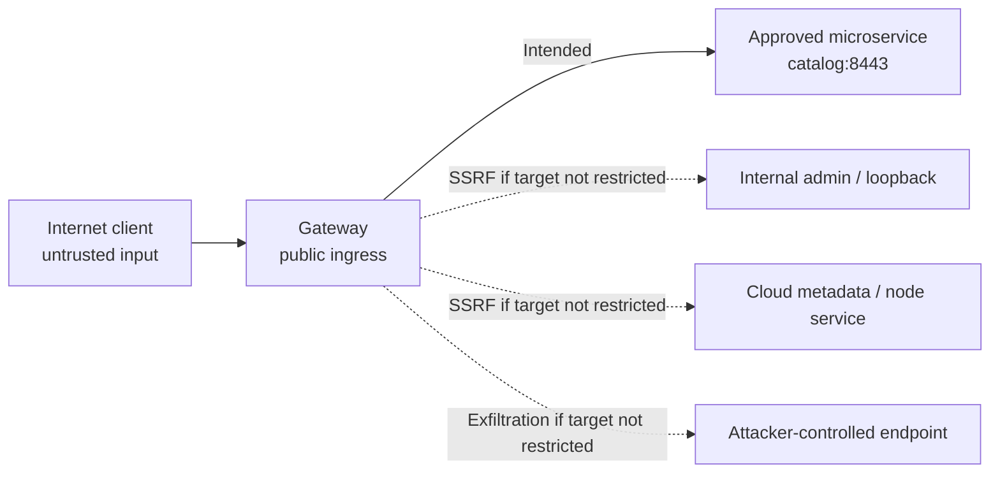
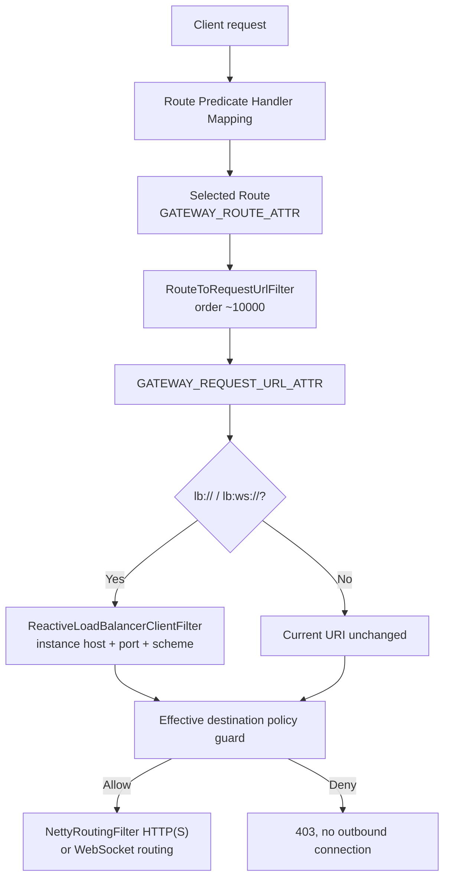
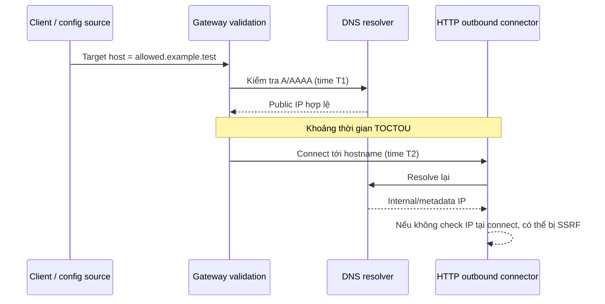
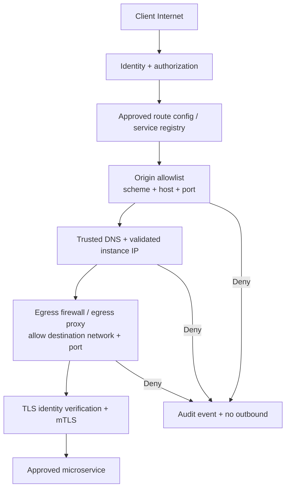
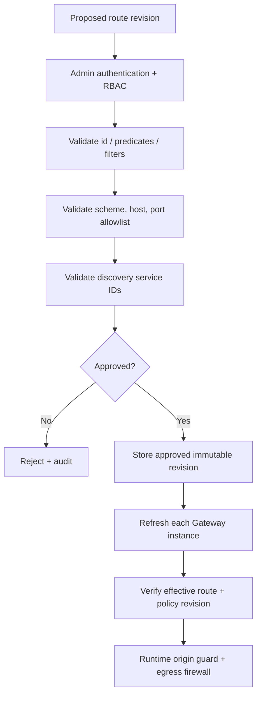

# Chống SSRF và giới hạn scheme, host, port của URI đích trong Spring Cloud Gateway

**Spring Cloud Gateway** là cổng vào cho các microservices, nơi một request từ bên ngoài có thể được chọn bằng route predicate, đi qua filter chain, đổi path/header, khám phá dịch vụ, xác thực, giới hạn lưu lượng, retry, circuit breaker và chuyển tiếp đến upstream. Những khả năng này cũng tạo ra một ranh giới an ninh quan trọng: **ai được phép quyết định Gateway sẽ kết nối đến máy chủ nào?**

Nếu dữ liệu do client kiểm soát có thể biến thành **URI đích** hoặc làm thay đổi host/port được kết nối mà không có ràng buộc, Gateway có nguy cơ trở thành một công cụ **Server-Side Request Forgery (SSRF)**: kẻ tấn công khiến máy chủ chủ động gửi request đến một địa chỉ không được phép từ mạng có quyền cao hơn client. Đích có thể là metadata service của cloud, ứng dụng quản trị nội bộ, localhost, Pod/service khác, hoặc một máy chủ ngoài tổ chức nhận dữ liệu bí mật.

Bài thuộc chương **Gia cố bảo mật** của module `SPRING_CLOUD_GATEWAY`. Trọng tâm là **giới hạn chính xác scheme, host và port của URI đích**, áp dụng ở **thời điểm cấu hình/duyệt route** và **ngay trước outbound routing**, đồng thời bảo vệ DNS, redirects, service discovery và network egress. Ví dụ dựa trên **Spring Cloud Gateway Server WebFlux 5.0.x**, có đối chiếu với Server Web MVC và các thành phần Gateway liên quan.

> **Phạm vi phiên bản:** Spring Cloud Gateway 5.0.5 / Spring Boot 4.x / Spring Framework 7 theo các bản tương thích của Spring Cloud 2025.1.x. Thuộc tính route WebFlux sử dụng `spring.cloud.gateway.server.webflux.routes`, không phải prefix `spring.cloud.gateway.routes` trong hướng dẫn cũ. Mọi ví dụ kết nối tới `127.0.0.1` đều **chỉ dành cho lab loopback**, không phải chính sách egress production.

## 1. Mục tiêu học tập

Sau bài này, bạn có thể:

1. Mô tả SSRF trong API Gateway và sự khác nhau giữa **client URL**, **route URI** và **địa chỉ IP được chọn khi thực sự kết nối**.
2. Chỉ ra các nguồn thay đổi outbound URI: YAML/Java routes, dynamic route repository, discovery locator, `lb://`, route filters, custom `GlobalFilter`, redirect/fallback và proxy/HTTP clients phụ trợ.
3. Xây chính sách **positive allowlist** theo `routeId → (scheme, host, port)` thay vì dùng blacklist, suffix check hoặc một regex URL sơ sài.
4. Phân tích các kiểu URI nguy hiểm: scheme không cho phép, userinfo, hostname lừa đảo, port khác, IP nội bộ/metadata, IPv6 và host encoding.
5. Hiểu tại sao validate URI string **không đủ chống DNS rebinding/TOCTOU**, và cần kiểm soát DNS resolution, destination IP tại lúc connect cùng network egress.
6. Tạo một `GlobalFilter` kiểm tra `GATEWAY_REQUEST_URL_ATTR` **sau bước route URI creation và load balancing, trước Netty outbound**.
7. Dựng lab Gateway WebFlux với allowlist chính xác, routes được phép/bị từ chối, stub backend Java và kiểm thử `curl`/JUnit.
8. Thiết kế kiểm soát riêng cho `lb://`/service discovery, WebSocket `ws:/wss:`, gRPC descriptor resources, redirect handling và Server Web MVC.
9. Giới hạn khả năng quản trị/refresh route, log audit, kiểm thử âm tính và triển khai defense-in-depth.
10. Chỉ ra được những điều mà một `GlobalFilter` ở tầng ứng dụng **không thể thay thế**, đặc biệt là egress firewall và enforcement tại connect-time.

## 2. SSRF xảy ra ở đâu trong một Gateway?

### 2.1. Mô hình đe dọa

Ví dụ một API thiết kế sai cho phép client quyết định upstream:

```text
GET /proxy?destination=http://127.0.0.1:9000/admin
X-Target-Url: http://some-internal-host/private
```

Đây là **ví dụ input không đáng tin**, không phải một API nên triển khai. Nếu server lấy `destination` hoặc `X-Target-Url` rồi tạo route/`HttpClient` outbound, client có thể khiến Gateway **đọc từ mạng mà client không trực tiếp truy cập được**.



Hậu quả có thể là đọc metadata/credentials, gọi API nội bộ có side effect, dò cấu trúc mạng, SSRF blind qua thời gian/status, hoặc chuyển tiếp header nhạy cảm (`Authorization`, cookies, service tokens) tới host không được phép.

**SSRF không đồng nghĩa “cứ gọi IP private là xấu”**. Gateway microservices có nhiệm vụ gọi dịch vụ **nội bộ được phê duyệt**. Câu hỏi đúng là: *đích đã được cấp quyền theo route, môi trường, phương thức kết nối và mức tin cậy hay chưa?* Chính sách cho phép `orders.internal.example:8443` không đồng nghĩa cho phép **toàn bộ** dải `10.0.0.0/8`.

### 2.2. Ba thực thể URL không được đánh đồng

| Thực thể | Ví dụ | Nguồn tin cậy? | Điều cần kiểm soát |
|---|---|---|---|
| **Inbound request URL** | `https://api.example.test/catalog/42` | Client kiểm soát method/path/query/headers | Authentication, predicates, normalization, input validation |
| **Configured route URI** | `https://catalog.svc.example.test:8443` | Chỉ tin nếu route source được quản trị và duyệt | Allowlist scheme/host/port, route ID, change control |
| **Effective outbound URI** | `https://10.22.3.17:8443/catalog/42` hoặc host DNS đã resolve | Có thể đổi do `lb://`, service registry, custom filters | Kiểm tra đích cuối tại Gateway và network connect |
| **Resolved socket address** | `10.22.3.17:8443` | Phụ thuộc DNS/LB, có thể thay theo thời gian | IP/network policy **tại thời điểm connect** |

Điểm quan trọng: `Path=/catalog/**` chỉ chọn một route. **Nó không chứng minh `uri` của route an toàn**. Tương tự, xác thực JWT cho client không tự cho quyền chọn bất kỳ host/port nào phía server.

### 2.3. Khi nào route tĩnh vẫn có rủi ro?

Một route YAML có URI đích cố định và chỉ admin thay được thường có bề mặt SSRF **hẹp hơn** endpoint proxy theo URL client cung cấp. Tuy nhiên, nó vẫn có thể trở thành nguy cơ nếu:

- Repository chứa route do một tài khoản ít quyền hoặc hệ thống CI bị chiếm có thể sửa.
- Một admin API cho phép POST route không xác thực/chưa phân quyền.
- Service discovery/registry bị giả hoặc service instance cung cấp host/port không hợp lệ.
- Custom filter ghi đè `GATEWAY_REQUEST_URL_ATTR` dựa trên query/header.
- DNS của hostname được duyệt bị trỏ sang địa chỉ IP cấm.
- HTTP client tự follow redirect sang đích mới chưa qua validation.
- Một filter khác (image fetch, webhook, OAuth callback, gRPC proto resource) mở outbound connection ngoài đường Netty routing thông thường.

Bởi vậy **route tĩnh và authenticated client chưa đủ** để loại trừ SSRF trên toàn hệ thống.

## 3. Xác định tất cả nguồn tạo hoặc thay đổi URI

### 3.1. Route definitions ở cấu hình và control plane

Một route hợp lệ có thể đến từ:

- `application.yml` / `application.properties`;
- Java DSL (`RouteLocatorBuilder` trong WebFlux, WebMvc.fn route APIs trong MVC);
- database/Redis/custom `RouteDefinitionLocator` hoặc `RouteDefinitionRepository`;
- gateway actuator route management khi được bật quyền ghi;
- discovery locator tự sinh route từ service IDs;
- cơ chế refresh/synchronization route ở nhiều Gateway replicas.

**Không cho frontend hoặc tenant tự ghi trường `uri` như một chuỗi URL tùy ý.** Với nhu cầu chọn dịch vụ, hãy nhận một **service key** thuộc enum/allowlist và map nó sang route đã định nghĩa sẵn ở control plane.

### 3.2. Pipeline WebFlux tạo URI outbound

Tài liệu Spring Cloud Gateway Server WebFlux mô tả:



Các chi tiết cần nhớ:

1. `RouteToRequestUrlFilter` lấy URI của route và request, tạo URI mới trong attribute `ServerWebExchangeUtils.GATEWAY_REQUEST_URL_ATTR`.
2. Với `lb://service-id`, `ReactiveLoadBalancerClientFilter` dùng instance từ LoadBalancer, có thể thay **host, port và scheme** của URI trong attribute này.
3. `NettyRoutingFilter` proxy nếu scheme cuối là `http` hoặc `https`; `WebsocketRoutingFilter` xử lý `ws`/`wss`.
4. Thứ tự chạy filters quyết định **thời điểm chính sách outbound nhìn thấy URL nào**. Một guard chạy **trước** bước LB có thể thấy `lb://catalog` thay vì `http://10.22.3.17:8080`, bỏ sót host/port cuối.
5. Một `GlobalFilter` chỉ chạy trong **Gateway WebFlux route processing** khi route match; nó không chặn mọi outbound connection từ mọi SDK bean và không thay thế network firewall.

Tài liệu Gateway Actuator `/actuator/gateway/globalfilters` cho ví dụ `RouteToRequestUrlFilter` order `10000` và `ReactiveLoadBalancerClientFilter` order `10100`; các routing filters có order rất lớn. Giá trị cụ thể phải được **đối chiếu trên release đang chạy**, không sao chép thứ tự từ blog cũ.

### 3.3. Scheme đặc biệt không có cùng ý nghĩa

| Scheme / dạng URI | Ý nghĩa | Cách kiểm soát |
|---|---|---|
| `https://host:443` | Outbound HTTP qua TLS | Cho phép khi **host + port + TLS identity** hợp lệ |
| `http://host:8080` | Outbound HTTP plaintext | Chỉ dùng cho hop nội bộ được chấp thuận hoặc lab |
| `lb://catalog` | Tên service qua Spring Cloud LoadBalancer | Allowlist service ID và **instance sau resolve** |
| `lb:ws://chat` | Service discovery cho WebSocket | Kiểm tra service ID và effective `ws/wss` target |
| `wss://chat:9443` | WebSocket qua TLS | Chính sách riêng cho WebSocket, Origin/auth và egress |
| `ws://chat:9001` | WebSocket plaintext | Không mở public, chỉ khi internal policy cho phép |
| `forward:///local-fallback` | Dispatch nội bộ qua WebFlux handler | Không phải network egress, nhưng vẫn cần giới hạn handler/authorization |
| `no://op` | Một số route filter xử lý đặc biệt như redirect | Không dùng như một URI outbound được whitelist chung |
| `file:`, `jar:`, `ftp:`, `gopher:`, `dict:` | Không phải HTTP proxy hợp lệ cho lab này; có thể nguy hiểm trong SDK khác | **Deny**, không thêm vào egress allowlist |
| `http://169.254.169.254:80` | Ví dụ địa chỉ metadata link-local | Không cho phép từ Internet-controlled route; chặn tại egress |

**Đừng whitelist mọi URI có scheme `https`**. HTTPS chỉ nói traffic được mã hóa đến một endpoint nào đó; nó không chứng minh endpoint được phép nhận request hoặc dữ liệu bí mật.

## 4. Chính sách an toàn: positive allowlist theo route

Thay vì rule “cấm localhost và metadata” rồi cho đi nơi còn lại, đặt policy:

\[
\mathrm{Allow}(r,u) =
\big(\mathrm{routeId}(r),\mathrm{scheme}(u),\mathrm{host}(u),\mathrm{port}(u)\big)
\in \mathcal A
\]

trong đó `𝒜` là tập các origin đã được phê duyệt. **Mặc định không có mục nào thì deny**.

### 4.1. Ma trận scheme–host–port được phê duyệt

| Route | Scheme | Host | Port | Ghi chú |
|---|---|---|---:|---|
| `catalog-api` | `https` | `catalog.svc.example.test` | 8443 | Upstream nội bộ có TLS đúng tên |
| `orders-api` | `https` | `orders.svc.example.test` | 8443 | Dịch vụ orders; quyền riêng |
| `public-assets` | `https` | `assets.example.test` | 443 | Chỉ đúng FQDN và port |
| `catalog-lab` | `http` | `127.0.0.1` | 9001 | **CHỈ LAB loopback** |
| `chat-wss` | `wss` | `chat.svc.example.test` | 9443 | Cần guard WebSocket phù hợp riêng |

Không có `*://*:*`, `https://*.internal.example.test:*` hay cả subnet `10.0.0.0/8`. Nếu nghiệp vụ dùng `lb://catalog`, danh sách service ID được phê duyệt và danh sách instance/network được phép phải được liên kết với route đó.

**Quy tắc production:** port **80/443** có thể hợp lệ cho một số endpoints, nhưng vẫn phải cho phép theo **cặp host và port cụ thể**. Không cho `https://catalog.svc.example.test:2375` chỉ vì hostname nằm trong danh sách.

### 4.2. Vì sao một blacklist không đủ?

Denylist `127.0.0.1`, `localhost`, `169.254.169.254` dễ bỏ sót:

- Các dạng IPv4 khác tương đương hoặc alias DNS trỏ về loopback.
- IPv6 `::1`, IPv4-mapped IPv6, IPv6 link-local, unique-local.
- NAT64 hoặc dual-stack khi network cho phép đi tới IPv4 bị cấm qua IPv6.
- IP private nằm ở ranges không phải `10.0.0.0/8`.
- DNS rebind từ hostname có vẻ công khai sang private/metadata address.
- Redirect từ URL hợp lệ sang đích mới chưa được duyệt.
- Port admin mới và các dịch vụ khác trên chính host đã được phép.

OWASP khuyến nghị **allowlist**, chính sách egress mạng và validation tại lúc kết nối. Denylist IP đặc biệt chỉ là **bảo vệ bổ sung**, không thay thế cơ chế cho phép tích cực.

### 4.3. HTTP redirect không làm origin được phép “di chuyển”

Nếu backend `https://assets.example.test` trả:

```http
HTTP/1.1 302 Found
Location: http://unapproved-host.internal:8080/private
```

Gateway có thể:

- trả nguyên 302 cho **client** mà **không** tự follow redirect; hoặc
- HTTP client/proxy filter tùy biến **tự follow** và tạo request outbound thứ hai.

Chỉ trường hợp thứ hai là bước outbound **cần kiểm tra URL mới** để tránh SSRF. Chính sách nên **không tự follow redirects** trừ khi nghiệp vụ bắt buộc và code đã áp dụng allowlist/IP controls cho **mọi redirect hop**, có max redirects và không chuyển credentials sai origin. Không dựa vào việc đã validate URL **ban đầu** để cho phép một redirect mới.

### 4.4. Không nhận target từ query hoặc header

**Anti-pattern:**

```java
// KHÔNG dùng: attacker có thể quyết định URI đích.
String target = exchange.getRequest()
    .getQueryParams().getFirst("url");
URI destination = URI.create(target);
exchange.getAttributes().put(
    ServerWebExchangeUtils.GATEWAY_REQUEST_URL_ATTR, destination);
```

**Thiết kế đúng hơn:** Client chỉ gửi mã nghiệp vụ đã cho phép, ví dụ `GET /catalog/items/42`. Route `catalog-api` đã có `uri: https://catalog.svc.example.test:8443` và policy kiểm soát origin. Nếu thật sự cần nhiều providers, client gửi `provider=CATALOG_A`, server tra `Map<Provider, ApprovedOrigin>` không thể bị sửa từ bên ngoài, rồi áp authorization.

Không để HTTP header `Host` hoặc `X-Forwarded-Host` quyết định upstream URI một cách mặc định. Những header đó thuộc **inbound host/proxy context**, không phải chỉ thị cấp quyền gọi network.

## 5. Chuẩn hóa URI trước khi so sánh allowlist

### 5.1. Không viết một regex duy nhất để parse URL

Dùng `java.net.URI` (hoặc thư viện parser chuẩn đã được kiểm thử) để tách **scheme, authority, userinfo, host, port, path, query, fragment**. Sau đó kiểm tra từng field, thay vì viết:

```java
// Anti-pattern: substring dễ chấp nhận host giả mạo hoặc URI khó hiểu.
if (url.contains("catalog.svc.example.test")) {
    // ALLOW -- SAI
}
```

Những dạng cần xử lý bằng policy rõ:

| Input minh họa | Câu hỏi bảo mật |
|---|---|
| `https://catalog.svc.example.test:8443` | Có nằm đúng allowlist route không? |
| `HTTP://CATALOG.SVC.EXAMPLE.TEST:8443` | Scheme/host không phân biệt chữ hoa/thường; normalize nhất quán |
| `https://catalog.svc.example.test` | Port không ghi: HTTPS mặc định 443, **khác 8443** |
| `https://catalog.svc.example.test:9443` | Host đúng nhưng **port sai** |
| `http://catalog.svc.example.test:8443` | Host/port đúng nhưng **scheme sai**; có thể làm mất TLS |
| `https://catalog.svc.example.test.evil.test:8443` | String chứa hostname được duyệt nhưng origin khác |
| `https://catalog.svc.example.test@evil.test:8443` | `userinfo` đánh lừa người đọc; host thực là `evil.test` |
| `https://evil.test@catalog.svc.example.test:8443` | Userinfo vẫn không cần cho gateway proxy và có thể lộ secrets |
| `https://catalog.svc.example.test.:8443` | FQDN với dấu chấm cuối cần canonicalize hoặc deny nhất quán |
| `https://cátalog.example.test:8443` | IDN/Unicode; cần chuyển IDNA thành punycode bởi thành phần tin cậy rồi so exact |
| `https://[::1]:8443` | IPv6 loopback, không được bỏ sót khi kiểm tra localhost |
| `https://127.0.0.1:8443` | Địa chỉ loopback; chỉ có thể hợp lệ trong lab cô lập |
| `https://catalog.svc.example.test:8443/path?x=y` | Origin có thể hợp lệ; path/query cần kiểm soát ở layer riêng |
| `file:///etc/passwd` | Không có HTTP host/port và không được chấp nhận là proxy target |
| `lb://catalog` | Pseudo-scheme cần validate service ID rồi kiểm tra instance sau LB |

**Quan trọng:** `URI.getHost()` có thể trả `null` với một authority không chuẩn dù `URI.create(...)` không ném exception. Không coi `null` là “dùng host mặc định” hay tin `getRawAuthority()` chưa kiểm tra.

### 5.2. Quy tắc canonicalization đề xuất

1. Parse bằng parser chuẩn, reject URI null/opaque, thiếu host/authority.
2. Chỉ chấp nhận **scheme đã được policy cho phép**; ví dụ HTTP guard chỉ hỗ trợ `http`/`https`.
3. Reject `userinfo`, `fragment` và các thành phần mơ hồ không cần thiết cho target.
4. Canonicalize scheme và DNS hostname sang lowercase (`Locale.ROOT`), không dùng locale của máy.
5. Chọn rõ cách xử lý IDN/IPv6/trailing dot: hoặc dùng parser/normalizer chuẩn được test đủ, hoặc **deny** cho tới khi có support có chủ đích.
6. Chuẩn hóa **effective port**: `http` thiếu port → 80; `https` thiếu port → 443; explicit port 8443 vẫn là 8443.
7. So sánh **origin đầy đủ** bằng equality, không phải startsWith/endsWith/contains.
8. Phân ranh giới **origin policy** với **path/query policy** và **resolved IP egress policy**.
9. Không DNS lookup đồng bộ trong `GlobalFilter` vì nó có thể **block Netty event loop**.
10. Không biến unknown scheme/host/port thành default cho phép; **fail closed**.

### 5.3. Host suffix check là bẫy nếu không rõ boundary

`host.endsWith("example.test")` nhận cả `notexample.test`. `host.endsWith(".example.test")` tốt hơn một chút về boundary nhưng vẫn mở **mọi subdomain**, gồm subdomain bị chiếm quyền hoặc namespace do tenant tự đăng ký.

Đối với route quan trọng, nên dùng **exact FQDN**. Nếu thực sự cần wildcard theo nghiệp vụ, phải có owner của toàn bộ namespace, public suffix protection, tenant isolation, certificate policy và danh sách con được phê duyệt. Không gộp “có TLS cert hợp lệ cho một subdomain” với “subdomain đó được quyền nhận mọi traffic backend”.

### 5.4. URI đích không phải là HTTP `Host` header

Khi proxy tới `https://catalog.svc.example.test:8443`:

- HTTP routing/cấu hình client quyết định **socket endpoint**.
- `Host`/`:authority` ở request có thể được xây từ target hoặc bị ảnh hưởng bởi `PreserveHostHeader`.
- TLS SNI và certificate hostname verification phải dùng danh tính **đích đáng tin**.
- `X-Forwarded-Host` thể hiện inbound proxy context, không phải chỉ thị tùy ý thay target.

**Không thay hostname bằng IP đã tìm được rồi bỏ TLS validation.** Nếu cần connect pinning vào IP được phép, HTTP client phải giữ đúng origin hostname cho SNI, Host và certificate verification; thực hiện bằng connector/network policy chuyên dụng đã được kiểm thử.

## 6. DNS rebinding, special IP ranges và egress network

### 6.1. Vì sao hostname allowlist vẫn có thể bị đánh lừa?

Giả sử có hostname được duyệt ở control plane. Ở lần kiểm tra đầu, DNS trả một IP hợp lệ. Đến khi HTTP client thật sự kết nối, resolver có thể trả **IP khác** do DNS rebinding, cache TTL, split-horizon DNS, CDN/registry thay đổi hoặc một nguồn DNS không tin cậy.



**Giải pháp:** Nếu policy cần hạn chế IP, kiểm tra A/AAAA **và đảm bảo kết nối thực sự tới một IP đã được xác thực**, không để HTTP client resolve lại mà không kiểm tra. Hoặc enforce destination network tại egress proxy/firewall ở connection time, kết hợp DNS policy tin cậy.

Một `GlobalFilter` chỉ so `URI.getHost()` **không đủ để chống DNS rebinding**. Nó là **lớp origin allowlist** quan trọng, nhưng phải có lớp connect-time.

### 6.2. Những nhóm địa chỉ cần đặc biệt cảnh giác

| Nhóm | Ví dụ | Rủi ro |
|---|---|---|
| Loopback IPv4 | `127.0.0.0/8` | Gateway gọi service quản trị chỉ bind local |
| Unspecified | `0.0.0.0/8` và một số địa chỉ đặc biệt | Biểu diễn không nên dùng làm outbound target |
| RFC1918 private | `10.0.0.0/8`, `172.16.0.0/12`, `192.168.0.0/16` | Dịch vụ nội bộ ngoài danh sách |
| Link-local IPv4 | `169.254.0.0/16` | Cloud metadata, node/pod identity |
| Shared address | `100.64.0.0/10` | Mạng nhà cung cấp/CGNAT trong vài topology |
| Multicast/reserved | `224.0.0.0/4`, broadcast, reserved | Không phải đích proxy bình thường |
| IPv6 loopback | `::1/128` | Local management services |
| IPv6 unique-local | `fc00::/7` | Mạng nội bộ IPv6 |
| IPv6 link-local | `fe80::/10` | Interface-local services |
| IPv4-mapped IPv6 | `::ffff:0:0/96` | Cùng địa chỉ IPv4 ở dạng IPv6 |
| NAT64 | `64:ff9b::/96` và prefix mạng thực tế | Có thể tới IPv4 đích cấm qua IPv6 |
| IPv6 multicast | `ff00::/8` | Đích không dành cho API outbound |
| Metadata addresses | `169.254.169.254`, các endpoint IPv6/provider-specific | Metadata/credentials hoặc identity service của cloud |

Danh sách trên là **hướng kiểm thử và defense-in-depth**, không phải một firewall rule dùng nguyên để **chặn mọi IP private**. Gateway hợp lệ có thể phải kết nối đến private IP đã phê duyệt của Kubernetes Service. Policy production cần **network namespace + port + service identity** cụ thể, không chỉ “public vs private”.

Khi cần phát hiện địa chỉ IPv4-mapped/NAT64, hãy canonicalize bằng một thư viện/connector IP được kiểm thử và kiểm soát cả IPv4 lẫn IPv6; chỉ kiểm tra chuỗi `startsWith("127.")` là không đủ.

### 6.3. Kiến trúc defense-in-depth



Các lớp có mục đích khác nhau:

- **Authorization**: ai được gọi route nào?
- **Route policy**: route được phép chọn upstream nào?
- **DNS/IP policy**: hostname thực sự resolve tới mạng/destination được phép không?
- **Network egress**: process/pod Gateway thật sự chỉ có khả năng kết nối tới các mạng/port đã cấp quyền.
- **TLS/mTLS**: đúng hostname/service workload identity, tránh credential leakage và MITM.
- **Logging/monitoring**: phát hiện route config/instance drift, denial bất thường và egress ngoài kế hoạch.

**Không đặt hết niềm tin vào mã Java của `GlobalFilter`**. Một thư viện tự tạo `WebClient`, gRPC channel, OAuth JWK fetch hoặc native socket có thể bỏ qua filter chain của Gateway. Network egress là lớp cuối bảo vệ các outbound connections đó.

### 6.4. Kubernetes và cloud deployment

Với Kubernetes:

1. Chỉ cho namespace/service account Gateway egress đến **đúng namespaces/Pods/ports** mà API cần.
2. Dùng CNI thực sự thực thi `NetworkPolicy` cho **egress**, kiểm tra default-deny + allow rules trên cluster hiện tại.
3. Giới hạn DNS egress tới resolver tin cậy, nhưng nhớ IP destination có thể thay; policy đến DNS **không** thay IP/connect rules.
4. Chặn metadata/node endpoints và cloud identity APIs không cần từ Gateway pod bằng chính sách của platform.
5. Nếu dùng service mesh/egress gateway, giới hạn service identity, SNI/host, cert và đích thực tế; không chỉ tin HTTP Host.
6. Khi dùng external SaaS, cân nhắc egress proxy allowlist, hostname verification và IP change process.
7. Test pod gọi một **mock internal-denied service** trong cluster thử nghiệm để chứng minh egress bị chặn; không thử kết nối metadata production.

`NetworkPolicy` chuẩn thường mô tả IP CIDRs, namespace/pod selectors và ports, **không phải FQDN policy mặc định**. Nếu cần hostname allowlisting tại egress, sử dụng CNI/egress proxy hỗ trợ tính năng đó và xác minh cách nó xử lý DNS TTL/rebinding.

### 6.5. Những điều timeout và TLS không làm được

`response-timeout: 3s` giúp giảm thời gian giữ tài nguyên khi upstream chậm, nhưng **không ngăn** SSRF tới một endpoint nội bộ trả 200 trong 2 ms.

`https://host` cùng certificate hợp lệ giúp xác minh host/network identity theo trust model, nhưng **không quyết định host có được route này gọi không**. TLS, timeout, rate limiter và circuit breaker chỉ là những lớp phụ; **allowlist scheme–host–port + IP/connect egress** mới là trọng tâm của chủ đề.

## 7. Lab WebFlux: allowlist origin theo route ID

Mục tiêu: Gateway lắng nghe `127.0.0.1:8080`, backend echo ở `127.0.0.1:9001`. Route `catalog-lab` được phép tới `http://127.0.0.1:9001`. Route `blocked-loopback` dùng **cùng origin** nhưng không có quyền theo route ID. Route `blocked-port` dùng port 9002 không được phê duyệt. Guard từ chối 403 **trước outbound**, dù target URL hợp lệ về cú pháp.

**Lưu ý:** Allowlist `127.0.0.1` là **chỉ cho lab loopback**. Production phải có policy riêng tới dịch vụ được duyệt và không lấy lab policy mở localhost.

### 7.1. Dependency Maven và ứng dụng khởi động

Tạo project Spring Boot 4.x dùng Spring Cloud BOM 2025.1.x tương thích:

```xml
<dependencies>
    <dependency>
        <groupId>org.springframework.cloud</groupId>
        <artifactId>spring-cloud-starter-gateway-server-webflux</artifactId>
    </dependency>
    <dependency>
        <groupId>org.springframework.boot</groupId>
        <artifactId>spring-boot-starter-actuator</artifactId>
    </dependency>
</dependencies>
```

Đây chỉ là dependencies chính, không phải `pom.xml` hoàn chỉnh; cần Boot parent/plugin và BOM chính xác. Không thêm Gateway Server Web MVC starter cùng project.

`SsrfGatewayApplication.java`:

```java
import org.springframework.boot.SpringApplication;
import org.springframework.boot.autoconfigure.SpringBootApplication;
import org.springframework.boot.context.properties.EnableConfigurationProperties;

@SpringBootApplication
@EnableConfigurationProperties(EgressRules.class)
public class SsrfGatewayApplication {
    public static void main(String[] args) {
        SpringApplication.run(SsrfGatewayApplication.class, args);
    }
}
```

### 7.2. Profile lab và route policy

`src/main/resources/application-ssrf-lab.yml`:

```yaml
server:
  address: 127.0.0.1
  port: 8080

spring:
  application:
    name: gateway-ssrf-lab
  cloud:
    gateway:
      server:
        webflux:
          routes:
            - id: catalog-lab
              uri: http://127.0.0.1:9001
              predicates:
                - Path=/catalog/items/**
                - Method=GET
              filters:
                - StripPrefix=1
                - RemoveRequestHeader=Cookie
                - RemoveRequestHeader=Authorization
                - RemoveRequestHeader=X-Target-Url

            - id: blocked-loopback
              uri: http://127.0.0.1:9001
              predicates:
                - Path=/blocked-loopback/**
                - Method=GET
              filters:
                - StripPrefix=1

            - id: blocked-port
              uri: http://127.0.0.1:9002
              predicates:
                - Path=/blocked-port/**
                - Method=GET
              filters:
                - StripPrefix=1

# Đây là custom property của ứng dụng, không phải
# một SSRF firewall property sẵn có trong Gateway.
app:
  gateway:
    egress:
      allowed-origins:
        catalog-lab:
          - "http://127.0.0.1:9001"

management:
  endpoints:
    web:
      exposure:
        include: health,info
```

Chính sách có **một mục duy nhất**: route `catalog-lab` được gọi HTTP port 9001. Hai blocked routes tồn tại để kiểm chứng deny theo route ID/port, **không phải endpoints production**.

### 7.3. ConfigurationProperties chứa allowlist

Tạo `EgressRules.java` trong cùng package được Boot component scan:

```java
import java.util.HashMap;
import java.util.List;
import java.util.Map;

import org.springframework.boot.context.properties.ConfigurationProperties;

@ConfigurationProperties(prefix = "app.gateway.egress")
public class EgressRules {

    // Key = routeId; values = origin-only URLs.
    private Map<String, List<String>> allowedOrigins =
            new HashMap<>();

    public Map<String, List<String>> getAllowedOrigins() {
        return allowedOrigins;
    }

    public void setAllowedOrigins(
            Map<String, List<String>> allowedOrigins) {
        this.allowedOrigins = allowedOrigins == null
                ? new HashMap<>()
                : allowedOrigins;
    }
}
```

Mặc định map rỗng có nghĩa **không route nào được phép**. Cấu hình này thuộc control plane có phân quyền, code review và versioning, không được nhận trực tiếp từ query/header hay form public. Trong production nên có validation fail-fast nếu thiếu policy bắt buộc, nhưng không được tự mở allow-all để tránh khởi động lỗi.

### 7.4. `GlobalFilter` kiểm tra URI hiệu lực

Tạo `OutboundOriginGuard.java`:

```java
import java.net.URI;
import java.util.HashMap;
import java.util.HashSet;
import java.util.List;
import java.util.Locale;
import java.util.Map;
import java.util.Set;

import org.slf4j.Logger;
import org.slf4j.LoggerFactory;
import org.springframework.cloud.gateway.filter.GatewayFilterChain;
import org.springframework.cloud.gateway.filter.GlobalFilter;
import org.springframework.cloud.gateway.route.Route;
import org.springframework.cloud.gateway.support.ServerWebExchangeUtils;
import org.springframework.core.Ordered;
import org.springframework.http.HttpStatus;
import org.springframework.stereotype.Component;
import org.springframework.web.server.ServerWebExchange;

import reactor.core.publisher.Mono;

@Component
public class OutboundOriginGuard implements GlobalFilter, Ordered {

    private static final Logger log =
            LoggerFactory.getLogger(OutboundOriginGuard.class);

    // HTTP-only policy for this lab. WS/forward/lb and IPv6 need
    // separate, explicitly reviewed extensions.
    private static final Set<String> SCHEMES =
            Set.of("http", "https");

    private final Map<String, Set<Origin>> allowByRoute;

    public OutboundOriginGuard(EgressRules rules) {
        Map<String, Set<Origin>> compiled = new HashMap<>();

        for (Map.Entry<String, List<String>> entry
                : rules.getAllowedOrigins().entrySet()) {
            String routeId = entry.getKey();
            if (routeId == null || routeId.isBlank()
                    || entry.getValue() == null) {
                throw new IllegalArgumentException(
                    "Invalid route ID or origin list");
            }

            Set<Origin> approved = new HashSet<>();
            for (String text : entry.getValue()) {
                URI uri;
                try {
                    uri = URI.create(text);
                } catch (IllegalArgumentException ex) {
                    throw new IllegalArgumentException(
                        "Malformed outbound origin policy", ex);
                }

                Origin origin = Origin.from(uri);
                String path = uri.getRawPath();
                // Policy values are origins, not full request URLs.
                if (origin == null
                        || (path != null && !path.isEmpty())
                        || uri.getRawQuery() != null) {
                    throw new IllegalArgumentException(
                        "Origin policy must be scheme://host[:port]");
                }
                approved.add(origin);
            }
            compiled.put(routeId, Set.copyOf(approved));
        }
        this.allowByRoute = Map.copyOf(compiled);
    }

    @Override
    public int getOrder() {
        // Gateway WebFlux 5.0 documented example:
        // RouteToRequestUrlFilter: 10000
        // ReactiveLoadBalancerClientFilter: 10100
        // NettyRoutingFilter: very late in chain.
        // Verify effective order in Actuator on YOUR release.
        return 10500;
    }

    @Override
    public Mono<Void> filter(
            ServerWebExchange exchange,
            GatewayFilterChain chain) {

        Route route = exchange.getAttribute(
                ServerWebExchangeUtils.GATEWAY_ROUTE_ATTR);
        URI target = exchange.getAttribute(
                ServerWebExchangeUtils.GATEWAY_REQUEST_URL_ATTR);

        Origin actual = Origin.from(target);
        String routeId = route == null ? null : route.getId();

        Set<Origin> approved =
                routeId == null ? null : allowByRoute.get(routeId);

        if (actual == null || approved == null
                || !approved.contains(actual)) {
            // Do not log raw URI, query tickets or credentials.
            log.warn("SSRF guard denied routeId={}",
                    routeId == null ? "<none>" : routeId);
            exchange.getResponse().setStatusCode(HttpStatus.FORBIDDEN);
            return exchange.getResponse().setComplete();
        }

        return chain.filter(exchange);
    }

    private record Origin(String scheme, String host, int port) {

        static Origin from(URI uri) {
            if (uri == null || uri.isOpaque()
                    || uri.getRawAuthority() == null
                    || uri.getRawUserInfo() != null
                    || uri.getRawFragment() != null) {
                return null;
            }
            String inputScheme = uri.getScheme();
            String inputHost = uri.getHost();
            if (inputScheme == null || inputHost == null) {
                return null;
            }

            String scheme = inputScheme.toLowerCase(Locale.ROOT);
            String host = inputHost.toLowerCase(Locale.ROOT);

            if (!SCHEMES.contains(scheme) || !asciiHost(host)) {
                return null;
            }

            int port = uri.getPort();
            if (port == -1) {
                port = scheme.equals("https") ? 443 : 80;
            }
            if (port < 1 || port > 65535) {
                return null;
            }
            return new Origin(scheme, host, port);
        }

        // Conservative teaching parser: ASCII DNS/IPv4 only.
        // A full IPv6/IDNA policy requires separately tested logic.
        private static boolean asciiHost(String host) {
            if (host.isEmpty() || host.length() > 253
                    || host.endsWith(".")) {
                return false;
            }
            for (String label : host.split("\\.", -1)) {
                if (label.isEmpty() || label.length() > 63
                        || !label.matches(
                           "[a-z0-9](?:[a-z0-9-]*[a-z0-9])?")) {
                    return false;
                }
            }
            return true;
        }
    }
}
```

`Origin` là Java record: phép so sánh bằng `equals` so đúng **scheme, normalized host và effective port**. Mục allowlist gắn với **route ID** giúp tránh route B mượn quyền outbound của route A.

### 7.5. Vì sao guard ở order 10500 vẫn chưa là giải pháp hoàn chỉnh?

Trong tài liệu Actuator của Gateway WebFlux 5.0, `RouteToRequestUrlFilter` có order `10000`, `ReactiveLoadBalancerClientFilter` được minh họa order `10100` và `NettyRoutingFilter` rất muộn. Guard `10500` vì vậy nhìn thấy URI sau những bước đó, **nếu** thứ tự runtime đúng như dự kiến.

Nhưng:

- Custom filter có order từ `10501` tới trước outbound **vẫn có thể thay `GATEWAY_REQUEST_URL_ATTR` sau khi guard đã chạy**. Phải cấm hoặc đặt mọi URI-mutating filters trước guard; test runtime order/attributes.
- HTTP client tự follow redirects sẽ thực hiện outbound hop mới **không nhất thiết đi qua `GlobalFilter` lần nữa**.
- `forward:///...`, `ws/wss`, `lb:ws://...` và SDK bên ngoài Netty routing cần policy riêng.
- Host allowlist không chặn DNS rebinding; phải enforce IP/network tại **connect time**.
- GlobalFilter không bảo vệ outgoing WebClient/gRPC/S3 SDK không đi qua Gateway route pipeline.

Đây là **một lớp policy enforcement tại Gateway route**, không phải một outbound firewall chung của JVM.

### 7.6. Những hành vi fail-closed có chủ đích

Mẫu này từ chối IPv6 literal, Unicode hostname, `forward:`, `ws/wss`, `lb://` chưa được resolve và unknown route ID. Những trường hợp đó **không vô hại**; phải thêm khả năng hỗ trợ sau khi xây canonicalization, trust policy và test đầy đủ.

Không sửa code bằng `host.contains(...)`, không cho phép `approved==null` đi qua, không làm DNS lookup đồng bộ trong Netty event loop, không tắt TLS verification và không chuyển 403 guard thành 200 fallback. Nếu route mới thiếu policy, xử lý lỗi cấu hình trong control plane thay vì tắt cơ chế kiểm soát để “không gián đoạn”.

## 8. Lab backend và kiểm thử Gateway không gọi URI bị cấm

### 8.1. Backend echo độc lập dùng JDK

Tạo `SsrfEchoBackend.java` trong thư mục lab khác với Gateway:

```java
import com.sun.net.httpserver.HttpExchange;
import com.sun.net.httpserver.HttpServer;
import java.net.InetSocketAddress;
import java.nio.charset.StandardCharsets;
import java.util.concurrent.atomic.AtomicInteger;

public class SsrfEchoBackend {
    private static final AtomicInteger COUNT = new AtomicInteger();

    public static void main(String[] args) throws Exception {
        HttpServer server = HttpServer.create(
            new InetSocketAddress("127.0.0.1", 9001), 0);

        server.createContext("/__lab/count", exchange ->
            reply(exchange, 200, "calls=" + COUNT.get(), false));

        server.createContext("/__lab/reset", exchange -> {
            if (!"POST".equals(exchange.getRequestMethod())) {
                reply(exchange, 405, "method-not-allowed", false);
                return;
            }
            COUNT.set(0);
            reply(exchange, 200, "reset=ok", false);
        });

        server.createContext("/", exchange -> {
            int n = COUNT.incrementAndGet();
            String path = exchange.getRequestURI().getRawPath();
            String query = exchange.getRequestURI().getRawQuery();

            String result = "call=" + n + "\n"
                + "path=" + path + "\n"
                + "query=" + (query == null ? "" : query) + "\n"
                + "cookiePresent="
                + exchange.getRequestHeaders().containsKey("Cookie") + "\n"
                + "authPresent="
                + exchange.getRequestHeaders().containsKey("Authorization")
                + "\n"
                + "targetHeaderPresent="
                + exchange.getRequestHeaders().containsKey("X-Target-Url");

            int status = path.startsWith("/items/") ? 200 : 404;
            reply(exchange, status, result, true);
        });
        server.start();
        System.out.println("SSRF lab backend on 127.0.0.1:9001");
    }

    private static void reply(HttpExchange exchange, int status,
                              String body, boolean upstream)
            throws java.io.IOException {
        byte[] bytes = body.getBytes(StandardCharsets.UTF_8);
        exchange.getResponseHeaders().set(
            "Content-Type", "text/plain; charset=utf-8");
        exchange.getResponseHeaders().set("Cache-Control", "no-store");
        if (upstream) {
            exchange.getResponseHeaders().set("X-Upstream-Lab", "hit");
        }
        exchange.sendResponseHeaders(status, bytes.length);
        try (var out = exchange.getResponseBody()) {
            out.write(bytes);
        }
    }
}
```

Backend chỉ bind `127.0.0.1`. Hai endpoints `/__lab/*` không được xác thực và **chỉ dành cho thử nghiệm**, tuyệt đối không triển khai trên production.

Chạy backend và Gateway ở hai terminal riêng:

```bash
# Terminal 1, JDK 17+
java --add-modules jdk.httpserver SsrfEchoBackend.java

# Terminal 2, trong project Gateway, Linux/macOS
SPRING_PROFILES_ACTIVE=ssrf-lab ./mvnw spring-boot:run
```

Với Windows PowerShell:

```powershell
$env:SPRING_PROFILES_ACTIVE = 'ssrf-lab'
.\mvnw.cmd spring-boot:run
```

### 8.2. Positive test: đúng origin và route

```bash
curl -i -X POST http://127.0.0.1:9001/__lab/reset

curl -i \
  -H "Cookie: SESSION=synthetic-only" \
  -H "Authorization: Bearer synthetic-only" \
  -H "X-Target-Url: http://127.0.0.1:9002" \
  "http://127.0.0.1:8080/catalog/items/42?lang=vi"
```

Kết quả minh họa:

```http
HTTP/1.1 200 OK
X-Upstream-Lab: hit
Content-Type: text/plain; charset=utf-8

call=1
path=/items/42
query=lang=vi
cookiePresent=false
authPresent=false
targetHeaderPresent=false
```

Đây là bằng chứng:

- `Path=/catalog/items/**` match route `catalog-lab`.
- `StripPrefix=1` gửi `/items/42` tới backend.
- `RemoveRequestHeader` loại ba header test không được chuyển downstream.
- Header `X-Target-Url` do client gửi **không làm thay đổi upstream URI** trong route lab.
- `OutboundOriginGuard` cho phép đúng tuple `(catalog-lab, http, 127.0.0.1, 9001)`.

**Không dùng token/cookie thực.** Trong production cần `TokenRelay` đến service có audience phù hợp thì chính sách header phải khác, được thiết kế riêng.

### 8.3. Negative test: route và port không được duyệt

```bash
curl -s http://127.0.0.1:9001/__lab/count

curl -i http://127.0.0.1:8080/blocked-loopback/items/42
curl -i http://127.0.0.1:8080/blocked-port/items/42

curl -s http://127.0.0.1:9001/__lab/count
```

Hai request qua Gateway phải trả `403 Forbidden` do guard, và counter backend 9001 **không tăng**:

- `blocked-loopback` dùng đúng host/port 9001 nhưng **route ID không có policy**.
- `blocked-port` đi tới 9002; origin này không được phép, nên không cần có server port 9002 thật.

Trong môi trường nhiều requests song song, counter toàn cục dễ bị nhiễu. CI nên dùng backend stub riêng cho mỗi test hoặc request journal theo test ID. 403 riêng lẻ **không chứng minh** không có outbound: cần counter, tracing hoặc egress logs.

### 8.4. No-route không phải SSRF guard denial

```bash
curl -i http://127.0.0.1:8080/catalog/admin
curl -i -X POST http://127.0.0.1:8080/catalog/items/42
```

Hai request không match route lab theo Path/Method; nếu không có handler khác thường trả 404. **Guard không được gọi nếu Gateway không chọn route**, nên không mong đợi 403 ở đây.

Để thử URI `file:`/`ftp:`/`gopher:`, dùng **unit test validator** chứ không tạo một proxy route nguy hiểm. Không bao giờ gửi request thực tới cloud metadata/admin hosts trong môi trường production để “kiểm tra có chặn không”.

### 8.5. Đối chiếu filter order với Actuator

Trong **profile quản trị read-only trên loopback**, có thể cấu hình:

```yaml
management:
  endpoint:
    gateway:
      access: read-only
  endpoints:
    web:
      exposure:
        include: health,info,gateway
```

```bash
curl -i http://127.0.0.1:8080/actuator/gateway/globalfilters
curl -i http://127.0.0.1:8080/actuator/gateway/routes
```

Xác nhận `OutboundOriginGuard` ở order 10500, sau URL construction/LB và trước Netty routing. Điều này chỉ xác minh **filter order runtime**, không chứng minh mọi DNS connection hay các SDK khác đã đi qua guard.

**Không mở Actuator route management ra Internet.** Quyền xem route/filter và quyền ghi/refresh route là quyền khác nhau; route admin phải nằm trên management network có RBAC/audit.

## 9. Kiểm duyệt route động trước activation

Một `GlobalFilter` runtime là lớp bảo vệ quan trọng, nhưng chính sách phải **bắt đầu ở control plane**:



### 9.1. Những kiểm tra cần có ở cửa quản trị route

1. Chỉ authenticated/admin workload được quản lý route; yêu cầu approval cho thay đổi nhạy cảm.
2. Kiểm tra `routeId` duy nhất, namespace, owner, priority/order và route overlap.
3. URI hợp lệ về cú pháp **và** thuộc allowlist theo route ID.
4. Với `lb://service-id`: service ID đã được duyệt, instance host/port có policy riêng.
5. Filters có thể sửa `GATEWAY_REQUEST_URL_ATTR` phải bị hạn chế và xét đến order của guard.
6. Không chấp nhận arbitrary `Forwarded`/`Host`/`X-Target-Url` để chọn destination.
7. Không cho phép lộ debug/Actuator/administration URLs chỉ vì thêm route `/**`.
8. Route mới hoặc thay đổi scheme/host/port cần validation và audit trước commit.
9. Cập nhật **mọi** Gateway replicas, kiểm tra effective revision và rollback khi không đồng bộ.
10. Khi validation lỗi: **không lưu và không kích hoạt**, không fallback allow-all.

### 9.2. Pseudocode cho admission control

```java
// PSEUDOCODE: cần tự implement các interface và method.
Mono<Void> approveAndPublish(
        RouteDefinition proposed, Admin actor) {

    authorize(actor, "GATEWAY_ROUTE_WRITE");
    ensureSafeIdOrderPredicates(proposed);
    validateRouteUri(
        proposed.getId(), proposed.getUri());
    validateNoPostGuardUriMutation(proposed.getFilters());

    ApprovedRevision revision = approveAndSign(proposed);
    return storeRevision(revision)
        .then(refreshAllGatewayInstances(revision))
        .then(verifyEffectiveRevisionOnEveryInstance(revision));
}
```

Đoạn trên **không phải Java class tự chạy**; các kiểu `Admin`, `ApprovedRevision` và những hàm chưa được định nghĩa. Mục tiêu là thể hiện thứ tự bước kiểm soát, không phải giới thiệu một API Gateway built-in tự làm toàn bộ approval.

### 9.3. Discovery locator có thể sinh route ngoài ý muốn

Gateway WebFlux có `spring.cloud.gateway.server.webflux.discovery.locator.enabled` (tài liệu 5.0 ghi mặc định `false`). Khi bật, nó có thể tạo routes từ registry, với `url-expression` mặc định `'lb://'+serviceId`.

Do đó:

- Chỉ bật khi thật sự cần.
- Giới hạn service IDs bằng `include-expression`/metadata theo policy, không để registry tự quyết mọi service sẽ public.
- Bảo vệ quyền ghi instance/port/host trong service registry.
- Validate **service ID** trước route activation và **instance URI** sau LoadBalancer resolution.
- Kết hợp network egress, mTLS/service identity và authorization để service khác không chiếm vị trí của target đã được duyệt.
- Test một service lạ được register trong môi trường test **không tự xuất hiện thành public route** có quyền outbound.

## 10. `lb://` và service discovery: phải kiểm tra **instance thật**

### 10.1. Service ID không phải destination IP

Một route có thể được cấu hình như sau:

```yaml
spring:
  cloud:
    gateway:
      server:
        webflux:
          routes:
            - id: catalog-prod
              uri: lb://catalog-service
              predicates:
                - Path=/api/catalog/**
              filters:
                - StripPrefix=2
```

Khi có Spring Cloud LoadBalancer và `ServiceInstance`, `ReactiveLoadBalancerClientFilter` thay `lb://catalog-service` bằng URI có **host/port/scheme** của instance. Nếu registry bị sai hoặc bị thao túng, một service ID hợp lệ vẫn có thể trỏ tới host/port trái chính sách.

| Giai đoạn | Kiểm tra |
|---|---|
| Route admission | `catalog-prod` chỉ được dùng service ID `catalog-service` |
| Sau LoadBalancer | Effective host/port/scheme thuộc danh sách instance được cấp phép |
| Khi DNS/socket connect | Resolved IP nằm trong network/service identity được phép |
| Tầng backend | mTLS/workload identity và domain authorization hợp lệ |

Theo tài liệu Gateway WebFlux, `ServiceInstance.isSecure()` có thể ảnh hưởng scheme của outbound URL. **Không giả định** HTTPS inbound nghĩa outbound cũng là HTTPS. Kiểm tra scheme thực sau LoadBalancer và TLS certificate/CA/SNI của kết nối outbound.

### 10.2. NetworkPolicy chỉ nên mở đúng service/port

Ví dụ `NetworkPolicy` **minh họa** cho Gateway pods trong namespace `edge`, egress tới catalog pods ở port 8443:

```yaml
apiVersion: networking.k8s.io/v1
kind: NetworkPolicy
metadata:
  name: gateway-catalog-egress
  namespace: edge
spec:
  podSelector:
    matchLabels:
      app: gateway
  policyTypes: [Egress]
  egress:
    - to:
        - namespaceSelector:
            matchLabels:
              kubernetes.io/metadata.name: catalog
          podSelector:
            matchLabels:
              app: catalog-api
      ports:
        - protocol: TCP
          port: 8443
```

**Đây chưa phải policy production hoàn chỉnh**: Gateway có thể cần DNS egress và các kết nối có chủ đích đến Identity Provider, service discovery, metrics. Cần thêm rules tối thiểu cho đúng topology và labels trên cluster. Phải kiểm thử CNI hỗ trợ egress policies và sự tương tác với Kubernetes Service NAT/EndpointSlice, không chỉ xem YAML.

**Không mở mọi Pod IP và mọi port** để sửa lỗi discovery. `NetworkPolicy` chuẩn cũng không cung cấp FQDN allowlist động mặc định; dùng CNI/egress proxy có cơ chế đáng tin nếu cần chặn theo hostname.

### 10.3. Không phát hành toàn bộ registry thành public routes

Nếu bật `spring.cloud.gateway.server.webflux.discovery.locator.enabled`, cần:

- Duyệt service ID bằng `include-expression`/metadata được bảo vệ.
- Bảo vệ ai được đăng ký/chỉnh service instance.
- Xác định route Path/Method/Host có thể expose ra Internet.
- Xác minh mỗi instance thuộc mạng, port và chứng chỉ đã cấp quyền.
- Test đăng ký một service lạ trong registry **không** sinh public route được phép.

## 11. Redirect, fallback và các đường outbound đặc biệt

### 11.1. Gateway trả 302 khác HTTP client tự follow 302

`RedirectTo` GatewayFilter có thể trả `Location` cho **client**. Điều đó **không đồng nghĩa Gateway tự kết nối** đến URL trong `Location`. SSRF xuất hiện khi HTTP client/SDK chạy trên server **tự follow redirect** rồi tạo request tới đích mới mà không kiểm tra lại.

| Trường hợp | Contract an toàn |
|---|---|
| Backend trả 302 tới URL không được duyệt | Không tự follow ở server; nếu forward 302 cần kiểm soát open redirect riêng |
| Server-side client cần follow redirect | Kiểm tra từng hop scheme/host/port/IP, giới hạn số redirects |
| Redirect từ HTTPS sang HTTP | Từ chối khi policy yêu cầu TLS, không gửi Authorization/cookie |
| Redirect tới loopback/link-local | Không kết nối; audit denial |
| Redirect vòng | Bounded redirects + deadline; tránh resource exhaustion |
| OAuth callback dùng return URL | Allowlist return URL, bảo vệ code/token không bị redirect ra ngoài |

OWASP khuyến nghị tắt tự follow redirect với luồng chịu rủi ro SSRF. Cấu hình thực tế tùy Reactor Netty `HttpClient`, WebClient hoặc SDK được dùng; không tự bịa một property Gateway `follow-redirect` nếu nhánh đang chạy không công bố.

### 11.2. `forward:///...`: nội bộ không đồng nghĩa tự do

Gateway WebFlux `ForwardRoutingFilter` xử lý `forward:` thông qua Spring `DispatcherHandler`, **không phải socket HTTP outbound**. Tuy nhiên, client/route source không đáng tin vẫn không được tự chọn `forward:///actuator/...` hoặc handler quản trị.

Guard HTTP-only trong lab **cố ý từ chối** `forward:`. Nếu nghiệp vụ cần fallback `forward:/fallback`, hãy thiết kế allowlist **routeId → internal handler path**, kiểm tra authorization và không cho đường forward tới admin/diagnostics endpoints. Không mở scheme `forward` chung trong HTTP origin policy để tránh 403.

### 11.3. WebSocket `ws://`, `wss://` và `lb:ws://`

WebSocket vẫn có outbound destination và rủi ro SSRF:

- `ws://`: plaintext WebSocket outbound.
- `wss://`: WebSocket outbound có TLS.
- `lb:ws://service-id`: chọn instance qua LoadBalancer trước WebSocket routing.

Cần allowlist service ID, **effective scheme/host/port**, IP/connect-time egress và TLS identity phù hợp. Ngoài ra còn cần browser Origin allowlist, handshake authentication và per-message authorization.

`OutboundOriginGuard` trong lab chỉ chấp nhận HTTP/HTTPS. Một WebSocket route `wss://chat.svc.example.test:9443` sẽ bị nó từ chối. Nếu hỗ trợ WebSocket, cần mở rộng bằng **policy riêng** và kiểm thử order của `WebsocketRoutingFilter`, không chỉ thêm `ws`/`wss` vào tập scheme mà bỏ qua các điểm khác.

### 11.4. HTTP `Host`, forwarded headers và `PreserveHostHeader`

`PreserveHostHeader` có thể giữ inbound Host khi proxy. `Forwarded`/`X-Forwarded-*` biểu diễn context của ingress. Nếu backend dùng Host/`X-Forwarded-Host` để xác định service, tenant hoặc callback và tin giá trị tự khai từ client, có nguy cơ host-header poisoning/confused-deputy.

- Ingress phải strip/ghi lại forwarded headers từ nguồn tin cậy.
- Không dùng inbound `Host`/`X-Target-Url` làm target URI nếu thiếu allowlist.
- TLS SNI/certificate validation phải xác minh approved upstream hostname.
- Không chuyển raw `Authorization`/`Cookie` sang một origin không được cấp quyền.
- Backend vẫn phải xác minh identity/tenant/resource authorization riêng.

### 11.5. Retry, CircuitBreaker và fallback cũng cần policy

Retry có thể chọn service instance khác, fallback có thể chuyển route/`forward:`, và HTTP client có thể follow redirect sau một 3xx. **Mọi outbound attempt** phải tuân thủ destination policy. Một fallback trả 200 không được che giấu việc **SSRF guard đã từ chối 403**.

Giới hạn retry budget, timeouts, circuit breaker và side effects. SSRF validation **không thay** idempotency keys cho POST/payment, và không ngăn backend hợp lệ bị gọi quá nhiều.

## 12. Advisory thực tế: CVE-2026-47879 liên quan gRPC descriptor

Ngày **20/08/2026**, Spring công bố **CVE-2026-47879 — Spring Cloud Gateway SSRF and native file access with gRPC**. Vấn đề liên quan `JsonToGrpcGatewayFilterFactory`: đường dẫn Spring `Resource` dùng để lấy **proto descriptor** có thể trỏ tới tài nguyên không được phép.

| Điểm cần biết | Theo thông báo Spring |
|---|---|
| Thành phần | `JsonToGrpcGatewayFilterFactory` |
| Vấn đề | Proto descriptor có thể lấy từ arbitrary Spring Resource location |
| Nhánh 5.0 bị ảnh hưởng | **5.0.0–5.0.2** |
| Bản sửa OSS cho 5.0 | **5.0.3** |
| Các bản sửa nhánh hỗ trợ khác | 4.3.6, 4.2.10, 3.1.14 tùy điều kiện hỗ trợ trong advisory |
| Cấu hình giới hạn resource trên 5.0/4.3 | `spring.cloud.gateway.server.webflux.json-to-grpc.valid-proto-descriptor-prefixes` |
| Phòng vệ | **Nâng cấp bản đã vá**, chỉ cho descriptor resources thuộc prefix được kiểm soát, giới hạn quyền file/network |

Nguồn chính thức: [Spring Security Advisory — CVE-2026-47879](https://spring.io/security/cve-2026-47879/).

**Điểm chuyên môn quan trọng:** Đây **không chỉ** là route `uri: http(s)://...`. Một Spring `Resource` đọc file/URL ở bên trong filter có thể **bỏ qua `GATEWAY_REQUEST_URL_ATTR` và `NettyRoutingFilter`**. Vì vậy một `GlobalFilter` kiểm tra outbound route URI **không tự sửa** được lỗ hổng ở proto descriptor.

Nếu không dùng `JsonToGrpc`, đừng bật filter chỉ để thử. Nếu dùng, kiểm tra phiên bản đã vá, whitelist descriptor resource prefixes, không cho client/tenant tự điền Resource location, và bảo vệ egress + filesystem. Không mở `file:` hoặc `http:` chung cho mọi resource vì một nhu cầu gRPC.

### 12.1. Bề mặt khác cần được thống kê

Ngoài Gateway route, các bean/thư viện có thể tự tạo outbound requests: webhook delivery, image fetch, OAuth2/JWK discovery, health check URLs, S3/cloud SDK, gRPC channel, custom WebClient, HTTP redirect follower hoặc proxy exchange helper.

Với mỗi loại hãy hỏi:

1. Ai chọn URL/host và từ nguồn tin cậy nào?
2. Có allowlist scheme–host–port/Resource location không?
3. Có kết nối link-local/localhost/private IP ngoài quyền không?
4. HTTP redirects có được giới hạn và revalidate mỗi hop không?
5. Có DNS rebinding/TOCTOU và connect-time enforcement không?
6. Có chuyển service credentials/cookies/token sang origin sai không?
7. Có resource size/timeout/concurrency limits không?
8. Có egress firewall/egress proxy và audit event tương ứng không?

## 13. Server Web MVC cần lớp enforcement **khác**

Gateway Server Web MVC dùng Servlet + Spring MVC/WebMvc.fn `RouterFunction`/`HandlerFunction`, khác với reactive `GlobalFilter`/`ServerWebExchange` của Gateway Server WebFlux.

| Khía cạnh | Server WebFlux | Server Web MVC |
|---|---|---|
| Runtime | Reactor Netty/WebFlux | Servlet container/Spring MVC |
| Route namespace | `spring.cloud.gateway.server.webflux.routes` | `spring.cloud.gateway.server.webmvc.routes` |
| Route filter | `GatewayFilter` / `GlobalFilter` | `HandlerFilterFunction` và before/after filter functions |
| Security | `SecurityWebFilterChain` | Servlet `SecurityFilterChain` |
| URI hiệu lực | `GATEWAY_REQUEST_URL_ATTR` trên `ServerWebExchange` | Proxy target/attributes theo MVC handler/client riêng |
| SSRF check | Admission + **post-LB WebFlux guard** + egress | Admission + **MVC before-proxy check/outbound client** + egress |
| DNS/IP/egress | Bắt buộc defense-in-depth | **Cũng bắt buộc** |

Ví dụ MVC YAML:

```yaml
spring:
  cloud:
    gateway:
      server:
        webmvc:
          routes:
            - id: catalog-mvc
              uri: https://catalog.svc.example.test:8443
              predicates:
                - Path=/api/catalog/**
              filters:
                - StripPrefix=2
```

Route `catalog-mvc` cần policy `(catalog-mvc, https, catalog.svc.example.test, 8443)` giống về nguyên tắc, **nhưng Java `OutboundOriginGuard implements GlobalFilter` trong mục 7 không bảo vệ MVC**. Phải enforce ở bước route/URI sau resolution **trước MVC HTTP proxy client**, dùng extension/filter được phiên bản MVC hỗ trợ, và tại network egress.

Cũng cần phân biệt **Proxy Exchange** với Gateway Server: handler/controller có thể sử dụng `ProxyExchange` hoặc HTTP client riêng. Những kết nối đó cần validation **tại chính API gọi outbound**, không giả định Server WebFlux `GlobalFilter` được áp dụng.

## 14. Ma trận kiểm thử SSRF theo scheme–host–port và route

Bộ test nên kiểm tra **allow và deny**, **outbound count = 0 khi deny** và **địa chỉ socket thực tế** trong network/egress integration tests.

| ID | Đầu vào / cấu hình | Kỳ vọng |
|---|---|---|
| S01 | `catalog-lab → http://127.0.0.1:9001` | Allow **chỉ lab**, backend nhận request |
| S02 | Route khác dùng cùng origin 9001 nhưng không có policy | Deny, backend count không tăng |
| S03 | `catalog-lab` bị sửa sang port 9002 | Deny, không connect 9002 |
| S04 | Host đúng, scheme `https` thay vì `http` | Deny nếu tuple không được duyệt |
| S05 | Host đúng, port 443 thay cho 8443 | Deny nếu port mới chưa approved |
| S06 | Host thêm hậu tố `.evil.test` | Deny exact match |
| S07 | Userinfo `allowed-host@evil.test` | Deny userinfo/non-matching host |
| S08 | Userinfo trước host thực được duyệt | Deny mọi userinfo |
| S09 | Mixed-case scheme/host | Canonicalize so exact; không mở quyền mới |
| S10 | FQDN có trailing dot | Demo deny; prod normalize hoặc deny nhất quán |
| S11 | Unicode/IDN hostname chưa support | Demo deny; prod dùng IDNA policy đã test |
| S12 | IPv6 loopback `[::1]` | Demo deny; prod kiểm tra CIDR/IPv6 đầy đủ |
| S13 | IPv4-mapped IPv6 | Deny khi không approved; kiểm tra mapping tại egress |
| S14 | NAT64 tới IPv4 restricted | Chặn bằng resolved IP/egress policy |
| S15 | `169.254.169.254` | Không kết nối metadata, kiểm chứng bằng mock/network deny |
| S16 | URL thiếu host/authority | Deny parser, không fallback |
| S17 | Scheme `file:`/`jar:`/`ftp:` | Deny HTTP origin policy |
| S18 | URI có `fragment` hoặc `userinfo` | Deny |
| S19 | `https://host` không port | Effective port 443; chỉ allow nếu tuple 443 approved |
| S20 | `http://host` không port | Effective port 80; không tự allow 8080 |
| S21 | Port `0`/invalid hoặc URI malformed | Deny hoặc reject admission |
| S22 | Route không match Path/Method | Không outbound, thường route miss 404 |
| S23 | Header `X-Target-Url` giả mạo | Không đổi destination, bị sanitize nếu policy quy định |
| S24 | Inbound `Host`/`X-Forwarded-Host` giả | Không quyết định upstream; proxy headers phải trusted |
| S25 | Client query `?url=other-host` | Không dùng chọn route; backend cũng phải validate nếu nó fetch URL |
| S26 | Dynamic route chưa approved | Không activate; audit control-plane deny |
| S27 | Route active nhưng policy thiếu | Runtime deny, không fail-open |
| S28 | Một pod chưa refresh policy | Detect policy revision drift/deny |
| S29 | `lb://approved-service` instance đúng | Allow nếu cả service ID và instance/network policy pass |
| S30 | `lb://approved-service` instance chuyển sang port lạ | Post-LB deny |
| S31 | Registry tạo service ID lạ | Không sinh public route được phép |
| S32 | DNS hostname đổi A/AAAA sang restricted IP | Connect-time deny dù hostname string allow |
| S33 | HTTP 302 tới origin bị cấm | Không follow server-side hoặc revalidate rồi deny |
| S34 | Redirect HTTPS sang HTTP | Deny khi TLS required |
| S35 | Retry chọn instance khác | Mọi attempt vẫn phải qua approved destination |
| S36 | WebSocket `wss:` approved | Policy WebSocket riêng; handshake/Origin/auth pass |
| S37 | WebSocket scheme/port không duyệt | Deny trước outbound handshake |
| S38 | `forward:///admin` không approved | Deny internal handler/authorization |
| S39 | `JsonToGrpc` proto descriptor ngoài prefix | Reject trên bản đã vá / policy riêng |
| S40 | Gateway Web MVC có route lạ | MVC outbound guard/egress deny, không dựa vào WebFlux filter |
| S41 | Route guard trả 403 | Counter upstream không tăng, log không có URL token |
| S42 | SDK WebClient custom gọi host ngoài route | Egress firewall deny dù Gateway GlobalFilter không thấy |
| S43 | Cloud metadata mock nội bộ | Egress mock bị chặn, **không dùng metadata production** |
| S44 | CORS preflight/Host predicate | CORS/route matching không thay outbound SSRF policy |
| S45 | Egress policy bị xóa hoặc lỗi parse | Fail-closed/abort config activation, không allow-all |

### 14.1. Test scheme/host/port **không cần kết nối thực tới đích nhạy cảm**

Với các case parser/URI policy, dùng unit tests tạo `URI` và assert allow/deny. Với các case egress, tạo **mock denied service** trên mạng test/cổng do nhóm kiểm soát, không gọi tới cloud metadata hay admin control plane thật.

Muốn chứng minh “đã không connect”, đừng chỉ assert 403: dùng upstream counter/request journal, egress proxy logs hoặc packet/network metrics trong môi trường cô lập.

### 14.2. Route-miss vs policy-deny

| Trường hợp | HTTP result điển hình | Chứng cứ |
|---|---|---|
| Không có Gateway route match | 404 nếu không có handler khác | `GATEWAY_ROUTE_ATTR` không được chọn; backend không called |
| Route match nhưng SSRF guard deny | **403** từ guard demo | Route ID hiện diện, backend không called |
| Route match, outbound allowed, backend trả 403 | 403 **từ backend** | Upstream marker/counter xác nhận đã proxy |
| LB không tìm instance | Thường 503 theo mặc định (có thể cấu hình 404) | LB metric/log, không nhầm policy deny |
| Egress network chặn socket | Connect/timeout/5xx theo runtime | Firewall/egress logs |
| Backend 302 nhưng không follow | Gateway có thể chuyển 302 về client | Không có outbound hop thứ hai |
| TLS cert sai | Outbound handshake thất bại | TLS verification logs, không trust-all |

**Không dùng status 403 làm kết luận duy nhất.** Khi có Spring Security, request có thể bị chặn **trước** khi `GlobalFilter` được gọi; 403 cũng có thể đến từ WAF/backend.

## 15. Kiểm thử tự động và CI regression

### 15.1. Tách test theo lớp

- **Unit test URI parser/normalizer:** scheme, host, port, userinfo, IDN, IPv6, malformed URI, path/query behavior.
- **Route admission tests:** dynamic route write bị reject, chỉ approved revision có thể refresh.
- **Gateway WebFlux integration:** `GATEWAY_REQUEST_URL_ATTR` đúng thời điểm; guard 10500 chặn trước Netty outbound; backend count không tăng.
- **LoadBalancer integration:** service ID approved nhưng instance thay host/port lạ vẫn deny.
- **DNS/egress integration:** connect-time enforcement ngăn hostname rebind/IP metadata bằng mock network.
- **Redirect tests:** 301/302/307/308 mỗi hop, credential stripping và redirect loop limits.
- **WebSocket tests:** `ws/wss`, post-LB endpoint, Origin/auth, handshake 101, không kết nối host cấm.
- **MVC tests:** MVC route/proxy client riêng, không dùng WebFlux `GlobalFilter` mocks.
- **Security tests:** route admin RBAC, non-approved route/config can't activate, logs không chứa raw secrets.
- **Upgrade regression:** test lại sau đổi Gateway/Boot/Cloud/Reactor Netty, Spring Security, discovery driver và CNI.

### 15.2. Pseudocode assertions cho HTTP contract

```java
// PSEUDOCODE: HTTP client/test harness và counter stubs tự thiết lập.
assertHttpStatus(
    get("http://127.0.0.1:8080/catalog/items/42"), 200);
assertBackendCalls("echo-9001", 1);

int before = backendCalls("echo-9001");
assertHttpStatus(
    get("http://127.0.0.1:8080/blocked-loopback/items/42"),
    403);
assertEquals(before, backendCalls("echo-9001"));

assertHttpStatus(
    get("http://127.0.0.1:8080/blocked-port/items/42"),
    403);
assertNoSocketConnect("127.0.0.1", 9002);
```

Đây là **pseudocode**, không phải code JUnit đầy đủ. `assertNoSocketConnect` cần socket mock/egress proxy monitoring; backend counter chỉ chứng minh **backend 9001** không được gọi, chưa chứng minh toàn bộ network layer.

### 15.3. CI gate đề xuất

| Stage | Tests | Điều kiện chặn release |
|---|---|---|
| Every PR | Static route validation, unit parser, policy diff | Route không approved/URI nguy hiểm |
| Integration | Gateway WebFlux/MVC tùy sản phẩm, backend stubs | Bất kỳ unauthorized outbound connection |
| Security regression | Host spoof, route admin, duplicate order, redirect | SSRF escape/credential leakage |
| Nightly | LB instance drift, DNS rebind mock, egress policy | IP/port không được phê duyệt có thể connect |
| Before release | K8s network egress, mTLS, multi-replica refresh | Policy drift hoặc egress open |
| Dependency upgrade | Security advisory/compatibility matrix | Fix version chưa áp dụng hoặc regression |

Không nhất thiết chạy một thử nghiệm network nặng trên mọi commit, nhưng **route admission và origin parser unit tests phải là fast gate**. Các thay đổi route/egress policy cần reviewer có thẩm quyền, change ticket và rollback plan.

### 15.4. CI báo cáo phải có bằng chứng, không chứa bí mật

Một báo cáo an toàn:

```json
{
  "testId": "SSRF-S30",
  "variant": "SERVER_WEBFLUX",
  "routeId": "catalog-prod",
  "policyRevision": "egress-r24",
  "effectiveScheme": "http",
  "effectivePort": 9200,
  "outcome": "DENIED",
  "upstreamConnections": 0,
  "source": "post-lb-policy"
}
```

Schema này là **đề xuất nội bộ**, không phải log mặc định Spring. Không ghi raw URI query, JWT, cookies, signed URLs, instance private keys hoặc full request bodies. Nếu cần host để điều tra, ghi một giá trị đã canonicalize và kiểm soát retention/cardinality, không nhận log injection từ input chưa kiểm tra.

## 16. Observability: theo dõi quyết định egress và policy drift

### 16.1. Những sự kiện nên instrument

| Metric/event gợi ý | Mục đích | Lưu ý |
|---|---|---|
| `gateway_ssrf_denied_total` | Tổng request bị origin guard chặn | Tag theo route ID/deny reason có kiểm soát |
| `gateway_ssrf_policy_missing_total` | Route active nhưng chưa có allowlist | Cảnh báo cấu hình chưa approved |
| `gateway_egress_connect_denied_total` | Egress proxy/firewall từ chối socket | Có thể đến từ network layer, không phải JVM |
| `gateway_route_revision_mismatch` | Replicas dùng revision khác nhau | Kiểm tra control-plane refresh |
| `gateway_discovery_instance_rejected_total` | Service instance sai host/port/scheme | Theo serviceId hạn chế cardinality |
| `gateway_outbound_scheme_change_total` | LB/redirect đổi từ HTTPS sang HTTP | Kết nối sai policy bị chặn |
| `gateway_admin_route_change_total` | Admin create/update/delete route | Audit actor, approval và revision |
| `gateway_outbound_tls_errors` | Cert/hostname/mTLS failure | Không sửa bằng cách tắt verify |
| `gateway_unapproved_redirect_total` | Client/server-side redirect target chưa duyệt | Chỉ áp dụng ở HTTP clients follow redirect |
| `gateway_policy_revision` | Phiên bản allowlist đang áp dụng | Nên là metadata bounded cardinality |
| `gateway_ssrf_cve_patch_level` | Phát hiện các bản có advisory chưa vá | Thu từ SBOM/dependency scanner thay vì tự bịa metric |

Đây là **schema đề xuất**, không phải tên metrics tự có sẵn trong Spring Cloud Gateway. Phải tự instrument ở control plane, Gateway guard và egress proxy, phù hợp chính sách quan sát của tổ chức.

Không gắn URL path đầy đủ, user ID, token, raw IP của từng request hoặc hostname tùy ý do client nhập thành metric tags, vì tạo cardinality cao và có thể làm lộ dữ liệu.

### 16.2. Log denial với dữ liệu tối thiểu

Một sự kiện mẫu sau khi đã lọc/sanitize:

```json
{
  "event": "gateway.egress.denied",
  "routeId": "catalog-prod",
  "policyRevision": "egress-r24",
  "reason": "UNAPPROVED_PORT",
  "scheme": "https",
  "port": 9200,
  "decision": "DENY",
  "upstreamAttempted": false,
  "correlationId": "opaque-trace-demo"
}
```

**Không phải output mặc định** của ví dụ Java; đây là cấu trúc audit nên xây. Với sự kiện đến từ connect-time egress firewall, `upstreamAttempted` có thể khác vì JVM đã bắt đầu mở socket rồi network mới deny; ghi đúng lớp thực thi thay vì khẳng định mọi deny đều trước connect.

Không log raw `Cookie`, `Authorization`, query ticket, OAuth code, cloud credentials, DNS responses nhạy cảm hoặc body chứa PII. Cẩn thận route ID/hostname do dynamic route source cung cấp có thể chứa ký tự log injection; chỉ cho route IDs theo charset/length đã validate.

### 16.3. Phát hiện route URI bị thay ngoài luồng

Một bộ kiểm tra reconciliation định kỳ nên:

1. Đọc approved route revision từ control plane tin cậy.
2. Lấy effective routes/filters qua management API **read-only** trên từng Gateway replica (có RBAC).
3. So `routeId`, `uri`, `order`, predicates, filters và policy revision.
4. Báo drift nếu có route mới, scheme/host/port khác, hoặc một filter thay URI không được duyệt.
5. Nếu phát hiện egress vượt policy, điều tra registry/LB, DNS và network logs trước khi chỉ sửa YAML.
6. Có rollback/kill switch **fail-closed**, không tự động chuyển toàn bộ Gateway sang allow-all.

Không dùng một mục `/actuator/gateway/routes` hiển thị URI tĩnh làm bằng chứng kết nối IP thực đã an toàn; cần audit connect-time khi yêu cầu chống DNS rebinding.

## 17. Lỗi thường gặp và cách khắc phục

| Triệu chứng | Nguyên nhân có thể | Kiểm tra / hướng giải quyết |
|---|---|---|
| Route đúng nhưng luôn 403 | Route ID thiếu allowlist, URI có scheme/port không khớp | Kiểm tra `app.gateway.egress.allowed-origins` và effective route |
| `catalog-lab` 403 sau copy YAML | Chưa bật `ssrf-lab` hoặc policy config không bind | Kiểm tra active profile, bean `EgressRules` |
| Backend 9001 không có request | Guard deny, Security chặn, route miss hoặc network lỗi | So HTTP status, Gateway logs, backend counter |
| Route thiếu vẫn trả 404 | Gateway không match Path/Method | Phân biệt route miss với SSRF 403 |
| Origin đúng string nhưng DNS tới IP ngoài quyền | DNS rebinding/split-horizon/poisoning | Connect-time policy + trusted DNS/egress |
| IP private hợp lệ bị deny | Parser demo từ chối IPv6 hoặc allowlist thiếu instance | Thiết kế approved private instance/network policy riêng |
| `https://host` bị deny nhưng `https://host:443` được phép | Effective port/default normalization sai giữa layer | Chuẩn hóa port 443/80 thống nhất |
| Host đúng nhưng port khác lọt | Policy chỉ so hostname | Dùng tuple scheme–host–port, test port 0/443/8443 |
| Host suffix giả lọt | Dùng `contains`/`endsWith` sai | So exact FQDN sau chuẩn hóa |
| URL có `@` lọt kiểm tra | Parser xử lý userinfo không đúng | Reject `getRawUserInfo()!=null` |
| DNS lookup khiến Gateway chậm | Gọi `InetAddress.getAllByName` đồng bộ trong event loop | Không DNS lookup blocking trong GlobalFilter; enforce ở connector/egress |
| `lb://service` bị deny bởi HTTP guard | LB chưa resolve hoặc filter order sai | Kiểm tra LoadBalancer/order/dependencies, không mở `lb` chung |
| Service ID approved nhưng host khác được kết nối | Chỉ validate service ID, bỏ effective instance | Post-LB guard + egress policy |
| HTTPS inbound nhưng outbound HTTP | `ServiceInstance.isSecure` hoặc route/prefix behavior | Kiểm tra actual scheme và policy TLS |
| Retry đi host thứ hai ngoài quyền | Attempt mới thiếu validation | Enforce policy per attempt và egress |
| Backend 302 khiến server kết nối metadata | HTTP client follow redirect mà không revalidate | Disable follow hoặc validate every hop/IP |
| `JsonToGrpc` đọc URL/file ngoài dự kiến | CVE-2026-47879 hoặc resource policy sai | Nâng bản vá và cấu hình allowed descriptor prefixes |
| Actuator route write mở public | Management API exposed/thiếu RBAC | Tắt write exposure, cô lập management network |
| Route URI vừa được sửa nhưng một pod vẫn dùng bản cũ | Refresh/revision drift | Reconcile từng instance, rollout/rollback có version |
| Header `Host` ảnh hưởng backend identity | `PreserveHostHeader`/forwarded headers tin client | Sanitize ingress, kiểm tra Host/TLS/security |
| Không mở được DNS sau NetworkPolicy | Chỉ cho port dịch vụ, quên DNS egress | Thêm DNS policy tối thiểu theo cluster, không allow all |
| `403` biến thành `200` qua fallback | Circuit breaker/error mapper che deny | Không fallback trên security denial, giữ error contract |
| IPv6-mapped metadata IP lọt | Chỉ kiểm tra IPv4 string/ranges | Chuẩn hóa mapped/NAT64, enforce dual-stack egress |
| MVC vẫn gọi upstream cấm | Chỉ cài WebFlux GlobalFilter | Xây MVC-specific guard/outbound client policy |
| SDK WebClient tự gọi unapproved URL | Không đi qua Gateway filter pipeline | HTTP-client guard + egress firewall |
| URL trong route URI có path nhưng backend không nhận path đó | Gateway route URI path semantics khác giả định | Gateway WebFlux thường dùng request path; dùng route filters và test upstream |
| `file:///...` “bị chặn” nhưng gRPC vẫn đọc file | Hai đường Resource/HTTP khác nhau | Restrict JsonToGrpc Spring Resource và filesystem permissions |
| Cùng host FQDN nhưng sai TLS cert | Chỉ allowlist text, thiếu TLS validation | Sửa CA/SAN/SNI, không trust-all |
| Metrics SSRF denied luôn bằng 0 | Chưa instrument hoặc requests không vào guard | Kiểm tra custom meter registration và route matching |
| Bật default deny khiến ứng dụng không có route hoạt động | Chưa có approved policy | Quay lại control-plane config và approval, **không** tắt guard |

### 17.1. Quy trình điều tra bảy bước

1. **Xác định request/route**: method, path, selected route ID và version.
2. **Đọc effective URI**: scheme, host, effective port sau URL construction/LB; **không in query secrets**.
3. **Xác định lớp deny**: Spring Security, SSRF guard, network egress, TLS hay backend.
4. **Kiểm tra allowlist**: route ID, cấu hình đã phê duyệt và canonicalization.
5. **Kiểm tra network**: DNS A/AAAA, resolved IP tại connect, egress logs và TLS identity.
6. **Kiểm tra các đường chuyển hướng**: retry, redirect, fallback, forward, WebSocket, custom SDK.
7. **Xác minh sửa lỗi**: test negative cases không mở socket và positive case đúng backend, cập nhật regression test/approval.

Không sửa lỗi bằng cách tắt TLS verify, đổi `anyRequest().permitAll()`, mở `0.0.0.0/0` toàn cổng, thêm host wildcard hoặc log URL credentials.

## 18. Câu hỏi tự kiểm tra

**Câu 1.** SSRF trong Gateway khác route match bình thường thế nào?

**Đáp án:** SSRF xảy ra khi server bị khiến tạo outbound request tới đích trái quyền. Route matching chỉ chọn logic xử lý request, không bảo đảm URI đích hợp lệ về chính sách.

**Câu 2.** Vì sao phải kiểm tra cả scheme, host và port?

**Đáp án:** `https://catalog:8443`, `http://catalog:8443` và `https://catalog:9200` có mức tin cậy/kết nối khác nhau; cùng host không đồng nghĩa mọi scheme/port đều được phép.

**Câu 3.** Dùng `host.contains("catalog")` có an toàn không?

**Đáp án:** Không. Có thể khớp attacker-controlled hostname khác. Dùng parser chuẩn và exact allowlist của normalized origin.

**Câu 4.** `URI.create(url)` không ném exception có đủ cho phép không?

**Đáp án:** Không. URI có thể opaque, thiếu host, userinfo, scheme/port khác, hoặc host null; phải validate fields và chính sách.

**Câu 5.** Vì sao `https://host` không tương đương `https://host:8443`?

**Đáp án:** HTTPS không ghi port thường mặc định 443. Port 8443 là socket endpoint khác và cần approval riêng.

**Câu 6.** Nếu route `catalog-lab` được phép gọi `127.0.0.1:9001`, route khác dùng cùng host có tự được phép không?

**Đáp án:** Không. Allowlist của lab gắn với route ID; route khác không có policy bị deny.

**Câu 7.** `GATEWAY_REQUEST_URL_ATTR` được tạo bởi filter nào?

**Đáp án:** `RouteToRequestUrlFilter` tạo outbound URI từ selected route và request; LoadBalancer có thể thay host/port/scheme sau đó.

**Câu 8.** Tại sao guard đặt trước `ReactiveLoadBalancerClientFilter` có thể bỏ sót rủi ro?

**Đáp án:** Nó thấy `lb://service-id` thay vì instance host/port cuối. Phải kiểm tra sau LB và tại network connect.

**Câu 9.** Kiểm tra hostname allowlist có chống DNS rebinding hoàn toàn không?

**Đáp án:** Không. DNS có thể đổi IP giữa lần kiểm tra và kết nối. Cần validate/bind resolved IP hoặc egress enforce tại connect-time.

**Câu 10.** Vì sao không gọi `InetAddress.getAllByName` đồng bộ trong `GlobalFilter`?

**Đáp án:** Nó có thể block Reactor Netty event loop, gây bottleneck và vẫn không khắc phục TOCTOU nếu HTTP client resolve lại khi connect.

**Câu 11.** Có nên block mọi IP RFC1918/private không?

**Đáp án:** Không nhất thiết. Gateway microservices có thể cần gọi private instances **được duyệt**. Chính sách tốt là exact service/destination/network/port, default deny với đích khác.

**Câu 12.** `NetworkPolicy` chuẩn có tự hiểu allowlist FQDN không?

**Đáp án:** Không mặc định. Nó thường dùng selectors/IP blocks/ports; cần CNI/egress proxy hỗ trợ FQDN nếu có yêu cầu.

**Câu 13.** Gateway trả `RedirectTo=302,...` có tự tạo SSRF không?

**Đáp án:** Không nhất thiết. Nó có thể chỉ gửi Location cho client. SSRF phát sinh nếu server-side HTTP client tự follow đến URL mới trái quyền; open redirect là vấn đề riêng.

**Câu 14.** Với `lb://catalog`, service ID approved đã đủ chưa?

**Đáp án:** Chưa. Registry có thể cung cấp host/port/scheme không được phép; phải kiểm tra resolved instance và egress.

**Câu 15.** Gateway nhận HTTPS public có bảo đảm outbound tới backend là HTTPS không?

**Đáp án:** Không. LoadBalancer/service instance/route URI có thể tạo HTTP outbound; cần kiểm tra scheme và TLS policy của hop Gateway → backend riêng.

**Câu 16.** Vì sao IPv4-mapped IPv6 và NAT64 quan trọng?

**Đáp án:** Chúng có thể biểu diễn/đi tới IPv4 bị cấm qua IPv6, vượt qua kiểm tra chỉ so chuỗi IPv4. Cần normalize IP và enforce dual-stack.

**Câu 17.** `forward:///fallback` có cùng policy với `https://catalog` không?

**Đáp án:** Không. `forward` là dispatch nội bộ, cần whitelist handler/path và Security, không phải network origin tuple HTTP.

**Câu 18.** WebSocket `wss:` có tránh SSRF mặc định không?

**Đáp án:** Không. WSS chỉ mã hóa/định danh kết nối, vẫn phải giới hạn route/service/host/port/IP và có Origin/auth riêng.

**Câu 19.** Vì sao `GlobalFilter` không giải quyết CVE-2026-47879?

**Đáp án:** `JsonToGrpcGatewayFilterFactory` có thể đọc Spring Resource proto descriptor ngoài Netty route outbound URL; cần bản vá/resource prefix policy riêng.

**Câu 20.** CVE-2026-47879 ảnh hưởng và được sửa ở bản 5.0 nào?

**Đáp án:** Theo advisory Spring, Gateway **5.0.0–5.0.2** bị ảnh hưởng; **5.0.3** là bản sửa OSS.

**Câu 21.** Route 403 có chứng minh không có outbound connection không?

**Đáp án:** Chưa. Cần backend journal/egress logs để biết lớp nào từ chối và có socket nào đã được mở trước đó không.

**Câu 22.** Trong Web MVC có thể dùng nguyên `OutboundOriginGuard implements GlobalFilter` không?

**Đáp án:** Không. Web MVC chạy Servlet/functional handler stack khác, phải có policy enforcement tương thích MVC và egress network.

**Câu 23.** Nếu admin route management bị mở public, chỉ có `GlobalFilter` có đủ không?

**Đáp án:** Không. Client có thể tạo/sửa routes, gây disruption và mở đường SSRF khác. Phải cô lập/RBAC route control plane, duyệt route trước activation.

**Câu 24.** Vì sao không nên ghi raw target URL trong audit log?

**Đáp án:** Query có thể chứa access token/signed URL hoặc dữ liệu nhạy cảm và gây log injection/high cardinality. Ghi tối thiểu route/policy revision/deny reason.

**Câu 25.** Ba lớp bảo vệ tối thiểu cần nhớ là gì?

**Đáp án:** Duyệt route/URI bằng allowlist trước activation, kiểm tra **effective outbound destination** trước routing, và enforce IP/network/TLS identity **tại connect-time**.

## 19. Checklist production và bài tập thực hành

### 19.1. Checklist chống SSRF cho Gateway

- [ ] Xác định đúng Gateway **Server WebFlux** hay **Server Web MVC**, không áp nhầm filter/API giữa hai variants.
- [ ] Có inventory **mọi route source**: YAML/Java, dynamic repository, discovery locator, Actuator route management và Proxy Exchange/custom SDK.
- [ ] Không cho client/tenant điều khiển trực tiếp `uri` hoặc `GATEWAY_REQUEST_URL_ATTR` bằng query/header.
- [ ] Có **positive allowlist** theo route ID và scheme/host/port, không dùng `contains`/host suffix wildcard ngoài phạm vi kiểm soát.
- [ ] URI parser xử lý null/opaque, authority, userinfo, fragment, default port, IDN và IPv6 theo policy rõ.
- [ ] Không mở các scheme `file:`/`ftp:`/`gopher:`/`jar:` trong HTTP routing policy.
- [ ] `forward:`/local handler có allowlist **riêng theo path và route ID** nếu được dùng.
- [ ] Có validation **trước khi approve/persist/activate** dynamic route.
- [ ] Mọi route policy/URI thay đổi có RBAC, review, version, audit và rollback.
- [ ] Discovery locator chỉ public services đã được duyệt; quyền ghi registry/instance được hạn chế.
- [ ] Với `lb://`, đã kiểm tra effective host/port/scheme **sau LoadBalancer resolution**.
- [ ] Guard chạy sau mọi filter thay URI và **trước** outbound routing; test filter order/attributes trên release thật.
- [ ] Không dựa vào `GlobalFilter` bảo vệ SDK WebClient/gRPC/Resource/ProxyExchange ngoài route chain.
- [ ] Có **DNS/connection-time IP validation** hoặc egress proxy/firewall chống DNS rebinding/TOCTOU.
- [ ] Có egress default-deny/allow tối thiểu đến network/port/service identity cần thiết.
- [ ] Chặn cloud metadata, loopback/host-admin endpoints trái quyền bằng network enforcement, không chỉ blacklist chuỗi.
- [ ] Chính sách xử lý IPv4/IPv6, mapped IPv6, NAT64, split DNS và metadata addresses.
- [ ] HTTP clients không tự follow redirect tùy ý; nếu theo redirect thì revalidate **mỗi hop** và giới hạn số hops.
- [ ] HTTPS/mTLS outbound xác minh CA/SAN/SNI và workload identity; không trust-all.
- [ ] Không chuyển `Authorization`/`Cookie`/service token tới origin sai hoặc backend không cần.
- [ ] Không dùng `PreserveHostHeader`/`X-Forwarded-*` từ client làm authority/target không đáng tin.
- [ ] `TokenRelay`, rate limiting, circuit breaker, retry và fallback không làm bypass policy/cho phép credential leak.
- [ ] WebSocket `ws/wss`/`lb:ws://` có destination egress policy riêng, cùng Origin/auth handshake và per-message authorization.
- [ ] Nếu dùng `JsonToGrpc`, Gateway đã được cập nhật bản vá **CVE-2026-47879** và hạn chế proto resource prefixes.
- [ ] Actuator route APIs/control plane chỉ ở mạng quản trị tin cậy, quyền ghi được kiểm soát khác quyền xem.
- [ ] Các routes nhạy cảm có negative tests: sai scheme/host/port, unknown route ID, DNS rebind, redirect, LB instance drift.
- [ ] Khi guard deny, logs/metrics xác minh upstream không bị gọi và không lộ raw URL/token.
- [ ] CI chặn P0 SSRF regression; release ghi chính xác Gateway/Boot/Cloud version và approved policy revision.
- [ ] Có reconciliation toàn bộ replicas để phát hiện route/policy drift và fail-closed khi config lỗi.

### 19.2. Bài tập 1 — Kiểm thử chính xác scheme, host, port

Dùng `Origin.from(...)` (có thể trích ra thành class package-private để test) và JUnit 5. Viết các case `http://127.0.0.1:9001`, `http://127.0.0.1:9002`, `https://127.0.0.1:9001`, `https://catalog.svc.example.test` và một URI có userinfo.

Yêu cầu: assert khác biệt giữa port mặc định 443/80 và port explicit; no-match phải deny. **Không tạo outbound network thật** cho unit tests.

### 19.3. Bài tập 2 — Chứng minh “deny không gọi backend”

Chạy lab trên loopback, reset `/__lab/count` và gửi request tới `catalog-lab`/`blocked-loopback`/`blocked-port`. Viết một bảng:

```text
routeId         request                 status  upstreamCountDelta
catalog-lab     GET /catalog/items/42   200     1
blocked-loopback GET /blocked-loopback/items/42 403 0
blocked-port    GET /blocked-port/items/42    403 0
```

Chỉ công nhận test đạt khi có **status đúng và delta backend đúng**. Giải thích tại sao một 403 đơn lẻ không đủ.

### 19.4. Bài tập 3 — Dynamic route approval

Giả sử control plane nhận route proposal qua JSON. Thiết kế endpoint chỉ admin được gọi, validator parse `uri` và chỉ persist khi `routeId + origin` đã approved. Test:

- Route được duyệt và các filters hợp lệ.
- Route có `file:`/`forward:` không nằm policy.
- Route dùng service ID lạ.
- Route đổi đúng hostname nhưng sai port.
- Route có filter ghi đè `GATEWAY_REQUEST_URL_ATTR` sau guard.

Kỳ vọng proposal không hợp lệ bị từ chối **trước activation** và audit có revision/deny reason.

### 19.5. Bài tập 4 — LoadBalancer instance drift

Tạo fake `ServiceInstanceListSupplier`/stub discovery với hai instances trong mạng thử nghiệm: một instance approved, một instance có port không approved. Dùng `lb://catalog-service` ở route test và đo:

- Initial policy theo service ID.
- Effective URI sau LB filter.
- Guard có cho phép/deny đúng instance nào.
- Khi supplier update, request không được chảy tới instance sai quyền.
- Việc đổi `isSecure` không gây downgrade TLS ngoài policy.

Không thử với service registry production.

### 19.6. Bài tập 5 — DNS rebinding an toàn trong lab

Không dùng một hostname public không kiểm soát. Dựng **test DNS server hoặc mock resolver riêng** trong network cô lập để mô phỏng hostname approved trả A/AAAA records thay đổi. Thiết kế test chứng minh:

1. Chỉ kiểm tra hostname text vẫn có thể bị rebind.
2. Egress proxy hoặc connect-time policy vẫn từ chối IP mới nếu nó nằm ngoài danh sách.
3. TLS SNI/Host không bị làm giả để bypass certificate verification.
4. Cả IPv4 và IPv6 được xử lý, không bỏ qua mapped/NAT64 cases nếu môi trường hỗ trợ.

**Không request tới metadata thật**, chỉ tới mock denied service.

### 19.7. Bài tập 6 — Redirect policy

Dùng backend stub do bạn kiểm soát trả 302 tới một origin khác trong **test-only network**. Thử HTTP client cấu hình không follow redirects và phiên bản tự follow có revalidation.

Yêu cầu: không connect tới origin bị deny, không relay credential sang origin mới, có max redirects và deadline. Phân biệt open redirect cho browser với server-side SSRF.

### 19.8. Bài tập 7 — WebSocket và gRPC resources

Viết test cho một WebSocket route `wss://` được allowlist riêng với hostname/port cụ thể; thử origin khác, scheme `ws://` và instance `lb:ws://` sai policy. Với gRPC descriptor, kiểm tra bản Gateway đã vá CVE-2026-47879 và chỉ cho `Resource` theo prefix đã phê duyệt.

Không dùng `file:///etc/...` hoặc URL mạng nhạy cảm thật để kiểm thử; dùng resource mock thuộc thư mục test.

### 19.9. Bài tập 8 — Egress NetworkPolicy

Trong namespace Kubernetes thử nghiệm, áp `NetworkPolicy` hạn chế Gateway pods đến một mock catalog Pod port 8443. Cấu hình DNS egress riêng theo cluster. Test positive connect đúng port và negative connect đến một mock Pod/port khác.

Yêu cầu: ghi lại CNI, namespace selectors, egress verdict, DNS behavior và kết quả sau rolling restart. **Không nới mọi CIDR/port để cho suite xanh**.

### 19.10. Bài tập 9 — Security logs và observability

Bổ sung counter `gateway_ssrf_denied_total` trong guard, tag theo route ID/deny reason đã kiểm soát và một audit event có policy revision. Test không có raw `Authorization`/`Cookie`/query string trong logs. Dùng route IDs giả định, không log trực tiếp user input.

### 19.11. Bài tập 10 — So sánh WebFlux và MVC

Tạo hai project Gateway riêng cho WebFlux và MVC với cùng approved origin policy. Đối với WebFlux, test `GlobalFilter` sau LB; đối với MVC, implement policy tại MVC routing/outbound client.

Một bảng báo cáo cần có `routeId`, scheme/host/port, expected allow/deny, actual outbound attempts và network evidence. Đừng đánh dấu MVC là an toàn chỉ vì WebFlux test pass.

## 20. Tài liệu tham khảo

1. [Spring Cloud Gateway 5.0 — Overview](https://docs.spring.io/spring-cloud-gateway/reference/5.0/index.html). Các biến thể Gateway Server WebFlux/MVC, Spring Boot 4 và Reactor.
2. [Spring Cloud Gateway Server WebFlux — How It Works](https://docs.spring.io/spring-cloud-gateway/reference/5.0/spring-cloud-gateway-server-webflux/how-it-works.html). Route predicates, filters, định nghĩa URI; URI path trong route có hành vi riêng.
3. [Spring Cloud Gateway Server WebFlux — Global Filters](https://docs.spring.io/spring-cloud-gateway/reference/spring-cloud-gateway-server-webflux/global-filters.html). `RouteToRequestUrlFilter`, `GATEWAY_REQUEST_URL_ATTR`, LoadBalancer, Netty/Websocket/Forward routing.
4. [Spring Cloud Gateway 5.0 — Actuator API](https://docs.spring.io/spring-cloud-gateway/reference/5.0/spring-cloud-gateway-server-webflux/actuator-api.html). Kiểm tra runtime filters, order, effective routes qua management endpoints.
5. [Spring Cloud Gateway 5.0 — Configuration Properties](https://docs.spring.io/spring-cloud-gateway/reference/5.0/configprops.html). Namespace `spring.cloud.gateway.server.webflux`, discovery locator và cấu hình filter/HTTP client.
6. [Spring Cloud Gateway Server Web MVC — How It Works](https://docs.spring.io/spring-cloud-gateway/reference/5.0/spring-cloud-gateway-server-webmvc/how-it-works.html). Servlet/WebMvc.fn routing và filters.
7. [Spring Cloud Gateway WebFlux — RemoveRequestHeader](https://docs.spring.io/spring-cloud-gateway/reference/spring-cloud-gateway-server-webflux/gatewayfilter-factories/removerequestheader-factory.html). Header sanitization trước upstream.
8. [Spring Security Advisory — CVE-2026-47879](https://spring.io/security/cve-2026-47879/). SSRF và native file access với `JsonToGrpcGatewayFilterFactory`; affected versions/fix và proto descriptor prefix restriction.
9. [OWASP — SSRF Prevention Cheat Sheet](https://cheatsheetseries.owasp.org/cheatsheets/Server_Side_Request_Forgery_Prevention_Cheat_Sheet.html). Allowlisting, DNS rebinding, redirects, cloud metadata và network egress.
10. [OWASP Top 10:2021 — A10 SSRF](https://top10.owasp.org/2021/A10_2021-Server-Side_Request_Forgery_%28SSRF%29/). Tác động SSRF và defense-in-depth.
11. [RFC 3986 — Uniform Resource Identifier: Generic Syntax](https://www.rfc-editor.org/rfc/rfc3986). Scheme/authority/userinfo/host/port/path/query/fragment.
12. [Java 17 — java.net.URI](https://docs.oracle.com/en/java/javase/17/docs/api/java.base/java/net/URI.html). `URI.create`/`getHost`/`getPort` và cách diễn giải URI.
13. [Java 17 — HttpServer](https://docs.oracle.com/en/java/javase/17/docs/api/jdk.httpserver/com/sun/net/httpserver/HttpServer.html). JDK HTTP backend của lab.
14. [Kubernetes — Network Policies](https://kubernetes.io/docs/concepts/services-networking/network-policies/). Egress isolation, selectors, ports và giới hạn implementation.
15. [Kubernetes — DNS for Services and Pods](https://kubernetes.io/docs/concepts/services-networking/dns-pod-service/). Service discovery và DNS trong cluster.
16. [Spring Framework — WebClient](https://docs.spring.io/spring-framework/reference/web/webflux-webclient.html). Custom reactive HTTP client cũng cần outbound policy riêng.
17. [Reactor Netty — HTTP Client](https://projectreactor.io/docs/netty/release/reference/http-client.html). HTTP connection/redirect/TLS behavior, kiểm soát outbound networking.
18. [IANA — IPv4 Special-Purpose Address Registry](https://www.iana.org/assignments/iana-ipv4-special-registry/iana-ipv4-special-registry.xhtml). Địa chỉ đặc biệt gồm link-local/loopback/private/reserved.
19. [IANA — IPv6 Special-Purpose Address Registry](https://www.iana.org/assignments/iana-ipv6-special-registry/iana-ipv6-special-registry.xhtml). IPv6 special-purpose ranges, mapped/translating prefixes cần đánh giá.
20. [Spring Cloud — Release Trains and Compatibility](https://spring.io/projects/spring-cloud/). Chọn BOM tương thích và theo dõi phiên bản đã được vá.

**Ghi nhớ:** Chống SSRF trong Spring Cloud Gateway cần **ba tầng liên tục**: **(1) duyệt và ràng buộc route URI theo positive allowlist** scheme–host–port trước activation, **(2) kiểm tra URI đích hiệu lực sau route construction/LoadBalancer và trước outbound routing**, **(3) giới hạn IP/network/service identity ở thời điểm kết nối bằng egress firewall/proxy và TLS/mTLS**. Không để header/query quyết định upstream, không tin hostname allowlist đủ chống DNS rebinding, không tự follow redirects tới origin mới và không giả định WebFlux `GlobalFilter` bảo vệ MVC, WebSocket/gRPC Resource hoặc SDK outbound khác. Kiểm thử phải chứng minh **route bị deny thực sự không tạo outbound request**, trong khi các upstream đã được phê duyệt vẫn hoạt động theo contract.
