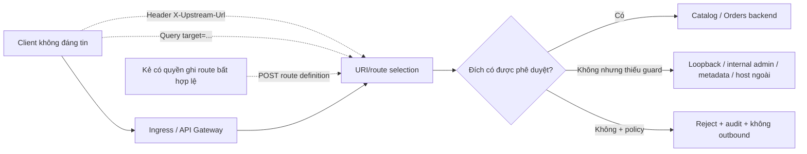
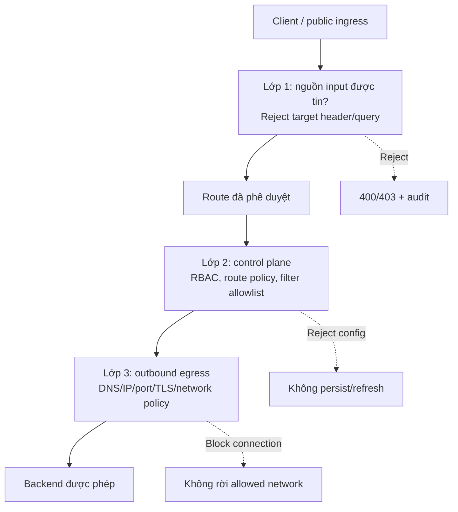
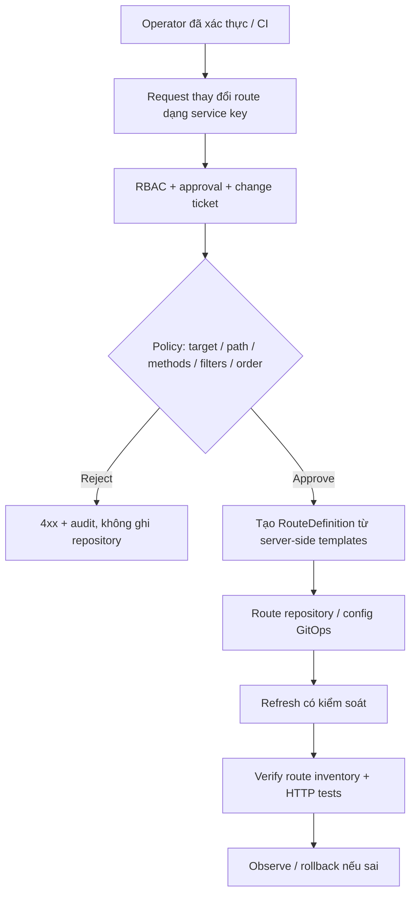

# Ngăn open proxy từ header, query hoặc cấu hình tuyến động

## 1. Tại sao API Gateway có nguy cơ trở thành open proxy?

**SPRING_CLOUD_GATEWAY** làm điểm vào chung cho microservices: route predicates chọn tuyến; filter chain biến đổi đường dẫn, header và request; `lb://` tìm instance dịch vụ; authentication, rate limiting, circuit breaker, retry, TLS và observability giúp vận hành hệ thống an toàn. Quyền **chọn nơi gửi HTTP request** vì thế là một quyền đặc biệt nhạy cảm.

Một gateway trở thành **open proxy** khi người gọi không đáng tin có thể khiến nó gửi request đến **địa chỉ ngoài phạm vi được phép**. Ví dụ: client cung cấp một header/query chứa URL đích và một filter/controller tin URL ấy; hoặc một API quản trị tuyến động bị lộ cho phép thêm route có `uri` tùy ý. Khi đó Gateway có thể trở thành công cụ **server-side request forgery (SSRF)** để truy cập dịch vụ nội bộ, địa chỉ loopback, cloud metadata endpoints hoặc máy chủ bên ngoài do attacker điều khiển.



Trong chương **Gia cố bảo mật**, bài này giải quyết đúng câu hỏi: **làm thế nào ngăn client điều khiển đích proxy qua header, query hoặc cấu hình tuyến động**, đồng thời không làm hỏng các chức năng Gateway hợp lệ.

### Mục tiêu học tập

Sau bài này, bạn có thể:

1. Giải thích **open proxy**, **SSRF**, **open redirect** và vì sao ba khái niệm liên quan nhưng không đồng nhất.
2. Chỉ ra các nguồn dữ liệu không đáng tin: `Host`, `Forwarded`, `X-Forwarded-Host`, `X-Target-URL`, query `target`/`url`, route metadata và các yêu cầu quản trị chưa được phê duyệt.
3. Nhận diện nguy cơ từ `RequestHeaderToRequestUri` và custom filters ghi `GATEWAY_REQUEST_URL_ATTR`.
4. Phân biệt **route predicate** (chọn tuyến) với **destination URI** và các filter thay đổi đích.
5. Áp dụng **allowlist service key**, URI scheme/hostname/port cố định, không lấy trực tiếp một URL tùy ý từ client.
6. Khóa **Actuator Gateway write operations** bằng `management.endpoint.gateway.access: read-only` hoặc không expose endpoint.
7. Thiết kế quy trình riêng cho tuyến động: authentication/RBAC, phê duyệt target, filter/predicate/order, audit, rollback và đồng bộ nhiều Gateway instances.
8. Bổ sung kiểm soát DNS/redirect/egress/TLS, không dựa vào regex kiểm tra host một lần để chống toàn bộ SSRF.
9. Thực hành Java/YAML/`curl` với route cố định, một filter từ chối destination hints và backend echo để chứng minh request không bị đổi đích.
10. Viết unit/integration tests cho header, query và quản trị tuyến động, biết phạm vi kết luận của từng tầng test.

> **Phạm vi phiên bản:** Các ví dụ sử dụng **Spring Cloud Gateway Server WebFlux 4.3.x**, **Spring Cloud 2025.0.x**, **Spring Boot 3.5.x**, Java 17+ và prefix cấu hình `spring.cloud.gateway.server.webflux`. Gateway Server Web MVC và Proxy Exchange có mô hình handler/filter khác; ý tưởng phòng vệ tương tự nhưng **không sao chép Java API WebFlux sang MVC**. Các phiên bản `3.5.0`/`2025.0.0` trong lab chỉ minh họa cặp tương thích, không phải khuyến nghị dùng patch đầu tiên ở production.

## 2. Phân biệt open proxy, SSRF và open redirect

| Khái niệm | Điều xảy ra | Ví dụ về sai lầm thiết kế | Kiểm soát trọng tâm |
| --- | --- | --- | --- |
| **Open proxy** | Một hệ thống thay mặt client gửi request tới nhiều đích tùy ý. | Gateway lấy `uri` từ `?target=` của client. | Không cho client chọn network destination; dùng mapping server-side. |
| **SSRF** | Attacker khiến server gửi request tới tài nguyên mà client không được phép trực tiếp truy cập. | Header do client gửi đổi target sang service quản trị nội bộ. | Allowlist + DNS/connect-time policy + egress firewall + auth. |
| **Open redirect** | Server trả `Location` khiến **client** chuyển tới địa chỉ ngoài ý muốn. | `RedirectTo` dùng URL không validate. | Validate redirect destination/origin; khác với outbound proxy. |
| **Header spoofing** | Attacker giả những metadata thường chỉ proxy tin cậy mới được đặt. | Client tự gửi `X-Forwarded-Host`, `X-User-Id`. | Ingress strip/overwrite và trusted proxy chain. |
| **Route poisoning** | Cấu hình định tuyến bị sửa, route mới chiếm request hoặc trỏ sai upstream. | Dynamic route có order ưu tiên cao, predicate quá rộng. | RBAC, review, immutable policy, route inventory và rollback. |

**Một HTTP 302 với `Location` độc hại không tự chứng minh Gateway đã SSRF**, vì request tiếp theo thường do browser/client phát. Ngược lại, một `200` với nội dung từ internal service có thể là hậu quả của outbound SSRF. Khi kiểm thử, phải đếm **request thật ở backend/blocked destination**, không chỉ nhìn HTTP status phía client.

### 2.1. Tại sao Gateway là điểm nhạy cảm?

Gateway thường có:

- Network route tới các service nội bộ hoặc service discovery mà client Internet không truy cập được.
- Service-to-service credentials, client certificates hoặc token relay.
- Egress DNS/proxy permission rộng hơn môi trường người dùng.
- Cơ chế retry, redirect, websocket, load balancing và route rewrites.
- Quyền quản trị cấu hình routes được phân tách khỏi data plane.

Nếu quyền chọn URI bị trao nhầm cho client, **vùng mạng Gateway được phép truy cập** trở thành phạm vi mà attacker có thể dò hoặc cố gọi. Vì vậy thiết kế phải bảo vệ cả **data plane** và **control plane**.

## 3. Dòng xử lý URI trong Gateway Server WebFlux

Ở Gateway Server WebFlux, `RoutePredicateHandlerMapping` chọn `Route`; `FilteringWebHandler` chạy GlobalFilters và route-specific GatewayFilters; các routing filters nhìn vào attributes của `ServerWebExchange`.

```text
Inbound request
    |
    v
Route predicate: Path=/api/catalog/**, Method=GET
    |
    v
Selected Route + GATEWAY_ROUTE_ATTR
    |
    v
Pre filters: path/header transforms
    |
    v
RouteToRequestUrlFilter
    | đặt GATEWAY_REQUEST_URL_ATTR (URI đích)
    v
Các filters có thể thay URI / chọn service instance
    | RequestHeaderToRequestUri  <- nguy hiểm nếu header untrusted
    | lb:// resolver            <- cần policy service ID/instance
    v
NettyRoutingFilter (http/https) hoặc WebSocket/forward routing
    |
    v
Approved downstream (nếu policy được thực thi)
```

Tài liệu Gateway 4.3 xác nhận `RouteToRequestUrlFilter` tạo `GATEWAY_REQUEST_URL_ATTR` từ route đã match; `ReactiveLoadBalancerClientFilter` có thể thay target sau khi chọn instance; Netty routing thực hiện outbound HTTP(S) dựa vào URI cuối. **Cấu hình route ban đầu an toàn chưa bảo đảm URL cuối an toàn** nếu một filter phía sau có thể đổi host/scheme.

### 3.1. Những dữ liệu thường bị nhầm là đáng tin

| Dữ liệu inbound/control | Có được dùng để chọn target host không? | Lý do |
| --- | --- | --- |
| `GET /api/catalog/items/42` | **Không**, trừ mapping path→service cố định. | Path do client chọn; chỉ được phép chọn route đã được operator phê duyệt. |
| `?target=https://...` hoặc `?url=` | **Không**. | Client không được khai báo network destination. |
| `X-Upstream-Url` hoặc `X-CF-Forwarded-Url` | **Không** trên public ingress. | Header dễ giả nếu không có trust boundary. |
| `Host`/`X-Forwarded-Host` | **Không** để chọn outbound host. | Host name spoofing, reverse proxy injection và virtual host confusion. |
| URI trong `RouteDefinition` vừa được POST | **Chưa**, cho đến khi kiểm tra RBAC và policy. | Một định nghĩa tuyến vẫn có thể trỏ tới mạng nhạy cảm. |
| Service ID từ registry | **Chỉ khi được phê duyệt**. | `lb://` không làm service ID/instance trở nên an toàn. |
| URI literal trong code/config đã review | **Có, trong giới hạn policy**. | Tách quyền thay đổi cấu hình khỏi quyền gọi API. |

### 3.2. Sơ đồ ba lớp phòng vệ



**Không phụ thuộc vào một filter Java duy nhất** như bảo đảm tuyệt đối. Một route động có thể thay filter order, một HTTP client tùy chỉnh có thể bypass filter Gateway, hoặc DNS có thể đổi sau khi ứng dụng kiểm tra. Network egress guard và quy trình kiểm soát route là lớp phòng vệ độc lập.

## 4. Nguy cơ trực tiếp: `RequestHeaderToRequestUri`

Gateway Server WebFlux 4.3 có filter **`RequestHeaderToRequestUri`**, nhận tên header và dùng **giá trị URI trong header** để thay URI downstream nếu hợp lệ. Tài liệu chính thức nhấn mạnh filter này **chỉ nên dùng trong môi trường đáng tin**, và header dùng để chuyển đích phải bị loại khỏi requests của client **trước khi vào Gateway**.

Một cấu hình nguy hiểm nếu đặt trên tuyến Internet công khai:

```yaml
# MẪU CẦN TRÁNH: header do client điều khiển có thể đổi URI.
spring:
  cloud:
    gateway:
      server:
        webflux:
          routes:
            - id: unsafe_header_routing
              uri: https://catalog.example.test
              predicates:
                - Path=/api/catalog/**
              filters:
                - RequestHeaderToRequestUri=X-Upstream-Url
```

Nếu client gửi `X-Upstream-Url` là một URL khác hợp lệ, filter có thể thay destination. Trong môi trường Gateway có network access rộng, đây là **một đường SSRF/open proxy**, không phải chỉ là custom header phục vụ logging.

**Thay thế an toàn cho tuyến public:** không cấu hình `RequestHeaderToRequestUri`; sử dụng **fixed destination** hoặc `lb://` service ID được phê duyệt, với predicate đủ hẹp. Nếu một hệ thống nội bộ thực sự cần header-based routing, phải:

1. Chỉ cho phép source **trusted routing layer** đặt header sau ingress authentication/mTLS.
2. Ingress **strip hoàn toàn** header cùng tên từ mọi external client trước khi trusted layer thêm.
3. Ràng buộc destination vào allowlist scheme/hostname/IP/port, không nhận arbitrary URL.
4. Kiểm soát DNS/redirect và egress ở network.
5. Đánh dấu source, audit route ID/target alias và kiểm thử chống spoofing.
6. Đảm bảo route động không thể thêm lại filter với tên header mới ngoài chính sách.

### 4.1. Có thể tắt filter factory nếu không sử dụng

Gateway 4.3 cung cấp property tương ứng:

```yaml
spring:
  cloud:
    gateway:
      server:
        webflux:
          filter:
            request-header-to-request-uri:
              enabled: false
```

Đây là **defense in depth** nhằm loại bớt một khả năng không cần dùng. Nếu một route hiện có dựa vào factory này, tắt factory có thể làm route invalid/startup fail; phải kiểm tra dependency trước khi thay đổi. **Property không thay thế kiểm tra custom filter hoặc route URI**: code tự ghi `GATEWAY_REQUEST_URL_ATTR` vẫn có thể tạo SSRF.

### 4.2. Custom filter có thể tạo cùng lỗi

Đoạn dưới là một **anti-pattern**, không được dùng để xử lý requests từ Internet:

```java
// KHÔNG AN TOÀN: chỉ minh họa lỗi thiết kế.
String supplied = exchange.getRequest().getHeaders()
        .getFirst("X-Upstream-Url");
URI next = URI.create(supplied);

exchange.getAttributes().put(
        ServerWebExchangeUtils.GATEWAY_REQUEST_URL_ATTR, next);
return chain.filter(exchange);
```

Cùng lỗi có thể xuất hiện khi `supplied` lấy từ:

- `exchange.getRequest().getQueryParams().getFirst("target")`;
- path variable như `{backend}` hoặc `{tenant}`;
- trường JSON `destination` do client gửi;
- một claim JWT **không được dùng đúng purpose** hoặc không validate chữ ký/audience;
- service discovery metadata chưa được xác minh.

Không dùng một URI parser để thay authorization. `URI.create(...)` chỉ parse chuỗi; nó **không cho biết host có được phép truy cập hay không**.

## 5. Header `Host`, `Forwarded` và sự nhầm lẫn giữa URI và authority

### 5.1. Header Host không phải target URI đáng tin

Gateway có thể nhận request:

```http
GET /api/catalog/items/42 HTTP/1.1
Host: edge.example.test
X-Forwarded-Host: another.example.test
```

`Host` thường mô tả authority mà client đang gọi, không phải backend được phép proxy. Nếu application tự xây target từ `Host`/`X-Forwarded-Host`, client có thể ảnh hưởng điểm đến. Bên cạnh đó, `SetRequestHostHeader` và `PreserveHostHeader` thay **HTTP Host header gửi đi**, nhưng không nhất thiết đổi target URI/socket destination. Việc sửa Host thiếu kiểm soát có thể gây **virtual-host confusion**, chứ không tự động là một routing control an toàn.

### 5.2. Trusted proxy chain và `X-Forwarded-*`

Với Gateway 4.3 Server WebFlux, docs dùng `spring.cloud.gateway.server.webflux.trusted-proxies` (Java regular expression) để xác định những proxy được tin trong xử lý `Forwarded`/`X-Forwarded-*`. Các `X-Forwarded-For`/`Host`/`Proto` có thể có hành vi **append** nếu bật.

Chính sách nên là:

- Edge ingress **xóa/ghi đè giá trị client tự gửi** cho các header mà ứng dụng tin, trừ khi chain đã được kiểm soát.
- Chỉ khai báo **đúng upstream proxy identities** là trusted. Không đặt regex `.*` cho môi trường public.
- Đừng dùng `X-Forwarded-For` không đáng tin làm IP source để cấp quota, xác thực hoặc mở egress.
- Không dùng `X-Forwarded-Host` để tính URI outbound. Tên miền ngoài trusted virtual host policy phải bị reject.
- Kết hợp Spring Security và outbound network policy; header filtering không tự xác thực principal.

### 5.3. Header request và response redirect khác nhau

`RedirectTo` hoặc `Location` có thể tạo **open redirect** nếu redirect target do client lựa chọn mà không có allowlist. Đây là một lớp lỗi riêng. Khi Gateway **proxy HTTP(S)**, Netty routing dùng một URI đích phía server; khi Gateway **redirect**, nó trả URI để browser/client quyết định có đi tiếp hay không. Một kiểm thử SSRF phải quan sát **server-side outbound connection**, không đồng nhất với HTTP 30x.

## 6. Query parameter: đừng biến dữ liệu tìm kiếm thành network destination

Một API hợp lý:

```http
GET /api/catalog/items/42?lang=vi
```

Gateway chỉ cần gửi request tới backend `catalog` đã cấu hình. Param `lang` là dữ liệu nghiệp vụ, **không** phải quyền chọn host.

Mẫu sai:

```java
// KHÔNG AN TOÀN: client chọn URL thực sự được gọi.
String target = exchange.getRequest().getQueryParams()
        .getFirst("target");
exchange.getAttributes().put(
        GATEWAY_REQUEST_URL_ATTR, URI.create(target));
return chain.filter(exchange);
```

**Thay thế:** route chọn backend cố định; nếu có nhiều upstream hợp lệ, chỉ chấp nhận **service key** như `catalog` hoặc `inventory`, sau đó map service key **trên server** sang target đã review. Không biến `?service=catalog` thành `lb://` + arbitrary user string. Với public API, tốt nhất tách thành các URL có định nghĩa cố định:

```text
/api/catalog/**      -> catalog-service
/api/inventory/**    -> inventory-service
```

Query values vẫn có thể ảnh hưởng backend nghiệp vụ, nên validate và encode; nhưng **không cho phép query trỏ tới protocol/host/port**. Việc chỉ xóa một query key `target` trong filter không cứu được custom code đọc một key khác để chọn URI; cần **kiến trúc không phụ thuộc URL client**, không chỉ blacklist các tên param.

### 6.1. Path variables cũng không được mở network authority

Path `/api/{tenant}/items/**` có thể dùng để xác định tenant sau **xác thực và phân quyền**, nhưng không nên tạo hostname kiểu `https://{tenant}.arbitrary-host` rồi proxy mà không có registry/allowlist. Host-based routing dùng `Host` predicate cũng phải giới hạn accepted domains và tránh giả định Host là chứng nhận ownership.

### 6.2. URL parser không thay allowlist

Một check kiểu `target.startsWith("https://catalog.example.test")` là **không đủ**, do có userinfo, host prefix, encoding, dấu chấm cuối, port và nhiều cách biểu diễn IP. Khi không thể tránh nhận URL đầu vào từ nguồn trusted, dùng parser URI chuẩn và kiểm tra **scheme, normalized hostname, port, userinfo, path/query/fragment**, đồng thời có DNS/connect-time enforcement ở lớp kết nối. Để đơn giản và an toàn hơn, **không cho caller nhập URL hoàn chỉnh**.

## 7. Tuyến động: một bề mặt thay đổi đích proxy có đặc quyền

Tuyến động là khả năng hữu ích để điều phối traffic, triển khai backend mới và thay đổi route mà không rebuild Gateway. Nhưng một `RouteDefinition` có thể mang theo:

- **`id`**: tên route, có thể cố chiếm/đè route đã có.
- **`uri`**: network destination hoặc scheme `lb://`, `forward://`, `ws://`...
- **`predicates`**: điều kiện `Path`, `Host`, `Method`, `Header`; predicate quá rộng có thể match endpoint nhạy cảm.
- **`filters`**: ví dụ `StripPrefix`, `RewritePath`, `RequestHeaderToRequestUri`, `SetRequestHostHeader`, `TokenRelay`, `Retry`, `CircuitBreaker`.
- **`order`**: thứ tự ưu tiên khi có nhiều route cùng match.
- **`metadata`**: thông tin bổ sung ảnh hưởng chính sách hoặc observability của ứng dụng.

Nếu một actor chỉ được phép gọi HTTP client API mà lại có thể POST `RouteDefinition` tùy ý, họ có thể **nâng quyền từ data plane sang control plane**.

### 7.1. Actuator Gateway 4.3: read-only và unrestricted

Tài liệu chính thức của Gateway Server WebFlux 4.3 mô tả `/actuator/gateway` **không được cấp quyền truy cập mặc định**; muốn dùng phải cấu hình mức access và web exposure. Với Spring Boot 3.5:

```yaml
# Cấu hình khuyến nghị khi cần quan sát tuyến trên mạng quản trị:
management:
  server:
    port: 8081
    address: 127.0.0.1
  endpoint:
    gateway:
      access: read-only
    health:
      access: read-only
  endpoints:
    web:
      exposure:
        include: health,gateway
```

`access: read-only` cho phép xem route khi endpoint được expose và có quyền mạng, nhưng **không cấp quyền create, delete hoặc refresh**. Nếu không cần route inventory qua Actuator, giải pháp chặt hơn là **không expose Gateway endpoint** hoặc đặt `access: none`.

Cấu hình khác:

```yaml
management:
  endpoint:
    gateway:
      access: unrestricted
```

có thể mở **các thao tác ghi** như tạo/xóa/refresh tuyến. Tài liệu 4.3 còn nhắc `management.endpoint.gateway.enabled=true` theo cơ chế enable legacy; **đừng dùng nó như cách bật read-only**. Trong production, chỉ cho phép write endpoint khi có nhu cầu quản trị rõ ràng, qua management network riêng, authentication/RBAC, approval, audit và các biện pháp kiểm soát bổ sung.

> **Quan trọng:** `management.server.address: 127.0.0.1` với management port riêng chỉ phù hợp **lab chạy cùng máy**. Trong Kubernetes hoặc multi-node, management traffic cần network policy, service riêng, mTLS/identity và các controls tương ứng. Bind loopback không thay thế authentication nếu một local process hoặc compromised container đã có quyền truy cập.

### 7.2. Các API cần được bảo vệ

| API Actuator Gateway | Method | Rủi ro nếu lộ quyền ghi |
| --- | --- | --- |
| `/actuator/gateway/routes` | GET | Lộ route inventory và upstream topology nếu public. |
| `/actuator/gateway/routes/{id}` | GET | Lộ details của route/filter/predicate. |
| `/actuator/gateway/routes/{id}` | POST | Tạo route định nghĩa đích/predicates/filters. |
| `/actuator/gateway/routes/{id}` | DELETE | Xóa route, gây outage/traffic shifting. |
| `/actuator/gateway/routes` | POST | Tạo nhiều routes theo API version. |
| `/actuator/gateway/refresh` | POST | Refresh route cache, đưa config thay đổi vào runtime. |

Trong Gateway 4.3, route creation qua Actuator sử dụng **route definition payload**, ví dụ `"predicates": ["Path=/managed/catalog/**"]`, `"filters": ["StripPrefix=2"]`, `"uri": "https://..." `. Tên filter và các arguments đều là **input quản trị cần kiểm soát**, không phải giá trị được an toàn hóa chỉ vì JSON parse được.

**Phân biệt trạng thái:** route được lưu tại repository và route hiện đang sử dụng có thể khác nhau nếu còn caching/refresh. Sau khi approve một route mới, cần xác minh kết quả qua route listing, HTTP behavior và trạng thái từng Gateway replica. Một HTTP `200` từ refresh không đủ chứng minh tất cả instance đồng bộ.

### 7.3. Vì sao kiểm tra URI đơn thuần chưa đủ cho route động?

Giả sử một payload có `uri` hợp lệ và thuộc service được phép. Nó vẫn có thể gây rủi ro nếu:

1. Predicate `Path=/**` chiếm traffic của `/admin/**` hoặc `/auth/**`.
2. `order` khiến route mới ưu tiên hơn route đã có authentication.
3. Filter `RequestHeaderToRequestUri` cho phép **mỗi client request** thay đích sau khi route match.
4. `RewritePath` mở đường vào backend management endpoint dù hostname thuộc allowlist.
5. `SetRequestHeader=Authorization,...` hoặc `TokenRelay` làm lộ credential tới service không đúng audience.
6. `PreserveHostHeader`/`SetRequestHostHeader` gây nhầm virtual host hoặc routing backend.
7. Route `lb://` dùng service ID không có trong danh sách được phê duyệt.
8. Metadata làm thay đổi behavior của custom security/tenant filter.
9. Một route ID có sẵn bị thay hoặc collision dẫn đến mapping/rollback khó dự đoán.

**Policy duyệt route phải kiểm tra bộ 5:** `URI + predicates + filters + order + ownership`. Metadata và ảnh hưởng tới security chain cũng phải review. Một allowlist hostname đơn độc không ngăn tất cả các trường hợp này.

### 7.4. Thiết kế control plane riêng và hẹp

Quy trình khuyến nghị:



- **Không nhận raw `RouteDefinition` từ public API**; endpoint quản trị nên nhận một DTO như `{ "serviceKey": "catalog" }`, rồi **server** sinh URI/predicate/filter từ template đã review.
- Chỉ các role tối thiểu như `GATEWAY_ROUTE_ADMIN` mới được yêu cầu thay đổi; cần independent approval cho route mới vào môi trường production.
- Không expose repository hoặc Actuator write API qua public ingress.
- Mọi write path phải chịu policy: custom admin service, GitOps, database/Redis repository, Actuator, Config Server hoặc controller/SDK nội bộ.
- Dynamic config nên có schema/version, danh sách domain/service đã phê duyệt, route ID namespace, giới hạn path order và filter set.
- Ghi audit: actor, approved service alias, route ID, diff trước/sau, thời gian, môi trường, reviewer, kết quả verify. **Không log secret filter arguments/tokens**.
- Có rollback version đã kiểm thử; không dựa vào việc một `DELETE` mù có thể khôi phục cấu hình cũ.

### 7.5. Đừng coi network-isolated actuator là bất khả xâm phạm

Kể cả khi `/actuator/gateway` chỉ listen trên private management network, những rủi ro còn tồn tại: SSRF qua một app khác trong VPC, credential compromise, proxy-forward sai, một workload có quyền egress tới management service, hoặc role quá rộng. Do đó **mTLS + RBAC + network policy + read-only by default** là lớp bảo vệ bổ sung.

Nếu cần Actuator ghi trong một phiên bảo trì, bật qua **môi trường quản trị thật sự cô lập**, giới hạn thời gian/phạm vi, ghi lại tất cả thao tác và **tắt lại khi xong**. Không khuyến nghị mở unrestricted lâu dài chỉ vì tiện `curl` trong vận hành.

## 8. Kiểm soát outbound: URI allowlist, DNS, redirect và kết nối thực tế

### 8.1. Tại sao prefix-check hoặc regex URL quá yếu?

Một số dạng URI có thể làm một check đơn giản nhận diện sai:

- Hostname gần giống hoặc có suffix khác host được phép.
- URI chứa userinfo `user@host` khiến việc tách authority bằng chuỗi dễ nhầm.
- Thêm port khác 443, scheme `http` thay vì `https`.
- IP literal IPv4/IPv6, dạng biểu diễn IP không chuẩn, loopback/link-local.
- Domain đổi kết quả DNS theo thời gian (*DNS rebinding*).
- HTTP redirect 30x từ host được phép sang host khác.
- Percent encoding/double encoding ảnh hưởng path, query hoặc các lớp URL parser khác nhau.

**Ví dụ một policy chặn kiểu exact destination**, thay vì `startsWith`:

| Thuộc tính | Policy production ví dụ |
| --- | --- |
| Scheme | `https` duy nhất (hoặc `wss` nếu route websocket được duyệt riêng). |
| Host | Exact ASCII canonical host trong allowlist, ví dụ `catalog.svc.example.internal`. |
| Port | `443`/`8443` theo service contract, không cho tùy ý. |
| Userinfo/fragment | Không có. |
| Query trong route base URI | Không có; query nghiệp vụ xử lý theo schema riêng. |
| Service discovery ID | Exact ID có trong registry do operator phê duyệt. |
| Resolved IP | Thuộc các CIDR được phép **ở thời điểm kết nối**. |
| Redirect | Tắt follow redirects mặc định hoặc revalidate **mỗi hop** nếu thật sự cần. |
| Credentials | Token/cert đúng audience và backend, không chuyển cho URI khác. |

**Policy ở trên là mô hình**, không tự được Gateway triển khai chỉ bằng khai báo bảng. Phải xây ở lớp nhận cấu hình, HTTP client/egress proxy và hạ tầng mạng.

### 8.2. DNS rebinding và khoảng trống time-of-check/time-of-use

Một code kiểu:

```java
InetAddress[] checked = InetAddress.getAllByName(host);
validateAllAddresses(checked);
httpClient.get().uri("https://" + host + "/..."); // DNS có thể được tra lại
```

**chưa đủ**: HTTP client có thể DNS lookup lại sau bước kiểm tra và nhận địa chỉ khác. Đây là lỗi **TOCTOU** (*time of check vs time of use*). OWASP khuyến nghị kiểm tra host/IP và bảo đảm kết nối thực dùng **địa chỉ đã được xác minh**, trong khi vẫn giữ hostname gốc cho TLS SNI/hostname verification.

Giải pháp thực tế có thể là:

1. Không cho client chỉ định hostname; chỉ dùng **registered service endpoints**.
2. Egress gateway/proxy hoặc DNS/network policy buộc kết nối chỉ đi tới **approved CIDRs**.
3. Nếu ứng dụng cần URL-based dispatch, dùng HTTP client với resolver/connect-time controls, không chỉ `InetAddress.getAllByName` trước một `WebClient` thông thường.
4. Không cho follow redirects tự do; nếu bật, validate mọi destination hop.
5. Kiểm soát IPv4 **và IPv6**, loopback, link-local, private/reserved networks theo **chính sách môi trường**. Lưu ý service nội bộ hợp lệ cũng có thể dùng private IP, vì vậy phải allow **CIDR cụ thể**, không áp dụng quy tắc “mọi private IP đều cấm” một cách vô điều kiện.
6. Kiểm tra DNS rebinding/route poisoning bằng test ở môi trường cô lập, không trên production.

### 8.3. Network policy là lớp cuối chặn SSRF

Ngay cả khi một custom filter đặt nhầm `GATEWAY_REQUEST_URL_ATTR`, network egress policy vẫn có thể **chặn kết nối**. Với Kubernetes, cần xem khả năng CNI/NetworkPolicy thực của cluster; NetworkPolicy tiêu chuẩn thường chọn pod/IP/port, còn FQDN policies có thể cần CNI hoặc egress proxy chuyên dụng.

Một hướng thiết kế:

```text
Gateway Pod (namespace edge)
    |
    +-- allow TCP 8443 --> catalog backend service subnet
    +-- allow TCP 8443 --> inventory backend service subnet
    +-- allow DNS      --> cluster resolver
    |
    +-- DENY other outbound traffic
         loopback-adjacent, metadata, arbitrary Internet, admin ranges
```

**Không có nghĩa “chặn 127.0.0.1 bằng NetworkPolicy” là đủ**: loopback trong cùng namespace/container, hostNetwork, CNI implementation, kube-proxy và egress NAT có các semantics khác nhau. Đánh giá theo deployment thực; dùng firewall/namespace/container isolation và tránh chạy nhầm privileged host networking.

### 8.4. `lb://` không tự là một allowlist

Với `uri: lb://catalog-service`, `ReactiveLoadBalancerClientFilter` chọn một `ServiceInstance` rồi tạo URI HTTP(S). Nhưng nếu client/admin có thể tùy ý đổi service ID, hoặc registry bị nhiễm instance sai, Gateway vẫn có thể đi tới host không mong muốn.

Kiểm soát:

- Service IDs được duyệt, không nối trực tiếp từ query/header/path untrusted.
- Quyền ghi service registry/discovery metadata.
- Port/scheme/backend certificate identity trong môi trường mTLS.
- Egress CIDR, service account, network policies.
- Cùng policy với direct `http(s)://` target và các retries/fallbacks.

### 8.5. TLS, token relay và SSRF có thể cộng hưởng

Nếu Gateway tự forward bearer tokens, cookies, API keys, mTLS client identity hoặc `Authorization` headers xuống target đã bị thay, một lỗi SSRF có thể trở thành **credential exfiltration**. Khi chọn upstream:

- Credential phải giới hạn **audience/scope**.
- Không forward user token tới service ngoài danh sách nhận token đó.
- Tách client identity và service-to-service identity; dùng token exchange nếu thích hợp.
- TLS phải xác minh CA/hostname/SAN, không dùng insecure trust manager.
- Không cho custom dynamic route disable security filters hoặc retry theo cách làm lộ body.

## 9. Hardening theo kiểu “cấu hình an toàn trước”

Ở public Gateway, ưu tiên **tuyến cố định** và một tập filter nhỏ đã review. Khả năng thay upstream từ client nên bị loại bỏ từ thiết kế chứ không chỉ chặn các mẫu URL nguy hiểm.

Một mẫu ngắn cho Gateway Server WebFlux 4.3:

```yaml
spring:
  cloud:
    gateway:
      server:
        webflux:
          filter:
            request-header-to-request-uri:
              enabled: false
          routes:
            - id: catalog_public_v1
              uri: https://catalog.svc.example.internal:8443
              predicates:
                - Path=/api/catalog/**
                - Method=GET
              filters:
                - StripPrefix=2
                - RemoveRequestHeader=X-Upstream-Url
                - RemoveRequestHeader=X-CF-Forwarded-Url
                - RemoveRequestHeader=X-Internal-User
```

Ví dụ production này **giả định** `catalog.svc.example.internal` là DNS/service đã được tổ chức phê duyệt, có TLS certificate hợp lệ và egress controls tương ứng. Nó **không phải URL có sẵn để copy chạy**, và chỉ xóa một vài header chưa thay thế việc chặn mọi vector SSRF khác.

### 9.1. Vì sao thêm `RemoveRequestHeader`?

Các headers mà API contract **không cho client kiểm soát** nên bị bỏ trước downstream, ví dụ `X-Internal-User` hoặc `X-Upstream-Url`. Tuy nhiên nếu client có thể chọn outbound target thông qua một filter trước bước remove header, xóa header **sau đó là quá muộn**. Muốn đảm bảo không dùng giá trị untrusted để định tuyến, phải:

- **Không bật** `RequestHeaderToRequestUri` cho public route.
- Chặn/strip tại trusted ingress trước mọi logic sử dụng header.
- Xem **filter order** và khả năng dynamic routes thêm filter mới.
- Có egress policy chặn target trái phép độc lập với filter Java.

### 9.2. Những cấu hình không nên dùng như “cách chữa nhanh”

| Anti-pattern | Vì sao sai |
| --- | --- |
| Bật `RequestHeaderToRequestUri` trên `/**`. | Cho header client ảnh hưởng trực tiếp destination. |
| Route `uri` lấy từ query parameter. | Biến API thành user-controlled HTTP client. |
| Cho public `/actuator/gateway/routes` POST. | Đưa quyền quản trị data plane cho client. |
| `management.endpoint.gateway.access: unrestricted` không RBAC. | Có thể tạo/xóa/refresh route tùy ý. |
| Allowlist bằng `startsWith("https://trusted")`. | Nhầm host, userinfo, port, canonicalization. |
| Check DNS một lần rồi HTTP client lookup lại. | DNS rebinding/TOCTOU. |
| Bật auto redirect tới mọi host. | Có thể rời allowlist ở hop tiếp theo. |
| Chỉ chặn IP `127.0.0.1`. | Còn IPv6, link-local, private/metadata, DNS và routing variants. |
| Chỉ đặt Auth ở backend, Gateway cho route động trỏ nơi khác. | Có thể bypass backend guard hoặc làm lộ token nội bộ. |
| Chỉ dựa vào custom GlobalFilter để chặn SSRF. | Route config/admin/HTTP client khác vẫn có thể thay target. |

## 10. Thực hành: Gateway WebFlux chỉ cho phép một đích đã định nghĩa

### 10.1. Mục tiêu và phạm vi lab

Dựng hai tiến trình trên **cùng máy**:

```text
Client : curl
    |
    | GET /api/catalog/items/42?lang=vi
    v
Gateway WebFlux :8080
    |-- GlobalFilter: reject routing hints từ header/query
    |-- Route: catalog_fixed -> http://127.0.0.1:9001
    |-- StripPrefix=2
    |-- KHÔNG có RequestHeaderToRequestUri
    v
EchoBackend :9001
    GET /items/42?lang=vi

Gateway management :8081 (127.0.0.1)
    /actuator/gateway/* -> chỉ đọc, không tạo/xóa/refresh
```

Lab cung cấp hai loại bằng chứng:

1. Request hợp lệ đi tới **đúng backend :9001**, path đã biến đổi.
2. Request chứa header/query routing hint bị trả **400** trước `GatewayFilterChain`, backend request counter không tăng.

**Giới hạn:** filter phát hiện vài tên input không được phép là **defense in depth cho API contract lab**, không chứng minh đã ngăn mọi SSRF. Bảo vệ cốt lõi là **route URI cố định + không dùng untrusted input chọn target + Actuator không cho ghi + egress policy**. Trong production, bổ sung authentication, authorization, ingress header sanitization, TLS/mTLS và firewall.

### 10.2. Maven `pom.xml`

Tạo project Maven riêng, JDK 17+:

```xml
<?xml version="1.0" encoding="UTF-8"?>
<project xmlns="http://maven.apache.org/POM/4.0.0"
         xmlns:xsi="http://www.w3.org/2001/XMLSchema-instance"
         xsi:schemaLocation="http://maven.apache.org/POM/4.0.0
                             https://maven.apache.org/xsd/maven-4.0.0.xsd">
    <modelVersion>4.0.0</modelVersion>

    <parent>
        <groupId>org.springframework.boot</groupId>
        <artifactId>spring-boot-starter-parent</artifactId>
        <version>3.5.0</version>
        <relativePath/>
    </parent>

    <groupId>com.example</groupId>
    <artifactId>gateway-open-proxy-hardening-lab</artifactId>
    <version>0.0.1-SNAPSHOT</version>

    <properties>
        <java.version>17</java.version>
    </properties>

    <dependencyManagement>
        <dependencies>
            <dependency>
                <groupId>org.springframework.cloud</groupId>
                <artifactId>spring-cloud-dependencies</artifactId>
                <version>2025.0.0</version>
                <type>pom</type>
                <scope>import</scope>
            </dependency>
        </dependencies>
    </dependencyManagement>

    <dependencies>
        <dependency>
            <groupId>org.springframework.cloud</groupId>
            <artifactId>spring-cloud-starter-gateway-server-webflux</artifactId>
        </dependency>
        <dependency>
            <groupId>org.springframework.boot</groupId>
            <artifactId>spring-boot-starter-actuator</artifactId>
        </dependency>

        <!-- Spring Test, JUnit 5, AssertJ -->
        <dependency>
            <groupId>org.springframework.boot</groupId>
            <artifactId>spring-boot-starter-test</artifactId>
            <scope>test</scope>
        </dependency>
        <dependency>
            <groupId>io.projectreactor</groupId>
            <artifactId>reactor-test</artifactId>
            <scope>test</scope>
        </dependency>
    </dependencies>

    <build>
        <plugins>
            <plugin>
                <groupId>org.springframework.boot</groupId>
                <artifactId>spring-boot-maven-plugin</artifactId>
            </plugin>
        </plugins>
    </build>
</project>
```

Maven BOM giữ Boot/Cloud versions tương thích; **không thêm** Gateway Server MVC starter hoặc Proxy Exchange vào lab này. Starter Actuator cần thiết để đọc routes trong bước test quản trị; ở production nên chỉ expose endpoint cần thiết và bảo vệ bằng management security.

### 10.3. Spring Boot entry point

Tạo `src/main/java/com/example/gateway/SecureGatewayApplication.java`:

```java
package com.example.gateway;

import org.springframework.boot.SpringApplication;
import org.springframework.boot.autoconfigure.SpringBootApplication;

@SpringBootApplication
public class SecureGatewayApplication {
    public static void main(String[] args) {
        SpringApplication.run(SecureGatewayApplication.class, args);
    }
}
```

Đặt custom GlobalFilter cùng package để `@Component` được quét.

### 10.4. `application.yml` với đích cố định

Tạo `src/main/resources/application.yml`:

```yaml
server:
  address: 127.0.0.1
  port: 8080

spring:
  application:
    name: gateway-open-proxy-hardening-lab
  cloud:
    gateway:
      server:
        webflux:
          filter:
            request-header-to-request-uri:
              enabled: false
          routes:
            - id: catalog_fixed
              uri: http://127.0.0.1:9001
              predicates:
                - Path=/api/catalog/**
                - Method=GET
              filters:
                - StripPrefix=2
                - RemoveRequestHeader=X-Upstream-Url
                - RemoveRequestHeader=X-CF-Forwarded-Url
                - RemoveRequestHeader=X-Target-Uri

management:
  server:
    address: 127.0.0.1
    port: 8081
  endpoint:
    gateway:
      access: read-only
    health:
      access: read-only
  endpoints:
    web:
      exposure:
        include: health,gateway
```

Các lựa chọn cố ý:

- Chỉ một route, match `GET /api/catalog/**` với target `127.0.0.1:9001`.
- `RequestHeaderToRequestUri` bị **vô hiệu hóa** vì lab không dùng.
- `StripPrefix=2` biến `/api/catalog/items/42` thành `/items/42`.
- `RemoveRequestHeader` loại các destination hints nếu một request hợp lệ không bị chặn bởi GlobalFilter khác; **không xem đây là SSRF guard duy nhất**.
- Management port `8081` chỉ loopback và `access: read-only`; không cho POST route/refresh.
- `http://` chỉ dành cho backend trên **loopback demo**. Ở production thay bằng `https://`/mTLS service identity và network egress policy.

**Đừng bật `management.endpoint.gateway.access: unrestricted` để test một cuộc tấn công route injection.** Bài này kiểm tra deny behavior, không tạo route độc hại thật.

### 10.5. GlobalFilter từ chối routing hints của client

Tạo `src/main/java/com/example/gateway/BlockClientRoutingHintsGlobalFilter.java`:

```java
package com.example.gateway;

import java.util.List;
import java.util.Locale;
import java.util.Set;

import org.springframework.cloud.gateway.filter.GatewayFilterChain;
import org.springframework.cloud.gateway.filter.GlobalFilter;
import org.springframework.core.Ordered;
import org.springframework.http.HttpStatus;
import org.springframework.http.HttpHeaders;
import org.springframework.stereotype.Component;
import org.springframework.web.server.ServerWebExchange;

import reactor.core.publisher.Mono;

@Component
public class BlockClientRoutingHintsGlobalFilter
        implements GlobalFilter, Ordered {

    private static final List<String> TARGET_HEADERS = List.of(
            "X-Upstream-Url",
            "X-CF-Forwarded-Url",
            "X-Target-Uri");

    private static final Set<String> TARGET_QUERY_KEYS = Set.of(
            "target",
            "targeturl",
            "proxyurl",
            "upstreamurl");

    @Override
    public Mono<Void> filter(
            ServerWebExchange exchange,
            GatewayFilterChain chain) {

        HttpHeaders headers = exchange.getRequest().getHeaders();

        boolean unsafeHeader = TARGET_HEADERS.stream()
                .anyMatch(headers::containsKey);

        boolean unsafeQuery = exchange.getRequest()
                .getQueryParams()
                .keySet()
                .stream()
                .map(key -> key.toLowerCase(Locale.ROOT))
                .anyMatch(TARGET_QUERY_KEYS::contains);

        if (unsafeHeader || unsafeQuery) {
            exchange.getResponse()
                    .setStatusCode(HttpStatus.BAD_REQUEST);

            // Fail closed: không gọi chain.filter(...).
            return exchange.getResponse().setComplete();
        }

        return chain.filter(exchange);
    }

    @Override
    public int getOrder() {
        return Ordered.HIGHEST_PRECEDENCE;
    }
}
```

**Hành vi:**

- `HttpHeaders.containsKey` nhận biết header theo semantics không phân biệt hoa/thường của HTTP header names.
- Tên query được chuyển về lowercase bằng `Locale.ROOT` rồi so với allowlist các tên **bị cấm trong API contract lab**.
- Nếu xuất hiện destination hint, filter trả 400 **trước chain**.
- Không có destination hint thì chain tiếp tục, Gateway dùng URI từ route đã cấu hình.
- `Ordered.HIGHEST_PRECEDENCE` làm filter chạy sớm trong **Gateway combined filter chain**. Nó không bảo đảm chạy trước WebFlux/Spring Security `WebFilter` ở một pipeline khác, không thay thế ingress sanitization, và không làm cho route dynamic tùy ý trở nên đáng tin.

**Không copy danh sách tên header/query này để tuyên bố chặn mọi URL injection.** Một custom filter khác có thể đọc `destination`, `host` hoặc body JSON; yếu tố an toàn thực sự là **không đọc URL client để chọn outbound target**. GlobalFilter chỉ diễn đạt **hợp đồng đầu vào cho chính routes của lab**, còn egress/network và control plane phải được bảo vệ riêng.

**Không dùng các header/query từ client làm danh tính:** `X-Correlation-Id`, `X-Tenant` hay `X-Forwarded-For` có thể được giả mạo. Nếu hệ thống dùng identity header, hãy thiết lập nó **sau khi xác thực principal** và xóa giá trị inbound cùng tên.

### 10.6. EchoBackend JDK để quan sát đích thực sự

Tạo `EchoBackend.java` trong **thư mục riêng ngoài Spring Boot project**:

```java
import com.sun.net.httpserver.HttpServer;
import java.net.InetSocketAddress;
import java.nio.charset.StandardCharsets;
import java.util.concurrent.atomic.AtomicLong;

public class EchoBackend {

    public static void main(String[] args) throws Exception {
        AtomicLong calls = new AtomicLong();

        HttpServer server = HttpServer.create(
                new InetSocketAddress("127.0.0.1", 9001), 0);

        server.createContext("/", exchange -> {
            long call = calls.incrementAndGet();

            String path = exchange.getRequestURI().getRawPath();
            String query = exchange.getRequestURI().getRawQuery();
            String host = exchange.getRequestHeaders()
                    .getFirst("Host");

            String body = "backend-call=" + call + "\n"
                    + "method=" + exchange.getRequestMethod() + "\n"
                    + "path=" + path + "\n"
                    + "query=" + query + "\n"
                    + "host=" + host + "\n"
                    + "unsafe-header-present="
                    + exchange.getRequestHeaders().containsKey(
                            "X-Upstream-Url")
                    + "\n";

            // Chỉ log tên route/path, không in credentials.
            System.out.println("BACKEND #" + call
                    + " " + path);

            byte[] bytes = body.getBytes(StandardCharsets.UTF_8);
            exchange.getResponseHeaders().set(
                    "Content-Type", "text/plain; charset=UTF-8");

            exchange.sendResponseHeaders(200, bytes.length);

            try (var output = exchange.getResponseBody()) {
                output.write(bytes);
            }
        });

        server.start();
        System.out.println(
                "EchoBackend listening on 127.0.0.1:9001");
    }
}
```

Backend này cố ý không tự đổi đích HTTP theo query/header. Nó đếm **request tới :9001** để chứng minh khi Gateway chặn input, backend counter không tăng. Nó **không phải** production service: chỉ chạy trên localhost và không có auth/TLS, không log token/cookie.

### 10.7. Khởi động lab

**Terminal A**, trong thư mục chứa `EchoBackend.java`:

```bash
java EchoBackend.java
```

**Terminal B**, trong project có `pom.xml`:

```bash
mvn spring-boot:run
```

Nếu cần Maven Wrapper: `./mvnw spring-boot:run` (Linux/macOS) hoặc `mvnw.cmd spring-boot:run` (Windows). Đảm bảo cổng `8080`, `8081`, `9001` đang rảnh.

**Lưu ý phạm vi:** lệnh này dành cho **người học chạy trong project lab riêng**, không phải bước build/Content QA của repository bài giảng. Worker STEP 4 chỉ viết Markdown và chỉnh status YAML được giao.

## 11. Kiểm tra bằng `curl`: request nào tới được backend?

### 11.1. Happy path: route cố định, query nghiệp vụ bình thường

```bash
curl -i \
  "http://127.0.0.1:8080/api/catalog/items/42?lang=vi"
```

Kỳ vọng status 200, nội dung chính tương tự:

```http
HTTP/1.1 200 OK
Content-Type: text/plain; charset=UTF-8

backend-call=1
method=GET
path=/items/42
query=lang=vi
host=127.0.0.1:9001
unsafe-header-present=false
```

Số `backend-call` sẽ tăng nếu đã gọi trước đó. `Host` thường phản ánh target authority; đừng ép khớp toàn bộ headers từng byte vì Reactor Netty/container có thể tự thêm các trường hợp lệ. Quan trọng nhất là backend nhận **path mong đợi** và được gọi **chính xác một lần**.

### 11.2. Header thay URI bị từ chối

Trong terminal C:

```bash
curl -i \
  -H "X-Upstream-Url: http://127.0.0.1:9999/not-approved" \
  "http://127.0.0.1:8080/api/catalog/items/42"
```

Mong đợi **400 Bad Request** từ GlobalFilter. Quan sát terminal backend: **không có dòng `BACKEND #...` mới**. Không cần tồn tại một service tại :9999; test chỉ xem client **không có quyền chỉ định** đích bên ngoài route cố định.

Thử header khác được Gateway docs liên hệ tới routing layer:

```bash
curl -i \
  -H "X-CF-Forwarded-Url: https://unapproved.example.test" \
  "http://127.0.0.1:8080/api/catalog/items/42"
```

Kết quả cũng phải bị chặn theo API contract lab. **Không dùng môi trường thật có bí mật hoặc endpoint quản trị để test SSRF**; ta chỉ cần chứng minh filter không gọi chain và target config không thay đổi.

### 11.3. Query đích tùy ý bị từ chối

```bash
curl -i \
  "http://127.0.0.1:8080/api/catalog/items/42?target=http%3A%2F%2F127.0.0.1%3A9999"
```

Mong đợi 400 và backend counter không tăng. Test bằng chữ hoa cũng cần bị từ chối vì code chuẩn hóa tên query:

```bash
curl -i \
  "http://127.0.0.1:8080/api/catalog/items/42?TargetUrl=https%3A%2F%2Foutside.example.test"
```

**Không suy rằng mọi tên query chứa `url` đều nguy hiểm**; chính sách lab chặn những key mà API contract không hỗ trợ. Trong API thật, cần contract chi tiết theo route và không có code đọc bất kỳ query nào để đổi target network.

### 11.4. Một header không bị cấm có được phép đổi đích không?

Ví dụ:

```bash
curl -i \
  -H "X-Random-Info: hello" \
  "http://127.0.0.1:8080/api/catalog/items/42?lang=vi"
```

Request hợp lệ vẫn tới **:9001** vì route URI cố định và không có filter đọc `X-Random-Info` làm destination. Đây là bài học quan trọng: an toàn đạt được bằng **không dùng untrusted input chọn target**; không phải bằng cách cấm mọi header ngoài một danh sách bất tận.

### 11.5. Actuator chỉ đọc: không thể tạo/refresh route

Đọc danh sách:

```bash
curl -i \
  "http://127.0.0.1:8081/actuator/gateway/routes"
```

Kỳ vọng route `catalog_fixed` xuất hiện nếu Actuator Gateway endpoint đã được bật/expose và accessible local. Nếu API không có vì config/version khác, kiểm tra startup/endpoint exposure trước khi kết luận.

Thử một **write operation bị cấm**, không truyền route payload:

```bash
curl -i -X POST \
  "http://127.0.0.1:8081/actuator/gateway/refresh"
```

Với `access: read-only`, write mapping phải **không được phép**. Mã HTTP cụ thể có thể là 404/405/403 theo endpoint registration/security setup; assertion chính là **không refresh được**, không thay route inventory và không cấp thêm quyền. Nếu nhận 2xx, cấu hình management cần được xem xét ngay.

**Phân biệt:** `read-only` chỉ kiểm soát **Actuator Gateway endpoint**; nó không tự ngăn một custom admin controller hoặc Redis/config writer có quyền sửa route repository. Phải bảo vệ **tất cả write paths**.

### 11.6. Route miss và method mismatch

```bash
curl -i \
  "http://127.0.0.1:8080/not-routed"

curl -i -X POST \
  "http://127.0.0.1:8080/api/catalog/items/42"
```

Không có route tương ứng trong lab nên thường nhận 404/405 tùy mappings khác; backend **không có request mới**. GlobalFilter của Gateway chỉ chạy khi đã chọn route Gateway phù hợp — với route miss, không mong nó trả 400 cho mọi URL. Một security `WebFilter` đặt ngoài Gateway có thể xử lý từ sớm nếu hệ thống cần policy toàn cục.

## 12. Sinh tuyến động từ template đã phê duyệt, không từ URL tự do

Nếu doanh nghiệp thực sự cần quản lý tuyến động, lựa chọn an toàn hơn việc nhận một `RouteDefinition` JSON tùy ý là **nhận một service key nằm trong catalog**, rồi server tạo toàn bộ route từ template.

### 12.1. Policy input hẹp

Giả sử operator được phép yêu cầu bật route cho hai service:

```json
{"serviceKey": "catalog"}
```

hoặc:

```json
{"serviceKey": "inventory"}
```

Đây không phải một URL. Admin **không được truyền** `uri`, `host`, `filterName`, `order` hoặc `predicates` trong DTO này. Control plane quyết định các trường đó dựa trên service registry đã được review và environment.

### 12.2. Java factory trả `RouteDefinition` chỉ từ mapping server-side

Tạo `src/main/java/com/example/gateway/ApprovedRouteFactory.java`:

```java
package com.example.gateway;

import java.net.URI;
import java.util.List;
import java.util.Map;

import org.springframework.cloud.gateway.filter.FilterDefinition;
import org.springframework.cloud.gateway.handler.predicate.PredicateDefinition;
import org.springframework.cloud.gateway.route.RouteDefinition;

public final class ApprovedRouteFactory {

    // Policy minh họa cho production: hai targets đã được review.
    // Không dùng trực tiếp host này cho lab localhost.
    private static final Map<String, URI> TARGETS = Map.of(
            "catalog",
            URI.create(
                    "https://catalog.svc.example.internal:8443"),
            "inventory",
            URI.create(
                    "https://inventory.svc.example.internal:8443"));

    private ApprovedRouteFactory() {
    }

    public static RouteDefinition build(String serviceKey) {
        if (serviceKey == null) {
            throw new IllegalArgumentException(
                    "Unsupported serviceKey");
        }

        // Không gọi URI.create(serviceKey): đây là service key,
        // không phải URL do người gọi tự nhập.
        URI uri = TARGETS.get(serviceKey);

        if (uri == null) {
            throw new IllegalArgumentException(
                    "Unsupported serviceKey");
        }

        // Service key đến từ một map cố định, nên không cho phép
        // các ký tự làm lệch public path hoặc route ID.
        RouteDefinition route = new RouteDefinition();
        route.setId("managed_" + serviceKey);
        route.setUri(uri);
        route.setOrder(100);

        route.setPredicates(List.of(
                new PredicateDefinition(
                        "Path=/managed/" + serviceKey + "/**"),
                new PredicateDefinition("Method=GET")));

        route.setFilters(List.of(
                new FilterDefinition("StripPrefix=2"),
                new FilterDefinition(
                        "RemoveRequestHeader=X-Upstream-Url"),
                new FilterDefinition(
                        "RemoveRequestHeader=X-CF-Forwarded-Url")));

        return route;
    }
}
```

**Vì sao mẫu này an toàn hơn?**

- `serviceKey` chỉ có thể chọn một trong hai **keys đã tồn tại**, không thể chỉ định một IP/hostname tự do.
- `id`, `Path`, `Method`, `order` được **server** sinh, không cho caller tự cấu hình để bắt `/auth/**`.
- `uri` là một `URI` đã review và có HTTPS/port theo service contract.
- Filter list không cho thêm `RequestHeaderToRequestUri` hoặc `SetRequestHostHeader`.
- Route chỉ nhận **GET**, tránh tự động mở các POST/DELETE nhạy cảm.
- Đích HTTPS vẫn cần **DNS/connect-time validation, mTLS/CA/hostname check và network egress policy**. Map cố định không tự bảo đảm service registry/DNS không bị chiếm.

**Đây chỉ là factory tạo đối tượng**, chưa phải một public admin API, chưa ghi vào repository hoặc refresh cache. Không expose `build(serviceKey)` cho mọi client mà bỏ authentication/RBAC. Quy trình ghi route phải nằm sau change approval và có audit/rollback. Đặc biệt, nếu cùng lúc còn có `/actuator/gateway/routes` unrestricted hoặc một writer khác nhận raw JSON, **factory này không ngăn đường bypass**.

### 12.3. Vì sao không nhận `RouteDefinition` nguyên bản?

Một DTO:

```json
{
  "id": "anything",
  "uri": "https://anything",
  "predicates": ["Path=/**"],
  "filters": ["RequestHeaderToRequestUri=X-Upstream-Url"],
  "order": -1000
}
```

có quá nhiều quyền điều khiển. Kể cả khi `uri` qua một hostname allowlist, `Path=/**` và filter/header override có thể gây route shadowing hoặc bypass chính sách. **JSON parse thành công không có nghĩa cấu hình hợp lệ về bảo mật.**

Nếu một hệ thống phải chấp nhận raw route definitions từ operator được xác thực, cần validate **tất cả**:

| Field | Ví dụ rule cần kiểm tra |
| --- | --- |
| `id` | Unique, namespace dành cho owner, không overwrite ID khác. |
| `uri` | Scheme/host/IP/port allowlisted; không userinfo, fragment, redirects tùy ý. |
| `predicates` | Public path namespace được cấp, method/host/header theo API contract. |
| `filters` | Allowlist filter names và validate **từng argument**; cấm dynamic URI override trừ policy đặc biệt. |
| `order` | Trong phạm vi được cấp, không shadow routes auth/admin. |
| `metadata` | Chỉ những keys cho phép, không cho disable security/tenant controls. |
| `source/owner` | RBAC scoped theo service và environment, audit diff/approval. |
| `effective route` | Sau compile/refresh, kiểm tra route thực sự dùng đúng URI/filter/order. |

**Không chỉ validate lúc UI tạo route.** Nếu route definitions còn được ghi từ database migrations, Redis, GitOps, CLI hoặc Actuator, những write paths đó cũng phải kiểm soát. Có thể thực thi policy ở centralized approval gateway và admission trước repository, nhưng vẫn nên khóa network egress để giảm hậu quả của một path lọt.

### 12.4. Route lifecycle cần xác minh, không chỉ ghi repository

Mỗi thay đổi route nên qua các trạng thái:

```text
PROPOSED -> VALIDATED -> APPROVED -> PERSISTED
          -> REFRESHED -> VERIFIED -> ACTIVE
                                     |
                                  ROLLBACK
```

**PERSISTED ≠ ACTIVE**: route repository và cached route locator có thể khác nhau. Nếu có nhiều Gateway pods, cần xác minh từng instance nhận đúng route version. **REFRESHED ≠ SAFE**: refresh chỉ khiến routes được cập nhật, không tự thực thi destination/authorization policy.

Một release checklist cho dynamic route:

- Review diff cũ/mới: `id`, `uri`, `Path`, `Method`, filter list, `order`, metadata.
- Chạy unit policy tests và integration contract tests.
- Đảm bảo service target được phê duyệt và TLS identity đúng.
- Publish theo canary/small scope, đo latency, status, destination alias.
- Kiểm tra route inventory và outbound target thực.
- Nếu thất bại, rollback **toàn bộ route definition**, không chỉ xóa ID tùy ý.
- Ghi audit change ticket/actor/time và bảo vệ access logs khỏi lộ credentials.

## 13. Unit tests: filter chặn input và factory hạn chế route

### 13.1. Test `BlockClientRoutingHintsGlobalFilter` không gọi chain khi từ chối

Tạo `src/test/java/com/example/gateway/BlockClientRoutingHintsGlobalFilterTest.java`:

```java
package com.example.gateway;

import java.util.concurrent.atomic.AtomicInteger;

import org.junit.jupiter.api.Test;
import org.springframework.http.HttpStatus;
import org.springframework.mock.http.server.reactive.MockServerHttpRequest;
import org.springframework.mock.web.server.MockServerWebExchange;

import reactor.test.StepVerifier;

import static org.assertj.core.api.Assertions.assertThat;

class BlockClientRoutingHintsGlobalFilterTest {

    private final BlockClientRoutingHintsGlobalFilter guard =
            new BlockClientRoutingHintsGlobalFilter();

    @Test
    void clientSuppliedTargetHeaderIsRejected() {
        MockServerWebExchange exchange = MockServerWebExchange.from(
                MockServerHttpRequest
                        .get("/api/catalog/items/42")
                        .header("X-Upstream-Url",
                                "http://127.0.0.1:9999")
                        .build());

        AtomicInteger nextCalls = new AtomicInteger();

        StepVerifier.create(guard.filter(exchange, forwarded -> {
            nextCalls.incrementAndGet();
            return forwarded.getResponse().setComplete();
        })).verifyComplete();

        assertThat(exchange.getResponse().getStatusCode())
                .isEqualTo(HttpStatus.BAD_REQUEST);
        assertThat(nextCalls.get()).isZero();
    }

    @Test
    void lowerCaseHeaderIsAlsoRejected() {
        MockServerWebExchange exchange = MockServerWebExchange.from(
                MockServerHttpRequest
                        .get("/api/catalog/items/42")
                        .header("x-upstream-url",
                                "https://unapproved.example.test")
                        .build());

        AtomicInteger nextCalls = new AtomicInteger();

        StepVerifier.create(guard.filter(exchange, forwarded -> {
            nextCalls.incrementAndGet();
            return forwarded.getResponse().setComplete();
        })).verifyComplete();

        assertThat(exchange.getResponse().getStatusCode())
                .isEqualTo(HttpStatus.BAD_REQUEST);
        assertThat(nextCalls.get()).isZero();
    }

    @Test
    void targetQueryIsRejected() {
        MockServerWebExchange exchange = MockServerWebExchange.from(
                MockServerHttpRequest
                        .get("/api/catalog/items/42"
                                + "?target=https%3A%2F%2Foutside.example.test")
                        .build());

        AtomicInteger nextCalls = new AtomicInteger();

        StepVerifier.create(guard.filter(exchange, forwarded -> {
            nextCalls.incrementAndGet();
            return forwarded.getResponse().setComplete();
        })).verifyComplete();

        assertThat(exchange.getResponse().getStatusCode())
                .isEqualTo(HttpStatus.BAD_REQUEST);
        assertThat(nextCalls.get()).isZero();
    }

    @Test
    void ordinaryQueryContinuesToNextFilter() {
        MockServerWebExchange exchange = MockServerWebExchange.from(
                MockServerHttpRequest
                        .get("/api/catalog/items/42?lang=vi")
                        .build());

        AtomicInteger nextCalls = new AtomicInteger();

        StepVerifier.create(guard.filter(exchange, forwarded -> {
            nextCalls.incrementAndGet();
            return forwarded.getResponse().setComplete();
        })).verifyComplete();

        assertThat(nextCalls.get()).isEqualTo(1);
        assertThat(exchange.getResponse().getStatusCode())
                .isNull();
    }
}
```

**Hợp đồng thật sự được test:** khi input không hợp lệ, guard trả 400 và fake chain **không** được gọi; với input hợp lệ, chain được gọi một lần. `MockServerWebExchange` không chạy Netty, không thể chứng minh **backend :9001** có/không nhận HTTP request. Bằng chứng mạng phải đến từ `curl` + EchoBackend hoặc integration test thật.

### 13.2. Test route factory từ chối service key không được phê duyệt

Tạo `src/test/java/com/example/gateway/ApprovedRouteFactoryTest.java`:

```java
package com.example.gateway;

import java.net.URI;

import org.junit.jupiter.api.Test;
import org.springframework.cloud.gateway.route.RouteDefinition;

import static org.assertj.core.api.Assertions.assertThat;
import static org.assertj.core.api.Assertions.assertThatThrownBy;

class ApprovedRouteFactoryTest {

    @Test
    void buildsOnlyApprovedServiceRoute() {
        RouteDefinition catalog = ApprovedRouteFactory
                .build("catalog");

        assertThat(catalog.getId())
                .isEqualTo("managed_catalog");

        assertThat(catalog.getUri())
                .isEqualTo(URI.create(
                        "https://catalog.svc.example.internal:8443"));

        assertThat(catalog.getOrder()).isEqualTo(100);

        assertThat(catalog.getPredicates())
                .hasSize(2);
        assertThat(catalog.getFilters())
                .hasSize(3);

        assertThat(catalog.getFilters().stream()
                .anyMatch(f -> "RequestHeaderToRequestUri"
                        .equals(f.getName())))
                .isFalse();
    }

    @Test
    void rejectsUnknownServiceKey() {
        assertThatThrownBy(() ->
                ApprovedRouteFactory.build(
                        "http://127.0.0.1:9999"))
                .isInstanceOf(IllegalArgumentException.class)
                .hasMessageContaining("Unsupported serviceKey");
    }

    @Test
    void rejectsNullServiceKey() {
        assertThatThrownBy(() ->
                ApprovedRouteFactory.build(null))
                .isInstanceOf(IllegalArgumentException.class);
    }
}
```

Các unit tests này chứng minh factory không nhận arbitrary host/service keys. Chúng **không** test RBAC, audit, route repository writes, DNS rebinding hoặc network policy. Phải thêm những tầng kiểm thử đó nếu triển khai dynamic route thật.

### 13.3. Chạy test trong project học tập

```bash
mvn -Dtest=BlockClientRoutingHintsGlobalFilterTest,ApprovedRouteFactoryTest test
```

Hoặc Maven Wrapper:

```bash
./mvnw -Dtest=BlockClientRoutingHintsGlobalFilterTest,ApprovedRouteFactoryTest test
```

**Đây là lệnh học viên tự chạy trong project riêng.** Trong công việc STEP 4, worker chỉ viết tài liệu Markdown, không chạy Maven/Gradle build hoặc Content QA chuyên môn của repository.

### 13.4. Vì sao chỉ unit test chưa đủ?

Unit test kiểm tra các nhánh logic cục bộ, không kiểm tra:

- Gateway route selection, `FilteringWebHandler` order và tên filter factory trong YAML.
- NettyRoutingFilter HTTP(S) outbound, DNS/TLS/redirect/connection pool.
- Actuator management endpoint thực có/không cho phép POST.
- Gateway nhiều replica dùng cùng route repository hoặc có cache route khác nhau.
- Ingress trusted headers/mTLS/NetworkPolicy của cluster.
- Spring Security JWT signature, audience, roles và CSRF policy.
- Nhiều route overlap, path rewrite tạo đường vào endpoint quản trị.

Cần HTTP integration tests với **backend stub/recorder** và cả negative cases, sau đó staging/E2E tests có network controls thật.

## 14. Kiểm thử tích hợp: chứng minh “không outbound” bằng HTTP thực

### 14.1. Bộ phép thử tối thiểu

| Test | Input | Gateway mong đợi | Backend :9001 mong đợi |
| --- | --- | --- | --- |
| H01 | GET `/api/catalog/items/42?lang=vi` | 200. | Một GET `/items/42?lang=vi`. |
| H02 | Header `X-Upstream-Url` | 400. | **0 call mới**. |
| H03 | Header `X-CF-Forwarded-Url` | 400. | **0 call mới**. |
| H04 | Header khác case `x-upstream-url` | 400. | **0 call mới**. |
| H05 | Query `?target=` | 400. | **0 call mới**. |
| H06 | Query `?TargetUrl=` | 400. | **0 call mới**. |
| H07 | Query `?lang=vi` | 200. | Chỉ tới backend cấu hình. |
| H08 | POST vào GET-only route | 404/405 hoặc 4xx phù hợp handler mapping. | **0 call mới**. |
| H09 | Unknown path | 404 trong lab. | **0 call mới**. |
| H10 | Actuator GET route list local | Read-only response nếu endpoint exposed. | Không ảnh hưởng dữ liệu backend. |
| H11 | Actuator POST refresh local | Write denied, thường 4xx. | Không đổi route. |
| H12 | Route factory key `catalog` | Sinh URI/Path/filter đã phê duyệt. | Chưa phải outbound call. |
| H13 | Route factory key lạ | Exception, không sinh route. | Không outbound/persist. |
| H14 | Backend target không hoạt động | 5xx/exception theo Gateway policy. | Không được chuyển tới target client chọn. |
| H15 | Route config cố trỏ host ngoài allowlist | Bị review/admission từ chối. | Không route/refresh. |
| H16 | Thử URI được allow nhưng DNS đổi | Egress/connect-time controls không cho ra ngoài mạng phê duyệt. | Không kết nối bất hợp pháp. |
| H17 | Backend redirect sang host ngoài | HTTP client không follow ngoài policy. | Không có kết nối tới redirect host. |
| H18 | Mọi route có auth | JWT/scope/tenant được xác minh. | Không nhận request trái quyền. |
| H19 | Nhiều Gateway replicas | Route version giống nhau. | Cùng target/predicate/filter. |
| H20 | Rollback một route sai | Route cũ phục hồi, audit đầy đủ. | Không còn đường đến target sai. |

**H01–H11** có thể kiểm tra bằng lab local (cần thêm backend call counter/assertions tương ứng); **H12–H13** là unit tests; **H15–H20** yêu cầu control plane/network/staging chuyên dụng. Không ghi “đã pass” các trường hợp DNS, egress hoặc JWT chỉ vì unit test guard xanh.

### 14.2. Không chỉ assert status 400

Assertion cần đạt cho request phải từ chối:

```text
HTTP response status = 400
AND
Gateway selected target không đổi thành URL từ client
AND
backend request count delta = 0
AND
không có outbound network connection tới địa chỉ ngoài allowlist
```

Trong lab, EchoBackend chỉ đo **calls tới :9001**, không tự đo mọi egress tới địa chỉ khác. Để kiểm chứng tuyệt đối outbound policy, cần thêm **network-level egress logs/firewall audit** hoặc test egress proxy bắt connection attempts. Vì vậy một counter không tăng **không chứng minh không có bất kỳ HTTP connection nào tới địa chỉ khác**. Đây là giới hạn quan trọng khi kết luận về SSRF.

### 14.3. Dynamic route validation: test cả trường không phải URI

Một suite tốt phải thử:

- Route trùng ID nhưng khác owner.
- `Path=/**` hoặc predicate ăn vào `/auth/**`, `/admin/**`.
- Order ưu tiên quá cao/âm khác policy.
- Filter không nằm allowlist (kể cả tên hợp lệ của Gateway).
- Filter name cho phép nhưng args không an toàn.
- Route `lb://` với service ID chưa phê duyệt.
- URI `http://` khi yêu cầu HTTPS, port ngoài service contract, userinfo/fragment.
- Route do custom repository writer đẩy vào mà không qua validator.
- Refresh đồng thời/rollback, nhiều Gateway replicas đọc config ở các thời điểm khác nhau.
- Auth role đọc được routes nhưng không được phép write/refresh.
- Expired/revoked admin credentials không còn ghi được route.

**Không dùng một URI duy nhất “trông có vẻ nội bộ” làm tiêu chuẩn allowlist.** Cần quyền sở hữu tuyến, service identity và approved destination set.

## 15. Quan sát và phát hiện route/URI bất thường

Một Gateway có thể bị cấu hình sai **mà không lập tức trả 5xx**: nếu target bên ngoài vẫn trả HTTP 200, một dashboard chỉ theo status sẽ không nhận ra tuyến đã rời allowlist. Cần quan sát **đích outbound** và **sự thay đổi control plane** cùng với HTTP status.

### 15.1. Những tín hiệu nên theo dõi

| Tín hiệu | Nguồn | Cách đọc đúng |
| --- | --- | --- |
| HTTP requests theo route ID, status, method | Gateway Micrometer metrics. | Tăng route lạ/Path lạ hoặc status bất thường. |
| Route inventory và config version | GitOps/repository + Actuator read-only. | Diff giữa approved routes và active routes. |
| Số route changes / refreshes | Admin API audit + config deploy logs. | Cảnh báo mọi thay đổi ngoài change window. |
| Rejected destination hints | Custom guard counter by route & reason. | Tăng đột biến có thể là probing; không log raw URL. |
| Egress denies | Firewall/CNI/egress gateway. | Xác nhận outbound attempts tới IP/CIDR ngoài policy. |
| Outbound destination alias, scheme, port | HTTP client instrumentation/egress proxy. | Dùng danh mục service đã duyệt, không tạo label từ raw URL. |
| DNS lookup bất thường | DNS audit/resolver logs. | Đích ngoài allowlist, private/public transitions, rebinding. |
| TLS handshake/hostname failures | Reactor Netty/TLS logs có kiểm soát. | Phân biệt cert sai với HTTP 5xx từ backend. |
| Truy cập management write API | Ingress/management auth logs. | Unauthorized POST/DELETE/refresh, credential misuse. |
| Backend authorization errors | Backend access logs/traces. | Kiểm tra route bypass và requests ngoài quyền. |

**Tránh high-cardinality metrics:** không dùng toàn bộ `uri`, query raw, user ID, access token, cookie hoặc attacker-controlled hostname làm tag. Thay bằng `routeId`, `destinationClass` (`approved`/`blocked`) và mã lý do có cardinality hữu hạn.

### 15.2. Route count không đủ để phát hiện route poisoning

Số tuyến có thể không đổi khi một existing route bị thay URI hoặc filter. Một route mới có thể dùng ID gần giống, hoặc order khác làm shadow route cũ. Hãy lưu **hash/diff** của các trường:

```text
route-id | uri scheme/host/port | predicates | filters/args
         | order | metadata | owner | deployed-version
```

So sánh kết quả trên **từng Gateway instance**, không chỉ database route repository. Khi cần, kiểm tra cả trạng thái route cache/refresh; đừng giả định commit config ở một nơi nghĩa là toàn bộ data plane nhất quán.

### 15.3. Logs phải an toàn

Khi phát hiện `X-Upstream-Url` hoặc `?target=`, log **sự kiện bị chặn**, không in nguyên giá trị:

```text
routeId=catalog_fixed
reason=UNTRUSTED_DESTINATION_HINT
source=public_ingress
decision=REJECT
httpStatus=400
```

Tránh ghi raw target URL vì nó có thể chứa access token, username/password trong userinfo, query secrets, internal DNS names hoặc dữ liệu cá nhân. Với audit quản trị, hash/diff đã redact đủ để điều tra mà không làm lộ secrets.

## 16. Runbook khi nghi Gateway đã bị biến thành open proxy

### 16.1. Dấu hiệu kích hoạt điều tra

- Xuất hiện route ID không thuộc inventory hoặc `uri` mới ngoài approved targets.
- Actuator Gateway write endpoint bất ngờ accessible.
- Có `RequestHeaderToRequestUri` trên một public route mới.
- Egress firewall ghi nhận kết nối từ Gateway tới host/IP không thuộc allowed network.
- Nhiều request có `target`, `X-Upstream-Url`, `X-CF-Forwarded-Url` bất thường.
- Service account Gateway xuất hiện request tới admin/metadata endpoints mà không có workflow được duyệt.
- Audit ghi route refresh ngoài change window, thay order/predicates hoặc bật filter lạ.

### 16.2. Các bước phản ứng theo thứ tự an toàn

1. **Contain:** khóa write access của Actuator/custom route admin, áp network egress deny với destination không được phép, ngừng rollout route bất thường. Không cần chờ xác nhận data exfiltration mới thu hẹp blast radius.
2. **Giữ dấu vết:** lưu approved config version, active route snapshot của từng replica, audit events, egress/DNS/proxy logs có timestamp và request ID đã redact. Hạn chế access vào dữ liệu điều tra.
3. **Xác định đường thay đích:** có client-controlled header/query, custom filter, admin API, Redis/DB route repository hay compromised service registry? Kiểm tra cả `GATEWAY_REQUEST_URL_ATTR` logic và load balancer decisions.
4. **Kiểm tra quyền:** role/principal nào thực hiện route change; management endpoint ở mức `read-only` hay `unrestricted`; proxy/header trust có bị override không?
5. **Khôi phục:** rollback về route definitions đã review; refresh/activate theo quy trình kiểm soát và xác minh từng Gateway replica. Không xóa bừa một route nếu chưa biết dependency của traffic.
6. **Kiểm thử lại:** gửi synthetic requests tới approved targets, negative tests cho header/query, kiểm tra egress deny counters; bảo đảm no unintended outbound connections.
7. **Xử lý secrets:** nếu Gateway có thể đã forward token/cookie/service credentials sang URI sai, đánh giá phạm vi và **rotate/revoke credentials** theo playbook bảo mật.
8. **Theo dõi sau phục hồi:** tăng giám sát route inventory/destination, xác nhận không còn unauthorized writes/refresh và xác định root cause để chặn tái diễn.

**Không dùng một “test SSRF trực tiếp” vào cloud metadata hoặc hệ thống quản trị production** để chứng minh sự cố. Dùng môi trường cô lập, stub destinations và egress logs có quyền kiểm tra; tránh tạo thêm tác động xấu hoặc rò dữ liệu khi điều tra.

### 16.3. Tình huống kiểm tra nhanh

| Hiện tượng | Kết luận chưa được phép | Kiểm tra tiếp |
| --- | --- | --- |
| Client thấy 400 khi gửi `X-Upstream-Url`. | "Không thể SSRF bằng mọi cách." | Có custom URL inputs khác, dynamic routes hay client ngoài Gateway chain? |
| Actuator POST bị 405. | "Không ai có thể sửa routes." | GitOps, DB/Redis repository, custom admin API, config server permissions. |
| Không có request mới ở EchoBackend. | "Không có outbound traffic trái phép." | Egress/firewall logs cho tất cả destinations. |
| `uri` trong YAML an toàn. | "Runtime destination cũng an toàn." | Route filters, `GATEWAY_REQUEST_URL_ATTR`, LB result và final outbound URI. |
| DNS name thuộc allowlist. | "IP kết nối chắc chắn thuộc allowlist." | DNS rebinding/TOCTOU/connect-time policy. |
| Backend trả 200. | "Caller có quyền truy cập." | JWT/tenant auth và resource authorization. |
| Route count không đổi. | "Không có route poisoning." | Diff URI/filter/Path/order/metadata/owner. |
| TLS handshake thành công. | "Credential relay an toàn." | Audience/scope, SNI/hostname, target identity và allowed recipient. |

## 17. Checklist gia cố trước production

### 17.1. Data plane — request từ client

- [ ] Public routes **không** lấy URI outbound từ header, query, path variable hoặc request body chưa đáng tin.
- [ ] `RequestHeaderToRequestUri` không dùng trên public ingress; nếu không cần, tắt filter factory theo phiên bản.
- [ ] Header `X-Upstream-Url`/`X-CF-Forwarded-Url` và các routing hints bị strip/reject trước bất kỳ logic nào có thể sử dụng chúng.
- [ ] Route `Host`, `Path`, `Method` predicates đủ hẹp và có kiểm thử route overlaps.
- [ ] `Host`, `Forwarded`, `X-Forwarded-*` chỉ tin theo ingress/proxy policy đã review.
- [ ] Không dùng `X-Forwarded-Host`/query user input làm target host hoặc tenant authorization.
- [ ] Headers chứa identity nội bộ được remove/overwrite sau khi xác thực, không append cùng giá trị giả.
- [ ] JWT/session/API key được xác minh trước khi thực hiện hành động cần quyền, backend kiểm tra authorization trên tài nguyên.
- [ ] Rate limiter và circuit breaker không tạo đường bỏ qua security, retries không làm lộ data/credentials.
- [ ] Body/query/path được validate/encode; không log raw secrets/target URL.

### 17.2. Control plane — định nghĩa tuyến động

- [ ] Actuator Gateway endpoint không expose hoặc `management.endpoint.gateway.access: read-only` theo mục đích.
- [ ] Không có `unrestricted` hoặc legacy `enabled=true` mở write API ngoài control plane đã bảo vệ.
- [ ] Management network/port riêng, mTLS/identity, RBAC tối thiểu và audit events.
- [ ] Mọi write path (Actuator, custom admin, GitOps, Redis/DB, Config Server) đều qua validation/admission tương ứng.
- [ ] Chỉ service keys trong allowlist, không nhận raw `RouteDefinition` tùy ý từ public API.
- [ ] `uri`, `predicates`, `filters` và **filter args**, `order`, metadata đều được review.
- [ ] Có namespace route ID, ownership và policy chống route shadowing/trùng ID.
- [ ] Dynamic `lb://` chỉ tới service IDs đã được phê duyệt; service registry có quyền ghi hạn chế.
- [ ] Có approved config version, audit diff, canary, refresh verification từng replica và rollback.

### 17.3. Egress, DNS và TLS

- [ ] Destination allowlist dùng scheme/host/port chính xác, không `startsWith` URL.
- [ ] Không chấp nhận userinfo, fragment hoặc URI scheme không được phê duyệt.
- [ ] DNS rebinding/TOCTOU được xử lý qua connect-time validation/egress controls, không chỉ lookup trước HTTP call.
- [ ] IPv4/IPv6, loopback, link-local, metadata, private CIDRs được đánh giá theo môi trường.
- [ ] Redirects bị tắt hoặc từng hop được validate lại theo policy.
- [ ] Firewall/NetworkPolicy/egress proxy chỉ cho phép approved destinations và ports.
- [ ] `lb://` resolution không được bypass egress/firewall policy.
- [ ] TLS CA/hostname/SAN/SNI và mTLS client identity được xác minh; không bật trust-all.
- [ ] Token relay/credentials đúng service audience, không forward tới target có thể bị client thay.

### 17.4. Kiểm thử và quan sát

- [ ] Unit tests chứng minh bad header/query → 400 và **chain count = 0**.
- [ ] Backend capture chứng minh request hợp lệ tới đúng target/path, request bị chặn không phát sinh backend call.
- [ ] Egress logs hoặc network-level test chứng minh không có kết nối tới destination không cho phép.
- [ ] Integration test xác minh route/YAML binding, filter order và management write denial.
- [ ] Có test route shadowing/priority/filter args và dynamic route admission.
- [ ] Có test DNS/redirect/TLS/IPv6 trong staging cô lập theo quyền được cấp.
- [ ] Metrics/cảnh báo về route changes, destination aliases, egress deny, unauthorized admin attempts.
- [ ] Logs/metrics không chứa token, raw URL/query, cookie hoặc dữ liệu cá nhân.
- [ ] Rollback/incident response được diễn tập, không chỉ mô tả trên giấy.
- [ ] Boot/Cloud/Gateway versions đang được hỗ trợ và patch các security advisories liên quan.

## 18. Câu hỏi tự kiểm tra

**1. Open proxy khác open redirect thế nào?**

Open proxy khiến **server/Gateway** gửi HTTP request tới destination do client điều khiển. Open redirect khiến **client** được hướng bằng `Location` tới URL khác. Cả hai cần validate destinations, nhưng luồng mạng và tác động khác nhau.

**2. Vì sao `RequestHeaderToRequestUri` nguy hiểm trên route public?**

Vì filter có thể dùng header của request để **thay downstream URI**. Khi client có quyền đặt header đó, họ có thể chỉ định target ngoài route đã review.

**3. `?target=https://...` có hợp lệ để chọn backend catalog không?**

Không. Client chỉ nên chọn dữ liệu nghiệp vụ hoặc một service key được map phía server; không được nhập arbitrary URL cho HTTP outbound.

**4. `RouteDefinition` có `uri` thuộc allowlist thì đã an toàn chưa?**

Chưa. `predicates`, `filters`/args, `order`, metadata và route ownership còn có thể shadow auth routes hoặc thay URI sau khi route match.

**5. Chỉ đặt `management.endpoint.gateway.access: read-only` có chặn mọi write path không?**

Không. Nó kiểm soát Actuator Gateway endpoint, không tự bảo vệ custom admin controllers, Redis/DB/Config Server writers hoặc GitOps deployments.

**6. Vì sao không dùng `target.startsWith("https://trusted")`?**

Vì phép so tiền tố chuỗi không xác nhận **host/port/scheme thực**, có thể nhầm với userinfo, domain suffix, port hoặc các URI forms khác.

**7. Vì sao DNS lookup trước HTTP request chưa đủ chống rebinding?**

HTTP client có thể lookup DNS lại khi kết nối. Phải bảo đảm endpoint thực được kết nối là **địa chỉ đã được xác minh**, cùng egress policy.

**8. Nếu test thấy 400 và EchoBackend counter không tăng, đã chứng minh không có SSRF chưa?**

Chưa tuyệt đối. Có thể một request đã tới destination khác; cần egress/network logs hoặc controlled destination recorder để chứng minh không có **bất kỳ outbound connection trái phép**.

**9. Khi dùng `lb://catalog-service`, service ID có tự thành trusted không?**

Không. Service ID, instance registry và resolved host/port vẫn phải qua authorization, service discovery và outbound network policy.

**10. Vì sao cần kiểm tra cả route order?**

Route mới có predicate rộng và order ưu tiên cao có thể **shadow** route cũ, thay đường xử lý hoặc tạo đường bypass một chính sách bảo mật.

**11. Có nên bật `unrestricted` trên Actuator trong production cho tiện quản trị không?**

Không phải mặc định. Chỉ bật nếu thực sự cần trong control plane cô lập, có RBAC, approval, audit, giới hạn mạng và rollback. Khi chỉ cần xem routes, dùng `read-only` hoặc không expose endpoint.

**12. Nếu outbound target đã bị thay, cần xem thêm rủi ro nào ngoài truy cập service nội bộ?**

Credential/token relay sai audience, tiết lộ payload, metadata exfiltration, bypass backend authorization, load/retry gây DoS và audit/trace bị giả mạo.

## Kết luận

**Ngăn open proxy từ header, query hoặc cấu hình tuyến động** là bài toán **quyền kiểm soát destination** trong Spring Cloud Gateway. Với Gateway Server WebFlux, URI downstream có thể bắt đầu từ một route được chọn nhưng lại bị thay bởi các filters hoặc dynamic route definitions. Vì vậy **không để public client chỉ định outbound URI**, không bật `RequestHeaderToRequestUri` trên tuyến untrusted, và không cấp quyền tạo/refresh route tùy ý thông qua Actuator.

Giải pháp có độ bền là **ba lớp cùng tồn tại**: (1) data plane chỉ chấp nhận requests theo API contract và fixed/approved service mapping; (2) control plane giới hạn RouteDefinition bằng RBAC, templates, allowlist, review và audit; (3) network egress/HTTP client buộc kết nối thực tuân thủ scheme/host/IP/port/TLS/redirect policy. Unit tests cho header/query, HTTP tests với backend capture và E2E egress checks phải được triển khai cùng nhau. Những chính sách này còn cần phối hợp với **authentication, rate limiting, circuit breaker, retry, TLS và observability** để Gateway vận hành an toàn trước cấu hình sai hoặc các yêu cầu không đáng tin.

### Tài liệu tham khảo chính thức

- [Spring Cloud Gateway 4.3 — RequestHeaderToRequestUri GatewayFilter Factory](https://docs.spring.io/spring-cloud-gateway/reference/4.3/spring-cloud-gateway-server-webflux/gatewayfilter-factories/requestheadertorequesturi-factory.html)
- [Spring Cloud Gateway 4.3 — Actuator API (access levels, dynamic routes, refresh)](https://docs.spring.io/spring-cloud-gateway/reference/4.3/spring-cloud-gateway-server-webflux/actuator-api.html)
- [Spring Cloud Gateway 4.3 — Global Filters / RouteToRequestUrl / Netty Routing](https://docs.spring.io/spring-cloud-gateway/reference/4.3/spring-cloud-gateway-server-webflux/global-filters.html)
- [Spring Cloud Gateway 4.3 — HttpHeadersFilters / Trusted Proxies](https://docs.spring.io/spring-cloud-gateway/reference/4.3/spring-cloud-gateway-server-webflux/httpheadersfilters.html)
- [Spring Cloud Gateway 4.3 — Route Configuration](https://docs.spring.io/spring-cloud-gateway/reference/4.3/spring-cloud-gateway-server-webflux/configuration.html)
- [Spring Cloud Gateway 4.3 — How It Works](https://docs.spring.io/spring-cloud-gateway/reference/4.3/spring-cloud-gateway-server-webflux/how-it-works.html)
- [Spring Cloud Gateway 4.3 — Configuration Properties](https://docs.spring.io/spring-cloud-gateway/reference/4.3/configprops.html)
- [Spring Cloud Gateway 4.3 — SetRequestHostHeader GatewayFilter Factory](https://docs.spring.io/spring-cloud-gateway/reference/4.3/spring-cloud-gateway-server-webflux/gatewayfilter-factories/setrequesthostheader-factory.html)
- [Spring Boot 3.5 — Actuator: Endpoint Access and Exposure](https://docs.spring.io/spring-boot/3.5/reference/actuator/endpoints.html)
- [Spring Security — WebFlux Security](https://docs.spring.io/spring-security/reference/reactive/index.html)
- [OWASP — Server-Side Request Forgery Prevention Cheat Sheet](https://cheatsheetseries.owasp.org/cheatsheets/Server_Side_Request_Forgery_Prevention_Cheat_Sheet.html)
- [OWASP — API Security Top 10: Server Side Request Forgery](https://owasp.org/API-Security/editions/2023/en/0xa7-server-side-request-forgery/)
- [Kubernetes — NetworkPolicy](https://kubernetes.io/docs/concepts/services-networking/network-policies/)
- [Spring Cloud — Release Train Compatibility](https://spring.io/projects/spring-cloud/)


