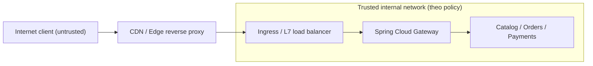
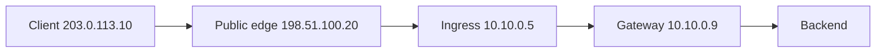
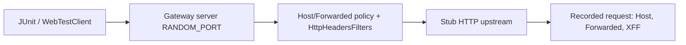

# Kiểm soát Host, Forwarded và X-Forwarded-* trong Spring Cloud Gateway

Một request HTTP đi qua CDN, reverse proxy, ingress hoặc load balancer thường **không giữ nguyên toàn bộ thông tin kết nối ban đầu**. Client truy cập `https://api.example.com/api/orders` nhưng Spring Cloud Gateway có thể nhận kết nối nội bộ từ `10.20.0.5:8080` bằng HTTP. Proxy phía trước gửi thêm `Forwarded` hoặc `X-Forwarded-*` để mô tả địa chỉ client, host, scheme và port công khai. Những thông tin đó rất hữu ích cho redirect, audit và rate limiting, **nhưng cũng là đầu vào có thể bị giả mạo** nếu ranh giới tin cậy không được kiểm soát.

Một lỗ hổng thường không nằm ở một thuật toán mật mã phức tạp. Nó có thể bắt đầu từ:

```http
GET /reset-password HTTP/1.1
Host: account-attacker.example.test
X-Forwarded-Host: account-attacker.example.test
X-Forwarded-Proto: https
X-Forwarded-For: 127.0.0.1
```

Nếu ứng dụng lấy các header này làm URL khôi phục mật khẩu, nhận diện địa chỉ IP “nội bộ” hoặc bỏ qua quota, request đó có thể dẫn tới **Host header poisoning, open redirect, cache poisoning, sai log truy vết hoặc bypass giới hạn theo IP**. Đối với API Gateway đứng trước microservices, tác động có thể lan tới nhiều service cùng lúc.

Bài thuộc chương **Gia cố bảo mật** của module `SPRING_CLOUD_GATEWAY`. Dựa trên phạm vi module: Gateway định tuyến bằng route predicate/filter chain, sửa đường dẫn và header, khám phá service, xác thực, giới hạn lưu lượng, circuit breaker, retry, TLS và quan sát request. Chủ đề trực tiếp của bài là **Kiểm soát Host, Forwarded và X-Forwarded-***: phân biệt thông tin HTTP do client gửi với metadata proxy đã được kiểm chứng, xác định proxy nào được tin và bảo vệ các quyết định an ninh dựa vào host/IP/scheme.

**Kết quả học tập:**

1. Hiểu `Host`/HTTP/2 `:authority`, `Forwarded` theo RFC 7239 và họ `X-Forwarded-*`.
2. Phân biệt **địa chỉ peer TCP** với **địa chỉ client thực đã được xác minh**.
3. Xây dựng **trusted proxy boundary**, làm sạch header ngoài biên và kiểm soát direct access tới Gateway.
4. Tách chức năng `ForwardedHeaderTransformer` của Spring WebFlux khỏi `ForwardedHeadersFilter` và `XForwardedHeadersFilter` của Gateway.
5. Cấu hình allowlist hostname, forwarding ở edge NGINX/Kubernetes, và các Gateway header filters đúng biến thể/phiên bản.
6. Ngăn Host poisoning, redirect và cache poisoning; không dùng header chưa tin cậy để quyết định JWT, IP allowlist hoặc rate-limit key.
7. Kiểm thử host giả, nhiều header mâu thuẫn, proxy chain, HTTPS redirect, WebSocket, CORS và các tình huống lỗi.

> **Phạm vi kỹ thuật:** Ví dụ chính dùng **Spring Cloud Gateway Server WebFlux**. Tên config `spring.cloud.gateway.server.webflux.*` phù hợp họ Gateway mới (tài liệu 5.1.0); các nhánh 4.x cũ và **Server Web MVC** có namespace/bộ lọc khác. Đối chiếu tài liệu Spring Cloud Gateway và Spring Framework của **đúng version đã deploy**, nhất là cấu trúc forwarded-header transformer và trusted-proxies. Những hostname/IP trong bài dùng cho minh họa; code phải được build, thử qua proxy thật và security review trước production.

## 1. Mô hình đe dọa: Gateway tin ai?

Trước tiên xác định đường đi request:



Trust boundary không thể vẽ chỉ bằng một hình chữ nhật “internal network”. Cần kiểm tra **kết nối thực sự tới Gateway có bị giới hạn vào những proxy được quản lý** hay không; một pod khác trong cluster hoặc một NodePort bị mở nhầm có thể truy cập Gateway trực tiếp.

### 1.1. Ba nguồn thông tin khác nhau

| Nguồn | Ví dụ | Mức độ tin cậy |
| --- | --- | --- |
| **Transport peer** | TCP peer `10.20.0.5` (Ingress). | Biết ai kết nối trực tiếp ở tầng transport, nhưng chưa chắc là end user. |
| **Client-supplied HTTP headers** | `Host`, `Forwarded`, `X-Forwarded-For` do client tự đặt. | **Không đáng tin theo mặc định**. |
| **Trusted edge metadata** | Các giá trị do proxy đã xác minh/ghi đè sau khi lọc input. | Có thể dùng theo **chính sách trust + network isolation + parser chuẩn**. |

Một header có tên bắt đầu bằng `X-` **không** có nghĩa nó do hạ tầng nội bộ tạo. Một mTLS connection tới proxy đáng tin cũng **không chứng minh** nội dung header client-origin đã được proxy vệ sinh; cần cả chính sách xử lý header.

### 1.2. Tài sản cần bảo vệ

- Hostname của các API/public login callback.
- Đường dẫn password reset/magic link/invitation/email verification.
- Giới hạn request theo user/tenant/IP và IP allowlists.
- Quy tắc phân route nội bộ và route quản trị.
- JWT issuer/audience, OAuth2 redirect URI, cookie origin.
- Cache keys tại CDN/proxy và các backend.
- Audit logs, metrics, threat detection, incident correlation.
- Dữ liệu cá nhân và bí mật trong headers.

**Không dùng một header đơn lẻ làm bằng chứng “người dùng đang ở mạng nội bộ” hoặc “request đến qua HTTPS” nếu chưa truy được gốc tin cậy.**

## 2. Header `Host` là gì và HTTP/2 `:authority` liên quan thế nào?

Trong HTTP/1.1, `Host` xác định authority/virtual host của request:

```http
GET /api/catalog/products/42 HTTP/1.1
Host: api.example.com
```

Ở HTTP/2, pseudo-header `:authority` mang authority tương ứng:

```text
:method: GET
:scheme: https
:authority: api.example.com
:path: /api/catalog/products/42
```

HTTP implementation/proxy có thể chuyển đổi thông tin authority giữa protocol versions. **Đừng viết security check chỉ dựa vào việc raw `Host` xuất hiện trong một packet HTTP/1.1** rồi giả định HTTP/2 không còn host poisoning.

### 2.1. Host không phải danh tính user

`Host=api.example.com` giúp chọn virtual host/route, không xác thực ai đang gọi. Một attacker có thể gửi Host hợp lệ và không có JWT; cũng có thể gửi một Host khác nếu edge không chặn.

`Host` không thay:
- OAuth2 Resource Server JWT verification.
- mTLS client identity.
- Backend authorization.
- Tenant ownership checks.

### 2.2. Host header có thể đi kèm port

```text
Host: api.example.com
Host: api.example.com:443
Host: api.staging.example.com:8443
Host: [2001:db8::1]:8443
```

Nếu viết allowlist, phân tích authority bằng HTTP library thay vì `split(":")` tự chế. IPv6 chứa nhiều dấu `:`; port có thể bị bỏ hoặc có giá trị không hợp lệ. Nên kiểm tra hostname được chuẩn hóa, port được phép theo môi trường và đích protocol.

### 2.3. Case, trailing dot, IDN và wildcard

Hostname trong DNS có so sánh không phân biệt hoa/thường, nhưng điều đó không có nghĩa mọi chuỗi gần giống nhau đều hợp lệ. Cần quyết định rõ cách xử lý:

- `API.EXAMPLE.COM`.
- `api.example.com.` có dấu chấm cuối.
- Internationalized Domain Names (IDNA/Punycode).
- `api.example.com.attacker.test`.
- `attacker-api.example.com`.
- Ký tự Unicode confusable.
- Port 80/443/8443 không đúng policy.
- Multiple Host headers hoặc mâu thuẫn `Host` với `:authority`.

**Allowlist nên dựa trên giá trị authority đã được HTTP parser chuẩn hóa và chỉ cho phép những hostname/port cụ thể**, không dùng `contains("example.com")` hoặc `endsWith("example.com")` thiếu boundary check.

## 3. Phân biệt `Forwarded` và `X-Forwarded-*`

`Forwarded` là header chuẩn hóa bởi **RFC 7239**. Họ `X-Forwarded-*` là các quy ước thực tế được dùng rộng rãi, không phải một header duy nhất có schema chuẩn chung cho mọi proxy.

| Tên | Dữ liệu mô tả | Cách sử dụng điển hình |
| --- | --- | --- |
| `Host` | Authority mà HTTP request mang. | Virtual host, route predicate, URL generation sau validation. |
| `Forwarded` | Danh sách `for`/`by`/`host`/`proto` theo proxy hops. | Bảo tồn client/scheme/host khi qua proxy chain. |
| `X-Forwarded-For` | Danh sách IP của client/proxy chain. | Audit, anti-abuse, IP allowlist **sau trust resolution**. |
| `X-Forwarded-Host` | Host ban đầu hoặc danh sách host theo proxy convention. | Public URL/redirect, nếu edge kiểm soát. |
| `X-Forwarded-Proto` | External scheme, ví dụ `https`. | Tạo HTTPS redirect/cookie policy theo public origin. |
| `X-Forwarded-Port` | Cổng public, ví dụ `443`. | Absolute URL/callback khi port đặc biệt. |
| `X-Forwarded-Prefix` | External URL prefix, ví dụ `/api`. | Mô hình path phía ngoài, không tự thực hiện rewrite. |
| `X-Real-IP` | Một giá trị client IP theo proxy convention. | Chỉ dùng nếu provenance được tin cậy. |
| `Via` | Thông tin qua proxy theo HTTP semantics khác. | Diagnosing proxies, **không** thay forwarded trust. |

Một request có thể chứa cả `Forwarded` và `X-Forwarded-*`, **thậm chí mâu thuẫn**. Phải chọn nguồn được công nhận theo hợp đồng hạ tầng, không tự lấy giá trị có vẻ thuận tiện hơn.

## 4. Cú pháp RFC 7239 cần hiểu đúng

Một `Forwarded` element gồm các cặp tham số phân cách bằng dấu `;`, nhiều elements phân cách bằng dấu `,`.

```http
Forwarded: for=203.0.113.10;proto=https;host=api.example.com
```

Khi có hai proxy:

```http
Forwarded: for=203.0.113.10;proto=https;host=api.example.com,
           for=198.51.100.20;proto=http;host=api.example.com
```

Bốn tham số chuẩn:

- `for`: node đã gọi vào proxy.
- `by`: interface của proxy nhận request.
- `host`: Host mà proxy nhìn thấy.
- `proto`: protocol/scheme mà proxy nhận.

Một proxy có thể append element mới hoặc bỏ các headers nhận được; việc bảo tồn chain **không bắt buộc** ở mọi hop.

### 4.1. IPv6 và dấu quote

```http
Forwarded: for="[2001:db8::1234]";proto=https;host="api.example.com:443"
```

Dấu hai chấm và ngoặc IPv6 yêu cầu đúng quoted-string grammar trong RFC. Không tách chuỗi bằng `split(",")` hoặc `split(";")` rồi bỏ qua quoted strings, escaping, duplicate fields, multiple header lines và các giá trị `unknown`/obfuscated identifiers.

### 4.2. `for=unknown` không phải IP lỗi để tự đổi thành 127.0.0.1

```http
Forwarded: for=unknown;proto=https
Forwarded: for="_hidden-client";proto=https
```

RFC cho phép node identifier không phải một địa chỉ IP thực. Nếu chính sách yêu cầu IP đáng tin mà giá trị không thể suy ra an toàn, nên **fail closed hoặc dùng identity khác**; không mặc định một giá trị IP nội bộ.

### 4.3. `Forwarded` không có integrity tự thân

RFC 7239 không ký số headers. Nó mô tả thông tin nhưng **không chứng minh** proxy nào đặt chúng. Integrity phụ thuộc edge sanitization, network controls, proxy identity và cách parse.

## 5. Những kiểu tấn công Host/Forwarded phổ biến

| Kiểu tấn công | Input giả | Hậu quả tiềm năng |
| --- | --- | --- |
| **Host header poisoning** | `Host: attacker.example.test`. | Tạo absolute URL/redirect chứa domain của attacker. |
| **X-Forwarded-Host poisoning** | `X-Forwarded-Host: attacker.example.test`. | Bỏ qua Host allowlist nếu app tin XFH hơn Host. |
| **Password reset poisoning** | Public reset link lấy host từ request. | Nạn nhân nhận link tới domain attacker. |
| **Web cache poisoning** | Cache key không tính host nhưng response tạo URL theo host. | Người khác nhận nội dung/redirect bị đầu độc. |
| **IP spoofing via XFF** | `X-Forwarded-For: 127.0.0.1`. | Né IP allowlist/rate limiter nếu gateway tin raw XFF. |
| **Scheme confusion** | `X-Forwarded-Proto: http` trên HTTPS public. | Redirect sai, cookie/secure-origin logic sai. |
| **Prefix confusion** | `X-Forwarded-Prefix: /admin` tùy ý. | URL/path policy bị thay đổi bất ngờ. |
| **Proxy chain confusion** | Nhiều Forwarded/XFF elements mâu thuẫn. | Lấy sai IP hoặc host từ một hop không tin cậy. |
| **Virtual host bypass** | Host khớp internal vhost. | Chuyển vào route nội bộ nếu edge không giới hạn host. |
| **Log/metric poisoning** | Header chứa chuỗi dài/đặc biệt. | Log sai, high cardinality, phát tán dữ liệu giả. |

Đây là các **threat scenarios để học phòng vệ**. Mức độ khai thác thật phụ thuộc cách proxy và ứng dụng xử lý header; một request lạ chưa tự chứng minh tồn tại lỗ hổng.

### 5.1. Ví dụ password reset URL nguy hiểm

Mẫu tư duy cần tránh:

```java
// KHÔNG DÙNG: raw Host hoặc forwarded host là dữ liệu client có thể sửa.
String resetUrl = requestHostFromHeaders + "/reset?token=" + resetToken;
```

Phương án tốt là dùng **public base URL được cấu hình sẵn và allowlist** theo environment/tenant đã được xác minh:

```properties
app.public-base-url=https://accounts.example.com
```

Sau đó:
- Link reset được build từ base URL trusted config.
- Token có hạn dùng/ngữ cảnh, không log vào access logs.
- Không dùng raw request Host/XFH làm nguồn redirect chính.
- Test Host poisoning không làm thay đổi link được gửi.

### 5.2. Cache poisoning do thay host

Nếu CDN cache response cho `/login` theo path nhưng Gateway tạo `Location` hoặc HTML meta links từ `X-Forwarded-Host` giả, kẻ tấn công có thể làm response xấu được cache cho người khác. Phải kết hợp **Host validation** và **cache key semantics**, không chỉ chỉnh `Cache-Control`.

## 6. Vạch rõ “first trusted edge”

Giả sử topology:



Các địa chỉ thuộc dải tài liệu và là ví dụ minh họa.

Mấu chốt là **đâu là proxy đầu tiên do tổ chức kiểm soát nhận input Internet**. Proxy đó phải:

1. Chặn/viết đè `Forwarded` và **toàn bộ** `X-Forwarded-*` mà Internet client tự gửi.
2. Chọn/validate Host/SNI/public domain theo allowlist.
3. Tạo metadata client IP, external scheme/host/port từ **nguồn đã xác minh**.
4. Giới hạn requests malformed, quá nhiều header/size.
5. Chỉ đưa request tới Gateway qua đường network được phép.

Các proxies nội bộ có thể append thông tin hop **chỉ khi phần chain trước đã được làm sạch ở edge**. Một trust policy chỉ tồn tại trong code Gateway mà ingress vẫn chuyển nguyên XFF client gửi là **chưa đủ**.

### 6.1. Direct access phá vỡ trust model

Nếu client bỏ qua CDN/Ingress và kết nối thẳng tới Gateway qua public NodePort:

```text
Internet client → Gateway:8080
Forwarded: for=127.0.0.1;proto=https;host=api.example.com
```

Gateway có thể nhìn header “như từ proxy” dù TCP peer thực là attacker. **Network isolation, ingress-only Service/NetworkPolicy và authentication hop** phải được cấu hình; đừng kỳ vọng regex `trusted-proxies` sửa mọi đường bypass.

### 6.2. Mỗi hop cần hợp đồng

| Điểm | Đầu vào được tin | Xử lý header | Đầu ra |
| --- | --- | --- | --- |
| **Public Edge** | TCP peer client, SNI/Host sau validation. | Strip incoming forwarded metadata; tạo canonical values. | Một chain sạch từ biên. |
| **Ingress nội bộ** | Peer Edge trong allowlist. | Append đúng thông tin hop, giới hạn headers. | Chain có provenance kiểm soát. |
| **Gateway** | Peer Ingress + metadata theo trust config. | Normalize, apply routing/security, outbound header policy. | Chỉ forwarded metadata được phép đến backend. |
| **Backend** | Peer Gateway/mesh được phép. | Không trust header ngoài hợp đồng; xác thực identity riêng. | Audit/redirect/business decisions đúng. |

## 7. Xác định IP client: peer TCP khác X-Forwarded-For

Giả sử:

```http
X-Forwarded-For: 203.0.113.10, 198.51.100.20
```

Gateway nhận TCP từ `10.10.0.5`. Những giá trị có nghĩa:

- `getRemoteAddress()` ở transport có thể là ingress `10.10.0.5`.
- `203.0.113.10` có thể là client.
- `198.51.100.20` có thể là CDN/edge.
- Nhưng **không có bằng chứng nào chỉ từ text của header** rằng các IP này là thật.

Một nguyên tắc an toàn: bắt đầu từ **peer transport đáng tin cuối cùng**, kiểm tra chain với danh sách các hops proxy được tin và dừng tại hop không tin cậy đầu tiên. Cách chọn “phần tử thứ nhất” chỉ đúng khi edge đã scrub đầu vào; nếu một proxy không giữ quy tắc, attacker có thể chèn thêm phần tử ở đầu.

### 7.1. Không dùng regex bất kỳ làm bộ phân tích IPv4

`X-Forwarded-For` là danh sách có thể chứa whitespace, IPv6, nhiều headers và giá trị sai. Không tự viết:

```java
// KHÔNG AN TOÀN làm nguồn xác thực IP:
String ip = exchange.getRequest().getHeaders()
    .getFirst("X-Forwarded-For")
    .split(",")[0];
```

Không được xem `"127.0.0.1"` hoặc một dải `10.0.0.0/8` do client khai là danh tính network.

### 7.2. `XForwardedRemoteAddressResolver` của Gateway WebFlux

Một số phiên bản Gateway Server WebFlux có `XForwardedRemoteAddressResolver` để xử lý `RemoteAddr` predicate dựa trên `X-Forwarded-For`:

- `trustAll()` chọn IP đầu tiên và **dễ bị giả mạo** nếu headers từ Internet không được làm sạch.
- `maxTrustedIndex(n)` chọn vị trí theo **số proxy hops đáng tin** được giả định, không phải xác thực CIDR/signature tự động.

Ví dụ theo mô hình một proxy đã được đảm bảo:

```java
import org.springframework.cloud.gateway.support.ipresolver.XForwardedRemoteAddressResolver;

var resolver = XForwardedRemoteAddressResolver.maxTrustedIndex(1);
```

Đây chỉ là **fragment logic**: cần gắn `resolver` vào route predicate theo Java route DSL đúng phiên bản. Số `1` chỉ phù hợp khi topology có đúng **một** hop trusted phía trước; với CDN + Ingress có thể cần chính sách khác. Không chọn `maxTrustedIndex(99)` với mong muốn “càng tin nhiều càng an toàn”.

### 7.3. Điều gì xảy ra khi hop count thay đổi?

Khi chuyển từ một ingress trực tiếp sang CDN + ingress, `maxTrustedIndex(1)` có thể không còn chọn client IP; nó có thể chọn CDN. Nếu attacker được phép tạo một XFF element ở đầu và edge không scrub, index cấu hình sai còn có thể chọn địa chỉ giả.

Vì vậy test client-IP resolution phải nằm trong **change checklist của topology**, không chỉ test lúc viết code một lần.

## 8. Host allowlist: chính sách an toàn ở nhiều tầng

**Phòng tuyến đầu:** edge nhận yêu cầu cho những public hostnames được quản lý, ví dụ:

```text
Allowed:
  api.example.com
  api.staging.example.com

Rejected:
  api.example.com.attacker.test
  attacker-api.example.com
  internal-admin.local
  unknown.example.com
```

Một allowlist đúng cần:
- Exact hostname hoặc wildcard được xét theo segment boundary.
- Kiểm tra port/SNI khi policy cần.
- Xử lý IDNA/Punycode/case/trailing dot có chủ đích.
- Chặn host header trùng, malformed hoặc conflicting authority theo HTTP stack.
- Chặn default vhost forward vào Gateway cho unknown hosts.
- Cấu hình policy riêng cho health probes/management listener.

### 8.1. `Host` Route Predicate chỉ chọn route

Trong Gateway Server WebFlux, `Host` predicate lấy các host patterns và so sánh với Host request:

```yaml
spring:
  cloud:
    gateway:
      server:
        webflux:
          routes:
            - id: orders-public
              uri: lb://order-service
              predicates:
                - Host=api.example.com
                - Path=/api/orders/**
```

Nó giúp **route matching**, không đồng nghĩa ứng dụng đã có “hostname firewall”. Nếu có route khác `Path=/**` không kiểm tra Host, một unknown host có thể được route. Nếu request đã bị spoofed forwarded metadata biến đổi cách nhìn host, cần hiểu transformer/filter order.

**Host predicate không thay edge allowlist, SNI policy hoặc authentication.**

### 8.2. Hành vi với unknown host

Tầng edge nên có **default virtual host** từ chối hostname không nằm trong allowlist. Tùy controller/proxy, status có thể là `400`, `403`, `404` hoặc `421 Misdirected Request`; đừng giả định một mã chung cho mọi implementation. Điều cần chứng minh là **không forward vào privileged route**.

## 9. Ví dụ WebFlux `WebFilter` như lớp phòng vệ bổ sung

Có thể đặt một WebFlux WebFilter kiểm tra host trên request đã đi qua policy proxy được kiểm soát:

```java
package com.example.gateway.security;

import java.net.InetSocketAddress;
import java.util.Locale;
import java.util.Set;

import org.springframework.context.annotation.Bean;
import org.springframework.context.annotation.Configuration;
import org.springframework.core.Ordered;
import org.springframework.core.annotation.Order;
import org.springframework.http.HttpStatus;
import org.springframework.web.server.WebFilter;

@Configuration
public class PublicHostPolicy {

    private static final Set<String> ALLOWED_HOSTS =
        Set.of("api.example.com", "api.staging.example.com");

    @Bean
    @Order(Ordered.HIGHEST_PRECEDENCE)
    WebFilter knownPublicHostOnly() {
        return (exchange, chain) -> {
            InetSocketAddress host =
                exchange.getRequest().getHeaders().getHost();

            if (host == null) {
                exchange.getResponse().setStatusCode(
                    HttpStatus.BAD_REQUEST);
                return exchange.getResponse().setComplete();
            }

            String name = host.getHostString()
                .toLowerCase(Locale.ROOT);

            if (!ALLOWED_HOSTS.contains(name)) {
                exchange.getResponse().setStatusCode(
                    HttpStatus.BAD_REQUEST);
                return exchange.getResponse().setComplete();
            }

            return chain.filter(exchange);
        };
    }
}
```

**Giới hạn quan trọng:**

- Đây là **phòng vệ bổ sung**, không thay proxy-sanitization và network isolation; WebFilter cũng nhìn request đã được WebFlux xử lý, không có quyền phân tích mọi malformed HTTP framing.
- Nếu `ForwardedHeaderTransformer` đã dùng metadata giả để sửa request view, app-level allowlist vẫn có thể bị đầu độc. Phòng tuyến edge mới là chính.
- Cấu hình này áp cho mọi WebFlux request cùng application context: kube health probe dùng `Host: 127.0.0.1` có thể bị chặn. Cần listener/management port riêng hoặc policy phù hợp cho internal health checks.
- Nếu public API dùng custom port/hostname alias, đưa chúng vào policy theo contract và kiểm thử.
- Một policy stricter có thể kiểm tra port, SNI/Host consistency và security events tại ingress; sample không thay tất cả các bước đó.

### 9.1. Sai lầm khi dùng wildcard

```java
// KHÔNG an toàn cho chính sách host:
boolean allowed = host.toLowerCase().contains("example.com");
```

Chuỗi `attacker-example.com.evil.test` cũng chứa `example.com`. Nếu cần subdomains, viết parser/allowlist theo đúng DNS label boundary hoặc dùng thành phần proxy/virtual host có chức năng này.

### 9.2. Header validation không thay TLS SNI validation

TLS SNI được gửi trong handshake trước HTTP Host. Một proxy có thể terminate TLS bằng cert đúng SNI nhưng HTTP Host mang giá trị khác. Cần quyết định có từ chối mismatch hay cho phép theo chính sách (ví dụ domain aliases được quản lý). Chỉ kiểm tra certificate hợp lệ chưa chứng minh HTTP Host hợp lệ.

## 10. Spring Boot WebFlux: `server.forward-headers-strategy`

Spring Boot cung cấp cấu hình xử lý forwarded metadata ở web server/framework boundary, ví dụ:

```yaml
server:
  forward-headers-strategy: framework
```

Các lựa chọn thường gồm:

| Giá trị | Ý nghĩa khái quát | Khi nào hợp lý |
| --- | --- | --- |
| `none` | Không tự diễn giải forwarded metadata qua strategy này. | Gateway public direct hoặc không có trusted proxy metadata. |
| `native` | Để web server/adapter xử lý theo support thực tế. | Chỉ dùng khi native implementation đã được cấu hình/đối chiếu. |
| `framework` | Dùng cơ chế Spring Framework, với WebFlux có `ForwardedHeaderTransformer`. | Khi edge đã scrub headers và app cần external scheme/host. |

**Bật `framework` không khiến các header tự nhiên trở thành đáng tin.** Spring Framework nhấn mạnh ứng dụng không thể tự biết header do trusted proxy hay malicious client gửi nếu không có trust boundary phía trước.

### 10.1. `ForwardedHeaderTransformer` làm gì?

Trong WebFlux, transformer có thể:
- Sử dụng `Forwarded` hoặc `X-Forwarded-*` để sửa URI/host/port/scheme trên request view, theo version.
- Xử lý prefix nếu có cấu hình hỗ trợ.
- Loại các forwarded headers sau xử lý để giảm việc dùng lại không kiểm soát.
- Hoạt động sớm khi xây dựng request/exchange, **trước nhiều Gateway filters**.

Do vậy `exchange.getRequest().getURI()` sau transformer có thể phản ánh **external URL** thay vì connection URI nội bộ. Điều này hữu ích cho redirect nhưng nguy hiểm nếu nguồn header chưa được edge chứng thực.

### 10.2. `removeOnly`: bỏ qua input mà không tin metadata

Spring Framework hỗ trợ chế độ **chỉ xóa forwarded headers**:

```java
import org.springframework.context.annotation.Bean;
import org.springframework.web.server.adapter.ForwardedHeaderTransformer;

// Fragment minh họa cho WebFlux; đăng ký tên bean đúng
// khi framework version/hạ tầng chấp nhận bean tùy chỉnh.
@Bean(name = "forwardedHeaderTransformer")
ForwardedHeaderTransformer forwardedHeaderTransformer() {
    ForwardedHeaderTransformer transformer =
        new ForwardedHeaderTransformer();

    transformer.setRemoveOnly(true);
    return transformer;
}
```

Đây là **fragment dành cho trường hợp ứng dụng không muốn dùng forwarded metadata**. Tùy Spring Framework version, constructor/API/đăng ký bean có thể thay đổi; cần kiểm tra. Nếu ứng dụng cần external scheme/host để redirect, `removeOnly` có thể khiến URL lại dùng internal HTTP origin — nên hãy thiết kế request origin policy rõ, không bật/tắt mù quáng.

### 10.3. Tránh xung đột cấu hình

Không vừa bật một native forwarded handler vừa đăng ký transformer thủ công mà không biết thứ tự/nguồn nào được dùng. Không giả định tên `server.forward-headers-strategy` và Gateway `trusted-proxies` là cùng một cơ chế; chúng có scope khác nhau.

**Phải kiểm tra** effective request URI, Host và outbound headers trên đúng version khi dùng cả Spring Boot và Spring Cloud Gateway filters.

## 11. Gateway WebFlux: `HttpHeadersFilters` trước khi gửi xuống backend

Spring Cloud Gateway có một lớp **HttpHeadersFilter** áp dụng lên request **trước outbound routing** (ví dụ trước `NettyRoutingFilter`). Đây khác với **transformer inbound** của Spring WebFlux.

| Thành phần | Phạm vi | Vấn đề nó giải quyết |
| --- | --- | --- |
| `ForwardedHeaderTransformer` | Request vào WebFlux/framework boundary. | Diễn giải hoặc xóa forwarded metadata trong request view. |
| `ForwardedHeadersFilter` (Gateway) | Headers của request đi tới backend. | Tạo/bổ sung `Forwarded` theo Gateway routing context. |
| `XForwardedHeadersFilter` (Gateway) | Headers của request đi tới backend. | Tạo/bổ sung `X-Forwarded-For/Host/Proto/Port/Prefix`. |
| `RemoveHopByHopHeadersFilter` | Outbound headers. | Loại hop-by-hop headers như `Connection`, `Keep-Alive`, `Transfer-Encoding`. |
| `PreserveHostHeader` route filter | Ảnh hưởng Host gửi tới upstream. | Giữ original Host theo behavior của routing filter. |
| `SetRequestHostHeader` route filter | Outbound Host. | Thay Host gửi tới upstream bằng giá trị được cấu hình. |

Một lỗi phổ biến: cấu hình “forwarded” ở **Gateway outbound headers** rồi cho rằng HTTP request đã được validate ở edge hoặc local client IP đã được xác minh. **Không có quan hệ bảo đảm như vậy.**

### 11.1. Bật/tắt header filter không tự sanitize input

Ngay cả khi Gateway có tùy chọn disable forwarding, điều đó **không thay** yêu cầu edge strip untrusted `Forwarded`/`X-Forwarded-*`. Cũng không thay chuyện một WebFilter khác có thể đọc raw headers trước khi outbound routing.

### 11.2. Hop-by-hop headers

Những headers như `Connection` hoặc `Transfer-Encoding` liên quan đến một hop HTTP, không phải thông tin end-user đáng tin. Gateway có filter loại bỏ các headers này khi gửi xuống backend. Không tự tạo một header allowlist xóa mọi `Connection` một cách mù quáng trong các đường WebSocket Upgrade mà chưa kiểm tra protocol/version.

## 12. Cấu hình `trusted-proxies` theo Server WebFlux version

Tài liệu Gateway WebFlux **5.1.0** cho biết muốn kích hoạt các HTTP headers filters `Forwarded` và `XForwarded`, cấu hình một **Java regular expression** nhận diện proxies được tin trong chain:

```yaml
spring:
  cloud:
    gateway:
      server:
        webflux:
          trusted-proxies: "^10\\.20\\.0\\.5$"
          forwarded:
            enabled: true
          x-forwarded:
            enabled: true
```

**Đây là ví dụ mô hình dùng một proxy duy nhất với IP cố định `10.20.0.5`**, không phải cấu hình production cho một Kubernetes cluster có proxy IP thay đổi. Regex trong YAML double-quoted phải escape backslash đúng; `"^10\\.20\\.0\\.5$"` biểu diễn regex literal dấu chấm sau khi YAML parse. Kiểm tra config-binding thực tế với version sử dụng.

### 12.1. Ý nghĩa của `trusted-proxies`

- Đây là một **Java regex**, không phải CIDR parser: `10.20.0.0/16` không tự biến thành match dải IP.
- Phải xác định IP proxy thực tế và scope mà Gateway implementation dùng regex.
- Regex quá rộng như `.*` gần như mất ý nghĩa ranh giới trust.
- Regex cần được anchored và xử lý IPv6/ports đúng theo metadata format.
- **Không thể chỉ đặt property rồi suy rằng mọi nguồn HTTP được xác thực.** NetworkPolicy và first-edge sanitization vẫn bắt buộc.

Các APIs defaults và cách filter kích hoạt có thể khác giữa 4.1, 4.3 và 5.x. Với nhánh cũ tài liệu có `spring.cloud.gateway.trusted-proxies`; đừng copy thẳng vào server namespace mới và ngược lại.

### 12.2. Enable khác Append

Trong WebFlux 5.1 config properties có các tùy chọn:

| Config suffix | Ý nghĩa |
| --- | --- |
| `x-forwarded.for-enabled` | Có tạo `X-Forwarded-For` đi backend hay không. |
| `x-forwarded.host-enabled` | Có tạo `X-Forwarded-Host` không. |
| `x-forwarded.proto-enabled` | Có tạo `X-Forwarded-Proto` không. |
| `x-forwarded.port-enabled` | Có tạo `X-Forwarded-Port` không. |
| `x-forwarded.prefix-enabled` | Có tạo `X-Forwarded-Prefix` không. |
| `x-forwarded.for-append` | Append vào giá trị hiện có thay vì replace theo filter semantics. |
| `x-forwarded.host-append` | Append host values. |
| `x-forwarded.proto-append` | Append proto values. |
| `x-forwarded.port-append` | Append port values. |
| `x-forwarded.prefix-append` | Append prefix values. |

**`*-enabled` và `*-append` là hai trục khác nhau**. Tài liệu metadata có default `true` cho các toggles này khi filter hoạt động. Vì vậy không nên mặc định “header cũ bị xóa trước khi Gateway thêm mới”: một phần của chain có thể được append.

### 12.3. Ví dụ chọn replace thay vì append ở một hop đã được thiết kế

```yaml
spring:
  cloud:
    gateway:
      server:
        webflux:
          x-forwarded:
            for-append: false
            host-append: false
            proto-append: false
            port-append: false
            prefix-append: false
```

**Không khuyến nghị bật nguyên khối ví dụ này trong mọi topology.** Nó có thể làm mất chuỗi proxy chain có giá trị cho audit/trust nếu Gateway cần truyền nhiều hops. Để vận hành an toàn, trước tiên xác định canonical metadata ở edge, rồi quyết định append/replace tại **từng hop** và test backend nhận gì.

## 13. Không trộn cấu hình WebFlux với Server Web MVC

Hai biến thể Gateway cùng có chức năng Forwarded, nhưng **namespace khác**:

| Cấu hình | WebFlux nhánh mới | Server Web MVC nhánh mới |
| --- | --- | --- |
| Trusted proxy regex | `spring.cloud.gateway.server.webflux.trusted-proxies`. | `spring.cloud.gateway.server.webmvc.trusted-proxies`. |
| Bật outbound forwarded filter | `...server.webflux.forwarded.enabled`. | `...server.webmvc.forwarded-request-headers-filter.enabled`. |
| Bật outbound x-forwarded filter | `...server.webflux.x-forwarded.enabled`. | `...server.webmvc.x-forwarded-request-headers-filter.enabled`. |
| Key API trong custom filters | Reactive `ServerWebExchange`. | Servlet `ServerRequest`/WebMvc.fn. |
| Spring Security chain | Reactive `SecurityWebFilterChain`. | Servlet `SecurityFilterChain`. |

Mẫu WebFlux Java filter trong bài **không dùng trực tiếp** trong MVC. Cũng không copy `WebFilter`/`ForwardedHeaderTransformer` của WebFlux sang Servlet request lifecycle mà chưa kiểm tra tương đương `ForwardedHeaderFilter`/native behavior.

### 13.1. Tách “framework forwarded request” và “Gateway outbound forwarded”

Trong MVC, Spring MVC/Servlet có cơ chế forwarded request handling riêng. Spring Cloud Gateway Server MVC cũng có request header filters riêng. **Cùng tên Forwarded không có nghĩa class, order và enable properties giống nhau**.

Bởi vậy, khi ứng dụng dùng **Gateway Server Web MVC**, phải kiểm tra `SecurityFilterChain` và Servlet request filters của MVC riêng; không dùng `WebFilter`/`SecurityWebFilterChain` reactive ở ví dụ Server WebFlux này.

## 14. NGINX edge: mẫu làm sạch headers từ Internet

Một reverse proxy đầu tiên chịu trách nhiệm **chặn Host không được phép** và **ghi đè forwarded values**. Ví dụ NGINX chỉ nhận public `api.example.com` trên HTTPS:

```nginx
# Fragment: đặt trong http{} của NGINX tại first trusted edge.
upstream gateway_http {
    server edge-gateway.internal:8080;
    keepalive 32;
}

# Từ chối hostname không được khai báo.
server {
    listen 443 ssl default_server;
    server_name _;
    ssl_certificate     /etc/nginx/certs/default-chain.pem;
    ssl_certificate_key /etc/nginx/certs/default-key.pem;
    return 421;
}

server {
    listen 443 ssl;
    server_name api.example.com;

    ssl_certificate     /etc/nginx/certs/api-chain.pem;
    ssl_certificate_key /etc/nginx/certs/api-key.pem;

    location / {
        proxy_pass http://gateway_http;
        proxy_http_version 1.1;
        proxy_set_header Connection "";
        proxy_http_version 1.1;

        # Edge này là first controlled HTTP proxy, trực tiếp nhận client.
        # Không append XFF bẩn từ Internet.
        proxy_set_header Host              api.example.com;
        proxy_set_header X-Forwarded-Host  api.example.com;
        proxy_set_header X-Forwarded-Proto https;
        proxy_set_header X-Forwarded-Port  443;
        proxy_set_header X-Forwarded-For   $remote_addr;

        # Bỏ standard Forwarded/prefix do client tự khai.
        proxy_set_header Forwarded "";
        proxy_set_header X-Forwarded-Prefix "";

        proxy_connect_timeout 3s;
        proxy_read_timeout 60s;
        proxy_send_timeout 60s;
    }
}
```

**Rất quan trọng:**

- Mẫu này giả định NGINX là **first HTTP edge trực tiếp**; `$remote_addr` khi đó là địa chỉ TCP peer client. Nếu NGINX nằm sau CDN/LB, `$remote_addr` thường là CDN/LB; phải cấu hình trusted Real IP tương ứng, không thay bằng raw `$http_x_forwarded_for`.
- `server_name` và `default_server` cần hoạt động phù hợp với TLS/SNI và các listener 80/443 thật; mẫu chỉ minh họa listener 443.
- `proxy_set_header Header ""` trong NGINX thường **không chuyển** header đó ra upstream. Cần xác minh bằng recorded request của backend.
- Cố định `Host: api.example.com` trong vhost này giúp canonicalize một domain; với nhiều domains, dùng allowlist/mapping có kiểm soát, không phản chiếu Host bất kỳ.
- `proxy_pass` ở đây không có URI suffix, giúp giữ nguyên request URI theo semantics của NGINX trong `location /` này; những cách rewrite khác phải được test.
- `proxy_http_version 1.1` và bỏ `Connection` cố định trong nhánh HTTP bình thường giúp upstream keep-alive phù hợp hơn; WebSocket Upgrade cần cấu hình `Connection: upgrade`/`Upgrade` riêng theo contract.
- Với WebSocket, cần thêm HTTP/1.1 Upgrade headers và timeout thích hợp; mẫu chủ yếu minh họa **Host/Forwarded trust**, không phải config WebSocket hoàn chỉnh.

### 14.1. Vì sao không dùng `proxy_add_x_forwarded_for` ngay ở first edge?

`$proxy_add_x_forwarded_for` thường nối `$remote_addr` vào XFF đã nhận. Nếu client được phép gửi:

```http
X-Forwarded-For: 127.0.0.1
```

thì chain có thể thành `127.0.0.1, <client-ip>`. Một backend dùng “leftmost XFF = client IP” sẽ thấy địa chỉ giả. **First trusted edge nên loại đầu vào bẩn trước khi append**; ở các hop nội bộ, append sau khi chain đã sạch có thể hợp lệ.

### 14.2. Nếu NGINX đứng sau CDN

Không thể dùng ngay `$remote_addr` và kết luận đó là end user. Cần:
- Đặt CDN IP ranges đáng tin bằng cơ chế Real IP của NGINX.
- Chỉ chấp nhận header identity do CDN **cam kết set/overwrite**.
- Cập nhật các dải IP của CDN theo cách tự động có kiểm soát.
- Chặn direct-to-origin bypass qua firewall/IP allowlist/mTLS.
- Kiểm tra XFF/Forwarded được sanitize ngay ở một biên được kiểm soát.
- Test request đi qua CDN lẫn request giả lập direct-to-origin bị chặn.

Đừng cấu hình `set_real_ip_from 0.0.0.0/0` chỉ để xem đúng IP client; như thế gần như mọi peer đều được quyền tự khai identity.

## 15. Kubernetes Ingress và Host policy

Một `Ingress` trỏ domain public tới Service Gateway:

```yaml
apiVersion: networking.k8s.io/v1
kind: Ingress
metadata:
  name: edge-api
  namespace: gateway
spec:
  ingressClassName: nginx
  tls:
    - hosts:
        - api.example.com
      secretName: api-example-tls
  rules:
    - host: api.example.com
      http:
        paths:
          - path: /
            pathType: Prefix
            backend:
              service:
                name: edge-gateway
                port:
                  number: 80
```

Đây là **bộ quy tắc routing**, không phải toàn bộ security policy. Cần kiểm tra:

1. Controller đã thực sự chọn ingress class này.
2. Default/fallback virtual host có từ chối unknown hosts không.
3. TLS secret/certificate SAN/SNI có đúng không.
4. Proxy có strip/overwrite `Forwarded`/`X-Forwarded-*` từ Internet không.
5. Cloud LB/CDN phía trước làm thay đổi client IP/Host như thế nào.
6. Gateway Service có bị expose trực tiếp qua NodePort/LoadBalancer ngoài ý muốn không.
7. NetworkPolicy chỉ cho phép traffic từ ingress/controller đúng namespace.
8. Actuator management endpoints không public qua catch-all path `/`.

### 15.1. NetworkPolicy là một lớp kiểm soát, không phải giả định

Kubernetes NetworkPolicy chỉ có hiệu lực khi CNI thực thi và pod selectors/IP policy đúng. Một ingress controller chạy với `hostNetwork` hoặc một cloud LB với source IP đặc biệt có thể thay đổi cách policy nhìn traffic.

**Thử kết nối thật** từ pod được phép và pod không được phép, không chỉ kiểm tra YAML đã có `NetworkPolicy`.

### 15.2. Thay ingress controller có thể đổi header semantics

ingress-nginx, cloud ALB, Traefik, HAProxy và service mesh không dùng chung mọi annotation hoặc chính sách XFF. Nếu đổi controller, phải kiểm tra lại:
- Nguồn client IP.
- Host preservation.
- X-Forwarded-Proto/Port.
- Forwarded standard header.
- TLS termination/reencryption.
- Redirect/cookies/CORS.
- WebSocket/SSE behavior.

## 16. PreserveHostHeader và SetRequestHostHeader không phải bộ lọc bảo mật đầu vào

Gateway WebFlux có hai route filters thường liên quan Host:

### 16.1. `PreserveHostHeader`

```yaml
spring:
  cloud:
    gateway:
      server:
        webflux:
          routes:
            - id: public-catalog
              uri: https://catalog.internal.example
              predicates:
                - Path=/api/catalog/**
              filters:
                - PreserveHostHeader
```

Filter này yêu cầu routing filter **giữ Host đầu vào** khi gửi tới upstream, thay vì Host xác định theo target HTTP client. Nó **không xác thực** Host đầu vào.

Chỉ dùng khi backend **cần public Host** và edge đã validate/canonicalize host trước Gateway. Nếu backend thực tế cần `catalog.internal.example` để virtual-host routing, PreserveHostHeader có thể làm backend chọn sai virtual host.

### 16.2. `SetRequestHostHeader`

```yaml
spring:
  cloud:
    gateway:
      server:
        webflux:
          routes:
            - id: private-catalog
              uri: https://catalog.internal.example
              predicates:
                - Path=/api/catalog/**
              filters:
                - name: SetRequestHostHeader
                  args:
                    host: catalog.internal.example
```

Filter này thay Host trong **request gửi xuống backend** bằng giá trị được cấu hình. Nó hữu ích khi backend cần một Host cố định, nhưng cũng **không** tự từ chối unknown Host ở public entrypoint.

### 16.3. Bảng quyết định

| Yêu cầu backend | Lựa chọn có thể hợp lý |
| --- | --- |
| Backend cần host đích nội bộ theo URI | Để HTTP client/Gateway quyết định Host theo target thông thường. |
| Backend cần public host đã qua validation | `PreserveHostHeader` theo route có chủ đích. |
| Backend cần hostname cố định khác với public host | `SetRequestHostHeader` với giá trị allowlisted. |
| Backend cần biết public origin để tạo links | Dùng trusted forwarded metadata hoặc base URL config, không tin raw Host. |
| Gateway cần chặn Host lạ | **Edge Host allowlist** và/hoặc WebFilter validation bổ sung. |

**Không dùng PreserveHostHeader như một “cách sửa host injection”.** Nó có thể lan giá trị Host không đáng tin đến backend nếu edge yếu.

## 17. Path prefix và các header khác: tránh nhầm ý nghĩa

`X-Forwarded-Prefix` có thể mô tả việc một upstream được publish dưới `/api` công khai, nhưng không tự động tương đương `StripPrefix` hoặc `RewritePath`.

```text
Public:   https://api.example.com/catalog/products/42
Ingress:  giữ path /catalog/products/42
Gateway:  StripPrefix=1
Backend:  /products/42
```

Nếu ingress đã rewrite path và Gateway cũng strip, route có thể không match hoặc backend nhận path sai. Nếu một attacker tự gửi `X-Forwarded-Prefix: /admin` và ứng dụng dùng nó để tính context path, có thể tạo absolute URLs sai.

**Cần phân biệt:**
- Path thật sau mỗi hop.
- Metadata về external prefix.
- Application context path.
- Security matchers.
- CORS/CSRF/cookie Path.
- Downstream redirect `Location`.

Đừng gán quyền truy cập từ `X-Forwarded-Prefix`; đó là thông tin định tuyến, không phải credential.

## 18. HTTPS redirect, OAuth2 callback và cookie security

Một Gateway sau TLS-terminating ingress có thể thấy socket vào là HTTP nhưng browser nhìn thấy HTTPS.

### 18.1. Khi scheme bị hiểu sai

```text
Public request:  https://api.example.com/login
Ingress → GW:   http://edge-gateway:8080/login
Bad redirect:    http://edge-gateway:8080/oauth2/callback
Expected:        https://api.example.com/oauth2/callback
```

Nếu app tin sai `X-Forwarded-Proto`/Host:
- Redirect downgrade từ HTTPS sang HTTP.
- OAuth2 redirect URI mismatch.
- Public callback hoặc password reset links chứa internal hostname.
- Cookie `Secure`/domain/path không đúng contract.
- CORS origin mismatch.

### 18.2. Giải pháp nguyên tắc

1. Chọn public base URL từ **trusted config/issuer registration** cho những URL nhạy cảm.
2. Ingress ghi đè external proto/host theo HTTPS listener và host allowlist.
3. Boot framework xử lý forwarded metadata **chỉ sau khi edge thực sự scrub**.
4. Test redirect `Location` có HTTPS/public host và không chứa cluster-local names.
5. Không dùng raw `X-Forwarded-Host` làm dynamic redirect target.
6. OAuth2 authorization server/client phải validate redirect URIs theo allowlist.
7. JWT audience/issuer không được suy một cách tùy tiện từ Host header.

### 18.3. TLS và mTLS không tự chữa header injection

TLS bảo vệ tính toàn vẹn giữa **hai endpoints của một kết nối**, không nói gì về việc client gửi giá trị Host/XFF sai từ đầu. Ngay cả khi Gateway nhận mTLS từ ingress, ingress vẫn phải xác minh input headers và identity chính xác.

## 19. RemoteAddr predicate, KeyResolver và rate limiting

Trong `SPRING_CLOUD_GATEWAY`, tính năng bảo vệ theo IP thường nằm ở:
- `RemoteAddr` route predicate.
- `RequestRateLimiter` key resolver theo IP/client identity.
- IP allowlist cho endpoint nhạy cảm.
- Abuse detection/WAF rules.
- Audit logs.

### 19.1. Sai lầm 1: dùng IP của ingress làm client IP

Nếu tất cả requests qua một ingress, `exchange.getRequest().getRemoteAddress()` có thể là cùng một peer IP. Một rate limit 100 RPS/IP sẽ gom mọi người thành một bucket, gây 429 diện rộng.

### 19.2. Sai lầm 2: dùng header do client giả

```java
// Không dùng trực tiếp cho KeyResolver theo IP:
String spoofable = exchange.getRequest()
    .getHeaders()
    .getFirst("X-Forwarded-For");
```

Client đổi `X-Forwarded-For` mỗi request sẽ tạo bucket mới và có thể vượt quota. Ngoài ra, header chứa list/malformed có thể tạo hàng triệu keys trong Redis.

### 19.3. Mẫu tư duy an toàn

```text
Request
  → Peer IP thuộc ingress/edge trusted sources?
      → Không: từ chối hoặc bỏ qua mọi forwarded metadata.
      → Có: dùng chain đã được scrub để suy effective client IP.
  → Ưu tiên principal/API key đã xác thực khi quota theo tài khoản.
  → Stable normalized key per user/tenant/IP policy.
  → RateLimiter/authorization nhận key đã xác minh.
```

Một user có thể có nhiều IP; nhiều user có thể chia NAT/CGNAT. Per-IP limit chỉ là lớp bảo vệ bổ sung, không thay per-user quota hoặc bot management.

### 19.4. Proxy chain đổi khi autoscaling

Nếu ingress thêm/bớt một hop hoặc bật service mesh, thuật toán `maxTrustedIndex(n)`/client IP resolution có thể đổi kết quả. Chạy regression tests sau mỗi thay đổi topology, không chỉ sau khi sửa Java code.

## 20. CORS, CSRF, JWT và Origin: cái nào được tin?

Không được nhầm `Host` với `Origin`:

- `Host`/`:authority` cho biết HTTP authority của request.
- `Origin` do browser gửi để trình bày web origin, hữu ích cho CORS/CSRF policies.
- `Referer` có thể vắng mặt/được rút gọn; không nên là identity.
- `Forwarded`/`X-Forwarded-*` mô tả proxy metadata, không phải user credential.
- `Authorization: Bearer ...` cần Spring Security xác thực chữ ký/issuer/audience/expiry.
- Cookie session cần CSRF protection khi request được authenticated theo cookie, theo threat model.

### 20.1. CORS không chống Host poisoning

CORS kiểm soát việc trình duyệt đọc response cross-origin theo policy. Nó **không** khiến server từ chối request `curl`/non-browser có Host lạ, cũng không bảo vệ email reset links nếu server dựng host từ headers.

### 20.2. JWT không nên phụ thuộc Host tự khai

Security policy có thể chọn tenant hoặc JWT audience dựa vào public hostname, nhưng chỉ khi hostname đã được **allowlist và provenance xác minh**. Không để attacker gửi Host `tenant-admin.internal` rồi khiến app chọn một issuer/tenant policy lỏng hơn.

### 20.3. WebSocket Origin khác CORS preflight

WebSocket handshake có thể mang `Origin`, nhưng không dùng CORS `OPTIONS` preflight thông thường như `fetch`. Host/Origin phải được validate theo WebSocket server/route policy; Origin cũng có thể bị giả bởi non-browser client, nên phải dùng authentication thực.

## 21. Log, trace và metric: ghi nguồn quyết định thay vì tin raw header

Một incident về forwarded headers rất khó chẩn đoán nếu log chỉ có:

```text
clientIp=127.0.0.1
host=admin.internal
```

mà không biết hai trường đến từ TCP peer, raw XFF hay nguồn đã chuẩn hóa.

Nên instrument các trường có **ngữ nghĩa rõ**:

| Trường nội bộ/log | Nguồn | Chính sách |
| --- | --- | --- |
| `peerIp` | Socket peer mà server thực nhận. | Bounded; có thể có dữ liệu cá nhân, retention cần kiểm soát. |
| `effectiveClientIp` | Trusted resolver sau edge validation. | Không log nếu không cần; có thể hash/pseudonymize. |
| `publicHost` | Canonical host đã qua allowlist. | Dùng giá trị bounded. |
| `publicScheme` | External scheme từ trusted transport/proxy. | `http`/`https` theo policy. |
| `proxyHopCount` | Chain length đã parse/validate. | Hữu ích phát hiện topo thay đổi. |
| `hostRejected` | Kết quả allowlist. | Metrics label bool, không label raw Host. |
| `forwardedRejected` | Input forward metadata không hợp lệ/không tin. | Metrics và security alert theo source. |
| `routeId` | Gateway matched route. | Label bounded, không sinh theo request. |
| `traceId` | Distributed trace. | Dùng trong logs/traces, **không** làm Prometheus label. |

### 21.1. Không log toàn bộ `Forwarded`/`X-Forwarded-*` vô hạn

Với tracing, W3C `traceparent` chỉ là correlation context, **không phải credential** và không chứng minh danh tính Host/IP. Trong Gateway WebFlux, meter `spring.cloud.gateway.requests` có thể dùng tag `httpStatusCode` để phân biệt mã HTTP theo route, nhưng traffic bị chặn ở CDN/ingress trước Gateway sẽ không xuất hiện trong meter này.

Raw headers có thể chứa hàng trăm IPs, ký tự điều khiển (khi parser kém), domain attacker, PII hoặc chuỗi rất dài. Giới hạn độ dài, escape/log structure, redact và không đưa raw values vào metric labels.

### 21.2. Lỗ hổng trước route có thể không hiện ở Gateway route timer

Một HTTP request bị edge từ chối vì Host lạ sẽ không tới Gateway. Một request bị Spring Security/WebFilter chặn trước route matching có thể không có `routeId` trong `spring.cloud.gateway.requests`.

Nên quan sát:
- Ingress accepted/rejected requests by virtual host.
- Gateway HTTP server metrics.
- Host policy rejects và Forwarded trust violations.
- Gateway route status/latency khi route match.
- Backend audit/status nếu request đã đi qua Gateway.

## 22. Kiểm thử thực tế: Host spoofing và forwarded spoofing

**Chỉ thực hiện trên staging/test environment hoặc host được phép kiểm thử.** Mục tiêu là xác nhận hệ thống của chính mình không tin header tự khai, không gây gián đoạn hoặc tấn công hạ tầng bên ngoài.

### 22.1. Case bình thường

```bash
curl -i "https://api.staging.example.com/api/catalog/products/42"
```

Kỳ vọng:
- TLS certificate/SNI đúng cho hostname.
- Route hợp lệ, response theo contract.
- Redirect (nếu có) dùng public HTTPS host.
- Backend nhận Host và forwarded metadata đúng chính sách.

### 22.2. Host lạ

```bash
curl -i \
  "https://api.staging.example.com/api/catalog/products/42" \
  -H "Host: attacker.invalid"
```

Kỳ vọng: edge từ chối/misdirect theo policy và **không** chuyển request vào privileged route. Không áp một HTTP status bắt buộc duy nhất; tùy edge có thể là 400/403/404/421.

### 22.3. X-Forwarded-Host giả

```bash
curl -i \
  "https://api.staging.example.com/login" \
  -H "X-Forwarded-Host: attacker.invalid" \
  -H "X-Forwarded-Proto: http"
```

Kỳ vọng:
- Không có `Location: http://attacker.invalid/...`.
- Không có link khôi phục mật khẩu/absolute URL dùng host giả.
- External scheme/public host vẫn theo policy HTTPS/allowed host.
- Nếu route yêu cầu login, response auth/CORS đúng; test phải phân biệt điều đó với việc validate host.

### 22.4. X-Forwarded-For giả

```bash
curl -i \
  "https://api.staging.example.com/api/debug/whoami" \
  -H "X-Forwarded-For: 127.0.0.1"
```

`/api/debug/whoami` là endpoint **test được bảo vệ trong staging**, không mở public diagnostics tiết lộ IP/private headers. Kỳ vọng `effectiveClientIp` theo trusted edge, không thành 127.0.0.1.

### 22.5. Header chuẩn Forwarded giả

```bash
curl -i \
  "https://api.staging.example.com/api/debug/whoami" \
  -H 'Forwarded: for=127.0.0.1;proto=http;host=attacker.invalid'
```

Test này quan trọng vì nhiều hệ thống chỉ chặn `X-Forwarded-*` nhưng quên **header chuẩn `Forwarded`**, hoặc ngược lại.

### 22.6. Hai họ header mâu thuẫn

```bash
curl -i \
  "https://api.staging.example.com/api/debug/whoami" \
  -H 'Forwarded: for=203.0.113.9;proto=http;host=attacker.invalid' \
  -H 'X-Forwarded-For: 127.0.0.1' \
  -H 'X-Forwarded-Host: admin.internal' \
  -H 'X-Forwarded-Proto: https'
```

Kỳ vọng canonical request identity **không phụ thuộc vào input bẩn**. Nếu hệ thống nhận giá trị từ một family bất kỳ do client tự khai, phải sửa edge trust contract.

### 22.7. Direct-to-Gateway path

Từ một network không được phép, thử kết nối tới IP/port Gateway trực tiếp. **Mong đợi kết nối không tới được listener hoặc bị chặn bằng auth/network policy**, không phải dùng header giả để trở thành trusted proxy.

### 22.8. HTTP/2 và hostname khác SNI

Nếu hạ tầng cho phép HTTP/2, test tình huống TLS SNI `api.staging.example.com` nhưng HTTP `:authority`/Host khác. Edge phải thực thi virtual host/authority policy, không chỉ chọn certificate.

## 23. Integration test bằng WebTestClient + stub upstream

Để chứng minh **Gateway không chuyển tiếp header độc hại**, một test nên chạy **Gateway WebFlux thật trên RANDOM_PORT** và một HTTP stub backend thật, rồi kiểm tra request upstream nhận được.

Mô hình:



Các assertion quan trọng:

| Setup | Expect client | Expect upstream |
| --- | --- | --- |
| Host được phép + metadata hợp lệ | 2xx/response theo stub. | Nhận đúng path, host và trusted headers. |
| Host ngoài allowlist | 4xx theo policy. | **0 request** nếu Gateway chặn trước outbound. |
| Client gửi `X-Forwarded-For: 127.0.0.1` qua trusted edge test | 2xx hoặc deny theo contract. | Không nhận raw spoofed value. |
| Client gửi `Forwarded: ...attacker...` | Deny/sanitized. | Không dùng attacker host/IP. |
| `PreserveHostHeader` có chủ đích | Response theo stub. | Host là canonical public host, không phải bất kỳ input. |
| `SetRequestHostHeader` có chủ đích | Response theo stub. | Host cố định theo cấu hình. |
| No-route + Host lạ | 4xx/no route. | Không request nào. |
| HTTPS public nhưng HTTP hop nội bộ | Redirect theo contract. | Không tạo internal HTTP origin. |

**Phân biệt rõ:** gọi Gateway listener trực tiếp bằng `WebTestClient.bindToServer()` **không** chứng minh NGINX/CDN đã strip header đúng. Cần thêm **deployed integration test đi qua edge/ingress thật** để xác minh trust boundary bên ngoài.

### 23.1. Test `Host` với WebTestClient

```java
client.get()
    .uri("/api/catalog/products/42")
    .header("Host", "attacker.invalid")
    .exchange()
    .expectStatus().isBadRequest();
```

Đây là **assertion cho WebFilter allowlist ví dụ ở mục 9**, không phải status mặc định của mọi Gateway. Nếu edge chặn trước request, test trực tiếp Gateway không đi qua edge và phải phân loại mục tiêu khác.

### 23.2. Test client IP giả với HTTP stub

```java
client.get()
    .uri("/api/catalog/products/42")
    .header("Host", "api.example.com")
    .header("X-Forwarded-For", "127.0.0.1")
    .exchange()
    .expectStatus().isOk();
```

**Không đủ để kết luận hệ thống an toàn** chỉ vì trả 200. Test phải kiểm tra **backend received headers, effective client IP hoặc quota key**; trong một Gateway nhận request trực tiếp, chính sách nên bỏ qua headers giả, hoặc environment test giả lập một trusted edge thực sự có sanitizer.

### 23.3. Test header chain có thể cần capture raw request

Dùng WireMock/MockWebServer/Reactor Netty stub để ghi:
- Request path thật.
- HTTP Host tới upstream.
- Số lượng và nội dung `Forwarded`/`X-Forwarded-*`.
- Port/scheme mà backend nhìn thấy.
- Correlation ID và route ID.
- Upstream hit count khi request bị chặn.

Không chỉ nhìn body client trả 200/403. Cần chắc chắn privileged backend không nhận request đã bị deny.

## 24. Bài toán multi-proxy và thay đổi topology

Giả sử ban đầu:

```text
Client → NGINX → Gateway
```

Bạn cấu hình resolver với một hop trusted. Sau đó thêm CDN:

```text
Client → CDN → NGINX → Gateway
```

Điều gì thay đổi?

- NGINX `$remote_addr` có thể trở thành IP CDN.
- XFF có thể thêm một hop theo convention của CDN.
- Nếu NGINX overwrite XFF bằng `$remote_addr`, Gateway chỉ biết CDN chứ không biết client.
- Nếu NGINX append nguyên raw XFF của CDN nhưng CDN không strip client spoofed values, chain có thể độc hại.
- Kết quả `maxTrustedIndex` có thể thay.
- TLS scheme có thể kết thúc ở CDN trước NGINX; `$scheme` của NGINX có thể là `http` nếu CDN gọi origin bằng HTTP.
- Public URL redirect/cookie policy có thể sai nếu XFP ghi scheme hop nội bộ thay vì public scheme.
- Rate-limit theo IP có thể đột ngột gom tất cả users vào một CDN IP.

### 24.1. Checklist khi thêm/bớt proxy

1. Xác định first trusted edge mới và nơi scrub forwarded metadata.
2. Cập nhật allowlist peer IP ranges/mTLS/network controls.
3. Cập nhật chuỗi proxies/hop count/resolver policy.
4. Định nghĩa canonical external `host`, `proto`, `port`, `prefix`.
5. Test XFF/Forwarded mâu thuẫn, IPv6 và direct-origin bypass.
6. Test JWT/CORS/OAuth callback và IP-based rate limit.
7. Ghi thay đổi vào deployment runbook với canary/rollback.
8. So sánh logs/metrics trước và sau, đặc biệt 401/403/429/5xx.

**Không coi topology change là thay đổi “chỉ của DevOps”**; security semantics của ứng dụng có thể đổi.

## 25. Phân biệt lỗi 400/403/404/421/429 theo nguồn

| Dấu hiệu | Nguồn có thể | Bước điều tra |
| --- | --- | --- |
| `400` khi Host thiếu/malformed | HTTP parser, edge validation, WebFilter. | Request framing, hostname policy. |
| `403` khi Host/identity bị deny | WAF/Security/authorization/host policy. | Nguồn response và audit decision. |
| `404` khi Host lạ | Edge default vhost hoặc Gateway Host predicate không match. | Ingress host routing, route inventory. |
| `421 Misdirected Request` | Authority không khớp virtual host/origin policy. | SNI, HTTP/2 authority, ingress logs. |
| `429` sau đổi XFF | Rate limit key tính sai hoặc edge rate limiting. | Effective client IP, limiter source. |
| `502` sau bật TLS/host rewrite | Upstream TLS SNI/Host sai hoặc target unavailable. | Proxy upstream TLS/cert/route host. |
| Redirect sai host | App tin Host/XFH input hoặc internal scheme. | `Location`, external base URL, transformer. |
| OAuth callback mismatch | Scheme/host/port không đúng public origin. | OIDC registration, XFP/XFH, URL policy. |
| Một số replicas khác nhau | Config/Ingress trust/headers drift. | Compare config/version và backend request capture. |

Không suy rằng mọi `400` là tấn công; một HTTP client lỗi cũng có thể gửi Host không hợp lệ. Security metrics nên giữ category/source, không dùng raw Host như nhãn high-cardinality.

## 26. Ma trận kiểm thử bảo mật theo từng đường đi

| Test | Mục tiêu | Điều kiện đạt |
| --- | --- | --- |
| Host chính xác được phép | Route bình thường. | Public 2xx, upstream đúng. |
| Host khác case | Chính sách normalize. | Kết quả theo allowlist contract, không bypass. |
| Host có port tùy ý | Kiểm soát authority/port. | Port ngoài allowlist không mở privileged route. |
| Host có trailing dot | DNS normalization policy. | Nhất quán, không tạo alias ngoài chủ đích. |
| Host chứa subdomain attacker | Không dùng `contains/endsWith` sai. | Bị từ chối. |
| HTTP/2 authority khác SNI | Virtual-host consistency. | Không đến privileged route. |
| Duplicate/conflicting Host | Parser protection. | Reject hoặc xử lý theo HTTP spec; không route sai. |
| `X-Forwarded-Host` lạ | Header poisoning. | Không ảnh hưởng redirect/reset URL. |
| `Forwarded host` lạ | Standard header poisoning. | Không ảnh hưởng public host. |
| XFF loopback giả | IP spoofing. | Không bị coi là local admin. |
| XFF nhiều hops | Chain resolution. | Chọn effective IP theo trusted topology. |
| XFF IPv6/unknown | Robust parser. | Không fallback thành trusted private IP. |
| Forwarded + XFF mâu thuẫn | Precedence policy. | Không lấy metadata Internet chưa scrub. |
| XFP `http` trên HTTPS public | Scheme confusion. | Không tạo downgrade redirect. |
| X-Forwarded-Prefix giả | Prefix confusion. | Không mở route/admin context sai. |
| CDN mới thêm vào chain | Trust topology drift. | Rate-limit/client IP/redirect vẫn đúng. |
| Direct NodePort bypass | Network isolation. | Client không được đi thẳng Gateway. |
| Actuator public path | Management exposure. | Không truy cập admin/refresh từ Internet. |
| RequestRateLimiter IP-key | Fair quota. | Header giả không mở bucket mới. |
| OAuth redirect URI | Callback safety. | HTTPS host cấu hình, không attacker host. |
| Cache poisoning attempt | Response-cache isolation. | Không cache response chứa attacker origin. |
| WebSocket Origin/Host | Upgrade security. | Allowed origin/auth, không spoof route. |
| Retry/503 hop | Không che nguồn lỗi. | Log/traces xác định edge/Gateway/backend. |
| Rolling deploy | Uniform policy. | Các replicas cùng rules, không có cửa sổ bypass. |

## 27. Bài tập có đáp án

### Bài 1 — Host có phải xác thực?

Client gửi `Host: admin.internal`, Gateway có route admin dùng `Host` predicate. Host có thể dùng để xác nhận user là admin không?

**Đáp án:** Không. Host chỉ là metadata routing có thể do client đặt; cần chặn unknown public hosts ở edge và xác thực/phân quyền thật.

### Bài 2 — XFF giả

Client gửi `X-Forwarded-For: 127.0.0.1` rồi được phép qua IP allowlist. Sai ở đâu?

**Đáp án:** Ứng dụng đã tin raw XFF chưa được trusted proxy xác minh, hoặc edge chưa scrub incoming value.

### Bài 3 — Trusted edge

Vì sao không đủ khi chỉ đặt `spring.cloud.gateway.server.webflux.trusted-proxies`?

**Đáp án:** Header có thể đến qua direct path hoặc một proxy vẫn giữ input bẩn; cần network isolation và stripping/overwriting tại first trusted edge.

### Bài 4 — Hai family mâu thuẫn

`Forwarded` nói `proto=http`, `X-Forwarded-Proto` nói `https`. Nên tin bên nào?

**Đáp án:** Chỉ tin family/precedence được quy định trong hợp đồng trusted proxy và framework; nếu đầu vào không được scrub, cả hai đều không đáng tin.

### Bài 5 — RFC 7239

Trong `Forwarded: for=203.0.113.10;proto=https;host=api.example.com`, tham số `by` có bắt buộc không?

**Đáp án:** Không. `Forwarded` có các tham số tùy chọn; `by` mô tả interface proxy nhưng không phải bắt buộc.

### Bài 6 — IPv6 parser

Tại sao parser tự `split(":")` để lấy port của `Forwarded for="[2001:db8::1]"` dễ sai?

**Đáp án:** IPv6 chứa nhiều `:` và RFC còn có quoted-string; dùng HTTP parser được kiểm chứng, không split thủ công.

### Bài 7 — Host allowlist

Rule `hostname.contains("example.com")` có an toàn không?

**Đáp án:** Không. `api.example.com.attacker.test` cũng chứa chuỗi đó. Dùng exact allowlist hoặc wildcard theo DNS label boundary.

### Bài 8 — Host predicate

Route `Host=api.example.com` có đủ đảm bảo mọi Host khác bị từ chối không?

**Đáp án:** Không. Route khác vẫn có thể match; cần edge default-vhost deny, app validation và security policy.

### Bài 9 — `PreserveHostHeader`

Vì sao filter này có thể làm lộ rủi ro nếu edge không validate Host?

**Đáp án:** Nó có thể chuyển Host đầu vào không đáng tin tới backend; nó không phải bộ kiểm tra allowlist.

### Bài 10 — `SetRequestHostHeader`

Route tới backend cần `Host=catalog.internal.example`. Filter nào có thể đặt outbound Host cố định?

**Đáp án:** `SetRequestHostHeader`, nhưng vẫn phải validate public Host ở ingress/edge riêng.

### Bài 11 — HTTP/2

Nếu request dùng HTTP/2 `:authority`, server có thể bỏ qua hostname validation vì không có raw `Host` HTTP/1.1 không?

**Đáp án:** Không. `:authority` biểu diễn authority và vẫn cần policy virtual host/SNI.

### Bài 12 — Password reset poisoning

Một email reset link dùng host lấy trực tiếp từ request. Attacker đổi `X-Forwarded-Host`. Sửa thế nào?

**Đáp án:** Dùng public base URL trusted config/allowlisted tenant domain và edge scrub headers; không dùng raw request headers cho link nhạy cảm.

### Bài 13 — Spring Boot framework strategy

`server.forward-headers-strategy: framework` tự xác thực Proxy IP theo CIDR không?

**Đáp án:** Không. Nó điều khiển framework xử lý metadata; ranh giới tin cậy phải được thực thi ở proxy/network.

### Bài 14 — `removeOnly`

Khi nào dùng `ForwardedHeaderTransformer.setRemoveOnly(true)`?

**Đáp án:** Khi muốn xóa forwarded headers mà không diễn giải chúng thành external scheme/host; phải kiểm tra tác động redirect và version.

### Bài 15 — Regex trusted proxies

Vì sao `trusted-proxies: ".*"` là lựa chọn rủi ro?

**Đáp án:** Nó quá rộng, làm mất khả năng giới hạn các proxies thật sự đáng tin trong cách filter kiểm tra; cần regex/peer policy cụ thể và network isolation.

### Bài 16 — NGINX `proxy_add_x_forwarded_for`

Tại sao append raw XFF từ Internet tại first trusted edge có thể nguy hiểm?

**Đáp án:** Nó có thể giữ IP attacker chèn ở đầu, làm downstream chọn sai client IP; phải strip incoming XFF trước khi tạo chain sạch.

### Bài 17 — Ingress sau CDN

Nginx `$remote_addr` bây giờ là IP CDN, còn trước đây là IP client. Cần làm gì?

**Đáp án:** Cập nhật trusted CDN IP ranges/Real IP và client-IP policy; chống direct-origin bypass và test lại XFF/key resolver.

### Bài 18 — RateLimiter

Vì sao key `X-Forwarded-For` raw có thể làm Redis quota bị bypass?

**Đáp án:** Client thay giá trị mỗi request để tạo buckets mới; dùng verified identity/IP và bounded stable key.

### Bài 19 — Redirect tới internal HTTP host

HTTPS client nhận `Location: http://edge-gateway.svc/login`. Nguyên nhân đáng kiểm tra?

**Đáp án:** Trusted external host/scheme chưa được dùng đúng, response Location rewrite hoặc app tạo URL theo internal peer/Host.

### Bài 20 — Bằng chứng kiểm thử đủ mạnh

Đưa ra bốn bằng chứng rằng Gateway đã gia cố Host/Forwarded đúng.

**Đáp án:** (1) Unknown Host/SNI bị chặn trước privileged routes; (2) spoofed XFF/XFH/Forwarded không thay client IP/public URL; (3) backend stub nhận Host/Forwarded canonical theo hợp đồng; (4) direct-to-Gateway bypass bị network policy ngăn, đồng thời rate-limit/JWT/redirect vẫn đúng qua multi-hop proxy.

## 28. Checklist triển khai production

- [ ] Đã vẽ **trusted proxy topology** đến Gateway, gồm CDN, LB, ingress, mesh và direct paths.
- [ ] Đã xác định first HTTP edge và loại/ghi đè cả `Forwarded` lẫn **mọi** `X-Forwarded-*` không đáng tin.
- [ ] Public Host/HTTPS SNI/allowed ports được allowlist tại edge, không dùng wildcard/substring lỏng lẻo.
- [ ] Unknown Host/default vhost không forward vào privileged Gateway route.
- [ ] Direct NodePort/LoadBalancer/private port bypass bị chặn bằng network/security policy.
- [ ] NGINX/CDN/Ingress trusted proxy IP/CIDR/mTLS được quản lý, có quy trình cập nhật dải IP.
- [ ] Hợp đồng `Host`/`Forwarded`/`X-Forwarded-For/Host/Proto/Port/Prefix` rõ ở mỗi hop.
- [ ] Không dùng raw forwarded headers cho authorization, rate limiting, password reset hoặc OAuth callback.
- [ ] XFF chain được parse/validate; IPv6, unknown, duplicated headers và hop count đã test.
- [ ] Đã chọn precedence giữa `Forwarded` và `X-Forwarded-*`; input mâu thuẫn bị xử lý theo policy.
- [ ] `server.forward-headers-strategy` được đặt đúng Spring Boot/WebFlux version và đã test effective external URL.
- [ ] `ForwardedHeaderTransformer` inbound được phân biệt với Gateway outbound `ForwardedHeadersFilter`.
- [ ] `trusted-proxies` regex đúng namespace/phiên bản, không dùng `.*` vô kiểm soát.
- [ ] `x-forwarded.*-enabled` và `*-append` chỉ bật theo hợp đồng chuỗi proxy, không tự suy trust.
- [ ] Không copy config WebFlux sang Web MVC hoặc nhánh cũ mà không sửa namespace.
- [ ] `PreserveHostHeader` không được coi là Host validation; `SetRequestHostHeader` có outbound host cố định.
- [ ] Host route predicates không thay toàn bộ edge allowlist và authentication.
- [ ] Public base URL cho reset-password/email/OAuth callback đến từ trusted config/allowlist.
- [ ] HTTPS redirects, cookies Secure/SameSite/Domain/Path và OIDC callback được kiểm thử qua edge.
- [ ] Spring Security JWT signature/issuer/audience được validate, không chọn tenant theo raw Host.
- [ ] CORS/CSRF và WebSocket Origin policies độc lập với Host allowlist; không nhầm Origin với credential.
- [ ] Backend authorization không chỉ dựa vào `X-User-Id`/`X-Role` do client tự khai.
- [ ] RateLimiter per-user/tenant/IP dùng stable verified key, không dùng raw XFF list.
- [ ] Gateway route metrics và ingress logs phân biệt request bị chặn trước route.
- [ ] Security events/logging có peer IP vs effective client IP và canonical Host, không high-cardinality labels.
- [ ] Có test spoofed Host, XFH, XFF, Forwarded, XFP, conflicting families, IPv6, HTTP/2 authority.
- [ ] Có end-to-end tests đi **qua edge thật**, không chỉ Gateway `WebTestClient.bindToServer()`.
- [ ] Có network tests cho direct Gateway bypass và internal admin/Actuator exposure.
- [ ] Có runbook khi thêm/bớt CDN/proxy hop hoặc nâng cấp Gateway/Ingress controller.
- [ ] Canary/rollback có dashboard reject rate, 401/403/429/5xx, redirects và backend request trace.
- [ ] Đã đối chiếu tài liệu framework/SCG versions; chưa coi học liệu STEP 4 là Content QA STEP 6 hay security audit production.

## 29. Tài liệu tham khảo để đối chiếu theo phiên bản

Các nguồn gốc nên đọc trước khi đưa configuration vào môi trường thật:

1. **Spring Cloud Gateway Server WebFlux 5.1.0 — HttpHeadersFilters** (`ForwardedHeadersFilter`, `XForwardedHeadersFilter`, `trusted-proxies`, enable/append toggles):  
   https://docs.spring.io/spring-cloud-gateway/reference/spring-cloud-gateway-server-webflux/httpheadersfilters.html
2. **Spring Cloud Gateway 5.1.0 — Configuration Properties** (đối chiếu prefix `server.webflux` và `server.webmvc`):  
   https://docs.spring.io/spring-cloud-gateway/reference/5.1/configprops.html
3. **Spring Cloud Gateway — Host Route Predicate Factory**:  
   https://docs.spring.io/spring-cloud-gateway/reference/spring-cloud-gateway-server-webflux/request-predicates-factories.html
4. **Spring Cloud Gateway — PreserveHostHeader và SetRequestHostHeader GatewayFilter factories**:  
   https://docs.spring.io/spring-cloud-gateway/reference/spring-cloud-gateway-server-webflux/gatewayfilter-factories/preservehostheader-factory.html  
   https://docs.spring.io/spring-cloud-gateway/reference/spring-cloud-gateway-server-webflux/gatewayfilter-factories/setrequesthostheader-factory.html
5. **Spring Framework WebFlux — Forwarded Headers / ForwardedHeaderTransformer và Security Considerations**:  
   https://docs.spring.io/spring-framework/reference/web/webflux/reactive-spring.html
6. **RFC 7239 — Forwarded HTTP Extension**:  
   https://www.rfc-editor.org/rfc/rfc7239.html
7. **OWASP Web Security Testing Guide — Host Header Injection (WSTG-INJT-16)**:  
   https://wstg.owasp.org/latest/11-Injection/16-Host_Header_Injection/
8. **NGINX — proxy_set_header và Real IP module**:  
   https://nginx.org/en/docs/http/ngx_http_proxy_module.html  
   https://nginx.org/en/docs/http/ngx_http_realip_module.html
9. **Kubernetes Ingress và NetworkPolicy**:  
   https://kubernetes.io/docs/concepts/services-networking/ingress/  
   https://kubernetes.io/docs/concepts/services-networking/network-policies/

### 29.1. Quy tắc kiểm chứng code/config từ tài liệu

Những snippets này **không phải kết quả build hoặc pentest**. Khi triển khai:
- Pin Spring Boot/Spring Cloud BOM.
- Xác minh package/API/constructor tương thích.
- Inspect effective config/management endpoint đã hạn chế quyền.
- Capture headers thật tại stub upstream sau ingress/Gateway.
- Kiểm thử negative Host/XFF/Forwarded cases theo từng topology.
- Review bởi nhóm platform và security trước production.

## 30. Tổng kết

**Kiểm soát Host, Forwarded và X-Forwarded-*** là một phần quan trọng của việc gia cố `SPRING_CLOUD_GATEWAY` khi cổng API đứng sau CDN, load balancer, ingress hoặc reverse proxy. `Host`/`:authority` dùng để xác định HTTP authority; `Forwarded` và `X-Forwarded-*` chỉ mô tả thông tin mà proxy có thể đã nhìn thấy. **Không header nào tự chứng minh mình đến từ một proxy đáng tin.**

Phòng vệ đúng bắt đầu từ **first trusted edge**: chặn Host ngoài allowlist, xóa incoming forwarded metadata do Internet client tự khai, tạo chuỗi proxy đáng tin và cấm kết nối trực tiếp bỏ qua edge. Sau đó Spring Boot WebFlux có thể xử lý thông tin origin qua `ForwardedHeaderTransformer`; Gateway tạo headers outbound qua `ForwardedHeadersFilter`/`XForwardedHeadersFilter` theo config và version. Hai tầng này **khác mục đích và không thay việc xác minh trust**.

Cuối cùng, các quyết định về **IP-based rate limiting, RemoteAddr, OAuth callback, password reset, cookies, HTTPS redirect và backend virtual host** phải dựa vào identity/origin đã được xác minh. Hãy kiểm thử qua proxy thật với header giả, nhiều hop, HTTP/2 Host/SNI, JWT/CORS và backend request recording. **Một header được forward đúng cú pháp chưa phải một header an toàn**; chỉ khi cả network boundary, proxy sanitization, ứng dụng và observability phối hợp nhất quán, Gateway mới đáng tin khi bảo vệ microservices.
