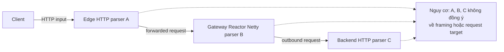
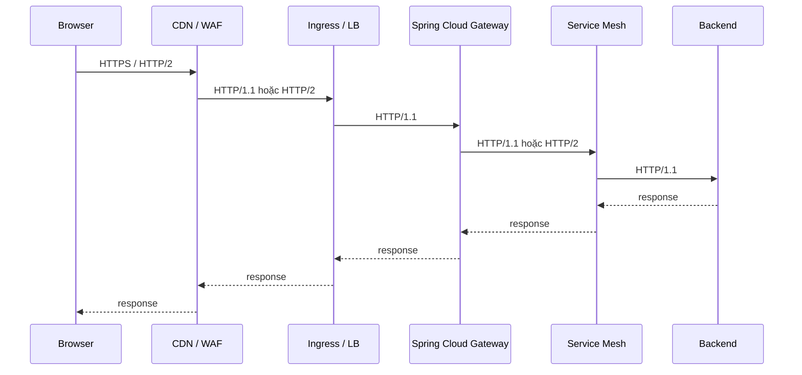
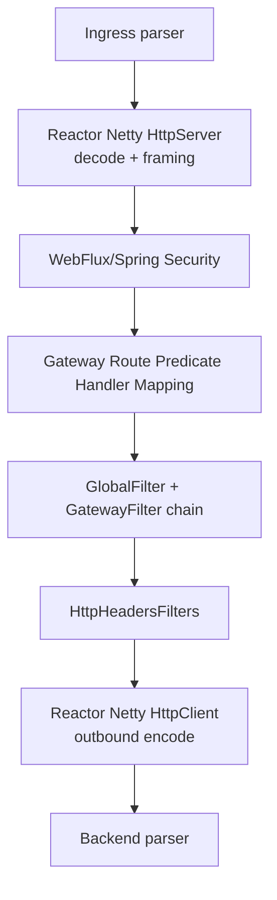

# Rà soát request smuggling và bất đồng cách hiểu HTTP giữa các chặng

## Mục tiêu bài học

Trong chương **Gia cố bảo mật** của module **SPRING_CLOUD_GATEWAY**, bài học này hướng dẫn cách rà soát **HTTP request smuggling** và **HTTP desynchronization** trong kiến trúc dùng Spring Cloud Gateway làm cổng vào microservices. Một Gateway có thể áp **route predicates, filter chain, rewrite path/header, service discovery, xác thực, giới hạn lưu lượng, retry, circuit breaker, TLS và observability**, nhưng vẫn gặp rủi ro nếu **CDN, Ingress, Gateway hoặc backend có cách phân tích thông điệp HTTP không giống nhau**.

Sau bài, người học có thể:

- Giải thích request smuggling và nhận diện các **ranh giới tin cậy** trong luồng Client → Edge/WAF → Ingress → Spring Cloud Gateway → Backend.
- Phân biệt **HTTP/1.1 framing** bằng `Content-Length` và `Transfer-Encoding` với body đã được decode trong Spring WebFlux.
- Hiểu các nhóm sai khác **CL.TE, TE.CL, TE.TE**, duplicate Content-Length, malformed chunk encoding, HTTP/2 downgrade và request-target ambiguity.
- Biết các quy tắc quan trọng trong **RFC 9110, RFC 9112 và RFC 9113** về framing, duplicate fields, HTTP/2 pseudo-headers, CRLF và connection-specific fields.
- Giải thích vai trò thật của Reactor Netty decoder, `NettyRoutingFilter`, `HttpHeadersFilter`, `RequestSize`, `RequestHeaderSize` và `SecureHeaders`; không nhầm một GatewayFilter với network parser.
- Rà soát `Host`, `:authority`, `Forwarded`, `X-Forwarded-*`, route predicates, `StripPrefix` và `RewritePath` để tránh đường dẫn hoặc host được hiểu khác giữa các hops.
- Thiết kế **kiểm thử phòng thủ trong môi trường cô lập** bằng HTTP fixtures, backend echo và assertions về số request thực mà backend nhận.
- Theo dõi **security advisories Netty/Gateway**, chọn bản vá tương thích với Spring Boot/Cloud BOM và có phương án rollout/rollback.
- Xử lý sự cố mà không ghi raw JWT, cookie, API key hoặc request body nhạy cảm vào log.

> **Phạm vi:** các ví dụ Gateway tập trung vào **Spring Cloud Gateway Server WebFlux trên Reactor Netty**. Gateway Server Web MVC, Servlet containers và `ProxyExchange` có HTTP stacks/configuration riêng; không dùng property của subsystem này cho subsystem khác nếu chưa xác minh. Với Spring Cloud Gateway mới, cấu hình thường thuộc `spring.cloud.gateway.server.webflux.*`, còn nhiều phiên bản cũ dùng `spring.cloud.gateway.*`. **Mọi malformed-request testing phải chạy trong lab do bạn kiểm soát**, không gửi các chuỗi gây desync tới production hoặc dịch vụ bên thứ ba.

## 1. Request smuggling thực sự xảy ra ở đâu?

HTTP/1.1 cho phép tái sử dụng một TCP connection để truyền nhiều HTTP requests. Mỗi recipient phải nhất quán về:

1. Nơi bắt đầu request line và kết thúc header section.
2. Request body có bao nhiêu **bytes**.
3. Nếu body dùng chunked encoding, đâu là terminal chunk và trailers.
4. Vị trí của **request tiếp theo** trên connection đó.

Một mô hình lỗi:

```text
Proxy A: "Những bytes này vẫn thuộc request số 1."
Server B: "Request số 1 đã kết thúc; bytes tiếp theo bắt đầu request số 2."
```

Hai bên đã **mất đồng bộ ranh giới thông điệp**. Nếu một lớp bảo mật kiểm tra một request khác với request backend thực thi, sẽ có nguy cơ bypass routing, authentication/authorization hoặc cache policy.



**Bản chất là khác biệt giữa các HTTP parsers/chặng chuyển đổi**, không phải chỉ một header độc hại. Một request bị từ chối ở mọi chặng theo cùng quy tắc không tạo thành smuggling chỉ vì nó chứa `Transfer-Encoding`.

### 1.1. Tác động có thể gặp

- Một request tới endpoint được cấp quyền thấp bị xử lý ở backend như request tới endpoint khác.
- **Response queue poisoning:** hai response và hai callers bị gắn nhầm khi một upstream connection bị desync.
- Cache ghi response dưới một URL/cache key khác với tài nguyên thật.
- Rò data giữa users, sai session context hoặc nhầm tenant.
- SSRF/host routing confusion qua `Host` hay request-target bị diễn giải khác.
- 400, 502, 504, connection reset, backend timeout, request đợi mãi hoặc tài nguyên bị giữ lâu.

Không phải cứ 502 là request smuggling. Cũng không phải parser mismatch nào cũng cho phép đọc dữ liệu: cần điều tra **cặp HTTP implementations**, kiểu connection pooling và message forwarding cụ thể.

### 1.2. Đừng nhầm với những chủ đề gần kề

| Khái niệm | Điểm khác |
| --- | --- |
| **Request smuggling** | Nhiều hops bất đồng request boundaries/meaning |
| **HTTP response splitting** | Phá ranh giới headers/response, thường qua CRLF |
| **SSRF** | Backend bị hướng gọi target không được phép |
| **Cache poisoning** | Cache lưu dữ liệu sai theo key; đôi khi là hậu quả smuggling |
| **Host header poisoning** | Dùng Host/Forwarded không đáng tin để sinh URL/routing |
| **CSRF** | Browser tự gửi credentials trong thao tác trái ý user |
| **CORS** | Browser kiểm soát quyền JavaScript đọc cross-origin response |
| **HTTP desync** | Trạng thái request/response của các hops không còn khớp |

CSRF/CORS/TLS có thể là các lớp quan trọng, nhưng **không thay strict message parsing**.

## 2. Lập bản đồ giao thức xuyên chuỗi proxy

Một deployment điển hình:



**Đừng suy rằng Browser gọi HTTP/2 thì Order Service cũng nhận HTTP/2.** CDN có thể downgrade h2 → h1; một mesh sidecar có thể tạo connection mới; Gateway HTTP client có thể dùng giao thức/connection pool khác ở hop phía sau.

### 2.1. Bản đồ cần lưu trong tài liệu kiến trúc

| Chặng | Đầu vào/đầu ra cần ghi nhận | Câu hỏi bảo mật |
| --- | --- | --- |
| Browser → CDN | h2/h3, TLS/ALPN | Có reject malformed pseudo-headers và field values? |
| CDN → Ingress | h2 → h1 hoặc h1 → h1 | Framing HTTP/1.1 được tạo lại đúng? |
| Ingress → Gateway | h1, keep-alive, Host | Duplicate CL/invalid TE được chặn ở đâu? |
| Gateway Netty → HTTP client | Inbound decode → outbound encode | Body và headers còn nhất quán sau filters? |
| Gateway → Mesh | h1/h2, TLS, pooled connections | Có forward hop-specific fields sai không? |
| Mesh → Backend | h2 → h1 nếu downgrade | Backend hiểu Host/Content-Length/trailers thế nào? |
| Backend → Gateway | Response headers/body | Có response framing, cache và connection reuse an toàn? |

Đối với mỗi hop, cần ghi:

- **Tên, phiên bản và advisory status** của HTTP parser/codec.
- HTTP/1.0, 1.1, 2, 3, h2c, Upgrade và CONNECT có được hỗ trợ?
- Hình thức TLS termination, mTLS, SNI và ALPN.
- Ai được phép sinh/ghi đè `Host`, `Forwarded`, `X-Forwarded-*`?
- Connection reuse, pooling, pipelining, HTTP/2 multiplexing và thời gian idle.
- Nơi authN/authZ, CORS, WAF, cache và rate limiter chạy.
- Hành vi khi malformed: reject, normalize, close, hoặc forward?

**Chỉ kiểm tra Gateway một mình chưa đủ.** Cần test đúng chuỗi cặp parser đang được triển khai.

## 3. HTTP/1.1 message framing: nền tảng bắt buộc

Một request HTTP/1.1 minh họa:

```http
POST /api/orders HTTP/1.1
Host: api.example.test
Content-Type: application/json
Content-Length: 17

{"itemId":"A-42"}
```

`Content-Length` biểu thị **số bytes**, không phải số ký tự Unicode hoặc `String.length()`. Nếu Gateway sửa body thì length của outbound representation có thể thay đổi; HTTP client cần tính lại framing theo bytes thực.

### 3.1. Hai cách báo body length

| Cơ chế | Ý nghĩa | Phải kết thúc thế nào? |
| --- | --- | --- |
| `Content-Length: N` | Body gồm đúng N octets | Đủ N bytes |
| `Transfer-Encoding: chunked` | HTTP/1.1 truyền chunks | Terminal zero-sized chunk và trailers hợp lệ nếu có |
| Không CL/TE trong request | Body length bằng 0 theo framing HTTP/1.1 | Kết thúc headers đồng thời kết thúc request |

**Method không xác định message framing.** Không dùng quy tắc “GET luôn có body length 0” hay “POST luôn có body” để thay RFC 9112.

### 3.2. `Content-Length` và `Transfer-Encoding` cùng hiện diện

Theo [RFC 9112](https://www.rfc-editor.org/rfc/rfc9112.html):

- Sender **MUST NOT** gửi cả `Content-Length` và `Transfer-Encoding` trong một HTTP message.
- Khi nhận cả hai, `Transfer-Encoding` có precedence về framing; sự kết hợp là tín hiệu nguy hiểm và nên được coi là lỗi.
- Server được phép **reject** request; nếu chọn xử lý theo TE, phải **đóng connection sau response** để tránh phần bytes còn lại bị diễn giải nhầm.
- Intermediary nếu chọn forward phải **loại received Content-Length** và xử lý Transfer-Encoding đúng trước khi sinh message mới.

**Policy ưu tiên tại public edge** thường là **reject conflicting framing**. Không khẳng định RFC buộc mọi trường hợp TE+CL trả 400 ngay lập tức: nó cho phép lựa chọn xử lý theo TE với nghĩa vụ close connection. Điều quan trọng là **không có hai “nguồn sự thật” về body boundary**.

### 3.3. Duplicate Content-Length

Ví dụ rủi ro:

```text
Content-Length: 11
Content-Length: 27
```

Nếu Proxy A chọn giá trị đầu còn Backend B chọn giá trị cuối, hai bên disagree về điểm kết thúc body. Với giá trị trùng nhau ở dạng danh sách, **RFC 9110** cho phép recipient reject hoặc chuẩn hóa một trường hợp nhất định như `Content-Length: 42, 42` thành một giá trị hợp lệ. Nhưng nó không cho phép forward CL đã biết là sai. <https://www.rfc-editor.org/rfc/rfc9110.html>

Đối với ingress security policy, **reject duplicate Content-Length** là một lựa chọn bảo thủ dễ chứng minh, dù một số dạng trùng nhau có thể được chuẩn hóa hợp lệ theo RFC. Phải test tất cả hops để xác nhận không ai chọn giá trị đầu/cuối tùy ý.

### 3.4. Ma trận framing và hành vi phòng thủ

| Đầu vào | Nhận định | Policy mong muốn |
| --- | --- | --- |
| Một CL decimal hợp lệ, không TE | Framing rõ | Cho phép nếu trong size limit |
| Chunked hợp lệ, không CL | Framing rõ | Cho phép nếu decoder hỗ trợ |
| TE và CL cùng request | Ambiguity/rủi ro smuggling | Reject ở edge hoặc xử lý TE đúng RFC + close |
| Hai CL khác giá trị | Không rõ length | Reject, close |
| CL âm/không phải số/overflow | Invalid | Reject, close |
| CL trùng cùng decimal | Có quy tắc normalize giới hạn | Chọn reject hoặc normalize nhất quán |
| Request TE có chunked **không phải final coding** | Không xác định reliable length | **400 và close** theo RFC 9112 |
| Malformed chunk size/terminal chunk | Incomplete hoặc invalid | Reject, close, không reuse connection |
| HTTP/1.0 request có TE | Faulty framing | Reject/close theo HTTP/1.1 compatibility rules |
| Không CL/TE trên request | Body length zero | Không đoán theo method |

### 3.5. Transfer-Encoding không phải phép tìm chuỗi `"chunked"`

Một parser phải xử lý:

- Multiple `Transfer-Encoding` field lines.
- Danh sách các transfer codings và **thứ tự** của chúng.
- Mixed case, whitespace, control chars theo grammar.
- `chunked` phải là **final transfer coding** cho HTTP/1.1 request.
- Chunk size hex, integer overflow và giới hạn kích thước.
- Chunk extensions, quoted strings và CRLF.
- Trailers, terminal zero-sized chunk và incomplete close.

**Code kiểu sau không phải validation:**

```java
if (transferEncoding.toLowerCase().contains("chunked")) {
    // Không đủ để tuyên bố HTTP message hợp lệ.
}
```

Việc kiểm tra đầy đủ phải nằm trong **HTTP codec/decoder được vá**, không tự triển khai bằng một `GatewayFilter` dựa trên header text.

### 3.6. Chunked request và close

Chunked framing có cấu trúc logic:

```text
<chunk size hex> CRLF
<đúng số bytes của chunk> CRLF
...
0 CRLF
<optional trailer fields>
CRLF
```

Một request có terminal chunk sai hoặc bị cắt giữa chừng là **incomplete/malformed**; phải dùng HTTP parser xử lý đúng và không reuse một connection có phần dữ liệu còn lại không được phân loại chắc chắn.

Trong bài test, chỉ dùng synthetic body và backend stub; không tạo “request thứ hai” có tác động đến endpoint thật để chứng minh parser gap.

### 3.7. `Transfer-Encoding` và `Content-Encoding` khác nhau

| Header | Mục đích |
| --- | --- |
| `Transfer-Encoding: chunked` | Framing trên HTTP/1.1 connection/hop |
| `Content-Encoding: gzip` | Encoding của content representation |
| `Content-Length` | Số bytes content body theo framing tương ứng |

Sau khi `ModifyRequestBody` hoặc một custom body transformation đổi JSON/gzip/UTF-8, không giữ raw incoming length, encoding/digest hoặc ETag không còn đúng. Nhưng **đổi body đã parse** vẫn khác việc **phân định raw message boundary** ở network parser.

## 4. Các họ bất đồng parser cần nhận diện

Các chữ viết tắt sau biểu thị **sự khác nhau giữa hai parsers**, không phải tên một API khai thác hay Spring filter.

### 4.1. CL.TE

```text
Front-end parser: tôi dùng Content-Length để xác định body.
Back-end parser: tôi dùng Transfer-Encoding để xác định body.
```

Nếu một thông điệp có framing mâu thuẫn lọt qua, hai bên có thể coi bytes sau đó thuộc hai requests khác nhau.

### 4.2. TE.CL

```text
Front-end parser: tôi dùng chunked terminal marker.
Back-end parser: tôi dùng Content-Length.
```

Một bên có thể coi body đã kết thúc, bên kia vẫn chờ bytes; kết quả có thể là timeout, request misassociation hoặc backend diễn giải sai request kế tiếp.

### 4.3. TE.TE

Hai bên đều thấy TE nhưng **khác cách parse field value**: whitespace, multiple field lines, chunked token order, chunk extension hoặc malformed syntax. Tổ hợp này có thể dẫn đến desync tương tự CL.TE/TE.CL trong topology cụ thể.

### 4.4. Zero-length/early response variants

Một số nghiên cứu gọi nhóm tình huống body-length zero hoặc early response là `CL.0`. Tên biến thể không thay câu hỏi cốt lõi: **hai hops có cùng nhận định về request boundary và phần bytes còn lại hay không?**

Một backend trả response trước khi đọc hết body không có nghĩa bytes tồn dư được phép coi là request mới. Các thành phần phải xử lý connection/request lifecycle đúng protocol.

### 4.5. Response queue poisoning

Nếu upstream keep-alive connection đã desync, một response có thể bị gắn nhầm sang request hoặc caller khác. Đây là một lý do **phải đóng/bỏ connection nghi bị desync**, không tái sử dụng nó chỉ vì server vừa trả 200.

## 5. HTTP/2 và nguy cơ chuyển đổi h2 → HTTP/1.1

HTTP/2 không dùng start-line và `Transfer-Encoding: chunked` như HTTP/1.1. Nó có **frames, streams và pseudo-headers**:

```text
:method    = GET
:scheme    = https
:authority = api.example.test
:path      = /api/orders/42
```

Body được mang bằng DATA frames. Khi một proxy chuyển h2 sang h1, nó phải **tạo lại HTTP/1.1 framing hợp lệ từ một h2 message đã validate**.

### 5.1. Content-Length trong h2

HTTP/2 có thể dùng regular `content-length` field nhưng độ dài body thực theo DATA frames/stream. Theo RFC 9113, nếu field này có trong message chứa content, nó phải **khớp tổng DATA frame payload lengths** theo protocol rules. Mismatch phải được coi là malformed.

Khi downgrade:

```text
h2 stream data
  ↓ validation
h1 request với một Content-Length mới hợp lệ
  hoặc Transfer-Encoding được HTTP client sinh đúng
```

Không copy một h2 CL untrusted/mâu thuẫn rồi forward như HTTP/1.1 framing.

### 5.2. Hop-by-hop fields bị cấm trong h2

Những connection-specific fields như:

```text
Connection
Keep-Alive
Proxy-Connection
Transfer-Encoding
Upgrade
```

không được xuất hiện trong một HTTP/2 message theo RFC 9113. Ngoại lệ: HTTP/2 request có thể mang `TE: trailers` và **không được mang giá trị khác** cho TE. Một h2 parser phải reject/protocol-error đối với field không hợp lệ, không chép chúng xuống h1.

### 5.3. Host và `:authority`

Nếu request h2 có:

```text
:authority = api.example.test
host       = admin.internal.example.test
```

thì có **host/target ambiguity**. RFC 9113 cấm client tạo Host khác `:authority`, và server **SHOULD treat** Host mâu thuẫn với `:authority` là malformed sau canonical normalization phù hợp.

Test các trường:

- Ingress chọn authority để định tuyến từ đâu?
- Gateway route/host predicate và Spring Security thấy host nào?
- Backend h1 `Host` sau downgrade là gì?
- Cache keys, redirects và virtual hosting có dùng một authority thống nhất?

Không dùng Host hoặc `:authority` làm bằng chứng user identity.

### 5.4. CR, LF và invalid fields trong h2

RFC 9113 cấm CR, LF, NUL trong field values; field names h2 phải lower-case và hợp lệ. Nếu một proxy nhận field value chứa line break rồi serialize nguyên sang h1, nó có thể biến text thành **một header line hoặc request line khác**.

**Chặn trước khi downgrade** bằng HTTP parser/codec đã vá; không chỉ regex sau khi `ServerWebExchange` được tạo.

### 5.5. H2C, CONNECT và WebSocket

`h2c` cleartext upgrade, HTTP/2 prior knowledge, CONNECT tunneling và WebSocket 101 Upgrade có các semantics riêng. Chỉ bật chúng trên routes và network boundaries được kiểm soát; không để một public client tùy ý yêu cầu upgrade/tunnel tới backend nội bộ ngoài allowlist. Không khẳng định h2c hay WebSocket luôn có request smuggling: rủi ro nằm ở protocol translation và parser/state handling không nhất quán.

## 6. Đường dẫn, Host và request target cũng phải nhất quán

Không phải mọi bypass đa-hop đều bắt nguồn từ CL/TE. Một số trường hợp **front proxy kiểm tra URL khác với backend thật sự thực thi**.

```text
Ingress policy:  /api/public/** được phép
Gateway:         RewritePath / StripPrefix
Backend:         thêm một bước URI decode/canonicalization
```

Các trường hợp cần rà soát:

- Percent-encoded slash `%2F`, `%2f` và double-encoded `%252F`.
- Dot-segments `.` / `..` và encoded dots `%2e`.
- Backslash `%5C`, repeated slashes, trailing slash.
- Query vs path separator, semicolon/matrix parameter.
- Unicode canonicalization/invalid UTF-8 bytes.
- HTTP/1.1 origin-form so với absolute-form request target.
- Host/`:authority` và TLS SNI/virtual-host routing.

Mục tiêu là **một canonical target nhất quán** khi quyết định security/routing, và backend vẫn kiểm tra resource authorization sau khi áp chính quy tắc path của nó.

### 6.1. Ví dụ route đúng, nhưng cần test backend path

```yaml
spring:
  cloud:
    gateway:
      server:
        webflux:
          routes:
            - id: orders
              uri: lb://order-service
              predicates:
                - Path=/api/orders/**
              filters:
                - StripPrefix=1
```

Với URL thông thường:

```text
Gateway nhận: /api/orders/42
Backend nhận: /orders/42
```

Khi có `%2F`, encoded dot segment hoặc repeated slashes, **phải kiểm chứng request target on-wire** và **backend route mapping**; không suy từ route predicate đúng rằng mọi parser sau đó hiểu giống hệt.

### 6.2. Backend phải thực hiện resource authorization

Đừng đặt tất cả rào chắn vào `Path=/api/admin/**` ở Gateway rồi cho backend tin mọi lời gọi từ private IP. Một service cần:

- Kiểm tra identity/token/service identity đã được xác minh.
- Xác thực tenant và resource ownership.
- Chặn direct backend bypass bằng network policy/mTLS khi phù hợp.
- Không tin `X-User`, `X-Tenant`, `X-Forwarded-*` client tự gửi.

### 6.3. URI injection và outbound request-line

HTTP/1.1 start-line có các separators `SP` và `CRLF`. URI được sinh từ user-controlled strings phải được validate và encode đúng trước khi đưa vào HTTP client. Không nối raw target URI bằng string concatenation. Một số Netty advisories từng mô tả cách request-line validation bị bypass khi URI được mutate qua API cụ thể; **giữ thư viện đã vá và chỉ dùng validated URI components**.

## 7. `Connection`, hop-by-hop headers và forwarded trust

Spring Cloud Gateway Server WebFlux có `HttpHeadersFilters` để xử lý request headers **trước khi gửi downstream** trong routing path. Theo tài liệu Gateway hiện hành, `RemoveHopByHop` mặc định loại các trường:

```text
Connection
Keep-Alive
Proxy-Authenticate
Proxy-Authorization
TE
Trailer
Transfer-Encoding
Upgrade
```

Nguồn: <https://docs.spring.io/spring-cloud-gateway/reference/spring-cloud-gateway-server-webflux/httpheadersfilters.html>.

### 7.1. Điều gì mà RemoveHopByHop không giải quyết?

Filter outbound hoạt động trên headers đã parse. Nó **không thay** một strict **inbound HTTP parser** ở Netty/Ingress. Nếu một hop trước đã diễn giải body boundary sai, loại `Transfer-Encoding` ở Gateway outbound không thể chứng minh đã loại request desync.

### 7.2. `Connection` có thể đánh dấu các headers khác

Ví dụ:

```http
Connection: keep-alive, X-Internal-Hop
X-Internal-Hop: untrusted-value
```

HTTP semantics yêu cầu một intermediary xử lý cả field names được nêu trong `Connection` như connection-specific cho hop đó. Không đủ chỉ remove chính header `Connection` rồi chuyển tiếp mọi field nó đánh dấu mà chưa xem xét dynamic list processing.

### 7.3. Forwarded headers là metadata, không phải nguồn xác thực

```text
Forwarded
X-Forwarded-For
X-Forwarded-Host
X-Forwarded-Proto
X-Forwarded-Port
X-Forwarded-Prefix
```

có thể được client tự tạo nếu edge không sanitize. Trong Gateway Server WebFlux mới, `spring.cloud.gateway.server.webflux.trusted-proxies` là một phần cấu hình Forwarded/XForwarded header filters, **không phải nút bật toàn bộ parser hardening**.

Policy an toàn:

```text
Untrusted client
  → Trusted Ingress loại forwarded metadata giả
  → Gateway chỉ diễn giải metadata từ proxy được tin
  → Backend kiểm tra authenticated identity chứ không chỉ tin headers
```

### 7.4. Host outbound

Client gửi:

```http
Host: api.example.test
```

Gateway gọi:

```text
https://orders.internal.example.test/orders/42
```

thì outbound Host/authority phải phù hợp target URI và virtual-host contract, không tự giữ public Host. `PreserveHostHeader` chỉ dùng nếu upstream cần chính xác và đã test TLS SNI, redirects, routing và auth boundary; không bật để “giữ nguyên mọi header” khi xử lý request smuggling.

## 8. Giới hạn thực của các Spring Cloud Gateway filters

Mô hình logic:



*Sơ đồ diễn giải vai trò, không cam kết thứ tự từng custom filter trong mọi runtime.* Điểm chính là **Netty đã phân định request trước khi route filters nhìn `ServerWebExchange`**.

### 8.1. Các filter hữu ích ở mức application

- `RequestRateLimiter` hạn chế tần suất.
- Spring Security WebFlux xác thực và phân quyền.
- `Path`/`Method`/`Host` route predicates chọn route.
- `StripPrefix`/`RewritePath` chuyển đổi URL đã parse.
- `RemoveRequestHeader`, `SetRequestHeader` điều khiển header forwarding.
- `RequestSize`, `RequestHeaderSize` giảm oversized request/header.
- `Retry`, `CircuitBreaker` kiểm soát resilience ở những phạm vi thích hợp.

Nhưng chúng **không sửa được raw invalid CRLF, malformed chunk-size, duplicate CL đã bị decoder gộp, hoặc HTTP/2 pseudo-header parsing ở một hop trước**.

### 8.2. Ví dụ RequestSize và RequestHeaderSize

```yaml
spring:
  cloud:
    gateway:
      server:
        webflux:
          routes:
            - id: bounded-orders
              uri: lb://order-service
              predicates:
                - Path=/api/orders/**
              filters:
                - StripPrefix=1
                - RequestHeaderSize=8KB
                - name: RequestSize
                  args:
                    maxSize: 1MB
```

`RequestHeaderSize` có thể trả **431** khi header vượt limit; `RequestSize` có thể trả **413** khi body quá lớn, theo tài liệu Gateway. Đây là defense-in-depth chống resource exhaustion, **không phải một HTTP framing validator**. Cần đồng thời cấu hình limits ở Ingress và Netty listener.

### 8.3. SecureHeaders/CORS/CSRF/TLS không thay framing validation

`SecureHeaders` có thể thêm response security headers (HSTS, X-Frame-Options...); CORS quy định browser cross-origin; CSRF bảo vệ cookie-based state changing; TLS bảo vệ bytes giữa TLS endpoints. **Không tính năng nào thay việc các hops phải nhất quán về HTTP framing và request target**.

### 8.4. Body rewrite phải để HTTP client tạo framing mới

Khi filter biến đổi JSON/Unicode, không:

- Giữ incoming `Content-Length` sau khi bytes body thay đổi.
- Chuyển `Transfer-Encoding: chunked` HTTP/1.1 sang HTTP/2.
- Giữ `Content-Encoding: gzip` nếu body đã giải nén.
- Giữ chữ ký/digest/ETag của representation cũ sau khi rewrite.
- Đọc buffer stream nhiều lần ngoài API cache/replay hỗ trợ.

Dùng APIs body transformation được hỗ trợ và kiểm thử backend thực nhận bytes nào, không tự serialize raw request-line/headers bằng string concatenation.

## 9. Rà soát dependencies và security advisories Netty

Một hệ thống không có custom GatewayFilter nguy hiểm vẫn có thể chịu ảnh hưởng nếu **HTTP decoder/encoder bên dưới** tồn tại lỗi. Spring Cloud Gateway Server WebFlux dựa vào Spring WebFlux/Reactor Netty/Netty; bên cạnh đó còn có Ingress controller, HTTP clients, service mesh và backend server độc lập.

### 9.1. Chỉ nhìn `pom.xml` chưa đủ

Trong nhiều dự án Spring Boot, phiên bản Netty được quản lý bằng Spring Boot dependency management/BOM và có thể bị thay đổi bởi:

- Spring Cloud release train/BOM.
- Một dependency khác có transitive Netty jars.
- Dependency override thủ công.
- Container image hoặc platform classpath.
- Spring Boot patch updates hoặc native packaging.

Hãy kiểm tra **resolved runtime artifacts** đối với:

```text
io.netty:netty-codec-http
io.netty:netty-codec-http2
io.netty:netty-handler
io.projectreactor.netty:reactor-netty-http
org.springframework.cloud:spring-cloud-gateway-...
```

Không khẳng định chỉ cần `spring-cloud-gateway` version mới là mọi Netty codec ở runtime đã được vá. Đồng thời, không ép một Netty JAR từ bản khác vào classpath mà không kiểm tra tương thích Reactor Netty/Boot.

### 9.2. Ví dụ advisory có liên quan trực tiếp

Các advisory dưới đây là **ví dụ lịch sử đã được Netty công bố**. Chúng minh họa vì sao phải rà soát các parser khác nhau; không phải danh sách mọi lỗ hổng đang còn hiệu lực trong tương lai.

| Advisory và thời điểm | Loại sai khác | Mốc bản vá được công bố |
| --- | --- | --- |
| [GHSA-fghv-69vj-qj49](https://github.com/netty/netty/security/advisories/GHSA-fghv-69vj-qj49), tháng 9/2025 | Chunk extensions với bare LF có thể được parse khác reverse proxy | `4.1.125.Final`, `4.2.5.Final` |
| [GHSA-84h7-rjj3-6jx4](https://github.com/netty/netty/security/advisories/GHSA-84h7-rjj3-6jx4), tháng 12/2025 | CRLF validation ở HTTP request encoder/URI | `4.1.129.Final`, `4.2.8.Final` |
| [GHSA-pwqr-wmgm-9rr8](https://github.com/netty/netty/security/advisories/GHSA-pwqr-wmgm-9rr8), tháng 3/2026 | HTTP/1.1 chunk extension quoted-string parsing | `4.1.132.Final`, `4.2.12.Final` |
| [GHSA-38f8-5428-x5cv](https://github.com/netty/netty/security/advisories/GHSA-38f8-5428-x5cv), tháng 5/2026 | Malformed `Transfer-Encoding` với `chunked` không phải final coding | `4.1.133.Final`, `4.2.13.Final` |
| [GHSA-v8h7-rr48-vmmv](https://github.com/netty/netty/security/advisories/GHSA-v8h7-rr48-vmmv), tháng 5/2026 | `DefaultHttpRequest.setUri()` và request-line injection | `4.1.133.Final`, `4.2.13.Final` |
| [GHSA-rq4j-fc47-9698](https://github.com/netty/netty/security/advisories/GHSA-rq4j-fc47-9698), tháng 9/2026 | Control characters trong chunk-size line | `4.1.138.Final`, `4.2.18.Final` |
| [GHSA-hcvj-94mj-jp5c](https://github.com/netty/netty/security/advisories/GHSA-hcvj-94mj-jp5c), tháng 9/2026 | Incomplete validation của malformed Transfer-Encoding | `4.1.138.Final`, `4.2.18.Final` |

**Lưu ý khi sử dụng bảng:** mỗi mốc là phiên bản mà **advisory cụ thể** ghi là đã vá, không bảo đảm phiên bản ấy đã vá toàn bộ advisories khác hoặc là bản mới nhất hiện tại. Hãy đối chiếu phạm vi affected/fixed trong advisory gốc và BOM đang chạy, nâng cấp sang một **supported release** phù hợp rồi chạy regression tests.

### 9.3. Triage theo thành phần, không theo từ khóa

Một số CVE liên quan Spring Cloud Gateway nói về `Forwarded` headers từ untrusted proxies, Actuator route mutation, SpEL hoặc resource exhaustion. Chúng có thể nghiêm trọng nhưng **không đồng nhất** với lỗi HTTP message framing.

Quy trình:

```text
Advisory liên quan artifact nào?
  ↓
Phiên bản resolved của hệ thống có nằm trong affected range?
  ↓
Protocol/feature bị ảnh hưởng có mở ở topology thực?
  ↓
Cặp proxy/backend có parser differential hoặc bypass path không?
  ↓
Patch / mitigation / retest / document residual risk
```

**Không cần chờ có exploit được trong production** mới áp bản vá cho thành phần bị ảnh hưởng. Việc mô phỏng/kiểm thử chỉ giúp chọn mitigation bổ sung và xác minh sau upgrade.

### 9.4. Kiểm thử sau khi nâng cấp BOM

Không chỉ test `GET /health` trả 200. Cần test:

- HTTP/1.1 CL hợp lệ và chunked hợp lệ.
- HTTP/2 → HTTP/1.1 downgrade.
- Body Unicode, gzip và streaming.
- WebSocket handshake nếu dùng.
- Route predicates, `StripPrefix`, `RewritePath` và `Host` forwarding.
- RequestSize/HeaderSize rejection.
- Duplicate/invalid framing bị từ chối như policy.
- Connection không bị reuse sau malformed input.
- Load balancer, retry, circuit breaker và TLS hoạt động như trước.

## 10. Hardening ở public edge và ingress

Public ingress là nơi có thể **reject raw malformed HTTP trước Gateway**, với điều kiện chính edge parser được cập nhật và cấu hình đúng. Đây là lớp bảo vệ đầu tiên, không phải lớp duy nhất.

### 10.1. Những policy nên có

1. Giới hạn HTTP protocol versions/ALPN và chỉ bật `h2c`, CONNECT, Upgrade nơi thực sự cần.
2. Bật strict HTTP parsing theo hướng dẫn của **đúng Ingress/WAF vendor và version**.
3. Reject contradictory TE + CL, duplicate/invalid CL theo security policy đã duyệt.
4. Reject malformed transfer codings, chunk lengths/extensions và incomplete messages.
5. Reject HTTP/2 invalid pseudo-headers, `:authority`/Host conflicts và forbidden connection-specific fields.
6. Không forward nguyên field values CR, LF, NUL từ h2 sang h1.
7. Đặt max header count/size, request-line limit, body size và timeouts.
8. Khi message boundary không rõ, **close affected connection** thay vì tái sử dụng.
9. Xóa `Forwarded`/`X-Forwarded-*` do untrusted client đưa vào; chỉ gắn metadata được trusted edge xác minh.
10. Giới hạn routes/hosts có thể đi vào Gateway, không forward các target tùy ý.

### 10.2. Reject tốt hơn normalize không chắc chắn

Một proxy có thể normalize các trường hợp duplicate CL giống nhau theo RFC, nhưng nếu một hop khác lại gộp hoặc ưu tiên field khác, rủi ro vẫn còn.

Chỉ normalize khi:

- Có **một body length authority** đã được xác minh.
- Normalization hoàn tất **trước** authorization, routing và forwarding.
- Chỉ phát ra một thông điệp mới có framing hợp lệ.
- Các downstream parsers đều xử lý giống nhau trong integration tests.
- Không giữ connection với phần bytes chưa được phân loại.

Nếu không xác định được **request boundary duy nhất**, chọn **reject/close** thay vì “sửa tạm và forward”.

### 10.3. WAF không thay cho parser correctness

WAF có thể bổ sung signature/rate controls, nhưng không giải quyết nếu:

- WAF parser đọc request khác Ingress HTTP parser.
- WAF nhìn h2 trong khi downstream nhận h1 được chuyển đổi sai.
- Backend/Gateway còn có đường bypass ingress.
- Malformed transfer coding vượt khỏi regex/signature rules.

Kiểm thử **toàn bộ thực tế hops**. “Đã bật WAF” không phải bằng chứng không còn request smuggling.

### 10.4. Ngăn bypass của lớp đã sanitize

Kiến trúc an toàn:

```text
Internet
  ↓
CDN/WAF/Ingress đã được vá + strict parsing
  ↓ private network
Spring Cloud Gateway replicas
  ↓ mTLS/NetworkPolicy
Backend services
```

Kiểm tra Cloud firewall, Kubernetes Service type, NodePort/LoadBalancer, pod ingress rules, security groups, service mesh policies và management ports. Nếu app có thể nhận raw Internet request trực tiếp vào Gateway/Backend, không được dựa duy nhất vào ingress sanitize.

## 11. Hardening tại Gateway và backend

### 11.1. Gateway WebFlux

- Dùng Spring Boot/Gateway/Reactor Netty/Netty **được vá** và tương thích BOM.
- Giữ `RemoveHopByHop` headers filter với defaults phù hợp; không tùy tiện giữ TE/Connection.
- Không cho `RequestHeaderToRequestUri` hoặc custom URL selection lấy host tùy ý từ client.
- Áp security authN/authZ trước những routes nhạy cảm, nhưng **không tin đây là raw parser defense**.
- Không copy nguyên tất cả inbound headers bằng custom filter.
- Giới hạn header/body/connection counts ở **Netty HTTP server/Ingress**, không chỉ route filters.
- Đặt request timeouts, pending queue limits, rate limiter và retry budgets.
- Không log raw headers/body/token bằng Netty wiretap trên traffic thật.
- Khi phát hiện malformed input, xử lý theo HTTP codec error/close; không retry một request chưa xác định ranh giới.

### 11.2. Backend

- Patch HTTP server library (Servlet container, Undertow/Jetty/Tomcat/Netty/NGINX tuỳ hệ thống).
- Xác minh authenticated service identity hoặc user token theo audience/scope.
- Kiểm tra **object/tenant authorization** sau backend path canonicalization.
- Không tin private network IP hoặc `X-User`, `X-Tenant`, `X-Forwarded-*` như bằng chứng user đã authenticated.
- Hạn chế direct access bypass Gateway bằng network policies và mTLS khi cần.
- Giới hạn body/header sizes và idle/read timeouts.
- Reject malformed/incomplete messages, không reuse desynced keep-alive connections.
- Nếu có caching, tránh dùng cache key được tạo từ một path representation khác với backend resource.

### 11.3. Tách response lỗi và parser lỗi

Nếu backend trả 400 cho một request mà Gateway vừa coi hợp lệ, có thể:

- Backend validation nghiệp vụ khác.
- Khác giới hạn header/body.
- Khác route URL/encoding.
- Khác parser về message framing.

Điều tra theo bằng chứng, không mặc định đó là smuggling. Cần trả lời:

```text
Edge thấy bao nhiêu HTTP requests?
Gateway thấy bao nhiêu ServerWebExchange?
Gateway gửi bao nhiêu outbound HTTP requests?
Backend thực nhận bao nhiêu?
Connection nào bị close/reuse sau lỗi?
Backend parser reject theo lý do nào?
```

### 11.4. TLS/mTLS không miễn kiểm tra framing

TLS bảo vệ bytes trên từng đoạn:

```text
Client --TLS #1--> Ingress --TLS #2--> Gateway --TLS #3--> Backend
```

Sau khi TLS terminate, HTTP vẫn được parse. Mã hóa không làm `Content-Length` sai thành hợp lệ và không ngăn lỗi h2→h1 translation. mTLS giúp xác nhận kết nối giữa workloads nhưng không sửa HTTP parsing differential.

## 12. Thiết kế kiểm thử phòng thủ mà không tạo nguy cơ cho người dùng khác

Request smuggling testing đặc biệt nhạy cảm vì một malformed request có thể làm hỏng **persistent connection chung** với traffic của người khác. Vì vậy, quy trình kiểm thử phải được cách ly.

### 12.1. Topology test tối thiểu

```text
Synthetic test client
  ↓
Test Ingress/Proxy phiên bản giống production
  ↓
Spring Cloud Gateway test pod
  ↓
Backend HTTP echo stub
```

Quy định:

- Các thành phần nằm trong namespace/network **không có traffic khách hàng**.
- Không dùng tài khoản, JWT, cookie hoặc API keys có hiệu lực thật.
- Backend chỉ echo metadata và ghi số request, **không có endpoint thực hiện side effects**.
- Test có timeout tổng và kill switch để không làm pipeline treo vô hạn.
- Mỗi case bắt đầu bằng connection mới hoặc pool được reset theo test design.
- Không chạy fuzz trên public CDN domain, production endpoints hoặc hệ thống không thuộc quyền kiểm soát.

### 12.2. Hai mức test

**Mức A — syntax/codec unit tests:** dùng HTTP decoder/encoder và một network fixture cô lập để kiểm tra invalid framing bị reject. Không cần một client thật tương tác với người dùng.

**Mức B — end-to-end parser differential:** gửi synthetic malformed HTTP qua **đúng Ingress → Gateway → Backend** trong lab. So sánh accepted/rejected requests và số request backend ghi nhận.

Một test framework HTTP cấp cao như `WebTestClient` hoặc `curl` thông thường có thể **tự chuẩn hóa headers/body** và ngăn không cho tạo request vi phạm syntax. Nó hữu ích cho happy paths, nhưng **không đủ** để chứng minh parser reject raw malformed bytes. Cần một bộ test giao thức/codec được kiểm soát, do security team cho phép.

### 12.3. Các invariants nên assert

| Invariant | Ý nghĩa |
| --- | --- |
| Mỗi request hợp lệ chỉ tạo các backend calls dự kiến | Không có request ẩn |
| Input malformed bị reject hoặc chuẩn hóa theo chính sách đã xác minh | Không có ambiguity |
| Khi framing lỗi, connection không được dùng lại sai | Ngăn cross-request contamination |
| Gateway authz decision áp vào chính backend action | Không bypass resource policy |
| Đường h2→h1 không tạo CL/TE mâu thuẫn | Downgrade an toàn |
| Backend response gắn đúng caller/request ID | Không queue poisoning |
| Caches không đổi key theo path/host mâu thuẫn | Không poisoning |
| Không lưu token/body vào logs test/production | Không tạo lỗ rò dữ liệu mới |

### 12.4. Kiểm tra phía backend bằng test stub

Một backend stub có thể ghi **chỉ metadata**:

```json
{
  "method": "GET",
  "path": "/orders/42",
  "host": "orders.internal.example.test",
  "requestId": "synthetic-req-042",
  "bodyLengthBytes": 0,
  "connectionId": "test-conn-01"
}
```

Không ghi raw `Authorization`, `Cookie`, `X-API-Key`, payload hoặc session ID. Backend stub cần đếm thực tế:

```text
receivedRequestCount
requestIdsReceived
connectionIdsUsed
backendStatusCodes
connectionCloseReason
```

Nếu client gửi một request test hợp lệ mà backend ghi nhận hơn một request **không theo Retry policy**, đây là tín hiệu điều tra quan trọng. Tuy nhiên, Retry/CircuitBreaker/load balancing có thể tạo attempts bổ sung trong trường hợp hợp lệ; phải tắt hoặc quan sát riêng chúng khi xác minh parser.

### 12.5. Test assertion an toàn, không in payload

Pseudocode:

```java
// Test pseudocode: dùng đúng test HTTP client/stub của dự án.
// Không mô phỏng malformed bytes bằng WebTestClient bình thường.

String expectedId = "synthetic-req-042";

sendValidRequestToIsolatedIngress(expectedId);

List<RecordedRequest> calls = backendStub.recordedRequests();

assertThat(calls).hasSize(1);
assertThat(calls.get(0).method()).isEqualTo("GET");
assertThat(calls.get(0).path()).isEqualTo("/orders/42");
assertThat(calls.get(0).header("X-Test-Request-Id"))
    .isEqualTo(expectedId);

// Với malformed fixture:
//   assert input is rejected per edge policy;
//   assert backend received zero requests;
//   assert suspect connection was closed/not reused.
```

Các hàm `sendValidRequestToIsolatedIngress` và `RecordedRequest` là **test harness abstraction minh họa**, không phải API có sẵn của Spring Cloud Gateway. Cần cài đặt cụ thể bằng WireMock/MockWebServer/embedded test server hoặc công cụ protocol-conformance test mà team đã duyệt.

## 13. Ma trận kiểm thử HTTP/1.1 và HTTP/2

| # | Nhóm | Fixture an toàn | Kỳ vọng |
| --- | --- | --- | --- |
| 1 | H1 | CL hợp lệ, JSON ngắn | Một request backend, body bytes đúng |
| 2 | H1 | Chunked hợp lệ, terminal chunk đúng | Một request backend |
| 3 | H1 | TE và CL cùng xuất hiện | Edge reject theo policy, backend zero requests |
| 4 | H1 | Duplicate CL khác giá trị | Reject, không forward |
| 5 | H1 | Duplicate CL cùng giá trị | Reject hoặc normalize đúng policy/RFC |
| 6 | H1 | CL âm | Reject |
| 7 | H1 | CL không phải decimal | Reject |
| 8 | H1 | CL cực lớn/overflow | Reject, không allocation quá mức |
| 9 | H1 | TE với chunked không là final coding | 400 và close theo RFC |
| 10 | H1 | Multiple TE fields | Parse theo grammar hoặc reject, không bất đồng |
| 11 | H1 | Unknown transfer coding | Không forward mơ hồ |
| 12 | H1 | Chunk-size syntax invalid | Reject/close |
| 13 | H1 | Chunk extension control characters | Reject/close |
| 14 | H1 | Terminal chunk/trailer incomplete | Reject/close |
| 15 | H1 | HTTP/1.0 cùng TE | Reject/close, không xử lý như H1 hợp lệ |
| 16 | H1 | `Connection` liệt kê extra header | Hop semantics được áp nhất quán |
| 17 | H1 | Header name mixed case | Case-insensitive semantics đúng |
| 18 | H1 | Header có CR/LF không hợp lệ | Reject |
| 19 | H1 | Request-line chứa invalid characters | Reject ở encoder/decoder |
| 20 | H2 | Valid DATA frames, CL đúng | Downgrade sinh H1 framing đúng |
| 21 | H2 | CL không khớp DATA bytes | Malformed, không chuyển downstream |
| 22 | H2 | `Transfer-Encoding` xuất hiện | Malformed |
| 23 | H2 | `TE` khác `trailers` | Malformed |
| 24 | H2 | `Connection`/`Upgrade` xuất hiện | Malformed |
| 25 | H2 | `:authority` khác Host | Reject theo strict policy |
| 26 | H2 | Duplicate pseudo-header | Malformed |
| 27 | H2 | Uppercase field name | Malformed |
| 28 | H2 | CR/LF trong field value | Malformed |
| 29 | H2 | Invalid `:path` target | Reject hoặc xử lý theo chuẩn |
| 30 | URI | Encoded slash/dot segments | Gateway và backend chọn cùng resource theo contract |
| 31 | URI | Duplicate slash/backslash | Không bypass protected resource |
| 32 | Host | Host/authority conflict | Không route vào internal virtual host |
| 33 | Forwarded | Client fake `X-Forwarded-Host` | Không đổi routing/security authority |
| 34 | Forwarded | Client fake XFF private IP | Không bypass IP-based policy |
| 35 | Body | JSON rewrite đổi UTF-8 bytes | Outbound CL/TE/Content-Encoding đúng |
| 36 | Response | HEAD/204/304/CONNECT semantics | Response framing hợp lệ |
| 37 | Pool | Malformed request trên keep-alive | Connection không tái sử dụng sai |
| 38 | Security | Malformed request bên cạnh protected path | Không có backend action không qua authz |
| 39 | Cache | Host/path variants | Cache key/response không bị trộn |
| 40 | Recovery | Nâng Netty/Ingress lên patched version | Không hồi quy happy paths, malformed bị reject |

**Với case malformed, không cần tự xây payload chèn một admin request vào body** để có giá trị kiểm thử. Test response policy, connection close và request count của backend stub đủ để phát hiện nhiều khác biệt nguy hiểm mà không ảnh hưởng hệ thống khác.

## 14. Một bài lab có kiểm soát: đối chiếu H1 và H2

### 14.1. Phần hợp lệ trước

Cho Gateway route:

```yaml
spring:
  cloud:
    gateway:
      server:
        webflux:
          routes:
            - id: demo-orders
              uri: http://localhost:9001
              predicates:
                - Path=/api/orders/**
              filters:
                - StripPrefix=1
                - RequestHeaderSize=8KB
                - name: RequestSize
                  args:
                    maxSize: 1MB
```

Backend stub chạy ở `localhost:9001` trong cùng lab network namespace; đây **không phải** URI production.

Gửi request H1 hợp lệ:

```bash
curl --http1.1 -i \
  "http://localhost:8080/api/orders/42" \
  -H "X-Test-Request-Id: lab-h1-042"
```

Kỳ vọng:

```text
Gateway routeId: demo-orders
Backend path:    /orders/42
Backend count:   1
Backend ID:      lab-h1-042
```

### 14.2. Đối chiếu HTTP/2 hợp lệ

Khi lab Gateway/Ingress đã bật HTTP/2 với TLS/ALPN:

```bash
curl --http2 -i \
  "https://lab-api.example.test/api/orders/42" \
  -H "X-Test-Request-Id: lab-h2-042"
```

Lệnh này chỉ test **request h2 hợp lệ**, không tạo malformed HTTP/2 frames. Nếu edge hỗ trợ h2 và backend vẫn nhận HTTP/1.1, backend stub phải thấy **cùng tài nguyên và một request**, với framing do intermediary tạo đúng.

### 14.3. Negative fixtures nên do protocol-conformance harness kiểm soát

Đối với duplicate CL, invalid TE, bare CR/LF hoặc h2 pseudo-header conflict, client HTTP thông thường có thể tự sửa/từ chối trước khi gửi. Security team có thể dùng codec-level tests hoặc protocol conformance fixtures:

```text
Given:
  isolated ingress, Gateway, backend stub
  zero real user traffic
  fixture contains a non-conforming framing/header case

When:
  fixture được gửi qua chuỗi proxy

Then:
  policy yêu cầu reject ở edge
  backendStub.receivedRequests == 0
  error connection bị đóng/không reuse
  log không ghi raw fake secrets
```

**Không chạy các fixtures đó qua một shared production CDN connection**; trong một số cấu hình, desync có thể ảnh hưởng request tiếp theo của người khác.

### 14.4. Phân biệt fail-closed và availability

Reject malformed request bằng 400/close là hành vi đúng, không phải outage. Nhưng nếu ingress/parser quá nghiêm ngặt làm reject một HTTP client hợp lệ do bug parser của client, cần xác định:

- Client có vi phạm RFC không?
- Có thể sửa client hoặc upgrade proxy thay vì nới lỏng security?
- Có cần một backward-compatible fix mà vẫn có **một framing authority**?
- Có đường upgrade không an toàn giữa h2/h1?

Không đơn giản bật “lenient HTTP parsing” rộng cho toàn hệ thống chỉ vì một thiết bị cũ bị lỗi.

## 15. Rà soát authN/authZ và route security trong điều kiện parser ambiguity

Một lỗ hổng parser có thể phá giả định “một request đã được Gateway kiểm tra”.

### 15.1. Mô hình không đủ

```text
Ingress kiểm tra host + path
  ↓
Gateway route chỉ auth /api/admin/**
  ↓
Backend tin mọi request đã qua Gateway
```

Nếu request target bị normalize khác hoặc backend có đường direct access, một action đặc quyền có thể không chịu quy tắc đúng.

### 15.2. Phòng thủ nhiều lớp

- Front proxy **strict parser** và host/path allowlist.
- Gateway Spring Security xét authenticated principal/authorities.
- Backend xác minh token/service identity và resource authorization.
- Service-to-service mTLS/network policy hạn chế bypass.
- Public routes chỉ expose endpoints thật sự cần.
- Admin/management routes tách ra private plane.
- Dùng stable/canonical route IDs và policy revision trong telemetry.

Không coi private source IP là proof of identity. Không dùng `X-Forwarded-For: 127.0.0.1` để cho phép admin.

### 15.3. `Retry` và body replay

Retry có thể tạo nhiều upstream attempts cho **một** inbound request bình thường. Khi kiểm thử parser mismatch, cần:

- Tắt Retry trong fixture test hoặc log riêng attempt count.
- Không nhầm số attempts hợp lệ với một “hidden request”.
- Không retry malformed request, 400 parser error hoặc credentials lỗi.
- Không replay non-idempotent POST nếu không có idempotency key và backend deduplication.

Một HTTP parser desync và retry storm có thể cùng xuất hiện; cần phân biệt nguyên nhân bằng trace/span, connection ID, attempt number và backend audit.

## 16. Observability: phát hiện bất thường mà không thu raw secrets

### 16.1. Các tín hiệu có giá trị

| Tín hiệu | Vì sao hữu ích |
| --- | --- |
| HTTP decoder/parser error count | Malformed framing/headers tăng |
| Ingress 400, Gateway 400, backend 400 theo hop | Biết hop nào reject |
| Connection close/reset sau 400 | Xem chính sách không reuse desynced connection |
| 502/504, premature close, read timeout | Có thể xuất hiện khi parser disagree |
| Inbound request count vs outbound attempt count | Phát hiện chênh lệch đáng điều tra |
| Upstream request ID vs Gateway trace ID | Mapping request/response có nhất quán? |
| Route ID và canonical path class | Tìm route confusion |
| HTTP protocol version vào/ra | Xác định h2→h1 downgrades |
| Netty/Ingress versions | Kiểm tra phần mềm đang thực thi có bản vá? |
| Backend authz denials bất thường | Tín hiệu có protected resource bị gọi lạ |
| Cache miss/hit/key anomalies | Điều tra cache poisoning |

### 16.2. Không suy từ một metric duy nhất

Một Gateway nhận 100 requests, backend ghi 110 calls **không tự** có nghĩa smuggling vì `Retry` hoặc application fan-out có thể tạo thêm calls.

Phải tính:

```text
Expected outbound calls =
  incoming matched requests
  + allowed retries
  + explicit fan-out
  - short-circuited/fallback/cache-hit requests
```

và giải thích từng nhánh. Khi điều tra request desync, so **client request ID, Gateway trace/span ID, backend request ID, HTTP connection ID và response association** theo telemetry đã được thiết kế.

### 16.3. Wiretap chỉ trong isolated lab

Reactor Netty `HttpServer`/`HttpClient` wiretap có thể ghi **raw headers và bodies**, bao gồm:

```text
Authorization: Bearer ...
Cookie: SESSION=...
X-API-Key: ...
PII hoặc nội dung request body
```

HEX_DUMP **không phải encryption** và TLS không ngăn nội dung ứng dụng xuất hiện trong logs sau khi giải mã. Nếu cần byte-level evidence:

- Dùng synthetic traffic, fake tokens, riêng test pod/namespace.
- Thu log sink riêng có retention ngắn, RBAC và audit.
- Tắt wiretap sau khi thu bằng chứng; xóa các bản ghi theo policy.
- Không chia sẻ PCAP/log chứa credential thật ngoài nhóm incident response.

Trong production nên ưu tiên **structured metadata allowlist**, không log raw malformed payload hoặc toàn bộ query string.

### 16.4. Ví dụ event log an toàn

```json
{
  "routeId": "orders",
  "ingressProtocol": "HTTP/2",
  "upstreamProtocol": "HTTP/1.1",
  "result": "rejected-malformed-framing",
  "errorClass": "invalid-transfer-encoding",
  "httpStatus": 400,
  "connectionClosed": true,
  "traceId": "synthetic-trace-id"
}
```

**Lưu ý:** các fields ví dụ là telemetry **ứng dụng/agent phải triển khai**, không phải bộ nhãn Gateway/Netty mặc định. `errorClass` nên là enum đã chuẩn hóa, không chép nguyên exception message chứa raw URL/headers.

## 17. Quy trình xử lý khi nghi request smuggling

### 17.1. Tín hiệu kích hoạt

- Các backend 400/timeout bất thường đi kèm Ingress 200/400 khác nhau.
- Một client trace ID liên hệ nhiều backend requests không khớp Retry policy.
- Tình huống response nhận không thuộc request gốc.
- Cache chứa nội dung của một endpoint dưới key endpoint khác.
- Một route yêu cầu auth nhưng backend ghi nhận unauthenticated action.
- Công bố CVE parser có phạm vi tương ứng với resolved version/protocol.

### 17.2. Hành động tức thời

1. Mở incident theo chính sách và xác định phạm vi.
2. **Không thử lại malformed payload trên production.**
3. Xác minh current versions và topology các HTTP hops.
4. Nếu có nguy cơ cao, chặn/hạn chế đường protocol bị ảnh hưởng tại edge hoặc tạm tắt h2c/downgrade tính năng không cần theo change procedure.
5. Nếu có advisory, ưu tiên vendor patch và rollout có kiểm chứng.
6. Nếu nghi connection desync, cần loại/đóng connections bị ảnh hưởng và đánh giá pool reuse; thay đổi phải dựa trên implementation thực.
7. Kiểm tra logs/audit với privacy policy, không lưu/lan truyền tokens.
8. Tạo reproducible **isolated lab** từ config/version tương đương để xác minh trước/sau.
9. Kiểm tra có rò data/cache poisoning/unauthorized writes không; thực hiện containment, revocation/rotation nếu có credentials bị lộ.
10. Hoàn tất postmortem với prevention actions và regression suite.

### 17.3. Các biện pháp tạm thời có giới hạn

| Biện pháp | Có thể giúp | Không bảo đảm |
| --- | --- | --- |
| Reject TE+CL/duplicate CL tại Ingress | Giảm CL/TE ambiguity | Không chữa mọi lỗi HTTP/2/chunk parser |
| Đóng connection khi malformed | Giảm cross-request contamination | Không vá parser nhận sai trước đó |
| Tắt HTTP/2 downgrade ở đường không cần | Loại một đường conversion có rủi ro | Không bảo vệ H1-only parser mismatch |
| Chặn Gateway/Backend direct access | Bảo vệ trust boundary | Không chữa malformed request qua public ingress |
| Giới hạn connections/requests/rate | Giảm tải và phạm vi ảnh hưởng | Không bảo đảm authz hay framing đúng |
| Nâng cấp Netty/Ingress/Backend | Vá lỗi đã biết | Cần regression và kiểm tra CVE khác |

Không dùng “bật `Connection: close` cho mọi request” như một lời giải tổng quát. Nó có thể giảm một số kịch bản reuse nhưng không sửa parser correctness, có thể tăng CPU/socket churn và không chặn đường downgrade khác.

## 18. Troubleshooting các tình huống phổ biến

### 18.1. Ingress trả 400, Gateway không có log

**Có thể là hành vi đúng**: edge parser đã reject malformed input trước khi forward. Kiểm tra edge error category, policy và connection close; không sửa bằng cách cho request invalid đi tiếp.

### 18.2. Gateway ghi GET nhưng backend thấy thêm một POST lạ

Không kết luận vội. Kiểm tra Retry, async side effects, route fan-out và connection/request ID. Nếu loại trừ cơ chế hợp lệ, nghi parser desync và điều tra trong isolated lab, bảo vệ audit evidence.

### 18.3. 502 xuất hiện ngẫu nhiên sau keep-alive reuse

Có thể do upstream connection stale, backend reset, TLS/idle timeout, response framing hoặc desync. Phân tích response/connection close reasons, pool metrics và codec errors thay vì chỉ tăng timeout.

### 18.4. `Content-Length` sai sau ModifyRequestBody

Nếu body đổi từ ASCII sang Unicode, Java `String.length()` không bằng UTF-8 byte count. Không tự đặt CL từ string length; để HTTP client tính outbound representation framing. Test actual backend bytes.

### 18.5. Gateway `RemoveHopByHop` đã bật mà scanner vẫn báo CL.TE

`RemoveHopByHop` là outbound header filter, không chứng minh raw inbound parser hoặc front ingress đã reject ambiguous framing. Kiểm tra parser versions, ingress policy và end-to-end test.

### 18.6. Backend nhận `Host` khác Gateway public host

Điều đó có thể là **đúng** khi Gateway chuyển tới upstream virtual host. Vấn đề là backend có đang dùng một untrusted Host/Forwarded value để định tuyến hay tạo links không. Test Host/SNI và authority contracts.

### 18.7. HTTP/2 client nhận 400 trong khi HTTP/1.1 client thành công

Có thể do invalid h2 pseudo-headers/forbidden fields, khác header size limit hoặc h2 downgrade. So sánh **hợp lệ theo từng RFC**, không tự ép h2 parser trở nên permissive như h1.

### 18.8. H2 `content-length` không khớp DATA

Theo RFC 9113 đây là malformed message. Gateway/Ingress cần reject, không forward CL sai tới H1 backend. Kiểm tra upstream proxy không copy stale CL.

### 18.9. HTTP/1.0 request có Transfer-Encoding bị lỗi

Theo RFC 9112, HTTP/1.0 nhận Transfer-Encoding phải được coi framing faulty. Không cố xử lý như chunked H1.1 để duy trì tương thích với client lỗi.

### 18.10. Test malformed được “sửa” tự động trước khi tới Gateway

Đây thường là hành vi của `curl`/WebTestClient HTTP client. Muốn test parser syntax phải dùng **codec-level hoặc protocol-conformance fixture** an toàn trong lab. Không tuyên bố Gateway đã reject nếu client không hề gửi input invalid.

### 18.11. CVE Netty đã có fix nhưng dependency tree còn bản cũ

Spring Cloud BOM có thể giữ phiên bản chưa được cập nhật hoặc app override transitive dependency. Xác minh **resolved runtime** và nâng lên release tương thích đã vá, không chỉ sửa version trong một mục không được load.

### 18.12. Lỗi chỉ xuất hiện ở một Gateway pod

Kiểm tra config/image drift, network path/Ingress routing, native transport mode, JVM/Netty versions, sidecar versions và connection pools. Rà soát toàn fleet, không suy từ một instance khỏe rằng mọi paths an toàn.

### 18.13. WAF không phát hiện nhưng backend báo request bất thường

WAF parser/signature không thay parser của Ingress/backend; có thể có h2/h1 translation hoặc bypass. Phải so request interpretation theo từng hop, không chỉ WAF decision.

### 18.14. Security team cần packet capture để phân tích

Chỉ capture test traffic giả trong isolated environment. Nếu cần xem production data theo incident policy, giới hạn phạm vi, phân quyền, mã hóa lưu trữ, retention và redaction; không phát tán PCAP chứa cookies/JWT.

## 19. Checklist rà soát trước khi release

| Nhóm | Câu hỏi xác minh |
| --- | --- |
| **Topology** | Có sơ đồ h1/h2/h3 qua CDN/Ingress/Gateway/Mesh/Backend? |
| **Versions** | Netty, Reactor Netty, Boot, Gateway, Ingress/Backend resolved versions đã được rà CVE? |
| **Framing** | Ingress reject TE+CL/duplicate invalid CL theo policy? |
| **Chunk parsing** | Decoder đã được vá cho chunk-size, chunk-ext, CRLF, final coding? |
| **H1 close** | Malformed/incomplete message không làm reuse desynced connection? |
| **HTTP/2** | Reject forbidden connection-specific fields, invalid pseudo-headers và CL/DATA mismatch? |
| **Downgrade** | h2→h1 sinh Host/CL/TE đúng, không copy forbidden fields? |
| **URI** | Decoding, dot segments, encoded slash, double encoding nhất quán? |
| **Host** | `Host`, `:authority`, SNI, virtual-host rules và cache keys phù hợp? |
| **Proxy trust** | X-Forwarded/Forwarded từ Internet đã sanitize trước khi tin? |
| **Headers** | RemoveHopByHop giữ đúng behavior, có dynamic `Connection` handling? |
| **Security** | Backend tự authz object/tenant; không tin request chỉ vì đi qua Gateway? |
| **Routing** | Route predicates/filters/rewrites có test với actual backend URI? |
| **Body** | CL/TE/Content-Encoding sau rewrite đúng bytes/protocol? |
| **Limits** | Header/body/connection/read timeout limits có ở edge và app? |
| **Retries** | Attempt count có thể phân biệt với smuggled request, non-idempotent retry được chặn? |
| **Cache** | Cache key dùng canonical authority/path và authorization boundaries? |
| **Actuator** | Route mutation/refresh endpoints nằm trên private admin plane? |
| **Network** | Không còn direct ingress bypass tới Gateway/backend ports? |
| **Testing** | Có lab differential tests, malformed rejects, backend call count và connection close assertions? |
| **Operations** | Có metrics parser errors, pool state, 400/502, route ID, traces? |
| **Privacy** | Không log raw JWT/cookie/API key/PII/wiretap body trên production? |
| **Change** | Có canary/rollback, security advisory review và evidence archive có quyền truy cập? |

## 20. Bài luyện tập có đáp án

### Bài 1 — CL và TE mâu thuẫn

Một request H1 chứa cả `Content-Length` và `Transfer-Encoding`. Nhóm vận hành muốn pass-through vì “backend sẽ chọn đúng”.

**Đáp án:** không nên pass-through mơ hồ. RFC 9112 quy định TE có precedence nếu xử lý, intermediary phải loại CL nếu forward và server phải close sau response. Với public edge, **reject conflicting framing** là chính sách phòng thủ dễ kiểm chứng hơn.

### Bài 2 — Duplicate CL

Một proxy chọn CL đầu, backend chọn CL cuối.

**Đáp án:** đó là **parser differential** có thể gây desync. Reject duplicated mismatched CL và test nhất quán across hops; không chọn giá trị tùy ý.

### Bài 3 — H2 có `Transfer-Encoding: chunked`

**Đáp án:** malformed. HTTP/2 không sử dụng chunked Transfer-Encoding; phải reject ở h2 parser. Đừng downgrade field đó thành H1 chunked request.

### Bài 4 — HTTP/2 `TE: trailers`

**Đáp án:** đây là ngoại lệ được RFC 9113 cho phép trong HTTP/2 request. Các TE values khác không được phép. Hãy test parser theo chính grammar của h2.

### Bài 5 — Host khác `:authority`

`Host` trỏ `admin.internal.example.test`, còn `:authority` là `api.example.test`.

**Đáp án:** đây là authority mismatch. Nên reject tại h2 edge theo strict policy; không cho frontend route theo `:authority` trong khi backend authorize theo Host khác.

### Bài 6 — `RequestSize` có đủ không?

Route giới hạn body 1MB, nhưng ingress cho nhận malformed chunk extension.

**Đáp án:** không. `RequestSize` chạy trên request đã parse, không thay codec validation. Cần parser patch và malformed framing tests.

### Bài 7 — Same URL, backend khác path

Ingress cho `/public/**`, backend normalize encoded path sang protected handler.

**Đáp án:** route/path normalization ambiguity. Test canonical path ở các hops và kiểm tra backend resource authorization, không chỉ edge ACL.

### Bài 8 — TLS đã bật

Team cho rằng HTTPS ngăn HTTP request smuggling.

**Đáp án:** TLS bảo vệ transport giữa endpoints, HTTP vẫn được decode/parse ở mỗi hop. h2→h1 conversion vẫn có thể sai.

### Bài 9 — Scanner gửi malformed request và thấy 502

**Đáp án:** một 502 chưa chứng minh exploitable smuggling. Cần isolated lab, xác định parser disagreement, backend request count và connection close behavior. Không chạy đi chạy lại trên production.

### Bài 10 — Bản vá Netty

Netty nằm trong dependency tree nhưng build không khai báo version trực tiếp.

**Đáp án:** xem resolved runtime dependency do Spring Boot BOM quản lý và official affected/fixed ranges. Upgrade compatible Boot/Cloud stack, retest parser behavior.

### Bài 11 — WAF đã chặn input

Gateway pods vẫn expose NodePort cho Internet.

**Đáp án:** tồn tại **bypass của lớp sanitize**. Cần network isolation/ingress-only traffic, security policies và parser correctness ở Gateway vẫn phải được duy trì.

### Bài 12 — Keep-alive sau framing error

HTTP server trả 400 nhưng giữ connection với unconsumed bytes.

**Đáp án:** có nguy cơ desync/cross-request contamination. Cần reject/close theo RFC và implementation contract; test connection không bị reuse sai.

### Bài 13 — Netty wiretap trong production

Team muốn bật HEX_DUMP để kiểm tra malformed request của mọi user.

**Đáp án:** không nên. Wiretap có thể lưu credentials, cookies và PII. Sử dụng metadata alerts và isolated lab với synthetic traffic; nếu incident cần raw evidence, theo quy trình kiểm soát dữ liệu nghiêm ngặt.

### Bài 14 — Backend 401 và Gateway 200

**Đáp án:** chưa đủ chứng minh smuggling. Phải xác định status ở hop nào, correlation IDs, route/Retry/fallback behavior và backend authorization. Chỉ điều tra parser differential sau khi có dấu hiệu request identity/boundary không thống nhất.

### Bài 15 — Một request thành hai backend calls

**Đáp án:** có thể do Retry, load balancing fan-out hoặc request smuggling. Tắt/đo Retry riêng, kiểm tra backend request identifiers và các connections trong lab trước khi kết luận.

## 21. Quy trình thực hành cho một security review

### Bước 1 — Khoanh các HTTP boundaries

Vẽ rõ Client → CDN/WAF → Ingress → Gateway WebFlux → Service Mesh → backend. Điền protocol version, connection reuse và software version của từng hop.

### Bước 2 — Rà soát parser advisories

Tra Netty, Reactor Netty, Boot/Gateway BOM, Ingress/mesh/backend advisories. Lưu resolved dependency versions và fixed ranges; xây kế hoạch nâng cấp tương thích.

### Bước 3 — Kiểm tra cấu hình edge

Đảm bảo strict malformed parsing, limits, H2→H1 translation, host normalization và trust metadata. Tắt đường bypass public tới các internal listeners.

### Bước 4 — Kiểm tra Gateway route/filter policy

Xác nhận đúng `HttpHeadersFilters`, body transforms, `Host` handling, request size/header size limits, authN/authZ, TokenRelay/cookie filtering và route URI allowlist.

### Bước 5 — Dựng lab tương đồng

Chạy đúng phiên bản/protocol chain trong mạng cô lập, chỉ test fake requests và HTTP backend stub.

### Bước 6 — Chạy safe differential regression

Trước tiên valid H1/H2, sau đó malformed protocol fixtures để assert reject/close/no backend request. Kiểm tra path/host/authorization/caches nhất quán.

### Bước 7 — Phân tích telemetry

So request counts, route IDs, backend calls, HTTP versions, parser errors và connection close reasons. Không dùng raw body/credential logging trên production.

### Bước 8 — Fix, canary, rollback

Nâng cấp parser/proxy/BOM, deploy canary, xác minh 400/502 rates và success paths, có phương án rollback nếu client hợp lệ bị ảnh hưởng. Nếu rollback bản vá security, phải có mitigation thay thế được phê duyệt.

### Bước 9 — Đưa các invariants vào CI

Giữ tests về duplicate CL, conflicting TE, chunk syntax, h2 illegal fields, authority mismatch, URL normalization, body framing và direct-ingress bypass dưới dạng automated suite cô lập.

## 22. Tài liệu tham khảo

### Tiêu chuẩn

- [RFC 9110 — HTTP Semantics](https://www.rfc-editor.org/rfc/rfc9110.html): Content-Length validity, duplicated values, target URI, HTTP field semantics và security considerations.
- [RFC 9112 — HTTP/1.1](https://www.rfc-editor.org/rfc/rfc9112.html): Transfer-Encoding, message body length, incomplete messages, request smuggling và close behavior.
- [RFC 9113 — HTTP/2](https://www.rfc-editor.org/rfc/rfc9113.html): pseudo-headers, field validity, invalid connection-specific fields, CL vs DATA length, downgrade considerations.
- [RFC 7239 — Forwarded HTTP Extension](https://www.rfc-editor.org/rfc/rfc7239): proxy metadata (`for`, `host`, `proto`, `by`), không phải một giao thức xác thực.

### Spring Cloud Gateway và Netty

- [Spring Cloud Gateway Server WebFlux — HttpHeadersFilters](https://docs.spring.io/spring-cloud-gateway/reference/spring-cloud-gateway-server-webflux/httpheadersfilters.html): `Forwarded`, `XForwarded`, `RemoveHopByHop`.
- [Spring Cloud Gateway — Configuration Properties](https://docs.spring.io/spring-cloud-gateway/reference/configprops.html): namespace hiện hành, filters và properties theo release train.
- [Spring Cloud Gateway Server WebFlux — RequestSize](https://docs.spring.io/spring-cloud-gateway/reference/spring-cloud-gateway-server-webflux/gatewayfilter-factories/requestsize-factory.html): body size limit.
- [Spring Cloud Gateway Server WebFlux — RequestHeaderSize](https://docs.spring.io/spring-cloud-gateway/reference/spring-cloud-gateway-server-webflux/gatewayfilter-factories/requestheadersize-factory.html): header-size limit.
- [Netty official security advisories](https://github.com/netty/netty/security/advisories): kiểm tra các advisories HTTP codec và affected/fixed versions.
- [OWASP Web Security Testing Guide — HTTP Request Smuggling](https://wstg.owasp.org/): phương pháp luận kiểm thử, chỉ áp dụng với systems thuộc quyền kiểm soát và có phê duyệt.

## Tổng kết

**Rà soát request smuggling** là kiểm tra **tính nhất quán của HTTP message framing và request target xuyên mọi hop**, không phải chỉ tìm một chuỗi `Transfer-Encoding` trong `ServerWebExchange`. HTTP/1.1 yêu cầu hiểu đúng `Content-Length`, `Transfer-Encoding`, terminal chunk, duplicate fields và close behavior; HTTP/2 yêu cầu validate pseudo-headers, DATA frame length, forbidden hop-specific fields và h2→h1 downgrade. Các lỗi CL.TE/TE.CL/TE.TE xảy ra khi **các parser áp những quy tắc khác nhau** lên cùng input.

Đối với **Spring Cloud Gateway Server WebFlux**, `HttpHeadersFilters`, `RequestSize`, `RequestHeaderSize`, `RewritePath`, Spring Security và `SecureHeaders` có vai trò quan trọng nhưng **không thay strict Netty/Ingress parsers đã được vá**. Phòng vệ hiệu quả cần **edge reject malformed input, protocol translation đúng, route/Host/path canonicalization, backend authorization, network isolation, patched dependencies, connection close khi framing đáng ngờ, và differential tests trong lab cô lập**. Kết hợp observability có chọn lọc và incident response không làm lộ credentials sẽ giúp Gateway định tuyến microservices một cách **an toàn, nhất quán và có thể kiểm chứng**.
