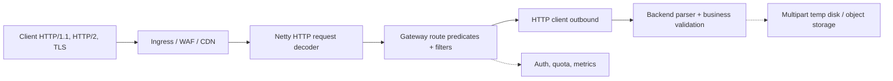
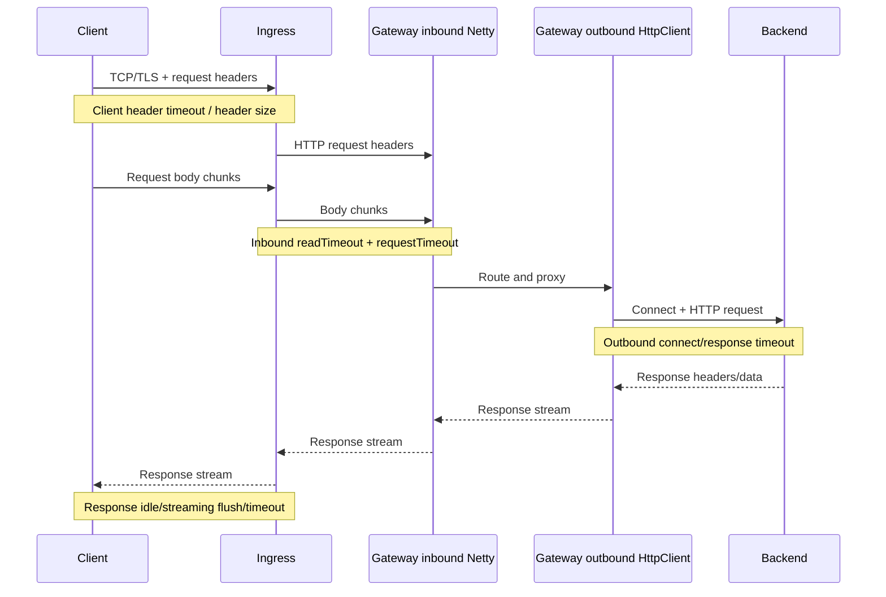
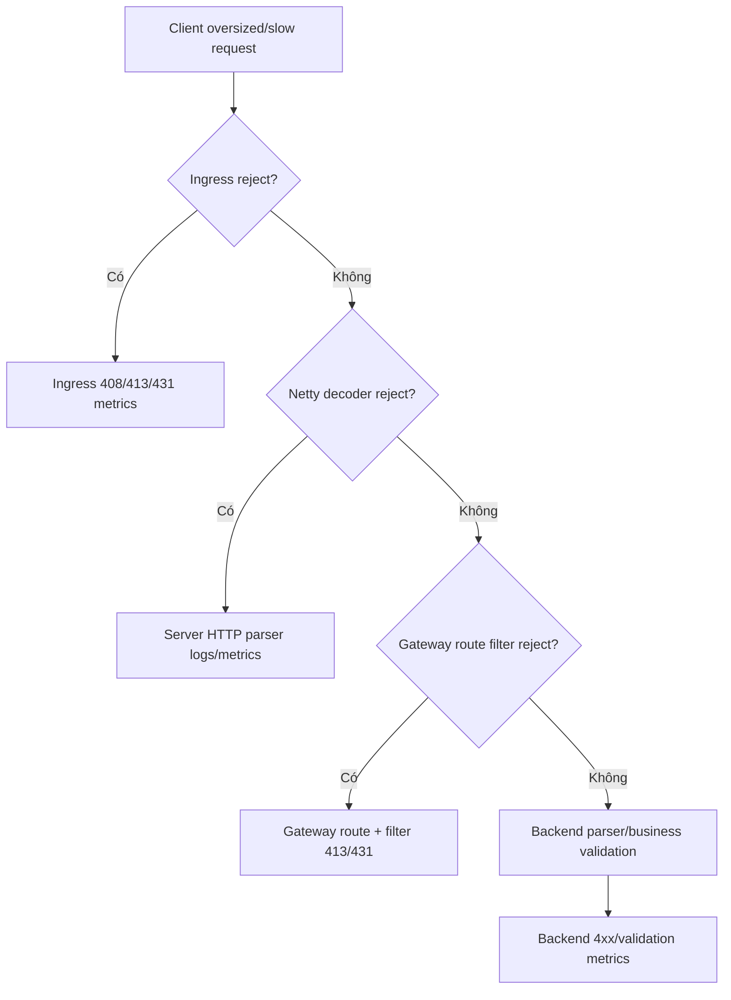
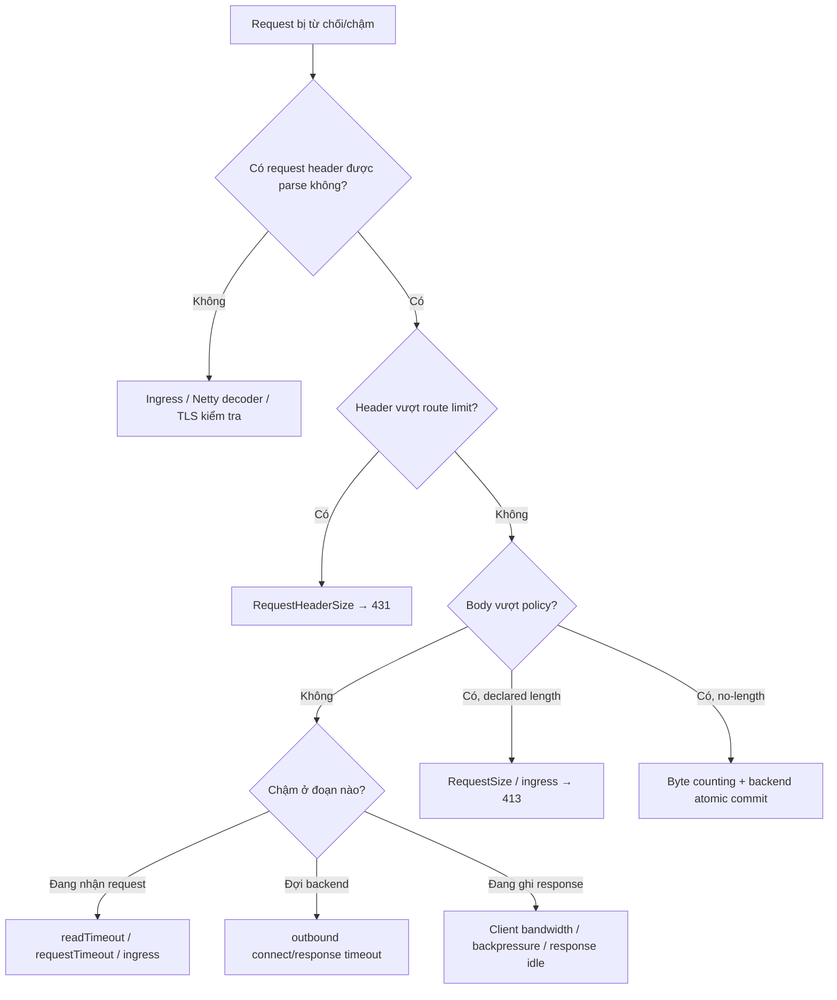

# Giới hạn header, body, multipart và thời gian đọc trong Spring Cloud Gateway

## 1. Vì sao giới hạn đầu vào là một phần của gia cố bảo mật?

**Spring Cloud Gateway** là điểm vào của microservices: định tuyến bằng route predicate, thực thi filter chain, biến đổi path/header, khám phá dịch vụ, xác thực/phân quyền, rate limiting, circuit breaker, retry, TLS và quan sát request. Một Gateway cấu hình route đúng vẫn có thể trở thành điểm bị quá tải nếu **đọc, giữ hoặc chuyển tiếp dữ liệu không có giới hạn**.

Những request cần đề phòng:

- Một cookie/JWT/header tùy chỉnh dài bất thường hoặc hàng trăm headers; parser/proxy/ứng dụng phải tốn bộ nhớ để giải mã.
- URL có query string rất dài, request line bất thường hoặc các header framing mâu thuẫn.
- HTTP POST khai báo `Content-Length` rất lớn, hoặc **không khai báo** tổng chiều dài mà gửi body theo luồng.
- Multipart upload có một file quá lớn, hàng nghìn parts nhỏ, một part có header dài hoặc tập tin tạm tích tụ trên disk.
- Client gửi mỗi vài byte sau nhiều giây (**slow upload/slowloris**), giữ kết nối dù tổng body chưa lớn.
- Lỗi do body caching ở `Retry`, `CacheRequestBody` hoặc `ModifyRequestBody`: vài chục request có thể giữ hàng trăm MiB trên heap/direct memory.
- Response SSE/WebSocket sống rất lâu; nếu vô tình dùng chung timeout với API JSON thì bị cắt, nhưng bỏ tất cả timeout cũng có thể khiến kết nối không còn hữu ích tồn tại vô hạn.

**Mục tiêu:** xây dựng chính sách **defense in depth** giới hạn đúng loại dữ liệu, tại đúng thời điểm, không làm hỏng streaming hợp lệ:

1. Giới hạn kích thước HTTP headers, request line và số lượng headers.
2. Giới hạn **tổng request body** cho JSON, upload và request streaming, kể cả khi không có `Content-Length`.
3. Giới hạn riêng **multipart**: số parts, header per part, non-file memory, dung lượng mỗi file, disk tạm.
4. Giới hạn **thời gian đọc request**: khoảng im lặng giữa các chunks và thời gian tối đa nhận trọn body.
5. Tách outbound connect/response timeout khỏi inbound read timeout, và tách route streaming khỏi route request ngắn.
6. Kiểm thử lỗi ở từng lớp, đo **backend đã nhận/commit dữ liệu chưa**, không chỉ nhìn status client.
7. Giữ TLS, authentication, quota tài nguyên, logging an toàn và chỉ số vận hành.

> **Phạm vi và phiên bản:** ví dụ ưu tiên **Spring Cloud Gateway Server WebFlux** (4.3+/5.x) chạy trên Reactor Netty, Spring Boot 3.5 hoặc 4.x. Gateway **Server Web MVC** sử dụng Servlet/WebMvc.fn và các giới hạn parser/timeout của Tomcat/Jetty khác; phần so sánh được nêu riêng. Prefix Gateway WebFlux mới là `spring.cloud.gateway.server.webflux.*`, còn một số bản cũ sử dụng `spring.cloud.gateway.*`.

## 2. Bốn lớp giới hạn độc lập



| Lớp | Giới hạn phù hợp | Không thay thế |
|---|---|---|
| **Ingress/WAF** | Header bytes/count, URI, body bytes, header/body read time, connections | Business authorization; parser limits ở backend |
| **HTTP server Reactor Netty** | Request decoder, request line, header parse, read/request timeout, idle connections | Gateway per-route content policy và outbound timeout |
| **Gateway route/filters** | `RequestHeaderSize`, `RequestSize`, authentication, RateLimiter, kiểm tra MIME/path | Header chưa parse được, body không có length nếu filter chỉ dựa header |
| **Backend WebFlux/Servlet** | Multipart parts/memory/disk, file type, checksum, user quota, atomic commit | Bảo vệ Gateway khỏi traffic đã tiêu tốn tài nguyên trước đó |

Một request có thể bị từ chối **trước Gateway filter chain**, ví dụ request line quá dài đã bị HTTP decoder chặn. Ngược lại, một request có headers hợp lệ vẫn có thể bị route `RequestHeaderSize` từ chối vì policy route chặt hơn.

### 2.1. Sắp xếp chính sách theo thứ tự chi phí

```text
Chặn sớm (thường rẻ hơn)
  1. Ingress / TLS / HTTP parser: header, line, content framing, slow input
  2. Authentication / route policy / declared size
  3. Counting bytes đang đọc + global concurrency/timeout budget
  4. Multipart/JSON parsing với memory/disk caps
  5. Backend domain validation, file scanning, atomic commit
Chặn muộn (thường đã tốn tài nguyên hơn)
```

Không phải mọi policy đều kiểm tra trước khi backend thấy byte đầu tiên. Với upload streaming, Gateway có thể đã forward một phần body khi số bytes vượt ngưỡng mới được phát hiện. Backend cần thiết kế **chưa commit** tệp/giao dịch nếu nhận request chưa hoàn chỉnh, và phải cleanup khi client/distributed proxy disconnect.

### 2.2. Loại dữ liệu nào đi với giới hạn nào?

| Dữ liệu | Đơn vị và ý nghĩa | Ví dụ vị trí |
|---|---|---|
| HTTP request header | Bytes mỗi header hoặc tổng field section tùy server | `server.max-http-request-header-size`, `RequestHeaderSize`, ingress |
| Request line / URI | Bytes/ký tự của method+target+protocol hoặc URL path/query | Netty `httpRequestDecoder.maxInitialLineLength`, ingress |
| Tổng HTTP body | Tổng bytes request, **gồm multipart framing** | `RequestSize`, ingress body cap, streaming byte counting |
| JSON string/object | Bytes cần aggregate trước deserialize | WebFlux codecs `max-in-memory-size` |
| Multipart text field | Memory tiêu thụ cho một non-file part | WebFlux multipart `max-in-memory-size` |
| Multipart file part | Số bytes của từng file, disk/temp budget | `max-disk-usage-per-part` và nghiệp vụ |
| Multipart part headers | Bytes của Content-Disposition/Content-Type trong mỗi part | `max-headers-size` |
| Multipart part count | Số parts trong một request | `max-parts` |
| Thời gian không có byte | Khoảng im lặng giữa hai lần đọc request | Reactor Netty `readTimeout`/ingress client-body timeout |
| Thời gian nhận toàn body | Tổng duration đọc request content | Reactor Netty `requestTimeout`/ingress total budget |

**Điểm mấu chốt:** `256KB` cho codec **không có nghĩa** mọi upload trên 256 KiB bị chặn; `max-in-memory-size` và `RequestSize` bảo vệ những ranh giới khác nhau.

## 3. Khởi tạo Gateway Server WebFlux đúng stack

### 3.1. Starter và quan sát

```xml
<!-- pom.xml: Spring Boot parent + Spring Cloud BOM phiên bản tương thích -->
<dependency>
    <groupId>org.springframework.cloud</groupId>
    <artifactId>spring-cloud-starter-gateway-server-webflux</artifactId>
</dependency>
<dependency>
    <groupId>org.springframework.boot</groupId>
    <artifactId>spring-boot-starter-actuator</artifactId>
</dependency>
<dependency>
    <groupId>io.micrometer</groupId>
    <artifactId>micrometer-registry-prometheus</artifactId>
    <scope>runtime</scope>
</dependency>
```

`spring-boot-starter-actuator` và Prometheus registry phục vụ health/metrics, không bắt buộc để route hoạt động. Nếu ứng dụng dùng Spring Security WebFlux resource server, thêm starter OAuth2 resource server và cấu hình issuer/audience/scope; không xem header limits là authentication.

### 3.2. Hai cách chạy Gateway rất khác nhau

| Đặc điểm | **Server WebFlux** | **Server Web MVC** |
|---|---|---|
| Network/server | Reactor Netty mặc định với reactive stack | Servlet container (Tomcat/Jetty) |
| Gateway routing | `GatewayFilter`, `GlobalFilter`, `ServerWebExchange` | WebMvc.fn `HandlerFunctions.http()`, before/after filters |
| Inbound request read timeout | Reactor Netty `HttpServer`/Boot server properties | Container connectors, Servlet async/body parsing |
| Header limit Boot | `server.max-http-request-header-size` (Netty semantics) | Cùng property nhưng Tomcat/Jetty semantics khác |
| Multipart | WebFlux multipart codec/`PartEvent` | Servlet multipart resolver/`spring.servlet.multipart.*` |
| Outbound HTTP | Reactor Netty `HttpClient` | `RestClient`/`ClientHttpRequestFactory` |

Đừng trộn `server.tomcat.max-http-form-post-size` và `spring.servlet.multipart.max-file-size` vào Gateway **Server WebFlux Netty** rồi nghĩ đã có limit. Tương tự, `spring.cloud.gateway.server.webflux.httpclient.response-timeout` là **timeout outbound**, không phải HTTP request body **inbound**.

## 4. Giới hạn header ở server và tại từng route

### 4.1. Server-level: chặn ngay ở HTTP decoder

Spring Boot có property:

```yaml
# application.yml của Gateway dùng Reactor Netty.
server:
  port: 8080
  max-http-request-header-size: 8KB
```

Spring Boot mô tả `server.max-http-request-header-size` là giới hạn kích thước request header. **Ý nghĩa chi tiết phụ thuộc embedded server**: tài liệu Boot lưu ý Netty áp giới hạn theo **từng header**, còn Tomcat xét **request line cộng tên/giá trị các headers**. Ở cấp Reactor Netty HTTP decoder cũng có `maxHeaderSize` và giới hạn request line; khi triển khai HTTP/1.1 so với HTTP/2, kiểm tra mức giới hạn thực trong **phiên bản đã chạy**.

**Không suy rằng 8KB luôn là tổng mọi headers của mọi loại server.** Nếu tổ chức cần một **tổng giới hạn header field section** hoặc số field nhất định, cần thêm policy ở ingress/HTTP/2 proxy phù hợp và kiểm thử thực tế.

### 4.2. Route-level: `RequestHeaderSize`

Gateway WebFlux cung cấp filter riêng:

```yaml
spring:
  cloud:
    gateway:
      server:
        webflux:
          routes:
            - id: orders-header-guard
              uri: http://localhost:8081
              predicates:
                - Path=/api/orders/**
              filters:
                - StripPrefix=1
                - RequestHeaderSize=4KB
```

Theo tài liệu, `RequestHeaderSize` tính bytes **key + value** của **mỗi request header**; nếu một header vượt `maxSize`, filter đặt status **`431 Request Header Fields Too Large`** và có thể thêm header `errorMessage` (có thể tùy biến tên). Ví dụ dùng `4KB` **chặt hơn** giới hạn HTTP server `8KB`.

Đừng hiểu filter này là một giới hạn **tổng bytes của tất cả headers** hay **tổng số headers**. Nó cũng chỉ chạy khi HTTP request **đã parse thành công và match route**; nếu request bị HTTP decoder chặn trước, phản hồi có thể khác 431 hoặc connection bị đóng.

### 4.3. Vì sao server limit và route limit đều cần?

```text
Client có một header 20 KiB
  -> Netty decoder với limit 8 KiB chặn trước route

Client có một header 6 KiB, route yêu cầu 4 KiB
  -> Netty parse được, RequestHeaderSize từ chối 431

Client có 100 headers × 1 KiB
  -> Mỗi header có thể nằm dưới policy 4 KiB
  -> Cần thêm giới hạn tổng và header count ở ingress/server nếu là yêu cầu
```

Giới hạn nhỏ quá cũng có thể chặn **JWT/cookie hợp lệ**, nhất là browser mang nhiều cookies. Hãy đo phân bố **kích thước header hợp lệ** trong môi trường được phép (không log raw token), rồi chọn ngưỡng đủ cho usage thật nhưng không mở vô hạn.

### 4.4. Request line, query và header count

Ngoài header field bytes, giới hạn:

- `maxInitialLineLength`: HTTP/1.x request line quá dài, bao gồm path/query; Reactor Netty reference nêu default khoảng **4096 bytes** trong các dòng hiện hành, nhưng hãy kiểm tra release.
- **Số lượng headers**: policy ingress/HTTP/2 header list; nhiều fields nhỏ vẫn có thể chiếm tài nguyên.
- **Số cookies và tổng cookie bytes**: không đưa định danh hoặc access token vào query string để lách giới hạn cookie/header.
- Query parameters không giới hạn có thể làm router/app/logging và database search tiêu tốn CPU; đặt số parameters/query length theo API contract.
- Header parsing validation phải được bật. **Không tắt validate-headers** để “chữa” một client gửi framing sai.

Ví dụ tùy chỉnh **Netty HTTP decoder trong Spring Boot 4.x**:

```java
package com.example.gateway.security;

import org.springframework.boot.reactor.netty.NettyReactiveWebServerFactory;
import org.springframework.boot.web.server.WebServerFactoryCustomizer;
import org.springframework.context.annotation.Configuration;

@Configuration(proxyBeanMethods = false)
public class InboundDecoderLimits
        implements WebServerFactoryCustomizer<NettyReactiveWebServerFactory> {

    @Override
    public void customize(NettyReactiveWebServerFactory factory) {
        factory.addServerCustomizers(server ->
            server.httpRequestDecoder(spec -> spec
                .maxInitialLineLength(4096)
                .maxHeaderSize(8192)
                .validateHeaders(true)));
    }
}
```

**Chỉ dùng khi thực sự cần tùy biến Netty ngoài cấu hình Boot**, và kiểm tra **Spring Boot 4.x package/API**. Với Boot 3.x, class factory thường ở `org.springframework.boot.web.embedded.netty.NettyReactiveWebServerFactory`. Khi có cả `server.max-http-request-header-size` và customizer đặt `maxHeaderSize`, **đừng thiết lập các giá trị mâu thuẫn**; dùng một nguồn chính thức, xem thứ tự customizers và kiểm tra wire behavior cuối cùng. HTTP/2 framing/header-list limits còn có những quy tắc riêng tại proxy/TLS terminator; customizer trên không bảo đảm một chính sách bất biến cho mọi giao thức.

## 5. Header hardening không chỉ là giới hạn byte

### 5.1. Các header cần kiểm tra tại trust boundary

| Header/nhóm | Rủi ro nếu xử lý sai | Chính sách |
|---|---|---|
| `Authorization` | JWT quá lớn hoặc bị lộ vào logs | Giới hạn kích thước hợp lệ, xác minh token, không log |
| `Cookie` | Header rất dài hoặc nhiều cookies | Giới hạn, `Secure`/`HttpOnly`/`SameSite`, không log |
| `Host` | Host routing tới dịch vụ không được công bố | Allowlist Host/virtual hosts và route policies |
| `Forwarded`, `X-Forwarded-*` | Client giả mạo IP/host/scheme để bypass ACL/redirect | Chỉ tin trusted reverse proxies; strip/overwrite tại edge |
| `X-User-Id`/`X-Tenant-Id` | Giả mạo danh tính để đọc resource của tenant khác | Không tin client, tạo từ principal đã xác minh hoặc không forward |
| `Content-Length`/`Transfer-Encoding` | Ambiguous body framing/request smuggling | Parser và proxy thống nhất, reject conflicting/malformed framing |
| `Connection`, `TE`, `Upgrade` | Hop-by-hop header forwarding sai | Theo HTTP version; loại bỏ hop-by-hop ngoài protocol cần upgrade |
| `Content-Encoding` | Compressed payload nhỏ nhưng giải nén thành nội dung khổng lồ | Giới hạn cả compressed bytes và decompressed/parser bytes |

### 5.2. Giới hạn header không thay HTTP protocol validation

HTTP request smuggling có thể xảy ra khi ingress, Gateway và backend **diễn giải ranh giới body khác nhau**. Hệ thống phải:

1. Dùng phiên bản ingress/Netty/Gateway đã được vá.
2. Reject request framing mâu thuẫn, `Content-Length` không hợp lệ hoặc `Transfer-Encoding` không đúng HTTP version.
3. Chuẩn hóa hop-by-hop headers, protocol upgrades và HTTP/2 → HTTP/1 conversions ở trusted edge.
4. Kiểm thử các trường hợp malformed trong **hệ thống cô lập** bằng HTTP parser tester được phép.
5. Không tự xây filter “sửa lỗi” bằng cách chấp nhận header framing bất thường rồi chuyển tiếp.

Vì header validation thường xảy ra **trước route**, một custom `GatewayFilter` không thể thay thế HTTP parser hardening. Header-size limits cũng không sửa lỗi authorization, CSRF, CORS hoặc SSRF khi ứng dụng sử dụng Host/URI động.

## 6. Giới hạn tổng HTTP body: `RequestSize` và điểm dễ bỏ sót

### 6.1. Route-level body limit

Gateway WebFlux có `RequestSize` `GatewayFilter Factory`. Ví dụ route chỉ nhận upload nhỏ:

```yaml
spring:
  cloud:
    gateway:
      server:
        webflux:
          routes:
            - id: document-upload
              uri: http://localhost:8081
              predicates:
                - Path=/api/documents/upload
                - Method=POST
              filters:
                - StripPrefix=1
                - RequestHeaderSize=4KB
                - name: RequestSize
                  args:
                    maxSize: 1048576
```

`1048576` là **1 MiB tính theo bytes**; dùng con số tường minh giúp kiểm thử boundary không mơ hồ `MB`/`MiB`. Theo tài liệu chính thức, nếu filter nhận biết request vượt `maxSize`, nó trả **413 Payload Too Large** và có thể thêm header `errorMessage`. Khi không có tham số, tài liệu mô tả mức mặc định của **filter** là 5 MB; không có nghĩa filter mặc định được gắn trên **mọi route**.

**Đừng hiểu sai:** route `RequestSize` áp tổng request body, không chỉ riêng bytes của `file` multipart; HTTP multipart framing và text fields cũng chiếm bytes. Filter chạy **sau HTTP decoder/route selection**. Một Gateway có nhiều routes phải bảo đảm **mọi route nhận body** đều có policy tương ứng hoặc một giới hạn chung ở ingress.

### 6.2. `Content-Length`: dễ kiểm tra, nhưng không đầy đủ

Kịch bản HTTP/1.1:

```text
POST /api/documents/upload HTTP/1.1
Content-Type: application/octet-stream
Content-Length: 1200000

... 1.200.000 bytes ...
```

Nếu HTTP parser nhận header hợp lệ và `Content-Length` lớn hơn giới hạn, Gateway có thể quyết định từ chối **trước khi đọc đủ body**. Việc từ chối sớm giảm bandwidth/heap/backend work. Tuy nhiên:

- `Content-Length` là **khai báo của client**, không phải bằng chứng bytes thực nhận.
- HTTP/1.1 có thể gửi `Transfer-Encoding: chunked` mà **không biết tổng length trước**.
- HTTP/2 request body được truyền qua **DATA frames**, không bắt buộc có `Content-Length`.
- Client có thể gửi sai hoặc mâu thuẫn length/framing; HTTP decoder hoặc proxy phải từ chối theo protocol rules.

Vì vậy một test chỉ gửi body có `Content-Length` và thấy 413 **không chứng minh đã ngăn mọi cách vượt giới hạn**.

### 6.3. Vấn đề đã được báo cáo với request không có length

Issue công khai **spring-cloud-gateway#3843** (mở ngày 6/7/2025) báo cáo rằng ở một số phiên bản, `RequestSize` chỉ dựa vào `Content-Length` và có thể để lọt body streaming không khai báo length. Đây là **báo cáo issue**, không khẳng định mọi phiên bản Gateway hiện tại đều có lỗi. Nhưng nó cho thấy lý do bắt buộc phải thử:

| Ca | Header/body thực | Điều hệ thống an toàn phải đạt |
|---|---|---|
| Declared length dưới ngưỡng | `Content-Length: 1000` | Cho qua nếu đúng quyền/MIME |
| Declared length vượt ngưỡng | `Content-Length: 1200000` | Từ chối trước backend theo policy |
| Không có declared length | Chunked transfer, actual bytes > limit | Phát hiện vượt giới hạn bằng một **byte-counting layer** |
| HTTP/2 không có length | DATA frames > limit | Không được coi no-length là unlimited |
| Declared length khác thực tế | EOF/extra bytes bất thường | HTTP parser/edge reject malformed framing |
| Client hủy giữa body | Incomplete request | Backend không commit dữ liệu chưa hợp lệ |

**Policy mục tiêu:** “Mỗi POST của route document-upload có tối đa **1 MiB bytes thực**” khác với “Khi header Content-Length tồn tại, từ chối nếu nó trên 1 MiB”. Bài kiểm thử phải chứng minh điều **thứ nhất** hoặc tài liệu phải công khai rằng layer nào đang chịu trách nhiệm byte counting.

### 6.4. Không dùng `spring.http.codecs.max-in-memory-size` thay tổng body limit

Trong Spring Boot 4.x:

```yaml
spring:
  http:
    codecs:
      max-in-memory-size: 256KB
```

Trong nhiều phiên bản Boot 3.x, tên cấu hình là `spring.codec.max-in-memory-size`. Property codec giới hạn số bytes phải **aggregate** để decode một representation/đối tượng trong WebFlux server/WebClient auto-configured. Nó **không bảo đảm** một Gateway đang proxy **raw Flux<DataBuffer>** sẽ tự reject một body 5 MiB vì 256KB.

Ví dụ:

- Controller `@RequestBody Mono<MyDto>` có thể cần buffer đủ JSON object; có thể nhận `DataBufferLimitException` nếu vượt codec limit.
- Controller `Flux<PartEvent>` xử lý multipart streaming có cơ chế riêng; dữ liệu mỗi part có thể không aggregate giống DTO.
- Gateway filter `CacheRequestBody(String.class)` hoặc `ModifyRequestBody` có thể gây aggregation; phải giới hạn và kiểm chứng ở đúng pipeline.
- Gateway route proxy raw body không nhất thiết chạy JSON decoder trước khi chuyển tiếp.

**Không dùng `DataBufferLimitException` như mã phản hồi chung cho tất cả request quá lớn:** mapping lỗi mặc định có thể khác `413`. Thiết kế error handler có chính sách rõ nhưng tránh trả stack trace/internal details cho client.

## 7. Giới hạn body streaming mà không giữ toàn bộ vào memory

### 7.1. Hai kiến trúc có mục tiêu bảo mật khác nhau

| Chiến lược | Cách hoạt động | Ưu điểm | Đánh đổi |
|---|---|---|---|
| **Pre-validate trước khi gửi backend** | Nhận toàn body dưới quota, lưu bounded memory/disk rồi mới forward | Backend **không thấy** request vượt giới hạn | Tăng latency, memory/temp storage, giới hạn streaming |
| **Streaming count trong khi proxy** | Đếm bytes đọc, hủy kết nối khi vượt ngưỡng | Ít buffering hơn, phù hợp upload lớn có policy | Backend có thể **đã nhận một phần** trước khi phát hiện vượt quota |
| **Ingress body cap + backend validation** | Chặn sớm, backend cũng tự đếm/atomic commit | Defense in depth, giảm tác động lên Gateway | Cần đồng bộ chính sách nhiều thành phần |

Một `GlobalFilter` tự đếm số bytes theo `Flux<DataBuffer>` **không thể hứa** backend chưa nhận byte nào nếu outbound stream đã bắt đầu. Với mutation/upload, backend phải dùng **temporary staging**, checksum/atomic commit và cleanup khi request bị hủy; không coi HTTP 413 muộn là rollback một giao dịch.

### 7.2. Pseudocode byte accounting

```text
PSEUDOCODE — biểu diễn yêu cầu thiết kế, KHÔNG phải Java chạy trực tiếp:

maxRequestBytes = 1048576
principal = authenticateOrReject()
route = authorizeAndChooseRoute(principal, request)
if Content-Length is valid and > maxRequestBytes:
    reject(413) BEFORE proxy starts

actualBytes = 0
on each inbound DataBuffer:
    actualBytes += readableByteCount(buffer)
    if actualBytes > maxRequestBytes:
        cancel inbound publisher
        cancel/close outbound request if already started
        release owned DataBuffers / cleanup staging
        return 413 IF response headers are not committed
        otherwise close transport and record limit violation
    else:
        forward buffer without copying, respecting ownership/backpressure

backend MUST NOT commit partial upload before complete body+validation
```

Những yêu cầu production khi viết một custom filter thực tế:

1. Kiểm tra đúng **route, method và body scope**, không apply một quota không rõ mục đích lên mọi traffic.
2. Đặt filter ở vị trí trước các bước có thể **cache/deserialize toàn body**.
3. Không `collectList()`/`DataBufferUtils.join()` cho luồng chưa có trần.
4. Không `subscribe()` độc lập ngoài chuỗi reactive của request.
5. Giữ **single subscription**, cancellation và backpressure; chú ý `doOnDiscard` và `DataBufferUtils.release` khi filter sở hữu buffers.
6. Chặn các request có `Content-Length` lớn **trước khi gửi**; vẫn đếm bytes thật cho no-length/HTTP2.
7. Đặt maximum duration/concurrency quota để chống client gửi 1 byte/giây.
8. Nếu response/headers đã commit, không cố gửi JSON 413 vào cùng response như chưa có dữ liệu.
9. Log metric **loại vi phạm/route**, không log raw body/token.
10. Kiểm thử chunked/HTTP2, cancel giữa upload, large multipart, retry và lỗi upstream.

**Không đưa một đoạn “custom GlobalFilter copy trên mạng” chưa được kiểm chứng làm giải pháp bảo mật mặc định**. Khi tính chính xác bytes và atomic commit là điều kiện tuân thủ, ưu tiên giải pháp ingress/server có thể chứng minh bằng integration tests, kết hợp backend validation.

### 7.3. Memory budget của filter caching

Giả sử một route cho phép body **4 MiB**, bật `CacheRequestBody` rồi có **120 requests đồng thời**:

\[
4\ \text{MiB/request} \times 120\ \text{requests}
 = 480\ \text{MiB}
\]

Con số 480 MiB mới là **một bản payload**, chưa tính copies, header state, JWT, Netty direct buffers, TLS, thread stacks, heap objects và GC overhead. Một container `limits.memory:512Mi` có thể `OOMKilled` dù không có “lỗi nghiệp vụ” trong payload.

`Retry` với body có thể phải cache để phát lại. `ModifyRequestBody`/`ModifyResponseBody` có thể decode/encode toàn representation. Tránh áp mặc định các filter này lên upload lớn, SSE hoặc luồng NDJSON vô hạn.

### 7.4. Request quota khác rate limit

`RequestRateLimiter` token bucket giới hạn **số requests/giây** theo key; nó không tự giới hạn **bytes/request**, **bytes/giây**, số **active uploads** hoặc số WebSocket/SSE streams đang mở. Một user có thể gửi rất ít requests nhưng mỗi request giữ connection lâu và tiêu thụ nhiều RAM/disk.

Thiết kế cần ít nhất bốn giới hạn độc lập:

- `max-request-bytes`: mỗi request tối đa bao nhiêu bytes?
- `max-request-read-duration`: bao lâu phải gửi xong body?
- `max-concurrent-uploads-per-principal`: một người được upload mấy request đồng thời?
- `max-upload-byte-rate/tenant quota` (nếu cần): tổng lượng dữ liệu theo thời gian, thường ở ingress/backend.

Quotas phân tán qua nhiều Gateway pods có thể cần Redis/central admission control; không dựa vào counter cục bộ khi yêu cầu hạn mức toàn cụm.

## 8. Multipart: nhiều giới hạn bên trong một request

### 8.1. Multipart framing có nhiều thành phần

Một multipart request không chỉ có file:

```http
POST /api/documents/upload HTTP/1.1
Content-Type: multipart/form-data; boundary=abc123

--abc123
Content-Disposition: form-data; name="description"

test document
--abc123
Content-Disposition: form-data; name="file"; filename="demo.pdf"
Content-Type: application/pdf

%PDF-1.7...
--abc123--
```

`Content-Length` của toàn HTTP request (nếu có) bao gồm **boundary, part headers, field bytes và file bytes**. Vì vậy file 1 MiB có thể khiến request multipart **lớn hơn 1 MiB**. Nếu nghiệp vụ cho phép file tối đa 1 MiB và thêm metadata, đặt tổng request cap **lớn hơn có chủ đích**, đồng thời có **per-file cap** trên backend.

### 8.2. Spring Boot WebFlux multipart properties

Với **backend WebFlux thực sự parse multipart**, có thể đặt:

```yaml
# application.yml của BACKEND WebFlux nhận upload.
spring:
  webflux:
    multipart:
      max-in-memory-size: 128KB
      max-disk-usage-per-part: 2MB
      max-headers-size: 4KB
      max-parts: 5
      file-storage-directory: /tmp/spring-multipart
```

| Property | Bảo vệ điều gì | Không có nghĩa |
|---|---|---|
| `max-in-memory-size` | Memory cho non-file part và ngưỡng chuyển file part ra disk | Không phải tổng body-size limit |
| `max-disk-usage-per-part` | Dung lượng disk cho từng file part khi parser dùng disk | Không phải quota cả node hoặc toàn request |
| `max-headers-size` | Bytes headers **bên trong một multipart part** | Không phải HTTP request headers ban đầu |
| `max-parts` | Số parts được phép trong request | Không giới hạn kích thước từng part |
| `file-storage-directory` | Vị trí lưu part tạm theo parser | Không phải nơi lưu file nghiệp vụ bền vững |

**Defaults thay đổi theo Boot version:** tài liệu Boot mới có các giá trị mặc định explicit hơn (ví dụ `max-disk-usage-per-part` và `max-parts` không còn mặc định vô hạn ở một số dòng). Không dựa vào default cũ như `-1` trong tutorial và cho rằng đã an toàn; đặt budget rõ, kiểm tra binding khi startup và test cả memory lẫn disk behavior.

### 8.3. Các property đặt ở Gateway có tự bảo vệ backend không?

Không nhất thiết. Nếu Gateway chỉ **proxy multipart raw body** qua Reactor Netty mà không gọi `MultipartHttpMessageReader`, `spring.webflux.multipart.*` của Gateway có thể **không được sử dụng** trong đoạn forwarding. Backend parse multipart phải tự giới hạn theo `spring.webflux.multipart.*` của **chính backend**.

Để bảo vệ sớm:

1. Ingress giới hạn tổng body bytes (kể cả chunked).
2. Gateway `RequestSize`/byte-counting policy cho route upload.
3. Backend multipart parser giới hạn parts/memory/disk.
4. Backend nghiệp vụ kiểm tra file type thực, số file, owner, checksum, quota và scan.
5. Tệp tạm chỉ được promote vào storage bền vững **sau khi hoàn tất và hợp lệ**.

Nếu backend là **Spring MVC/Servlet**, thuộc tính là `spring.servlet.multipart.max-file-size`, `max-request-size`, `file-size-threshold` và các giới hạn container/part parser tương ứng, **không** phải `spring.webflux.multipart.*`.

### 8.4. Multipart streaming với `PartEvent`

Spring WebFlux hỗ trợ xử lý multipart streaming qua `Flux<PartEvent>`. Khi chọn cách này, bạn phải tiêu thụ/giải phóng `DataBuffer` trong mỗi part và tự giữ byte count/limit cho stream. Tài liệu Boot ghi `file-storage-directory` dành cho parser lưu file part có thể **không được sử dụng** ở kiểu `PartEvent` streaming.

Đừng giả định quota disk của parser mặc định vẫn bảo vệ chính xác luồng mà ứng dụng tự xử lý. Với streaming, tự kiểm tra:

- File count/part count; maximum bytes mỗi part; maximum aggregate bytes.
- Part header length, filename sanitization và path traversal.
- Buffer ownership/cancellation khi client dừng giữa chừng.
- Atomic commit/temp cleanup và per-principal upload concurrency.

### 8.5. Tệp tạm có thể gây pod eviction trước khi heap đầy

Nếu upload 3 MiB/file, có 100 uploads đồng thời, một parser lưu tệp tạm có thể tiêu thụ **300 MiB disk tạm** chưa tính các bản sao. Kubernetes `ephemeral-storage`, `emptyDir.sizeLimit` và node `DiskPressure` phải được tính. Nếu dùng `emptyDir.medium: Memory` (tmpfs), các trang tạm còn **tính vào cgroup memory**, có thể góp phần gây OOM.

Không dùng file name từ client làm đường dẫn ghi trực tiếp. Với production, randomize object key/UUID server-side, dùng storage staging, quota disk/size và antivirus/mime checks khi nghiệp vụ yêu cầu. Metadata như `filename` và `description` là untrusted input, không gắn vào metric labels.

## 9. Giới hạn thời gian đọc request từ client

### 9.1. Slowloris và slow upload khác backend chậm

Ví dụ hai request:

```text
Trường hợp A — client chậm:
Client --1 byte / vài giây--> Gateway --???--> Backend
                     ^ Gateway đang chờ client gửi thêm body

Trường hợp B — backend chậm:
Client --gửi body xong--> Gateway --đã gửi request--> Backend
                                                  ^ Backend xử lý 20s
```

Trường hợp A cần giới hạn **inbound read** và connection lifetime. Trường hợp B cần **outbound response timeout**, circuit breaker/bulkhead và backend SLO. Chỉ đặt `spring.cloud.gateway.server.webflux.httpclient.response-timeout` **không** chặn một client gửi request body chậm.

### 9.2. Ba timeout inbound của Reactor Netty `HttpServer`

| API | Định nghĩa được Reactor Netty tài liệu hóa | Không phải |
|---|---|---|
| `readTimeout(Duration)` | Khoảng tối đa **giữa hai network-level reads** khi đang đọc **request content** | Không phải deadline cho cả nghiệp vụ/backend |
| `requestTimeout(Duration)` | Tổng thời gian tối đa dành để đọc **request content** | Không đồng nghĩa total HTTP response time |
| `idleTimeout(Duration)` | Thời gian connection **đang đợi một HTTP request** khi rảnh | Không thay request-body read timeout |

**Cực kỳ quan trọng:** tài liệu Reactor Netty nói `readTimeout` handler được thêm **sau khi nhận đủ request headers** và được gỡ khi đọc xong content. Vì vậy nó **không tự bảo vệ đầy đủ slow header attack trước khi header hoàn chỉnh**. Cần `client_header_timeout` hoặc cơ chế thời hạn đọc header ở ingress/transport thích hợp.

Một client gửi đều **mỗi 4 giây một byte** có thể **không chạm** `readTimeout=5s`, nhưng vẫn có thể mất vài phút để gửi xong. `requestTimeout=30s` giới hạn tổng thời gian nhận request content; cả hai cần thiết vì giải quyết hai kiểu client chậm khác nhau.

### 9.3. Tùy chỉnh inbound `HttpServer` trong Spring Boot

Ví dụ cho **Spring Boot 4.x**:

```java
package com.example.gateway.security;

import java.time.Duration;

import org.springframework.boot.reactor.netty.NettyReactiveWebServerFactory;
import org.springframework.boot.web.server.WebServerFactoryCustomizer;
import org.springframework.context.annotation.Configuration;

@Configuration(proxyBeanMethods = false)
public class InboundReadTimeLimits
        implements WebServerFactoryCustomizer<NettyReactiveWebServerFactory> {

    @Override
    public void customize(NettyReactiveWebServerFactory factory) {
        factory.addServerCustomizers(server -> server
            .readTimeout(Duration.ofSeconds(5))
            .requestTimeout(Duration.ofSeconds(30))
            .idleTimeout(Duration.ofSeconds(30)));
    }
}
```

Với **Spring Boot 3.x**, import `NettyReactiveWebServerFactory` thường là `org.springframework.boot.web.embedded.netty.NettyReactiveWebServerFactory`; `WebServerFactoryCustomizer` ở namespace Boot tương ứng. Reactor Netty `HttpServer.readTimeout`/`requestTimeout` có từ Reactor Netty 1.1.9; kiểm tra dependency train đang dùng và thứ tự các Boot customizers trước khi áp.

**Cấu hình trên là một policy toàn inbound server**, không phải per-route deadline tự động. Nếu phải cho upload video hợp lệ kéo dài 10 phút nhưng API JSON giới hạn 30 giây, đừng áp máy móc một `requestTimeout=30s` cho cả hai. Cân nhắc tách upload domain/ingress/gateway deployment, upload trực tiếp object storage hoặc extension point có per-route enforcement được kiểm chứng.

### 9.4. Phân biệt header timeout

`readTimeout` và `requestTimeout` trong ví dụ chủ yếu liên quan **body** sau headers. Để giảm slow-header attack:

- Ingress đặt thời gian đọc request headers hoàn chỉnh (`client_header_timeout` với Nginx) và giới hạn header/URI bytes.
- Reactor Netty áp HTTP decoder constraints ngay khi parse, có connection-level timeout theo lifecycle được hỗ trợ, nhưng không suy rằng `idleTimeout` luôn bao trùm request header đang nhỏ giọt.
- Trên TLS edge, đặt **TLS handshake timeout** phù hợp; client bắt tay TLS rất chậm cũng chiếm tài nguyên trước HTTP.
- Đặt connection quota và rate limit tại edge; không chỉ dựa vào kích thước.

### 9.5. HTTP status khi hết thời gian

HTTP 408 là mã có ý nghĩa cho **request timeout**, nhưng **đừng hard-code** rằng mọi timeout Netty sẽ trả 408. Tùy thời điểm/proxy/parser, hệ thống có thể trả 408, 4xx khác, đóng TCP/TLS connection hoặc khiến client thấy network error. Nếu response đã commit, server không thể đổi status của response cũ.

Kiểm thử phải ghi **ai đóng** (ingress/Gateway/backend/client), **thời gian thực** và **backend có side effect không**. Với request bị cắt giữa upload, backend phải xóa staging file và không commit nội dung dở dang.

## 10. Ingress/WAF: chặn sớm, nhưng hiểu đúng buffering và timeout

### 10.1. Cấu hình Nginx tham khảo

Ví dụ sau là **fragment Nginx trong server TLS đã được cấu hình chứng chỉ và upstream hợp lệ**, không phải file Nginx đầy đủ có thể chạy độc lập:

```nginx
# Chỉ minh họa các directives trong một server/location được quản lý.
server {
    listen 443 ssl;
    server_name api.test.example.test;

    # Đọc toàn bộ header trong một khoảng thời gian hữu hạn.
    client_header_timeout 10s;
    client_header_buffer_size 1k;
    large_client_header_buffers 4 8k;

    # Giới hạn request body, kể cả trường hợp proxy có thể xác định bytes.
    client_max_body_size 2m;
    # Thời gian chờ giữa các lần nhận body, KHÔNG phải tổng deadline upload.
    client_body_timeout 10s;

    location /api/ {
        proxy_pass http://gateway_upstream;
        proxy_http_version 1.1;

        # Buffer body trước khi forward: cần temp disk quota.
        proxy_request_buffering on;
        proxy_send_timeout 15s;
        proxy_read_timeout 60s;
    }
}
```

Đọc đúng:

- `client_max_body_size 2m` là chính sách **tổng HTTP request body** ở ingress. Dùng cùng ký hiệu đơn vị và đo boundary test trên tool thật; Nginx thường trả 413 khi vượt.
- `client_header_timeout 10s` yêu cầu nhận đủ header trong ngưỡng; có thể trả 408 khi client quá chậm.
- `client_body_timeout 10s` là thời gian **giữa hai lần đọc**, client cứ gửi từng ít bytes có thể tránh timeout này—vẫn cần total duration/bandwidth quota ở lớp khác.
- `large_client_header_buffers 4 8k` liên quan xử lý header lớn; **không có nghĩa tổng header section được phép luôn là đúng 32 KiB** cho mọi protocol. Cần kiểm thử cả nhiều headers nhỏ và HTTP/2.
- `proxy_send_timeout` và `proxy_read_timeout` cũng chủ yếu liên quan khoảng chờ I/O giữa upstream operations, không mặc định là total response deadline.
- `proxy_request_buffering on` giúp ingress nhận/buffer body trước khi forward, có thể giảm partial uploads tới backend nhưng **tăng temp disk usage và latency**, cần quota/cleanup.

Trong Kubernetes Nginx Ingress Controller, các giới hạn tương tự có thể được quản lý bằng **annotations/ConfigMap của controller**, không phải chỉnh trực tiếp một file `nginx.conf` trong Pod. Tên annotation khác theo loại controller/phiên bản; tra tài liệu **controller thực sự được triển khai** trước khi áp.

### 10.2. Streaming upload và proxy buffering

Nếu `proxy_request_buffering off`, ingress có thể forward request body **theo luồng** để giảm disk buffering và độ trễ; khi đó backend có thể nhận một phần body **trước khi** biết toàn upload vượt quota. Chọn policy dựa trên:

| Mục tiêu | Lựa chọn thường phù hợp | Cần bổ sung |
|---|---|---|
| Không cho backend thấy upload vượt limit | Prebuffer có giới hạn tại ingress hoặc staging layer | Temp storage quota, body timeout, scan/checksum |
| Upload lớn streaming | Forward theo luồng/đẩy trực tiếp object storage | Byte-count cap, backpressure, backend atomic commit |
| Upload có thể resume | Chunk protocol hoặc object-store multipart API | Idempotent chunk IDs, size/type/auth quota |
| Giảm CPU/bandwidth Gateway | Direct-to-object-store có presigned credentials ngắn hạn | Ownership, method/size/content validation |

**Không dùng `proxy_request_buffering off` làm giải pháp bảo mật chỉ vì upload chạy nhanh hơn.** Nó là một đánh đổi có chủ ý giữa tài nguyên ingress và khả năng backend nhận partial data.

### 10.3. Phân nhánh SSE/WS ra chính sách khác

SSE `GET` có **response stream lâu dài**, không phải upload request-body dài. Trên ingress, route SSE thường cần:

- `proxy_buffering off` cho response SSE (hoặc policy tương đương).
- `proxy_read_timeout`/idle timeout phù hợp **heartbeat**; nếu heartbeat không đến client thì stream vẫn bị cắt.
- Có **connection lifetime** hoặc rotation/reconnect policy riêng cho auth/session.
- Không response-cache, không toàn-body rewrite filter.

WebSocket upgrade dùng HTTP handshake, sau đó là **WebSocket frames**. `client_max_body_size` của HTTP **không giới hạn** dung lượng từng WebSocket frame/message; phải có frame size, rate/active sessions và queue/bandwidth limits riêng. Không đặt WebSocket trong cùng filter chain như raw HTTP multipart và cho rằng `RequestSize` bảo vệ frames.

### 10.4. Nhiều hop dễ có chính sách mâu thuẫn

```text
Client -> CDN max 10MB -> Ingress max 2MB -> Gateway max 1MiB
                                             -> Backend max 1MiB/file
```

Một file 900 KiB cùng multipart framing có thể pass nếu tổng body dưới Gateway cap; file 1 MiB đúng giới hạn **per-file** có thể fail Gateway vì tổng multipart >1 MiB. Đây là lựa chọn policy cần giải thích cho client, không phải lỗi bất ngờ.

Đề xuất đặt **per-file limit nhỏ hơn total-request limit có khoảng headroom rõ ràng**; tài liệu API nên chỉ rõ cả hai. Nếu có nhiều file, tính tổng file/part count và business quota, đừng giữ giới hạn mơ hồ “1 MB upload”.

## 11. Outbound Gateway timeout hoàn toàn khác thời gian đọc client

### 11.1. Cấu hình Reactor Netty HTTP client cho route API thường

```yaml
# application.yml — Gateway Server WebFlux, áp dụng cho HTTP outbound calls.
spring:
  cloud:
    gateway:
      server:
        webflux:
          httpclient:
            connect-timeout: 2000
            response-timeout: 10s
            pool:
              type: fixed
              max-connections: 200
              acquire-timeout: 1000
```

- `connect-timeout: 2000`: **mili-giây** kết nối TCP outbound tới backend; không đo client gửi body chậm.
- `response-timeout: 10s`: response timeout outbound, semantics theo Reactor Netty/SCG; không phải tổng wall-clock deadline cứng cho mọi download.
- `max-connections`/`acquire-timeout`: quản lý connection pool **outbound** khi dùng FIXED pool, không giới hạn inbound WebSocket/SSE sessions hay số uploads đang mở.

Không cần tăng outbound timeout để “chữa” slowloris. Một request có thể bị giữ hàng phút ở **inbound read phase** ngay cả khi backend chưa được gọi.

### 11.2. Route SSE có thể cần response timeout khác

```yaml
spring:
  cloud:
    gateway:
      server:
        webflux:
          streaming-media-types:
            - text/event-stream
          routes:
            - id: notifications-sse
              uri: http://localhost:8082
              predicates:
                - Path=/api/notifications/stream
                - Method=GET
              filters:
                - StripPrefix=1
              metadata:
                response-timeout: -1
```

Trong Gateway WebFlux, metadata `response-timeout: -1` là ví dụ được tài liệu hóa để **vô hiệu global response timeout cho route này**. Nó **không** bỏ qua ingress/CDN/firewall idle timeout, không kéo dài JWT/session vô thời hạn và không bỏ body-read timeouts trên HTTP requests khác.

Route WebSocket là `ws://`/`wss://`, không dùng `httpclient.response-timeout` cho WebSocket frame lifetime như một HTTP GET thường.

### 11.3. Retry, circuit breaker và absolute deadline

Nếu backend xử lý request 8 giây, `connect-timeout=2s` không giúp gì sau khi TCP connect xong. Một `Retry` có ba attempts, mỗi attempt chờ nhiều giây, có thể vượt API end-to-end SLA nếu không có **retry budget**, circuit breaker/bulkhead và client deadline.

Đặc biệt, retry `POST`/multipart có thể gửi lại body, tăng memory do caching, và tạo side effects trùng nếu backend đã commit nhưng response mất. Không retry mutations chỉ vì status 5xx nếu chưa có idempotency contract.

### 11.4. Tóm tắt timeout theo hướng truyền



Từ sơ đồ: **server read timeout** và **HTTP client response timeout** đo hai phần khác nhau. Đừng gộp tất cả thành một cấu hình tên “gateway.timeout=30s” mà không nêu giai đoạn.

## 12. Cấu hình hợp nhất cho một Gateway thử nghiệm

### 12.1. Bốn routes với quota khác nhau

Ví dụ hoàn chỉnh cho **Spring Cloud Gateway Server WebFlux** và **Spring Boot 4.x** (thay URI backend theo môi trường):

```yaml
# application.yml — profile local/test, không chứa secrets.
server:
  port: 8080
  max-http-request-header-size: 8KB

spring:
  http:
    codecs:
      max-in-memory-size: 256KB
  cloud:
    gateway:
      server:
        webflux:
          default-filters:
            - RequestHeaderSize=4KB
          httpclient:
            connect-timeout: 2000
            response-timeout: 10s
          streaming-media-types:
            - text/event-stream
          metrics:
            enabled: true
            path-tags:
              enabled: false
          routes:
            - id: orders-read
              uri: http://localhost:8081
              predicates:
                - Path=/api/orders/**
                - Method=GET
              filters:
                - StripPrefix=1

            - id: documents-raw
              uri: http://localhost:8081
              predicates:
                - Path=/api/documents/raw
                - Method=POST
              filters:
                - StripPrefix=1
                - name: RequestSize
                  args:
                    maxSize: 1048576  # 1 MiB total body

            - id: documents-multipart
              uri: http://localhost:8081
              predicates:
                - Path=/api/documents/upload
                - Method=POST
              filters:
                - StripPrefix=1
                - name: RequestSize
                  args:
                    maxSize: 2097152  # 2 MiB total multipart body

            - id: events-stream
              uri: http://localhost:8081
              predicates:
                - Path=/api/events/stream
                - Method=GET
              filters:
                - StripPrefix=1
              metadata:
                response-timeout: -1

management:
  endpoints:
    web:
      exposure:
        include: health,info,metrics
```

**Ý nghĩa và giới hạn của ví dụ:**

- `default-filters` áp dụng `RequestHeaderSize=4KB` cho **mọi route đã match**, không cho request bị chặn trước bởi Netty decoder hoặc chưa match route.
- `documents-raw` có tổng HTTP body tối đa 1 MiB **theo policy**, cần test no-length/chunked để chứng minh có byte-counting enforcement đầy đủ.
- `documents-multipart` có tổng HTTP body policy 2 MiB; backend vẫn cần **per-file cap** riêng, ví dụ 1 MiB/file và tối đa ba files.
- `events-stream` là HTTP SSE route GET, không phải WebSocket; response-timeout -1 không bỏ request/header timeout ở ingress.
- `spring.http.codecs.max-in-memory-size` là **Boot 4.x**. Với Boot 3.x hãy đối chiếu `spring.codec.max-in-memory-size` và config metadata.
- `server.max-http-request-header-size` là hạn chế của embedded server, có nghĩa phụ thuộc Netty implementation; nó **không** thay route RequestHeaderSize hoặc HTTP/2 header-list policy tại ingress.
- `management.endpoints.web.exposure` chỉ hiển thị endpoints; phải bảo vệ Actuator bằng mạng riêng và Spring Security/identity, không mở public không kiểm soát.

**Các ví dụ ở các mục trước là những phương án minh họa riêng.** Khi dùng cấu hình hợp nhất này, không copy thêm các routes cùng ID vào `application.yml` khác hay Java DSL trùng nhau; tránh route selection không xác định.

### 12.2. Backend multipart cần cấu hình riêng

Backend demo (chạy `localhost:8081`) cần:

```yaml
# application.yml của BACKEND WebFlux 4.x/Boot 4.x (không phải Gateway).
server:
  port: 8081
spring:
  webflux:
    multipart:
      max-in-memory-size: 128KB
      max-disk-usage-per-part: 2MB
      max-headers-size: 4KB
      max-parts: 5
      file-storage-directory: /tmp/spring-multipart
```

Nếu chỉ đặt ở Gateway trong khi Gateway không parse multipart, backend **không nhận** các quota này. Cần tạo thư mục temp với quyền non-root và `emptyDir`/filesystem quota phù hợp khi chạy trong container.

### 12.3. Bốn yêu cầu không thể cấu hình chỉ bằng hai filters

`RequestHeaderSize` + `RequestSize` **chưa giải quyết đầy đủ**:

1. Giới hạn **tổng số headers** hoặc mọi HTTP/2 header-list trường hợp.
2. Body không `Content-Length` trong phiên bản RequestSize chỉ kiểm header.
3. Tổng **thời gian đọc request content**, khoảng gap giữa reads và slow headers.
4. Multipart per-file/quota/scan/atomic commit trong backend.

Cần ingress HTTP parser policy, Netty `readTimeout`/`requestTimeout` và backend validation. Chốt trách nhiệm mỗi layer **bằng kiểm thử**, không chỉ bằng tên property.

## 13. Backend demo kiểm chứng request bytes thật

### 13.1. Backend WebFlux nhận raw bytes mà không gom toàn bộ

Để biết request có bị Gateway chặn hay vẫn đến backend, dùng một backend thử nghiệm tách riêng với starter `spring-boot-starter-webflux`.

```java
package com.example.documentdemo;

import java.util.Map;
import org.springframework.core.io.buffer.DataBufferUtils;
import org.springframework.http.MediaType;
import org.springframework.web.bind.annotation.PostMapping;
import org.springframework.web.bind.annotation.RequestBody;
import org.springframework.web.bind.annotation.RestController;
import reactor.core.publisher.Flux;
import reactor.core.publisher.Mono;
import org.springframework.core.io.buffer.DataBuffer;

@RestController
public class RawUploadProbeController {

    @PostMapping(path = "/documents/raw",
                 consumes = MediaType.APPLICATION_OCTET_STREAM_VALUE)
    public Mono<Map<String, Long>> raw(
            @RequestBody Flux<DataBuffer> body) {
        return body.map(buffer -> {
                try {
                    return (long) buffer.readableByteCount();
                } finally {
                    // Chỉ release khi handler sở hữu và đã tiêu thụ buffer.
                    DataBufferUtils.release(buffer);
                }
            })
            .reduce(0L, Long::sum)
            .map(n -> Map.of("receivedBytes", n));
    }
}
```

Handler demo này **đếm số bytes đã tiêu thụ** rồi trả JSON, không lưu file và không tự giới hạn tổng bytes. Nó **không phải backend production an toàn**: phải có business size/cancellation/storage quota. Nếu response không có vì Gateway hủy request giữa chừng, test harness nên ghi một **counter server-side có thể reset** hoặc log metadata đã redacted để biết backend đã bắt đầu nhận bytes.

### 13.2. Backend nhận multipart và đếm file bytes

```java
package com.example.documentdemo;

import java.util.Map;
import org.springframework.core.io.buffer.DataBufferUtils;
import org.springframework.http.MediaType;
import org.springframework.http.codec.multipart.FilePart;
import org.springframework.web.bind.annotation.PostMapping;
import org.springframework.web.bind.annotation.RequestPart;
import org.springframework.web.bind.annotation.RestController;
import reactor.core.publisher.Mono;

@RestController
public class MultipartProbeController {

    @PostMapping(path = "/documents/upload",
                 consumes = MediaType.MULTIPART_FORM_DATA_VALUE)
    public Mono<Map<String, Object>> upload(
            @RequestPart("file") FilePart file,
            @RequestPart("description") String description) {

        return file.content()
            .map(buffer -> {
                try {
                    return (long) buffer.readableByteCount();
                } finally {
                    DataBufferUtils.release(buffer);
                }
            })
            .reduce(0L, Long::sum)
            .map(bytes -> Map.of(
                "fileName", file.filename(),
                "description", description,
                "receivedBytes", bytes));
    }
}
```

Ví dụ này cho biết file part tồn tại và có bao nhiêu bytes. **Không** dùng `file.filename()` trực tiếp để ghi tệp, không log payload nhạy cảm. `receivedBytes` khớp vẫn **chưa chứng minh nội dung không bị biến đổi**; kiểm tra SHA-256 trên raw bytes ở client/backend khi cần. Bộ giải mã multipart có thể dùng file tạm **trước khi controller được gọi** nên cần quota parser/temp directory riêng.

### 13.3. Endpoint SSE thử nghiệm để kiểm tra timeout phân loại

```java
package com.example.documentdemo;

import java.time.Duration;
import org.springframework.http.MediaType;
import org.springframework.http.codec.ServerSentEvent;
import org.springframework.web.bind.annotation.GetMapping;
import org.springframework.web.bind.annotation.RestController;
import reactor.core.publisher.Flux;

@RestController
public class EventProbeController {

    @GetMapping(path = "/events/stream",
                produces = MediaType.TEXT_EVENT_STREAM_VALUE)
    public Flux<ServerSentEvent<String>> stream() {
        return Flux.interval(Duration.ofSeconds(1))
            .map(i -> ServerSentEvent.<String>builder()
                .id(Long.toString(i + 1))
                .event("tick")
                .data("test-" + (i + 1))
                .build());
    }
}
```

Trong ví dụ này, event ID được tạo **lại từ 1 mỗi subscription**; không có durable replay. Nó chỉ để kiểm tra **HTTP response streaming không bị cắt bởi outbound timeout 10s** của route khác. Nếu test nhiều người cùng xem thông báo thật, cần authentication, cursor bền vững, retry/backpressure và active connection quotas.

## 14. Thực hành thủ công: header, body, multipart và read time

Các lệnh dưới đây chỉ dành cho **máy cá nhân, container test hoặc cluster sandbox được phê duyệt**. Không gửi malformed/oversize/slowloris requests vào API production hoặc hệ thống bên thứ ba. Chỉ dùng nội dung giả, giữ payload nhỏ hơn 2 MiB và xóa file tạm sau bài học.

### 14.1. Kiểm tra baseline qua đúng route

```bash
# Backend demo phải chạy :8081, Gateway chạy :8080.
curl -i http://localhost:8080/api/orders/42

# Body nhỏ dạng raw, tương thích backend /documents/raw.
printf 'hello' | curl -i \
  -X POST \
  -H 'Content-Type: application/octet-stream' \
  --data-binary @- \
  http://localhost:8080/api/documents/raw
```

Nếu `/api/orders/42` trả 404 vì backend chưa có `/orders/42` handler, đó là **lỗi setup route/backend demo**, không phải header policy. Để kiểm tra header policy, dùng endpoint upload `/api/documents/raw` có sẵn.

### 14.2. Một header dưới ngưỡng và một header vượt ngưỡng

```bash
# Header dưới giới hạn 4 KiB của route.
curl -i -X POST \
  -H 'X-Training-Padding: short' \
  -H 'Content-Type: application/octet-stream' \
  --data-binary 'hello' \
  http://localhost:8080/api/documents/raw

# Tạo khoảng 5.000 ký tự test, lớn hơn 4 KiB nhưng dưới Netty 8 KiB.
PAD=$(printf 'x%.0s' $(seq 1 5000))
curl -i -X POST \
  -H "X-Training-Padding: $PAD" \
  -H 'Content-Type: application/octet-stream' \
  --data-binary 'hello' \
  http://localhost:8080/api/documents/raw
```

Kỳ vọng ca thứ hai: `RequestHeaderSize=4KB` **phát hiện quá giới hạn và trả 431** khi Netty đã parse request; backend không được xử lý. Số bytes header thực còn có **tên header**, không chỉ 5000 chữ `x`. Nếu response là 400/connection reset, kiểm tra có bị **ingress/Netty decoder** chặn trước Gateway route hay không.

Không tạo header hàng MB để thử; ngưỡng nhỏ cho phép chứng minh chính sách bằng payload nhỏ. **Không paste giá trị JWT/Cookie thật vào shell/history**.

### 14.3. Request body dưới và trên 1 MiB với declared length

```bash
# Tạo file binary giả 100.000 bytes và 1.200.000 bytes.
head -c 100000 /dev/zero > /tmp/gw-body-ok.bin
head -c 1200000 /dev/zero > /tmp/gw-body-too-large.bin

curl -i -X POST \
  -H 'Content-Type: application/octet-stream' \
  --data-binary @/tmp/gw-body-ok.bin \
  http://localhost:8080/api/documents/raw

curl -i -v -X POST \
  -H 'Content-Type: application/octet-stream' \
  --data-binary @/tmp/gw-body-too-large.bin \
  http://localhost:8080/api/documents/raw
```

Với file thông thường, curl thường tính được `Content-Length`. Cần nhìn `-v` để xác minh header thực trước khi kết luận. Với body vượt 1 MiB, Gateway `RequestSize` dự kiến **413**; backend counter không được tăng theo request bị từ chối sớm.

### 14.4. Raw chunked body không có `Content-Length`

Để test **đường truyền streaming** thay vì body đã có declared length:

```bash
# Ví dụ curl đọc stdin từ pipe, gửi POST streaming; sandbox only.
head -c 1200000 /dev/zero |
  curl --http1.1 -i -v \
    -X POST \
    -T - \
    -H 'Content-Type: application/octet-stream' \
    http://localhost:8080/api/documents/raw
```

**Bắt buộc kiểm tra trace `-v`:** client có thực sự gửi `Transfer-Encoding: chunked` và **không có `Content-Length`** hay không? Curl/version/proxy có thể thay request framing; lệnh chỉ có giá trị kiểm thử “no-length” nếu điều kiện wire này được xác nhận.

Tiêu chí bảo mật: khi actual bytes > 1 MiB, **một lớp byte counting phải chặn request**, và backend không được **commit** dữ liệu trái policy. Nếu Gateway RequestSize hiện tại chỉ kiểm `Content-Length` mà body vẫn được forward, đó là **kết quả FAIL của kiến trúc enforcement**, cần ingress/backend policy hỗ trợ; không đổi expected status thành 200 để test xanh.

### 14.5. HTTP/2 không có total body length

```bash
# Chỉ khi có TLS sandbox hostname và curl build hỗ trợ HTTP/2.
curl --http2 -v -i \
  -X POST \
  -H 'Content-Type: application/octet-stream' \
  --data-binary @/tmp/gw-body-too-large.bin \
  https://api.test.example.test/api/documents/raw
```

`--http2` không tự bảo đảm request **không có Content-Length**: curl có thể thêm length nếu file size đã biết. Muốn test đúng trường hợp **HTTP/2 DATA frames không kèm declared length**, dùng HTTP/2 client/test harness có thể stream request body, rồi xác minh ALPN/protocol và headers thực tại ingress. Không suy từ `curl --http2` đơn lẻ rằng bạn đã test toàn bộ no-length case.

### 14.6. Multipart nhỏ, vượt tổng giới hạn và vượt per-file cap

```bash
head -c 64000 /dev/zero > /tmp/gw-file-small.bin
head -c 1900000 /dev/zero > /tmp/gw-file-large.bin

# Dưới 2 MiB tổng request: backend trả receivedBytes=64000.
curl -i \
  -F 'description=small-test' \
  -F 'file=@/tmp/gw-file-small.bin;filename=small.bin' \
  http://localhost:8080/api/documents/upload

# Gần 2 MiB; cần xem tổng multipart bytes + headers/boundary.
curl -i \
  -F 'description=large-test' \
  -F 'file=@/tmp/gw-file-large.bin;filename=large.bin' \
  http://localhost:8080/api/documents/upload
```

Với file 1.9 MB, tổng request có thể **vẫn dưới** cap 2 MiB của Gateway; backend parser `max-disk-usage-per-part=2MB` cũng có thể chấp nhận. Nếu business policy chỉ cho **1 MiB/file**, backend phải tự từ chối theo **file bytes**; không kỳ vọng Gateway `RequestSize` chặn một request dưới **tổng** 2 MiB. Đây là test chứng minh **total vs per-file cap** khác nhau.

Để test gateway 413 với multipart, dùng file tạo tổng request rõ ràng **lớn hơn 2 MiB nhưng vẫn trong sandbox budget**:

```bash
head -c 2200000 /dev/zero > /tmp/gw-file-over-total.bin
curl -i \
  -F 'description=over-total' \
  -F 'file=@/tmp/gw-file-over-total.bin;filename=over.bin' \
  http://localhost:8080/api/documents/upload
```

Nên được từ chối ở Gateway/ingress khi size được nhận diện; **không** chỉ dựa vào response 413, phải kiểm tra backend/temporary storage không commit tệp lớn.

### 14.7. Multipart malformed và số parts

Một multipart header tự tạo thiếu `boundary` có thể bị backend parser từ chối:

```bash
curl -i -X POST \
  -H 'Content-Type: multipart/form-data' \
  --data-binary 'not-a-valid-multipart-message' \
  http://localhost:8080/api/documents/upload
```

Phản hồi có thể là `400`/`415` tùy decoder/HTTP client error handling. Từ chối đúng, không ghi file và cleanup temp resources mới là điều kiện chính. Khi dùng `curl -F`, **không set `Content-Type: multipart/form-data` thủ công** vì curl phải gắn boundary.

Test `max-parts:5` nên dùng 6 parts **nhỏ** với client kiểm thử hợp lệ. Không tạo hàng nghìn parts để thử; số ít vượt cap là đủ chứng minh. Cần backend parser thực sự xử lý multipart mới phát huy setting.

### 14.8. Slow body cần đo **thời điểm**, không chỉ lỗi

```bash
# Client gửi 40 KiB giả với tốc độ thấp, chỉ sandbox.
head -c 40960 /dev/zero > /tmp/gw-body-slow.bin

curl -i --http1.1 -v \
  --limit-rate 1k \
  --max-time 45 \
  -X POST \
  -H 'Content-Type: application/octet-stream' \
  --data-binary @/tmp/gw-body-slow.bin \
  http://localhost:8080/api/documents/raw
```

Nếu inbound `requestTimeout=30s` thực sự được áp, body dự kiến mất khoảng 40s ở ~1KiB/s, vượt ngân sách 30s. Response thực có thể là timeout/error/disconnect, **không bắt buộc 408**. Đo:

- Actual upload byte rate và headers để bảo đảm đang thử đúng hướng dữ liệu.
- Thời gian từ khi nhận headers tới khi request bị hủy.
- Gateway/backend có cleanup connections/buffers không.
- Backend **không commit** body chưa hoàn chỉnh.

Để test `readTimeout=5s`, cần client/harness có thể **tạm dừng hoàn toàn** gửi body >5 giây, không chỉ `--limit-rate` với bytes nhỏ liên tục. Hãy dùng fixture có ngắt có kiểm soát trong sandbox; không chạy slowloris trên production.

### 14.9. Test SSE không bị áp nhầm timeout

```bash
curl -i -N --max-time 20 \
  -H 'Accept: text/event-stream' \
  http://localhost:8080/api/events/stream
```

Với route SSE response timeout -1, events nên xuất hiện dần theo backend, không gom tới cuối. `--max-time 20` làm **client chủ động kết thúc** stream demo vốn vô hạn và curl có thể trả exit code 28; điều đó không tự chứng minh Gateway lỗi. So sánh trực tiếp backend/Gateway/ingress nếu có dồn chunks hoặc timeout bất ngờ.

### 14.10. Dọn file giả sau bài học

```bash
rm -f /tmp/gw-body-ok.bin /tmp/gw-body-too-large.bin \
  /tmp/gw-file-small.bin /tmp/gw-file-large.bin \
  /tmp/gw-file-over-total.bin /tmp/gw-body-slow.bin
```

Chỉ xóa **đúng các fixture đã tạo** trên máy sandbox. Không dùng wildcard rộng hay xóa thư mục temp của dịch vụ khác.

## 15. Kiểm thử tự động và tiêu chí PASS/FAIL

### 15.1. Vì sao cần dùng Gateway thật thay vì chỉ mock filter?

`WebTestClient.bindToController(...)` giúp kiểm tra backend parser/validation, nhưng không chạy đủ HTTP decoder/route filter/Netty proxy thực. Để chứng minh **server header limit**, `RequestHeaderSize`, `RequestSize` và backend side effects, cần kiểm thử qua **Gateway HTTP port thật** với backend riêng:

```text
JUnit / curl HTTP client
      |
      v
Gateway :8080 (Netty parser + Gateway filters)
      |
      v
Backend :8081 (counters, multipart parser, bytes)
```

Một test “400” của mock controller chưa chứng minh Netty đã từ chối malformed headers. Tương tự, một test Gateway trả “413” không chứng minh backend chưa ghi một phần upload.

### 15.2. JUnit test header route policy 431

Ví dụ sau giả định Gateway/backend đã chạy trong sandbox theo mục 12–13:

```java
package com.example.gatewaytest.it;

import java.time.Duration;
import org.junit.jupiter.api.Test;
import org.springframework.http.HttpStatus;
import org.springframework.http.MediaType;
import org.springframework.test.web.reactive.server.WebTestClient;

class HeaderHardeningIT {

    private final WebTestClient client = WebTestClient.bindToServer()
        .baseUrl("http://localhost:8080")
        .responseTimeout(Duration.ofSeconds(8))
        .build();

    @Test
    void rejectsSingleHeaderLargerThanRouteLimit() {
        client.post()
            .uri("/api/documents/raw")
            .header("X-Training-Padding", "x".repeat(5000))
            .contentType(MediaType.APPLICATION_OCTET_STREAM)
            .bodyValue(new byte[] {1, 2, 3})
            .exchange()
            .expectStatus()
            .isEqualTo(HttpStatus.REQUEST_HEADER_FIELDS_TOO_LARGE);
    }
}
```

Test này giả định Boot/Netty **cho parse header 5000 bytes** dưới server limit 8KB, rồi Gateway `RequestHeaderSize=4KB` từ chối. Nếu ingress hay Netty decoder đã chặn trước, hãy tách **decoder rejection test** riêng và không “làm xanh” suite bằng cách chấp nhận mọi status. Với test route policy, chạy **trực tiếp Gateway sandbox**; kiểm tra backend không được gọi qua counter đã được reset.

### 15.3. Test declared request body quá lớn

```java
package com.example.gatewaytest.it;

import java.time.Duration;
import org.junit.jupiter.api.Test;
import org.springframework.http.HttpHeaders;
import org.springframework.http.HttpStatus;
import org.springframework.http.MediaType;
import org.springframework.test.web.reactive.server.WebTestClient;

class BodySizeIT {

    @Test
    void rejectsDeclaredLengthOverOneMiB() {
        byte[] payload = new byte[1_200_000];

        WebTestClient client = WebTestClient.bindToServer()
            .baseUrl("http://localhost:8080")
            .responseTimeout(Duration.ofSeconds(10))
            .build();

        client.post()
            .uri("/api/documents/raw")
            .contentType(MediaType.APPLICATION_OCTET_STREAM)
            .header(HttpHeaders.CONTENT_LENGTH,
                    Integer.toString(payload.length))
            .bodyValue(payload)
            .exchange()
            .expectStatus()
            .isEqualTo(HttpStatus.PAYLOAD_TOO_LARGE);
    }
}
```

**Điều kiện cần kiểm chứng:** HTTP client thực tế gửi đúng `Content-Length: 1200000`, không tự chuyển body sang chunked/mâu thuẫn headers; đo bằng wire-level test fixture. Ngoài status 413, backend test counter phải **không tăng** và không có tệp được commit.

### 15.4. Test multipart nhỏ với part name chính xác

```java
package com.example.gatewaytest.it;

import java.time.Duration;
import org.junit.jupiter.api.Test;
import org.springframework.core.io.ByteArrayResource;
import org.springframework.http.MediaType;
import org.springframework.http.client.MultipartBodyBuilder;
import org.springframework.test.web.reactive.server.WebTestClient;
import org.springframework.web.reactive.function.BodyInserters;

class MultipartHardeningIT {

    @Test
    void forwardsSmallFileWithinDeclaredLimits() {
        byte[] fileBytes = new byte[64_000];
        ByteArrayResource file = new ByteArrayResource(fileBytes) {
            @Override
            public String getFilename() {
                return "fixture.bin";
            }
        };

        MultipartBodyBuilder parts = new MultipartBodyBuilder();
        parts.part("description", "safe-fixture");
        parts.part("file", file)
             .contentType(MediaType.APPLICATION_OCTET_STREAM);

        WebTestClient.bindToServer()
            .baseUrl("http://localhost:8080")
            .responseTimeout(Duration.ofSeconds(10))
            .build()
            .post()
            .uri("/api/documents/upload")
            .contentType(MediaType.MULTIPART_FORM_DATA)
            .body(BodyInserters.fromMultipartData(parts.build()))
            .exchange()
            .expectStatus().isOk()
            .expectBody()
            .jsonPath("$.fileName").isEqualTo("fixture.bin")
            .jsonPath("$.receivedBytes").isEqualTo(64000);
    }
}
```

Đây là **correctness test nhỏ**, không phải test disk exhaustion hay multipart parser abuse. Test riêng cho 6 parts khi `max-parts:5`, oversized part headers, missing `file`, malformed boundary và cancellation; xác minh temp files và backend side effects.

### 15.5. Test chunked/HTTP2 no-length phải thực sự không có header

`WebTestClient.bodyValue(byte[])` thường có thể suy ra chiều dài, nên **không** dùng test ở mục 15.3 để tuyên bố đã chặn no-length. Dùng:

- HTTP/1.1 streaming client gửi `Transfer-Encoding: chunked`, xác minh **không có Content-Length** ở đầu vào Gateway.
- HTTP/2 test fixture phát DATA frames không declared length; xác minh ALPN và HTTP version tại ingress.
- Backend test counter/atomic commit check, không chỉ response status.
- Ca client hủy giữa chừng, và body lớn hơn limit vừa một byte ở tầng được kiểm thử.

Các client test có thể gửi body một cách chậm rãi hoặc ngắt giữa chừng; đặt deadline tổng trong test runner và giới hạn bytes/concurrency nghiêm ngặt. Nếu một phiên bản RequestSize không chặn no-length, test regression phải **đỏ** cho đến khi có một lớp byte-counting khác thực thi policy thực.

### 15.6. Test read gap và total request duration

**Hai test khác nhau:**

```text
Test A — read gap:
  gửi headers + 100 bytes body
  ngừng hoàn toàn > 5s
  mong connection/request bị dừng theo readTimeout policy

Test B — slow continuous:
  gửi đều 1 KiB/giây
  tổng body cần > 30s
  mong requestTimeout kết thúc theo policy
```

Kiểm tra timestamp từ khi bắt đầu body đến khi bị đóng và resource cleanup. **Không buộc status phải bằng 408** nếu implementation đóng connection trước khi có response HTTP. Với test B, tăng `readTimeout` không thay thế total body deadline.

### 15.7. Ma trận acceptance dùng trong CI

| Nhóm | Kiểm thử PASS khi |
|---|---|
| Header trong limit | Server parse được, route match và backend nhận đúng request |
| Header vượt route limit | Gateway 431 (khi parser đã chấp nhận), backend không xử lý |
| Header vượt server limit | Decoder/ingress từ chối sớm, không chạy route/backend |
| Nhiều header nhỏ | Tổng/header count limit tại edge có hiệu lực, không quá memory budget |
| Declared body trên limit | 413 theo RequestSize/ingress, backend không commit |
| No-length/chunked trên limit | Có **thực thi byte-counting**, backend không commit dữ liệu trái policy |
| Multipart hợp lệ | Đúng `file`/`description`, byte count/checksum, không leak temp |
| Multipart nhiều parts | Parser từ chối theo `max-parts`, không OOM/disk full |
| Slow gap | `readTimeout`/ingress đóng request và cleanup đúng |
| Slow continuous | `requestTimeout`/absolute deadline hủy request đúng ngân sách |
| SSE hợp lệ | Không bị cắt do timeout HTTP JSON ngắn, flush events thật |
| Auth thiếu quyền | 401/403 trước khi backend commit, không rò resource |
| Incident response | Metrics/logs phân biệt ingress/Gateway/backend; không log secrets |

Không bắt buộc mọi PR chạy test raw malformed HTTP phức tạp, nhưng nên chạy chúng trong **sandbox preproduction** sau khi thay ingress, Netty, Spring Boot hoặc Gateway versions.

## 16. Bảo mật và quan sát khi từ chối request

### 16.1. Bảng status theo lớp

| HTTP status / kết quả | Nguyên nhân có thể | Không nên suy |
|---|---|---|
| **400 Bad Request** | HTTP decoder/header framing/multipart malformed | Không đồng nghĩa body quá lớn |
| **401 Unauthorized** | Thiếu/không hợp lệ authentication | Không chứng minh kích thước body an toàn |
| **403 Forbidden** | Principal không đủ quyền, Origin policy | Không phải HTTP request-size limit |
| **408 Request Timeout** | Ingress/server timeout trước request hoàn chỉnh trong một số cases | Không phải status bảo đảm của mọi Netty timeout |
| **413 Payload Too Large** | Total body limit/ingress/RequestSize/decoder | Không chứng minh backend chưa từng thấy partial bytes |
| **414 URI Too Long** | Request target dài bị reject ở server/ingress | Không thay header-size policy |
| **415 Unsupported Media Type** | Backend không parse MIME/content type | Không phải luôn là lỗi multipart size |
| **429 Too Many Requests** | Rate limiter/throttling quota | Không giới hạn bytes một request |
| **431 Request Header Fields Too Large** | Route RequestHeaderSize hoặc HTTP layer tương ứng | Không khẳng định parser nào đã chặn nếu không có log |
| **502/503/504** | Upstream connect/read timeout, không có instance, breaker/fallback | Không dùng để suy client đã upload quá chậm |
| **Connection close/reset** | Timeout/parser/proxy/client abort, response đã commit | Không thể biến mọi close thành JSON status |

**Cách trả lỗi:** giữ message ngắn, không tiết lộ internal route URI, backend topology, stack trace, token hoặc multipart filename có PII. Với lỗi `431`/`413`, có thể dùng Problem Details `application/problem+json` khi đã có response hợp lệ, nhưng không cố ghi thêm JSON nếu connection đã đóng hoặc headers commit.

### 16.2. Security vẫn cần xác minh trước khi xử lý dữ liệu nhạy cảm

- JWT/OAuth2 Resource Server: kiểm tra **issuer, signature, audience, scope và resource ownership**.
- Cookie/session: `Secure`, `HttpOnly`, `SameSite` và CSRF policy thích hợp.
- Ingress TLS và Gateway→backend TLS/mTLS: bảo vệ **hai chặng độc lập**.
- Không tin `X-User-Id`/`X-Tenant-Id` do client gửi; strip/overwrite từ trusted identity.
- Multipart: validate extension/MIME **không chỉ dựa vào tên và Content-Type do client khai**; scan/chặn loại file trái policy.
- Chặn decompression bombs theo **uncompressed size** ở thành phần thực sự decompress, không chỉ Content-Length của compressed body.
- Direct-to-backend access cần NetworkPolicy/firewall và backend auth; không coi Gateway là ranh giới bảo mật duy nhất.

Một upload có `Content-Encoding: gzip` nhỏ ở tầng wire có thể nở lớn sau giải nén. Nếu Gateway chỉ đếm **compressed bytes**, backend cần **giới hạn decompressed bytes** và validation; đừng mở request body codec memory vô hạn để “hỗ trợ mọi loại file”.

### 16.3. Metrics cần phân biệt nơi reject



Không phải mọi request bị ingress/Netty/Spring Security chặn trước route đều xuất hiện dưới cùng metric `spring.cloud.gateway.requests` với `routeId`. Cần quan sát:

1. Ingress WAF/request-size/reject counters.
2. Netty HTTP request decoder errors và active connections.
3. Gateway 4xx/5xx metrics theo **route ID ổn định**, không gắn raw path/user ID.
4. Backend parser limits/validation rejects, bytes staged và atomic commits.
5. Container heap/direct memory, GC, temp disk, open sockets và resource pressure.
6. Slow request duration và tỷ lệ client disconnect (không ghi raw payload).

### 16.4. Không log để làm lộ điều đang cố bảo vệ

Tránh:

```text
WARN request rejected: Authorization=Bearer eyJ...
WARN upload too large: rawBody=[...binary...]
WARN invalid multipart: filename=/home/alice/private/...
```

Thay bằng:

```text
WARN ingress_reject reason=body_limit route_class=upload status=413
WARN gateway_reject reason=header_limit route_id=documents-raw status=431
WARN backend_validation reason=too_many_parts status=400
```

Không đưa `userId`, `clientIp`, raw `path`, multipart filename, JWT hoặc trace ID vào **Micrometer time-series tags**. Khi cần điều tra một request cụ thể, dùng tracing/log có kiểm soát quyền truy cập và redaction; các tags metric chỉ có tập giá trị hữu hạn.

### 16.5. Kích thước giới hạn phải đo từ traffic hợp lệ

Với header/cookie thực tế, hãy thu **phân bố kích thước** bằng bucket/histogram có nhãn ít giá trị hoặc các statistics đã tổng hợp, không log giá trị nhạy cảm. Nếu legitimate SSO JWT/cookies thường dài 5 KiB, route policy 4 KiB sẽ gây false positives. Từ đó bạn có thể:

1. Giảm số/độ dài cookies và token claims nếu được.
2. Chuyển session data vào server-side state thay vì cookie quá lớn.
3. Thiết kế allowlist và budgets theo từng nhóm API/route.
4. Đồng bộ ingress và Netty decoder limits để không có đường bypass.
5. Test với TLS/HTTP2 và header compression thực tế.

Không tăng giới hạn lên hàng trăm KiB chỉ vì một ca lỗi chưa phân loại; trước tiên tìm nguyên nhân và đo p99 header size hợp lệ.

## 17. Ma trận chẩn đoán lỗi giới hạn tài nguyên

| Triệu chứng | Nguyên nhân khả dĩ | Điều tra trước khi sửa |
|---|---|---|
| Header 5 KiB trả 400 chứ không phải 431 | HTTP parser/ingress đã reject trước filter | Gọi direct Gateway sandbox, xem Netty decoder/ingress logs và limit thực |
| Header lớn hơn 4 KiB vẫn qua Gateway | Sai route, chưa áp `RequestHeaderSize`, header count/size hiểu sai | Actuator routes/filters trên đúng instance, wire bytes |
| 100 headers nhỏ làm tăng memory dù mỗi header <4 KiB | Per-header limit khác tổng header-section/count | Edge aggregate header count/list-size, proxy HTTP/2 policy |
| JWT hợp lệ bị 431 | Token/cookie dài hơn route policy | Đo distribution header bytes đã tổng hợp; tối ưu token/cookie trước khi nâng ngưỡng |
| URL/query rất dài trả 414/400 | Request line/URI limit ở decoder/ingress | `maxInitialLineLength`/HTTP2 pseudo-headers và API URI design |
| 413 với file “đúng 1 MB” | Multipart boundary/headers/text fields làm tổng body lớn hơn file | So full Content-Length với per-file size |
| 413 với request declared-length | `RequestSize`/ingress cap | Xem route match, actor reject, backend received bytes |
| Không 413 khi body chunked lớn | Filter dựa `Content-Length` hoặc layer byte counting thiếu | Test thật `Transfer-Encoding: chunked`, kiểm tra backend commits |
| HTTP/2 upload vượt limit nhưng vẫn tới backend | No-length DATA frames hoặc cap không áp ở H2 terminator | ALPN, ingress enforcement, Netty/request filters, backend |
| Body nhỏ nhưng `DataBufferLimitException` | JSON/codecs aggregation per object > memory cap | Xác nhận `max-in-memory-size`, avoid full aggregation |
| Upload file lớn gây `OOMKilled` | CacheRequestBody/Retry/ModifyBody, unbounded queues | Heap/direct memory, bytes × concurrency, stop caching |
| Multipart nhiều parts không bị chặn | `spring.webflux.multipart.max-parts` đặt sai service hoặc parser không chạy | Kiểm tra backend config binding/parser/PartEvent path |
| Multipart file bị lỗi hết disk | Temp directory/`emptyDir` đầy, disk usage limit thiếu | File storage, ephemeral metrics, cleanup và pod eviction |
| Backend nhận file rỗng | Một filter đã đọc body hoặc body rewrite sai | So direct backend/Gateway, single-subscription và checksum |
| Backend đã commit dù client nhận 413 | Quá-limit phát hiện sau partial forward; backend commit sớm | Chặn trước proxy hoặc staging/atomic commit tại backend |
| Client chậm được giữ mãi dù `readTimeout=5s` | Client luôn gửi trước mỗi khoảng 5s, hoặc timeout không thực thi | Thêm `requestTimeout` tổng và verify customizer runtime |
| Client dừng sau headers nhưng connection không timeout | Chỉ đặt `idleTimeout`, không `readTimeout` body | Xem lifecycle và thời điểm request headers completed |
| Client gửi headers nhỏ giọt không bị readTimeout chặn | Netty readTimeout chỉ kích hoạt sau headers | Ingress `client_header_timeout`/TLS handshake timeout |
| Upload hợp lệ 10 phút bị cắt 30 giây | Server-wide `requestTimeout=30s` áp cho mọi body | Tách upload route/deployment, có budget upload riêng |
| Backend chậm 20s nhưng tăng inbound readTimeout không hiệu quả | Đã gửi request xong, đang chờ outbound response | `httpclient.response-timeout`, backend tracing/CB |
| SSE đứt sau 10s | Global outbound response timeout của API ngắn | Route SSE metadata response-timeout -1, ingress idle/heartbeat |
| WebSocket frame lớn nhưng `RequestSize` không chặn | HTTP upgrade đã chuyển thành WebSocket frames | WebSocket max frame/message/connection quota riêng |
| Multipart Content-Type lạ trả 415 | Backend decoder không chấp nhận media type | Kiểm tra MIME/`boundary`, không tăng request-size cap |
| Proxy trả 408, Gateway không có route metric | Ingress timeout trước khi request tới Gateway | Ingress logs/metrics, kiểm tra layer origin |
| Metrics route thiếu 400/431 | Parser/Security reject trước route chain | Server/ingress metrics bổ sung, không đoán route tag |
| Body-size test xanh nhưng production lỗi | CI dùng Content-Length, production dùng chunked/H2 | Bổ sung transport-specific regression tests |
| Header size tăng sau SSO rollout | Cookie inflation/JWT claim changes | So auth config, max sizes và browser cookie policy |

### 17.1. Quy trình sáu bước khi gặp 413/431/408

1. **Ghi nhận giao thức:** HTTP/1.1 hay HTTP/2? TLS terminate ở đâu? Có ingress/CDN/mesh nào phía trước không?
2. **Xác định lớp trả lỗi:** ingress, Netty decoder, Gateway route filter hay backend parser?
3. **Đo đúng đại lượng:** bytes mỗi header hay tổng header section, declared vs actual body bytes, per-file vs total multipart, gap vs total read duration.
4. **Xác minh hậu quả:** backend có nhận/ghi một phần payload không? Temp files/buffers có cleanup sau cancel không?
5. **Sửa policy theo lớp:** edge cap, Netty parser, route filter, multipart parser, backend quota; không thay đổi cùng lúc tất cả giá trị.
6. **Đưa vào regression test:** declared/no-length, HTTP1/H2, bounded slow read và auth; đánh giá memory/latency sau sửa.

### 17.2. Sơ đồ quyết định nhanh



## 18. Checklist gia cố trước khi đưa vào production

### 18.1. Header và HTTP protocol

- [ ] Xác định **tổng header policy** và **per-header policy** theo ingress, HTTP/1.1/HTTP2 và runtime.
- [ ] Cấu hình `server.max-http-request-header-size` phù hợp Netty và kiểm tra trên cổng Gateway thật.
- [ ] Áp `RequestHeaderSize` cho routes cần bảo vệ; thử 431 khi parser đã chấp nhận request.
- [ ] Giới hạn request line/URI/query và số headers ở edge khi hệ thống hỗ trợ.
- [ ] Giữ HTTP header validation, loại hop-by-hop headers và xử lý CL/TE ambiguity đúng protocol.
- [ ] Host/Forwarded/X-Forwarded chỉ được tin từ trusted proxies; không tin identity headers client.
- [ ] JWT/cookie hợp lệ không bị chặn nhầm; không log raw credentials.

### 18.2. Body và multipart

- [ ] Có **total body size policy** cho từng route nhận body, không chỉ response/codec size.
- [ ] Test cả **`Content-Length` đúng, thiếu và HTTP/2 no-length**.
- [ ] Nếu `RequestSize` phụ thuộc header trong version hiện tại, có **byte-counting layer** khác và regression test.
- [ ] Định nghĩa **per-file cap**, số parts, part-header-size, memory/disk budget ở backend parser.
- [ ] Phân biệt Boot 4 `spring.http.codecs.*` với Boot 3 `spring.codec.*` và xác minh config binding.
- [ ] Không cache multipart/upload lớn trong `Retry`/`CacheRequestBody`/`ModifyBody` vô điều kiện.
- [ ] Backend không commit partial upload; có staging, checksum, scan, cleanup và idempotency khi cần.
- [ ] Temporary disk, `emptyDir`, per-tenant storage quota và lifecycle được quản lý.
- [ ] File name/MIME do client gửi không được tin; không ghép raw filename vào filesystem path.

### 18.3. Thời gian đọc và connection quota

- [ ] Phân biệt **header read timeout**, **body read gap**, **body total duration** và **idle keep-alive**.
- [ ] `readTimeout` và `requestTimeout` được kiểm thử trên **inbound Reactor Netty server**.
- [ ] Không nhầm `httpclient.connect-timeout`/`response-timeout` outbound với inbound read.
- [ ] Có concurrency/connection limits per route/principal và headroom cho long-lived streams.
- [ ] SSE/WS có timeout/heartbeat/lifetime riêng và reconnect/replay contract phù hợp.
- [ ] CPU, memory, direct buffers, temp disk, active sockets được đo dưới slow consumers.
- [ ] Slow-client regression chỉ chạy trong **sandbox có giới hạn bytes/concurrency/thời gian**.

### 18.4. Security và vận hành

- [ ] Authentication/authorization ở Gateway **và** backend theo trust boundary.
- [ ] TLS ở từng chặng; request compression/decompression size được kiểm soát.
- [ ] Ingress/WAF và Gateway parser/filter có policy nhất quán, không parser ambiguity.
- [ ] 400/408/413/431/429 được quan sát đúng **lớp phát sinh**, không cần lộ nội dung request.
- [ ] Actuator/Prometheus là private, metrics tags bounded và không chứa PII/token.
- [ ] Có alerts cho parser errors, ingress rejects, body overlimit, read timeout, 5xx, OOM/temp disk.
- [ ] Có runbook rollback version/config và bài test chứng minh **backend không commit payload bị cấm**.

## 19. Câu hỏi tự luyện và đáp án

**Bài 1 — Header vs body.** `server.max-http-request-header-size: 8KB` có chặn body 50 MB không?

**Đáp án:** không. Property giới hạn request headers ở embedded server, không phải tổng HTTP body. Dùng body-size policy và backend limits riêng.

**Bài 2 — Route header.** `RequestHeaderSize=4KB` trả status gì khi một header vượt giới hạn mà Netty đã parse được request?

**Đáp án:** tài liệu Gateway mô tả **431 Request Header Fields Too Large**; parser/ingress chặn trước có thể cho status/connection behavior khác.

**Bài 3 — Một trăm header nhỏ.** Mỗi header 1 KiB và route đặt `RequestHeaderSize=4KB`. Có đủ đảm bảo tổng headers không quá 4 KiB?

**Đáp án:** không. `RequestHeaderSize` kiểm tra **mỗi header** key + value, cần giới hạn tổng/header count ở tầng HTTP server/ingress nếu đó là yêu cầu.

**Bài 4 — Netty và Tomcat.** `server.max-http-request-header-size` có cùng semantics bytes trên mọi embedded server?

**Đáp án:** không. Spring Boot nêu sự khác biệt, ví dụ Netty so từng header trong khi Tomcat xét request line và các headers cộng lại; phải kiểm thử đúng runtime.

**Bài 5 — URI dài.** Client gửi query string 100 KiB. Chỉ bật `RequestHeaderSize` có chặn sớm request line quá dài không?

**Đáp án:** chưa chắc. Cần request-line/URI limit của HTTP decoder/ingress; filter chạy sau parsing.

**Bài 6 — Size bằng header.** `Content-Length: 1200000` vượt `RequestSize.maxSize=1048576`. Có thể từ chối trước khi đọc đủ body?

**Đáp án:** có thể khi filter/ingress nhìn được declared length hợp lệ; cần assert backend không nhận request đã bị reject theo policy.

**Bài 7 — No-length.** Nếu HTTP/2 upload không có `Content-Length`, `RequestSize` từng trả 413 với HTTP/1.1 có length đã đủ chứng minh an toàn chưa?

**Đáp án:** chưa. Cần test HTTP/2 DATA frames hoặc HTTP/1.1 chunked không declared length, và áp byte-level cap nếu filter chỉ kiểm header.

**Bài 8 — Multipart total.** File 1 MiB, route total body cap đúng 1 MiB. Có chắc pass không?

**Đáp án:** không. Multipart request còn boundary, part headers và fields; tổng bytes > file bytes.

**Bài 9 — Codec cap.** `spring.http.codecs.max-in-memory-size:256KB` có làm Gateway raw proxy tự từ chối mọi upload 300 KB?

**Đáp án:** không. Nó bảo vệ aggregation trong codecs, không tự biến thành tổng request-body limit cho raw streaming proxy.

**Bài 10 — Non-file vs file part.** `max-in-memory-size:128KB` nghĩa là file 1 MiB chắc chắn bị reject?

**Đáp án:** không. File part có thể được ghi ra disk sau threshold. Cần `max-disk-usage-per-part`/per-file business cap và temp storage quota.

**Bài 11 — Parser ở đâu?** Gateway chỉ proxy multipart raw, backend parse. Đặt `spring.webflux.multipart.max-parts:5` chỉ ở Gateway đã đủ chưa?

**Đáp án:** chưa. Nếu Gateway không parse multipart, setting đó có thể không được dùng; phải đặt và test trên backend thực sự parse.

**Bài 12 — PartEvent.** Dùng `Flux<PartEvent>` có bảo đảm mọi file được giữ trên disk và tự release mọi DataBuffer?

**Đáp án:** không. Streaming parser có lifecycle khác; application cần tự tiêu thụ/release buffers, đếm bytes/parts và cleanup.

**Bài 13 — Read gap.** Client gửi 1 byte mỗi 4 giây, `readTimeout=5s`. Có chắc request bị ngắt?

**Đáp án:** không. Khoảng giữa reads dưới 5 giây; cần `requestTimeout`/absolute body deadline để chặn request kéo dài.

**Bài 14 — Header slowloris.** `HttpServer.readTimeout=5s` có bảo vệ tất cả slow-header requests trước khi headers hoàn chỉnh không?

**Đáp án:** không. Reactor Netty áp read timeout cho request **content sau headers**; ingress header read deadline/TLS limits cần chính sách riêng.

**Bài 15 — Outbound timeout.** Backend chậm 20 giây, client đã gửi body xong. Tăng `requestTimeout` inbound có chữa được không?

**Đáp án:** không. Đang chờ outbound backend response; xem HTTP client response timeout, circuit breaker/bulkhead và backend SLO.

**Bài 16 — Response streaming.** SSE GET trả event mỗi giây trong một giờ. Có nên tăng global response timeout cho mọi JSON route lên một giờ?

**Đáp án:** không. Dùng route SSE riêng với timeout/heartbeat phù hợp, tránh ảnh hưởng request ngắn và không mở queue vô hạn.

**Bài 17 — Counting sau khi forward.** Gateway phát hiện upload vượt quota khi đã forward 800 KiB rồi cắt. Có thể chắc chắn backend chưa nhận byte nào không?

**Đáp án:** không. Backend có thể đã thấy partial body. Cần prevalidation/staging và atomic commit, cleanup khi cancel.

**Bài 18 — Compressed request.** Body gzip 100 KiB giải nén thành 100 MiB. Chỉ kiểm Content-Length 100 KiB đã đủ chưa?

**Đáp án:** chưa. Thành phần thực sự decompress/parse phải giới hạn **decompressed bytes**, object sizes và CPU/memory budget.

**Bài 19 — HTTP status.** Request quá chậm bị Netty đóng TCP không có HTTP 408. Có phải tự động coi là security test FAIL?

**Đáp án:** không. Hợp đồng có thể là **close connection** trước khi trả response; quan trọng là timeout có hiệu lực, không leak resource và backend không commit dữ liệu dở.

**Bài 20 — Kiểm thử đúng layer.** Request 413 từ ingress nhưng `spring.cloud.gateway.requests` không tăng. Có bất thường không?

**Đáp án:** không nhất thiết. Ingress reject trước khi request tới Gateway; cần ingress metrics, không chỉ Gateway route timer.

**Bài 21 — RequestRateLimiter.** Cho phép 5 requests/giây có bảo đảm một user không thể gửi một POST 2 GB không?

**Đáp án:** không. RPS limit không thay **bytes/request**, total upload duration, concurrent requests hay byte-rate quotas.

**Bài 22 — Production policy.** Bước quan trọng nhất sau khi đổi header/body/timeout settings?

**Đáp án:** chạy regression tests trên **đường đi thật** (ingress→Gateway→backend) với HTTP1/H2, declared/no-length, multipart/slow requests; đo status, backend side effects và tài nguyên, sau đó theo dõi production metrics và có rollback.

## 20. Tài liệu tham khảo chính thức và nguồn kiểm chứng

- [Spring Cloud Gateway Server WebFlux – RequestHeaderSize](https://docs.spring.io/spring-cloud-gateway/reference/spring-cloud-gateway-server-webflux/gatewayfilter-factories/requestheadersize-factory.html): `maxSize`, kích thước key+value của một header và HTTP 431.
- [Spring Cloud Gateway Server WebFlux – RequestSize](https://docs.spring.io/spring-cloud-gateway/reference/spring-cloud-gateway-server-webflux/gatewayfilter-factories/requestsize-factory.html): `DataSize`, maxSize, HTTP 413 và `errorMessage`.
- [Spring Cloud Gateway Server WebFlux – HTTP Timeouts](https://docs.spring.io/spring-cloud-gateway/reference/spring-cloud-gateway-server-webflux/http-timeouts-configuration.html): outbound connect/response timeouts, per-route metadata.
- [Spring Cloud Gateway Server WebFlux – CacheRequestBody](https://docs.spring.io/spring-cloud-gateway/reference/spring-cloud-gateway-server-webflux/gatewayfilter-factories/cacherequestbody-factory.html): caching request body và tác động memory.
- [Spring Cloud Gateway Server WebFlux – Retry](https://docs.spring.io/spring-cloud-gateway/reference/spring-cloud-gateway-server-webflux/gatewayfilter-factories/retry-factory.html): request body caching khi retry POST, nguy cơ memory.
- [Spring Cloud Gateway Server WebFlux – Configuration Properties](https://docs.spring.io/spring-cloud-gateway/reference/configprops.html): prefixes, Netty HTTP client, metrics, filters.
- [Spring Boot – Common Application Properties](https://docs.spring.io/spring-boot/appendix/application-properties/): `server.max-http-request-header-size`, `spring.http.codecs.max-in-memory-size`, `spring.webflux.multipart.*`, server properties.
- [Spring Boot – Reactive Web Applications](https://docs.spring.io/spring-boot/reference/web/reactive.html): `NettyReactiveWebServerFactory`, `WebServerFactoryCustomizer` và Netty-specific HTTP server tuning.
- [Reactor Netty – HTTP Server Reference](https://projectreactor.io/docs/netty/release/reference/http-server.html): HTTP decoder, `readTimeout`, `requestTimeout` và `idleTimeout`.
- [Reactor Netty – HttpServer Javadoc](https://projectreactor.io/docs/netty/release/api/reactor/netty/http/server/HttpServer.html): chính xác timeout lifecycle cho request content.
- [Spring Framework – WebFlux Reactive Core/Codecs](https://docs.spring.io/spring-framework/reference/web/webflux/reactive-spring.html): aggregation/`maxInMemorySize`/multipart buffering.
- [Spring Framework – Multipart Content](https://docs.spring.io/spring-framework/reference/web/webflux/controller/ann-methods/multipart-forms.html): `FilePart`/`PartEvent` và xử lý nội dung.
- [Nginx – ngx_http_core_module](https://nginx.org/en/docs/http/ngx_http_core_module.html): `client_header_timeout`, `client_body_timeout`, `client_max_body_size`, header buffers.
- [Nginx – ngx_http_proxy_module](https://nginx.org/en/docs/http/ngx_http_proxy_module.html): `proxy_request_buffering`, `proxy_read_timeout`, `proxy_send_timeout`.
- [Spring Cloud Gateway issue #3843](https://github.com/spring-cloud/spring-cloud-gateway/issues/3843): báo cáo về `RequestSize` khi client không gửi `Content-Length`; **căn cứ để thêm regression test, không phải bằng chứng tất cả phiên bản đều chưa sửa**.
- [OWASP – File Upload Cheat Sheet](https://cheatsheetseries.owasp.org/cheatsheets/File_Upload_Cheat_Sheet.html): xác thực, giới hạn file, file type, storage và scan theo nhu cầu.
- [OWASP – HTTP Security Response Headers](https://cheatsheetseries.owasp.org/cheatsheets/HTTP_Headers_Cheat_Sheet.html): hiểu đúng header policy và tránh làm lộ thông tin nhạy cảm.

**Ghi nhớ:** Gia cố Spring Cloud Gateway không có nghĩa chỉ đặt một `RequestSize`. Cần bảo vệ **HTTP header/parser ở ingress và Netty**, giới hạn **body bytes thật kể cả chunked/HTTP2 không `Content-Length`**, giới hạn **multipart per-part/memory/disk** ở thành phần thực sự parse, và đặt **request read gap + total read deadline** độc lập với outbound backend timeout. Với streaming và upload, phải tính cả **partial forwarding/atomic commit**, tránh cache body không giới hạn, kiểm thử trực tiếp từng lớp và quan sát 400/408/413/431/429 mà không log bí mật. Chỉ khi các ca kiểm thử chứng minh không bypass, không leak tài nguyên và không commit dữ liệu trái policy, hệ thống mới có cơ sở để vận hành API Gateway an toàn.
