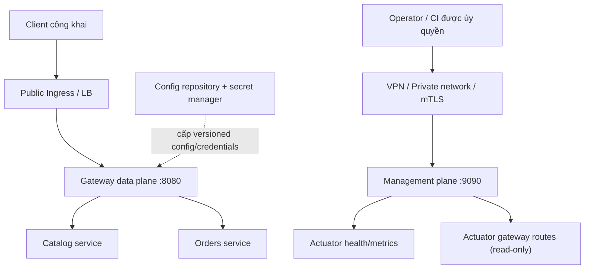
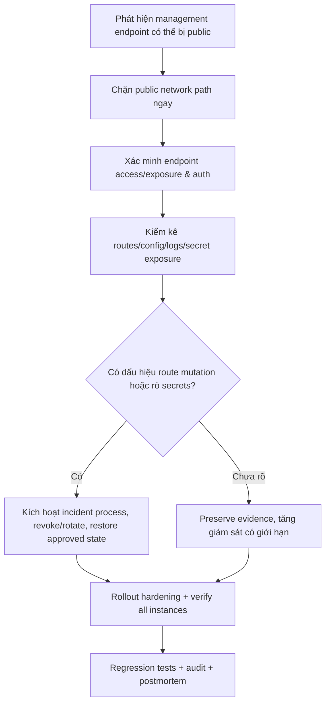

# Không công khai Actuator có quyền ghi hoặc dữ liệu cấu hình nhạy cảm

## 1. Mục tiêu: quản trị được Gateway nhưng không biến cổng vận hành thành cửa hậu

**Spring Cloud Gateway** là điểm vào của microservices: nó kiểm tra route predicates, chạy filter chain, biến đổi đường dẫn và headers, phát hiện dịch vụ, áp dụng xác thực, giới hạn lưu lượng, circuit breaker, retry, TLS và quan sát request. Bên cạnh cổng nhận traffic nghiệp vụ, một Gateway chạy **Spring Boot Actuator** có thể có thêm các API dành cho vận hành.

Các API này rất hữu ích: `health` báo readiness; `metrics`/`prometheus` cung cấp số liệu; `gateway/routes` giúp kiểm tra route nào đã được nạp. Nhưng nếu cấu hình sai, cùng một cổng HTTP có thể cho phép người không được ủy quyền **tạo route mới, xóa route, refresh route cache, đổi logging level, lấy thông tin cấu hình hoặc tải dữ liệu nhạy cảm**.

Tình huống giả định: ứng dụng public có route `/api/catalog/**`. Người triển khai sao chép cấu hình debug:

```yaml
management:
  endpoint:
    gateway:
      access: unrestricted
  endpoints:
    web:
      exposure:
        include: "*"
```

Nếu không có biện pháp xác thực, phân quyền và giới hạn mạng phù hợp, cấu hình này có thể đưa nhiều công cụ quản trị lên HTTP listener. Chỉ cần một thay đổi route sai cũng có thể đưa request/credential tới backend không tin cậy, chiếm namespace URL hoặc làm nhiều API ngừng hoạt động. **TLS đơn thuần không thay thế authorization**: HTTPS bảo vệ dữ liệu trên đường truyền, không chứng minh người gọi được phép quản trị Gateway.

### Kết quả học tập

Sau bài này, bạn có thể:

1. Phân biệt **Actuator endpoint access**, **HTTP/JMX exposure**, **Spring Security authorization** và **network reachability**.
2. Đặt `gateway` endpoint ở `none` hoặc `read-only`, không cấp quyền create/delete/refresh route trên public plane.
3. Giải thích vì sao `/env`, `/configprops`, `/heapdump`, `/logfile`, `/mappings` và cả `GET /gateway/routes` có thể nhạy cảm.
4. Thiết kế **public traffic plane** tách **private management plane**, gồm cổng mạng, TLS/mTLS, ServiceAccount/OAuth2, RBAC và audit.
5. Viết cấu hình Spring Boot 4 / Gateway Server WebFlux 5 để chỉ cho phép những endpoint quan sát thật sự cần.
6. Thiết lập policy WebFlux `SecurityWebFilterChain` an toàn khi ứng dụng đã tự cấu hình Spring Security.
7. Dùng `curl` và kiểm thử integration để chứng minh người không có quyền **không thể thực hiện hành động quản trị** và không lấy được cấu hình nhạy cảm.
8. Có runbook ứng phó khi phát hiện management endpoint từng bị phơi lộ.

> **Phạm vi:** **Spring Cloud Gateway Server WebFlux 5.0.x**, **Spring Boot 4.x**, Spring Security reactive. Gateway Server Web MVC có mô hình Actuator tương tự nhưng dùng Servlet `SecurityFilterChain`, không nhập nguyên `SecurityWebFilterChain` vào MVC. Ví dụ hostname, tài khoản, token, route và trạng thái trong bài dùng **dữ liệu giả lập**. Bài chỉ hướng dẫn phòng thủ và kiểm thử trên môi trường được phép.

## 2. Threat model: tại sao Actuator là bề mặt tấn công đặc biệt?

### 2.1. Cổng nghiệp vụ và cổng điều khiển không có cùng trust boundary



**Data plane** nhận HTTP requests từ browser/mobile/service clients, còn **management plane** dành cho probe, metrics collector và operator. Đừng coi việc hai endpoint cùng thuộc một Spring Boot process là lý do để chúng chia sẻ **quyền truy cập công khai**.

### 2.2. Tài sản có thể bị ảnh hưởng

| Tài sản | Nếu management API bị phơi lộ | Tác động |
|---|---|---|
| Route definitions | Tạo route tới URI không được duyệt, đổi filters/order | Chuyển traffic, gián đoạn, lộ dữ liệu |
| Route cache | Refresh khi config chưa ổn định | Sự cố định tuyến hoặc mở rộng blast radius |
| Logging config | Tăng level DEBUG/TRACE runtime | Chi phí CPU/I/O, lộ tokens/headers/payload nếu logger ghi |
| Environment/configuration | Xem property names, source/origins, values nếu bỏ sanitize | Lộ topology, credentials hoặc dữ liệu vận hành |
| Heap/thread dumps | Snapshot bộ nhớ và execution context | Có thể chứa tokens, private data và thông tin hệ thống |
| Metrics/HTTP exchanges | URI, tags, endpoints, latency, thông tin traffic | Reconnaissance, PII/cardinality risks |
| Shutdown/management operations | Ngắt hoặc thay trạng thái ứng dụng | Availability, phục hồi tốn thời gian |
| Kubernetes/Cloud credentials | Credential bị lộ qua log, env, dumps | Truy cập các hệ thống ngoài Gateway |

Ngay cả API chỉ đọc cũng có thể mang rủi ro. Ví dụ `GET /actuator/gateway/routes` có thể hiển thị URI backend, route predicate và chuỗi mô tả GatewayFilters; một cấu hình `AddRequestHeader` chứa giá trị nhạy cảm có thể bị phản ánh vào dữ liệu chẩn đoán. **Không lưu secret trong route definitions** để rồi chỉ dựa vào việc tắt GET Actuator.

### 2.3. Bốn loại sự cố phải phân biệt

- **Phơi lộ không xác thực:** Internet có thể gọi management endpoint mà không cần identity.
- **Phân quyền quá rộng:** mọi user đã đăng nhập được cấp quyền xem môi trường/route hoặc thao tác ghi.
- **Thay đổi cấu hình sai:** endpoints bị khóa mạng nhưng một operator/automation hợp lệ tạo route độc hại/sai URI do thiếu policy review.
- **Rò dữ liệu gián tiếp:** config đã được sanitize ở `/env` nhưng secrets vẫn xuất qua logging, exceptions, Actuator `heapdump` hoặc metrics labels.

Vì vậy cần defense in depth: **least capability**, **least exposure**, **identity/RBAC**, **network isolation**, **secret minimization**, **audit** và **verification**.

## 3. Mô hình bốn lớp bảo vệ Actuator trong Spring Boot 4

### 3.1. Lớp A — Endpoint *access*: có khả năng hoạt động hay không?

Spring Boot 4 hỗ trợ:

```yaml
management:
  endpoints:
    access:
      default: none
      max-permitted: read-only
  endpoint:
    health:
      access: read-only
    info:
      access: read-only
```

Ý nghĩa:

- `management.endpoints.access.default: none` là **deny-by-default**; endpoint không được opt-in sẽ **không có sẵn**.
- `management.endpoint.<id>.access: read-only` opt-in chỉ phần đọc của endpoint cụ thể.
- `management.endpoints.access.max-permitted: read-only` là **trần quyền** cấp ứng dụng, có độ ưu tiên cao hơn quyền từng endpoint. Nó giúp chặn thao tác ghi ngay cả khi một cấu hình khác vô tình yêu cầu `unrestricted`.

Với Spring Boot 4, các giá trị quan trọng là `none`, `read-only` và `unrestricted`. Tài liệu Boot nói rằng hầu hết endpoints có access mặc định `unrestricted` **trừ một số endpoint đặc biệt như `shutdown` và `heapdump`**, nhưng chúng vẫn **không tự xuất hiện ra HTTP** chỉ vì access cho phép. Gateway Actuator còn có mặc định riêng: **`gateway` access bị tắt nếu chưa bật**.

**Phân biệt:** `read-only` không có nghĩa mọi GET đều an toàn. `GET /env` có thể lộ metadata cấu hình; `read-only` chỉ loại bỏ khả năng **ghi**, không thay data classification.

### 3.2. Lớp B — *Exposure*: endpoint có được ánh xạ ra HTTP/JMX?

```yaml
management:
  endpoints:
    web:
      exposure:
        include: "health,info"
    jmx:
      exposure:
        exclude: "*"
```

Spring Boot mặc định chỉ expose `health` qua HTTP (và JMX). `include` là allowlist endpoint IDs, **không phải danh sách quyền truy cập**. `exclude` có thể loại endpoint ngay cả khi nó nằm trong `include`. Wildcard `"*"` phải đặt trong dấu nháy YAML; **không dùng `include: "*"` trong production** chỉ để thuận tiện quan sát.

**Không suy ra:** chỉ vì `management.endpoint.gateway.access=read-only` thì `GET /actuator/gateway/routes` đã truy cập được. Bạn còn cần đưa `gateway` vào `management.endpoints.web.exposure.include` và thỏa mãn authentication/network policy.

### 3.3. Lớp C — *Authorization*: ai được đọc hoặc quản trị?

Nếu Actuator có mặt trên HTTP, cần:

- **Authentication:** identity được xác minh (OIDC/OAuth2 JWT, mTLS, workload identity hoặc cơ chế doanh nghiệp được phê duyệt).
- **Authorization:** quyền `ops.read`, `ops.admin` hoặc RBAC phân tách rõ; không dùng “có login” làm điều kiện duy nhất.
- **Session/CSRF:** nếu dùng session/cookie và endpoint nhận POST/DELETE, cần chống CSRF đúng loại client; không tắt CSRF để “sửa 403” mà không xác định threat model.
- **Audit:** lưu actor, action, route ID, timestamp, nguồn yêu cầu và kết quả, không lưu credentials.

Spring Security có **`SecurityWebFilterChain`** cho WebFlux và **`SecurityFilterChain`** cho MVC. Nếu ứng dụng tự cung cấp chain, phải bảo đảm Actuator cũng được chain phù hợp xử lý; **không dựa vô điều kiện vào auto-configuration mặc định của Spring Boot**.

### 3.4. Lớp D — *Network reachability*: gói tin có tới endpoint được không?

Ngay cả endpoints đọc-only cũng nên ở private network:

```yaml
management:
  server:
    port: 9090
    address: 127.0.0.1
```

Đây là ví dụ **chạy localhost hoặc một management interface chỉ dành cho local tooling**. Spring Boot chỉ cho đặt `management.server.address` khác app server khi `management.server.port` khác. Với Kubernetes, binding loopback có thể khiến cluster Prometheus/remote probes **không truy cập trực tiếp**; khi cần private network hãy bind đúng interface phù hợp và dùng **NetworkPolicy/Service internal/ingress restrictions**, không chỉ đổi port.

Một port khác **không tự là biện pháp bảo mật** nếu Service/Ingress/firewall vẫn cho Internet vào. Đổi `/actuator` thành `/hidden-monitoring` cũng chỉ là thay URL, không phải identity hoặc permission.

### 3.5. Ma trận bốn lớp

| Tình huống | Access | Exposure HTTP | Auth/network | Kết luận |
|---|---|---|---|---|
| `gateway=none` | Không | Dù có include | Không liên quan | Gateway Actuator bị vô hiệu |
| `gateway=read-only` | Chỉ đọc | Có include | Private + authorized | Quan sát routes, không mutate |
| `gateway=read-only` | Chỉ đọc | Không include | Không liên quan | Không có API HTTP cho gateway |
| `gateway=unrestricted` | Có ghi | Có include | Internet/không auth | **Nguy hiểm** |
| `gateway=unrestricted` | Có ghi | Có include | Private + admin RBAC/mTLS/audit | Chỉ khi thật sự cần, vẫn tăng rủi ro |
| `env=read-only` | Chỉ đọc | Có include | User authenticated rộng | **Vẫn nhạy cảm**, phải xem data classification |
| `metrics=read-only` | Chỉ đọc | Có include | Collector identity/private | Phù hợp nếu metrics labels không lộ PII |

**Quy tắc kiểm tra:** endpoint khả dụng chỉ khi **capability được cho phép + được expose trên transport + request vượt qua security/network**. Mất một trong những lớp này thì không thể sử dụng theo cách dự kiến.

## 4. Kiểm kê endpoints theo rủi ro: chỉ đọc chưa chắc là vô hại

### 4.1. Những endpoint cần xem xét trước tiên

| Endpoint/nhóm | Ví dụ thao tác | Giá trị cho operator | Rủi ro nếu mở sai |
|---|---|---|---|
| `health` | `GET /actuator/health` | Liveness/readiness/overall status | Lộ chi tiết components nếu `show-details` quá rộng |
| `info` | `GET /actuator/info` | Phiên bản, release metadata được chọn | Lộ git details/hostnames/tên thành phần nếu tự publish |
| `metrics` | `GET /actuator/metrics`, `/.../{name}` | Tìm bottleneck và tỷ lệ lỗi | Lộ route names, upstream hints, labels có user IDs |
| `prometheus` | `GET /actuator/prometheus` | Scrape time-series metrics | Lộ service topology/metric tags; bị scrape quá tải |
| `gateway` | `GET /actuator/gateway/routes` | Runtime route, predicates, filters, URI, order | Để lộ topology, logic routing và giá trị filter |
| `gateway` **có ghi** | `POST /.../refresh`, `POST/DELETE /.../routes/{id}` | Thay route qua API quản trị | Thay đổi traffic, SSRF, bypass policy, DoS |
| `env` | `GET /actuator/env` và subpaths | Tìm nguồn của properties | Tên/nguồn/path/value cấu hình nhạy cảm |
| `configprops` | `GET /actuator/configprops` | Kiểm tra binding của beans | Cấu trúc/tên properties, giá trị nếu mở sanitize |
| `beans`, `conditions` | `GET` | Debug Spring context/autoconfiguration | Tên classes/beans, component surface |
| `mappings` | `GET` | Endpoint HTTP mappings | Lộ paths, handler names, API internals |
| `httpexchanges` | `GET` khi có `HttpExchangeRepository` | Tra cứu HTTP exchanges | Metadata về traffic, URIs/headers tùy cấu hình |
| `logfile` | `GET` nếu logging file được cấu hình | Tải log để điều tra | Log có thể chứa token, header, PII, internal errors |
| `heapdump` | Download heap khi cho phép | Phân tích leak/đối tượng runtime | **Rất nhạy cảm**: tokens, secrets, dữ liệu người dùng trong heap |
| `threaddump` | `GET` | Tìm thread deadlock/blocking | Stack traces, tên package, internal details |
| `loggers` | GET/POST thay level | Chẩn đoán lỗi động | POST tăng TRACE/DEBUG, leak secrets, tăng CPU/I/O |
| `caches` | Read/evict theo implementation | Cache diagnosis | Eviction phá performance/behavior |
| `shutdown` | POST nếu được bật | Graceful shutdown trong một số runtime | Tắt Gateway nếu không được ủy quyền |
| `refresh`, `busrefresh` | POST nếu có Spring Cloud dependencies | Refresh configuration/event bus | Rebind/config churn; không giống `gateway/refresh` |

**Khả dụng phụ thuộc dependencies và configuration.** Ví dụ `prometheus` cần registry, `httpexchanges` cần repository, `logfile` cần cấu hình log file, còn `shutdown` mặc định bị tắt. Không mặc định mọi endpoint trong bảng đều xuất hiện trên mọi Gateway instance.

### 4.2. Hai API “refresh” có thể bị nhầm

```text
POST /actuator/gateway/refresh    # Spring Cloud Gateway: refresh route cache
POST /actuator/refresh            # Spring Cloud Context: nếu dependency/endpoint hỗ trợ
```

Hai endpoint có **vòng đời, side effects và dependency khác nhau**. Không đánh đồng việc refresh route cache với nạp lại mọi Config Data, certificate, OAuth2 secret hay application beans. Khi đánh giá security, phải liệt kê **tất cả Actuator endpoints đang khả dụng**, gồm endpoints được thêm bởi thư viện/plug-in nội bộ.

### 4.3. Tại sao `GET /gateway/routes` vẫn nên là private?

Trong Gateway Server WebFlux, một route runtime có thể gồm:

```json
{
  "route_id": "catalog-internal",
  "predicate": "(Paths: [/api/catalog/**])",
  "filters": [
    "[[StripPrefix parts = 2], order = 1]",
    "[[AddRequestHeader X-Partner-Tag = 'internal'], order = 2]"
  ],
  "uri": "lb://catalog-internal",
  "order": 30
}
```

Đây là **output minh họa**. Các chuỗi filter được Gateway hiển thị tùy version. Một bên ngoài đọc được có thể biết namespace, upstream services, filter policy và thứ tự route. Nếu route/filter có literal credential, việc chỉ đọc cũng trở thành **data exposure**.

Lựa chọn tốt:

1. Không đưa bí mật vào `RouteDefinition`, nhất là `AddRequestHeader` literal.
2. Giữ `gateway` Actuator ở **`none`** nếu không cần.
3. Nếu operator cần, dùng **`read-only` trên management plane private** với role `ops.read`.
4. Đánh giá việc bật format verbose Actuator; tắt verbosity nếu giảm bớt dữ liệu hữu ích cho operator là chấp nhận được, nhưng **không coi nó thay RBAC**.

### 4.4. Vì sao `/env` và `/configprops` vẫn nhạy cảm khi giá trị đã che?

Spring Boot mặc định thay **giá trị** nhạy cảm bằng `******` ở `/env`, `/configprops` và `/quartz`. Tuy nhiên response còn có thể cho biết:

- Tên các property keys (ví dụ `spring.security.oauth2.client.registration.*`).
- Các nguồn property (`systemEnvironment`, file/config location) và metadata nguồn tùy version.
- Tên bean, namespace cấu hình, backend endpoints nếu lọc/hiển thị thêm fields không được sanitize.
- Các property được ứng dụng/custom Actuator endpoint xuất mà không đi qua sanitization mặc định.

`management.endpoint.env.show-values: when-authorized` không có nghĩa chỉ admin: nếu **không cấu hình roles**, theo Boot **mọi user đã authenticate** có thể được coi là authorized để xem giá trị. `show-values: always` còn nguy hiểm hơn. Vì thế chọn **`show-values: never`, không expose các endpoint này**, và chỉ cấp quyền điều tra có thời hạn trong môi trường cô lập nếu chính sách cho phép.

### 4.5. `/heapdump` và `/logfile` là ngoại lệ cần đặc biệt nghiêm ngặt

- Heapdump có thể chứa bản sao OAuth2 access token, session IDs, credentials, personal data hoặc key material trong bộ nhớ; **đừng phát tán** trong ticket/chat.
- Logfile có thể phản ánh request URI/query, upstream errors, debug/wiretap payloads và tokens nếu logging policy trước đó đã sai.
- Threaddump/beans/mappings có thể hỗ trợ reconnaissance, dù hiếm khi chứa trực tiếp secret text.

Nếu cần heapdump hay log extraction để điều tra một sự cố, ưu tiên **diagnostic workflow riêng có phê duyệt, quyền tạm thời, mã hóa, retention và xóa an toàn**, không bật endpoint đọc tự do cho tất cả operators.

## 5. Cấu hình production an toàn mặc định: deny by default

### 5.1. Mẫu public-facing Gateway chỉ công khai health tối thiểu

Ví dụ `application-prod.yml`:

```yaml
server:
  port: 8080

spring:
  application:
    name: gateway-edge

management:
  endpoints:
    access:
      default: none
      max-permitted: read-only
    web:
      exposure:
        include: "health"
    jmx:
      exposure:
        exclude: "*"
  endpoint:
    health:
      access: read-only
      show-details: never
      show-components: never
    gateway:
      access: none
    env:
      show-values: never
    configprops:
      show-values: never
```

**Phạm vi:** cấu hình này dành cho Gateway có probe HTTP trên **cùng listener**; nó chỉ đưa `health` ra Actuator web endpoint. `management.endpoints.access.default=none` còn làm những endpoint không opt-in **không khả dụng**, thay vì chỉ giấu URL khỏi HTTP. JMX được exclude để tránh một transport quản trị thứ hai vô tình có endpoints ngoài tầm kiểm soát.

Tuy nhiên `management.endpoints.web.exposure.include=health` không ngăn **custom controllers** tạo `/actuator/foo`, không hạn chế HTTP routes ngoài Actuator và không thay thế Spring Security. Nếu Gateway chạy sau public ingress, hãy chỉ expose health endpoint thực sự cần; một readiness/liveness path do platform quyết định có thể phải ở listener private.

### 5.2. Chế độ có quan sát riêng (private management, vẫn read-only)

Khi SRE cần đọc routes, health và metrics, có thể dùng **profile vận hành**:

```yaml
server:
  port: 8080

management:
  server:
    port: 9090
    address: 127.0.0.1
  endpoints:
    access:
      default: none
      max-permitted: read-only
    web:
      exposure:
        include: "health,info,metrics,gateway"
    jmx:
      exposure:
        exclude: "*"
  endpoint:
    health:
      access: read-only
      show-details: never
    info:
      access: read-only
    metrics:
      access: read-only
    gateway:
      access: read-only
    env:
      show-values: never
    configprops:
      show-values: never
```

Ở đây `read-only` cho `gateway` **không có** các HTTP mutation operations. `management.server.address: 127.0.0.1` chỉ là ví dụ cho **process chạy trên máy riêng**; trong Kubernetes, metrics collector ở pod khác có thể cần management bind vào private Pod interface và **NetworkPolicy** chỉ cho phép collector/operator đến port 9090.

**Quan trọng:** cho dù `GET /actuator/gateway/routes` là read-only, nó vẫn tiết lộ topology. Private management nên có **authentication/RBAC** nếu có nhiều principals nội bộ. Không route port 9090 qua public Gateway ingress hoặc NodePort.

### 5.3. Một guardrail mạnh hơn cho mọi endpoints

```yaml
management:
  endpoints:
    access:
      max-permitted: read-only
```

Trần quyền này hữu ích như **defense-in-depth**, nhất là khi một cấu hình profile khác đặt `management.endpoint.gateway.access: unrestricted`. Nhưng production vẫn cần **default: none** + opt-in cụ thể; nếu chỉ đặt `max-permitted: read-only`, bạn có thể vô tình mở **nhiều endpoints đọc nhạy cảm** khi sau đó dùng `include: "*"`.

### 5.4. Không sử dụng `management.endpoint.gateway.enabled=true` như đường tắt

Tài liệu Gateway 5.0.x ghi rằng khi đặt `management.endpoint.gateway.access=unrestricted` **hoặc** cấu hình legacy `management.endpoint.gateway.enabled=true`, bạn có thể bật khả năng tạo/xóa/refresh routes. Vì vậy:

- Không trộn `enabled: true` từ tài liệu cũ với policy `access: read-only` rồi mặc định sẽ an toàn.
- Ưu tiên rõ `management.endpoint.gateway.access: none` hoặc `read-only`.
- Kiểm tra **effective endpoints và HTTP methods** khi upgrade Spring Boot/Gateway, kể cả profile và env overrides.
- Dùng `management.endpoints.access.max-permitted: read-only` như guardrail bổ sung, không thay kiểm thử.

### 5.5. Thay path không làm endpoint an toàn hơn

```yaml
management:
  endpoints:
    web:
      base-path: /secret-operations
```

Cấu hình chỉ đổi đường dẫn (ví dụ `/actuator/health` thành `/secret-operations/health`). Không biến endpoint thành private, không thêm authorization và có thể làm policy/nginx route cũ bỏ sót endpoints. Nếu thay path, cập nhật **security matchers, reverse proxy rules, tests và observability** đồng thời.

### 5.6. Kiểm tra JMX, không chỉ HTTP

`management.endpoints.web.exposure.include` chỉ áp dụng HTTP, còn `management.endpoints.jmx.exposure.include/exclude` điều khiển JMX. Nếu hệ thống có remote JMX/Jolokia/diagnostics, phải kiểm soát authentication, network access và data exposure riêng. Với Gateway không cần JMX, cấu hình `exclude: "*"` và không public port JMX.

## 6. Nếu thật sự cần ghi route: chỉ trong control plane có kiểm soát

### 6.1. Các phương thức thay đổi route

Với `gateway.access: unrestricted` và endpoint được expose, tài liệu Spring Cloud Gateway mô tả:

```text
GET    /actuator/gateway/routes            # xem routes
GET    /actuator/gateway/routes/{id}       # xem route chi tiết
POST   /actuator/gateway/routes/{id}       # tạo route
DELETE /actuator/gateway/routes/{id}       # xóa route do Actuator quản lý
POST   /actuator/gateway/refresh           # làm mới cache
```

Route từ `application.yml`/Java `@Bean` được quản lý bởi nguồn riêng, **không phải route Actuator-managed có thể tùy ý DELETE**. Ngay cả với quản trị hợp lệ, `POST` đè một route ID đã có có thể gây duplicate definitions/lỗi runtime theo cảnh báo docs. Đây **không phải** API an toàn để public cho mọi client.

### 6.2. Các tình huống abuse cần phòng ngừa

Nếu một principal không đáng tin có quyền tạo route, họ có thể:

- Tạo `Path=/**` với `order` ưu tiên cao để chiếm toàn bộ request.
- Trỏ `uri` đến upstream không được duyệt, gồm internal admin/cloud metadata endpoints (**SSRF**).
- Thêm/bớt request/response header gây bỏ lọt tenant identity hoặc phá security contract.
- Cố ý tạo nhiều routes/filters gây tải, làm nghẽn bộ nhớ hoặc route refresh.
- Gây outages bằng thay đổi route sai và refresh liên tục.

**Mục tiêu phòng thủ:** không bao giờ để user ngoài control plane sở hữu route management HTTP methods. Các biện pháp ở đây không chỉ là authentication: người có quyền thao tác cũng phải bị **ràng buộc danh sách URIs, route namespaces, filters, order ranges và change approval**.

### 6.3. Chính sách tối thiểu nếu tổ chức cần dynamic routing

Quy trình an toàn hơn:

1. **Route source of truth** trong GitOps/Config Server/RouteDefinition repository có version.
2. Operator mở change request với route ID, predicates, filters, URI, order, owner và rollback revision.
3. Static checks kiểm tra **host/scheme/port allowlist**, không duplicate ID, không `Path=/**` trái phép và không literal secrets.
4. Approval/CI deployment service được phép gọi API trên **private network**, bằng short-lived identity/mTLS.
5. Gateway nhận definition, refresh trong phạm vi dự kiến; test runtime + backend traffic trên từng instance.
6. Audit actor, change ID, route revision, success/failure; không ghi raw tokens hoặc secret values.
7. Thu hồi quyền tạm thời/kết thúc maintenance window, rollback nếu test fail.

**Không bật unrestricted 24/7** chỉ vì cần thay một route vài lần mỗi quý. Nhiều hệ thống đạt mục tiêu an toàn hơn bằng deploy **versioned config qua rollout** thay vì mở writable Actuator HTTP.

### 6.4. Chế độ emergency không được biến thành backdoor vĩnh viễn

Khi sự cố yêu cầu route change gấp, vẫn cần:

- Privileged operator identity và dual approval theo policy.
- Mạng private / VPN / mTLS; không tạo public ingress tạm rồi quên xóa.
- Time-bound access, audit log và tự động thu hồi.
- Idempotent change plan/rollback; tránh POST route ID trùng.
- Verify HTTP response thực đến backend được phê duyệt.

Đừng nhầm **`POST /gateway/refresh` trả HTTP 200** với kết luận route update đã hoạt động trên toàn bộ pods; refresh có thể gặp lỗi bất đồng bộ hoặc các instances có caches khác nhau.

## 7. Spring Security WebFlux: đừng để custom security chain bỏ quên Actuator

### 7.1. Tại sao “đã có starter-security” chưa đủ?

Spring Boot có auto-configuration để bảo vệ một số Actuator endpoints khi Spring Security được thêm vào. Nhưng trong ứng dụng Gateway, nhiều team đã tự tạo `SecurityWebFilterChain` để xử lý JWT, OAuth2, CORS hoặc TokenRelay. Khi có custom chain, bạn **phải tự chịu trách nhiệm** về rules và thứ tự matching, không coi Actuator luôn được Boot tự bảo vệ theo cùng mặc định.

Ví dụ dễ sai:

```java
// PHẢN VÍ DỤ: chú trọng API mà quên các URL khác.
// Nếu không có fallback policy an toàn, Actuator có thể bị bỏ sót.
http.securityMatcher(
    new PathPatternParserServerWebExchangeMatcher("/api/**"))
    .authorizeExchange(ex -> ex.anyExchange().authenticated());
```

Một chain chỉ match `/api/**` **không tự chặn** request `/actuator/**`. Nếu không có chain khác/fallback, request có thể đi qua phần không được bảo vệ như team tưởng. Phải review toàn bộ `SecurityWebFilterChain` và endpoint mappings thực tế.

### 7.2. Ví dụ SecurityWebFilterChain: health tối thiểu, observability có scope

Ví dụ này áp dụng khi **Actuator và HTTP API dùng cùng WebFlux listener**, có dependency Spring Security OAuth2 Resource Server, issuer và JWT validation **đã được cấu hình bằng nguồn tin cậy**. Với security policy riêng cho multiple ports/contexts, phải kiểm chứng lại trên từng port như mục 8.

```java
package com.example.gateway;

import org.springframework.boot.security.autoconfigure.actuate.web.reactive.EndpointRequest;
import org.springframework.context.annotation.Bean;
import org.springframework.context.annotation.Configuration;
import org.springframework.core.Ordered;
import org.springframework.core.annotation.Order;
import org.springframework.security.config.annotation.web.reactive.EnableWebFluxSecurity;
import org.springframework.security.config.web.server.ServerHttpSecurity;
import org.springframework.security.web.server.SecurityWebFilterChain;

import static org.springframework.security.config.Customizer.withDefaults;

@Configuration(proxyBeanMethods = false)
@EnableWebFluxSecurity
public class GatewaySecurityConfig {

    @Bean
    @Order(Ordered.HIGHEST_PRECEDENCE)
    SecurityWebFilterChain actuatorChain(ServerHttpSecurity http) {
        http.securityMatcher(EndpointRequest.toAnyEndpoint())
            .authorizeExchange(exchanges -> exchanges
                .pathMatchers(
                    "/actuator/health",
                    "/actuator/health/liveness",
                    "/actuator/health/readiness"
                ).permitAll()
                .anyExchange().hasAuthority("SCOPE_ops.read"))
            .oauth2ResourceServer(oauth2 -> oauth2.jwt(withDefaults()));

        return http.build();
    }

    @Bean
    @Order(Ordered.LOWEST_PRECEDENCE)
    SecurityWebFilterChain applicationChain(ServerHttpSecurity http) {
        http.authorizeExchange(exchanges -> exchanges
                // Chặn cả URL giả dạng Actuator không thuộc known endpoints.
                .pathMatchers("/actuator/**").denyAll()
                .anyExchange().authenticated())
            .oauth2ResourceServer(oauth2 -> oauth2.jwt(withDefaults()));

        return http.build();
    }
}
```

**Cách hiểu:**

1. `EndpointRequest.toAnyEndpoint()` là matcher **theo metadata Actuator**, bao gồm endpoint subpaths và Actuator links endpoint, tránh phụ thuộc duy nhất vào một path string.
2. Chain có `@Order(Ordered.HIGHEST_PRECEDENCE)` được xét trước chain fallback.
3. Chỉ `health` và những probe paths đã liệt kê mới được anonymous truy cập trong ví dụ.
4. Các Actuator endpoints khác cần `SCOPE_ops.read` **nếu** endpoint đã được bật và expose; nó **không** tạo thêm endpoint mới.
5. Chain fallback deny `/actuator/**` và đòi authentication cho các URL khác. Ở production, các route nghiệp vụ còn cần **scope/tenant/resource authorization**, không chỉ `authenticated()`.
6. `oauth2ResourceServer(...jwt(...))` cần issuer/JWK validation từ identity provider: chỉ thêm phương thức Java không làm JWT tự được xác minh.

Ví dụ property để Spring Security biết issuer từ nguồn được phê duyệt:

```yaml
spring:
  security:
    oauth2:
      resourceserver:
        jwt:
          issuer-uri: https://identity.ops.example.test/realms/platform
```

Tên issuer là **minh họa**. Scope `ops.read` thường ánh xạ thành authority `SCOPE_ops.read` trong Resource Server JWT setup chuẩn; nếu IdP dùng roles/claims riêng, phải có converter được review và integration tests.

### 7.3. Điều kiện và giới hạn của ví dụ

**Không copy y nguyên** vào ứng dụng sử dụng cookie login rồi tắt CSRF cho toàn bộ requests. Đối với browser/cookie sessions, Spring Security CSRF và CORS cần chính sách riêng. Đối với machine-to-machine bearer tokens, có thể không cần CSRF cho những đường bearer-only, nhưng quyết định cần dựa trên threat model, không dựa vào một response 403.

**Không dùng role `ops.read` để tạo/xóa route.** Nếu sau này yêu cầu route write, tách một admin identity `ops.change`, thực thi qua control plane riêng, giới hạn network/URI/filter và giữ audit/change approval. Đặc biệt, nên duy trì `max-permitted: read-only` trên các Gateway production nhận traffic thường lệ.

**Không mặc định** chain của app listener chính tự bảo vệ chính xác mọi management endpoint khi chúng chạy trên **management port/context khác**. Cần test đúng URL, port, context path và security config của version Boot/Gateway hiện tại; coi network isolation như một lớp riêng, không phải kết luận từ việc bean SecurityWebFilterChain tồn tại.

### 7.4. Tại sao `EndpointRequest` tốt hơn hard-code path?

Một tổ chức có thể đổi `management.endpoints.web.base-path` sang `/ops`, thêm `management.server.base-path`, hoặc có additional health paths. Matcher `EndpointRequest` hiểu metadata endpoints, trong khi matcher chỉ viết `/actuator/**` có thể **bỏ sót những đường dẫn khác**. Dù vậy, app fallback chain vẫn cần chính sách deny-by-default nếu URL chưa match endpoint.

### 7.5. Bảo vệ actuator trên MVC khác WebFlux

| Gateway stack | API security chính | Matcher theo endpoint |
|---|---|---|
| **Gateway Server WebFlux** | `ServerHttpSecurity`, `SecurityWebFilterChain` | `org.springframework.boot.security.autoconfigure.actuate.web.reactive.EndpointRequest` |
| **Gateway Server Web MVC** | `HttpSecurity`, `SecurityFilterChain` | `org.springframework.boot.security.autoconfigure.actuate.web.servlet.EndpointRequest` |

Không import `servlet.EndpointRequest` vào WebFlux class; cũng không dùng `ServerHttpSecurity` trong ứng dụng chỉ có Servlet. Các properties `management.*` tương tự ở Spring Boot, nhưng security filter chain là của **web runtime** tương ứng.

## 8. Tách management HTTP listener và giới hạn mạng

### 8.1. Cấu hình hai listener chỉ là bước đầu

```yaml
server:
  port: 8080

management:
  server:
    port: 9090
    address: 127.0.0.1
```

Với process local, public API ở `8080`; Actuator trên loopback `127.0.0.1:9090`. Cách này giúp tránh Internet reachability nếu app được triển khai ở VM và chỉ có port 8080 được expose. Nhưng:

- Người có quyền chạy code trong **cùng host/namespace network** có thể truy cập loopback.
- Nếu container publish management port hoặc có sidecar/host-network access, phải kiểm tra paths thực tế.
- Trên Kubernetes, monitoring sidecar ở cùng pod thường chia sẻ network namespace, còn Prometheus ở pod khác không tự vào loopback đó.
- Nếu muốn remote management, nên dùng private interface + mTLS/RBAC/NetworkPolicy, **không** mở listener trên all interfaces với public ingress.

### 8.2. Public Ingress chỉ đi tới cổng phục vụ nghiệp vụ

Giả sử Gateway Pod có app port `8080` và management port `9090`. Service/Ingress public nên chỉ map `8080`. Một ví dụ Service public **không có management port**:

```yaml
apiVersion: v1
kind: Service
metadata:
  name: gateway-public
  namespace: gateway-prod
spec:
  type: ClusterIP
  selector:
    app: gateway-edge
  ports:
    - name: http
      port: 80
      targetPort: 8080
```

Đây là **trích đoạn service**, chưa gồm ingress/TLS/network policies hoàn chỉnh. Dùng `ClusterIP` để Ingress controller trỏ về service; không đưa port `9090` vào Ingress/NodePort/LoadBalancer công khai.

### 8.3. NetworkPolicy chỉ cho phép scrape private port từ workload được phép

Ví dụ **mang tính minh họa** khi management listener bind vào Pod IP/private interface (không phải `127.0.0.1`) và CNI có hỗ trợ Kubernetes NetworkPolicy:

```yaml
apiVersion: networking.k8s.io/v1
kind: NetworkPolicy
metadata:
  name: gateway-ingress-restrictions
  namespace: gateway-prod
spec:
  podSelector:
    matchLabels:
      app: gateway-edge
  policyTypes:
    - Ingress
  ingress:
    - from:
        - namespaceSelector:
            matchLabels:
              gateway-client: "trusted-ingress"
      ports:
        - protocol: TCP
          port: 8080
    - from:
        - podSelector:
            matchLabels:
              app: private-metrics-collector
      ports:
        - protocol: TCP
          port: 9090
```

**Đừng triển khai mẫu nguyên xi:** namespace labels, collector namespace/podSelector và ingress topology phải đúng thực tế. `podSelector` không có namespaceSelector chỉ match pods **trong cùng namespace**. Nếu collector ở namespace khác, phải thêm selector cho namespace tương ứng. NetworkPolicy còn phụ thuộc CNI enforcement và các ngoại lệ node/hostNetwork; kiểm thử network thực, không chỉ đọc YAML.

### 8.4. TLS/mTLS ở management plane

Nếu management được truy cập qua mạng, hãy:

- Dùng HTTPS với certificate được xác minh SAN/chain/SNI.
- Áp dụng mTLS hoặc workload identity khi môi trường yêu cầu, kết hợp application RBAC.
- Cấp Secret/key/cert riêng với private key inbound của public Gateway nếu chính sách PKI yêu cầu.
- Bảo vệ credentials cho Prometheus/metrics collector; không chứa token tĩnh trong URL/query.
- Không bật `management.server.ssl.enabled=false` cho một management listener public.

Spring Boot hỗ trợ `management.server.ssl.*` khi management chạy cổng riêng. Cấu hình cụ thể tùy SSL bundle/PKCS12/PEM/secret manager của hệ thống, **không đưa password/PEM key vào YAML Git**. TLS bảo vệ kết nối, còn `ops.read`/`ops.admin` quyết định ai được làm gì.

### 8.5. Các đường truy cập khác có thể bypass Ingress

Kiểm tra ít nhất:

- Public DNS/ingress routes, including wildcard `Path=/**`.
- Kubernetes NodePort/LoadBalancer, hostPort, port-forward permissions và Service mesh.
- VM firewall/security group, IPv4/IPv6 listener và các secondary interfaces.
- JMX, RSocket management/diagnostics hoặc custom admin HTTP controllers.
- Backend service Actuator được **proxy gián tiếp qua Gateway** do route quá rộng.

Ví dụ Gateway không expose `/actuator/env` của chính nó nhưng route `Path=/services/**` với `StripPrefix=1` có thể vô tình proxy **`/services/catalog/actuator/env`** tới **Actuator của catalog backend** nếu service đó không chặn. Phải bảo vệ Actuator ở **từng service**, không chỉ Gateway.

## 9. Che dữ liệu cấu hình: không chỉ dựa vào sáu dấu sao

### 9.1. Sanitization mặc định có ích nhưng không phải một security boundary độc lập

Spring Boot có chế độ hiển thị giá trị của `env`, `configprops` và `quartz`:

| `show-values` | Ai được nhìn giá trị gốc? | Khuyến nghị |
|---|---|---|
| `never` | Không được hiển thị qua cơ chế chuẩn (giá trị được sanitize) | **Mặc định an toàn hơn** |
| `when-authorized` | Người đã xác thực, và thỏa roles nếu cấu hình roles | Dùng rất thận trọng trong mạng kín |
| `always` | Bất kỳ ai có quyền truy cập endpoint, trừ các giá trị vẫn bị custom sanitizer che | **Không dùng trên production exposed** |

**Điểm dễ bị hiểu nhầm:** `when-authorized` khi **không cấu hình roles** có thể coi **mọi authenticated user** là đủ quyền nhìn giá trị. Nếu Gateway là OAuth2 Resource Server cho hàng triệu end users, một end user đã login **không phải operator**. Tách roles/scope ở Spring Security và không expose `env`/`configprops` vẫn là chính sách phù hợp nhất.

Nếu tổ chức nhất thiết phải tạm bật `when-authorized` để điều tra trong staging, cần:

1. Mạng quản trị riêng và approved identity có role cụ thể.
2. `management.endpoint.env.roles`, `management.endpoint.configprops.roles` phù hợp.
3. SanitizingFunction cho những keys/values đặc thù.
4. Thời hạn bật, audit, kiểm thử redaction và rollback cấu hình.

**Không thử bằng cách đưa secret production thật vào một endpoint rồi xem response để xác minh nó được che.** Dùng giá trị giả và môi trường cô lập.

### 9.2. Dữ liệu bí mật không nên có trong YAML/log/route definition

**Không viết:**

```yaml
# PHẢN VÍ DỤ — không copy vào project.
spring:
  cloud:
    gateway:
      server:
        webflux:
          routes:
            - id: partner-api
              uri: https://api.partner.example.test
              predicates:
                - Path=/partner/**
              filters:
                - AddRequestHeader=Authorization,Bearer SUPER_SECRET_TOKEN
```

Một token literal có thể bị lộ qua Git history, image, ConfigMap, diagnostics, Actuator filter descriptions hoặc backup. Một path public được proxy tới backend sẽ còn có nguy cơ đưa token sang host sai nếu route URI bị cấu hình nhầm.

**Hướng tốt hơn:** secret lấy từ Vault/secret manager/workload identity, có TTL/audience, và một cơ chế xác thực tới upstream phù hợp (OAuth2 client credentials, token exchange hoặc signed request policy). Với Gateway, `TokenRelay`/OAuth2 là một khả năng riêng cần Spring Security OAuth2 client và auth policy; **không coi mọi bearer token inbound là token được phép relay**.

### 9.3. Tránh dùng environment dump để debug

Những thao tác thường gây lộ:

```text
kubectl exec ... -- printenv
kubectl get secret ... -o yaml
actuator /env với show-values=always
logging.level.reactor.netty=TRACE + wiretap body
heap dump lưu công khai
curl -v kèm Authorization trên terminal chia sẻ
```

Thay thế:

- Ghi **config revision/secret version ID** đã được phê duyệt, không ghi secret value.
- Kiểm tra **property có bind hay không** bằng validation/startup check, không trả giá trị ra API.
- Kiểm tra **certificate issuer, serial, SAN, expiry**, không in private key.
- Dùng mock token/test identity để xác nhận authn/authz.
- Dùng application metrics với labels hữu hạn; không gắn raw JWT/email/account ID vào tag.

### 9.4. Các endpoint chẩn đoán có thể phá giới hạn dữ liệu

`/env` được sanitize không tự bảo đảm:

- `/heapdump` không chứa token trong JVM heap.
- `/logfile` không chứa headers/PII đã bị ứng dụng ghi trước đó.
- `/httpexchanges` không chứa URI hoặc request details nhạy cảm theo repository đã bật.
- `/gateway/routes` không trả literal secret trong một Filter description.
- `/prometheus` không chứa user IDs hoặc hostnames trong metric labels.

Vì vậy **không expose chúng từ đầu** nếu không cần. Mỗi dữ liệu đã được phê duyệt để thu thập cần policy phân quyền, encryption, retention và redaction riêng.

### 9.5. Loggers có quyền ghi có thể bật chế độ làm lộ bí mật

Endpoint `/actuator/loggers/{logger}` khi có write operation có thể đổi runtime level của một logger, ví dụ đẩy HTTP client/Netty lên DEBUG/TRACE. Dù bản thân endpoint không trả token, hậu quả có thể khiến **logs tương lai chứa headers, URIs hoặc body** nếu app đang có debug/wiretap và sanitize chưa đủ.

Không cấp `loggers.access: unrestricted` trên public Gateway. Khi cần chẩn đoán, team vận hành nên dùng **một thay đổi có thời hạn và audit**, xác nhận logger categories được phép, quyền truy cập log collector và kế hoạch tắt lại. Không mặc định rằng `read-only` có nghĩa API loggers có thể đổi level.

### 9.6. Security headers, HTTP path và SSRF cũng là dữ liệu cấu hình

Các vị trí dễ lộ hoặc gây bypass:

| Nơi cấu hình | Ví dụ dữ liệu | Biện pháp |
|---|---|---|
| `uri` route | Internal hostname, scheme, port | Allowlist destination, DNS/egress guard |
| `Path`/`Host` predicate | URL namespace nội bộ | Review collisions, route priority |
| `AddRequestHeader` | Literal API key/token | Không lưu secret literal |
| `RemoveRequestHeader` | Xóa Authorization/tenant ID | Kiểm tra security contract |
| `RequestRateLimiter` | Bucket policy/key resolver | Không cho operator bất kỳ sửa |
| `Retry`/`CircuitBreaker` | Attempts, fallback routes | Bảo vệ idempotency/availability |
| `X-Forwarded-*` handling | Client identity, host/scheme | Chỉ tin ingress đã xác thực |
| Custom `GlobalFilter` | Logs, headers, upstream identity | Redaction, code review, tests |

Một thay đổi route hợp lệ về JSON có thể **sai về bảo mật**. Dù đóng writable Actuator, bạn vẫn cần review/ký/versioned configuration và security regression tests cho routes.

## 10. Lab kiểm thử an toàn trên localhost: chứng minh read-only thật sự

### 10.1. Topology và dependency

Lab gồm một Gateway Server WebFlux trên `127.0.0.1:8080`, một backend giả lập `127.0.0.1:8081` và management listener riêng `127.0.0.1:9090`.

```text
curl ──> Gateway HTTP :8080 ──> catalog-demo :8081
             |
             └── Actuator :9090 (localhost only, read-only)
```

Trong project Gateway Boot 4 / Cloud Gateway 5, dependencies cơ bản:

```xml
<dependencies>
    <dependency>
        <groupId>org.springframework.cloud</groupId>
        <artifactId>spring-cloud-starter-gateway-server-webflux</artifactId>
    </dependency>
    <dependency>
        <groupId>org.springframework.boot</groupId>
        <artifactId>spring-boot-starter-actuator</artifactId>
    </dependency>
</dependencies>
```

Khi muốn test JWT roles/scope, thêm dependencies Spring Security OAuth2 Resource Server phù hợp Boot BOM và dùng test identity provider **đã cấu hình đúng issuer/JWKS**; đừng dùng production tokens trong lab.

### 10.2. Một route hợp lệ, không cần writable Actuator

```yaml
server:
  port: 8080

spring:
  application:
    name: gateway-actuator-hardening-demo
  cloud:
    gateway:
      server:
        webflux:
          routes:
            - id: catalog-public
              uri: http://127.0.0.1:8081
              predicates:
                - Path=/api/catalog/**
                - Method=GET
              filters:
                - StripPrefix=2

management:
  server:
    port: 9090
    address: 127.0.0.1
  endpoints:
    access:
      default: none
      max-permitted: read-only
    web:
      exposure:
        include: "health,gateway"
  endpoint:
    health:
      access: read-only
      show-details: never
    gateway:
      access: read-only
    env:
      show-values: never
    configprops:
      show-values: never
```

Ở localhost lab này, **không gắn thêm JWT security config ở mục 7** để quan sát chính xác **Actuator capability và network binding**. Các operator lệnh `curl` thực hiện trên chính máy. **Không triển khai cấu hình không auth trên một management interface reachable từ mạng rộng**; nếu dùng K8s/VM, bắt buộc thêm authn/RBAC/mTLS và network restrictions.

### 10.3. Kiểm tra health và route read operations

```bash
# Chạy từ chính host của Gateway.
curl --noproxy '*' -i \
  'http://127.0.0.1:9090/actuator/health'

curl --noproxy '*' -i \
  'http://127.0.0.1:9090/actuator/gateway/routes'

curl --noproxy '*' -i \
  'http://127.0.0.1:9090/actuator/gateway/routes/catalog-public'
```

Kỳ vọng sau khi app/route đã nạp: health có trạng thái phù hợp; danh sách Gateway routes chỉ đọc thấy `catalog-public`, URI và order. Đây là **API quản trị local**, không phải endpoint cho browser public.

### 10.4. Kiểm tra mutations phải bị chặn

**Chỉ thực hiện trên lab localhost có quyền thử.** Dùng methods không tạo side effects:

```bash
# POST refresh không được phép khi gateway access=read-only.
curl --noproxy '*' -i -X POST \
  'http://127.0.0.1:9090/actuator/gateway/refresh'

# DELETE một route đã biết không được phép.
curl --noproxy '*' -i -X DELETE \
  'http://127.0.0.1:9090/actuator/gateway/routes/catalog-public'

# POST tạo route giả phải bị chặn.
curl --noproxy '*' -i -X POST \
  'http://127.0.0.1:9090/actuator/gateway/routes/blocked-test-route' \
  -H 'Content-Type: application/json' \
  --data '{"predicates":["Path=/lab/blocked/**"],"uri":"http://127.0.0.1:8081"}'
```

**Expected:** cả ba thao tác **không thành công** (thường 4xx như 404/405/401/403, tùy endpoint access, Spring Security và web stack). Không ép assert một status duy nhất; cần khẳng định **không có thay đổi route**.

Kiểm tra lại:

```bash
# Route thực tế vẫn còn.
curl --noproxy '*' -i \
  'http://127.0.0.1:9090/actuator/gateway/routes/catalog-public'

# ID giả không được xuất hiện trong runtime.
curl --noproxy '*' -i \
  'http://127.0.0.1:9090/actuator/gateway/routes/blocked-test-route'
```

**Cảnh báo về cách diễn giải:** `DELETE catalog-public` trong ví dụ thuộc YAML nên ngay cả khi `gateway.access: unrestricted`, Actuator **không xóa được route YAML** theo docs. Vì vậy **chỉ test DELETE trên YAML route chưa đủ chứng minh quyền ghi bị chặn**; cần kiểm tra endpoint method mapping/permission và một **dynamic test route thuộc Actuator-managed store** trong một môi trường thử riêng, hoặc dùng `POST /refresh` + negative POST create kèm kiểm tra state.

### 10.5. Kiểm tra dữ liệu cấu hình không bị expose

```bash
curl --noproxy '*' -i \
  'http://127.0.0.1:9090/actuator/env'

curl --noproxy '*' -i \
  'http://127.0.0.1:9090/actuator/configprops'

curl --noproxy '*' -i \
  'http://127.0.0.1:9090/actuator/heapdump'

curl --noproxy '*' -i \
  'http://127.0.0.1:9090/actuator/loggers'
```

Các endpoint này **không được bật/expose trong cấu hình lab**, vì vậy không nên có response thành công với dữ liệu. `404` là trường hợp thông dụng khi endpoint không khả dụng; nếu thêm Spring Security chain thì có thể gặp `401/403` trước khi routing. Điều bắt buộc là **không đọc được dữ liệu**.

### 10.6. Xác minh route nghiệp vụ không bị ảnh hưởng

Giả định backend cổng `8081` có `GET /items/42`:

```bash
curl --noproxy '*' -i \
  'http://127.0.0.1:8080/api/catalog/items/42'
```

Mục tiêu: route business vẫn hoạt động, `StripPrefix=2` đưa request tới `/items/42`. Việc khóa Actuator **không đồng nghĩa tắt Gateway routing**: route YAML/Java tiếp tục chạy theo cấu hình ứng dụng.

### 10.7. Không test public exposure chỉ bằng một localhost curl

`curl http://127.0.0.1:9090/actuator/...` kiểm tra app/methods trên localhost. Nó **không chứng minh** port 9090 không reachable qua public DNS, LB, NodePort, IPv6 hoặc service mesh. Cần kiểm tra topology/IaC/firewall và **thử kết nối từ một nguồn ngoài không được ủy quyền** theo quy trình pentest nội bộ được phê duyệt.

## 11. Tự động hóa kiểm thử quyền Actuator bằng WebTestClient

### 11.1. Contract-based tests cần gì?

Một bộ kiểm thử **security regression** nên khẳng định:

- Health hoặc metrics được phép ở vị trí và vai trò được phê duyệt.
- Các mutation operations **không khả dụng**, bất kể caller có cung cấp payload hợp lệ hay không.
- Các endpoint nhạy cảm **không trả dữ liệu**.
- Các route business tiếp tục hoạt động, không có ID lạ bị tạo.
- Hành vi được kiểm tra trên **management listener thực tế**, không chỉ ở một mocked web handler không có route repository.

Nếu test chỉ assert `POST /gateway/refresh` trả 4xx nhưng không đọc runtime, nó có thể bỏ sót trường hợp interceptor trả status sai **sau khi đã thực thi side effect**. Do đó hãy kết hợp **HTTP status + route state**.

### 11.2. Dependency cho test

Với Spring Boot 4.x và BOM tương thích, một ví dụ test dependencies:

```xml
<dependencies>
    <dependency>
        <groupId>org.springframework.boot</groupId>
        <artifactId>spring-boot-starter-webflux-test</artifactId>
        <scope>test</scope>
    </dependency>
    <dependency>
        <groupId>org.springframework.security</groupId>
        <artifactId>spring-security-test</artifactId>
        <scope>test</scope>
    </dependency>
</dependencies>
```

`spring-security-test` hữu ích khi cần mock JWT principals/roles trong tests có Spring Security context. Các test black-box HTTP ở đây chỉ cần `WebTestClient` và một Gateway lab đang chạy; JUnit Jupiter cần nằm trong test classpath.

### 11.3. Một integration test black-box trên localhost

Ví dụ class chạy khi lab ở mục 10 đã start (Gateway :8080; Actuator :9090). Đây là **external HTTP test**, không tạo server hay backend trong JUnit:

```java
package com.example.gatewaytests;

import org.junit.jupiter.api.Test;
import org.springframework.http.MediaType;
import org.springframework.test.web.reactive.server.WebTestClient;

class ActuatorReadOnlyContractTest {

    private final WebTestClient management = WebTestClient.bindToServer()
        .baseUrl("http://127.0.0.1:9090")
        .build();

    private final WebTestClient traffic = WebTestClient.bindToServer()
        .baseUrl("http://127.0.0.1:8080")
        .build();

    @Test
    void canReadAllowedRoutesButNotSensitiveConfig() {
        management.get()
            .uri("/actuator/gateway/routes/catalog-public")
            .exchange()
            .expectStatus().isOk()
            .expectBody()
            .jsonPath("$.route_id").isEqualTo("catalog-public");

        management.get().uri("/actuator/env")
            .exchange().expectStatus().is4xxClientError();

        management.get().uri("/actuator/configprops")
            .exchange().expectStatus().is4xxClientError();

        management.get().uri("/actuator/heapdump")
            .exchange().expectStatus().is4xxClientError();
    }

    @Test
    void cannotCreateRouteOrRefreshAndBusinessStillWorks() {
        String payload = """
            {
              "predicates": ["Path=/lab/blocked/**"],
              "uri": "http://127.0.0.1:8081",
              "order": -100
            }
            """;

        management.post()
            .uri("/actuator/gateway/routes/blocked-test-route")
            .contentType(MediaType.APPLICATION_JSON)
            .bodyValue(payload)
            .exchange().expectStatus().is4xxClientError();

        management.post().uri("/actuator/gateway/refresh")
            .exchange().expectStatus().is4xxClientError();

        management.get().uri("/actuator/gateway/routes/blocked-test-route")
            .exchange().expectStatus().is4xxClientError();

        management.get().uri("/actuator/gateway/routes/catalog-public")
            .exchange().expectStatus().isOk();

        // Backend :8081 được giả định có GET /items/42.
        traffic.get().uri("/api/catalog/items/42")
            .exchange().expectStatus().isOk();
    }
}
```

**Giới hạn cần hiểu:** test đang dùng cấu hình lab **không có custom JWT security** và chỉ chạy trên loopback. Khi triển khai Spring Security/JWT, các requests không có token có thể trả 401/403 trước khi đến endpoint. Hãy thêm tests bằng một identity test `ops.read` để chứng minh GET được phép đúng vai trò, và identity `public-user`/anonymous bị chặn; **không tạo production token trong source test**.

Nếu cấu hình production đưa `gateway.access: none`, assertion `GET .../routes/catalog-public` phải đổi thành **không khả dụng**. Test policy cần khớp **profile đang kiểm thử**, không ép mọi môi trường phải công khai route metadata để test dễ hơn.

### 11.4. Phép kiểm tra network isolation phải là test riêng

`WebTestClient.bindToServer().baseUrl("http://127.0.0.1:9090")` chạy trên **cùng host** không đo được firewall/Ingress. Hãy bổ sung smoke test từ ít nhất hai nguồn:

| Caller | Đường đến management | Kết quả mong đợi |
|---|---|---|
| Operator/collector được duyệt | VPN/private Service hoặc local port-forward | Read-only endpoint theo scope |
| Client Internet không xác thực | Public DNS/Gateway Ingress | Không có đường truy cập management |
| Pod bất kỳ không nằm trong allowlist | Pod IP/Service management | Bị NetworkPolicy/mTLS/RBAC từ chối |
| Workload được phép scrape metrics | Private metrics endpoint | Chỉ đọc, không mutation |
| Người dùng JWT nghiệp vụ | API listener | Không có quyền ops tự động |

**Trạng thái “connection refused/timeout”** có thể là bằng chứng network isolation; **HTTP 403** là bằng chứng ứng dụng đã nhận request nhưng từ chối. Hai trường hợp khác nhau và nên được kiểm thử bằng công cụ trên đường mạng được phê duyệt.

### 11.5. Test JWT roles/scope mà không dùng credential thật

Trong WebFlux tests chạy với Spring Security context, thư viện `spring-security-test` hỗ trợ `mockJwt()`. Một kịch bản cần có:

```text
Given JWT giả role/scope = ops.read
When  GET /actuator/gateway/routes từ management context được phép
Then  200 và route metadata không chứa secret

Given JWT giả chỉ có scope = catalog.read
When  GET /actuator/gateway/routes
Then  không đọc được route metadata

Given JWT giả scope = ops.read
When  POST /actuator/gateway/refresh
Then  vẫn không được phép vì Gateway endpoint access=read-only

Given bất kỳ JWT
When  GET /actuator/env hoặc /actuator/configprops
Then  endpoint không tồn tại/không expose trong production profile
```

Ở test này `mockJwt()` chỉ giả lập authentication layer cho unit/integration test có security test support; nó **không chứng minh JWT signature, issuer/JWKS, audience hoặc mTLS ngoài mạng đã được xác minh**. Có thêm một end-to-end test với IdP test và transport thật để chứng minh trust boundary.

### 11.6. Kiểm tra method mapping, không chỉ GET

Khi `gateway.access: read-only`, security test cần thử **GET/HEAD** và **POST/DELETE** tách biệt. Một GET `/actuator/gateway/routes` thành công là đúng đối với `ops.read`; một POST create/refresh thành công lại là lỗi hardening.

Nhớ rằng `404`, `405`, `401` hay `403` có thể xuất hiện ở những lớp khác nhau:

- `404`: endpoint không enabled/exposed/mapped.
- `405`: URL tồn tại nhưng method không có handler.
- `401`: cần authentication.
- `403`: đã authenticate nhưng thiếu authorization, hoặc CSRF kiểm tra không đạt.

**Không mặc định** `403` luôn là “RBAC đã chặn”; nếu Spring Security CSRF đang bật, một POST có thể bị chặn bởi CSRF dù **người gọi có quyền write**. Phải kiểm tra endpoint capability, security policy và **side effects** để khẳng định nguyên nhân.

## 12. Quy trình kiểm soát dữ liệu nhạy cảm trên toàn vòng đời

### 12.1. Secrets phải nằm ngoài Actuator-readable sources

Một bảng phân loại:

| Dữ liệu | Ví dụ | Nơi cấp phù hợp | Không nên |
|---|---|---|---|
| OAuth2 client secret | Client credentials cho TokenRelay/token acquisition | Vault/Secret manager/K8s Secret, workload identity | Literal `application.yml`/route `AddRequestHeader` |
| Server TLS private key | `tls.key`, PKCS12 keystore | Secret volume/PKI | Git, image, heapdump public |
| Upstream mTLS client key | Gateway identity tới backend | PKI/Secret volume tách danh tính | Dùng chung khóa public ingress không kiểm duyệt |
| JWT/JWK private signing key | Ký tokens nếu service có chức năng đó | KMS/HSM/secret manager | `/env`, console logs |
| DB/service password | Backend/internal connectors | Secret manager, TTL/rotation | URL query hoặc log exception |
| Public CA certificate | Chain/trust anchors | Versioned trust bundle có integrity | Thay tùy tiện bằng CA không được duyệt |
| Route namespace/upstream host | `Path`, `uri` | Git/Config Server versioned | Trả công khai GET routes không cần thiết |

Một Secret ở file mount chỉ an toàn nếu **file permissions, workload identity, access logging và backup policy** được kiểm soát. Không biến YAML thành Secret rồi xem bài toán kết thúc; trong Pod, một process có quyền vẫn có thể đọc value nếu bị xâm nhập.

### 12.2. Giữ cấu hình quan sát ở mức ít thông tin nhất

Ví dụ:

```yaml
management:
  endpoint:
    health:
      show-details: never
      show-components: never
    env:
      show-values: never
    configprops:
      show-values: never
```

Giữ `show-values: never` ngay cả khi `env`/`configprops` đã bị tắt/exclude: đây là một **guardrail bổ sung** nếu config khác vô tình enable endpoint trong tương lai. Tuy nhiên hiệu quả cuối cùng còn phụ thuộc **profile/config precedence**; phải xác nhận effective properties trên từng release.

Không đưa toàn bộ `/actuator` vào access log debug với query/body/header raw. Một endpoint monitoring tưởng như không lộ secret có thể khiến **credential của người truy cập chính nó** bị ghi vào logs.

### 12.3. CORS không thay xác thực

Actuator CORS có thể được bật khi cấu hình `management.endpoints.web.cors.allowed-origins`. CORS chỉ kiểm soát **browser cross-origin access**, không chặn `curl` hoặc các client không phải browser. Không dùng CORS như biện pháp giới hạn quản trị, và không đặt `allowed-origins: "*"`/credentials rộng để tạo dashboard operator. Với dashboard, ưu tiên same-origin private UI hoặc backend-for-frontend có authz và không relay credentials không kiểm soát.

### 12.4. CSRF không thay authorization

Spring Security có thể trả 403 cho thao tác POST vì CSRF token không hợp lệ. Nhưng CSRF là **một lớp chống hành động ngoài ý muốn qua browser sessions**, không thay quyền người gọi. Nếu một operator sử dụng access token bearer-only và control plane non-browser, chính sách CSRF có thể khác, nhưng phải có **strong authentication, RBAC, replay protection/audit** và không bật mutation API nếu không cần.

### 12.5. Quyền xem log và metric vẫn cần tách biệt

Ngay cả khi `prometheus` hoặc `metrics` read-only, các labels có thể lộ tên route, hostname/upstream tags hoặc IDs. Hãy:

- Chỉ scrape trên private interface qua collector identity.
- Dùng **bounded metric tags**, không đưa email/JWT/account ID vào labels.
- Giới hạn retention/RBAC ở log, metric, trace backends.
- Sanitize API error messages/stack traces.
- Không bật Reactor Netty wiretap/TRACE lâu dài trên production.

## 13. Incident response: phát hiện writable Actuator từng bị public

### 13.1. Xác định mức độ và cắt đường vào ngay

Một sơ đồ hành động phòng thủ:



Không trả lời bằng “đổi `/actuator` thành `/admin-private`” trong khi URL mới vẫn public. Ưu tiên **chặn Ingress/LB/firewall**, sau đó đặt endpoint access `none`/`read-only` và kiểm tra identity control.

### 13.2. Kiểm tra phạm vi thay đổi route

Nếu endpoint từng có quyền ghi:

1. Liệt kê **effective routes** và so với Git/RouteDefinition source of truth đã kiểm duyệt.
2. Tìm route ID lạ, destination URI/port bất thường, `Path=/**`, `order` rất nhỏ, header filters lạ.
3. Kiểm tra Gateway logs/HTTP access logs/audit proxy cho POST/DELETE/refresh (có thể thiếu, không coi thiếu log là bằng chứng không bị khai thác).
4. Xác định tất cả Gateway instances, vì một pod có thể bị thay route còn pod khác chưa.
5. Khôi phục **approved version** qua đúng source (GitOps/route repository) và refresh/rollout đúng cơ chế.
6. Kiểm tra HTTP requests thật đi tới **backend identity** hợp lệ, không chỉ nhìn `GET /routes`.

**Không POST nguyên GET/runtime JSON quay lại Actuator**; format và quyền sửa route có giới hạn. Nếu hệ thống dùng Actuator-managed routes, phải cleanup đúng store, tránh duplicate IDs và giữ audit phiên bản.

### 13.3. Khi có thể đã lộ secret

Nếu `env`, `configprops`, `heapdump`, `logfile` hay route literal secrets có thể đã được xem, nên:

- Xác định secrets/keys/permissions có khả năng lộ.
- Tạm hạn chế/khóa compromised principals hoặc egress routes theo incident playbook.
- **Revoke/rotate** OAuth client secrets, API keys, session tokens, TLS/private keys nếu có bằng chứng/rủi ro phù hợp.
- Kiểm tra downstream logs và data exfiltration indicators.
- Hạn chế quyền truy cập forensic logs/dumps; không đăng public sample có secret.
- Ghi thay đổi và thông báo tới các owner/compliance stakeholders theo quy định áp dụng.

Không rollback sang **private key đã bị lộ hoặc bị thu hồi** chỉ để nhanh đạt HTTP 200. Cấp identity/key mới và phối hợp trust rotation theo PKI runbook.

### 13.4. Vì sao phải kiểm tra mọi instance sau khi khắc phục?

Trong cluster nhiều Gateway pods, có thể một instance vẫn chạy image/profile cũ với `gateway.access: unrestricted` hoặc Service/Ingress khác vẫn expose management port. Chỉ sửa một `application-prod.yml` trong Git chưa chắc thay **các process đang chạy**. Cần đối chiếu:

```text
pod / instance ID
image digest
config revision
management endpoint access level
management listener & network path
security-chain version
route IDs / destination URIs
secret/certificate version (không in giá trị)
```

Hãy kiểm thử từ **nguồn client ngoài không được phép**, từ **operator được phép**, và từ **từng pod** theo topology. Không công bố sự cố đã đóng chỉ vì một pod trả 403.

## 14. Troubleshooting: vì sao Actuator vẫn mở hoặc operator bị chặn?

### 14.1. Bảng chẩn đoán theo lớp

| Triệu chứng | Nguyên nhân khả dĩ | Hướng xử lý |
|---|---|---|
| `/actuator/gateway/routes` trả 404 | Gateway endpoint `none`/disabled, chưa expose, management port/base path khác | Kiểm tra `management.endpoint.gateway.access`, web exposure, đúng port |
| `GET routes` trả 200 nhưng POST refresh trả 4xx | `gateway.access: read-only` hoặc max-permitted read-only | **Đúng kỳ vọng** nếu chỉ muốn quan sát |
| `POST /gateway/refresh` trả 200 trên production | `unrestricted`/legacy `enabled=true` còn hiệu lực, authn/RBAC cho write | Điều tra ngay nếu policy cấm; xác định config source |
| `management.endpoints.access.default: none` làm health biến mất | Chưa opt-in `health.access: read-only` | Thêm explicit read-only health, test probe |
| `include: "health,gateway"` nhưng GET gateway không có | Gateway access disabled mặc định | Opt-in read-only nếu thật sự cần |
| `include: "*"` và `exclude: env,beans` vẫn lộ `configprops` | Exclude không đầy đủ, allowlist quá rộng | Chuyển sang include allowlist ngắn |
| `GET /env` trả masked values nhưng security scan vẫn cảnh báo | Dù masked, endpoint vẫn lộ names/origins | Tắt expose/access; không chỉ dựa vào sanitization |
| `/env` lộ giá trị thật với JWT của user | `show-values=when-authorized` và roles chưa giới hạn, hoặc always | `show-values: never`, remove exposure, điều tra leak |
| `/heapdump` có thể download | Endpoint được bật/expose do config/override | Đóng endpoint, thu hồi forensic artifact nếu cần |
| Metrics collector không scrape được sau hardening | `metrics.access: none`, port loopback, NetworkPolicy quá chặt, thiếu scope | Cấp opt-in đọc + private access đúng role |
| App đã có `SecurityWebFilterChain` nhưng Actuator không được bảo vệ | Chain chỉ match `/api/**`; thiếu fallback/Actuator chain | Dùng EndpointRequest, thứ tự chains và deny-by-default |
| Operator có JWT đúng nhưng vẫn 403 | Thiếu scope/claim mapping hoặc CSRF chặn POST | Kiểm tra authority mapping, endpoint access và CSRF riêng |
| JWT user thường đọc được routes | Chain chỉ yêu cầu `authenticated()`, không có ops authority | Tách `SCOPE_ops.read`, network private, tests |
| Đổi `management.endpoints.web.base-path` sang `/ops` nhưng ingress vẫn cho vào | Đổi path không cách ly mạng | Sửa Ingress/ACL và endpoint security |
| Gateway mgmt port 9090 truy cập được từ Internet | NodePort/LB/Ingress/hostPort/firewall expose | Chặn public path, dùng private Service/NetworkPolicy |
| `management.server.address: 127.0.0.1` khiến Prometheus không scrape được | Prometheus ở Pod khác không vào loopback của Gateway | Dùng private Pod IP/Service + auth/TLS/NetworkPolicy |
| Backend Actuator bị đọc qua public Gateway | Route catch-all hoặc path rewrite forward tới backend `/actuator` | Khóa Actuator từng service và route guard |
| `DELETE /routes/{id}` 404 dù endpoint unrestricted | Route đến từ YAML/Java, Actuator không sở hữu | Không coi đây là bằng chứng RBAC đã chặn |
| `POST route` không đổi state nhưng vẫn trả 2xx | Side effect/cache/source không được kiểm tra đúng hoặc asynchronous | Readback runtime + test traffic, cảnh báo nếu trái policy |
| Loggers không đổi level | Endpoint read-only hoặc CSRF/role chặn write | Đúng nếu policy không cho debug mutation |
| `management.endpoint.gateway.enabled=true` trong profile cũ | Cấu hình legacy khiến quyền mutate bật ngoài dự kiến | Bỏ legacy flag, explicit access và max-permitted |
| JMX vẫn có endpoints bị cấm qua HTTP | JMX exposure/access quản lý riêng | Exclude JMX và kiểm tra remote JMX connector |
| GET health lộ database/client details | `show-details: always`, custom HealthIndicator nhạy cảm | `show-details: never`, custom detail sanitization |
| Một pod bị chặn, pod khác cho ghi | Config/profile/image revisions khác nhau | Kiểm từng instance, rollout và policy drift detection |
| Requests tới management không thấy trong Gateway route logs | Actuator management context khác GatewayFilter chain | Dùng management HTTP access/audit logs riêng |
| GET `/gateway/routes` vẫn tiết lộ backend URI khi đã read-only | Read-only chỉ cấm ghi | Giới hạn reader roles, không expose public |
| Access log/metrics có secrets trong query | App đặt secrets trong URL hoặc debug logging | Sửa API, redact, rotate compromised secrets |

### 14.2. Quy trình khi một scanner báo “Actuator exposed”

Không kết luận an toàn/nguy hiểm chỉ từ URL status. Thực hiện:

1. Xác nhận URL/port/base path **thực sự** thuộc Actuator hay là một handler khác.
2. Xác định server **WebFlux Netty** hay **Web MVC Servlet**, và management listener riêng hay chung.
3. Kiểm tra effective `management.endpoints.access.*` và `management.endpoint.<id>.access`.
4. Kiểm tra HTTP/JMX `exposure.include/exclude` và endpoints được thêm bởi dependencies.
5. Xác minh **network reachability** từ client Internet, pod không được tin và operator được phép.
6. Kiểm tra Spring Security chains, roles/scopes/CSRF và mapping ở đúng port.
7. Với writable candidates, test **mutation denial + unchanged route state** trong môi trường được phép.
8. Với sensitive reads, kiểm tra không trả data (bao gồm URL aliases/custom endpoints).
9. Ghi bằng chứng, config revision, ownership và khắc phục theo mức rủi ro.
10. Lặp lại trên mọi Gateway instances sau khi rollout.

### 14.3. Phân biệt 401, 403, 404 và 405

```text
401  Không được xác thực hoặc không có bearer token hợp lệ.
403  Đã xác thực nhưng thiếu quyền; cũng có thể bị CSRF.
404  Endpoint không khả dụng hoặc URL không match.
405  URL có handler nhưng HTTP method bị loại.
```

Vì status tùy thứ tự security/handler mapping, một kiểm thử `"POST không được phép"` có thể chấp nhận các **4xx**, miễn **route state không thay đổi**. Nhưng khi cần audit/security assurance, nên tìm **lớp thực sự từ chối** để tránh tình huống vô tình chặn do lỗi đường dẫn trong khi production route tương đương khác vẫn writable.

### 14.4. Spring Security default và custom chains: sai lầm phổ biến

Trong Spring Boot WebFlux, thêm OAuth2/JWT cho client APIs thường dẫn tới custom security configuration. Nếu team chỉ có:

```java
http.authorizeExchange(exchanges -> exchanges
    .pathMatchers("/api/**").authenticated()
    .anyExchange().permitAll());
```

thì **Actuator có thể bị permitAll** nếu nó được expose và matcher của chain bao phủ request đó. Cần đảo mental model: các đường public phải được **liệt kê** (`health` hoặc một số routes nghiệp vụ được cho phép), còn các đường chưa có quy tắc phải **deny/authenticate**. Tốt hơn là không expose Actuator nhạy cảm để chúng không thành một con đường HTTP dù security chain có lỗi.

### 14.5. Những biện pháp không đủ

| Biện pháp đơn lẻ | Lý do chưa đủ |
|---|---|
| Đổi `/actuator` thành đường dẫn dài khó đoán | Không có authentication/RBAC |
| Mở port 9090 nhưng đặt số port “lạ” | Port scan/Ingress/Service vẫn có thể tìm |
| Chỉ dùng CORS allowlist | Non-browser clients không bị CORS chặn |
| Chỉ bật HTTPS | TLS không phân biệt operator và người dùng thường |
| Chỉ đòi `authenticated()` | Customer token không đồng nghĩa ops role |
| Chỉ bật sanitize `/env` | Metadata/heapdump/logfile có thể vẫn lộ |
| Chỉ khóa `/gateway/routes` GET | Mutations còn lại có thể vẫn hoạt động nếu writable |
| Chỉ kiểm tra DELETE trên YAML route | Nó vốn không thuộc Actuator-managed store |
| Chỉ test một Gateway pod | Pod khác vẫn có thể giữ cấu hình cũ |
| Chỉ nhìn HTTP 4xx một lần | Không chứng minh side effects không xảy ra |

## 15. Checklist hardening trước khi triển khai

### 15.1. Access và exposure

- [ ] Lập inventory **tất cả Actuator endpoints** từ Boot/Gateway/Cloud libraries đang có.
- [ ] Đặt `management.endpoints.access.default: none` nếu có thể áp dụng mô hình opt-in.
- [ ] Chỉ mở `health`/`info`/`metrics` thật sự cần theo mức `read-only`.
- [ ] Có `management.endpoints.access.max-permitted: read-only` trên Gateway data-plane production.
- [ ] Đặt `management.endpoint.gateway.access: none` hoặc `read-only`, **không** `unrestricted`.
- [ ] Không bật `management.endpoint.gateway.enabled=true` legacy trong profile production.
- [ ] HTTP exposure là **allowlist ngắn**, không dùng `include: "*"`.
- [ ] JMX exposure được đánh giá và loại bỏ khi không dùng.
- [ ] `/env`, `/configprops`, `/heapdump`, `/logfile`, `/loggers` không public.
- [ ] `health.show-details: never` nếu health endpoint có thể tiếp cận từ mạng công khai.

### 15.2. Identity, authorization và mạng

- [ ] Management listener trên private port/network, không được public Ingress/LB/NodePort expose.
- [ ] Kubernetes NetworkPolicy/VM firewall/Service mesh policy đã được kiểm thử từ nhiều nguồn.
- [ ] Có authentication và RBAC/scope phân biệt `ops.read` với quyền thao tác.
- [ ] Spring Security `SecurityWebFilterChain` bao phủ Actuator + API; không có `permitAll` fallback ngoài ý muốn.
- [ ] Nếu management khác port/context, đã test security chain trên **đúng listener**.
- [ ] Không dùng CORS thay authn/authz; không tắt CSRF vô điều kiện cho browser sessions.
- [ ] Certificate/TLS/mTLS, issuer/audience và token lifetime phù hợp với operator/workload identity.
- [ ] Management audit logs có actor, action, route revision và kết quả.
- [ ] Quyền port-forward, exec, config editing và JMX được giới hạn theo operational roles.
- [ ] Upstream backend Actuator không thể bị public Gateway route proxy lộ ra.

### 15.3. Dữ liệu cấu hình và bí mật

- [ ] `env.show-values: never` và `configprops.show-values: never`, không có profile override thành always.
- [ ] Không có token/credential literal trong `RouteDefinition` hoặc ConfigMap/Git.
- [ ] Secrets/PKI private keys được cấp bằng secret manager/volume, có rotation và least privilege.
- [ ] Không in env dumps, Secret.data, heap dumps hay JWTs trong logs/tickets.
- [ ] Log, metrics và traces không mang raw credentials/PII/high-cardinality IDs.
- [ ] Gateway `GET /routes` chỉ cấp quyền cho người thực sự cần thấy backend topology.
- [ ] Có review với custom Actuator endpoints và HTTP handlers do team tự viết.
- [ ] Có kiểm tra outbound destination allowlist để chống route-SSRF.
- [ ] Có retention/RBAC/encryption cho mọi diagnostic artifacts.

### 15.4. Testing, rollout và recovery

- [ ] Unit/integration tests chứng minh read-only endpoints không có write methods.
- [ ] Negative tests có assertion **không thay đổi route state**, không chỉ status 4xx.
- [ ] Authorized read và unauthorized read được thử riêng.
- [ ] Health/readiness không bị hardening làm hỏng việc rollout/drain.
- [ ] Runtime routes và business traffic vẫn đúng sau khi khóa Actuator.
- [ ] Network tests xác nhận Internet/untrusted Pod không thể tới management.
- [ ] Đã kiểm tra all Gateway pods/profile revisions và cả HTTP/JMX transports.
- [ ] Có policy/approval nếu cần tạm mở writable management trong maintenance.
- [ ] Có runbook block public path, revoke/rotate secrets, restore approved routes.
- [ ] Có audit/report version trước và sau thay đổi; không declare PASS chỉ từ một pod.

## 16. Ma trận kiểm thử security hardening và quan sát vận hành

### 16.1. Positive, negative và regression tests

| ID | Thiết lập/hành động (lab hoặc staging được phép) | Kết quả cần chứng minh |
|---|---|---|
| T01 | Chỉ `health.access=read-only`, default access none | `GET health` hoạt động, các endpoints khác không được bật |
| T02 | `GET /actuator/health` ở public plane nếu được phê duyệt | Không lộ component details/secrets |
| T03 | `gateway.access=none` nhưng `exposure.include=gateway` | Gateway Actuator không khả dụng |
| T04 | `gateway.access=read-only` + include gateway | GET routes có thể hoạt động cho operator phù hợp |
| T05 | `gateway.access=read-only` + POST refresh | Không refresh route, không side effect |
| T06 | `gateway.access=read-only` + POST route ID mới | Không tạo route trong repository/runtime |
| T07 | `gateway.access=read-only` + DELETE dynamic route | Không xóa route thuộc writable test store |
| T08 | `gateway.access=unrestricted` nhưng `max-permitted=read-only` | Global cap chặn mutations |
| T09 | Legacy `gateway.enabled=true` xuất hiện trong một profile thử | Preflight/policy bắt config không mong muốn |
| T10 | `env/configprops` không opt-in | Không có HTTP response chứa dữ liệu cấu hình |
| T11 | `env.show-values=never` | Không có property value gốc qua sanitizer chuẩn nếu endpoint được phép đọc trong lab |
| T12 | `env.show-values=when-authorized`, user chỉ login | Test roles policy không cho xem giá trị gốc |
| T13 | `env.show-values=always` trong Git diff | Static policy/CI chặn release |
| T14 | `heapdump` không enabled/exposed | Không tải được heap data |
| T15 | `logfile` không exposed | Không tải được log file qua public endpoint |
| T16 | `loggers` read-only | Không đổi được logger level |
| T17 | `shutdown` không enabled | POST shutdown không tắt Gateway |
| T18 | `refresh` của Cloud Context tồn tại do dependency thêm | Endpoint được inventory và chặn mutate ngoài control plane |
| T19 | `httpexchanges`/`mappings` chưa được phép | Không lộ URL handlers/traffic |
| T20 | `/actuator/gateway/routes` trả dữ liệu chỉ đọc trên private plane | Role `ops.read` có thể xem, role user thường không thể |
| T21 | Caller anonymous truy cập routes với JWT security | Bị chặn, không có route metadata |
| T22 | JWT user có business scope nhưng không ops scope | Không đọc quản trị chỉ vì đã login |
| T23 | JWT `ops.read` thử POST refresh | Vẫn bị endpoint capability read-only chặn |
| T24 | Custom WebFlux `SecurityWebFilterChain` chỉ match /api | Test bắt actuator path không được chain khác bảo vệ |
| T25 | Đổi actuator base-path sang /ops | Matchers/security/network policy vẫn bảo vệ đúng path |
| T26 | HTTP management port 9090 chỉ bind loopback local | Client external không kết nối được |
| T27 | Kubernetes private management Pod IP + NetworkPolicy | Chỉ collector/operator allowlisted truy cập |
| T28 | Public Ingress/Service config | Không có route/port forward tới 9090 |
| T29 | NodePort/LoadBalancer/IPv6 unintended listener | Scan nội bộ theo phạm vi được phép phát hiện/cấm |
| T30 | Route catch-all proxy tới backend `/actuator/env` | Backend Actuator vẫn bị bảo vệ |
| T31 | JMX enabled mặc dù HTTP chỉ expose health | JMX không mở các endpoints nhạy cảm |
| T32 | Health readiness/liveness probe | Vẫn hoạt động theo policy sau hardening |
| T33 | Gateway business `GET /api/catalog/items/42` | Route/filter/backend không bị ảnh hưởng |
| T34 | Route ID nguồn YAML bị DELETE trong lab | Không dùng 404 này làm bằng chứng duy nhất write denied |
| T35 | Một API client gửi CORS preflight tới Actuator | CORS không được dùng thay authn/RBAC |
| T36 | Mutating endpoint POST với thiếu CSRF | Phân biệt CSRF 403 với quyền write thực sự |
| T37 | Logger DEBUG/wiretap ở một Pod | Audit/retention phát hiện và hạn chế dữ liệu nhạy cảm |
| T38 | Một Secret giả nằm trong route header value | Policy review ngăn nó tới GET routes/logs |
| T39 | Một Pod rollout cũ còn unrestricted | Multi-pod compliance test phát hiện config drift |
| T40 | Thử rà lại từ nguồn Internet sau hardening | Không có public network path tới management |
| T41 | Operator hợp lệ có thể scrape metrics trên private port | Scrape chỉ đọc, không lộ token ở labels |
| T42 | Audit log sau thử mutation bị chặn | Có actor/action/result thích hợp, không ghi credential |

**Ghi nhớ:** các test trên là **đề xuất**, chưa phải kết quả đã chạy ở bước viết bài. Với mutations trong T05–T08, chỉ thử trên **lab/staging được quyền thay đổi**; không dùng một production Gateway thật để “kiểm tra thử xem có tạo route được không”.

### 16.2. Cách phân loại kết quả cho mỗi test

```text
test ID:                   T06
environment:               gateway-security-lab
gateway image/config:      versioned identifiers only
management listener:       127.0.0.1:9090
caller identity/scope:     anonymous / ops.read / public-user
endpoint capability:       gateway.access=read-only
HTTP method/path:          POST /actuator/gateway/routes/blocked-test-route
HTTP status:               4xx (actual recorded)
route state before:        blocked-test-route ABSENT
route state after:         blocked-test-route ABSENT
side effects:              NONE observed
result:                    PASS if policy + state assertions both pass
```

Nếu policy yêu cầu operation không thể tiếp cận mạng, test từ một untrusted client có thể kết thúc bằng **TCP connection refused/timeout** thay vì HTTP status. Đừng đánh dấu thất bại chỉ vì không có HTTP 403: **network denial** là một lớp bảo vệ có chủ đích.

### 16.3. Policy-as-code kiểm tra trước rollout

Một CI linter/release gate có thể thực hiện những assertions **mang tính pseudocode**:

```text
assert prod.management.endpoints.access.default == "none"
assert prod.management.endpoints.access.max-permitted in {"read-only","none"}
assert prod.management.endpoint.gateway.access in {"none","read-only"}
assert prod.management.endpoint.gateway.enabled != true
assert prod.management.endpoints.web.exposure.include subsetOf APPROVED_IDS
assert "env" not in prod.management.endpoints.web.exposure.include
assert "heapdump" not in prod.management.endpoints.web.exposure.include
assert "logfile" not in prod.management.endpoints.web.exposure.include
assert prod.management.endpoint.env.show-values == "never"
assert prod.management.endpoint.configprops.show-values == "never"
assert noPublicIngressToManagementPort()
assert allowedRouteDestinationsOnly()
assert allGatewayInstancesUseApprovedConfigRevision()
```

Đây **không phải** đoạn Python/Shell có thể chạy trực tiếp. Production cần policy implementation hiểu Spring Boot **property precedence**, active profiles, Helm/template expansion, env overrides và các default khác nhau theo phiên bản. Một `application-prod.yml` nhìn an toàn **không có nghĩa** Pod thực đang dùng cùng effective properties.

### 16.4. Điều kiện hoàn thành một hardening change

Một thay đổi được chấp nhận khi **đồng thời**:

1. **Endpoint capability PASS:** không có write operations ngoài control plane được phép.
2. **Exposure PASS:** HTTP/JMX chỉ có endpoint IDs cần thiết.
3. **Identity PASS:** user thường không có quyền ops; operator scope giới hạn.
4. **Network PASS:** public clients không tới management listener.
5. **Confidentiality PASS:** không có config/secret/dump/log data bị lộ.
6. **Business PASS:** gateway routing, authn, rate limits và readiness vẫn chạy.
7. **Cluster PASS:** mọi instances có cùng approved config revision.
8. **Audit/Recovery PASS:** có logs đủ điều tra và rollback plan theo source.

**Một kết quả `GET /actuator/health → 200` chỉ là một trong các bằng chứng**, không thể thay thế cả tám điều kiện.

## 17. Bài tập và câu hỏi tự kiểm tra

**Bài 1 — Ba lớp kỹ thuật.** Phân biệt `management.endpoint.gateway.access`, `management.endpoints.web.exposure.include` và Spring Security/NetworkPolicy. Nếu thiếu một lớp thì chuyện gì xảy ra?

**Bài 2 — Deny-by-default.** Viết một đoạn YAML chỉ cho `health` đọc và tắt các Actuator endpoints khác. Vì sao `max-permitted: read-only` vẫn có ích?

**Bài 3 — Read-only.** Vì sao `gateway.access: read-only` có thể cho GET `/routes` nhưng không cho POST `/refresh` và DELETE route?

**Bài 4 — Vai trò của quyền đọc.** Tại sao không nên đưa `/actuator/gateway/routes` ra public mặc dù endpoint chỉ có GET?

**Bài 5 — Boot defaults.** Có đúng mọi Actuator endpoint đều được expose HTTP ngay khi thêm starter Actuator không? `gateway` endpoint có mặc định gì đặc biệt?

**Bài 6 — Secrets trong headers.** Một route chứa `AddRequestHeader=Authorization,Bearer <secret>`. Liệt kê các nơi giá trị có thể bị lộ và phương án thiết kế phù hợp.

**Bài 7 — Env sanitization.** Một operator nói “Spring Boot đã che `/env` bằng `******`, nên ai cũng đọc được”. Lập luận này sai ở đâu?

**Bài 8 — when-authorized.** `management.endpoint.env.show-values=when-authorized` không cấu hình roles. JWT của một end user đã xác thực có thể gặp rủi ro gì nếu endpoint bị expose?

**Bài 9 — Heapdump.** Vì sao một heap dump có thể chứa bí mật dù `/env` không expose?

**Bài 10 — Logger write.** Endpoint `loggers` có quyền đổi DEBUG/TRACE có thể ảnh hưởng confidentiality và availability như thế nào?

**Bài 11 — Legacy config.** Vì sao phải tìm `management.endpoint.gateway.enabled=true` ở các profile/Helm values cũ trước khi khẳng định write API đã tắt?

**Bài 12 — Management port.** Đổi `management.server.port` sang 9090 có tự chặn mọi Internet request không? Nêu ít nhất ba điều cần xác minh.

**Bài 13 — Kubernetes.** Một NetworkPolicy chỉ cho pod `private-metrics-collector` cùng namespace tới TCP 9090. Nếu Prometheus nằm ở namespace khác thì cần thay gì?

**Bài 14 — SecurityWebFilterChain.** Một chain WebFlux chỉ match `/api/**` và có fallback `anyExchange().permitAll()`. Rủi ro với Actuator là gì? Viết lại policy theo hướng an toàn.

**Bài 15 — EndpointRequest.** Vì sao matcher theo metadata `EndpointRequest.toAnyEndpoint()` phù hợp hơn việc chỉ hard-code `/actuator/**`?

**Bài 16 — CSRF.** Tại sao một POST management trả 403 không đủ chứng minh RBAC đã chặn quyền ghi?

**Bài 17 — Test side effect.** Kịch bản POST tạo `blocked-test-route` trả 4xx. Cần assert gì tiếp để chứng minh route không được tạo?

**Bài 18 — YAML route deletion.** DELETE `catalog-public` trả 404. Vì sao test này một mình chưa chứng minh Gateway Actuator đang read-only?

**Bài 19 — Proxy vào backend.** Gateway own `/actuator/env` đã tắt. Route catch-all có thể vẫn làm lộ Actuator của service `catalog` như thế nào?

**Bài 20 — CORS.** Vì sao chỉ đặt CORS allowed origins không thay được authentication/authorization cho Actuator?

**Bài 21 — Incident.** Scanner xác nhận một writable Gateway Actuator từng reachable từ Internet. Nêu sáu bước ứng phó ưu tiên, từ ngăn truy cập tới xác minh mọi pod.

**Bài 22 — Multi-pod drift.** Pod A `gateway.access=read-only`, pod B `unrestricted`. Vì sao một test 403 qua LoadBalancer không đủ chứng minh an toàn?

**Bài 23 — Metrics privacy.** `prometheus` chỉ đọc nhưng có metric labels chứa email/userId. Các hậu quả gì và cách sửa?

**Bài 24 — Phân quyền.** Một operator cần xem route để xử lý sự cố, nhưng không được phép tạo/xóa route. Cấu hình và identity nào phù hợp?

**Bài 25 — Config revision.** Một file `application-prod.yml` chứa hardening đúng nhưng process Gateway vẫn expose endpoint. Nêu những nguồn ghi đè hoặc lỗi deployment cần kiểm tra.

**Bài 26 — JMX.** HTTP expose chỉ `health` nhưng remote JMX cho nhiều endpoints khác. Vì sao chưa đủ hardening?

**Bài 27 — Health.** `health.show-details: always` có thể lộ những loại thông tin nào? Hướng thay thế là gì?

**Bài 28 — Dynamic route policy.** Nếu doanh nghiệp bắt buộc cần thay routes không downtime, vì sao vẫn cần URI allowlist, approvals, audit và versioned rollback ngay cả khi chỉ người có role admin được POST?

### Gợi ý đáp án

1. `access` quyết định khả năng endpoint, `exposure` ánh xạ lên HTTP/JMX, Spring Security/network xác định caller nào đến và được làm gì. Phải có cả các lớp cần thiết; một lớp an toàn không bù đắp mọi lớp khác.
2. `management.endpoints.access.default=none`, `management.endpoint.health.access=read-only`, `management.endpoints.web.exposure.include=health`; `max-permitted=read-only` chặn quyền ghi do config khác.
3. `read-only` chỉ cho read operations; create/delete/refresh là operations ghi nên không được map/cho phép.
4. GET routes có thể lộ upstream URI, Path/Host predicates, filters/order và topology; phải hạn chế reader roles/private network.
5. Không. Boot thường chỉ expose health HTTP mặc định; Gateway Actuator có `gateway.access` disabled mặc định, cần opt-in.
6. Git/config history, image/ConfigMap, diagnostics, route output, logs; dùng secret manager và token acquisition/relay theo scope/audience, không nhúng literal token.
7. Metadata key/source/path vẫn nhạy cảm; các endpoint khác như heapdump/logfile/routes có thể lộ; sanitization không thay exposure/RBAC.
8. Theo Boot, nếu roles không cấu hình, mọi authenticated user có thể được coi authorized để xem giá trị gốc khi endpoint được expose và không bị custom sanitizer; tốt hơn `never` + endpoint disabled.
9. JVM heap có thể chứa secrets/tokens/session/PII đang sử dụng trong memory, không liên quan response `/env`.
10. Debug/wiretap có thể ghi headers/body/token và tăng CPU/disk/log I/O; loggers write phải là quyền tạm thời được audit.
11. Legacy `enabled=true` có thể bật route mutation capability theo Gateway docs; test effective properties/method mapping, xóa legacy config.
12. Không. Kiểm Ingress/Service/NodePort/firewall, bind address/IPv6, Kubernetes/VM network và Spring Security/mTLS.
13. Thêm `namespaceSelector` phù hợp và podSelector cho collector; kiểm thử CNI/network path thực tế.
14. Có thể permit Actuator ngoài `/api/**`. Tạo endpoint-aware chain ưu tiên, allow health tối thiểu và role `ops.read` cho read; fallback deny unknown Actuator paths.
15. EndpointRequest dùng Actuator metadata và có thể match endpoint subpaths/base-path changes; hard-coded path dễ bỏ sót khi thay config.
16. 403 có thể do CSRF, không chứng minh user thiếu write permission; cần test access=read-only/method absence và không có route side effects.
17. GET `/routes/blocked-test-route` không có ID, so route definitions/runtime trước-sau và traffic không bị đổi.
18. Route khai báo YAML/Java vốn không được Actuator delete; test một dynamic route trong lab riêng hoặc kiểm method mapping/access cap.
19. Route broad path có thể forward `/services/catalog/actuator/env` đến backend Actuator; từng backend phải khóa Actuator và route guard.
20. CORS chỉ bảo vệ browser cross-origin reads; `curl`/machine clients không bị CORS giới hạn. Cần network/identity/RBAC.
21. Chặn public network; tắt writable access; audit route changes; tìm data exposure; revoke/rotate nếu cần; restore approved config; test mọi instance; lưu incident records.
22. LoadBalancer có thể gửi test đến A nhưng traffic khác đến B. Kiểm từng pod, version convergence và network paths.
23. PII leak, high-cardinality metrics, dữ liệu tồn lâu ở collector. Dùng bounded labels/route templates, loại IDs, RBAC/retention.
24. `gateway.access=read-only` + private exposure + `SCOPE_ops.read`; không cấp unrestricted/ops.admin.
25. Env vars, command-line overrides, profile khác, Config Server, Helm/ConfigMap chưa rollout, instance/image cũ; xác minh effective state từng pod.
26. HTTP/JMX là hai transports; JMX exposure/remote connector cần được đóng hoặc bảo vệ riêng.
27. Health details có thể lộ DB names, component status, topology/exception details tùy HealthIndicators. Dùng `show-details: never` public và private detailed monitoring nếu cần.
28. Admin account vẫn có thể sai/mất credential; route mutation tác động traffic, SSRF, auth header và availability. Cần guardrails ngoài identity và rollback theo revision.

## Tài liệu tham khảo chính thức

- [Spring Cloud Gateway Server WebFlux 5.0 — Actuator API](https://docs.spring.io/spring-cloud-gateway/reference/5.0/spring-cloud-gateway-server-webflux/actuator-api.html) — `gateway.access`, read-only/unrestricted, create/delete/refresh routes, cảnh báo trùng ID.
- [Spring Boot 4.0 — Actuator Endpoints](https://docs.spring.io/spring-boot/4.0/reference/actuator/endpoints.html) — endpoint access levels, max-permitted, exposure, sanitization `env`/`configprops`, health details và bảo mật.
- [Spring Boot 4.0 — Monitoring and Management Over HTTP](https://docs.spring.io/spring-boot/4.0/reference/actuator/monitoring.html) — management port/address, HTTP endpoint mappings và management-specific SSL.
- [Spring Boot 4.0 — Spring Security](https://docs.spring.io/spring-boot/4.0/reference/web/spring-security.html) — WebFlux security auto-configuration và custom `SecurityWebFilterChain`.
- [Spring Boot 4.0 Javadoc — WebFlux EndpointRequest](https://docs.spring.io/spring-boot/4.0/api/java/org/springframework/boot/security/autoconfigure/actuate/web/reactive/EndpointRequest.html) — matcher Actuator URLs và endpoint subpaths.
- [Spring Security — WebFlux Security](https://docs.spring.io/spring-security/reference/reactive/configuration/webflux.html) — nhiều security filter chains và cách matching/order.
- [Spring Security — Reactive OAuth2 Resource Server JWT](https://docs.spring.io/spring-security/reference/reactive/oauth2/resource-server/jwt.html) — validation issuer/JWKS và JWT authorities/scopes.
- [Spring Cloud Gateway Server WebFlux 5.0 — How It Works](https://docs.spring.io/spring-cloud-gateway/reference/5.0/spring-cloud-gateway-server-webflux/how-it-works.html) — sự khác biệt giữa route filter chain và các HTTP handler khác.
- [Spring Cloud Gateway Server WebFlux 5.0 — Configuration Properties](https://docs.spring.io/spring-cloud-gateway/reference/5.0/configprops.html) — namespaces/property compatibility.
- [Spring Boot 4.0 — Externalized Configuration](https://docs.spring.io/spring-boot/4.0/reference/features/external-config.html) — property-source precedence và profile/config overrides.
- [Kubernetes — Network Policies](https://kubernetes.io/docs/concepts/services-networking/network-policies/) — giới hạn traffic giữa workload theo selectors/ports.
- [Kubernetes — Good Practices for Secrets](https://kubernetes.io/docs/concepts/security/secrets-good-practices/) — Secret RBAC, encryption, least privilege và vòng đời credentials.
- [OWASP — Secrets Management Cheat Sheet](https://cheatsheetseries.owasp.org/cheatsheets/Secrets_Management_Cheat_Sheet.html) — kiểm soát lifecycle, giảm rò secrets và đáp ứng sự cố.
- [OWASP — SSRF Prevention Cheat Sheet](https://cheatsheetseries.owasp.org/cheatsheets/Server_Side_Request_Forgery_Prevention_Cheat_Sheet.html) — allowlist destination và chống SSRF qua dynamic proxy routing.
