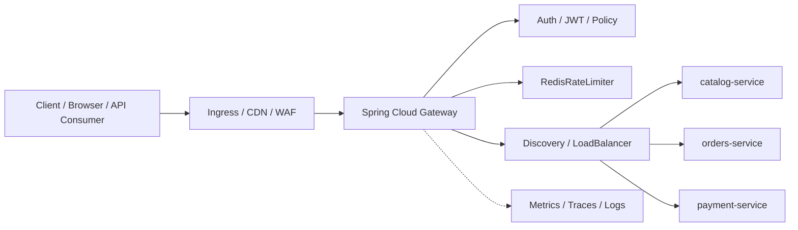
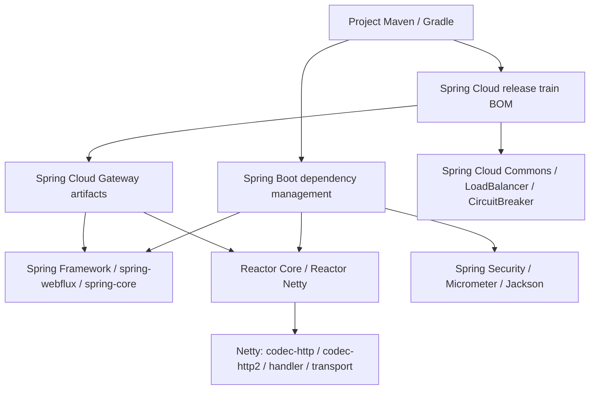
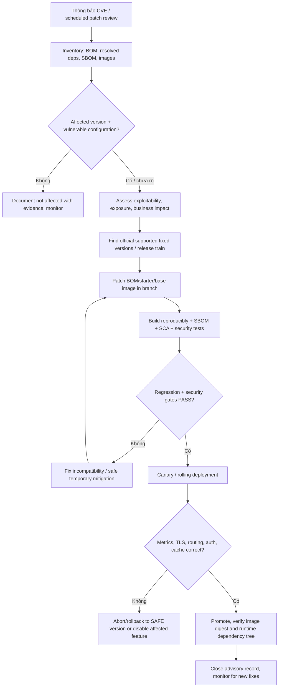
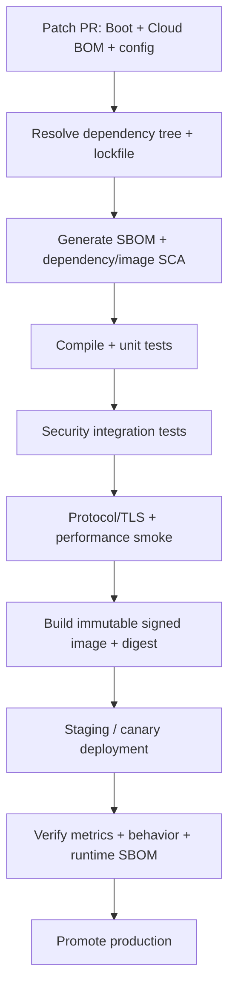
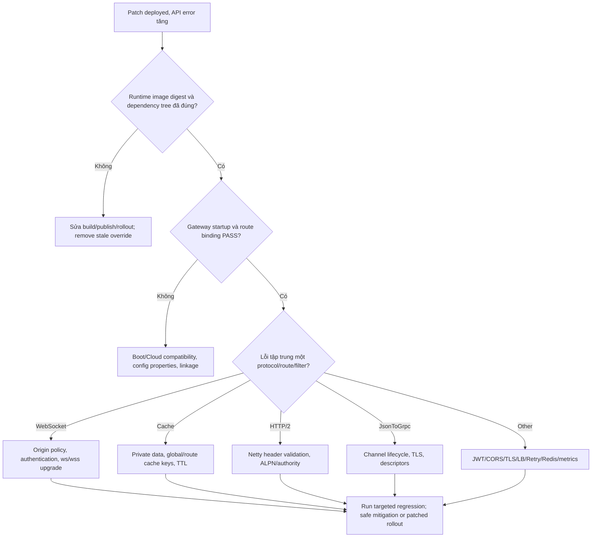

# Cập nhật bản vá Gateway, Spring Framework và Reactor Netty

Trong hệ thống microservices, **Spring Cloud Gateway** đứng ở vị trí nhận lưu lượng từ client không tin cậy, chọn tuyến theo route predicates, thực thi `GlobalFilter`/`GatewayFilter`, sửa đường dẫn và headers, chuyển tiếp tới backend qua discovery/LoadBalancer, kiểm tra JWT, áp dụng rate limiting, retry, circuit breaker và TLS. Một lỗ hổng tại Gateway, **Spring Framework**, **Reactor Netty** hoặc thư viện **Netty** bên dưới có thể ảnh hưởng đến nhiều microservices cùng lúc dù code ứng dụng không thay đổi.

Vì vậy, **gia cố bảo mật bằng bản vá** không chỉ là chạy lệnh cập nhật một dependency. Đây là quy trình **xác định thành phần thực đang chạy → đánh giá advisory và điều kiện bị ảnh hưởng → chọn chuỗi phiên bản tương thích → thử hồi quy chức năng/bảo mật → triển khai có kiểm soát → xác minh phiên bản cuối → duy trì vòng đời hỗ trợ**.

Bài thuộc chương **Gia cố bảo mật** của module **SPRING_CLOUD_GATEWAY**. Nó kết nối việc quản trị bản vá với đặc thù API Gateway: route predicate, filter chain, path/header mutation, discovery, JWT/token relay, rate limiting, circuit breaker/retry, TLS, WebSocket/gRPC và observability. Trọng tâm là nâng cấp **Gateway + Spring Boot/Framework + Reactor Netty/Netty** đúng cách, thay vì tắt các tính năng bảo mật để đạt trạng thái “không có cảnh báo”.

> **Mốc tham chiếu:** Ví dụ sự cố trong bài dùng những advisory đã công bố **ngày 19/11/2026**, xem tại [Spring Security Advisories](https://spring.io/security/), cùng một advisory Netty công bố trong năm 2026. Tại thời điểm đọc bài, hãy **tra cứu lại advisory/versions mới nhất**; số version được nêu chỉ dùng để minh họa cách xác minh, **không phải khuyến nghị nâng cấp bất biến**. Các bản OSS và bản chỉ dành cho **Enterprise Support** không được xem là cùng khả năng tải/sử dụng.

## 1. Vì sao một bản vá nhỏ có thể quan trọng với API Gateway?

Gateway là ranh giới bảo mật và mạng:



Nếu thư viện HTTP parser có lỗi, một request có thể được Gateway hiểu khác backend; nếu cache sai chính sách riêng tư, dữ liệu user A có thể được trả cho user B; nếu filter tạo kết nối không được đóng, traffic lặp lại có thể làm cạn sockets/file descriptors. Đây là những rủi ro **phụ thuộc vào cấu hình** và **đường đi dữ liệu**, không thể xử lý chỉ bằng sửa một controller ở backend.

### Nhóm hệ quả cần quan tâm

| Nhóm rủi ro | Tác động với Gateway | Tín hiệu cần quan sát |
| --- | --- | --- |
| **Request parsing / smuggling** | Gateway và downstream hiểu khác nhau về Host, request target hoặc HTTP framing. | 4xx bất thường, route mismatch, request parse errors, security audit. |
| **Authorization bypass** | Header/path normalization hoặc matcher thay đổi ý nghĩa route. | Requests tới backend không đúng chính sách, 401/403 anomalies. |
| **Data disclosure qua cache** | Response private được lưu/trả cho caller khác. | Cache hits ở auth routes, dữ liệu cross-user, incident security. |
| **Resource exhaustion / DoS** | Memory leak, socket/channel leak, unbounded allocations. | Heap/direct memory, open FDs, active connections, GC/OOM. |
| **TLS / hostname validation** | Kết nối không xác thực đúng bên nhận hoặc lỗi sau upgrade. | TLS handshake failure, SNI/CA validation, cert expiry. |
| **WebSocket / long-lived traffic** | Origin checks, handshake changes, stream cancellation. | 403 handshake, active streams, disconnections. |
| **Dependency mismatch** | Version mới chạy với API/ABI không tương thích. | `NoSuchMethodError`, `NoClassDefFoundError`, startup fail. |

**Mục tiêu của bản vá là loại bỏ điều kiện dễ bị khai thác mà vẫn giữ đúng chức năng.** Không nên che lỗi bằng cách cho phép mọi CORS origin, vô hiệu xác thực, bỏ TLS certificate validation hoặc trả dữ liệu cache riêng tư.

## 2. Hiểu “chuỗi phiên bản” mà Gateway thực sự dùng

Một ứng dụng Spring Cloud Gateway Server WebFlux thông thường có cấu trúc quản trị dependency:



**Sơ đồ là quan hệ quản trị/điển hình**, không phải một dependency tree có thể được dùng nguyên xi cho mọi bản. Để biết chính xác dự án chạy gì, phải đọc **resolved dependency graph** và artifact có trong runtime image.

| Lớp | Ví dụ artifacts | Vai trò trong đánh giá bản vá |
| --- | --- | --- |
| **Spring Cloud release train** | `org.springframework.cloud:spring-cloud-dependencies`. | Chọn các phiên bản Spring Cloud tương thích với Spring Boot. |
| **Gateway** | `spring-cloud-starter-gateway-server-webflux`, `spring-cloud-gateway-server-webflux`. | Route/filter chain, cache, WebSocket, JsonToGrpc, NettyRoutingFilter. |
| **Spring Boot** | `spring-boot-starter-parent` / `spring-boot-dependencies`. | Quản lý Spring Framework, Reactor/Netty, logging/Jackson, Actuator. |
| **Spring Framework** | `spring-webflux`, `spring-web`, `spring-core`, `spring-context`. | HTTP request/response handling, codecs, SpEL, framework infrastructure. |
| **Project Reactor** | `reactor-core`, `reactor-netty-http`, `reactor-netty-core`. | Reactive streams và Netty HTTP client/server integration. |
| **Netty** | `io.netty:netty-codec-http`, `netty-codec-http2`, `netty-handler`, `netty-transport`. | Byte-level protocols, HTTP/1.1, HTTP/2, TLS, buffers, transport. |
| **Security** | `spring-security-web`, `spring-security-oauth2-resource-server`. | Authentication, Authorization, JWT/JWK, WebFilter chains. |
| **Other optional** | Redis reactive client, gRPC/Protobuf, Caffeine, discovery clients. | Riêng từng tính năng cần advisory/compatibility bổ sung. |

### Không nhầm ba tên

1. **Reactor Core** điều phối reactive streams; không phải Netty HTTP parser.
2. **Reactor Netty** là integration/reactive network runtime dùng Netty.
3. **Netty** là bộ thư viện giao thức/transport dưới cùng, có nhiều modules riêng.

Nếu CVE ảnh hưởng `io.netty:netty-codec-http2`, không thể kết luận đã vá chỉ vì `reactor-netty-http` đổi version mà **resolved Netty codec HTTP/2** vẫn cũ. Ngược lại, advisory Spring Framework không nhất thiết biến mất chỉ bằng nâng Netty.

### Chọn đúng Gateway variant

| Variant | Runtime | Cách quản trị |
| --- | --- | --- |
| **Gateway Server WebFlux** | Reactive stack, Reactor Netty theo cấu hình mặc định. | Kiểm tra Spring Framework WebFlux, Reactor Netty/Netty và Gateway Server WebFlux. |
| **Gateway Server Web MVC** | Servlet stack/HTTP client theo starter/container thực. | Không giả định mọi lỗ hổng Reactor Netty xảy ra trên đường inbound; kiểm tra Servlet container/HTTP client thực. |
| **Proxy Exchange WebFlux/MVC** | Controller-based proxy khác Gateway Server filters. | Kiểm tra đúng artifact và HTTP client variant; không suy từ `GatewayFilterFactory`. |

Một ứng dụng thêm cả Netty client, Tomcat server hoặc gRPC Netty transport có thể có **nhiều đường dùng Netty khác nhau**. Trước khi kết luận “không bị ảnh hưởng”, hãy xem resolved artifacts, runtime configuration và đường đi request thật.

## 3. Spring Boot và Spring Cloud release train: nâng cấp theo cặp tương thích

Spring Cloud duy trì **bảng release train tương thích với Spring Boot** trong [Spring Cloud project page](https://spring.io/projects/spring-cloud/) và tài liệu release train. Bảng có thể thay đổi theo mốc thời gian; **không tự ghép “Boot mới nhất” với “Cloud cũ nhất”**.

### Ví dụ snapshot tương thích

Ở tài liệu dự án công bố trong tháng 11/2026, có các thông tin tham chiếu:

| Spring Cloud train | Spring Boot generation được dự án chỉ ra | Cách sử dụng bảng |
| --- | --- | --- |
| `2026.0.x` | Tài liệu `2026.0.0` chỉ ra **Spring Boot 4.2.0**. | Kiểm tra release notes và bộ modules đi kèm trước khi nâng major. |
| `2025.1.x` | Bảng Spring Cloud chỉ ra Boot `4.0.x`; hỗ trợ `4.1.x` bắt đầu từ mốc service release được nêu trên trang dự án. | Dùng service release phù hợp với Boot minor. |
| `2025.0.x` | Bảng tham chiếu Boot `3.5.x`. | Kiểm tra trạng thái support/EOL trước khi chọn cho production. |
| Những train cũ hơn | Các thế hệ Boot cũ theo bảng support. | Không giả định vẫn có **OSS security fix**. |

Nguồn đối chiếu: [Spring Cloud project](https://spring.io/projects/spring-cloud/), [Spring Cloud 2026.0.0 documentation](https://docs.spring.io/spring-cloud-release/reference/index.html), [Supported Versions](https://github.com/spring-cloud/spring-cloud-release/wiki/Supported-Versions).

**Không chọn chỉ theo hàng trong bảng.** Một ứng dụng cụ thể phải kiểm tra: Java baseline, Spring Boot minor/patch, Gateway artifact version, Spring Framework/Netty resolved tree, server/client behavior và kênh phát hành OSS/Enterprise tương ứng.

### Các lựa chọn nâng cấp

1. **Patch trong cùng nhánh tương thích:** ít thay đổi API/cấu hình nhất, ưu tiên khi có bản sửa được hỗ trợ.
2. **Service release của Spring Cloud train:** thường cập nhật nhiều Spring Cloud modules cùng lúc.
3. **Minor/Major migration:** nếu nhánh cũ EOL/không có bản vá công khai, cần kế hoạch chuyển runtime/startup/properties và JVM.
4. **Commercial/Enterprise fix:** một số bản vá chỉ được cung cấp trong kênh hỗ trợ có quyền truy cập và điều kiện sử dụng riêng; **không ghi vào `pom.xml` nếu chưa xác nhận repository/entitlement**.

**Không dùng version override cục bộ của `spring-webflux` hoặc `netty-handler` như biện pháp mặc định** để né bom compatibility. Điều đó có thể tạo một graph “hết CVE theo scanner” nhưng runtime vỡ hoặc lộ lỗi khác vì không tương thích.

## 4. Quy trình vá bảo mật tổng thể



Ở mỗi bước cần **artifact và bằng chứng**: phiên bản trước/sau, affected routes/filters, test outputs, canary metrics, rollout revision và người phê duyệt. Với mức độ khẩn cấp cao, không bỏ hoàn toàn kiểm thử; dùng một **gói smoke/security regression tối thiểu đã chuẩn bị sẵn** để triển khai sớm mà vẫn có khả năng phát hiện lỗi nghiêm trọng.

## 5. Nhận diện advisory đúng cách

Advisory có thể được công bố ở nhiều nguồn:

- [Spring Security Advisories](https://spring.io/security/) — dự án, mức độ, affected ranges, fixed versions và điều kiện bị ảnh hưởng.
- [Spring Cloud Gateway Releases](https://github.com/spring-cloud/spring-cloud-gateway/releases) — service releases và thay đổi behavior.
- [Spring Framework Releases](https://github.com/spring-projects/spring-framework/releases).
- [Reactor Netty Releases](https://github.com/reactor/reactor-netty/releases).
- [Netty Security Advisories](https://github.com/netty/netty/security/advisories), [Netty Releases](https://github.com/netty/netty/releases).
- [GitHub Advisory Database](https://github.com/advisories), NVD/OSV để đối chiếu artifact coordinates và aliases.
- SBOM/SCA của **dự án và container image thực sự deploy**.

### Phân loại mức độ rủi ro

| Trường trong advisory | Câu hỏi cần trả lời |
| --- | --- |
| **Affected product/artifact** | Gateway factory, Spring Framework codec hay Netty module nào? |
| **Affected version ranges** | Resolved version trong runtime có thuộc dải không? |
| **Conditions** | Feature/filter/protocol/config có bật và reachable từ attacker không? |
| **Impact** | Data disclosure, bypass, DoS, cache poisoning, unauthorized routing? |
| **Fixed version** | Đã có bản sửa trong OSS hay chỉ Enterprise? |
| **Workaround** | Có cách vô hiệu **đúng tính năng bị ảnh hưởng** trong lúc vá không? |
| **Release train compatibility** | Boot/Cloud/Gateway/Framework/Reactor/Netty nào chạy cùng nhau? |
| **Evidence** | Source code, route inventory, SBOM, tests, log/traces, exposure map. |

Một CVE xuất hiện trong dependency tree nhưng **code path không được dùng** có thể là finding không khai thác được theo điều kiện advisory. Tuy nhiên, không đóng cảnh báo chỉ vì “chưa từng thấy exploit”: cần bằng chứng cấu hình/route/usage rõ và đánh giá liệu feature có thể được bật qua dynamic routes sau đó không.

## 6. Snapshot advisory liên quan trực tiếp đến Gateway — 19/11/2026

Spring công bố một số lỗi ảnh hưởng các tính năng Gateway cụ thể. Bảng sau là **ví dụ thực tế về cách đọc điều kiện**, không phải danh sách đầy đủ mọi CVE:

| Advisory | Thành phần/điều kiện tiêu biểu | Hậu quả chính | Cần kiểm tra |
| --- | --- | --- | --- |
| [CVE-2026-59425](https://spring.io/security/cve-2026-59425/) | `JsonToGrpc` trên route reachable; phiên bản bị ảnh hưởng tạo `ManagedChannel` mới mỗi request mà không giải phóng. | Cạn sockets/channel resources → DoS. | Route inventory, filter enabled, gRPC resource lifecycle, bản Gateway đã vá. |
| [CVE-2026-59426](https://spring.io/security/cve-2026-59426/) | **Global** `LocalResponseCache` với các route có cùng request URI nhưng khác predicates không nằm trong cache key. | Có thể lộ response giữa các routes. | Có bật global cache? Route predicates có phân biệt policy/tenant? |
| [CVE-2026-59427](https://spring.io/security/cve-2026-59427/) | `LocalResponseCache` có thể lưu response `Cache-Control` nhiều directives như `private, no-store`/`no-cache, no-store, ...` trong các phiên bản bị ảnh hưởng. | Tiết lộ authenticated/private content qua cache. | Cache có áp lên endpoint riêng tư? Chính sách Cache-Control/Vary và phiên bản? |
| [CVE-2026-59428](https://spring.io/security/cve-2026-59428/) | `WebsocketRoutingFilter` trên routes `ws/wss` trước khi có same-origin policy mặc định. | Cross-origin WebSocket handshake có thể dùng browser credentials. | Origin allowlist/allowed patterns, cookie auth, websocket routes. |

Các advisory trên liệt kê **Gateway 5.0.0–5.0.4** trong affected ranges và **5.0.5 (OSS)** là một bản có các sửa lỗi tương ứng. Một số dòng `4.3.x`, `4.2.x` hoặc `3.1.x` có affected/fixed ranges khác nhau, trong đó những bản sửa được ghi là **Enterprise Support Only**. **Không tuyên bố mọi phiên bản 4.x có OSS patch công khai**. Đọc từng advisory để biết cụ thể thay vì áp một range chung cho mọi CVE.

### Phân biệt “dependency hiện diện” với “tính năng reachable”

Nếu class `JsonToGrpcGatewayFilterFactory` có trong JAR nhưng không route nào dùng `JsonToGrpc`, điều kiện riêng của CVE-2026-59425 có thể không được kích hoạt trên đường traffic hiện tại. Nếu dynamic routes có thể thêm filter đó trong tương lai, việc không kiểm soát route publisher có thể làm exposure xuất hiện ngay sau khi bật. Vì vậy:

1. Inventory **artifact version**.
2. Inventory **active routes/filter factories** và config revisions.
3. Inventory **external reachability** của route.
4. Đối chiếu điều kiện advisory.
5. Nâng cấp vẫn là hướng sửa bền vững; không để assessment tạm thời thay thế patch plan.

## 7. Snapshot Spring Framework và Netty: không chỉ Gateway filter factories

Ngày 19/11/2026 Spring còn công bố các advisory Framework liên quan trực tiếp hoặc gián tiếp đến WebFlux:

| Advisory | Ví dụ điều kiện đặc biệt | Bài học cho Gateway |
| --- | --- | --- |
| [CVE-2026-59418](https://spring.io/security/cve-2026-59418/) | Spring WebFlux on Reactor Netty, decode request bodies thành streaming `Flux<String>`/`bodyToFlux(String.class)` và cấu hình codec `maxInMemorySize` nhỏ hơn Netty buffer size; dẫn tới rò pooled memory. | Audit custom body-inspecting filters và codec limits; không suy mọi Gateway đều bị ảnh hưởng. |
| [CVE-2026-59419](https://spring.io/security/cve-2026-59419/) | `WebClient`/`RestClient`/`RestTemplate` có observations, HTTP method chọn từ untrusted input và connector cho phép non-standard methods. | Audit custom proxy/controller dùng method do client quyết định; xem cardinality và HTTP client metrics. |
| [CVE-2026-59389](https://spring.io/security/cve-2026-59389/) | Spring WebFlux parsing multipart, kiểm tra nội dung rồi relay downstream trên các bản bị ảnh hưởng. | Kiểm tra upload/`ModifyRequestBody`/multipart filters nếu Gateway inspect+forward untrusted parts. |

Theo advisory tháng 11/2026, các issue Framework trên nêu **7.0.11 (OSS)** trong danh sách bản sửa; các bản sửa cho một số nhánh `6.x` được ghi **Enterprise Support Only**. Đọc dải affected/fixed **của từng CVE**; không gắn mặc định cho mọi Framework issue.

Ví dụ phía Netty: [GHSA-c69g-56f8-xwqj / CVE-2026-59900](https://github.com/netty/netty/security/advisories/GHSA-c69g-56f8-xwqj) liên quan `io.netty:netty-codec-http2` khi chuyển đổi HTTP/2 headers sang HTTP/1.x, với các bản vá được advisory chỉ ra là `4.1.136.Final` và `4.2.16.Final` cho các nhánh tương ứng. **Đây là ví dụ công bố tháng 7/2026, không khẳng định đó là Netty patch mới nhất.** Kiểm tra Netty modules resolved, HTTP/2 translation usage và chính sách route/Host của application.

### Tại sao cần kiểm thử sau khi patch Netty?

Sửa lỗi parser, header validation hoặc giới hạn kích thước có thể **từ chối các request trước đây được chấp nhận**. Đây có thể là hành vi đúng về bảo mật nhưng ảnh hưởng clients cũ, proxies hoặc backend giả định headers không chuẩn. Sau patch phải test:

- HTTP/1.1 headers, chunking và keep-alive đúng RFC.
- HTTP/2 pseudo-headers, Host/`:authority`, ALPN và gRPC nếu dùng.
- WebSocket handshake và Origin.
- Request target/path normalization, encoded slash và routing.
- Header size/body size limits với client hợp lệ.
- Correct status on malformed requests, không forward vào backend.
- TLS, cert trust, SNI và pooled connection lifecycle.

**Không tắt Netty HTTP header validation chỉ để “khôi phục benchmark xanh”** khi đó chính là kiểm soát vừa được vá.

## 8. Kiểm kê những phiên bản đang chạy, không chỉ phiên bản khai báo

Mã nguồn có thể khai báo `spring-cloud-starter-gateway-server-webflux` nhưng thực tế nhận các phiên bản khác nhau qua:

- Spring Boot BOM.
- Spring Cloud BOM.
- Explicit `<version>` của một dependency con.
- `dependencyManagement` hoặc Gradle resolution strategy/plugin override.
- Maven profiles/Gradle variants/điều kiện build khác nhau.
- Một starter bên thứ ba kéo version Netty không tương thích.
- Một gRPC Netty transport tự quản dependency của mình.
- JAR được shade/relocate, native libraries, container image layers.

### Ghi nhận cả nguồn và runtime

| Lớp kiểm kê | Ví dụ giá trị cần lưu | Vì sao cần |
| --- | --- | --- |
| **Repository revision** | Commit SHA/release tag, build job ID. | Biết chính xác phiên bản source. |
| **Build configuration** | Boot parent/plugin, Cloud BOM, profiles. | Định danh version management. |
| **Resolved dependencies** | Group/artifact/version, dependency path. | Phát hiện override và transitive packages. |
| **Produced artifact** | Boot executable JAR, image digest. | Tránh build xong nhưng deploy image cũ. |
| **SBOM** | CycloneDX/SPDX component list. | Đối chiếu máy quét CVE. |
| **Runtime flags/config** | WebFlux/MVC, HTTP/2, ws/wss, cache, `JsonToGrpc`. | Xác định exploitability theo advisory. |
| **Deployment evidence** | K8s image digest, pod revision/labels. | Chứng minh production đã nhận bản vá. |

### Ví dụ các artifacts nên tìm trong dependency tree

```text
org.springframework.cloud:spring-cloud-gateway-server-webflux
org.springframework.cloud:spring-cloud-commons
org.springframework:spring-webflux
org.springframework:spring-web
org.springframework:spring-core
io.projectreactor.netty:reactor-netty-http
io.projectreactor.netty:reactor-netty-core
io.projectreactor:reactor-core
io.netty:netty-codec-http
io.netty:netty-codec-http2
io.netty:netty-handler
io.netty:netty-transport
org.springframework.security:spring-security-web
```

**Không suy thiếu HTTP/2 CVE chỉ vì `netty-codec-http2` không xuất hiện trong một đoạn output đã lọc**: hãy xem đầy đủ graph hoặc SBOM và runtime classpath. Những modules chỉ được load ở một tính năng tùy chọn cũng cần được đối chiếu nếu tính năng đó có thể bật trong production.

## 9. Maven: kiểm tra resolved dependencies trước khi chỉnh `pom.xml`

Các lệnh dưới đây là **ví dụ người học tự chạy trong repo được phép**, không phải lệnh được thực thi cho bài này:

```bash
# Xem graph, bao gồm dependency paths.
./mvnw dependency:tree

# Lọc các artifacts có liên quan.
./mvnw dependency:tree -Dincludes=org.springframework.cloud:*,org.springframework:*,io.projectreactor.netty:*,io.netty:*

# Xem effective dependencyManagement / profiles (artifact output do bạn chọn).
./mvnw help:effective-pom -Doutput=effective-pom.xml

# Xác minh project build ra JAR mới.
./mvnw -DskipTests package
```

Nếu môi trường Windows PowerShell sử dụng wrapper chuẩn, tên file thường là `mvnw.cmd` thay vì `./mvnw`; điều chỉnh theo shell và script của project. **Không commit `effective-pom.xml` vào repo chỉ để kiểm tra nếu nó chứa repository URLs/credentials**; đặt vào thư mục công việc test và bảo vệ dữ liệu build. Trong CI, chạy Maven offline cache/approved repositories khi cần reproducibility.

### Đọc dependency tree như thế nào?

Một hình dung:

```text
project
  spring-cloud-starter-gateway-server-webflux (via Cloud BOM)
    spring-cloud-gateway-server-webflux
      spring-webflux (managed by Boot BOM)
      reactor-netty-http (managed by Boot BOM)
        netty-codec-http
        netty-handler
        ...
```

Đây là **sơ đồ giả lập**, không phải output của project hiện tại. Mỗi đường kéo dependency cần được kiểm tra bằng tool thực. Nếu thấy hai phiên bản `netty-handler` khác nhau trong các nhánh:

- Xác định **resolved winner** của Maven theo dependency mediation/management.
- Xem artifact nào đã bị omitted và tại sao.
- Xem các module Netty có đồng bộ compatible BOM không.
- Xác minh runtime image không còn một bản được shade riêng.

**Không chỉ nhìn dòng dependency trực tiếp trong `pom.xml` rồi kết luận resolved version đã đúng.**

## 10. Maven: nâng cấp Boot parent và Spring Cloud BOM

Một cấu trúc quản trị minh họa:

```xml
<project>
  <modelVersion>4.0.0</modelVersion>
  <groupId>com.example</groupId>
  <artifactId>api-gateway</artifactId>
  <version>1.0.0</version>

  <parent>
    <groupId>org.springframework.boot</groupId>
    <artifactId>spring-boot-starter-parent</artifactId>
    <version>REPLACE_WITH_SUPPORTED_BOOT_VERSION</version>
    <relativePath/>
  </parent>

  <properties>
    <java.version>REPLACE_WITH_SUPPORTED_JAVA_BASELINE</java.version>
    <spring-cloud.version>REPLACE_WITH_COMPATIBLE_CLOUD_TRAIN</spring-cloud.version>
  </properties>

  <dependencyManagement>
    <dependencies>
      <dependency>
        <groupId>org.springframework.cloud</groupId>
        <artifactId>spring-cloud-dependencies</artifactId>
        <version>${spring-cloud.version}</version>
        <type>pom</type>
        <scope>import</scope>
      </dependency>
    </dependencies>
  </dependencyManagement>

  <dependencies>
    <dependency>
      <groupId>org.springframework.cloud</groupId>
      <artifactId>spring-cloud-starter-gateway-server-webflux</artifactId>
    </dependency>
    <dependency>
      <groupId>org.springframework.boot</groupId>
      <artifactId>spring-boot-starter-actuator</artifactId>
    </dependency>
  </dependencies>
</project>
```

**Mẫu trên chỉ là đoạn POM cấu trúc**, phải thay các placeholder và bổ sung build plugins, phiên bản Java, security/test dependencies thực tế. `java.version` **không nhận chuỗi placeholder trong build chạy thật**; ví dụ dùng để minh họa vùng cần cập nhật, không phải POM có thể build nguyên xi.

### Quy trình nâng cấp được đề xuất

1. Chọn **Spring Cloud train** đáp ứng compatibility với Spring Boot patch/minor yêu cầu.
2. Chọn Spring Boot **supported patch** đã chứa bản sửa Framework/Reactor/Netty theo release notes.
3. Đổi Boot parent và Cloud BOM **cùng một pull request** có bảng resolved versions trước/sau.
4. Chỉ dùng explicit version overrides khi **release management chứng minh** cần thiết, có issue/ticket, compatibility test và thời hạn loại bỏ override.
5. Chạy dependency tree sau build; so **tất cả** `spring-*`, `reactor-*` và `netty-*` relevant modules.
6. Chạy security scan lại trên **artifact/image sau build**, không chỉ POM đã sửa.

### Vì sao không sửa một line như sau rồi dừng?

```xml
<!-- Anti-pattern: override một module con mà không đánh giá toàn bộ graph -->
<dependency>
  <groupId>io.netty</groupId>
  <artifactId>netty-handler</artifactId>
  <version>UNREVIEWED_NEW_VERSION</version>
</dependency>
```

Netty gồm nhiều modules có thể phải đồng bộ; Reactor Netty có compatibility assumptions; một module mới có thể làm lộ `NoSuchMethodError` khi khác ABI với modules cũ. Nếu cần hotfix override, dùng **Netty BOM tương thích được phê duyệt và regression test**, không mặc định thay một JAR đơn lẻ.

## 11. Gradle: kiểm kê và nâng cấp tương thích

Một cấu trúc **Gradle Groovy DSL** minh họa:

```groovy
plugins {
    id 'java'
    id 'org.springframework.boot' version 'REPLACE_WITH_SUPPORTED_BOOT_VERSION'
    id 'io.spring.dependency-management' version 'REPLACE_WITH_COMPATIBLE_PLUGIN_VERSION'
}

group = 'com.example'
version = '1.0.0'

ext.springCloudVersion = 'REPLACE_WITH_COMPATIBLE_CLOUD_TRAIN'

dependencyManagement {
    imports {
        mavenBom "org.springframework.cloud:spring-cloud-dependencies:${springCloudVersion}"
    }
}

dependencies {
    implementation 'org.springframework.cloud:spring-cloud-starter-gateway-server-webflux'
    implementation 'org.springframework.boot:spring-boot-starter-actuator'
    testImplementation 'org.springframework.boot:spring-boot-starter-test'
}
```

Đây là **khung build**; không ghi explicit Reactor Netty/Netty versions nếu BOM đã quản lý và bạn chưa có exception policy được phê duyệt. Có thể dùng Gradle native `platform(...)` hoặc version catalogs nếu project đã chuẩn hóa theo phương án đó; tránh vừa ép `platform` vừa dùng dependency management plugin với precedence không được hiểu rõ.

### Các lệnh người học có thể chạy

```bash
./gradlew dependencies --configuration runtimeClasspath

./gradlew dependencyInsight --dependency reactor-netty-http --configuration runtimeClasspath
./gradlew dependencyInsight --dependency netty-codec-http2 --configuration runtimeClasspath
./gradlew dependencyInsight --dependency spring-webflux --configuration runtimeClasspath

./gradlew clean test
```

Với Windows, dùng `gradlew.bat` khi cần. Một project Gradle có nhiều variants/configurations (testRuntimeClasspath, runtimeClasspath, native image) cần kiểm tra **configuration thực sự dùng**. Không suy từ một tree của unit tests rằng runtime image production có cùng dependencies.

### Dependency locking

Nếu CI dùng Gradle dependency locking, bản vá BOM sẽ thay đổi graph và lockfiles cần được **cập nhật có kiểm soát**, review diff. Nếu lock vẫn pin Netty/Framework cũ, thay build script có thể chưa nâng được artifact runtime.

## 12. Kiểm tra SBOM và phần mềm thực sự đóng gói

**SBOM (Software Bill of Materials)** là danh sách components và versions trong một build/image. Nó giúp:

- Tìm artifact bị CVE nhắm tới bằng coordinates, không chỉ grep tên JAR.
- Đối chiếu image `gateway:v2` thật sự chạy `spring-webflux` nào.
- Phát hiện gRPC shaded Netty hoặc plugin/transport native khác.
- Gắn kết quả scan với release digest và môi trường.
- Tạo audit trail cho security review.

### Ví dụ công cụ

| Công cụ/định dạng | Mục đích | Lưu ý |
| --- | --- | --- |
| **CycloneDX / SPDX** | Chuẩn đầu ra SBOM phổ biến. | Lưu version/coordinates/hash, liên kết image digest. |
| **Maven/Gradle dependency graph** | Resolved transitive dependencies. | Không thay hoàn toàn image/container scan. |
| **OWASP Dependency-Check / SCA scanner** | So version với vulnerability databases. | Có false positives, cần triage exploitability. |
| **Trivy/Grype hoặc scanner tương đương** | Quét image, OS packages và Java dependencies tùy chế độ. | DB freshness và file scanning coverage quan trọng. |
| **Container signing/provenance** | Chứng minh image nguồn CI tin cậy. | Không tự chứng minh không còn CVE. |

### Một câu hỏi phải trả lời

```text
Source pom.xml              -> Spring Cloud train X
Resolved runtime classpath  -> Gateway version Y
Container image SHA256      -> digest Z
Running pod imageID         -> digest Z?
SBOM of image Z             -> spring-webflux version W
Advisory affected range     -> W in / out?
```

Nếu source code đã vá nhưng **running pod dùng image digest cũ**, production **chưa** được vá. Nếu image đã được build từ dependency graph mới nhưng một `netty-all` shaded JAR cũ vẫn có thể load, cần kiểm tra classloading và affected code path.

### Đừng lưu secrets trong SBOM/logs

SBOM có thể lộ service topology/private repository URLs; không đưa credentials/token vào metadata. Đặt output trong artifact storage đã có access control. Nếu dùng plugin để tạo SBOM, **pin phiên bản plugin** và đảm bảo CI build reproducibility; không cho scanner tự tải tool chưa được phê duyệt trong pipeline production.

## 13. Triage “CVE đang bị ảnh hưởng thật” bằng bằng chứng

Một hồ sơ triage tối thiểu:

```text
Vulnerability ID:      CVE-...
Product/module:        spring-cloud-gateway / spring-webflux / netty-codec-http2
Resolved version:      measured from runtime/SBOM
Affected range:        copied from official advisory
Affected functionality: enabled / disabled / unknown
Entry point exposure:  public / authenticated / internal / unreachable
Mitigation:            vendor fixed release or guarded workaround
Owner:                 platform security + service owner
Target release:        supported Boot/Cloud train
Evidence:              dependency tree, route inventory, test IDs, image digest
Decision:              patch now / mitigate then patch / not affected with proof
```

### Ví dụ đánh giá CVE-2026-59427

1. **Version:** runtime Gateway có thuộc affected range được Spring công bố không?
2. **Feature:** route nào bật `LocalResponseCache`? Global filter có bật không?
3. **Data classification:** responses có chứa user-specific/authenticated data không?
4. **Cache-Control:** backend có gửi nhiều directives trên cùng header, chẳng hạn `private, no-store` hoặc `no-cache, no-store, max-age=0, must-revalidate` không?
5. **Vary / route separation:** cache có phân biệt callers theo policy không, hay có nguy cơ mix?
6. **Action:** ưu tiên upgrade fixed release; nếu chưa vá ngay được thì **ngừng cache dữ liệu riêng tư** và làm test cross-identity.

Không “đóng false-positive” chỉ vì backend gửi `Cache-Control: no-store`: advisory này nói chính cách so directive có thể sai khi header chứa **nhiều directives**, nên cần xem **header thực** và version.

### Ví dụ đánh giá CVE-2026-59418

Gateway đơn thuần proxy bytes qua Netty không có nghĩa nó dùng `Flux<String>` decoder đặc thù của advisory. Nhưng một **custom GatewayFilter/GlobalFilter** nhận request body, parse dòng text và dùng codec limit tùy biến có thể làm điều kiện trở nên đúng. Cần review code của **body inspection/adapter**. Nếu xác định không có code path, lưu bằng chứng; vẫn lên lịch nâng Framework trong nhánh hỗ trợ.

### False negative nguy hiểm

“Scanner xanh” có thể vì:

- SBOM chỉ quét POM, không quét final fat JAR/image.
- CVE chưa có trong database hoặc advisory mới chưa đồng bộ.
- Dependency bị shade, relocated hoặc dùng native transport.
- Runtime image dùng JAR cũ từ base/layer khác.
- Dynamic routes bật filter sau lần scan.

**Vulnerability scanner là nguồn tín hiệu, không thay security architecture review.**

## 14. Ưu tiên patch theo exploitability và blast radius

CVSS là một chiều; Gateway public entry point nên bổ sung:

| Yếu tố | Câu hỏi thực dụng |
| --- | --- |
| **Reachability** | Route/filter có nhận traffic từ Internet/untrusted users không? |
| **Privileges required** | Anonymous có thể tiếp cận điều kiện lỗi không? |
| **Data sensitivity** | Có token, session, dữ liệu đa tenant, payment/customer data không? |
| **Blast radius** | Một Gateway shared instance có phục vụ nhiều services không? |
| **Exploit prerequisites** | Chỉ lỗi khi ws/wss, LocalResponseCache, multipart decoder, http2 conversion? |
| **Existing mitigations** | Route deny, Origin allowlist, TLS policy, network segmentation, strict cache policy? |
| **Patch support** | OSS fixed release hay cần Enterprise subscription/migration? |
| **Operational impact** | Upgrade cần config migrations, Java major, connection drain/test coverage? |

Một quy trình severity nội bộ có thể chọn **thời hạn xử lý** theo critical/high/medium/low. Đừng sao chép SLA ngày cố định không phù hợp tổ chức; phải cân nhắc khả năng bị khai thác thật, tốc độ phát hành vendor fix và mức tiếp xúc của Gateway.

### Ba tình huống quyết định

1. **Public JsonToGrpc route trên affected Gateway:** ưu tiên vá rất cao; nếu chưa vá kịp, xem xét vô hiệu route hoặc giới hạn truy cập/traffic thay vì chỉ tăng file descriptor limit.
2. **Global cache trên routes có authenticated/private responses:** ưu tiên an toàn dữ liệu; **tắt shared caching** cho đến khi bản vá và test đúng.
3. **Netty HTTP/2 advisory nhưng Gateway chỉ dùng HTTP/1.1 trong toàn trust boundary:** có thể giảm mức độ exploitability theo điều kiện, nhưng vẫn phải xác minh chặng ingress, downstream, gRPC và khả năng HTTP/2 được bật sau rollout.

**Không viết “không bị ảnh hưởng” chỉ dựa vào một cấu hình YAML** nếu ingress có thể chuyển H2→H1, gRPC/sidecar dùng Netty riêng hoặc application còn endpoints public không được liệt kê.

## 15. Đọc release notes và change log trước khi chọn target

Một release bảo mật có thể bao gồm **behavior changes có chủ đích**:

- Header/protocol parser từ chối input mơ hồ từng được chấp nhận.
- WebSocket `Origin` bị kiểm tra chặt hơn.
- Cache keys hoặc eligibility thay đổi để chống rò private responses.
- Resource/channel lifecycle thay đổi, ảnh hưởng connection reuse và shutdown.
- Default codecs, size/time limits và observability tags thay đổi.
- Route/filter configuration property names được dịch chuyển giữa `3.x`/`4.x`/`5.x`.

### Ma trận nâng cấp

| Hạng mục | Cần ghi trước nâng cấp | Cần xác nhận sau nâng cấp |
| --- | --- | --- |
| Boot & Cloud | Parent/plugin + Cloud BOM, Java version, support status. | Chọn cặp đã công bố tương thích, runtime khởi động được. |
| Gateway | Variant/starter, route definitions, filter factories, dynamic routes. | Route semantics không sai; các factory còn được hỗ trợ. |
| Framework | `spring-webflux`, codecs, SpEL, Security integration. | HTTP parsing/body binding/auth không bị hồi quy. |
| Reactor Netty | `reactor-netty-http`/`core`, connection pool metrics, HTTP client. | No linkage errors, pooling/TLS/stream handling đúng. |
| Netty | `codec-http`/`codec-http2`/`handler`/`transport`. | Đúng patched branch, parser và HTTP/2 compatibility. |
| Security | JWT issuers/audiences, OAuth2/TokenRelay, CORS/CSRF. | Không bypass; người dùng hợp lệ vẫn truy cập được. |
| Caching | Local/global cache, `Cache-Control`, `Vary`, key isolation. | Private content không được cache; route isolation đúng. |
| WebSocket/gRPC | ws/wss origin policy, JsonToGrpc/gRPC channel resources. | Handshake hợp lệ, Origin reject đúng, channels đóng/reuse đúng. |
| Operations | Actuator, metrics, health, shutdown/timeouts. | Readiness/liveness và rollout/alerts không bị hỏng. |

### Một ví dụ nâng cấp thực tế theo mốc đã công bố

Ngày **20/11/2026**, Spring đã công bố các bản Spring Cloud:

- [Spring Cloud 2025.1.5](https://spring.io/blog/2026/11/20/spring-cloud-2025-1-5-has-been-released/) — release announcement liệt kê các sửa CVE-2026-59425 đến 59428 của Gateway.
- [Spring Cloud 2026.0.0](https://spring.io/blog/2026/11/20/spring-cloud-2026-0-0-has-been-released/) — release announcement cũng liệt kê các sửa tương ứng.

**Đây không phải chỉ dẫn “mọi project hãy đổi thẳng sang 2026.0.0”.** Cần đối chiếu Boot generation, Java baseline, các API thay đổi, features yêu cầu và khả năng support. Đặc biệt, một train có thể mới ra nhưng project đang ở một bản Boot/Java không tương thích với train đó; migration cần được lên kế hoạch.

### Đừng nghĩ bản vá chỉ đổi số version

Một bản sửa WebSocket Origin thường làm **các client cross-origin không được khai báo** nhận 403 thay vì được cho qua như cũ. Nếu frontend thật được host ở một origin khác, phải xây **explicit allowlist** sau khi review, không bật `*` để “làm cho test xanh”.

Một bản sửa Netty header validation có thể phát hiện một reverse proxy cũ đang gửi headers không chuẩn. Khi test fail, cần sửa proxy/client hoặc cấu hình giao thức phù hợp, không tự quay lại bản CVE chỉ vì production traffic có request bất thường.

## 16. Ví dụ: gia cố WebSocket Origin sau bản vá

Theo [CVE-2026-59428](https://spring.io/security/cve-2026-59428/), Gateway phiên bản được vá kiểm tra Origin của WebSocket handshake và có các properties cấu hình origins được cho phép.

### Cấu hình WebFlux dòng mới, ví dụ allowlist

```yaml
spring:
  cloud:
    gateway:
      server:
        webflux:
          websocket:
            allowed-origins:
              - https://app.example.com
              - https://portal.example.com
```

Trong các dòng `4.x`/`3.1.x`, advisory ghi namespace cũ theo `spring.cloud.gateway.websocket.*`; **không sao chép prefix WebFlux mới cho bản cũ**. Khi bắt đầu chạy, dùng config metadata và test handshake thật để xác minh property đã bind, không chỉ dựa YAML syntactically valid.

### Bản chất của kiểm soát

- Browser WebSocket gửi `Origin` nhưng không thực thi CORS preflight như `fetch` thông thường.
- Origin phải được so với policy đã công bố; `Host`/backend URI không tự thành allowlist.
- Một WebSocket client non-browser có thể tự gửi Origin; **Origin check không thay authentication và authorization**.
- Cookie/session auth với WebSocket cần chống cross-site misuse, không chỉ tin “sau khi đã JWT được xác thực”.
- Nếu WebSocket phục vụ nhiều tenants, policy Origin phải được thiết kế cùng tenant identity và hostname trust, không mở pattern quá rộng.

### Test cần có

| Request | Kết quả chính sách mong đợi |
| --- | --- |
| Origin `https://app.example.com` và token/session hợp lệ | Handshake được xét tiếp; backend phải authorize. |
| Origin `https://attacker.invalid` | Bị reject, ví dụ HTTP 403 theo security policy. |
| Origin có suffix gần giống `app.example.com.evil.invalid` | Không được nhận vì chuỗi chứa substring. |
| Header Origin thiếu hoặc malformed | Hành vi phụ thuộc Gateway version/policy; thử cụ thể. |
| Credential hợp lệ nhưng user không có quyền channel | Backend/Gateway auth vẫn từ chối. |
| wss route trên HTTP/2/ngang ingress | Handshake/protocol tested theo transport hỗ trợ. |

**Không dùng cấu hình `allowed-origins: ["*"]` như biện pháp khắc phục vĩnh viễn**; wildcard có thể khôi phục rủi ro cross-origin tùy mô hình credential.

## 17. Ví dụ: Global LocalResponseCache và private data

[CVE-2026-59426](https://spring.io/security/cve-2026-59426/) nêu rủi ro cache bị dùng chung giữa routes trong điều kiện cụ thể, còn [CVE-2026-59427](https://spring.io/security/cve-2026-59427/) liên quan xử lý `Cache-Control` private/no-store.

### Điều chỉnh tạm thời đối với global cache

Advisory 59426 mô tả cách tạm giảm rủi ro bằng cách **tắt global LocalResponseCache**, sau đó chỉ dùng route-level cache cho các routes public đã được đánh giá:

```yaml
spring:
  cloud:
    gateway:
      server:
        webflux:
          global-filter:
            local-response-cache:
              enabled: false
```

**Chú ý:** Namespace/behavior thay đổi theo dòng Gateway; hãy dùng property được **advisory cho đúng version**. Điều này là **mitigation trong lúc vá**, không thay thế việc nâng lên bản đã sửa. Route-level cache cũng cần policy `Cache-Control`/private data đúng; chỉ tắt global không tự sửa CVE-2026-59427 nếu route-level cache còn chạy trên affected version.

### Không cache dữ liệu nhận diện user

```text
GET /api/public/catalog/products/42
  → Có thể cân nhắc cache nếu response công khai, hợp đồng TTL rõ.

GET /api/users/me
GET /api/orders/123
GET /api/payments/history
  → Không cache shared; response phụ thuộc user/tenant.
```

**Không dùng “Cache-Control: private, no-store” như phép thử duy nhất trên bản chưa vá.** Phải dùng bản đã sửa và test được rằng response private/no-store **không được lưu** dù header có nhiều directives (bao gồm các directive từ Spring Security).

### Kiểm thử cross-identity

1. Dùng user A đã xác thực gọi route nhạy cảm, nhận response A.
2. Dùng caller B hoặc anonymous gọi **cùng URL** nhưng khác credentials.
3. Xác minh B không bao giờ thấy body/headers/ETag/cookie của A.
4. Thử cache state MISS/HIT, nhiều Gateway replicas, query và các method/status cacheable.
5. Ghi backend access counts và response hashes **trong lab**, không lưu PII trong test logs.
6. Test cả `Cache-Control: private, no-store` và multi-directive headers.

Nếu có dấu hiệu disclosure, **tắt route/global cache ngay, cô lập sự cố và xử lý theo quy trình incident**, không chờ toàn bộ regression suite hoàn tất.

## 18. Ví dụ: JsonToGrpc ManagedChannel lifecycle

Theo [CVE-2026-59425](https://spring.io/security/cve-2026-59425/), những phiên bản Gateway bị ảnh hưởng tạo `ManagedChannel` mới cho mỗi HTTP JSON→gRPC request qua `JsonToGrpc` mà không shutdown/reuse đúng, gây cạn resource.

### Điểm cần kiểm tra sau vá

| Quan sát | Trước/sau vá phải đối chiếu |
| --- | --- |
| **Active sockets / file descriptors** | Không tăng vô hạn khi gửi nhiều requests và kết thúc traffic. |
| **gRPC Netty channel resources** | Có lifecycle/reuse/shutdown được quản lý, theo implementation đã vá. |
| **Request latency** | Không hồi quy ngoài SLO; cold/warm connection behavior có thể đổi. |
| **TLS trust/SNI/mTLS** | Kết nối tới gRPC backend vẫn xác minh đúng server. |
| **Error mapping** | HTTP JSON response và gRPC status/trailers được xử lý đúng. |
| **Connection exhaustion recovery** | Khi traffic dừng, resources trở về mức ổn định trong thời gian hợp lý. |

### Đừng dùng resource limits để thay bản vá

Tăng `ulimit -n`, JVM heap, Netty pool size hoặc số Gateway replicas có thể kéo dài thời gian trước khi lỗi lộ diện nhưng **không loại bỏ channel leak**. Nếu không thể cập nhật ngay, điều kiện an toàn là vô hiệu/thu hẹp route `JsonToGrpc` reachable theo business needs và theo dõi sockets/FDs cho đến khi triển khai bản đã sửa.

### Ranh giới với streaming

`JsonToGrpc` là một HTTP JSON→gRPC bridge có giới hạn riêng; không biến nó thành gRPC streaming proxy chỉ vì đang dùng Netty. Khi nâng cấp, test unary JSON bridge riêng với native gRPC/WebSocket/SSE; không cho một test unary PASS đại diện mọi giao thức.

## 19. Spring Framework WebFlux: custom filters và body decoding

Một Gateway WebFlux thường chỉ proxy HTTP bodies, nhưng ứng dụng có thể viết:

- `CacheRequestBody` để dùng lại nội dung đã đọc.
- `ModifyRequestBody`/`ModifyResponseBody` để chuyển JSON.
- Custom `GlobalFilter` đọc `DataBuffer`.
- Controller/ProxyExchange bridge nhận multipart/form-data.
- Observability/validation filters phân tích text và JSON.

**Một thay đổi Spring Framework có thể ảnh hưởng những code paths này**, không chỉ Gateway factory được viết sẵn.

### Soát những điều cần quan tâm

| Code path | Rủi ro sau/cùng với bản vá | Test |
| --- | --- | --- |
| `Flux<String>` decoding | Streaming text decode, codec limit, pooled memory. | Nhiều dòng text/payload size trong bounds, cancellation, direct memory. |
| Multipart inspect + relay | Parsing boundaries và downstream semantics khác nhau. | Multipart có nhiều parts, metadata, content limits, forwarded body consistency. |
| `WebClient` với dynamic HTTP method | Non-standard method/metrics cardinality/exception. | Method whitelist, low-cardinality tags, invalid method rejection. |
| Data binding/SpEL/route config | Untrusted expressions/config có khả năng tác động routing. | Config source ownership, security validation, dangerous fields blocked. |
| Path/header normalization | Gateway và backend hiểu khác nhau. | Percent-encoding, duplicate headers, route/authorization test. |

### Không tắt giới hạn codec để né lỗi

`maxInMemorySize` và body size limits giúp kiểm soát resource. Khi patch parser/decoder sửa một DoS bug, một số request cũ có thể bị reject hợp lệ. **Không tăng giới hạn lên vô hạn** hoặc catch/retry mãi một exception parsing; cần xác định maximum body/headers chính thức, trả 4xx đúng và giữ memory bounded.

### Reactor event loop

Sau thay dependency, nếu custom filter gọi JDBC sync, `Thread.sleep` hoặc một HTTP client blocking trên event loop, p99 có thể tệ hơn. Việc vá không xóa rủi ro do ứng dụng tạo. Chạy test concurrency và quan sát Reactor Netty pool/event-loop/GC; không gộp regression performance do blocking custom code thành “Gateway patch lỗi” nếu thiếu bằng chứng.

## 20. Spring Cloud Config, dynamic routes và quyền cập nhật bảo mật

Nếu routes được thay đổi động, phiên bản Gateway mới có thể đã vá nhưng một route mới do nguồn cấu hình không an toàn thêm vào vẫn mở rủi ro:

```text
Approved route config → validation → signed revision → publish
                                             ↓
                                         Gateway pods
                                             ↓
                                     Route predicate + filters
```

**Không cho client Internet gửi URL/SpEL/filter arguments rồi trở thành route definition trực tiếp.** Control plane cập nhật routes phải được xác thực, phân quyền cao, audit và allowlist URI/service ID, route filter factories và các prefix.

### Các câu hỏi release gate

- Route mới có bật `JsonToGrpc`, global cache, WebSocket `ws/wss` hoặc proxy tới host ngoài trust boundary không?
- `RewritePath`/`StripPrefix` có thể đưa request tới backend admin endpoint không?
- Filter order có làm auth/rate limiting chạy sau một short-circuit không?
- KeyResolver có dùng principal đã được xác thực hay tin raw header user gửi?
- Backend `lb://` có service instances đúng namespace và TLS identity không?
- Gateway Actuator route mutation endpoints có bị expose công khai không?
- Route revision từ Config Server có verified signature/owner/change ticket không?

**Bản vá thư viện và kiểm soát cấu hình phải đi cùng nhau.** CVE ở parser có thể đã sửa, nhưng SSRF từ URI do user chọn vẫn là lỗi thiết kế ứng dụng.

## 21. CI pipeline: kiểm tra những gì trước khi đóng vulnerability ticket?

Một pipeline mẫu:



### Những gates không thể bỏ qua

| Gate | Điều kiện đạt |
| --- | --- |
| **BOM compatibility** | Boot/Cloud train hợp lệ, Java baseline đúng. |
| **Resolved tree** | Affected artifacts thực sự ngoài vulnerable ranges hoặc documented not-affected with evidence. |
| **Build/linkage** | Không `NoSuchMethodError`, `ClassNotFoundException`, `NoClassDefFoundError`. |
| **Gateway functional tests** | Route predicates/path/header filters/`lb://` hoạt động đúng. |
| **Security regression** | JWT/CORS/CSRF/TLS/origin/cache auth boundaries không yếu đi. |
| **Protocol tests** | H1/H2/WebSocket/gRPC nếu được sử dụng; malformed input được từ chối an toàn. |
| **Resilience tests** | Rate limiting, Retry/CircuitBreaker, fallback, timeouts không khuếch đại lỗi. |
| **Observability** | Actuator/probes/route metrics và tracing không mất bất ngờ. |
| **Image evidence** | Build digest và runtime digest khớp; SBOM của image được lưu. |

### Một pipeline thất bại không luôn là lỗi security patch

Ví dụ test WebSocket client vốn gửi Origin không nằm trong allowlist có thể bắt đầu nhận 403 sau bản vá. Đó có thể là **hành vi bảo mật được kỳ vọng**. Sửa frontend/deployment allowlist theo domain được duyệt, thay vì tắt Origin validation. Tương tự, Netty có thể từ chối header không hợp lệ từng được một proxy cũ chấp nhận; cần sửa producer/giao thức.

## 22. Bộ kiểm thử hồi quy bảo mật của Gateway

Hãy thiết lập **suite chạy trên cả bản trước và bản đã vá**. Mục tiêu không phải chứng minh exploit thành công trên production; bài thử tập trung vào **contract hợp lệ, bất biến bảo mật và việc từ chối input nguy hiểm** trên staging với mock backend.

### 22.1. Route predicates và path rewriting

| Test | Đầu vào | Bằng chứng đúng |
| --- | --- | --- |
| R01 | `GET /api/catalog/products/42` | Chọn route `catalog-public`, upstream nhận path đã dự kiến. |
| R02 | `POST` vào route chỉ cho GET | Không lách được `Method` predicate; trả status theo API contract. |
| R03 | URL gần giống `/api/catalogue/**` | Không bị route catalog chọn nhầm. |
| R04 | `/api/catalog/../admin` | Không vượt qua authorization/backend prefix; ingress/framework có thể reject trước. |
| R05 | Encoded slash/dot segments | Gateway/backend diễn giải nhất quán, không bypass. |
| R06 | Headers `Host`/`Forwarded` không tin cậy | Không đổi upstream target/tenant ngoài policy. |

Trên các input malformed, **không bắt buộc mọi version trả cùng một status**: parser mới có thể trả 400, security matcher có thể trả 403, route không match có thể trả 404. Điều bất biến cần kiểm là **request không tới backend/route không được phép**, không phải một mã lỗi cụ thể được viết tùy ý.

### 22.2. Authentication, CORS và token relay

| Test | Kỳ vọng |
| --- | --- |
| Missing token vào route protected | 401/403 đúng policy, không tới backend protected. |
| JWT hết hạn/issuer hoặc audience sai | Reject, không bật anonymous bypass. |
| User thiếu scope/tài nguyên thuộc tenant khác | 403 hoặc error contract phù hợp. |
| Token Relay đến đúng backend audience | Không rò token sang backend ngoài trust boundary. |
| CORS preflight từ Origin được cho phép | Trả Access-Control headers đúng; không wildcard credentials. |
| CORS preflight từ Origin không tin cậy | Không được cho phép cross-origin khi chính sách cấm. |
| Health/admin endpoints | `/actuator/**` không public; probe vẫn chạy trong trusted network. |

### 22.3. Rate limiting, Retry và CircuitBreaker

- Bật `RequestRateLimiter` trong lab: quota key theo principal/API key đáng tin, không do raw header giả mạo; 429 chỉ ở nhóm thực sự vượt policy.
- Tắt Redis test có kiểm soát: xác minh fail policy đã định nghĩa, Gateway không restart storm do liveness sai.
- Với backend 503→200: đo một inbound request có thể tạo hai upstream attempts, tránh retry cho POST không idempotent.
- Với backend luôn 503: Retry phải có max attempts/time budget; CircuitBreaker/fallback không làm lộ stack traces/secret headers.
- Kiểm tra **filter order**: auth/quota không bị chạy sau cache/fallback short-circuit trái policy; retry không nhân tác dụng phụ của custom filters.

### 22.4. TLS và giao thức

| Tình huống | Kiểm chứng |
| --- | --- |
| Client TLS chain hợp lệ | Handshake thành công với hostname/SAN đúng. |
| Upstream CA/hostname không tin cậy | Gateway từ chối thay vì trust-all. |
| mTLS client certificate thiếu | Chặng bắt buộc mTLS từ chối đúng. |
| HTTP/2 clients | ALPN, `:authority`/Host, trailers và downstream routing chuẩn. |
| Header không chuẩn/mơ hồ | Bị xử lý theo parser đã vá, không routing/authorization bypass. |
| WebSocket Origin hợp lệ/không hợp lệ | Origin allowlist hoạt động như policy. |
| gRPC/JsonToGrpc | Unary mapping, TLS, resource lifecycle đúng; streaming tests riêng nếu support. |

### 22.5. Response cache private data

Dùng hai danh tính test **A/B**:

1. A gọi một endpoint private đã xác thực và nhận body của A.
2. B (hoặc anonymous) gọi cùng URL nhưng credentials khác.
3. B không được nhận data/headers từ A từ bất kỳ cache entry nào.
4. Xác nhận directives `Cache-Control: no-store, private` dưới các tổ hợp header values.
5. Nếu global cache có thể match cùng URL trên nhiều routes với policies khác nhau, test route separation.
6. Chạy trên nhiều Gateway replicas/cold/warm cache, vì cache local theo pod.

Đây là **security correctness gate**: không đạt thì **không promote** dù p95/CPU giảm và scanner đã hết cảnh báo.

## 23. POC nâng cấp trong staging: từ inventory đến patch confirmation

Một nhóm platform đang sử dụng Gateway trên một release train có các versions trong affected ranges của advisories 19/11/2026. POC giả định:

```text
Source branch:                 security/gateway-patch
Deployed Gateway:              verify as potentially affected
Spring Cloud train:            check compatibility of current Boot
Active features:               WebFlux, RedisRateLimiter, ws/wss,
                               optional LocalResponseCache / JsonToGrpc
Goal:                          supported fixed release + no regression
```

### Bước 1: ghi baseline

- Xuất resolved dependency tree và SBOM cho image staging hiện tại.
- Ghi Boot parent/plugin, Cloud train, Gateway/Framework/Reactor Netty/Netty versions, JDK và image digest.
- Export route inventory gồm predicates, filters, route ID và dynamic config revision (không dump secrets/tenant IDs).
- Ghi p95/p99, 4xx/5xx/429, Redis limiter decisions, cache hit/miss, gRPC sockets nếu có.
- Chạy current security/functional smoke tests; ghi các lỗi đã có để không đổ lỗi nhầm cho patch.

### Bước 2: chọn target

Kiểm tra Spring Cloud project compatibility matrix và release notes mới. Ví dụ snapshot tháng 11/2026:

- Nếu app tương thích với Cloud `2025.1.x`, xem [2025.1.5 release notes](https://spring.io/blog/2026/11/20/spring-cloud-2025-1-5-has-been-released/) và kiểm tra Gateway patched version theo BOM.
- Nếu đang **chủ động** chuyển Boot/Cloud generation, xem [2026.0.0](https://spring.io/blog/2026/11/20/spring-cloud-2026-0-0-has-been-released/) và tương thích Boot/Java/Framework thực tế.
- So sánh với advisory fixed versions; đừng dùng một release tag tên mới nhưng vẫn chứa artifact vulnerable do explicit overrides/lockfiles.

### Bước 3: sửa cấu hình build

Đổi Boot parent/plugin và Cloud BOM được approve trong cùng pull request. Loại overrides cũ trái với target BOM. Nếu có override bắt buộc, ghi:

```text
override module:
current BOM-managed version:
required patched version:
compatibility evidence:
owner + expiry date:
tests required:
```

**Không tự patch JAR bằng cách thay file trong fat JAR**: cách đó làm mất khả năng reproducibility, SBOM/attestation và dễ tạo classpath conflicts.

### Bước 4: build và quét lại

Người học có thể chạy các nhóm lệnh tương ứng với build tool của project:

```bash
./mvnw -DskipTests=false verify
./mvnw dependency:tree
```

Hoặc:

```bash
./gradlew clean test
./gradlew dependencies --configuration runtimeClasspath
```

Sau khi tạo image mới, sinh SBOM/SCA từ **image digest**; không lấy output scan trước khi build rồi dán vào ticket sau khi vá. Nếu SCA database đánh dấu một CVE cũ trên artifact đã có bản vá theo vendor, đối chiếu **group/artifact/version, affected ranges và nguồn advisory**, không bỏ qua mà không có bằng chứng.

### Bước 5: chạy security regression

Chạy test suite mục 22. Đặc biệt:

- `JsonToGrpc` không leak FDs/channels khi tải và sau quiescence.
- `LocalResponseCache` không cache authenticated/private data và không leakage giữa routes.
- `WebsocketRoutingFilter` reject origins ngoài allowlist.
- Spring WebFlux body/codec paths trong custom filters không leak pooled memory.
- Netty H1/H2 header behavior phù hợp policy.
- Inbound/outbound TLS, JWT/CORS, service discovery, timeouts, retry/fallback được bảo toàn.

### Bước 6: verify final artifact

```text
Deployed image digest:          from Kubernetes/cloud runtime
Gateway artifact version:      from final SBOM
spring-webflux version:         from final SBOM
reactor-netty-http version:     from final SBOM
netty-codec-http2 version:      from final SBOM
Affected ranges matched:       none, or justified not-affected records
Known patch exceptions:        explicit with deadline
Canary security tests:         PASS
Canary route/resilience tests:  PASS
Rollback target:               last-known-safe image/config
```

**Không tuyên bố sản phẩm đã vá chỉ vì pull request được merge.** Chứng cứ phải liên kết **runtime image digest** đến dependency versions và release record.

## 24. Mô phỏng tải sau nâng Netty và Reactor Netty

Bản vá codec/HTTP parser có thể ảnh hưởng đến latency, connection reuse, direct memory hoặc pool behavior. Dùng một mock backend phù hợp contract với Gateway staging và so **same topology/same traffic** trước-sau.

### Các workload tối thiểu

| Workload | Đo gì? |
| --- | --- |
| GET JSON nhỏ, HTTP/1.1 keep-alive | Proxy overhead, stable RPS, p95/p99. |
| GET JSON HTTP/2 | ALPN/header validation và HTTP/2 route behavior. |
| Upload POST/body trong giới hạn | Codec, buffering, max body size, direct memory. |
| 503→200 với Retry | Extra attempts/backoff, no retry storm. |
| 100% 503 với circuit breaker | Fallback/status correctness, prevented backend calls. |
| Redis limiter burst | Redis decision p95, 429 accuracy, backend protection. |
| WebSocket sessions | Origin accept/reject, handshake, close/cancel, long-lived connections. |
| JsonToGrpc unary traffic | ManagedChannel/sockets/FDs stable after quiescence. |
| Cache public + private | Hit/miss, memory, no private data leakage. |
| TLS cold/warm | Certificate verification, handshake and connection pooling. |

### Phân biệt regression với hành vi sửa lỗi

- Request có header không hợp lệ bị reject là **kết quả bảo mật đúng**, không đơn giản là functional regression.
- Browser WebSocket Origin ngoài allowlist nhận 403 là **đúng** theo policy mới.
- Request body quá giới hạn được reject đúng là **safety behavior**, không nên tăng limit vô hạn.
- p99 tăng khi bật TLS verification thay vì trust-all là chi phí của bảo mật bắt buộc, không phải lý do bỏ kiểm tra.

Ngược lại, một **request hợp lệ** trước và sau patch phải tiếp tục đáp ứng hợp đồng. Hãy benchmark dữ liệu hợp lệ cùng route policy, không ép giao thức mơ hồ để “thắng” số liệu.

### Số liệu cần ghi trên từng pod

```text
gateway.request.count / status / latency p95, p99
http.client.connect / TLS handshake / pool pending acquire
JVM heap, direct buffers, process RSS, GC pauses
open file descriptors, active sockets, connection lifetime
backend request attempts / errors / retries
rate limiter decisions + Redis latency
fallback invocations and degraded outcomes
cache hits/misses/private-data test results
pod restarts / readiness / liveness / canary revision
```

Chính xác metric names tùy Boot/Micrometer/Reactor Netty version. Một meter `spring.cloud.gateway.requests` không tự có counter gRPC channel leak; cần HTTP client/runtime instrumentation và OS/container metrics.

## 25. Canary rollout và rollback an toàn

### Vì sao không nâng toàn cluster cùng lúc?

Bản vá có thể đổi parser, headers, Origin/CORS, TLS handshake hoặc memory behavior. Nếu triển khai một lần cho 100% Gateway pods, một regression khiến mọi microservice public entry point gặp lỗi đồng thời.

Quy trình gợi ý:

1. **Staging đã kiểm thử** dependency, routes, security and memory.
2. **Canary nhỏ** nhận lượng traffic/nhóm thử đã được định nghĩa và phù hợp dữ liệu.
3. So **canary vs stable** cùng request mix: HTTP 2xx/4xx/429/5xx, p95/p99, TLS failures, Origin 403 đúng policy, FDs/memory, cache private tests.
4. Nếu đạt release gates, **mở rộng từng đợt**; theo dõi hiện tượng chỉ xuất hiện khi có nhiều connections/rollout overlap.
5. Xác nhận **tất cả pods** đã chuyển image digest/route config revision đã phê duyệt.

Nếu hệ thống dùng **GitOps** (ví dụ controller đồng bộ manifest từ Git), thay đổi image digest và route configuration phải đi qua pull request/revision được kiểm duyệt. Đừng chỉnh tay deployment rồi để reconciliation vô tình đưa bản vulnerable cũ trở lại; trạng thái Git, cluster đang chạy và evidence từ SBOM cần khớp nhau.

### Kubernetes manifest excerpt

```yaml
apiVersion: apps/v1
kind: Deployment
metadata:
  name: api-gateway
spec:
  replicas: 3
  strategy:
    type: RollingUpdate
    rollingUpdate:
      maxSurge: 1
      maxUnavailable: 0
  selector:
    matchLabels:
      app: api-gateway
  template:
    metadata:
      labels:
        app: api-gateway
    spec:
      terminationGracePeriodSeconds: 45
      containers:
        - name: gateway
          image: registry.example.invalid/platform/api-gateway@sha256:REPLACE_WITH_DIGEST
          ports:
            - containerPort: 8080
              name: http
          readinessProbe:
            httpGet:
              path: /readyz
              port: http
            periodSeconds: 5
            timeoutSeconds: 2
            failureThreshold: 2
          livenessProbe:
            httpGet:
              path: /livez
              port: http
            periodSeconds: 10
            timeoutSeconds: 2
            failureThreshold: 3
```

**Đây là excerpt**, còn thiếu Service, startupProbe, resource limits, SecurityContext, Secrets, HPA/PDB/NetworkPolicy và chính sách TLS của cluster. Image URI là placeholder không tồn tại. Không copy manifest trực tiếp vào production khi chưa hoàn chỉnh.

### Readiness không thay security regression

`/readyz` 200 cho biết pod có thể nhận traffic theo health group, không xác minh:

- Spring Framework HTTP parsing đã sửa đúng.
- LocalResponseCache không lộ authenticated data.
- WebSocket Origin allowlist đúng.
- JsonToGrpc ManagedChannels không leak dưới tải.
- TLS/mTLS và JWT audience không bị downgrade.

Do đó, **probe 200 + rollout status complete ≠ security patch verified**. Cần canary functional/security tests và kiểm tra image digests.

### Kế hoạch rollback phải tránh quay lại bản CVE

Nếu bản mới gây regression nhưng bản cũ đang có CVE public reachable, `rollout undo` mù quáng có thể **tái kích hoạt lỗ hổng**. Chuẩn bị:

- Một **last-known-safe patched image** hoặc bản alternative đã kiểm thử.
- Khả năng **tắt/cô lập affected route/filter** trong cấu hình nếu phải giữ một phiên bản tạm thời.
- Feature flag/config revision để giảm blast radius.
- Owner phê duyệt security exception/timebound mitigation khi thật sự cần.
- Audit và monitoring trong giai đoạn exception.

**Không khẳng định rollback sang bản dễ bị khai thác là an toàn** chỉ vì latency/HTTP 200 hồi phục. Một bản an toàn phải đáp ứng cả function và security gates.

## 26. Quan sát sau vá: phát hiện đường đi vẫn có vấn đề

Theo dõi trong giai đoạn canary và sau khi promote:

| Tín hiệu | Diễn giải |
| --- | --- |
| **Gateway route HTTP status** | 401/403 bất thường có thể do Security/Origin policy; 502/503 có thể do TLS/route. |
| **Request latency** | p95/p99 tăng có thể do pool, parser/headers, body handling, Redis hoặc downstream. |
| **Netty connection pool** | Pending acquire, active/idle connections, request cancellation. |
| **Open file descriptors/sockets** | Đặc biệt quan trọng với JsonToGrpc channel leak case. |
| **Heap/direct memory** | Theo dõi pooled buffers, GC, OOM; không chỉ JVM heap. |
| **Cache hits/misses/private tests** | Không còn cross-route/cross-user leak; hit ratio có thể đổi sau fix. |
| **WebSocket handshake counts** | Tỷ lệ rejected Origin và legitimate clients được chấp nhận. |
| **HTTP/2/h1 parsing errors** | Một số invalid requests sẽ bị từ chối nhiều hơn sau patch; review traffic. |
| **Service discovery/LB** | No-instance 503 vs upstream TLS mismatch, route definitions còn đúng. |
| **Readiness/liveness/restarts** | Start/stop và graceful drain không hồi quy. |

### Một ví dụ PromQL cho Gateway 5xx

Nếu Micrometer Gateway timer `spring.cloud.gateway.requests` được exporter chuyển thành `spring_cloud_gateway_requests_seconds_count`, có label `routeId` và `status`, query có thể là:

```promql
sum by (routeId) (
  rate(spring_cloud_gateway_requests_seconds_count{
    status=~"5.."
  }[5m])
)
```

**Tên metric/labels phụ thuộc phiên bản/registry**, phải kiểm chứng `/actuator/prometheus` trước khi dùng. Metric này đo **final route responses**, không đủ để phát hiện private cache leak hoặc Netty fd leak. Đừng gắn raw user ID/token/URL paths vào metrics labels chỉ để phân biệt canary.

### Liên kết image revision và outcome

```text
gateway.routeId           = catalog-public
gateway.releaseGroup      = stable | canary
gateway.imageRevision     = finite release label
http.status              = observed status
gateway.httpClientPool   = active / idle / pending
memory.direct            = observed bytes
securityTest.cachePrivate = pass | fail
```

Đây là **mẫu telemetry do nhóm tự thiết kế**, không phải các metrics tự xuất hiện đầy đủ trong Gateway. Mọi metric phục vụ security review nên có **định nghĩa dữ liệu và phân quyền**; không đưa token, payload riêng tư hoặc exception stack trace vào attributes/tags.

## 27. Runbook: cập nhật gây lỗi, nguyên nhân có thể ở đâu?

| Triệu chứng sau nâng cấp | Giả thuyết | Bằng chứng/hành động an toàn |
| --- | --- | --- |
| JVM không start, lỗi `ClassNotFoundException`/`NoSuchMethodError` | Boot/Cloud/Framework/Reactor/Netty versions không tương thích hoặc override còn sót. | So effective dependency tree, BOM, starter variant; sửa graph thay vì ép JAR riêng. |
| Gateway khởi động nhưng routes 404 | Config namespace thay đổi, route binding lỗi, `RouteDefinitionLocator` khác. | Actuator route snapshot nội bộ, binding metadata, route IDs/predicates và backend mock. |
| WebSocket client hợp lệ nhận 403 | Origin kiểm tra chặt hơn sau CVE patch; origin chưa trong allowlist. | Xem Origin thật, thêm **trusted exact origin**, không bật wildcard. |
| WebSocket client không hợp lệ vẫn kết nối | Property allowlist sai namespace hoặc route không qua filter dự kiến. | Thử handshake trên runtime thực, kiểm tra config binding, auth/Origin tests. |
| Private response vẫn được cache | Chưa nâng đúng Gateway artifact, route-level/global config sai, policy cache thiếu. | Tắt cache route, kiểm tra image digest, directives/Vary, test cross-user. |
| Cache hit ratio giảm mạnh | Fix cache eligibility/key hoặc cache cold sau rollout. | Đối chiếu public eligible URLs, backend count, per-pod Caffeine stats; không cache private để tăng hit. |
| `JsonToGrpc` tải cao làm FDs tăng mãi | Bản vá chưa deploy, shaded gRPC resources khác hoặc leak riêng. | Runtime digest, socket/FD profiling, channel lifecycle, disable exposed route nếu cần. |
| Netty HTTP/2 requests bị 400 | Header/pseudo-header validation mới từ chối client/proxy không chuẩn. | Xem ingress/header traces đã redact; sửa client/proxy, không tắt validation đại trà. |
| Downstream 502/503 tăng | TLS CA/SNI, ALPN, LB/discovery, connection pool hoặc route config thay đổi. | Per-hop TLS tests, HTTP client metrics, backend availability. |
| JWT 401/403 tăng | Security DSL/issuer/JWK/audience/authority mapping đổi hoặc config sai. | Test valid/invalid tokens và resource-level auth; không `permitAll`. |
| Readiness 503 sau upgrade | Health property namespace, custom indicator, startup timing. | `/readyz` trên main port, Actuator group, startup/readiness logs. |
| CPU/heap/direct memory tăng | Codec behavior, body buffering, Retry, cache size, Netty pool, logging. | Profile/JFR/GC, per-pod traffic, direct allocator/FD metrics. |
| Scanner vẫn báo CVE | Image cũ, transitive version cũ, scanner DB stale hoặc false-positive match. | SBOM runtime, artifact coordinates, vendor advisory, fixed version. |
| Canary ổn, production lỗi | Traffic mix, TLS/cert, multi-tenant routes, horizontal scale/region khác. | Canary cohort coverage, staging fidelity, compare pod/revision metrics. |
| H2 clients mất metadata/trailers | Ingress/proxy conversion behavior thay đổi, compatibility/regression. | HTTP/2/gRPC protocol test per hop, check backend actual metadata. |
| Retry storm sau patch | Filter ordering/status mapping thay đổi hoặc error rate tăng từ stricter parsing. | Backend attempts, Retry/CircuitBreaker metrics, reduce retry budget safely. |

### Cây điều tra một lỗi sau nâng cấp



### Những việc nên tránh khi đang xử lý sự cố

- Tắt `oauth2ResourceServer`, TLS trust verification hoặc Origin checks cho mọi client.
- Rollback tự động về release đã biết public CVE có thể khai thác.
- Thêm một Netty JAR thủ công vào container đang chạy.
- Xóa toàn bộ Redis rate limits mà không có phương án bảo vệ backend.
- Tăng vô hạn HTTP/codec size, FDs, buffer pools để che memory leak.
- Log raw JWT, cookies, request bodies hoặc PII để “debug nhanh”.
- Tiếp tục promote canary vì HTTP 200 dù test cache cross-tenant fail.

## 28. Bản vá tạm thời, virtual patching và hạn chế của mitigation

Khi chưa có thể nâng ngay hoặc ứng dụng đang ở nhánh không còn OSS fix, có thể xem xét mitigation **có giới hạn thời gian**:

| Rủi ro | Mitigation tạm thời có thể xem xét | Vì sao chưa phải fix đầy đủ |
| --- | --- | --- |
| `JsonToGrpc` channel leak | Disable route/filter hoặc chặn untrusted access, giới hạn concurrency/rate. | Không sửa lifecycle leak của code cũ. |
| Global cache route-mixing | Tắt global cache theo advisory; dùng route-level public-only cache nếu an toàn. | Route-level cache trên affected version vẫn có thể có lỗi `Cache-Control` khác. |
| Private/no-store response caching | Disable caching ở mọi private/auth routes, kiểm tra response policies. | Chỉ upgrade fixed code mới giải quyết triệt để lỗi parser/directive. |
| WebSocket cross-origin | Restrict `ws/wss` routes ở edge/Origin allowlist nếu version hỗ trợ; auth session policy. | Edge không luôn thấy đúng semantic handshake, cần patch filter. |
| HTTP/2 parsing issue | Giới hạn protocols/entry points tạm thời nếu business cho phép, WAF rules đã test. | H1↔H2 conversion có thể ở nhiều hop; workaround không đảm bảo. |
| Spring WebFlux codec DoS | Loại bỏ/hạn chế vulnerable decoding path, enforce bounded body limits. | Không thay bản sửa Framework ở tầng pooled memory. |

**Virtual patching/WAF** có thể giảm exposure nhưng thường không hiểu hết parser semantics và protocol conversion giống application. Nếu CVE liên quan request smuggling/Host/HTTP2, hai tầng proxy có thể **diễn giải request khác nhau**; một rule ở edge không phải bằng chứng đã loại hết nguy cơ.

### Định nghĩa security exception

Một exception hợp lệ phải có:

- Advisory ID và version hiện tại.
- Business rationale vì sao không thể vá ngay.
- Exact compensating controls đã kiểm tra (route disabled/allowlist/network policy).
- Thời hạn hết hiệu lực, owner phê duyệt, tracking ticket.
- Monitoring/incident trigger và rollback/upgrade deadline.

**Không dùng status “risk accepted” vô thời hạn** trong một shared public Gateway khi vendor đã có bản vá được hỗ trợ.

## 29. Quản lý bản vá định kỳ và tự động hóa PR

Vá một đợt CVE chưa đủ. Khi CI image dùng các thư viện HTTP và security ở đường public, cần quy trình lặp lại:

| Nhịp công việc | Nội dung |
| --- | --- |
| **Liên tục/sau advisory** | Intake Spring/Netty/GitHub/NVD/OSV alerts, đánh giá exposure. |
| **Hằng tuần** (ví dụ) | Review dependency/SBOM diffs, mở patch PR cho supported train. |
| **Mỗi release ứng dụng** | Verify resolved versions và scan final container image. |
| **Mỗi thay đổi route/filter** | Review feature-specific advisories, destination allowlists, JWT/CORS/cache/Origin. |
| **Trước EOL** | Lập migration Boot/Cloud train và Java baseline. |
| **Sau incident** | Cập nhật regression tests, runbook, deployment gate và SBOM inventory. |

Các nhịp là **đề xuất quy trình**, không phải chuẩn SLA bắt buộc. Với lỗ hổng có khả năng khai thác Internet cao, không chờ chu kỳ tuần nếu bản vá đã có.

### Cấu hình Dependabot tham khảo

```yaml
version: 2
updates:
  - package-ecosystem: maven
    directory: "/"
    schedule:
      interval: weekly
    open-pull-requests-limit: 10
    labels:
      - dependencies
      - security-review
```

Đây là **mẫu GitHub Dependabot** dành cho một repo Maven tại root; với Gradle dùng `package-ecosystem: gradle` và đúng directory, nếu đang dùng GitHub/Dependabot và feature được tổ chức cho phép. Nó **không bảo đảm** Security Updates tự động vá toàn bộ BOM/Cloud train đúng tương thích; PR cần con người/CI kiểm chứng Boot/Cloud matrix và runtime SBOM. Với private repositories hoặc Maven registries, thiết kế credentials an toàn trong bot settings, không hardcode vào YAML.

### Quản lý BOM thay vì cập nhật từng module

Dependency bots có thể gửi PR nâng `spring-webflux` hoặc `reactor-netty-http` đơn lẻ. Hãy cấu hình policy:

1. **Prefer Spring Boot patch + Spring Cloud compatible train/service release**.
2. Chỉ chấp nhận direct overrides khi có documented compatibility/protected hotfix.
3. Chạy security/protocol/cache/auth tests bắt buộc.
4. Update lockfiles/SBOM/image digests cùng release.
5. Không auto-merge thay đổi major/minor khi chưa có regression gates.

### Danh mục routes là tài sản security

Một `route-inventory` được tạo từ active Gateway config nên giữ:

```text
route ID / environment / revision / owner
public vs internal exposure
URI scheme/host/service ID allowlist
predicates: Host, Path, Method, Headers
filters: auth, rate limit, body transform, cache, retry, circuit breaker
ws/wss and JsonToGrpc usage
TLS/mTLS and token relay policies
backend data classification
```

Không lưu credentials hoặc raw access tokens. Các thay đổi dynamic routes phải được audit và cập nhật exploitability assessment khi advisory nêu điều kiện theo filter/route.

## 30. Ranh giới trách nhiệm: platform, security, service owners

| Vai trò | Trách nhiệm tiêu biểu | Bằng chứng bàn giao |
| --- | --- | --- |
| **Platform/Gateway team** | Boot/Cloud BOM, route inventory, filter/runtime tests, deployment and rollback. | Dependency diff, SBOM, image digest, canary metrics. |
| **Security/AppSec** | Advisory intake, exploitability, threat model, acceptance/mitigation approval. | Triage record, exception ticket, control verification. |
| **Backend service owners** | Response Cache-Control, auth/tenant checks, TLS, protocol contract. | Cross-identity tests, status/body contract, certificate checks. |
| **SRE/Operations** | Capacity, p95/p99/5xx/FDs, rollout gates, incident runbooks. | Monitors/alerts, rollout record, rollback history. |
| **Release management** | Version/support policy, approvals, change windows. | Signed release record, approved BOM/image revision. |

### Hành động khi không có OSS patch cho nhánh hiện tại

Nếu Spring advisory liệt kê fixed version chỉ trong Enterprise Support cho nhánh cũ:

1. Không giả định artifact có sẵn miễn phí tại Maven Central.
2. Kiểm tra support entitlement/licensing và repository chính thức.
3. Nếu không có quyền/khả năng, lập **migration sang nhánh OSS được hỗ trợ** cùng compatible Boot/Java.
4. Trong thời gian chuyển, dùng bounded mitigation nếu có, exposure reduction và monitoring.
5. Đóng ticket chỉ sau khi production runtime thật sự có fix hoặc security exception được quản trị đúng.

**Không tự lấy JAR từ nguồn không tin cậy hoặc tải bản “cùng số version” từ một mirror ngẫu nhiên**. Supply-chain integrity là một phần của công việc vá bảo mật.

## 31. Ma trận nghiệm thu bản vá cho Gateway production

Bảng sau là **test plan**; nó không khẳng định các thử nghiệm đã được chạy. Sử dụng môi trường cô lập có mock backends, credentials thử nghiệm và network permission phù hợp. Không thực hiện stress/fault injection lên production ngoài change window và quy trình được phê duyệt.

| ID | Trường hợp | Tiêu chí đạt |
| --- | --- | --- |
| P01 | Đọc version Boot/Cloud/Gateway trước nâng | Có BOM, JDK, runtime resolved tree, image digest. |
| P02 | Kiểm tra Framework/Reactor Netty/Netty graph | Không bỏ sót modules/shaded libraries có thể bị CVE. |
| P03 | Đối chiếu advisory affected range | Nêu rõ version, feature config, reachability, fixed target. |
| P04 | Nâng Boot/Cloud theo support matrix | Build/runtime chạy được, không dùng overrides mâu thuẫn. |
| P05 | Build lại image từ CI | Có immutable image digest và SBOM mới. |
| P06 | Quét SCA trên final image | CVE đã loại bỏ hoặc not-affected record có bằng chứng. |
| P07 | Ứng dụng khởi động với Gateway WebFlux | Không linkage/classpath errors. |
| P08 | Cấu hình route namespace đúng | Route definitions thực sự được bind và match. |
| P09 | `Path`/`Host`/`Method` predicates | Không match routes ngoài hợp đồng. |
| P10 | `StripPrefix`/`RewritePath` | Backend nhận đúng normalized URI/path. |
| P11 | Header forwarding/trust | Không tin raw Host/Forwarded từ untrusted client. |
| P12 | JWT issuer/audience/scope | Tokens sai bị reject, tokens đúng xử lý đúng. |
| P13 | TokenRelay với backend trusted | Không gửi access token đến wrong audience/host. |
| P14 | CORS allowed/disallowed origin | Không bật wildcard credentials trái policy. |
| P15 | WebSocket `ws/wss` allowed Origin | Handshake hợp lệ vẫn hoạt động. |
| P16 | WebSocket disallowed Origin | Bị reject theo policy đã vá; không bỏ auth. |
| P17 | WebSocket long-lived connections | Không regression đóng/kết nối lại/upgrade headers. |
| P18 | Global LocalResponseCache cross-route | Không dùng response cache giữa policies/routes sai. |
| P19 | Route cache private/no-store | Không lưu/trả dữ liệu user khác qua cache. |
| P20 | Cache directives nhiều giá trị | `private, no-store` vẫn được áp policy đúng. |
| P21 | Cache `Vary`/language/query | Response variants không bị trộn gây disclosure. |
| P22 | JsonToGrpc unary path | JSON bridge response/error mapping và proto descriptor đúng. |
| P23 | JsonToGrpc load/quiescence | Open sockets/file descriptors/channel resources không leak tăng mãi. |
| P24 | HTTP/1.1 valid headers | Được proxy đúng, không làm hỏng clients chuẩn. |
| P25 | HTTP/1.1 malformed framing | Từ chối an toàn, không route authorization bypass. |
| P26 | HTTP/2 pseudo-header/Host | Xử lý thống nhất với backend/ingress. |
| P27 | H1↔H2 translation qua ingress | Không bỏ request target/authority gây misrouting. |
| P28 | TLS cert trust/hostname/SNI | Không trust-all, không hỏng mTLS và CA rotation. |
| P29 | gRPC/trailers nếu dùng | HTTP/2/ALPN, grpc-status và deadlines đúng. |
| P30 | Spring WebFlux text decoding paths | Codec limits/cancellation, bounded direct memory. |
| P31 | Multipart inspect/relay | Parts/boundaries và backend authorization đúng. |
| P32 | Client method từ untrusted input | Whitelist; không tạo unbounded method-tag metrics. |
| P33 | Redis limiter/KeyResolver | Decisions đúng, không 429 nhầm hoặc fail-open vô kiểm soát. |
| P34 | Retry/CircuitBreaker/filter order | No amplification ngoài budget, fallback không lộ secrets. |
| P35 | `lb://` discovery/LoadBalancer | Đúng instances, URI scheme, TLS trust. |
| P36 | Actuator `/livez`/`/readyz` | Probes nội bộ vẫn hoạt động và không public management. |
| P37 | Graceful shutdown/rolling update | Giữ SLO, không làm mất request không cần thiết. |
| P38 | Canary vs stable p95/p99/5xx | Không hồi quy ngoài release gates; correct request mix. |
| P39 | Test multi-replica cache/cert/config drift | Tất cả pods cùng approved image/route revision. |
| P40 | Rollback dry run | Không quay về image đã biết public CVE nếu có lựa chọn an toàn. |
| P41 | Runtime SBOM sau deploy | Image digest khớp patch evidence, không stale artifact. |
| P42 | Close security ticket | Có owner, evidence, test IDs, release notes và monitoring. |

### Một mẫu báo cáo test

```text
Patch change:                  gateway-security-YYYYMMDD
Image digest old/new:          sha256:... / sha256:...
Boot/Cloud train old/new:      ...
Gateway artifact old/new:      ...
Framework artifact old/new:    ...
Reactor Netty old/new:         ...
Netty codec HTTP/2 old/new:   ...
Advisories evaluated:          ...
Features used:                LocalResponseCache / ws / JsonToGrpc / other
Tests PASS:                   P01-P42 with applicable/not-applicable reasons
Failed tests:                 ...
Open exceptions:              ...
Canary p95/p99/5xx:            ...
Security approval:             ...
Rollback candidate safety:    ...
Production digest verified:   yes/no
```

**“N/A” cần lý do**. Ví dụ P22/P23 có thể không áp dụng nếu application không chứa/reach `JsonToGrpc`, nhưng phải có bằng chứng route inventory hoặc configuration review. Không đánh dấu N/A chỉ vì integration test khó chạy.

## 32. Checklist triển khai bảo mật trước khi đóng đợt patch

### A. Version và supply chain

- [ ] Đã chọn **supported** Spring Boot patch + Spring Cloud release train theo compatibility matrix hiện hành.
- [ ] Spring Cloud Gateway Server WebFlux/Web MVC/Proxy Exchange variant được định danh chính xác.
- [ ] Đã liệt kê `spring-webflux`, `reactor-netty-http`/`core` và mọi `io.netty` modules liên quan trong runtime.
- [ ] Không còn explicit overrides/Gradle lockfiles giữ bản vulnerable trái với BOM mới.
- [ ] Đã phân biệt fixed version **OSS** với **Enterprise Support Only** trên từng advisory.
- [ ] SBOM được tạo từ final fat JAR/image digest, SCA scan và exception evidence rõ ràng.
- [ ] Container base image/JDK cũng được patch theo security policy, không chỉ Java dependencies.
- [ ] Build plugins/scanner versions được pin/kiểm soát, artifact registry/source đáng tin.

### B. Features/route exploitability

- [ ] Active route inventory có predicates, filters, dynamic revision, public/private reachability và owners.
- [ ] Đã kiểm tra các CVE theo đúng **điều kiện bật filter/protocol**, không suy mọi dependency đều exploitable.
- [ ] `JsonToGrpc` nếu bật đã ở bản sửa resource leak, có socket/FD regression test.
- [ ] Local/global `LocalResponseCache` không lưu private/no-store hoặc trộn responses giữa routes/tenants.
- [ ] WebSocket `ws/wss` có Origin allowlist được phê duyệt và authentication/authorization độc lập.
- [ ] Netty H1/H2/headers/authority/path translation đã được test, không vô hiệu parser validation.
- [ ] Custom WebFlux body/multipart parsing và dynamic HTTP client methods đã được audit theo Framework advisories.
- [ ] Dynamic route publisher/config store không cho untrusted input tạo SSRF/SpEL route definitions.

### C. Contract và security gates

- [ ] Route/path/header transformations vẫn chuyển tới backend đúng trust boundary.
- [ ] JWT validation issuer/audience/scope, CORS/CSRF/session và token relay vẫn đúng.
- [ ] TLS/mTLS certificate verification, SNI, CA/trust store và key rotation đúng trên inbound/outbound.
- [ ] RateLimiter quota/error behavior, Redis/KeyResolver outages có policy và không gây restart storm.
- [ ] Retry time budget, idempotency và CircuitBreaker fallback không tạo duplicate side effects hoặc che outage.
- [ ] Health/probes, Actuator management endpoints không bị public exposure.
- [ ] Không ghi secrets, raw tokens/cookies/PII vào logs, metrics, traces hoặc security reports.
- [ ] Security regression suite có các test **request hợp lệ** và **input nguy hiểm cần reject**, không chỉ kiểm status 200.

### D. Deployment, cost và vận hành

- [ ] Canary/stable trên cùng request mix, có p95/p99/5xx/429/Origin reject/TLS metrics.
- [ ] Theo dõi Netty connection pool, heap/direct buffers, open FDs, sockets, retries, cache và backend attempts.
- [ ] Rollout readiness/progress và graceful shutdown được kiểm chứng trên đúng pods.
- [ ] Image digests/route revisions được xác minh sau khi promote tới 100% production.
- [ ] Rollback không tự quay về release có public reachable CVE; có safe fallback/route isolation plan.
- [ ] Advisory ticket được cập nhật evidence và owner/exception expiry.
- [ ] Có lịch review advisories/SBOM, quy trình cập nhật khi release train EOL.
- [ ] Có runbook khi bản vá làm client H2/WebSocket/cache/auth thay đổi hành vi.

## 33. Câu hỏi tự kiểm tra

1. Vì sao cập nhật Spring Cloud Gateway không chỉ là đổi một dòng dependency trong `pom.xml`?
2. **Spring Cloud release train**, Spring Boot BOM và Gateway starter có những trách nhiệm version management nào?
3. Reactor Core, Reactor Netty và Netty khác nhau về vai trò như thế nào?
4. Vì sao một CVE ở `netty-codec-http2` không tự được sửa bằng cách đổi `spring-webflux`?
5. Tại sao phải xem **runtime resolved dependency graph**, không chỉ direct dependencies?
6. Một application Gateway Server Web MVC có chắc bị ảnh hưởng giống WebFlux bởi lỗi Reactor Netty inbound HTTP parser không?
7. `spring-cloud-starter-gateway-server-webflux` và `spring-cloud-gateway-server-webflux` khác nhau theo starter/artifact role gì?
8. Dựa vào nguồn nào để xác định Spring Cloud train phù hợp Spring Boot generation?
9. Vì sao không nên ghép bản Boot mới nhất với Cloud BOM không còn được hỗ trợ?
10. Thế nào là khác biệt giữa **affected dependency present** và **vulnerable feature reachable**?
11. Khi nào một CVE có thể được đánh giá **not affected**; cần những bằng chứng nào?
12. Advisory `CVE-2026-59425` liên quan filter nào và loại resource nào bị rò trên bản bị ảnh hưởng?
13. Vì sao tăng số file descriptors không phải bản sửa của channel leak?
14. `CVE-2026-59426` và `CVE-2026-59427` khác nhau ở điều kiện global cache và Cache-Control thế nào?
15. Một response chứa `Cache-Control: private, no-store` có thể gặp rủi ro gì trên affected Gateway cache versions?
16. Vì sao cache private cross-user leak phải chặn rollout dù HTTP 200 rate và hit ratio cao?
17. WebSocket Origin check khác CORS preflight thế nào và vì sao không thay JWT/session authorization?
18. Khi sau patch WebSocket client trusted nhận 403, nên xử lý Origin allowlist ra sao?
19. Tại sao `allowed-origins: ["*"]` không phải default mitigation hợp lệ cho application có cookie auth?
20. Advisory Spring Framework về `Flux<String>` decoder có tự áp dụng cho mọi byte-proxy route WebFlux không?
21. Vì sao một custom `WebClient` method lấy từ untrusted input có thể ảnh hưởng HTTP client metrics?
22. `io.netty:netty-codec-http` và `netty-codec-http2` nên được kiểm tra ở những protocols nào?
23. Vì sao bản vá Netty HTTP header validation có thể khiến request trước đây hoạt động nay bị 400?
24. Khi test fail do header malformed, nên sửa client/proxy hay tắt Netty validation?
25. Tại sao patch Boot/Cloud BOM thường an toàn hơn override `netty-handler` đơn lẻ?
26. Maven `dependency:tree` và Gradle `dependencyInsight` giúp xác minh điều gì?
27. SBOM source-level khác final container image SBOM ở điểm nào?
28. Một PR đã merge cập nhật dependency có chứng minh production Gateway được vá chưa?
29. Nên gắn image digest/route revision với test/metrics như thế nào?
30. Vì sao SCA scanner xanh không bảo đảm không có CVE hoặc vulnerable code path?
31. Có nên rollback tự động về bản Gateway có CVE public nếu patch mới gây lỗi hoạt động không?
32. Khi nào có thể dùng mitigation tạm thời (disable route/cache) và cần tracking những gì?
33. Cache hit ratio giảm sau bản vá có thể là hiệu ứng tích cực trong bảo mật không?
34. Mức độ ưu tiên patch Gateway public cần xét những yếu tố gì ngoài CVSS?
35. Những regression tests nào giúp phát hiện lỗi path rewriting, JWT, mTLS, Redis quota và CircuitBreaker sau nâng cấp?
36. Vì sao cần load test sockets/FDs cho JsonToGrpc sau patch thay vì chỉ thử một HTTP JSON request?
37. Một Spring Cloud release train mới có đồng nghĩa phù hợp mọi Spring Boot/JDK project không?
38. Phân biệt OSS fixed version với Enterprise Support Only trong advisory như thế nào?
39. Nếu ứng dụng đang ở nhánh EOL không có OSS fix, các lựa chọn hợp lệ là gì?
40. Khi nào một security ticket có thể được đóng như **COMPLETED** với bằng chứng kỹ thuật?

## 34. Tài liệu chính thức và thông báo bảo mật để đối chiếu

**Luôn kiểm tra ngày, project, affected ranges và fixed versions trên nguồn chính thức trước khi chốt plan.** Những nguồn bên dưới hỗ trợ kiểm tra phiên bản/behavior, không thay runtime SBOM và regression tests:

### Spring Cloud Gateway, Spring Framework và Spring Cloud release train

- [Spring Security Advisories](https://spring.io/security/) — danh mục advisory, điều kiện, mức độ, fixed version/kênh phân phối.
- [Spring Cloud Gateway reference](https://docs.spring.io/spring-cloud-gateway/reference/) — variants, route predicates, GatewayFilters, TLS, observability, config properties.
- [Spring Cloud Gateway Config Properties](https://docs.spring.io/spring-cloud-gateway/reference/configprops.html) — namespaced settings theo release.
- [Spring Cloud Gateway GitHub Releases](https://github.com/spring-cloud/spring-cloud-gateway/releases) — Gateway patch/service releases.
- [Spring Cloud release train](https://spring.io/projects/spring-cloud/) — bảng Spring Boot compatibility.
- [Spring Cloud 2026.0.0 documentation](https://docs.spring.io/spring-cloud-release/reference/index.html) — ví dụ Boot generation, included projects.
- [Spring Cloud Supported Versions](https://github.com/spring-cloud/spring-cloud-release/wiki/Supported-Versions) — policy/support state.
- [Spring Cloud 2025.1.5 announcement, 20/11/2026](https://spring.io/blog/2026/11/20/spring-cloud-2025-1-5-has-been-released/) — patch train snapshot.
- [Spring Cloud 2026.0.0 announcement, 20/11/2026](https://spring.io/blog/2026/11/20/spring-cloud-2026-0-0-has-been-released/) — new train snapshot.
- [Spring Boot dependency management](https://docs.spring.io/spring-boot/reference/using/build-systems.html) — Boot parent/BOM guidance.
- [Spring Framework Releases](https://github.com/spring-projects/spring-framework/releases) — framework upgrade/release notes.

### Advisory ví dụ đã công bố 19/11/2026

- [CVE-2026-59425 — Spring Cloud Gateway JsonToGrpc ManagedChannel Resource Leak](https://spring.io/security/cve-2026-59425/).
- [CVE-2026-59426 — Spring Cloud Gateway Global LocalResponseCache Cross-Route Leak](https://spring.io/security/cve-2026-59426/).
- [CVE-2026-59427 — Spring Cloud Gateway LocalResponseCache Private/No-Store Leak](https://spring.io/security/cve-2026-59427/).
- [CVE-2026-59428 — Spring Cloud Gateway WebSocket Cross-Origin Policy](https://spring.io/security/cve-2026-59428/).
- [CVE-2026-59418 — Spring Framework WebFlux Streaming Text Decoding DoS](https://spring.io/security/cve-2026-59418/).
- [CVE-2026-59419 — Spring Framework HTTP Client Observations DoS](https://spring.io/security/cve-2026-59419/).
- [CVE-2026-59389 — Spring Framework Multipart Part Smuggling](https://spring.io/security/cve-2026-59389/).

### Reactor Netty, Netty và chuỗi cung ứng

- [Reactor Netty project](https://projectreactor.io/docs/netty/release/reference/index.html) — HTTP client/server, connection pool, metrics.
- [Reactor Netty Releases](https://github.com/reactor/reactor-netty/releases) — versions/compatibility notes.
- [Netty GitHub Security Advisories](https://github.com/netty/netty/security/advisories) — vulnerability details/fixed Netty modules.
- [Netty GitHub Releases](https://github.com/netty/netty/releases) — parser/transport behavior and fixes.
- [GHSA-c69g-56f8-xwqj / CVE-2026-59900](https://github.com/netty/netty/security/advisories/GHSA-c69g-56f8-xwqj) — HTTP/2→H1 Host duplication case, patched branches.
- [CycloneDX specification](https://cyclonedx.org/specification/overview/) và [SPDX project](https://spdx.dev/) — SBOM formats.
- [Maven Dependency Plugin](https://maven.apache.org/plugins/maven-dependency-plugin/tree-mojo.html) — resolved dependency tree.
- [Gradle dependency insight](https://docs.gradle.org/current/userguide/viewing_debugging_dependencies.html) — transitive dependency/version selection.
- [GitHub Dependabot version updates](https://docs.github.com/en/code-security/dependabot/working-with-dependabot/dependabot-options-reference) — bot configuration.
- [OWASP Dependency-Check](https://owasp.org/www-project-dependency-check/) — SCA scanner và vulnerability matching.

### Ba nguyên tắc cần giữ sau bài

| Nguyên tắc | Điều phải chứng minh |
| --- | --- |
| **Vá đúng phiên bản** | Runtime Gateway/Framework/Reactor Netty/Netty đã nhận fixed versions tương thích. |
| **Vá đúng đường tấn công** | Route/filter/protocol/auth/cache conditions bị ảnh hưởng đã được kiểm thử và xử lý. |
| **Vá mà không tạo lỗi mới** | Requests hợp lệ, TLS, JWT, CORS, retry/circuit breaker, discovery và SLO còn đúng; có rollback an toàn. |

**Ghi nhớ:** **Cập nhật bản vá Spring Cloud Gateway không tách rời Spring Boot/Cloud release train, Spring Framework, Reactor Netty và Netty**. Hãy xác định *artifact và code path thật*, đọc **advisory theo affected configuration**, chọn **fixed release có hỗ trợ**, dùng BOM để giữ dependency graph tương thích, kiểm thử route/auth/TLS/HTTP2/WebSocket/cache/JsonToGrpc và phát hành bằng **immutable image + SBOM + canary**. Một pull request đổi version hoặc một scanner xanh chưa đủ; chỉ có thể khẳng định Gateway đã được gia cố khi **runtime dependency versions, security regression tests, quan sát production và chính sách rollback** đều được xác minh.


