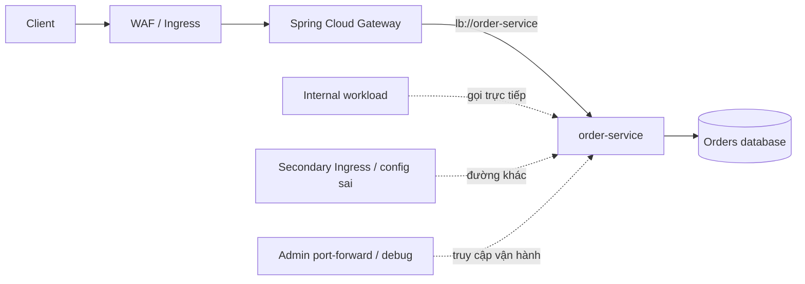
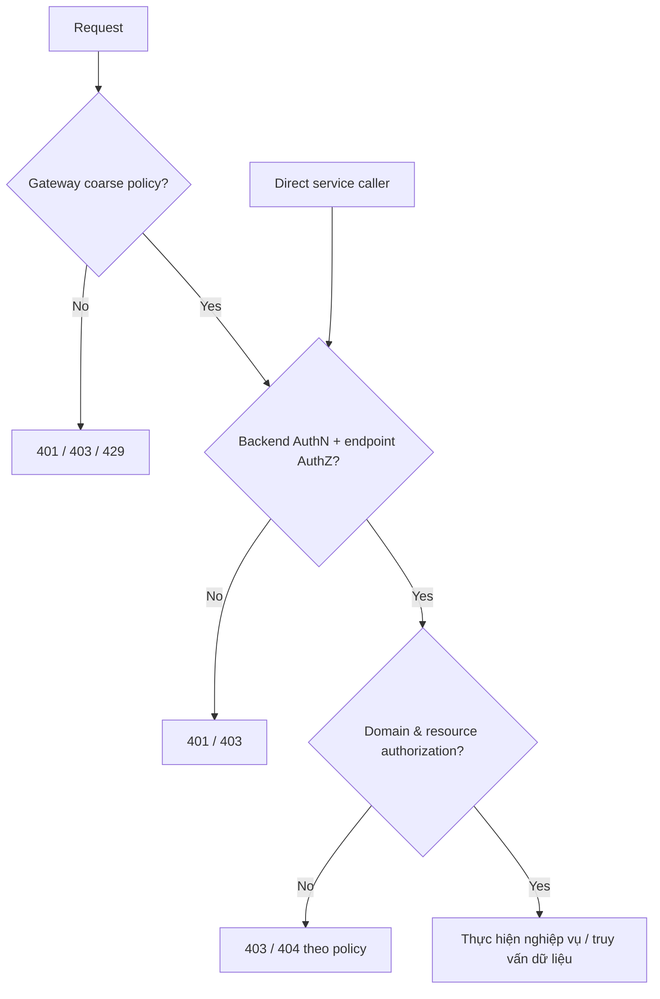
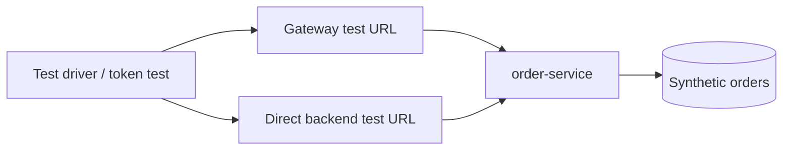
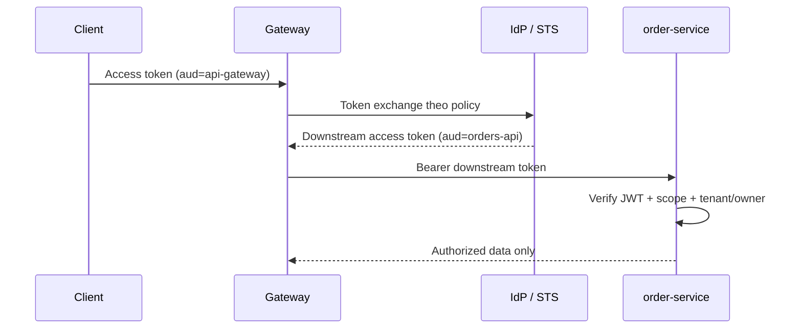

# Kiểm tra quyền tại dịch vụ khi gateway bị bỏ qua

Một **Spring Cloud Gateway** có thể xác thực JWT, kiểm tra route predicate, chuẩn hóa header, giới hạn lưu lượng, áp dụng TLS và chỉ chuyển những request hợp lệ tới microservice. Tuy nhiên, một backend chỉ “tin rằng mọi request đều đã đi qua Gateway” sẽ trở nên nguy hiểm khi có **đường truy cập khác**: Service nội bộ trong Kubernetes, cổng NodePort bị mở nhầm, Ingress thứ hai, một worker gọi trực tiếp backend, một service bị xâm nhập hoặc một cấu hình mạng bị thay đổi.

Bài thuộc chương **Gia cố bảo mật**, với câu hỏi trọng tâm:

> **Nếu attacker hoặc một service nội bộ gửi HTTP request thẳng tới backend, không qua Spring Cloud Gateway, liệu backend vẫn tự xác thực và từ chối thao tác vượt quyền không?**

Đây là một nguyên tắc **defense in depth** trong hệ thống API Gateway xây dựng bằng **Spring Cloud Gateway**: route predicates, filter chain, rewrite path/header, discovery `lb://`, authentication, rate limiting, circuit breaker, retry, TLS và observability giúp quản lý cổng vào, nhưng **không thay thế phân quyền tại dịch vụ sở hữu dữ liệu và nghiệp vụ**.

Bài minh họa Gateway dùng **Server WebFlux** và backend là một **Spring Boot REST service với Spring Security Servlet/MVC**. Backend WebFlux cũng áp dụng nguyên tắc tương tự, nhưng cấu hình `SecurityWebFilterChain` và reactive method security khác. Mẫu cấu hình dùng API thông dụng của Spring Boot 3/Spring Security 6; dependency, property và security defaults phải được đối chiếu với **version thực tế đang triển khai**.

> **Phạm vi an toàn:** Các kịch bản gọi trực tiếp backend chỉ được thực hiện trên dịch vụ, namespace và môi trường kiểm thử mà bạn có quyền. Không dò quét cổng, vượt mạng hoặc thử khai thác hệ thống không được cấp phép. Mọi hostname, token và dữ liệu trong bài là giả lập.

## 1. Khi nào Gateway có thể bị bỏ qua?

Xem sơ đồ thường gặp:



Đường chính là `Client → Ingress → Gateway → order-service`. Nhưng các đường nét đứt có thể tồn tại vì:

- Một ứng dụng nội bộ biết DNS `order-service.shop.svc.cluster.local`.
- Một Ingress/Service/LoadBalancer khác được thêm vào mà thiếu policy tương đương Gateway.
- Backend vô tình có `NodePort` hoặc `LoadBalancer` public.
- Một batch job, message consumer hoặc service-to-service caller cần gọi backend trực tiếp.
- Một sidecar, reverse proxy, service mesh hoặc API management layer khác đi vào backend.
- Người vận hành dùng `kubectl port-forward` để chẩn đoán trong môi trường được cấp phép.
- Một service trong cùng cluster bị xâm nhập hoặc có quyền mạng rộng hơn dự định.
- Một thay đổi rollout tạo tạm thời đường truy cập không đi qua chính Gateway được kiểm thử.

**Không có nghĩa cứ dùng Kubernetes ClusterIP là backend sẽ public.** ClusterIP thường chỉ được định tuyến trong cluster/network phù hợp; nhưng **nội bộ không đồng nghĩa đáng tin**. Phạm vi network là một lớp kiểm soát riêng, không phải bằng chứng user được phép xem một order.

### Điều gì sẽ xảy ra nếu backend không có bảo vệ?

Giả sử Gateway chặn:

```http
GET /api/orders/7ed5... HTTP/1.1
Authorization: Bearer <token-của-Bob>
```

vì Bob không sở hữu order đó. Nếu backend lại có endpoint `GET /orders/{id}` trả dữ liệu theo `id` mà không kiểm tra principal/tenant, một direct caller có thể bỏ qua quyết định của Gateway và đọc order.

**Thiếu phân quyền tại backend là lỗ hổng dữ liệu**, không chỉ là “Gateway configuration chưa tốt”.

## 2. Phân biệt xác thực, phân quyền và hạn chế mạng

| Kiểm soát | Câu hỏi | Ví dụ | Có thay thế kiểm soát khác? |
| --- | --- | --- | --- |
| **Authentication (AuthN)** | Caller là ai? | Xác minh JWT/mTLS identity | Không thay AuthZ |
| **Authorization (AuthZ)** | Caller được phép làm gì với tài nguyên nào? | Alice được xem order thuộc tenant A và sở hữu | Không thay AuthN |
| **Network access** | Caller có đường TCP tới service không? | NetworkPolicy chỉ cho namespace Gateway kết nối | Không thay AuthN/AuthZ |
| **API Gateway policy** | Request ngoài đi qua tuyến/filter nào? | JWT, rate limit, rewrite, CORS | Không thay backend AuthZ |
| **Service-to-service identity** | Workload gọi là service nào? | mTLS SPIFFE ID hoặc OAuth client credentials | Không chứng minh quyền của end user |
| **Audit** | Ai thử thao tác và kết quả gì? | Order read denied, trace ID | Không ngăn request nếu không enforcement |

Một hệ thống mạnh dùng **nhiều lớp cùng lúc**. Khi lớp mạng bị cấu hình sai, backend vẫn kiểm tra token/quyền. Khi Gateway có bug route/filter, backend vẫn kiểm tra resource ownership. Khi backend có bug dữ liệu, network isolation và gateway controls có thể giảm phạm vi tấn công nhưng **không xóa được lỗi logic**.

## 3. Threat model: tài sản, người gọi và ranh giới tin cậy

Để thiết kế kiểm thử, ghi rõ:

**Tài sản cần bảo vệ:**

- Orders, payments, invoices, reports, customer profiles.
- Dữ liệu theo tenant trong SaaS.
- Write operations có tác dụng tiền bạc hoặc trạng thái nghiệp vụ.
- Credentials, tokens, connection strings và audit logs.

**Các caller có thể tồn tại:**

1. End user qua Gateway.
2. End user có token nhưng cố gọi service bằng đường khác.
3. Một microservice được cấp quyền hợp lệ.
4. Một workload nội bộ bị compromise.
5. Một tác nhân không có token.
6. Một identity đã hết quyền hoặc thuộc tenant khác.
7. Một admin/operator có quyền mạng nhưng không có quyền đọc dữ liệu người dùng.

**Các boundary cần kiểm tra:**

```text
Internet -> Ingress/WAF -> Gateway -> service network -> backend code -> database
             |              |          |                |
          network         routing     AuthN           AuthZ + data
          boundary        policy      & caller        ownership
                                        proof
```

Phân quyền dữ liệu thường chỉ backend mới có đầy đủ ngữ cảnh: owner của order, trạng thái thanh toán, membership mới nhất và quy tắc nghiệp vụ. Vì vậy kiểm tra tại Gateway thường là **coarse-grained**, còn backend phải thực thi **fine-grained authorization**.

## 4. Một nguyên tắc không được bỏ qua

**“Gateway đã xác thực” không phải là một chứng cứ tự đủ để backend tin vào request.**

Gateway có thể:

- Đã xác thực JWT nhưng chuyển nguyên token tới backend không đúng audience.
- Gắn `X-User-Id` từ token, nhưng backend lại chấp nhận header đó từ mọi caller.
- Có route bỏ `TokenRelay` hoặc thiếu security filter.
- Được truy cập qua alternate ingress không bật cùng rules.
- Cấp token cho service thay vì user nhưng backend suy rằng đó là user.
- Áp quyền trên URL trước rewrite, trong khi backend chọn dữ liệu bằng parameter khác.

Backend nên xử lý mỗi request theo nguyên tắc:

1. **Xác thực credential** dành cho backend hoặc trust boundary đã được xác thực bằng cơ chế phù hợp.
2. **Xác định caller type**: end user, service principal hay delegated user.
3. **Kiểm tra quyền ở endpoint/operation**.
4. **Kiểm tra quyền trên dữ liệu thật** bằng tenant/resource ownership và business policy.
5. **Không tin metadata do caller tự khai**, kể cả khi header có tên “internal”.
6. **Mặc định từ chối** nếu credential, audience, principal, scope, tenant hoặc ownership không hợp lệ.
7. **Ghi audit có kiểm soát** khi access bị từ chối hoặc thao tác nhạy cảm được thực hiện.

## 5. Ba tầng policy: Gateway, backend HTTP và domain



Điểm quan trọng nằm ở mũi tên **Direct service caller → Backend AuthN + endpoint AuthZ**. Nó phải chịu cùng chính sách bảo vệ dữ liệu, dù không có route/filter của Gateway.

### Coarse-grained vs fine-grained

Gateway có thể kiểm tra:

- User đã có JWT hợp lệ?
- Token có scope `orders.read`?
- HTTP method và path có thuộc route cho phép?
- Client/tenant có vượt rate limit?
- Có CORS policy dành cho browser?
- Có header cần loại bỏ trước forwarding?

Backend phải kiểm tra thêm:

- Order `42` có thuộc đúng tenant của principal không?
- Principal có phải owner, assignee hoặc người được ủy quyền không?
- Vai trò support có được phép đọc hay sửa loại dữ liệu này không?
- Invoice đã khóa có được sửa không?
- Caller có quyền hoàn tiền **số tiền cụ thể** không?
- Một service principal có được phép thực hiện operation thay người dùng không?

**Có scope `orders.read` không đồng nghĩa được đọc mọi order của mọi tenant.**

## 6. BOLA/IDOR: bài test quan trọng nhất khi bypass Gateway

**Broken Object Level Authorization (BOLA)**, thường liên quan **Insecure Direct Object Reference (IDOR)**, xảy ra khi API kiểm tra identity/scope tổng quát nhưng không kiểm tra **quyền đối với đối tượng cụ thể**.

Ví dụ:

```text
Tenant Alpha:
  Alice sở hữu order A-101
  Bob sở hữu order A-102

Tenant Beta:
  Carol sở hữu order B-201
```

Nếu Alice có `SCOPE_orders.read`, các request:

```text
GET /orders/A-101  -> ALLOW
GET /orders/A-102  -> DENY (trừ khi policy cho phép)
GET /orders/B-201  -> DENY
```

phải giữ nguyên kết quả dù request đến qua Gateway hay trực tiếp vào backend.

Một backend chỉ làm:

```java
@PreAuthorize("hasAuthority('SCOPE_orders.read')")
public OrderDto get(UUID id) {
    return repository.findById(id).map(mapper::toDto).orElseThrow();
}
```

là **chưa đủ** nếu mọi user có scope đọc order đều có thể đoán ID của người khác. Cần kiểm tra ownership/tenant ở truy vấn hoặc domain service.

### UUID không phải cơ chế phân quyền

Ngay cả khi order ID là UUID ngẫu nhiên khó đoán, nếu user lấy được UUID từ logs, email, referer, dữ liệu rò rỉ hoặc sự kiện hợp lệ, backend vẫn phải từ chối. **Unpredictable ID giảm khả năng dò nhưng không thay Access Control**.

## 7. BFLA: kiểm tra quyền chức năng

**Broken Function Level Authorization (BFLA)** xảy ra khi caller có thể truy cập function không dành cho vai trò của mình.

Ví dụ các API:

| API backend | Quyền tối thiểu | Phân quyền dữ liệu bổ sung |
| --- | --- | --- |
| `GET /orders/{id}` | `orders.read` | Đúng tenant + owner/role |
| `POST /orders` | `orders.write` | Chỉ tạo order cho tenant được phép |
| `PATCH /orders/{id}` | `orders.write` | Owner + trạng thái cho phép sửa |
| `POST /orders/{id}/refund` | `payments.refund` | Quyền refund + limits + trạng thái |
| `GET /admin/reports` | Admin/report scope | Có quyền trên phạm vi báo cáo |
| `DELETE /users/{id}` | Privileged account management | Tách nhiệm vụ, audit nghiêm ngặt |

Nếu Gateway chỉ public GET nhưng backend vẫn mở `DELETE /orders/{id}` mà không có `@PreAuthorize`/security matcher, một direct caller có thể gọi DELETE.

**Không suy rằng HTTP method bị chặn ở Gateway là đủ để bảo vệ backend.** Bảo vệ phải có ở backend HTTP layer lẫn domain method.

## 8. Chọn mô hình credential cho backend

Có ba mô hình phổ biến:

| Mô hình | Backend nhận gì? | Khi phù hợp | Cần cẩn trọng |
| --- | --- | --- | --- |
| **End-user access token relay** | JWT/OAuth access token của user | Backend là resource server hợp lệ cho token đó | Validate issuer, audience, expiry, scopes, object rights |
| **Token exchange/on-behalf-of** | Token riêng cho downstream, có delegation context | Gateway/API cần chuyển token sang audience của service | Không tự tạo JWT bằng header; cần IdP/STS đáng tin |
| **Service-to-service credential** | Client credentials token hoặc mTLS workload identity | Worker/service gọi backend không thay mặt user | Không tự suy ra end-user rights; scopes và workload identity độc lập |

Một số hệ thống kết hợp **workload authentication (mTLS)** với **end-user authorization (token)**. Đó là hai chứng cứ khác nhau, không phải hai cách gọi cùng một quyền.

## 9. JWT access token cần được backend tự xác minh

Một backend dùng JWT phải kiểm tra ít nhất:

1. **Chữ ký** và thuật toán/khóa tin cậy; không chấp nhận `alg=none` hoặc khóa do client tự cung cấp.
2. **Issuer (`iss`)** chính xác trong danh sách được phê duyệt.
3. **Audience (`aud`)** dành cho backend/API này, không nhận token chỉ dành cho một ứng dụng khác.
4. **Expiration (`exp`)** và **not-before (`nbf`)**, có clock skew hợp lý theo policy.
5. **Token type / mục đích sử dụng** theo IdP contract: access token, không phải ID token nhầm chỗ.
6. **Scopes/authorities** ở endpoint.
7. **Subject (`sub`)** đáng tin và tenant/membership trong context hợp lệ.
8. **Revocation/permission freshness** theo yêu cầu rủi ro, không coi JWT chưa hết hạn là quyền vĩnh viễn.
9. **Key rotation/JWKS handling**: không tin mọi khóa bất kỳ mà token header trỏ đến.
10. **Transport security**: token truyền qua HTTPS/mTLS theo kiến trúc, không log vào output.

Chỉ decode Base64 JSON payload rồi kiểm tra `sub` không phải xác thực JWT. Claims **chỉ đáng tin sau khi verifier chấp nhận toàn bộ token**.

### ID token không phải backend access token

Trong OpenID Connect, **ID token** chủ yếu chứng minh thông tin authentication cho client, thường có audience là client application. Nó không mặc nhiên cấp quyền gọi `order-service`. Backend nên yêu cầu **OAuth2 access token dành cho resource** với claims/scopes phù hợp.

## 10. Audience (`aud`): lớp bảo vệ chống token dùng nhầm đích

Giả sử Identity Provider phát:

```json
{
  "iss": "https://identity.example.invalid/realms/shop",
  "sub": "alice",
  "aud": ["api-gateway"],
  "scope": "orders.read"
}
```

Token trên có thể được Gateway chấp nhận nếu Gateway chính là intended audience, nhưng **order-service không được mặc định nhận** nếu policy yêu cầu `aud=orders-api`.

Một token khác dành cho backend:

```json
{
  "iss": "https://identity.example.invalid/realms/shop",
  "sub": "alice",
  "aud": ["orders-api"],
  "scope": "orders.read",
  "tenant_id": "alpha"
}
```

Cả hai JSON đều là **payload minh họa không có chữ ký**, tuyệt đối không dùng làm token thật. Việc `aud` có thể là string hoặc array được JWT decoder xử lý theo chuẩn; token validation phải dựa trên verifier đã cấu hình.

### Vì sao aud quan trọng khi Gateway bị bỏ qua?

Nếu một JWT dùng cho reporting hoặc một app mobile khác cũng được order-service chấp nhận chỉ vì cùng issuer, token bị lộ ở chỗ đó có thể bị replay vào order-service. Audience binding thu hẹp phạm vi sử dụng token.

**Không tự “bypass audience validation” để TokenRelay cho dễ chạy.** Nếu user token chỉ dành cho Gateway, cần thiết kế **token exchange/on-behalf-of** hoặc phát access token có resource audience phù hợp theo chính sách IdP.

## 11. Issuer, signature và key rotation

Backend phải dựa vào một **trust anchor đã cấu hình**, ví dụ JWKS endpoint của IdP, chứ không lấy `jku`/`jwk` tùy ý từ untrusted token header rồi tải khóa đó.

Kiểm tra:

- Token signed bởi approved issuer.
- JWKS URL được lấy từ discovery/config tin cậy và có HTTPS.
- Algorithm allowlist phù hợp, tránh algorithm confusion.
- Chữ ký sai hoặc `kid` không có trong key set → từ chối.
- Issuer rotate key: token mới hợp lệ được chấp nhận khi keys đã cập nhật; token ký bằng khóa đã bị rút phải theo chính sách thu hồi.
- Clock skew hợp lý và đồng bộ NTP.
- Không dùng hard-coded private signing keys trong repository.

**JWKS caching và key rollover** có thể tạo downtime nếu backend không làm mới khóa đúng. Hãy test rotation như một thay đổi security infrastructure, thay vì tắt xác minh chữ ký.

## 12. Opaque access token cũng cần backend xác minh

Không phải mọi access token đều là JWT. Với **opaque token**, backend có thể phải gọi **introspection endpoint** của Authorization Server để biết token active, scope, subject, audience/resource và thời hạn.

Ưu/nhược điểm:

- Introspection có thể hỗ trợ kiểm tra trạng thái token tập trung và revocation gần thời gian thực.
- Mỗi request hoặc cache introspection có thể thêm latency/load; timeout/circuit breaker cần policy.
- Nếu introspection unavailable, backend không thể mặc định coi token còn hợp lệ; phải có **fail policy rõ**.
- Cache status phải có TTL và không kéo dài quyền hơn policy cho phép.
- Backend vẫn phải kiểm tra resource/tenant authorization sau khi biết token active.

**JWT offline validation và opaque introspection là hai kiến trúc**, không trộn chúng chỉ để khắc phục một endpoint trả 401.

## 13. Gateway TokenRelay chỉ là chuyển credential

Trong một cấu hình OAuth2 phù hợp, Spring Cloud Gateway có thể dùng filter `TokenRelay` để chuyển access token tới downstream. Khái niệm:

```text
Client -- token --> Gateway
                       |
                       +-- authn/route checks
                       |
                       +-- TokenRelay --> order-service
                                          |
                                          +-- validate token
                                          +-- authorize endpoint
                                          +-- authorize order/tenant
```

TokenRelay **không thay chữ ký, không thay audience và không chứng minh backend đã phân quyền**. Nó chỉ cung cấp phương tiện truyền token trong cấu hình phù hợp.

### Không dùng “Gateway đã auth rồi” làm bypass flag

Anti-pattern:

```http
X-Authenticated-User: alice
X-Tenant-Id: alpha
X-Is-Admin: true
```

Nếu backend tin các header này khi không kiểm tra nguồn và chữ ký, direct caller có thể gửi y hệt để nâng quyền. Header names “internal”, “verified”, “from-gateway” chỉ là chữ, không phải chứng cứ cryptographic.

Khi cần truyền identity context, ưu tiên backend xác minh **access token đúng audience**, hoặc một **signed/encrypted assertion** ngắn hạn với issuer/audience/timestamp/replay protections và trust policy rõ. **mTLS chỉ xác định workload peer**, không tự xác minh nội dung các header user context nếu không có policy bảo vệ end-to-end.

## 14. User identity và workload identity là hai trục

Một request có thể có hai danh tính:

- **User principal:** Alice, thuộc tenant Alpha, được phép đọc order A-101.
- **Workload caller:** `api-gateway`, `report-worker` hoặc `billing-service`.

```text
Request context:
  workload = api-gateway
  user = alice
  tenant = alpha
  action = orders.read
  resource = A-101
```

Backend nên quyết định:

1. Workload này có được phép gọi API không, nếu có workload policy?
2. User/delegation token có hợp lệ và intended audience đúng không?
3. User có authority để đọc order không?
4. Order thuộc tenant và owner/role của user không?
5. Có trạng thái nghiệp vụ nào chặn thao tác không?

Nếu một batch worker gọi bằng **client credentials** không có end user, backend phải áp **service authorization policy riêng**, không giả sử mọi call đều có `sub` của người dùng.

## 15. Service-to-service authorization không chỉ là service ở “mạng nội bộ”

Ví dụ `report-worker` được cấp quyền tổng hợp báo cáo. Nó có thể dùng OAuth2 client credentials token:

```json
{
  "iss": "https://identity.example.invalid/realms/shop",
  "sub": "report-worker",
  "aud": ["orders-api"],
  "scope": "orders.export"
}
```

Backend có thể cho phép operation `exportOrdersForReport` theo phạm vi tenant/service contract, nhưng không nên cho token đó gọi `POST /orders/{id}/refund` chỉ vì nó là “internal”.

**Client credentials không đại diện một end user**. Nếu operation yêu cầu người dùng ủy quyền, phải có delegation/on-behalf-of chain đáng tin, audit actor và subject rõ, hoặc yêu cầu một workflow authorization riêng.

### Tách scope cho service callers

- `orders.read.self`: người dùng đọc order của mình.
- `orders.read.support`: nhân viên support theo policy.
- `orders.export.service`: workload báo cáo được cấp quyền giới hạn.
- `orders.write`: thao tác ghi.
- `payments.refund`: quyền rủi ro cao, kiểm soát riêng.

Tên scopes ở trên chỉ minh họa. Nên giữ **ngữ nghĩa ổn định, nguyên tắc least privilege**, không dùng một `ROLE_INTERNAL` bao trùm mọi nghiệp vụ.

## 16. Không tin Header forwarding một cách vô điều kiện

Gateway có thể thêm, sửa hoặc xóa headers bằng `SetRequestHeader`, `AddRequestHeader`, `RemoveRequestHeader`. Đây là filter utility, không phải một hệ mật mã.

Những headers phải xem xét:

| Header | Nguy cơ | Cách xử lý |
| --- | --- | --- |
| `X-User-Id` | Client spoof principal | Không dùng làm authority khi chưa xác minh |
| `X-Tenant-Id` | Cross-tenant access | Lấy tenant từ verified identity/membership |
| `X-Role`/`X-Is-Admin` | Privilege escalation | Không tin raw role header |
| `Authorization` | Bearer token bị chuyển nhầm/leak | Validate token ở intended backend, không log |
| `X-Forwarded-For` | Giả IP để bypass IP rate limit | Tin chỉ sau trusted proxy chain |
| `X-Forwarded-Proto`/`Host` | Host/scheme spoof, link confusion | Trusted proxy, host policy và forwarding config |
| `X-Original-URI` | Bypass auth dựa path trước rewrite | Authorize actual backend resource/operation |
| `X-Request-Id` | Log forging/high-cardinality | Validate length/format và không dùng làm quyền |
| `Cookie` | Session fixation/CSRF risk | Chỉ dùng đúng auth model, giữ CSRF khi cookie auth |

**Gateway nên loại bỏ untrusted identity headers từ client** trước khi gắn internal context, nhưng backend vẫn cần kiểm chứng credential hoặc provenance. Cấu hình xóa header là lớp giảm thiểu, không thay backend auth.

## 17. Route predicate và rewrite không xác định quyền tài nguyên

Giả sử Gateway route:

```yaml
spring:
  cloud:
    gateway:
      routes:
        - id: orders-api
          uri: lb://order-service
          predicates:
            - Path=/api/orders/**
          filters:
            - StripPrefix=1
```

Đường đi:

```text
Client:  GET /api/orders/A-101
Gateway: match Path=/api/orders/**
Gateway: StripPrefix=1
Backend: GET /orders/A-101
```

Nếu backend Security config chỉ bảo vệ `/api/orders/**`, **không phải `/orders/**`, direct backend request có thể không match rule. Một `anyRequest().permitAll()` ở cuối sẽ biến lỗi mapping thành lỗ hổng.

**Backend phải bảo vệ URL và operation của chính nó**, không chỉ frontend path ở Gateway.

Bên cạnh đó:

- `RewritePath` có thể thay path phức tạp.
- `SetPath` có thể ánh xạ nhiều public endpoints về một backend handler.
- `Method` predicate có thể lọc HTTP methods ở Gateway nhưng direct client vẫn gọi method khác.
- `Host`/`Header` predicates không phải bằng chứng user có quyền.
- Backend router/method security là lớp độc lập, kể cả khi Gateway cập nhật route động.

## 18. Cấu hình Spring Security ở backend: deny by default

Ví dụ backend **Spring Boot Servlet/MVC** bảo vệ API orders:

```java
@Configuration
@EnableMethodSecurity
public class OrderSecurityConfiguration {

    @Bean
    SecurityFilterChain securityFilterChain(HttpSecurity http)
            throws Exception {
        return http
            // Chỉ phù hợp API stateless Bearer-only;
            // nếu sử dụng browser cookies/session, cần đánh giá CSRF.
            .csrf(csrf -> csrf.disable())
            .sessionManagement(session -> session
                .sessionCreationPolicy(SessionCreationPolicy.STATELESS))
            .authorizeHttpRequests(authorize -> authorize
                .requestMatchers(
                    "/actuator/health/liveness",
                    "/actuator/health/readiness"
                ).permitAll()
                .requestMatchers(HttpMethod.GET, "/orders/**")
                    .hasAuthority("SCOPE_orders.read")
                .requestMatchers(HttpMethod.POST, "/orders/**")
                    .hasAuthority("SCOPE_orders.write")
                .requestMatchers(HttpMethod.PATCH, "/orders/**")
                    .hasAuthority("SCOPE_orders.write")
                .anyRequest().denyAll())
            .oauth2ResourceServer(oauth2 -> oauth2
                .jwt(Customizer.withDefaults()))
            .build();
    }
}
```

Đây là **mẫu cấu hình cần thêm imports, dependency và kiểm thử thực tế**; các API/chính sách Spring Security có thể khác theo phiên bản. Mẫu yêu cầu:

- Mọi request (ngoài health probes đã allowlist) phải match rule chính xác hoặc bị `denyAll`.
- `GET /orders/**` cần `SCOPE_orders.read`.
- `POST`/`PATCH` cần `SCOPE_orders.write`, nhưng vẫn còn domain authorization.
- Không cho `DELETE` nếu chưa khai báo policy riêng.
- JWT được xác minh theo resource server config.
- Security ở **backend process** chứ không phụ thuộc Gateway.

**Không public Actuator health details/metrics/gateway routes một cách vô điều kiện.** Hai health probe paths chỉ được permit để orchestrator dùng trong mạng phù hợp; quản lý Actuator nên tách network/access policy theo deployment.

### CSRF và stateless API

`csrf.disable()` chỉ phù hợp khi backend dùng **Bearer token trong Authorization header**, không dùng cookie/session browser authentication. Nếu backend cũng dựa vào cookies tự động gửi từ browser, cần thiết kế CSRF protection; không copy cấu hình trên để tắt CSRF cho mọi ứng dụng.

## 19. Cấu hình JWT issuer ở backend

Với Spring Boot Resource Server phù hợp:

```yaml
spring:
  security:
    oauth2:
      resourceserver:
        jwt:
          issuer-uri: https://identity.example.invalid/realms/shop
```

Đây là một cách yêu cầu backend xác minh issuer và xử lý JWKS từ nguồn tin cậy theo configuration. Nhưng **issuer-uri riêng chưa luôn bảo đảm audience validation phù hợp nghiệp vụ**. Audience cần được cấu hình thêm theo cách mà Spring Security/Boot version hỗ trợ hoặc bằng custom validator.

**Không dùng hostname `example.invalid` trong production.** Thay bằng issuer chính thức của IdP, bảo đảm truststore/TLS, private networking và key rollover phù hợp.

### Dependency phổ biến

```xml
<dependency>
    <groupId>org.springframework.boot</groupId>
    <artifactId>spring-boot-starter-security</artifactId>
</dependency>
<dependency>
    <groupId>org.springframework.boot</groupId>
    <artifactId>spring-boot-starter-oauth2-resource-server</artifactId>
</dependency>
```

Không trộn starter OAuth2 client với Resource Server chỉ vì tên gần giống. Backend cần **Resource Server** để xác minh inbound access tokens; OAuth2 client được dùng khi backend chủ động gọi service khác và cần cấp/đổi token.

## 20. Audience validator: ví dụ ở backend

Nếu authorization server phát token có `aud=orders-api`, backend có thể dùng custom validator:

```java
@Configuration
public class JwtValidationConfiguration {

    @Bean
    JwtDecoder jwtDecoder(
            @Value("${security.jwt.issuer}") String issuer,
            @Value("${security.jwt.jwk-set-uri}") String jwkSetUri) {

        NimbusJwtDecoder decoder =
            NimbusJwtDecoder.withJwkSetUri(jwkSetUri).build();

        OAuth2TokenValidator<Jwt> issuerAndTime =
            JwtValidators.createDefaultWithIssuer(issuer);

        OAuth2TokenValidator<Jwt> intendedAudience = jwt -> {
            if (jwt.getAudience().contains("orders-api")) {
                return OAuth2TokenValidatorResult.success();
            }

            OAuth2Error error = new OAuth2Error(
                "invalid_token",
                "Token audience is not orders-api",
                null
            );
            return OAuth2TokenValidatorResult.failure(error);
        };

        decoder.setJwtValidator(
            new DelegatingOAuth2TokenValidator<>(
                issuerAndTime, intendedAudience
            )
        );
        return decoder;
    }
}
```

Cấu hình tương ứng:

```yaml
security:
  jwt:
    issuer: https://identity.example.invalid/realms/shop
    jwk-set-uri: https://identity.example.invalid/realms/shop/jwks
```

**Đây là skeleton API Java/Spring Security, cần imports phù hợp và URL JWKS thực từ IdP.** Mục tiêu là minh họa **chữ ký + issuer/time + audience**. Không copy đường dẫn `/jwks` nếu IdP dùng discovery endpoint khác. Việc tự khai báo `JwtDecoder` có thể ghi đè auto-configuration; cần test thực JWT signature, key rotation và validators.

Không được thay `JwtValidators.createDefaultWithIssuer` bằng validator chỉ kiểm tra audience; như vậy có thể vô tình bỏ kiểm tra `exp`/`nbf`.

### Về cấu hình audience có sẵn

Một số phiên bản Spring Boot có property/auto-config hỗ trợ audience validation, nhưng tên và behavior không nhất thiết như nhau. Nếu đã có cơ chế chính thức trong version pin, ưu tiên dùng thay vì tạo bean trùng. Dù theo cách nào, **negative test token đúng issuer nhưng sai aud** phải bị từ chối.

## 21. Resource ownership phải kiểm tra ở domain layer

Giả sử repository chứa:

| Order | Tenant | Owner |
| --- | --- | --- |
| A-101 | alpha | alice |
| A-102 | alpha | bob |
| B-201 | beta | carol |

Backend cần dùng principal/token đã xác minh để giới hạn truy vấn. **Không lấy owner/tenant từ query/path/header rồi tin rằng caller được quyền chọn giá trị đó.**

Một repository method minh họa:

```java
public interface OrderRepository
        extends JpaRepository<OrderEntity, UUID> {

    Optional<OrderEntity> findByIdAndTenantIdAndOwnerSubject(
        UUID id,
        String tenantId,
        String ownerSubject
    );
}
```

Khác biệt:

```java
// KHÔNG ĐỦ nếu caller có scope đọc nhưng không sở hữu order.
orderRepository.findById(orderId);

// Tốt hơn cho operation "read my order":
orderRepository.findByIdAndTenantIdAndOwnerSubject(
    orderId, verifiedTenantId, verifiedSubject
);
```

Việc áp tenant/owner ngay trong query có thể giảm nguy cơ fetch nhầm dữ liệu và bị lộ trước bước kiểm tra, nhưng vẫn cần thiết kế domain policy đầy đủ cho privileged roles, sharing/delegation và consistency.

### Vì sao cả tenant **và** owner?

- Nếu chỉ check tenant, Alice có thể đọc order của Bob cùng tenant nếu policy không cho phép.
- Nếu chỉ check ownerSubject nhưng subject ID không globally unique hoặc reused giữa tenants, dữ liệu vẫn có thể bị lẫn.
- Nếu chỉ check role `ADMIN` mà không scope role theo tenant, một tenant admin có thể được quyền trên tenant khác.
- Nếu chuyển tenant bằng request header, attacker có thể thử thay giá trị để vào tenant khác.

**Authorization là phép kiểm tra tập quyền trên đúng tài nguyên, không chỉ so sánh một chuỗi claim.**

## 22. Domain service minh họa: kiểm tra principal và resource

```java
@Service
public class OrderQueryService {

    private final OrderRepository repository;
    private final OrderMapper mapper;

    public OrderQueryService(
            OrderRepository repository,
            OrderMapper mapper) {
        this.repository = repository;
        this.mapper = mapper;
    }

    @PreAuthorize("hasAuthority('SCOPE_orders.read')")
    @Transactional(readOnly = true)
    public OrderDto readOwnedOrder(
            UUID orderId,
            JwtAuthenticationToken caller) {

        Jwt jwt = caller.getToken();
        String subject = jwt.getSubject();
        String tenantId = jwt.getClaimAsString("tenant_id");

        if (subject == null || subject.isBlank()
                || tenantId == null || tenantId.isBlank()) {
            throw new AccessDeniedException(
                "Required identity context is missing");
        }

        OrderEntity order = repository
            .findByIdAndTenantIdAndOwnerSubject(
                orderId, tenantId, subject)
            .orElseThrow(() ->
                new ResponseStatusException(
                    HttpStatus.NOT_FOUND,
                    "Order not found"));

        return mapper.toDto(order);
    }
}
```

Đây là **mẫu có chủ ý giới hạn vào “đọc order của chính mình”**, không bao gồm support/admin access. Cần bổ sung imports, mapper/repository/entity/JPA configuration, error response contract và tests.

Giải thích:

1. `JwtAuthenticationToken` đại diện một JWT **đã được Spring Security xác minh**.
2. `@PreAuthorize` kiểm tra scope operation trước khi truy cập database, khi proxy/method security được áp đúng.
3. `tenantId` và `subject` lấy từ verified JWT claims theo policy IdP.
4. Repository query scope dữ liệu theo **cả tenant và owner**.
5. Order không thuộc phạm vi trả `404` theo một policy che sự tồn tại; có thể chọn `403` nếu API contract cần.
6. Không dùng `?tenant=beta` hay `X-User-Id: alice` làm authority.

**Đừng gọi `readOwnedOrder` từ một internal code path bypass method security proxy rồi cho rằng annotation đã được thực thi.** Với Spring method security, self-invocation/proxy boundaries và việc gọi direct methods trong cùng class có thể là cạm bẫy. Domain service vẫn nên có check/query scoping **không phụ thuộc duy nhất annotation**.

## 23. Controller gọi domain service, không tin route của Gateway

```java
@RestController
@RequestMapping("/orders")
public class OrderController {

    private final OrderQueryService orderQueryService;

    public OrderController(OrderQueryService orderQueryService) {
        this.orderQueryService = orderQueryService;
    }

    @GetMapping("/{id}")
    public OrderDto getOne(
            @PathVariable UUID id,
            JwtAuthenticationToken authentication) {

        return orderQueryService
            .readOwnedOrder(id, authentication);
    }
}
```

Backend chỉ có URI `/orders/{id}`. Gateway có thể expose `/api/orders/{id}` và StripPrefix, nhưng **backend authorization không dựa vào sự hiện diện của `/api`**.

Direct call `GET /orders/{id}` phải đi qua Spring Security backend, sau đó qua service-owned query. Một alternate ingress/port-forward vẫn không tạo quyền mới.

## 24. Đừng chỉ dùng `@PreAuthorize` ở controller

Một lỗi thường gặp:

```java
@GetMapping("/{id}")
@PreAuthorize("hasAuthority('SCOPE_orders.read')")
public OrderDto getOrder(@PathVariable UUID id) {
    return service.findById(id);
}
```

Nếu có code path khác gọi `service.findById(id)`:

- Batch consumer.
- Internal scheduler.
- Admin handler.
- GraphQL resolver.
- Message queue listener.
- gRPC endpoint.

thì controller annotation có thể không bảo vệ được. **Authorization data ownership nên sống tại service/domain boundary**, có policy rõ cho caller type và transaction.

Một domain API tốt có tên phản ánh policy:

```text
readOwnedOrder(userContext, orderId)
readTenantOrders(tenantAdminContext, tenantId)
exportOrders(reportServiceContext, approvedScope)
```

Không tạo một `findAnyOrder(id)` public bên trong module rồi hy vọng mọi caller nhớ tự kiểm tra quyền trước.

## 25. Mối quan hệ giữa scope và row-level authorization

Quyền có thể biểu diễn:

\[
\text{ALLOW} =
\text{valid credential}
\land \text{operation scope}
\land \text{tenant membership}
\land \text{resource predicate}
\land \text{business constraints}
\]

Với `GET /orders/{id}`:

- Valid access token dành cho `orders-api`.
- `SCOPE_orders.read`.
- Tenant claim có membership hợp lệ.
- Order cùng tenant.
- Owner của order đúng subject hoặc actor có delegated access hợp lệ.
- Order không bị khóa theo một business restriction đặc biệt.

Nếu một điều kiện không đạt, từ chối. Policy có thể phức tạp hơn (RBAC + ABAC + relationship-based authorization), nhưng **mỗi điều kiện phải có nguồn dữ liệu tin cậy**.

### Claim tenant đã xác minh chưa đủ để chứng minh membership hiện hành?

IdP có thể phát token có `tenant_id=alpha` vào 10:00. Đến 10:05 user bị gỡ khỏi tenant, nhưng JWT còn hiệu lực đến 10:30. Backend cần quyết định **độ mới của quyền** theo rủi ro:

- Token lifetime ngắn và kiểm soát cấp token.
- Revocation/session invalidation hoặc introspection.
- Policy lookup/cache với TTL phù hợp cho quyền rủi ro cao.
- Kiểm tra membership trực tiếp trong backend/authorization service khi cần.
- Audit của permission changes.

Không có một cơ chế duy nhất phù hợp cho mọi API; refund/payment cần policy nghiêm hơn public read.

## 26. Status 401, 403 và 404: chọn hợp đồng nhất quán

| Status | Khi thường dùng | Kiểm tra gì |
| --- | --- | --- |
| **401 Unauthorized** | Thiếu/sai/hết hạn token, chưa xác thực | Backend AuthN chạy cả khi direct call |
| **403 Forbidden** | Đã xác thực nhưng thiếu scope/role/policy | Không bị Gateway bypass |
| **404 Not Found** | Resource không tồn tại **hoặc** cố ý che sự tồn tại ngoài phạm vi | Không lộ order cross-tenant |
| **405 Method Not Allowed** | Method không được handler hỗ trợ | Không dùng 405 thay AuthZ cho route nhạy cảm |
| **429 Too Many Requests** | Rate limit/admission, thường ở Gateway | Backend vẫn authz riêng |
| **5xx** | Lỗi server/dependency | Không trả 200 khi auth provider không kiểm chứng được |

**401 và 403 không chứng minh BOLA đã được kiểm tra.** Một user có scope `orders.read` có thể qua HTTP matcher nhưng vẫn phải bị chặn với order không thuộc quyền.

### Tránh information leakage

Nếu response khác nhau giữa “order thuộc tenant khác” và “order không tồn tại”, attacker có thể suy ra order IDs. Tùy policy, backend có thể trả **cùng 404** cho cả hai tình huống. Quan trọng là **không trả dữ liệu** và không lộ chi tiết nhạy cảm qua body, timing hoặc logs công khai.

## 27. Authorization cho thao tác ghi: TOCTOU và idempotency

Kiểm tra “user được phép sửa order” rồi chờ một thời gian trước khi cập nhật có thể gặp **time-of-check to time-of-use (TOCTOU)**.

Ví dụ:

```text
1. Backend đọc order, thấy trạng thái DRAFT.
2. Backend kiểm tra user owner.
3. Transaction khác chuyển order sang PAID.
4. Backend ghi thay đổi dựa trên trạng thái DRAFT cũ.
```

Với operation nhạy cảm:

- Kiểm tra scope và tenant/owner.
- Kiểm tra state transition hợp lệ.
- Dùng transaction/optimistic locking/conditional update khi phù hợp.
- Không chỉ tin trạng thái client gửi.
- Khi Retry có thể tạo duplicate attempts, dùng idempotency key và backend enforcement.
- Audit actor, action, outcome, resource ID theo policy log an toàn.
- Không để direct caller bỏ qua validation/business invariants.

Gateway `Retry` và `CircuitBreaker` không tự đảm bảo transactional correctness. Backend phải bảo vệ write semantics ngay cả khi request đến từ một service khác Gateway.

## 28. Service mesh mTLS: xác thực workload, không tự xác thực user

**Mutual TLS (mTLS)** có thể xác thực cả hai đầu TCP/TLS connection bằng certificates. Service mesh có thể gán danh tính workload (ví dụ SPIFFE ID) và enforce policy chỉ cho workload `api-gateway` gọi `order-service`.

```text
Gateway workload identity -- mTLS --> order-service workload identity
             |
             +-- delegated user access token (nếu user action)
```

Hai bằng chứng khác nhau:

- mTLS: peer đang kết nối là workload nào?
- OAuth/JWT: user/delegation token dành cho resource nào, có scope gì?

Nếu mTLS xác minh `report-worker` nhưng không có user token, backend có thể cho phép operation dành riêng cho service đó; không suy ra quyền của Alice.

### Những giới hạn của mTLS

- Workload certificate có thể bị compromise.
- Policy workload-to-workload quá rộng có thể cho service khác gọi thao tác nhạy cảm.
- Mesh policy sai hoặc bypass sidecar có thể tạo đường đi khác.
- Một Gateway đã authenticated ở workload-level vẫn có thể chuyển user token sai audience.
- mTLS không kiểm tra ownership của order trừ khi application/policy engine kiểm tra.

**mTLS + application-level authorization** là defense in depth, không phải lựa chọn loại trừ nhau.

## 29. Kubernetes NetworkPolicy: hạn chế đường truy cập nhưng không thay AuthZ

Một NetworkPolicy ví dụ cho `order-service` trong namespace `shop`, cho phép ingress từ Gateway pods ở namespace `edge`:

```yaml
apiVersion: networking.k8s.io/v1
kind: NetworkPolicy
metadata:
  name: orders-from-gateway-only
  namespace: shop
spec:
  podSelector:
    matchLabels:
      app: order-service
  policyTypes:
    - Ingress
  ingress:
    - from:
        - namespaceSelector:
            matchLabels:
              kubernetes.io/metadata.name: edge
          podSelector:
            matchLabels:
              app: api-gateway
      ports:
        - protocol: TCP
          port: 8080
```

**Giải thích quan trọng:**

- `podSelector` trên cùng một `from` entry với `namespaceSelector` tạo điều kiện **AND**: chỉ các Gateway pods phù hợp trong namespace phù hợp.
- Nếu đặt chúng thành **hai entries `from` độc lập**, policy có thể thành OR, mở rộng quyền truy cập ngoài dự định.
- NetworkPolicy hoạt động khi **CNI hỗ trợ enforcement**; YAML tồn tại không có nghĩa dataplane thực sự chặn.
- Policy dựa trên labels/namespace không tự chứng minh danh tính user hoặc quyền với tài nguyên.
- Monitoring, liveness, mesh sidecar, service callers được phép cần policy bổ sung có xét security.
- Port-forward, node-local traffic và hostNetwork có những đường đi/semantics đặc biệt tùy cluster/CNI; không xem NetworkPolicy là rào chắn tuyệt đối cho mọi vai trò quản trị.

**Không dùng ví dụ này để khóa production trước khi lập danh sách service callers hợp lệ.** Dùng staging và kiểm thử connectivity để tránh làm đứt integrations.

### Kiểm tra NetworkPolicy ở đâu?

Không chỉ xem manifest được Kubernetes chấp nhận. Cần thử từ các nguồn khác nhau **có quyền trong lab**:

- Một Gateway pod được phép → kết nối thành công, sau đó application authz vẫn chạy.
- Một test pod không được phép → kết nối bị chặn theo network policy.
- Một service caller đặc biệt được allowlist → kết nối và authz riêng đúng.
- Một pod đúng namespace nhưng sai app labels → không nên mặc định được phép.
- Một pod đúng app label nhưng sai namespace → không được phép nếu policy yêu cầu cả hai.

Sau đó **vẫn phải gửi request thiếu JWT qua đường được phép** để chứng minh backend trả 401, vì network policy pass **không đồng nghĩa đã có AuthN**.

## 30. Service type, Ingress và cổng quản trị: kiểm kê đường đi thật

Một đợt audit hardening nên kiểm kê:

| Tài nguyên | Câu hỏi |
| --- | --- |
| `Service type: ClusterIP` | Có đường nội bộ nào truy cập backend trực tiếp? |
| `Service type: NodePort/LoadBalancer` | Có cổng backend bị lộ ra ngoài không? |
| `Ingress/Gateway API` | Có route phụ trỏ trực tiếp backend? |
| `Service mesh VirtualService/HTTPRoute` | Có policy bypass Gateway? |
| `HostPort/hostNetwork` | Pod có mở cổng ngoài mô hình dự định? |
| `kubectl port-forward`/exec | Ai có RBAC quyền quản trị và audit? |
| `/actuator/**` | Endpoint quản trị có tách mạng/role đúng? |
| Backend HTTP vs HTTPS | TLS termination/trust boundary nằm ở đâu? |
| Egress policies | Workload nội bộ nào được phép gọi backend? |
| Secrets/truststores | Token/cert/issuer credentials có được bảo vệ/rotate? |

**Đừng coi “không có public LoadBalancer” là chứng minh không thể bypass Gateway.** Trong Kubernetes, nhiều callers có khả năng gọi backend qua service DNS nội bộ theo network/RBAC thực tế.

## 31. Kiểm tra forwarded host, proxy và origin

Các header `Forwarded`, `X-Forwarded-For`, `X-Forwarded-Proto` và `Host` thường phục vụ URL generation, client IP, scheme hoặc CORS. Chúng **không chứng minh một user được phép đọc order**.

Khi cấu hình `trusted-proxies` hoặc forward-header strategy theo Spring Boot/Gateway version:

1. Xác định rõ những proxy IP/network nào được phép ghi forwarded headers.
2. Ingress/edge phải loại bỏ hoặc chuẩn hóa giá trị client tự khai.
3. Không dùng forwarded address để xác định tenant/admin role.
4. Nếu cần IP-based rate limit, test NAT/shared IP, IPv6 và spoofed chain.
5. Test cả đường qua Gateway và direct call: thiếu forwarded headers không được làm backend bỏ authorization.
6. Kiểm tra Host/SNI routing đúng, không cho arbitrary Host khiến request vào virtual host có policy yếu.

**CORS chỉ là chính sách browser**, không phải cơ chế authentication; `curl`, internal services và non-browser clients không bị bảo vệ bởi same-origin policy.

## 32. Không phụ thuộc vào Gateway route filters để quyết định database scope

Gateway có thể đặt header:

```yaml
filters:
  - SetRequestHeader=X-Tenant-Id, alpha
```

Nhưng điều này không thể là nguồn tin cậy để backend chọn tenant. Khi direct caller gửi `X-Tenant-Id: beta`, nếu backend đọc header mà không kiểm tra membership sẽ có cross-tenant data exposure.

Một thiết kế an toàn:

```text
Bearer token (đã verify):
  sub = alice
  tenant_id = alpha

Backend policy:
  tenant membership = alpha, hợp lệ theo contract
  GET /orders/{id}
  repository query WHERE order.tenant=alpha AND owner=alice
```

Nếu người dùng có quyền chuyển tenant, quy trình chọn tenant phải kiểm tra membership/authorization cho tenant được chọn. **Không suy từ URL path hoặc header rằng user có membership**.

## 33. Bảo vệ tài nguyên theo tenant và role trong SaaS

Một SaaS có thể có policy phức tạp:

| Actor | Tenant | Resource | Action | Kết quả |
| --- | --- | --- | --- | --- |
| Alice owner | Alpha | Order Alice | Read | Allow |
| Bob same tenant | Alpha | Order Alice | Read | Deny nếu không có sharing |
| Tenant manager | Alpha | Order của Alpha | Read | Allow theo manager policy |
| Tenant manager | Beta | Order của Alpha | Read | Deny |
| Support employee | Platform | Order khách hàng | Read | Chỉ khi support delegation/ticket hợp lệ |
| Report worker | Service | Order Alpha | Export | Allow theo service scope/approved export |
| Anonymous | Không có | Bất kỳ order | Read | Deny |
| Token expired | Alpha | Order Alice | Read | Deny |

**Không nhúng role `ADMIN` toàn cục để tự cho quyền trên mọi tenant** nếu yêu cầu nghiệp vụ chỉ cho tenant admin. Định nghĩa scope/role theo cấp global, tenant, resource và delegation, rồi kiểm chứng tất cả chiều.

### Bài test cross-tenant rất dễ thiếu

Chỉ kiểm tra Alice → Order của Alpha thành công là chưa đủ. Cần thêm:

- Alice → Order của Bob trong Alpha.
- Alice → Order của Beta.
- Tenant manager Alpha → Order Beta.
- Support không có case/justification → Order Alpha.
- Token của Alice nhưng header `X-Tenant-Id: beta`.
- Token thiếu tenant claim.
- Token tenant claim sai format hoặc tenant đã bị vô hiệu.

Mỗi test phải gọi **backend trực tiếp**, không chỉ qua Gateway.

## 34. Hai đường kiểm thử: qua Gateway và trực tiếp backend

Để chứng minh Gateway không phải nơi duy nhất phân quyền, tạo hai đường HTTP trong **staging được cấp phép**:



Không cần mở backend ra public internet. Có thể chạy test pod có quyền trong cluster, ứng dụng integration test trên cổng ngẫu nhiên, hoặc dùng `kubectl port-forward` với RBAC hợp lệ.

| Caller/request | Qua Gateway | Backend trực tiếp | Mục tiêu |
| --- | --- | --- | --- |
| Alice đọc order của Alice | 200 | 200 | Truy cập hợp lệ |
| Alice đọc order Bob cùng tenant | 403/404 | 403/404 | Bị từ chối như nhau |
| Alice đọc order tenant khác | 403/404 | 403/404 | Không cross-tenant |
| Alice thiếu scope | 403 | 403 | Backend tự kiểm scope |
| Không token | 401 | 401 | Backend tự xác thực |
| Token sai audience | 401 | 401 | Backend chống dùng nhầm token |
| Token hết hạn | 401 | 401 | Backend kiểm expiry |
| Service token thiếu quyền | 403 | 403 | Không đặc quyền vì “internal” |

Statuses có thể khác nếu Gateway chủ động rate limit hoặc chặn trước routing; điều bất biến là **backend không được cấp dữ liệu hoặc thực hiện thao tác trái quyền**.

## 35. Chuẩn bị fixture đa tenant

```text
Users:
  alice: tenant=alpha, scope=orders.read
  bob:   tenant=alpha, scope=orders.read
  carol: tenant=beta,  scope=orders.read

Orders:
  order-101: tenant=alpha, owner=alice
  order-102: tenant=alpha, owner=bob
  order-201: tenant=beta,  owner=carol
```

Tạo thêm test identities: admin chỉ thuộc tenant Alpha, support agent được ủy quyền theo case, report-worker có service token, user disabled và token revoked/hết hạn.

**Không dùng dữ liệu thật hoặc signing key production**. Cần test issuer/JWKS riêng, thông tin user/tenant giả, tokens chỉ có hiệu lực trong môi trường test.

## 36. Unit-level AuthZ khác real-token integration test

Một `MockMvc` test dùng `jwt()` của Spring Security Test chèn một Authentication vào test context. Nó thích hợp kiểm:

- Scope/authority đã được ánh xạ.
- Tenant/owner checks trong domain service.
- 403/404 và response body policy.
- Handler và method security.

Nhưng **không chứng minh JWT signature/issuer/audience/JWKS/expiration verifier thực sự đúng**. Những phép kiểm đó cần HTTP integration với **signed test access token** do test IdP/JWKS phát hành.

| Loại test | Kiểm tra chính | Chưa đủ để kết luận |
| --- | --- | --- |
| `MockMvc jwt()` | Domain authorization khi đã có principal | Real signature/JWKS validation |
| SpringBootTest + DB fixture | Controller/service/repository ownership | Production network topology |
| Signed-JWT HTTP test | JWT decoder, audience, scope và AuthN/AuthZ | NetworkPolicy enforcement |
| K8s test pod gọi backend | Network path và application AuthZ | Toàn bộ prod connectivity |
| Gateway/Backend E2E | TokenRelay, route/rewrite và backend AuthZ | Mọi path/operation chưa test |

**Cần cả policy tests và credential/network tests**, không chọn một loại rồi coi là đủ.

## 37. MockMvc test trực tiếp backend: cùng tenant, khác owner

```java
@SpringBootTest
@AutoConfigureMockMvc
class OrderBackendAuthorizationTest {

    @Autowired
    MockMvc mockMvc;

    @Test
    void aliceCannotReadBobsOrder() throws Exception {
        UUID bobsOrder = UUID.fromString(
            "00000000-0000-0000-0000-000000000102");

        mockMvc.perform(get("/orders/{id}", bobsOrder)
            .with(jwt()
                .jwt(token -> token
                    .subject("alice")
                    .claim("tenant_id", "alpha"))
                .authorities(new SimpleGrantedAuthority(
                    "SCOPE_orders.read"))))
            .andExpect(status().isNotFound());
    }

    @Test
    void aliceCanReadHerOrder() throws Exception {
        UUID alicesOrder = UUID.fromString(
            "00000000-0000-0000-0000-000000000101");

        mockMvc.perform(get("/orders/{id}", alicesOrder)
            .with(jwt()
                .jwt(token -> token
                    .subject("alice")
                    .claim("tenant_id", "alpha"))
                .authorities(new SimpleGrantedAuthority(
                    "SCOPE_orders.read"))))
            .andExpect(status().isOk());
    }
}
```

Đây là test skeleton cần imports, Spring Security Test dependency, database fixture và `OrderQueryService` thật. Test dùng `404` làm policy che sự tồn tại của order không thuộc quyền; nếu hợp đồng API chọn `403`, điều chỉnh assertion.

**Không mock domain service theo cách bỏ qua truy vấn ownership**, nếu không `@SpringBootTest` chỉ chứng minh HTTP mapping và status giả.

### Kiểm tra response body

Với cross-tenant denial, response body cũng phải không lộ:

- Order amount/status/email/tenant ID.
- SQL diagnostics hoặc internal stack trace.
- Tokens hoặc headers nhạy cảm.
- Dữ liệu “hint” cho phép suy đoán order có tồn tại.

Một HTTP 404 chứa order detail trong JSON error vẫn là leak.

## 38. Kiểm thử direct HTTP đến backend test instance

```bash
# 1) Không có token.
curl -i http://127.0.0.1:18081/orders/00000000-0000-0000-0000-000000000101

# 2) Token Alice dành cho orders-api.
curl -i \
  -H "Authorization: Bearer $TEST_ALICE_ACCESS_TOKEN" \
  http://127.0.0.1:18081/orders/00000000-0000-0000-0000-000000000101

# 3) Token thiếu scope.
curl -i \
  -H "Authorization: Bearer $TEST_NO_SCOPE_TOKEN" \
  http://127.0.0.1:18081/orders/00000000-0000-0000-0000-000000000101
```

`127.0.0.1:18081` giả định backend lab hoặc local port-forward được cấp quyền. Không dùng token thật, đừng lưu bearer secrets trong terminal history/logs.

Kỳ vọng: không token 401; valid token đúng scope/owner 200; thiếu scope 403; sai signature/audience 401; scope hợp lệ nhưng sai owner 403/404.

**Đây là HTTP direct test, không qua Gateway**. Nếu nó trả 200 mà Gateway trả 403 cho cùng forbidden resource, backend có lỗ hổng quyền cần sửa.

## 39. Signed JWT/JWKS integration test

Một quy trình chặt chẽ:

1. Chạy **test authorization server** hoặc JWKS endpoint đã được backend cấu hình tin cậy.
2. Phát synthetic JWT với `iss`, `aud`, `sub`, `tenant_id`, `exp`, `nbf`, `scope`.
3. Backend xác minh chữ ký theo test public key.
4. Trực tiếp gọi backend với token đúng → tiếp tục authorization.
5. Token ký bằng key khác → 401.
6. Token đúng issuer nhưng sai audience → 401.
7. Token quá hạn/`nbf` tương lai → 401.
8. Token đúng audience nhưng thiếu scope → 403.
9. Test key rotation, JWKS refresh và truststore/TLS behavior.
10. Đối chiếu với `MockMvc jwt()` tests để bảo đảm cả policy lẫn verification.

**Không tạo token bằng cách sửa Base64 payload của một token thật.** Việc thay đổi payload mà không có issuer signing key sẽ làm chữ ký sai; test phải dùng issuer test riêng và hành vi verifier thực.

## 40. Header spoofing regression test

Gửi trực tiếp backend request với **token của Bob** nhưng raw headers tự khai:

```http
GET /orders/00000000-0000-0000-0000-000000000101 HTTP/1.1
Authorization: Bearer <test-token-của-Bob>
X-User-Id: alice
X-Tenant-Id: alpha
X-Is-Admin: true
X-Authenticated-User: alice
```

Backend phải quyết định theo **verified token subject/claims**, không theo raw headers. Nếu Bob không được xem order Alice, phải 403/404. Lặp với:

- Không token nhưng `X-Is-Admin: true`.
- Token tenant Beta nhưng `X-Tenant-Id: alpha`.
- Valid token không có admin authority nhưng `X-Role: ADMIN`.
- Header lặp, có whitespace/mixed case.
- Forwarded client cert header tự tạo khi không có authenticated proxy.

**Thêm `RemoveRequestHeader` ở Gateway không đủ**: direct caller không đi qua filter đó.

## 41. Sai audience và token exchange

Một token có claims:

```json
{
  "iss": "https://identity.example.invalid/realms/shop",
  "sub": "alice",
  "aud": ["reporting-api"],
  "scope": "orders.read"
}
```

**không được** order-service tự động nhận chỉ vì issuer và scope đúng. Backend cần `aud=orders-api` theo policy.

Nếu Gateway chỉ nhận token `aud=api-gateway` rồi phải gọi order-service, thiết kế **OAuth2 Token Exchange / on-behalf-of** với IdP/STS phù hợp, hoặc phát access token có multiple intended audiences theo security architecture. **Không xóa audience validator cho tiện TokenRelay.**



Downstream token vẫn phải ngắn hạn, limited scope, có actor/delegation audit khi cần. Không để Gateway tự tạo `sub=alice` bằng một unsigned header.

## 42. Quyền mới bị thu hồi: freshness và revocation

JWT offline signature validation xác minh claims được issuer phát hành tại thời điểm token còn hợp lệ; nó **không tự biết** user vừa bị disable hoặc đổi tenant membership.

Các biện pháp tùy rủi ro:

- Access token lifetime ngắn.
- Opaque token introspection hoặc token revocation.
- Membership/ACL lookup ở domain service.
- Cache quyền với TTL/invalidation phù hợp.
- Ràng buộc privileged operations với fresh authorization.
- Audit user disable, role change, session revoke.

Test quyền cũ sau revocation: cùng token chưa hết hạn nhưng user vừa mất role, API rủi ro cao phải ứng xử theo policy đã công bố. **Không coi `exp` còn tương lai là bảo chứng quyền luôn còn nguyên.**

## 43. Database Row Level Security: lớp bổ sung, không phải mặc định

Một số backend dùng **RLS**, tenant schema riêng hoặc query filters để giảm lộ dữ liệu nếu developer bỏ sót điều kiện tenant.

Nhưng:

- DB session role/tenant context phải được đặt từ **verified identity**.
- Connection pooling có thể reuse session; phải reset security context đúng.
- DB superuser/bypass-RLS role có thể làm vô hiệu chính sách.
- Native SQL/ORM query có thể tránh application tenant filtering.
- RLS không kiểm tra mọi business rule (refund limit, order state, authorization delegation).

Test row ownership cả tầng application lẫn database, đặc biệt với reused connections giữa tenant Alpha và Beta.

## 44. Asynchronous jobs và messaging bypass Gateway theo thiết kế

Một Kafka/RabbitMQ consumer hoặc scheduled worker có thể thực hiện nghiệp vụ mà không có HTTP Gateway request.

Nếu message chứa:

```json
{
  "action": "REFUND_ORDER",
  "orderId": "A-101",
  "userId": "alice",
  "tenantId": "alpha"
}
```

thì `userId` và `tenantId` **chỉ là dữ liệu**, không phải bằng chứng quyền. Cần:

1. Producer/workload identity được xác thực.
2. Queue ACL và message provenance/integrity theo threat model.
3. Delegation context hoặc service-only policy rõ.
4. Kiểm tra trạng thái nghiệp vụ + tenant authorization trước commit.
5. Idempotency và replay protection cho writes.
6. Audit actor/caller/service ID và correlation ID.

**Đừng viết `if event.source == internal then allow`** khi source do payload tự khai.

## 45. WebSocket và SSE có authorization lifecycle riêng

Gateway HTTP handshake `101` có thể đã xác thực, nhưng WebSocket chứa nhiều messages sau đó. Backend phải kiểm tra:

- Phân quyền subscription vào room/resource.
- Per-message permission cho write/action.
- Tenant isolation xuyên frame.
- Session/token expiry và quyền bị thu hồi.
- Reconnect sau Gateway scale-in/rollout vẫn áp auth.
- Direct WebSocket endpoint không bypass policy.

SSE chủ yếu một chiều nhưng subscription vẫn cần policy, đặc biệt dữ liệu riêng. Không coi handshake thành công là quyền truy cập mọi resource trong suốt connection lifetime.

## 46. Cache response có thể bỏ qua backend AuthZ

Ngay cả khi backend AuthZ hoàn hảo, một shared cache ở Gateway/CDN có thể phục vụ dữ liệu private cho user khác **mà không gọi backend**.

Ví dụ:

```text
Alice GET /api/orders/42 -> backend 200 -> shared cache lưu response
Bob   GET /api/orders/42 -> cache hit -> nhận dữ liệu Alice (SAI)
```

Với dữ liệu nhạy cảm, policy `Cache-Control: no-store` có thể thích hợp, cùng review CDN/Gateway eligibility, cookies, `Authorization`, `Vary`, ETag/304 và key construction.

Test cùng path với Alice/Bob/tenants khác nhau. **Backend ownership check không có cơ hội chạy trên cache hit**, vì vậy cache isolation là lớp bảo mật độc lập.

## 47. Alternate endpoints và method/path mismatch

Backend có thể có nhiều entrypoints:

```text
GET    /orders/{id}
POST   /orders
PATCH  /orders/{id}
DELETE /orders/{id}
POST   /orders/{id}/refund
GET    /internal/orders/{id}
GraphQL /graphql
gRPC OrderService.GetOrder
```

Gateway có thể chỉ expose một tập nhỏ. Backend phải bảo vệ **mọi operation thực sự triển khai**, kể cả debug/admin/GraphQL/gRPC và direct Service URL.

Cần test URL normalization:

- `/orders/42` vs `/orders/42/`.
- Encoded path/trailing slash theo router.
- HTTP `HEAD`/`OPTIONS`.
- Method override nếu được bật trong stack.
- Regex/path matchers không phụ thuộc raw user-controlled string.
- Gateway `StripPrefix`/`RewritePath` không đổi backend AuthZ.

Không dùng `request.getRequestURI().startsWith("/orders")` làm toàn bộ quyết định quyền. **Dùng framework matchers, method/domain security và resource ownership**.

## 48. Management/Actuator là bề mặt cần bảo vệ riêng

Khi backend expose Actuator:

- Health liveness/readiness có thể được allowlist tối thiểu cho orchestrator.
- `metrics`/`prometheus`/`env`/`configprops` và write endpoints phải theo management network/role policy.
- Không mở mọi `/actuator/**` bằng `permitAll` chỉ để probes xanh.
- Tách cổng quản trị, TLS/mTLS, network policy khi cần.
- Audit privileged operations và tránh lộ credentials/config.
- Test direct management port, không chỉ qua Gateway.

**Một operator có `kubectl port-forward` không mặc định có quyền xem dữ liệu khách hàng**. Quản lý RBAC vận hành và application AuthZ phải tách.

## 49. Backend cần capacity control riêng với AuthZ

Nếu RedisRateLimiter chạy ở Gateway, direct backend callers có thể bypass quota (dù backend AuthN/AuthZ vẫn đúng). Với threat model phù hợp, backend nên có:

- NetworkPolicy/mesh allowlist cho internal service callers.
- Backend concurrency/bulkhead bounds.
- Body size limits và timeout budgets.
- Database query/resource quotas.
- Per-service/application throttling nếu direct access là use case.
- Monitoring unusual internal request rates.
- Không cho retry vô hạn với writes, áp idempotency.

**Không bắt buộc nhân đôi toàn bộ rate-limiter policy ở mọi service**, nhưng phải nhận biết Gateway bypass làm mất lớp kiểm soát tải của Gateway.

## 50. TLS/mTLS và forwarded client certificate

Mô hình hai hop:

```text
Client -- HTTPS --> Ingress/Gateway -- HTTPS/mTLS --> backend
```

TLS tới Gateway không tự làm hop backend an toàn. Nếu service mesh xác minh workload `api-gateway` bằng mTLS, backend có thể dùng làm điều kiện workload policy, **nhưng end-user authorization vẫn cần token/delegation và resource check**.

Không tin raw `X-Forwarded-Client-Cert` từ direct caller. Nếu bắt buộc proxy-report client certificate, cần authenticate proxy, strip spoofed input, network isolation và policy provenance. Không tắt hostname/SNI/certificate verification để “làm bypass test chạy được”.

## 51. Dynamic routes, canary, scale-out và policy drift

Khi Gateway thêm replicas hoặc thay route definitions:

- Một pod có thể thiếu Security/RequestRateLimiter filter.
- Route ID thay đổi làm Redis bucket khác.
- Path rewrite thay `/api/orders/{id}` thành path backend khác.
- Auth resource audience/issuer config có thể lệch phiên bản.
- Local response cache có thể không được invalidate cùng lúc.

**Backend vẫn phải kiểm tra quyền**, bất kể Gateway phiên bản nào gửi request. Test canary một pod thiếu coarse authorization trong staging chỉ được phép nếu backend vẫn bắt 401/403/404 cho forbidden resource; không có quyền test trên production data.

## 52. Observability: phân biệt direct calls và authorization denials

Các nguồn quan sát:

| Nguồn | Dùng để biết | Cạm bẫy |
| --- | --- | --- |
| Gateway route metrics | Requests qua các routes instrumented | Không đếm mọi direct backend call |
| Backend HTTP server metrics | Tổng requests đến backend | Có jobs/health/internal calls hợp lệ |
| Mesh/mTLS identity logs | Peer workload | Không tự đại diện end user |
| Backend authn denials | 401/token invalid | Không chứng minh resource ownership |
| Backend authz denials | 403/404 domain policy | Cần reason category/operation |
| Audit events | Actor/action/resource/outcome | Bảo vệ PII, retention và integrity |
| Traces | Hành trình một request qua hops | Missing trace không mặc nhiên là attack |
| Redis/Gateway throttling | 429 quyết định ở edge | Direct callers có thể không thấy 429 |

Không log raw access token/refresh token/cookies. Trong Prometheus labels, dùng route/operation/status/reason category hữu hạn; không đưa `userId`, `tenantId`, raw URL hoặc `traceId` làm time series dimension.

### Audit event mẫu

```json
{
  "service": "orders-api",
  "operation": "orders.read",
  "outcome": "DENIED",
  "reason": "RESOURCE_SCOPE_MISMATCH",
  "callerType": "END_USER",
  "policyVersion": "orders-authz-v3",
  "traceId": "synthetic-test-trace"
}
```

Audit nghiệp vụ có thể cần actor/resource IDs theo retention policy, nhưng phải mã hóa/hạn chế truy cập và không lấy full raw request body chứa PII.

## 53. Ma trận kiểm thử JWT direct-backend

| ID | Trường hợp | Kỳ vọng |
| --- | --- | --- |
| J01 | Không Authorization | 401 |
| J02 | Bearer invalid format | 401 |
| J03 | Unsigned JWT/`alg=none` | 401 |
| J04 | JWT ký bằng key lạ | 401 |
| J05 | JWT `kid` không thuộc JWKS | 401 |
| J06 | Issuer sai | 401 |
| J07 | Audience chỉ là api-gateway | 401 ở orders-api |
| J08 | Audience orders-api hợp lệ | Tiếp tục check scope/ownership |
| J09 | Token hết hạn | 401 |
| J10 | `nbf` tương lai ngoài skew | 401 |
| J11 | Token missing subject/tenant claim | Deny theo policy |
| J12 | ID token thay access token | Từ chối theo token-purpose policy |
| J13 | Đúng aud nhưng thiếu read scope | 403 GET |
| J14 | Có read, thiếu write scope | 403 POST/PATCH |
| J15 | Key rotation hợp lệ | Chấp nhận sau refresh theo policy |
| J16 | Signing key bị thu hồi | Từ chối khi policy cập nhật |
| J17 | User disable/revoke nhưng token còn hạn | Theo freshness policy |
| J18 | Opaque token introspection down | Fail policy rõ, không silent allow |
| J19 | Token Bob + X-User-Id Alice | Quyền theo Bob |
| J20 | Header admin nhưng không token | Không được nâng quyền |

Các HTTP status là expected API contract thông dụng; custom security handler có thể điều chỉnh response. **Không được phép trả dữ liệu hoặc thực hiện writes vượt quyền** dù code trả status nào.

## 54. Ma trận kiểm thử phân quyền dữ liệu/chức năng

| ID | Actor/resource/operation | Kỳ vọng |
| --- | --- | --- |
| A01 | Alice đọc order Alice | Allow |
| A02 | Alice đọc order Bob cùng tenant | Deny trừ policy share |
| A03 | Alice đọc order tenant Beta | Deny |
| A04 | Bob biết UUID order Alice | Deny |
| A05 | Tenant manager Alpha đọc order Alpha | Theo manager policy |
| A06 | Tenant manager Alpha đọc order Beta | Deny |
| A07 | Support không có case/delegation | Deny |
| A08 | Support có case hợp lệ | Allow phạm vi được cấp |
| A09 | Token thiếu orders.read | Deny |
| A10 | Read scope gọi PATCH/DELETE | Deny |
| A11 | Write scope nhưng không owner | Deny |
| A12 | POST body ghi tenant khác | Không được tùy ý chọn tenant |
| A13 | Order PAID bị update trái workflow | Deny |
| A14 | Refund vượt limit | Deny |
| A15 | Order ID không tồn tại | 404 |
| A16 | Order ID tồn tại ở tenant khác | Không lộ existence |
| A17 | Report worker thiếu export scope | Deny |
| A18 | Export service token gọi refund | Deny |
| A19 | GraphQL/gRPC truy vấn order khác tenant | Deny |
| A20 | Async consumer tin userId từ payload | Không được bypass AuthZ |
| A21 | WebSocket message tới resource khác | Deny |
| A22 | SSE subscribe tenant khác | Deny |
| A23 | Role bị thu hồi | Theo freshness budget |
| A24 | DB RLS connection reuse cross tenant | Không lộ |
| A25 | Concurrent update/TOCTOU | Transaction/business policy đúng |
| A26 | Retry POST | Không duplicate side effects |
| A27 | Debug/admin alternate endpoint | Không bypass |
| A28 | Authorization dependency unavailable | Fail policy an toàn |

Đặc biệt các tests A02/A03/A10/A11/A18/A19 nên được thực hiện **trực tiếp backend** trong test environment.

## 55. Ma trận kiểm thử mạng và đường đi

| ID | Đường thử nghiệm | Điều cần kiểm chứng |
| --- | --- | --- |
| N01 | Client qua Gateway | Coarse policy + backend policy đúng |
| N02 | Test pod hợp lệ → ClusterIP không token | Backend 401 |
| N03 | Test pod hợp lệ → ClusterIP sai scope | Backend 403 |
| N04 | Test pod hợp lệ → ClusterIP sai tenant | Backend deny |
| N05 | Pod không thuộc allowlist NetworkPolicy | CNI chặn kết nối |
| N06 | Gateway pod đúng selector | Network allow, nhưng AuthN còn bắt buộc |
| N07 | Pod đúng namespace, sai app label | Không được allow ngoài policy |
| N08 | Pod đúng label, sai namespace | Không được allow nếu selector AND |
| N09 | Alternate Ingress test | Backend vẫn kiểm AuthZ |
| N10 | NodePort/LoadBalancer vô tình public | IaC audit phát hiện |
| N11 | Port-forward được cấp quyền | Ứng dụng vẫn yêu cầu token |
| N12 | Actuator management port | Network/role protection |
| N13 | Forged forwarded headers | Không thay user authorization |
| N14 | mTLS peer certificate sai | TLS/mesh deny |
| N15 | mTLS đúng workload, thiếu end-user context | Không truy cập user resource tùy tiện |
| N16 | Gateway canary thiếu một coarse filter | Backend vẫn deny trái quyền |
| N17 | Route rewrite khác nhau giữa pods | Domain AuthZ vẫn giữ |
| N18 | Cache hit Alice/Bob cùng URL | Không cross-user leak |
| N19 | Backend service job hợp lệ | Service scope + domain policy |
| N20 | HPA thêm Gateway replicas | Backend AuthZ nhất quán |

**Network deny thường không trả HTTP 401/403** vì request chưa tới application; có thể thấy timeout/connect failure. Đừng nhầm NetworkPolicy test pass với việc JWT validation đã được kiểm thử.

## 56. Những lỗi khiến security test xanh giả

- Test profile tắt Spring Security.
- `@WithMockUser`/`jwt()` bị hiểu nhầm là real signature verification.
- Mock service/repository bỏ hẳn ownership query.
- Database test chỉ có một tenant, không có negative fixtures.
- Direct URL thực ra trỏ tới một mock backend khác.
- Test không assert error response body không lộ dữ liệu.
- Test route qua Gateway có cache hit nên backend chưa hề được gọi.
- Một filter ở Gateway trả 403, backend direct vẫn mở.
- Backend `anyRequest().permitAll()` ở profile không được test.
- CI không kiểm tra network policies/alternate ingress.
- JWT issuer/audience bị bỏ validate do custom decoder ghi đè defaults.

Tách **policy tests**, **real JWT integration**, **network conformance** và **end-to-end Gateway path tests** để biết mỗi bài test chứng minh điều gì.

## 57. CI/CD security gates

Một checklist tự động hóa khả thi:

1. Unit tests cho tenant/owner/action policy.
2. Controller và method security tests.
3. Signed-JWT tests cho issuer/audience/signature/expiry.
4. Direct backend tests không token/wrong scope/wrong tenant.
5. Gateway rewrite/filter regression.
6. Alternate endpoint/OpenAPI/mapping audit.
7. K8s Service/Ingress/NodePort exposure kiểm tra theo allowlist.
8. NetworkPolicy conformance test với CNI thực ở staging.
9. Service-to-service scopes/delegation tests.
10. WebSocket/gRPC/async consumer authorization tests khi có.
11. Cache/private-response isolation tests.
12. Audit/telemetry không lộ token/PII.
13. Canary/scale-out/rollout config consistency.
14. Manual review cho privileged operations và exception policies.

Không phải mọi PR cần khởi tạo full Kubernetes, nhưng release pipeline phải có **direct-backend negative tests** thực sự chạy qua Security filter/domain.

## 58. Runbook: trực tiếp backend đọc được order người khác

Đây là nguy cơ **unauthorized data exposure**.

1. Kích hoạt incident response và lưu bằng chứng theo quy trình.
2. Hạn chế đường truy cập trái phép bằng network/Ingress policy đã được phê duyệt.
3. Xác định endpoint, actor/credential, resource và scope ảnh hưởng.
4. Kiểm tra backend SecurityFilterChain có chạy trên handler đó không.
5. Kiểm tra `anyRequest().permitAll()`, debug/alternate APIs.
6. Kiểm tra issuer/audience/signature/expiry.
7. Kiểm tra tenant+owner query và domain policy.
8. Kiểm tra service credentials có quá rộng không.
9. Kiểm tra shared cache có phục vụ private data ngoài backend không.
10. Xác định access log/audit và mức độ dữ liệu bị ảnh hưởng.
11. Sửa domain authorization, không chỉ đóng một public port.
12. Thêm regression test direct wrong-tenant/wrong-owner.
13. Rà soát notification/regulatory obligations nếu có exposure thật.
14. Viết postmortem rõ control gap “tin Gateway là ranh giới quyền duy nhất”.

**Đóng network route giảm exposure, nhưng chưa sửa backend không kiểm tra ownership.**

## 59. Runbook: backend 401 sau khi bật audience validator

1. Xác định status từ Gateway hay backend.
2. Xem structured auth logs, không in raw token.
3. Kiểm tra intended audience của access token thực.
4. Nếu token chỉ dành cho Gateway, xem token exchange/on-behalf-of architecture.
5. Kiểm tra issuer JWKS endpoint, truststore/TLS, key rotation và time skew.
6. Kiểm tra custom decoder vẫn validate issuer/exp/nbf.
7. Test token synthetic aud=orders-api thành công.
8. Test token aud=reporting-api vẫn 401.
9. Không tắt audience validator chỉ để request cũ chạy lại.
10. Cập nhật token issuance/resource registration theo chính sách chính thức.

## 60. Runbook: spoofed internal header được nâng quyền

1. Reproduce với synthetic user token và header trong staging.
2. Tìm nơi backend map raw header thành principal/roles.
3. Thay bằng verified token/credential-based identity.
4. Gateway vẫn strip/rewrite untrusted headers để giảm bề mặt.
5. Nếu cần internal assertion, dùng signed assertion có issuer/audience/expiry/replay checks và authenticated peer.
6. Kiểm tra alternate ingress và service callers.
7. Thêm test: token Bob + header Alice/admin phải bị deny.
8. Thêm test: không token + header admin phải bị 401.
9. Audit các privileged operations dùng cùng code path.
10. Rollout và kiểm tra không có config drift.

## 61. Runbook: service token có quyền vượt tenant

1. Xác định workload identity, access token subject và scopes.
2. Kiểm tra `aud` và delegation chain.
3. Tìm nhánh code `if internal then allow all`.
4. Giới hạn client credentials scopes theo operation/tenant thực cần.
5. Xem mTLS workload policy và NetworkPolicy.
6. Không sử dụng raw `X-User-Id` để giả lập người dùng.
7. Có thể tách privileged admin operations sang API riêng.
8. Audit actor và subject khi service hành động thay người dùng.
9. Rotate compromised credentials nếu có.
10. Test matrix per-service scope và cross-tenant denial.

## 62. Runbook: data leak do shared cache

1. Xác nhận response đến từ backend thật hay cache hit.
2. Phân loại dữ liệu private/shared/public.
3. Kiểm tra `Cache-Control`, `Vary`, cookies/Authorization và cache key.
4. Thử Alice/Bob/two tenants cùng URL.
5. Invalidate/disable shared caching theo incident policy.
6. Đảm bảo backend AuthZ vẫn đúng khi cache miss/direct.
7. Test ETag/304 và permission invalidation.
8. Đánh giá phạm vi exposure bằng audit/logs theo quyền.
9. Đưa regression test vào CI.
10. Không coi response cache configuration là chi tiết performance thuần túy.

## 63. Checklist gia cố backend độc lập Gateway

- [ ] Tất cả business endpoints có AuthN hoặc exemption explicit được duyệt.
- [ ] HTTP entrypoints dùng deny-by-default, không permitAll tổng quát.
- [ ] Backend xác minh JWT signature, issuer, exp, nbf và audience.
- [ ] Token type/purpose là access token, không dùng ID token sai mục đích.
- [ ] Endpoint scopes/roles và domain ownership/tenant checks chạy thực.
- [ ] Tenant claim/membership freshness policy phù hợp rủi ro.
- [ ] Privileged writes có state validation, idempotency và transaction rules.
- [ ] Không tin raw identity headers hoặc forwarded client certificate tự khai.
- [ ] Service-to-service caller có least-privilege scopes/workload policy.
- [ ] NetworkPolicy/mesh/Ingress hạn chế direct paths.
- [ ] Không có public NodePort/LoadBalancer ngoài allowlist.
- [ ] Actuator/management endpoints được bảo vệ.
- [ ] Cache không lộ dữ liệu private cross-user/cross-tenant.
- [ ] Async, GraphQL, gRPC và WebSocket operations không bypass domain AuthZ.
- [ ] Unit/domain tests có nhiều tenant và owner khác nhau.
- [ ] Signed-JWT integration tests xác minh verifier thật.
- [ ] Direct-backend tests kiểm 401/403/404/ownership.
- [ ] NetworkPolicy tests kiểm dataplane/CNI thực.
- [ ] Gateway canary/route refresh không làm backend policy drift.
- [ ] Audit có reason categories, không log raw token/PII.
- [ ] Có rollback, incident runbook và ownership rõ.
- [ ] Không thực hiện bypass probes ngoài tài nguyên được cấp phép.

## 64. Bài tập tổng hợp: order-service trong SaaS

Một nền tảng có:

- Gateway Server WebFlux expose `GET /api/orders/{id}`.
- Gateway JWT authentication, `RedisRateLimiter` per user, `StripPrefix=1`.
- Backend `order-service` chạy Spring Boot MVC ở `/orders/{id}`.
- Tenant Alpha: Alice và Bob sở hữu hai orders khác nhau.
- Tenant Beta: Carol sở hữu order khác.
- `report-worker` dùng client credentials cho export có kiểm soát.
- Kubernetes namespace `edge` chứa Gateway, namespace `shop` chứa backend.
- Backend resource audience `orders-api`, issuer test IdP đáng tin.
- Redis quota và backend authorization phải tiếp tục đúng khi Gateway scale-out.

### Nhiệm vụ A — Threat model

Liệt kê đường qua Gateway, ClusterIP, alternate Ingress, service mesh, port-forward/admin/debug và message consumer. Đánh dấu những đường hợp lệ, lớp authentication và ownership ở backend.

### Nhiệm vụ B — Backend Resource Server

Cấu hình `SecurityFilterChain` với `GET /orders/**` cần `SCOPE_orders.read`, `POST/PATCH` cần write scope, `anyRequest().denyAll()`. Bật JWT issuer/audience/expiry verification. Giải thích CSRF chỉ disable trong stateless bearer-only model.

### Nhiệm vụ C — Ownership

Tạo truy vấn `findByIdAndTenantIdAndOwnerSubject` từ verified JWT subject/tenant. Alice đọc order Alice thành công nhưng không đọc order Bob/Beta, kể cả biết UUID.

### Nhiệm vụ D — Direct callers

Gọi backend trực tiếp trong staging với no token, wrong scope, wrong audience, wrong tenant. Kiểm tra cả HTTP status, body và audit. Gửi header `X-Is-Admin: true` để chứng minh không nâng quyền.

### Nhiệm vụ E — Service-to-service

Cấp test token dành cho `report-worker` chỉ có export scope; không được đọc order bất kỳ hoặc refund. Test delegated user flow nếu nghiệp vụ cần.

### Nhiệm vụ F — Network isolation

Áp NetworkPolicy phù hợp, rồi kiểm tra allowed Gateway pod và disallowed test pod. Từ allowed pod, thiếu token vẫn phải trả application 401.

### Nhiệm vụ G — CI

Tạo MockMvc policy suite và signed-JWT HTTP integration suite. Kèm cache isolation, canary Gateway auth config drift và release audit checks.

### Nhiệm vụ H — Tiêu chí đạt

- Backend direct path không cấp dữ liệu vượt quyền.
- User khác tenant/owner bị từ chối.
- Scope không được suy từ Gateway header.
- Token sai audience/chữ ký/hết hạn bị từ chối.
- Service token không trở thành admin/user.
- NetworkPolicy và Actuator có ranh giới rõ.
- Cache/async/WebSocket không mở đường vượt quyền.
- Audit/metrics không chứa credentials/PII.
- Đường qua Gateway vẫn đúng và backend không bị phụ thuộc Gateway để kiểm tra quyền.

## 65. Câu hỏi tự kiểm tra

1. Vì sao Gateway không nên là nơi phân quyền dữ liệu duy nhất?
2. ClusterIP có khiến internal callers đáng tin không?
3. NetworkPolicy khác backend AuthZ ở lớp nào?
4. BOLA/IDOR và BFLA khác nhau ra sao?
5. Vì sao có scope `orders.read` không cho phép đọc mọi order?
6. Vì sao UUID ngẫu nhiên không thay phân quyền?
7. Gateway `Path` predicate có chứng minh ownership không?
8. `StripPrefix` có thể gây sai backend Security matcher thế nào?
9. `anyRequest().permitAll()` nguy hiểm gì khi direct caller tới backend?
10. Vì sao backend cần kiểm JWT audience?
11. Token `aud=api-gateway` có mặc định dùng cho orders-api được không?
12. TokenRelay thực hiện điều gì và không thực hiện điều gì?
13. ID token khác access token ở mục đích nào?
14. Vì sao raw `X-User-Id`, `X-Is-Admin` không đáng tin?
15. mTLS chứng minh workload peer hay quyền end user?
16. Client credentials token có chứng minh delegated user không?
17. Vì sao tenant membership cần freshness policy?
18. Kiểm tra tenant mà quên owner có thể gây BOLA thế nào?
19. Vì sao dùng repository query có tenant+owner tăng an toàn?
20. Chỉ `@PreAuthorize` ở controller có bảo vệ async/gRPC paths không?
21. Spring Security `jwt()` mock test thiếu kiểm chữ ký gì?
22. Vì sao cần signed-JWT + JWKS integration test?
23. 401, 403, 404 có ngữ nghĩa gì khác nhau?
24. Vì sao trả 404 có thể giúp che resource existence?
25. User gửi spoofed `X-Tenant-Id` nên bị xử lý thế nào?
26. Nếu JWKS không truy cập được, có nên tự accept token không?
27. JWT còn hạn sau khi user mất quyền gây vấn đề gì?
28. Token exchange khác tự sửa JWT payload ra sao?
29. Khi DB dùng RLS, connection pooling cần chú ý gì?
30. Tại sao message chứa `userId` không chứng minh authorization?
31. WebSocket handshake thành công có cho phép mọi message không?
32. Vì sao response cache có thể lộ private data dù backend AuthZ đúng?
33. CORS có phải cơ chế access control của backend không?
34. `X-Forwarded-Client-Cert` có đáng tin từ direct caller không?
35. NetworkPolicy namespaceSelector + podSelector cùng entry là AND hay OR?
36. Vì sao phải test CNI enforcement thực tế?
37. Khi Gateway canary thiếu filter, backend phải ứng xử thế nào?
38. Vì sao service credential quá rộng có thể thành vấn đề cross-tenant?
39. RedisRateLimiter ở Gateway bảo vệ direct backend requests không?
40. Nên audit denied operations thế nào mà không lộ token?
41. MockMvc authorization test có thay network test không?
42. Network deny có chứng minh JWT validator đúng không?
43. Direct backend 401 có chứng minh ownership checks đúng không?
44. Làm sao xác minh hai người cùng tenant nhưng khác owner?
45. Backend management endpoints cần bảo vệ ra sao?
46. Khi suspected cross-tenant exposure, tại sao đóng Ingress chưa đủ?
47. Một policy authorization có nên phụ thuộc vào forwarded URL trước rewrite không?
48. Privileged writes cần kiểm TOCTOU/idempotency thế nào?
49. Nguyên tắc least privilege áp dụng với internal workers ra sao?
50. Ba nhóm kiểm thử nào phải có trước khi kết luận backend chống bypass Gateway tốt?

**Ghi nhớ:** **Spring Cloud Gateway** là lớp định tuyến, xác thực sơ bộ, giới hạn lưu lượng và bảo vệ mép mạng; **backend sở hữu tài nguyên vẫn phải tự quyết định ai được truy cập dữ liệu nào và được thực hiện thao tác nào**. Kiểm tra chữ ký/issuer/audience/thời hạn của credential, scope/role, tenant và ownership, sau đó business constraints; không tin raw identity headers hoặc mạng nội bộ. Dùng NetworkPolicy/mTLS/management security như các lớp giảm phạm vi tấn công. Và quan trọng nhất: **kiểm thử qua Gateway lẫn gọi trực tiếp backend trong môi trường được phép** để chứng minh bỏ qua Gateway cũng không bỏ qua được quyền ở dịch vụ.


