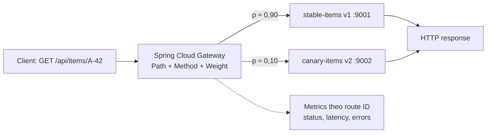
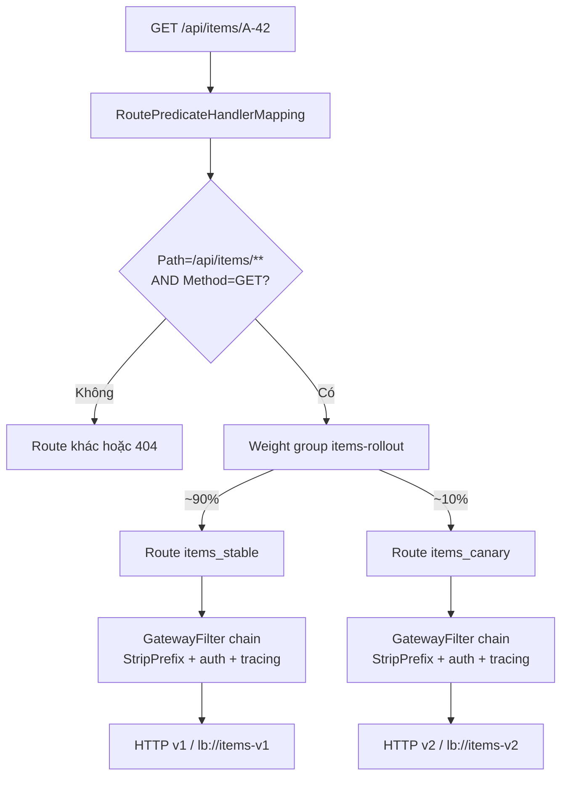

# Canary theo Weight và giới hạn của phân phối xác suất

## 1. Canary trong Spring Cloud Gateway giải quyết bài toán gì?

Khi triển khai phiên bản mới của một microservice, ta thường không muốn chuyển toàn bộ lưu lượng sản xuất sang phiên bản đó ngay. Một thay đổi nhỏ trong JSON response, cấu trúc dữ liệu, quyền truy cập hoặc timeout có thể làm hỏng nhiều client. **Canary release** cho phép đưa một phần request thật đến phiên bản mới để quan sát trước khi mở rộng.

Trong **SPRING_CLOUD_GATEWAY**, gateway chọn route qua **route predicates**, sau đó thực thi filter chain để biến đổi path/header, xác thực, rate limiting, circuit breaker, retry, TLS và chuyển request đến backend HTTP(S) hoặc `lb://` service. **`Weight` Route Predicate Factory** bổ sung một mẫu định tuyến: nhiều route thuộc **cùng một group** cạnh tranh chọn request theo **trọng số tương đối**.

Ví dụ: phiên bản ổn định `items-v1` nhận trọng số **9**, phiên bản canary `items-v2` nhận **1** trong group `items-rollout`. Với những request phù hợp cả hai route, Gateway dự kiến chọn v1 khoảng **90%** và v2 khoảng **10%** về mặt xác suất.



**Điểm phải nhớ ngay từ đầu:** `Weight=items-rollout,1` **không có nghĩa** 1% hay 1 request trong mọi nhóm 10 request; nó là **một trọng số** được chuẩn hóa trong group. Phân phối kết quả là **ngẫu nhiên theo request**, không phải một lịch tuần tự đảm bảo `9 lần v1 rồi 1 lần v2`. Không có bảo đảm **sticky session**, cùng user không được cố định vào một bản, và tỷ lệ request không nhất thiết bằng tỷ lệ người dùng, CPU hay doanh thu.

### Mục tiêu học tập

Sau bài này, người học có thể:

1. Khai báo hai `RouteDefinition` với cùng `Path`, `Method`, group `Weight`, nhưng URI/route ID khác nhau.
2. Tính xác suất dự kiến từ trọng số và phân biệt **trọng số tuyệt đối** với **tỷ lệ tương đối**.
3. Giải thích ảnh hưởng của cỡ mẫu, độ lệch chuẩn và khoảng bất định; tránh coi 7/100 thay vì 10/100 là lỗi cấu hình.
4. Phân biệt **canary theo request** với **user-cohort/sticky release** và **A/B experimentation**.
5. Nhận diện route overlap, route order, group name, route reload, nhiều Gateway pods và fallback/retry làm số đo sai.
6. Dựng lab Gateway WebFlux với hai EchoBackend có thể xác định phiên bản nhận request.
7. Đo số request vào mỗi route bằng `curl` và gateway metrics, so sánh tỷ lệ quan sát với xác suất kỳ vọng.
8. Viết test cho khả năng cả hai backend đều nhận request, đúng path/method và chính sách rollback.
9. Lập kế hoạch canary 1% → 5% → 10% → 25% → 50% → 100% dựa trên **SLO và error budget**, không chỉ dựa vào tỷ lệ traffic.

> **Phạm vi phiên bản:** Spring Cloud Gateway **Server WebFlux 4.3.x**, Spring Cloud **2025.0.x**, Spring Boot **3.5.x**, Java 17+. Bài dùng namespace `spring.cloud.gateway.server.webflux.routes`. **Server Web MVC** cũng có khái niệm Weight nhưng API/stack khác; không đưa ví dụ Reactor Netty/WebFlux này sang Servlet MVC. Cặp Maven `3.5.0` và `2025.0.0` trong lab nhằm minh họa tính tương thích, không phải khuyến nghị triển khai patch đầu tiên ở production.

## 2. `Weight` là một Route Predicate, không phải một GatewayFilter

### 2.1. Cú pháp chuẩn

Tài liệu Gateway Server WebFlux 4.3 mô tả **hai tham số**:

```text
Weight=<group>, <weight>
```

- `group`: tên nhóm định tuyến, ví dụ `items-rollout`; các route được chia tỷ lệ phải dùng **cùng group**.
- `weight`: số nguyên cho biết **mức tương đối** của route trong group. Các giá trị dương thường dùng để làm rollout.
- `id`: tên route để phân biệt stable/canary trong quản trị và metrics.
- `uri`: đích HTTP(S) hoặc service ID đã được phê duyệt.
- `predicates`: tất cả điều kiện trong một route, chẳng hạn `Path`, `Method`, `Weight`, thường có quan hệ **AND**.

Ví dụ:

```yaml
spring:
  cloud:
    gateway:
      server:
        webflux:
          routes:
            - id: items_stable
              uri: http://127.0.0.1:9001
              predicates:
                - Path=/api/items/**
                - Method=GET
                - Weight=items-rollout, 9

            - id: items_canary
              uri: http://127.0.0.1:9002
              predicates:
                - Path=/api/items/**
                - Method=GET
                - Weight=items-rollout, 1
```

Theo [Weight Route Predicate Factory của Spring Cloud Gateway 4.3](https://docs.spring.io/spring-cloud-gateway/reference/4.3/spring-cloud-gateway-server-webflux/request-predicates-factories.html), `8:2` tương ứng khoảng 80%:20%. Vì vậy `9:1` tương ứng khoảng 90%:10%. Tổng trọng số không cần bằng 100.

Dạng **fully expanded** cũng hợp lệ khi cần cấu hình rõ tên args:

```yaml
predicates:
  - Path=/api/items/**
  - Method=GET
  - name: Weight
    args:
      group: items-rollout
      weight: 9
```

Trong một cặp stable/canary, phải bảo đảm cả hai route có **cùng group** và cùng những predicate xác định population đích. Nếu dùng `group: items-stable` ở route v1 và `group: items-canary` ở v2, bạn **không còn** cấu hình một phân phối 90/10 trong cùng group.

### 2.2. Công thức chuẩn hóa

Với group có các route hợp lệ \(r_1,\ldots,r_k\) và trọng số \(w_i\), tỷ lệ mong đợi của mỗi route là:

\[
p_i = \frac{w_i}{\sum_{j=1}^{k} w_j}
\]

Nếu group `items-rollout` có hai route:

\[
p_{\mathrm{stable}} = \frac{9}{9+1} = 0{,}9, \qquad
p_{\mathrm{canary}} = \frac{1}{9+1} = 0{,}1.
\]

Với ba phiên bản, `7:2:1` cho khoảng 70% / 20% / 10%, **nhưng chỉ khi chúng được cấu hình đúng cùng group và cùng tập request cần phân phối**.

| Trọng số stable : canary | Dự kiến stable | Dự kiến canary | Ghi chú |
| --- | ---: | ---: | --- |
| `99 : 1` | 99% | 1% | Khởi động thận trọng với đủ cỡ mẫu. |
| `19 : 1` | 95% | 5% | Tỷ lệ nhỏ vẫn rất nhiễu ở cửa sổ ngắn. |
| `9 : 1` | 90% | 10% | Cấu hình chính của lab. |
| `3 : 1` | 75% | 25% | Tăng đáng kể exposure. |
| `1 : 1` | 50% | 50% | Không phải A/B theo người dùng. |
| Chỉ một route canary còn lại | 0% | 100% | Cách chuyển hoàn toàn rõ ràng. |

**Không dùng `Weight=...,0` như một lệnh kill switch mặc định.** Điều kiện hợp lệ của zero-weight, việc route còn tham gia tổng trọng số hay không và hành vi sau refresh cần được xác minh theo phiên bản. Một cách rollback dễ kiểm chứng hơn là **gỡ/tắt route canary khỏi tập routes đã phê duyệt**, giữ route ổn định hoạt động, triển khai và xác nhận lại.

### 2.3. Weight và `lb://` giải quyết hai tầng khác nhau

| Cơ chế | Cấp độ quyết định | Ví dụ |
| --- | --- | --- |
| `Weight` predicate | **Chọn route** stable hay canary. | `items_stable` 90%; `items_canary` 10%. |
| `lb://service-id` | **Chọn instance** trong service ID đã được discovery. | `lb://items-v2` có 3 pods v2. |
| Client-side retry | Một request có thể tạo **nhiều downstream attempts**. | Một request đã chọn v2, rồi retry khi 503. |
| Kubernetes Service | Phân phối connection/request tới pods sau route. | Service chỉ chứa instances v2. |
| Canary theo identity hash | **Chọn cohort ổn định** theo user/tenant. | Một user liên tục vào v2 trong đợt thử. |

Có thể kết hợp `Weight` với `lb://items-v1` và `lb://items-v2`, nhưng không được để **cùng service ID chứa lẫn hai phiên bản** rồi khẳng định Gateway đã có tỷ lệ version 90/10. Weight chỉ biết route nào được chọn; service discovery/load balancer quyết định instance sau đó.

## 3. Lộ trình chọn route và giới hạn của `Weight`



**Điều kiện biên:** Request `POST /api/items/A-42` **không thuộc population** của lab vì cả hai route yêu cầu `Method=GET`. Request `GET /health` cũng không thuộc population. Nếu một metric tổng hợp đếm cả health probes, static routes, unauthenticated rejects và canary API, tỷ lệ sẽ bị lệch so với 90:10 dù Weight hoạt động đúng.

### 3.1. Route overlap làm méo kết quả

Ví dụ dễ sai:

```yaml
# ANTI-PATTERN: một route rộng có thể chiếm request
# trước khi cặp stable/canary được xét.
- id: catch_all
  uri: http://127.0.0.1:9001
  predicates:
    - Path=/api/**

- id: items_stable
  uri: http://127.0.0.1:9001
  predicates:
    - Path=/api/items/**
    - Weight=items-rollout, 9

- id: items_canary
  uri: http://127.0.0.1:9002
  predicates:
    - Path=/api/items/**
    - Weight=items-rollout, 1
```

`Path=/api/**` overlap với `/api/items/**`. Khi route được chọn sớm, nó có thể bypass cơ chế Weight. Đừng dựa vào **thứ tự dòng YAML** như một cam kết ổn định của route selection. Hãy thiết kế predicates phân vùng rõ, kiểm tra `order` và **test thực tế cả route ID lẫn backend**.

### 3.2. Group giống nhau nhưng `Path`/`Method` khác nhau

Một lỗi khác:

```yaml
- id: items_stable
  predicates:
    - Path=/api/items/**
    - Weight=shared-group, 9

- id: other_canary
  predicates:
    - Path=/api/checkout/**
    - Weight=shared-group, 1
```

Không nên dùng cùng group để phân phối hai **population hoàn toàn khác nhau**. Việc chọn theo group, sự kết hợp predicates và route matching có thể tạo ra độ lệch hoặc route miss ngoài ý muốn. Dùng `items-rollout` cho hai phiên bản `items` và `checkout-rollout` cho hai phiên bản `checkout`.

Khi muốn chỉ canary cho user ở một vùng/quyền cụ thể, làm rõ điều kiện eligibility **ở cả hai nhánh**, tránh tình huống canary không match nhưng stable nhận tất cả request còn lại. Nếu cần deterministic cohort, cân nhắc giải pháp sticky riêng thay vì chồng nhiều predicate mà không hiểu tác động của xác suất.

### 3.3. Route order không phải cách tạo tỷ lệ

`order` xác định ưu tiên chọn route trong những trường hợp overlap; **nó không thay thế Weight**. Đặt `order: -100` cho canary không có nghĩa “canary 10% nhưng được xét trước” là một cấu hình canary đúng. Với lab, giữ hai route Weight cùng đối tượng xét/điều kiện và không có route thứ ba chiếm traffic.

Trong production, route inventory, filter order và weighted group cần được kiểm tra sau **mọi lần cập nhật**. Một route emergency hoặc temporary debug nếu quá rộng có thể làm mất hiệu lực thực tế của canary mà không thay bất cứ con số Weight nào.

## 4. Weight không tạo sticky session hoặc cohort thử nghiệm

### 4.1. Một người dùng có thể gặp cả hai phiên bản

Giả sử cùng một client gửi ba lần:

```text
GET /api/items/A-42  -> v1
GET /api/items/A-42  -> v2
GET /api/items/A-42  -> v1
```

Với canary **theo request**, chuỗi trên hoàn toàn có thể xảy ra. Không nên suy rằng một kết nối HTTP keep-alive hoặc HTTP/2 connection sẽ giữ người dùng ở cùng phiên bản. Vì vậy Weight phù hợp hơn với API **stateless** và contract v1/v2 tương thích.

Rủi ro nếu hai backend không chia sẻ state hoặc response schema:

- User vừa ghi dữ liệu bằng v2 rồi request tiếp theo vào v1 không đọc được.
- Cookie/session chỉ tồn tại tại một phiên bản.
- Cache key không chứa API/schema version hoặc tenant, gây trả dữ liệu chéo.
- Client nhận một field mới từ v2 rồi v1 loại bỏ field đó.
- POST ghi vào v2 nhưng read-after-write đi vào v1; trải nghiệm không nhất quán.
- Background jobs/consumers giữa hai bản dùng migration không backward-compatible.

### 4.2. Khi nào cần cohort/sticky release?

Nếu yêu cầu là “đúng khoảng 10% **người dùng** được gắn vào canary trong suốt 7 ngày”, nên dùng assignment **ổn định theo identity đáng tin** (ví dụ hash từ `authenticatedUserId + rolloutSalt`) và giữ mapping có version. Cách tính bucket khái niệm:

```text
bucket = stableHash(tenantOrUserId, rolloutSalt) mod 10000

if bucket < 1000:
    cohort = canary   # 10% bucket space
else:
    cohort = stable
```

Đây là **mô hình thiết kế**, không phải config sẵn có của `Weight` và không nên tin `X-User-Id`/cookie do client tự khai báo nếu chưa xác thực. Với khách chưa đăng nhập có thể dùng một server-issued, signed assignment cookie được quản lý đúng security/privacy/expiration; số user thực có thể lệch phân bố bucket khi population nhỏ hoặc truy cập không đều.

Cần lưu ý:

- User ID/tenant ID là **dữ liệu cá nhân/nội bộ**: không log raw ID làm metric label.
- Cohort assignment, session routing, feature flags và A/B analytics nên có **stable experiment ID**.
- Nếu rollout target là tenant B2B, hash tenant (không phải từng user) để giữ tenant cùng một phiên bản, nhưng mỗi tenant có quy mô rất khác.
- Đừng để client tự gửi `X-Canary: true` rồi dùng như quyền truy cập vào endpoint đặc quyền.
- Với authentication/authorization, cả v1 và v2 phải cùng thực thi policy và token audience phù hợp.

### 4.3. Weighted canary khác A/B test

| Khía cạnh | Weight canary | User-based A/B |
| --- | --- | --- |
| Đơn vị phân phối | Request. | User, tenant hoặc cohort. |
| Sticky | Không tự bảo đảm. | Có qua assignment ổn định. |
| Mục tiêu chính | Giảm rủi ro triển khai code mới, SLO. | Đánh giá khác biệt hành vi/nghiệp vụ. |
| Đếm tỷ lệ | Request count theo route. | Unique assigned units + exposures. |
| Phân tích kết quả | 5xx, latency, CPU, compatibility. | Conversion, retention, causal inference. |
| Bias thường gặp | Request count/user khác nhau; retries. | Sampling/selection bias, cross-user interference. |

**Không dùng số request v2 / tổng request làm kết luận “10% người dùng đã thử v2”.** Một bot gửi 1.000 requests có thể đóng góp phần lớn request count, còn một người dùng ít truy cập không đi vào canary trong khoảng quan sát.

## 5. Giới hạn xác suất: 90/10 là kỳ vọng, không phải lời hứa trên từng cửa sổ

### 5.1. Mô hình Bernoulli/binomial gần đúng

Để trực quan, giả sử có `n` request **độc lập, cùng eligibility, cùng xác suất canary `p=0,1`**, và không có can thiệp khác:

\[
X \sim \mathrm{Binomial}(n,p)
\]

\[
\mathbb{E}[X] = np,\qquad
\mathrm{Var}(X)=np(1-p),\qquad
\sigma_X=\sqrt{np(1-p)}.
\]

`X` là **số request được chọn canary**, không phải số response thành công hay số user riêng biệt. Các công thức là **mô hình thống kê lý tưởng** cho bài học; trong production, request không hoàn toàn độc lập, traffic bursts/retry/route refresh/replica heterogeneity có thể làm phân bố khác.

Với tỷ lệ quan sát \(\hat p=X/n\):

\[
\mathrm{SE}(\hat p) = \sqrt{\frac{p(1-p)}{n}}
\]

Với `n` đủ lớn, khoảng trực giác **xấp xỉ** 95% theo phân phối chuẩn quanh kỳ vọng là \(\hat p \approx p \pm 1{,}96\,\mathrm{SE}\). **Đó không phải guaranteed tolerance** cho từng đợt thử. Khi `p` rất nhỏ hoặc `n` thấp, nên dùng Wilson/exact binomial intervals thay vì công thức chuẩn đơn giản.

### 5.2. Cùng tỷ lệ 10%, cỡ mẫu khác cho dao động khác

| Số request đủ điều kiện `n` | Canaries kỳ vọng `np` | \(\sigma_X\) | Dao động xấp xỉ 95% quanh kỳ vọng về **tỷ lệ** |
| ---: | ---: | ---: | ---: |
| 20 | 2 | 1,34 | Khoảng ±13 điểm %; chuẩn kém chính xác ở mẫu nhỏ. |
| 100 | 10 | 3,00 | Khoảng ±5,9 điểm %. |
| 500 | 50 | 6,71 | Khoảng ±2,6 điểm %. |
| 1.000 | 100 | 9,49 | Khoảng ±1,9 điểm %. |
| 10.000 | 1.000 | 30,00 | Khoảng ±0,59 điểm %. |

Điều này có nghĩa trong 100 request, việc thấy **7 canary** thay vì **10** không tự chứng minh Gateway cấu hình sai. Trong 10.000 request cùng điều kiện, lệch xa 10% kéo dài đáng để điều tra hơn.

Một ví dụ nữa:

\[
P(X=0 \mid n=20,p=0{,}1)=(0{,}9)^{20}\approx 12{,}16\%.
\]

Tức là ngay cả khi canary đúng 10%, vẫn có xác suất khoảng **12%** để **20 request đầu không hề tới v2**. Với canary 1% và `n=100`:

\[
P(X=0 \mid n=100,p=0{,}01)=(0{,}99)^{100}\approx36{,}6\%.
\]

Kết luận **“canary không hoạt động vì tôi gửi 20 request mà chưa thấy v2”** là không có căn cứ thống kê. Kiểm tra route config, metrics và tăng sample hợp lý trên **môi trường được phép**, không nâng weight vội vì thiếu vài lần hit.

### 5.3. Kích thước mẫu tham khảo

Giả sử mong tỷ lệ thực trong một cửa sổ nằm gần `p=0,10` với sai số chuẩn xấp xỉ ±2 điểm phần trăm ở mức trực giác 95%. Ước lượng:

\[
n \gtrsim
\frac{1{,}96^2\,p(1-p)}{(0{,}02)^2}
\approx 865.
\]

Con số **~865 request** chỉ để **ước lượng tỷ lệ hit canary**, không đủ mặc nhiên để:

- Khẳng định v2 không có lỗi hiếm.
- Kiểm tra lỗi bảo mật/corruption xảy ra 1 lần trên 100.000 requests.
- So sánh tail latency P99 đáng tin.
- Kết luận conversion lift hay hiệu quả kinh doanh.
- Cung cấp statistical power cho A/B test theo user.

Đánh giá rollout cần số lượng **canary requests thực nhận**, số lỗi, latency distributions và minimum observation duration; không chỉ kiểm tra một tỷ lệ phần trăm.

## 6. Tỷ lệ request không phải tỷ lệ tài nguyên hay mức rủi ro

Một request v2 có thể tốn 10 lần CPU hoặc gửi 50 MiB response, trong khi một request v1 chỉ trả 2 KiB. Vì vậy:

```text
10% requests trên canary
    KHÔNG ĐỒNG NGHĨA
10% CPU, memory, connections, bytes, user impact hoặc revenue
```

Tổng tải backend có thể xấp xỉ:

\[
\mathrm{Load}_{\mathrm{canary}}
\approx
N_{\mathrm{canary}} \times \mathrm{CostPerRequest}_{\mathrm{canary}}.
\]

Chi phí theo request khác nhau giữa route `GET /items/{id}`, list/search và batch export. Nếu v2 chậm, số in-flight canary requests có thể tăng nhanh hơn tỷ lệ hit. Nếu retry tự động, 1 request canary có thể sinh nhiều **HTTP attempts** và memory retention khác với một request v1.

Các nguồn sai lệch thực tế:

- **Traffic mix:** bot/health checks/long polling chiếm một số routes; eligibility khác nhau.
- **Retry/fallback:** route ID ban đầu được chọn nhưng actual outbound attempts nhiều hơn 1.
- **Load balancing:** nhiều instances trong cùng service ID; chưa biết instance/version nào thực xử lý.
- **Cache:** cache hit ở Gateway/CDN có thể **không tới backend**; tỷ lệ upstream khác tỷ lệ route.
- **Time windows:** 1 phút có thể rất lệch, đặc biệt khi p=1%; 1 giờ có nhiều biến động triển khai.
- **Thay đổi route definitions:** old/new weights cùng tồn tại trong lúc refresh nhiều replicas.
- **Client behavior:** số request mỗi user không đều; retry phía client có thể sinh request mới và được cân lại.
- **Security filters:** 401/403/429 có thể chặn trước khi request đến upstream.
- **HTTP errors:** canary bị 503 không làm Weight tự động failover tất cả request về stable.

**Mẫu định tuyến đúng phải đo ba tỷ lệ riêng:** `selected route`, `actual backend attempts` và `successful outcomes`. Chỉ một tỷ lệ 9:1 tổng requests không đủ để kết luận canary an toàn.

## 7. Thực hành: canary v1/v2 với Weight 9:1

### 7.1. Kiến trúc lab

Chúng ta dựng ba tiến trình **độc lập trên máy local**:

```text
                  300 GET requests /api/items/A-42
Client (curl) ------------------------------------+
                                                  |
                                                  v
                                    Gateway WebFlux :8080
                                    group: items-rollout
                                     /              \
                           Weight=9 /                \ Weight=1
                                   v                  v
                         EchoBackend :9001      EchoBackend :9002
                         variant=stable         variant=canary
                         GET /items/A-42        GET /items/A-42
                                  \                 /
                                   +---------------+
                                           |
                                  response có variant
                                           |
                                     curl đếm tỷ lệ

Management Actuator :8081 (127.0.0.1)
  - health / metrics / gateway routes (read-only)
```

Lab dùng **GET không side effect**, phù hợp cho việc gửi lại cùng URL nhiều lần nhằm quan sát xác suất. Không dùng POST tạo đơn hàng/thanh toán trong thí nghiệm traffic sampling. Cổng `9001` và `9002` chỉ bind `127.0.0.1`; không gửi traffic tới môi trường sản xuất hoặc hệ thống chia sẻ.

### 7.2. Tạo Maven project

Yêu cầu JDK **17+**, Maven và `curl`. Tạo project riêng `gateway-weight-canary-lab` với `pom.xml`:

```xml
<?xml version="1.0" encoding="UTF-8"?>
<project xmlns="http://maven.apache.org/POM/4.0.0"
         xmlns:xsi="http://www.w3.org/2001/XMLSchema-instance"
         xsi:schemaLocation="http://maven.apache.org/POM/4.0.0
                             https://maven.apache.org/xsd/maven-4.0.0.xsd">
    <modelVersion>4.0.0</modelVersion>

    <parent>
        <groupId>org.springframework.boot</groupId>
        <artifactId>spring-boot-starter-parent</artifactId>
        <version>3.5.0</version>
        <relativePath/>
    </parent>

    <groupId>com.example</groupId>
    <artifactId>gateway-weight-canary-lab</artifactId>
    <version>0.0.1-SNAPSHOT</version>

    <properties>
        <java.version>17</java.version>
    </properties>

    <dependencyManagement>
        <dependencies>
            <dependency>
                <groupId>org.springframework.cloud</groupId>
                <artifactId>spring-cloud-dependencies</artifactId>
                <version>2025.0.0</version>
                <type>pom</type>
                <scope>import</scope>
            </dependency>
        </dependencies>
    </dependencyManagement>

    <dependencies>
        <dependency>
            <groupId>org.springframework.cloud</groupId>
            <artifactId>spring-cloud-starter-gateway-server-webflux</artifactId>
        </dependency>

        <dependency>
            <groupId>org.springframework.boot</groupId>
            <artifactId>spring-boot-starter-actuator</artifactId>
        </dependency>

        <dependency>
            <groupId>org.springframework.boot</groupId>
            <artifactId>spring-boot-starter-test</artifactId>
            <scope>test</scope>
        </dependency>

        <dependency>
            <groupId>io.projectreactor</groupId>
            <artifactId>reactor-test</artifactId>
            <scope>test</scope>
        </dependency>
    </dependencies>

    <build>
        <plugins>
            <plugin>
                <groupId>org.springframework.boot</groupId>
                <artifactId>spring-boot-maven-plugin</artifactId>
            </plugin>
        </plugins>
    </build>
</project>
```

Lưu ý:

- `spring-cloud-starter-gateway-server-webflux` là starter cho **Gateway Server WebFlux** trên Spring Cloud 2025.0.
- Actuator cung cấp metrics/routes inventory khi được cấu hình thích hợp.
- `spring-boot-starter-test` giúp viết HTTP integration test và assertion.
- `reactor-test` dùng khi test custom reactive components; Weight là built-in predicate nên **không cần viết custom predicate hoặc Reactor scheduler** trong lab này.
- Không thêm `spring-boot-starter-web` hoặc Gateway Server MVC vào cùng lab.
- Boot `3.5.0` + Cloud BOM `2025.0.0` là **cặp minh họa**; cập nhật patch vẫn được hỗ trợ khi triển khai thật.

### 7.3. Spring Boot entry point

Tạo `src/main/java/com/example/gateway/GatewayWeightApplication.java`:

```java
package com.example.gateway;

import org.springframework.boot.SpringApplication;
import org.springframework.boot.autoconfigure.SpringBootApplication;

@SpringBootApplication
public class GatewayWeightApplication {
    public static void main(String[] args) {
        SpringApplication.run(GatewayWeightApplication.class, args);
    }
}
```

Không cần `@RestController` cho route canary: các tuyến được khai báo trong Gateway route definitions và được xử lý bởi Gateway Server WebFlux, không phải một MVC proxy handler.

### 7.4. `application.yml`: hai route cùng group

Tạo `src/main/resources/application.yml`:

```yaml
server:
  port: 8080
  address: 127.0.0.1

spring:
  application:
    name: gateway-weight-canary-lab

  cloud:
    gateway:
      server:
        webflux:
          metrics:
            enabled: true

          routes:
            - id: items_stable
              uri: http://127.0.0.1:9001
              predicates:
                - Path=/api/items/**
                - Method=GET
                - Weight=items-rollout, 9
              filters:
                - StripPrefix=1

            - id: items_canary
              uri: http://127.0.0.1:9002
              predicates:
                - Path=/api/items/**
                - Method=GET
                - Weight=items-rollout, 1
              filters:
                - StripPrefix=1

management:
  server:
    port: 8081
    address: 127.0.0.1
  endpoint:
    gateway:
      access: read-only
  endpoints:
    web:
      exposure:
        include: health,metrics,gateway
```

Đọc từng dòng quan trọng:

1. `id`: tách `items_stable` và `items_canary`, phục vụ quan sát lỗi/latency theo route.
2. `uri`: hai backend khác nhau. Với lab trên cùng máy, dùng `127.0.0.1`; trong Kubernetes, `localhost` bên trong Pod Gateway **không chỉ đến backend Pod khác**.
3. `Path` và `Method`: **giống nhau** ở cả hai route, giúp so cùng loại request.
4. `Weight`: cùng group `items-rollout`, hai giá trị 9 và 1, kỳ vọng `~90%:~10%`.
5. `StripPrefix=1`: cả hai backend nhận `/items/A-42` từ `/api/items/A-42`.
6. `metrics.enabled`: bật gateway metrics theo namespace WebFlux tương ứng phiên bản. Metrics cần Actuator và traffic thực mới xuất hiện.
7. Actuator `gateway` ở chế độ **read-only** trên management port riêng, không dùng làm đường ghi dynamic routes trong lab.

**Không có một route `/api/**` thứ ba** để tránh route overlap. Giữ cùng auth/filter path/response headers ở hai phiên bản nếu cần so sánh công bằng.

### 7.5. EchoBackend có thể chạy với hai phiên bản

Tạo **một** file `EchoBackend.java` trong thư mục riêng (ngoài project Spring Boot). File nhận hai tham số `port` và `variant`, nên có thể chạy hai process cùng source:

```java
import com.sun.net.httpserver.HttpServer;
import java.net.InetSocketAddress;
import java.nio.charset.StandardCharsets;
import java.util.concurrent.atomic.AtomicLong;

public class EchoBackend {

    public static void main(String[] args) throws Exception {
        if (args.length != 2) {
            throw new IllegalArgumentException(
                    "Usage: java EchoBackend.java <port> <stable|canary>");
        }

        int port = Integer.parseInt(args[0]);
        String variant = args[1];

        if (!variant.equals("stable") && !variant.equals("canary")) {
            throw new IllegalArgumentException(
                    "Variant must be stable or canary");
        }

        AtomicLong requests = new AtomicLong();

        HttpServer server = HttpServer.create(
                new InetSocketAddress("127.0.0.1", port), 0);

        server.createContext("/", exchange -> {
            long n = requests.incrementAndGet();

            String path = exchange.getRequestURI().getRawPath();
            String query = exchange.getRequestURI().getRawQuery();

            String response = "variant=" + variant + "\n"
                    + "backend-count=" + n + "\n"
                    + "method=" + exchange.getRequestMethod() + "\n"
                    + "path=" + path + "\n"
                    + "query=" + query + "\n";

            System.out.printf(
                    "%s #%d %s %s%n",
                    variant, n, exchange.getRequestMethod(), path);

            byte[] output = response.getBytes(StandardCharsets.UTF_8);

            exchange.getResponseHeaders().set(
                    "Content-Type", "text/plain; charset=UTF-8");
            exchange.getResponseHeaders().set(
                    "X-Backend-Version", variant);

            exchange.sendResponseHeaders(200, output.length);

            try (var stream = exchange.getResponseBody()) {
                stream.write(output);
            }
        });

        server.start();
        System.out.printf(
                "EchoBackend %s at http://127.0.0.1:%d%n",
                variant, port);
    }
}
```

Backend chỉ trả nội dung được sinh từ tên phiên bản và đường dẫn, không có cơ sở dữ liệu hay side effect nghiệp vụ. `backend-count` là bộ đếm **riêng cho từng process**, không phải tổng requests đã qua Gateway. Mã EchoBackend không có xác thực/TLS vì là **demo loopback**; tuyệt đối không mở trực tiếp trên Internet.

### 7.6. Chạy ba tiến trình

**Terminal A** (thư mục có `EchoBackend.java`):

```bash
java EchoBackend.java 9001 stable
```

**Terminal B** (cùng thư mục EchoBackend):

```bash
java EchoBackend.java 9002 canary
```

**Terminal C** (thư mục Gateway project có `pom.xml`):

```bash
mvn spring-boot:run
```

Có thể dùng Maven Wrapper `./mvnw spring-boot:run` trên Linux/macOS hoặc `mvnw.cmd spring-boot:run` trên Windows. Nếu cổng 8080/8081/9001/9002 bận, đổi cấu hình của **cả bên Gateway và backend** nhất quán.

**Các lệnh này chỉ dành cho người học chạy trong project thực hành riêng.** Worker STEP 4 không build/running Gateway repo hoặc chạy Content QA của nền tảng.

## 8. Dùng `curl` quan sát canary và phân phối xác suất

### 8.1. Gửi request đơn lẻ

```bash
curl -i \
  "http://127.0.0.1:8080/api/items/A-42"
```

Phản hồi mẫu **một lần bất kỳ**:

```http
HTTP/1.1 200 OK
Content-Type: text/plain; charset=UTF-8
X-Backend-Version: stable

variant=stable
backend-count=1
method=GET
path=/items/A-42
query=null
```

Những lần khác **có thể** trả `variant=canary` và header `X-Backend-Version: canary`. Kết quả nào cũng hợp lệ khi Weight=9:1. Không chỉnh cấu hình vì 3–5 request đầu cùng rơi vào stable.

`query=null` là cách `EchoBackend` in giá trị `getRawQuery()` khi không có query; không phải một HTTP error. Đường dẫn phải là `/items/A-42` vì `StripPrefix=1`.

### 8.2. Gửi 300 requests liên tiếp trên máy local

Ví dụ Bash dùng `curl`, `sed`, `sort` và `uniq`:

```bash
for ((i = 1; i <= 300; i++)); do
  curl -fsS --max-time 5 \
    "http://127.0.0.1:8080/api/items/A-42" \
    | sed -n 's/^variant=//p' \
    || echo "ERROR"
done | sort | uniq -c
```

**Kết quả minh họa, không cố định:**

```text
  272 stable
   28 canary
```

Khi `n=300` và `p=0,10`, giá trị kỳ vọng khoảng **30** requests canary nhưng có thể thấy 21, 34 hoặc một số khác. Lệnh hiển thị **số response có marker**, không phải chắc chắn tổng số attempts: nếu `curl` lỗi, kiểm tra status/log riêng; `sed` có thể không in gì khi upstream trả body khác.

Để lấy mẫu có ý nghĩa, bảo đảm:

- Hai backend đều healthy trước khi bắt đầu.
- Không đổi weight trong lúc lấy mẫu.
- Không có HTTP cache/CDN, route khác hoặc client retry xen vào.
- Bốn cổng đều chỉ ở localhost, không gây tải môi trường khác.
- Dùng request cùng path/method, không trộn POST, health checks, cache hits.
- Ghi **số requests đủ điều kiện và số lỗi**, không chỉ tỷ lệ của những response 200.

### 8.3. Quan sát cùng một client vẫn có thể sang phiên bản khác

```bash
for ((i = 1; i <= 12; i++)); do
  curl -fsS \
    "http://127.0.0.1:8080/api/items/A-42" \
    | sed -n 's/^variant=//p'
done
```

Nếu thấy stable rồi canary rồi stable, đó là behavior canary **theo request**. Nếu cả 12 đều stable, cũng không chứng minh có stickiness: xác suất 12 lần không canary với 10% là \((0,9)^{12}\approx28,2\%\).

### 8.4. Request không thuộc nhóm phải được xử lý riêng

```bash
# POST không match hai route chỉ nhận GET:
curl -i -X POST \
  "http://127.0.0.1:8080/api/items/A-42"

# Path khác population:
curl -i \
  "http://127.0.0.1:8080/health"
```

Trong lab không có route tương ứng, thường nhận **404** (hoặc status khác nếu ứng dụng có thêm handler/security). **Không ghi những request này vào mẫu 90/10**. Nếu mục tiêu là canary cả GET lẫn POST, cần thiết kế method eligibility và idempotency riêng, không tự đổi `Method=GET` thành `Method=GET,POST` để thử giao dịch thật.

## 9. Actuator metrics: đếm route đã chọn thay vì chỉ nhìn body

Spring Cloud Gateway có Gateway Metrics Filter tạo metric `spring.cloud.gateway.requests` (khi bật trong phiên bản đang dùng) với tags như `routeId`, `routeUri`, `status`, `httpMethod` và `outcome`. Nhờ **route ID riêng biệt**, ta có thể so canary/stable cùng tuyến chức năng.

### 9.1. Đọc route inventory

```bash
curl -sS \
  "http://127.0.0.1:8081/actuator/gateway/routes"
```

Kiểm tra có đúng hai route `items_stable`/`items_canary`, cùng `Path=/api/items/**`, `Method=GET`, group `items-rollout`, weights 9 và 1; hai URI đúng cổng. Tùy phiên bản, format Actuator verbose có thể biểu diễn predicate đã biên dịch chứ không in nguyên text YAML. Nếu endpoint chưa xuất hiện, kiểm tra exposure/access và startup trước khi kết luận route không tồn tại.

**Không bật `management.endpoint.gateway.access: unrestricted`** chỉ để đọc routes. Actuator endpoint có thể cho tạo/xóa/refresh tuyến khi cho phép ghi; lab dùng `read-only` và bind management port tới loopback.

### 9.2. Xem metrics theo route ID

Sau khi gửi một số request:

```bash
curl -sS \
  "http://127.0.0.1:8081/actuator/metrics/spring.cloud.gateway.requests"

curl -sS \
  "http://127.0.0.1:8081/actuator/metrics/spring.cloud.gateway.requests?tag=routeId:items_stable"

curl -sS \
  "http://127.0.0.1:8081/actuator/metrics/spring.cloud.gateway.requests?tag=routeId:items_canary"
```

Trong response actuator, `measurements` có thể chứa `COUNT`, `TOTAL_TIME` và `MAX`, tùy meter. Lấy **COUNT theo route ID** trên cùng thời điểm/cửa sổ, sau đó tính:

\[
\hat p_{\mathrm{canary}}
=
\frac{N_{\mathrm{items\_canary}}}
{N_{\mathrm{items\_stable}}+N_{\mathrm{items\_canary}}}.
\]

Không dùng `routeUri` như một metric label ứng dụng do người dùng tự xây từ untrusted URL. Trong production, phân tích thời gian từ Prometheus/Grafana qua **rates/counters theo cửa sổ** và phân tách `status`/method/route ID; snapshot Actuator `COUNT` từ khi process start có thể không phản ánh **canary stage hiện tại** nếu mới đổi weights.

### 9.3. Phân biệt metrics và headers để tránh kết luận sai

| Nguồn số liệu | Đang đếm gì? | Hạn chế |
| --- | --- | --- |
| `X-Backend-Version` trong body/header | Phiên bản backend đã trả response thành công. | Thiếu requests failed/timeout; có thể bị cache/CDN. |
| `spring.cloud.gateway.requests` theo `routeId` | Requests đã đi qua Gateway metric filter theo route. | Tùy filter order/error path; cần xác nhận instrumentation. |
| Backend counter :9001/:9002 | Actual HTTP request được backend nhận. | Retry làm count lớn hơn số client requests. |
| Outbound Netty client metrics | HTTP attempts, connection errors và latency. | Cần tags được cấu hình phù hợp, không nhất thiết đồng nhất route selection. |
| Ingress requests | Tổng HTTP requests qua edge. | Bao gồm health, 401/403/404/429 và các route khác. |

**Canary hit ≠ canary success**. Một route có thể được chọn 10% nhưng v2 trả 503 cho một nửa số request; tỷ lệ **response thành công từ canary** sẽ thấp hơn 10%. Đừng chỉ đếm những response 200 rồi tự hào “v2 nhận 5%, an toàn”.

## 10. Tăng/giảm tỷ lệ bằng cách đổi trọng số có kiểm soát

### 10.1. Chuỗi rollout mẫu

Một kế hoạch tăng exposure ví dụ:

| Bước | Stable / Canary | Điều kiện mở bước |
| --- | --- | --- |
| 0: baseline | 100% stable | v2 deploy healthy, contract tests xanh, chưa nhận public traffic. |
| 1: smoke | 99 : 1 | Canaries có đủ request, không tăng 5xx/latency nghiêm trọng. |
| 2: early | 95 : 5 | Không xuất hiện auth/data compatibility lỗi. |
| 3: expand | 90 : 10 | SLO và error budget trong ngưỡng. |
| 4: expand | 75 : 25 | P95/P99/DB/CPU/heap tốt, quota đúng. |
| 5: half | 1 : 1 | Hiệu năng/chi phí của v2 đo được ở tải đáng kể. |
| 6: complete | 100% canary | Chỉ còn route v2 đã phê duyệt; sau ổn định đổi tên thành stable mới. |

Đây là **ví dụ quy trình**, không có lịch cứng theo phút hoặc tỷ lệ bắt buộc cho mọi hệ thống. Với request volume thấp, cần kéo dài quan sát hoặc chạy synthetic tests riêng để phát hiện lỗi; nhưng synthetic tests không thay thế traffic thực nếu muốn đánh giá production behavior.

### 10.2. Đổi từ 90:10 sang 95:5

Trong `application.yml`, chỉ sửa **hai giá trị Weight trong cùng group**:

```yaml
# Stable
- Weight=items-rollout, 19

# Canary
- Weight=items-rollout, 1
```

`19/(19+1)=95%`, `1/(19+1)=5%`. Không cần tổng 100. **Không đổi `group` ở một nhánh** và không bỏ route khỏi inventory mà chưa tính tác động.

Nếu deploy bằng config GitOps hoặc dynamic `RouteDefinitionLocator`, phải đảm bảo thay đổi được **apply/refresh** tới tất cả Gateway replicas. Trước khi tăng traffic, kiểm tra route inventory và tỷ lệ thực. Route definitions được lưu không đồng nghĩa mọi runtime instance đã áp dụng ngay.

### 10.3. Rollback về 100% stable

Một rollback rõ và dễ kiểm chứng trong lab là **bỏ route canary** và bỏ `Weight` ở route stable còn lại:

```yaml
spring:
  cloud:
    gateway:
      server:
        webflux:
          routes:
            - id: items_stable
              uri: http://127.0.0.1:9001
              predicates:
                - Path=/api/items/**
                - Method=GET
              filters:
                - StripPrefix=1
```

Sau khi apply/refresh:

- `/actuator/gateway/routes` chỉ còn `items_stable` cho endpoint này.
- Synthetic GET đúng path phải đến v1.
- Backend v2 counter ngừng tăng **sau khi các request đang xử lý đã hoàn tất**.
- Metrics theo route ID cho thấy canary `rate` tiến về 0, không nhầm với `COUNT` lũy kế cũ.
- Xác minh các Gateway replicas, ingress/CDN cache và các client còn giữ connection.

**Rollback traffic không tự rollback dữ liệu.** Nếu v2 đã ghi schema/đơn hàng/side effect không tương thích với v1, cần kế hoạch database migration/backward compatibility và compensating action riêng.

### 10.4. Không dùng response 503 làm auto rollback

`Weight` là predicate chọn route, **không phải circuit breaker hay health-check failover**. Khi v2 hỏng, việc request chọn v2 rồi bị 503 không tự có nghĩa Gateway sẽ quyết định “thử lại ở v1”. `Retry` và `CircuitBreaker` là các chính sách khác, với timeout, idempotency và fallback cần thiết kế tường minh.

Đối với sự cố nặng, rollback thông qua **config/control plane** và verify toàn bộ. Nếu muốn automatic traffic shift dựa vào canary health, cần một hệ thống rollout controller/traffic manager với metrics, guardrails và quyền thay đổi routes rõ ràng.

## 11. Integration test với hai backend HTTP trên cổng ngẫu nhiên

Kiểm thử unit riêng một `WeightRoutePredicateFactory` có thể cho biết cú pháp/logic của class, nhưng **không chứng minh** Gateway đã bind hai route YAML, chọn đúng route, chạy `StripPrefix` và proxy qua Netty. Vì vậy cần một **HTTP integration test** chạy Gateway và hai backend thật trong cùng JVM.

Kế hoạch:

1. Gateway chạy bằng `@SpringBootTest(webEnvironment = RANDOM_PORT)`.
2. Hai JDK `HttpServer` stubs mở cổng `0` để hệ điều hành cấp cổng trống.
3. `@DynamicPropertySource` override URI của `routes[0]` và `routes[1]` **trước khi Spring bind các route definitions**.
4. `TestRestTemplate` gửi GET qua Gateway HTTP socket thật.
5. Mỗi backend có `AtomicInteger` đếm requests nhận được.
6. Assert **mọi eligible request** tới đúng một backend hợp lệ, URL/method đúng.
7. **Không assert cố định** rằng 120 requests nhất thiết phải phân phối 108/12.

### 11.1. Test class hoàn chỉnh

Tạo `src/test/java/com/example/gateway/WeightedRoutesIntegrationTest.java`:

```java
package com.example.gateway;

import java.io.IOException;
import java.io.UncheckedIOException;
import java.net.InetSocketAddress;
import java.nio.charset.StandardCharsets;
import java.util.concurrent.atomic.AtomicInteger;

import com.sun.net.httpserver.HttpServer;

import org.junit.jupiter.api.AfterAll;
import org.junit.jupiter.api.Test;
import org.springframework.beans.factory.annotation.Autowired;
import org.springframework.boot.test.context.SpringBootTest;
import org.springframework.boot.test.web.client.TestRestTemplate;
import org.springframework.http.HttpStatus;
import org.springframework.http.ResponseEntity;
import org.springframework.test.context.DynamicPropertyRegistry;
import org.springframework.test.context.DynamicPropertySource;

import static org.assertj.core.api.Assertions.assertThat;

@SpringBootTest(
        webEnvironment = SpringBootTest.WebEnvironment.RANDOM_PORT)
class WeightedRoutesIntegrationTest {

    private static final AtomicInteger STABLE_CALLS =
            new AtomicInteger();
    private static final AtomicInteger CANARY_CALLS =
            new AtomicInteger();

    private static final HttpServer STABLE =
            startBackend("stable", STABLE_CALLS);
    private static final HttpServer CANARY =
            startBackend("canary", CANARY_CALLS);

    private static HttpServer startBackend(
            String variant, AtomicInteger counter) {

        try {
            HttpServer server = HttpServer.create(
                    new InetSocketAddress("127.0.0.1", 0), 0);

            server.createContext("/", exchange -> {
                counter.incrementAndGet();

                String body = "variant=" + variant + "\n"
                        + "method=" + exchange.getRequestMethod() + "\n"
                        + "path=" + exchange.getRequestURI()
                                .getRawPath() + "\n";

                byte[] output = body.getBytes(StandardCharsets.UTF_8);

                exchange.getResponseHeaders().set(
                        "Content-Type",
                        "text/plain; charset=UTF-8");

                exchange.sendResponseHeaders(200, output.length);

                try (var stream = exchange.getResponseBody()) {
                    stream.write(output);
                }
            });

            server.start();
            return server;
        } catch (IOException e) {
            throw new UncheckedIOException(e);
        }
    }

    @DynamicPropertySource
    static void chooseBackendPorts(DynamicPropertyRegistry registry) {
        registry.add(
                "spring.cloud.gateway.server.webflux.routes[0].uri",
                () -> "http://127.0.0.1:"
                        + STABLE.getAddress().getPort());

        registry.add(
                "spring.cloud.gateway.server.webflux.routes[1].uri",
                () -> "http://127.0.0.1:"
                        + CANARY.getAddress().getPort());
    }

    @Autowired
    TestRestTemplate client;

    @AfterAll
    static void stopBackends() {
        STABLE.stop(0);
        CANARY.stop(0);
    }

    @Test
    void eligibleGetsReachOnlyApprovedVersions() {
        int stableBefore = STABLE_CALLS.get();
        int canaryBefore = CANARY_CALLS.get();

        int sampleCount = 120;

        for (int i = 0; i < sampleCount; i++) {
            ResponseEntity<String> response = client.getForEntity(
                    "/api/items/A-42", String.class);

            assertThat(response.getStatusCode())
                    .isEqualTo(HttpStatus.OK);

            assertThat(response.getBody())
                    .contains("method=GET")
                    .contains("path=/items/A-42");

            assertThat(
                    response.getBody().contains("variant=stable")
                    || response.getBody().contains("variant=canary"))
                    .isTrue();
        }

        int stableDelta = STABLE_CALLS.get() - stableBefore;
        int canaryDelta = CANARY_CALLS.get() - canaryBefore;

        // Mỗi request từ client tới một trong hai backend.
        assertThat(stableDelta + canaryDelta)
                .isEqualTo(sampleCount);

        // KHÔNG assert stableDelta == 108 và canaryDelta == 12!
        // Weight tạo phân phối xác suất, không quota chính xác.
    }

    @Test
    void unrelatedPathDoesNotHitEitherBackend() {
        int before = STABLE_CALLS.get() + CANARY_CALLS.get();

        ResponseEntity<String> result = client.getForEntity(
                "/api/other/A-42", String.class);

        assertThat(result.getStatusCode())
                .isEqualTo(HttpStatus.NOT_FOUND);

        assertThat(STABLE_CALLS.get() + CANARY_CALLS.get())
                .isEqualTo(before);
    }

    @Test
    void postDoesNotMatchGetOnlyCanaryRoutes() {
        int before = STABLE_CALLS.get() + CANARY_CALLS.get();

        ResponseEntity<String> result = client.postForEntity(
                "/api/items/A-42", "demo", String.class);

        // Không có route POST trong lab; không assert cứng nếu
        // app đã thêm security/mappings ngoài phạm vi lab.
        assertThat(result.getStatusCode().is4xxClientError())
                .isTrue();

        assertThat(STABLE_CALLS.get() + CANARY_CALLS.get())
                .isEqualTo(before);
    }
}
```

### 11.2. Những điều cần lưu ý về test

- `@DynamicPropertySource` dùng **đúng hai index YAML `[0]` và `[1]`**; nếu đổi thứ tự khai báo routes, phải cập nhật mapping tương ứng. Test cũng nên xác nhận URI/route ID qua actuator nếu project được cấu hình khác.
- Cổng `0` cho backend stubs tránh xung đột với cổng `9001`/`9002` của lab thủ công.
- `STABLE_CALLS` và `CANARY_CALLS` là counters chia sẻ trong class: assertions giả định không chạy **nhiều test methods song song**; nếu CI có JUnit parallel mode, cần test isolation hoặc ghi request ID để phân biệt.
- **Mọi request có response 200** và hai counters cộng đúng `n` trong lab không chứng minh tỉ lệ đúng 90:10. Nó chứng minh **route matching + proxy thật + chỉ approved backends** trong các điều kiện đơn giản.
- Bất kỳ HTTP client interceptor/retry/filter nào được thêm vào project có thể làm số backend attempts vượt `n`, khi đó assertion sẽ giúp phát hiện behavior thay đổi và cần phân tích.
- Nếu custom security layer chặn trước route, test sẽ cần authentication tương ứng, không được tắt security chỉ để có status 200 trong production.
- `TestRestTemplate` gửi HTTP qua cổng Gateway thực; đây không chỉ là test `MockServerWebExchange`.
- Không dùng kết quả của **một** test với `n=120` để kết luận P99 latency, error rate hoặc user-cohort correctness.

### 11.3. Lệnh chạy tại project học tập

```bash
mvn -Dtest=WeightedRoutesIntegrationTest test
```

Với Maven Wrapper:

```bash
./mvnw -Dtest=WeightedRoutesIntegrationTest test
```

**Các lệnh này chỉ dành cho người học**, không phải phần việc worker STEP 4 chạy trong repository bài giảng. Không chạy Content QA chuyên môn của STEP 6 tại đây.

## 12. Kiểm thử phân phối xác suất mà không tạo flaky CI tests

### 12.1. Anti-pattern: khẳng định 90 lần stable, 10 lần canary cho 100 requests

```java
// SAI: phép thử này có thể thất bại dù Weight cấu hình đúng.
assertThat(stableCount).isEqualTo(90);
assertThat(canaryCount).isEqualTo(10);
```

Ngay cả với một công cụ random lý tưởng, xác suất để một mẫu 100 requests có **đúng 10 canary** không phải 100%. Nếu đặt expectation 90/10 chính xác, bộ CI có thể báo đỏ ngẫu nhiên rồi người viết test vô tình thay đổi production logic để làm test “ổn định”.

Các lựa chọn tốt hơn:

1. **Unit/config test xác định**: Assert cả hai RouteDefinitions có cùng `Path`, `Method`, group và đúng 9:1.
2. **HTTP contract test**: Assert mỗi request chọn một backend hợp lệ, body/path/headers đúng, không có unauthorized route.
3. **Statistical smoke**: Lấy sample đủ lớn, báo **observed ratio + confidence interval**, so với baseline; để mục tiêu này ở pipeline quan sát/staging thay vì block mỗi CI run bằng range quá hẹp.
4. **Deterministic selection**: Nếu bắt buộc mỗi user được gán đúng, triển khai assignment theo hash/cohort riêng có seed/test vectors; `Weight` mặc định không đưa ra `seed` cấu hình để cố định kết quả các request của unit test.
5. **Statistical fail condition**: Chỉ dùng khoảng tolerance rộng và số mẫu đủ lớn, tính xác suất false alarm; lặp lại phân tích sau khi loại các lỗi request/route refresh.

### 12.2. Một khoảng dung sai có thể chấp nhận khi chỉ smoke test

Với `p=0,1`, `n=1.000`, kỳ vọng 100 canaries, độ lệch chuẩn khoảng 9,49 request. Trong mô hình nhị thức, một khoảng `[70,130]` canaries là rất rộng (gấp hơn 3 độ lệch chuẩn), nên thường sẽ chứa quan sát nếu các giả định lý tưởng đúng.

Nhưng **không có khoảng xác suất hữu hạn nào bảo đảm tuyệt đối không fail**. Nếu production canary traffic là 1% hoặc có phân bố khác theo pods, ngưỡng phải được tính lại. Đừng sao chép `[70,130]` cho p=0,01 hoặc n=50.

Một quy trình kiểm thử:

```text
CONFIG CHECK:
  group = items-rollout
  stableWeight = 9
  canaryWeight = 1
  Path/Method identical
  no overlapping higher-priority route

FUNCTIONAL TEST:
  every eligible request reaches v1 or v2
  same upstream API contract
  no third destination

STATISTICAL OBSERVATION:
  n >= sample requirement
  observed canary share = canarySelected / eligibleSelected
  report CI / confidence range, do not require exact 10%
  investigate outliers before rollback/change
```

### 12.3. Phân biệt tỷ lệ chọn route với tỷ lệ response thành công

Giả sử có 1.000 client requests eligible:

```text
Selected by Weight: stable = 900, canary = 100
Actual backend attempts: stable = 900, canary = 130
Successful responses: stable = 895, canary = 60
```

Trong ví dụ giả định, tỷ lệ **selected canary** = 100/1000 = 10%, đúng cấu hình. Nhưng tỷ lệ **backend attempts canary** = 130/(900+130) ≈ 12,6% do retry. Tỷ lệ **successful canary responses** = 60/(895+60) ≈ 6,3% do lỗi. Nếu chỉ đếm **backend 200**, ta có thể lầm rằng Weight không đạt 10% hoặc đã ưu tiên stable.

Hãy đo:

- `selected_route_count` trong Gateway metrics.
- `outbound_attempt_count` và retry số lần.
- `success/error` theo route ID, backend version và status class.
- `latency` và resource consumption theo version.
- `eligible_requests` sau khi loại route miss, 401/403/429 và traffic khác.

### 12.4. Kết luận số liệu theo cửa sổ và sample size

Không gộp tất cả traffic từ khi app start nếu weight đã thay ba lần. Nên tính tỷ lệ theo **time window của từng rollout stage**, loại thời gian các Gateway replicas đang cập nhật config hoặc ghi rõ giai đoạn chuyển tiếp.

Với canary 1%, ví dụ 10.000 eligible requests chỉ kỳ vọng khoảng **100** canary requests. Nếu không thấy lỗi trong 100 request canary, quy tắc thống kê gần đúng *rule of three* cho thấy cận trên 95% của error probability vẫn có thể khoảng **3%**. Vì vậy “0 lỗi” với sample bé **không chứng minh dịch vụ không có lỗi hiếm**.

Khi một endpoint có nhiều loại request, nên phân tách GET item/detail, search/list, payload size và client platform theo hợp đồng. Mẫu lớn ở một endpoint nhẹ không chứng minh endpoint nặng an toàn.

## 13. Vận hành canary trên nhiều Gateway replicas

Một deployment thường có nhiều Gateway pods, mỗi pod có route cache/config version tại một thời điểm. Dù mỗi pod hoạt động đúng cấu hình hiện tại, **tỷ lệ tổng** có thể khác kỳ vọng nếu weights chưa được triển khai đồng bộ.

### 13.1. Ví dụ 2 Gateway replicas có config khác nhau

Giả sử ingress chia đều requests:

- Gateway A đã nhận config `90:10`.
- Gateway B vẫn ở config `99:1`.

Tỷ lệ canary tổng mong đợi là:

\[
p_{\mathrm{overall}}
= 0{,}5\times0{,}10 + 0{,}5\times0{,}01
= 0{,}055 = 5{,}5\%.
\]

Nếu ingress chia không đều (sticky connection, autoscaling, địa lý khác nhau), tỷ lệ tổng còn biến đổi theo traffic share tới mỗi Gateway pod:

\[
p_{\mathrm{overall}}=\sum_{i=1}^{m} a_i p_i,\quad
\sum_i a_i=1,
\]

trong đó `a_i` là tỷ lệ request đủ điều kiện đi qua Gateway replica `i`, và `p_i` là xác suất canary trên replica đó.

**Kết luận:** khi rollout weight, phải kiểm tra **config version và route inventory trên từng replica**, cùng metrics phân tách pod/instance. Một giá trị `COUNT` tổng hợp không chứng minh mọi replica đã nhận route config mới.

### 13.2. Refresh route cache không đơn thuần là thay YAML

Nếu routes lấy từ GitOps, Config Server, DB, Redis hoặc runtime API:

1. Phải có một source of truth/approved change request.
2. Validate group names, weight values, route ID uniqueness, identical eligibility, filter args và order.
3. Persist definitions theo **cùng một phiên bản cấu hình**, tránh chỉ đổi weight của một route và refresh sớm.
4. Apply/refresh route definitions qua cơ chế được Spring Cloud Gateway 4.3 hỗ trợ.
5. Xác minh active routes/weight groups trên từng Gateway replica sau refresh.
6. Chạy synthetic HTTP test cho stable/canary, quan sát 404/5xx và canary ratio.
7. Có rollback/kill-switch khi config sai.

**Cảnh báo lịch sử:** Spring Cloud Gateway từng có [issue #2980](https://github.com/spring-cloud/spring-cloud-gateway/issues/2980) ở bản **3.1.2** về việc weight calculator không cập nhật như mong muốn khi refresh routes. Không suy rằng lỗi cũ đó vẫn tồn tại trong Gateway 4.3.x, nhưng đây là lý do thực tế để **integration test đường refresh của đúng artifact đang dùng** thay vì chỉ test app startup.

### 13.3. Route ID, group và ownership

Một quy ước hữu ích:

```text
routeId: catalog_items_stable
routeId: catalog_items_canary
group:   catalog-items-v2-rollout
owner:   catalog-team
change:  CHG-2026-1042
```

Dùng route IDs **không đổi trong một stage**, group name đủ cụ thể để không trộn routes của dịch vụ khác. Không để user tùy ý sửa group/weight qua query/header; đây là **control-plane configuration**, cần authentication, authorization và audit.

### 13.4. Phân biệt rollback route và rollback binary

Tình huống thực tế:

- Canary v2 deploy lên :9002 và healthy.
- Weight đổi từ 10% lên 25%.
- v2 có bug trả sai dữ liệu tenant.
- Rollback Weight về stable 100% chặn **traffic mới** đến v2, nhưng không xóa response đã cache, side effect đã ghi hoặc các in-flight requests đang xử lý.

Cần kế hoạch:

- Chặn v2 nhận request mới.
- Thu hồi cached response có schema/scope không tương thích nếu cần.
- Đảm bảo rollback DB/schema compatibility.
- Xử lý idempotency/retry và authorization.
- Kiểm tra Gateway active routes trên mọi replica.
- Audit nguyên nhân và tránh lặp rollout trước khi fix.

## 14. An toàn và tương thích khi chia traffic

### 14.1. Authentication/authorization phải thống nhất

Trong Gateway, Spring Security `SecurityWebFilterChain` có thể chạy **trước** Gateway route predicates/filters. Hai version v1/v2 phải thực thi cùng yêu cầu quyền theo tài nguyên và tenant. Không coi `Weight` là access-control mechanism.

Một thiết kế sai:

```text
90% -> v1 kiểm tra JWT + tenant
10% -> v2 chỉ kiểm tra path / user header
```

Khi đó canary 10% là **đường bypass xác thực**, không phải cơ chế thí nghiệm. Không cho client tự đặt `X-Canary: true` để bypass rate limit/auth, không forward bearer token tới service không đúng audience. Nếu backend versions có identity/TLS certificate khác nhau, định nghĩa trust store, mTLS và scopes phù hợp từng service.

### 14.2. Dữ liệu và DB migration

Đối với thay đổi database:

- Dùng **expand/contract migration** để v1 và v2 cùng đọc/ghi trong giai đoạn overlap.
- Không triển khai v2 ghi format mà v1 không thể đọc nếu user có thể đổi version giữa requests.
- Dùng feature flag riêng cho logic writes nếu cần.
- Nếu cache ở backend/Gateway, xem cache key có version và tenant partition không.
- Với session cookies, cân nhắc shared session store hoặc cohort routing thay vì random per request.
- Test read-after-write và concurrent updates trên cả hai versions.
- Rollback route không tự undo database writes.

### 14.3. Retry, circuit breaker và fallback

Giả sử `items_canary` đã được chọn. Nếu v2 trả `503`:

- `Weight` không tự chuyển sang v1.
- `Retry` có thể gọi lại downstream **v2** hoặc tương tác với filter chain tùy cấu hình/order, làm tăng actual attempts.
- `CircuitBreaker` có thể trả fallback, nhưng fallback không được che lỗi dữ liệu/người dùng sai quyền.
- `POST` hoặc `PATCH` không nên retry mà không có idempotency.
- Rate limiter tính theo request/account và retries có thể có tác dụng ở những điểm khác nhau trong chain.
- Metrics `routeId` có thể phản ánh canary đã chọn, dù response cuối tới từ fallback.

Với deployment nguy cơ cao, hãy có **canary-specific error budget và rollback trigger** ngoài tỷ lệ traffic.

### 14.4. TLS/mTLS và service discovery

Khi dùng `https://` hoặc `lb://`:

- `lb://items-v1` và `lb://items-v2` cần service IDs được phê duyệt.
- Mỗi instance phải có health/readiness chính xác, không để v2 chưa sẵn sàng vào discovery.
- TLS CA chain, SAN/hostname/SNI và client certificates không được bỏ kiểm tra khi gặp handshake failure.
- Có egress controls và target URI allowlist; route config không do header/query public chọn.
- Không tắt `use-insecure-trust-manager` ở một version chỉ để canary “chạy qua”.
- Không để nhánh canary dùng `http://` công khai trong khi stable dùng HTTPS/mTLS theo chính sách.

Ví dụ lab `127.0.0.1` chỉ dùng HTTP vì tất cả tiến trình trên cùng máy. Trong production, thay bằng HTTPS/mTLS hoặc service mesh phù hợp.

### 14.5. Canary phải có tiêu chí dừng ngoài HTTP 5xx

Số liệu khuyến nghị:

| Tín hiệu | Cách đối chiếu |
| --- | --- |
| HTTP 5xx/4xx bất thường | So v1/v2 theo API operation và loại lỗi do client. |
| Latency P95/P99 | So cùng loại request và payload size; không chỉ average. |
| CPU/heap/direct memory | Canary có thể đắt tài nguyên dù request share nhỏ. |
| DB query latency / lock contention | V2 có thể gây áp lực hệ thống chung, ảnh hưởng cả stable. |
| Retry/circuit breaker OPEN | Phân biệt route canary được chọn và kết quả fallback. |
| Auth/tenant denials | Canary không được tạo đường bỏ qua quyền. |
| Data integrity | Phát hiện sai schema, side effects, duplicated writes. |
| Client compatibility | Contract tests mobile/web/SDK cũ và mới. |
| Error budget | Thời gian chờ/vùng cho phép trước rollback. |
| Observability completeness | Canaries có đủ trace/metrics, không lộ token/PII. |

Không “đợi đủ 1.000 request” khi đã phát hiện **rò dữ liệu tenant, bypass auth hoặc mất dữ liệu**; những lỗi nghiêm trọng cần rollback/contain ngay theo runbook, không dựa vào tỷ lệ thống kê.

## 15. Điều tra khi tỷ lệ quan sát lệch khỏi Weight

Một tỷ lệ `items_canary` quan sát được là 2% thay vì 10% có nhiều khả năng giải thích. Đừng đổi Weight ngay khi chưa hiểu **mẫu số** và **config đang chạy**.

| Triệu chứng | Nguyên nhân thường gặp | Bước chẩn đoán |
| --- | --- | --- |
| 10 lần GET đều stable | Cỡ mẫu quá nhỏ. | Thử mẫu lớn hơn trong lab; tính `0,9^n`; đừng coi là lỗi ngay. |
| 300 GET cho 8% canary | Dao động xác suất có thể chấp nhận. | Xem CI/cỡ mẫu, so log và route metrics. |
| Mọi GET đều stable dù 10.000 requests | Không đúng group, canary chưa loaded, route bị shadow hoặc metrics sai. | Đọc active routes, group, weight, order và backend counts. |
| 50/50 dù YAML ghi 9/1 | Hai routes khác group, config khác trên replicas, route definitions không đúng. | Xem route inventory và startup/refresh logs. |
| 10% selected route nhưng 6% thành công | Canary trả lỗi hoặc bị timeout/fallback. | So selected count, outbound attempts, success count. |
| Backend canary nhận >10% attempts | Retry, HTTP client retries, load-balancer routing, requests ngoài cửa sổ. | Đếm **client request vs backend attempt**, trace IDs. |
| Tỷ lệ drift sau deploy | Một số Gateway pods chưa cập nhật config. | So config version/route inventory per pod. |
| 404 tăng khi đổi weights động | Route group/refresh state chưa đồng bộ, predicate mismatch. | Kiểm tra app logs, active routes, synthetic tests; rollback nếu cần. |
| GET /api/items đi route khác | Path overlap, higher-priority route, route order. | Liệt kê mọi route match `/api/items/**`. |
| Cả stable và canary không nhận | Method/Path không match, Gateway chưa chạy, security chặn. | HTTP status, gateway logs, network/port check. |
| Health checks làm canary ratio thấp | Mẫu số chứa requests không eligible. | Lọc theo `routeId`, method và API path hợp lệ. |
| Một user gặp cả v1/v2 | Weight không sticky. | Dùng cohort assignment khi cần state/session. |
| Một số clients có response version cũ | Cache/CDN/keep-alive client caching. | Test `Cache-Control`, origin logs và actual body headers. |
| P99 v2 tệ nhưng share chỉ 1% | Canary request cost/latency khác stable. | So per-version tail latency và in-flight load. |
| 503 từ v2 vẫn xuất hiện | Weight không tự health-check failover. | Kiểm tra v2 readiness, circuit breaker/rollback policy. |
| v2 thành công nhưng DB hỏng | Không tương thích migration hoặc tenant authorization. | Data integrity contract tests, rollback dữ liệu riêng. |
| `/actuator/gateway/routes` không có | Actuator endpoint chưa expose/có quyền, khác config version. | Kiểm tra management exposure/access, không bật unrestricted. |

### 15.1. Quy trình 10 bước

1. **Định nghĩa population**: phương thức, Path, Host, tenant/audience nào được weight? Mẫu số có gồm unauthenticated/health/route miss không?
2. **Đọc approved config**: hai route IDs, cùng group, trọng số, Path/Method và filters.
3. **Đọc active routes mỗi Gateway replica**: mọi pod có cùng version sau refresh không?
4. **Kiểm tra route overlap/order**: có catch-all, debug route hoặc route cũ đang shadow không?
5. **Kiểm tra backend identities**: stable/canary URIs/service IDs có dẫn tới đúng version không? Registry có lẫn pods v1/v2?
6. **Kiểm tra time window**: có thay weight giữa lúc thu thập số liệu không? Counters có bao gồm traffic trước stage?
7. **Đếm route selection**: `routeId` metrics trên Gateway, không chỉ số response 200.
8. **Đếm downstream attempts**: backend logs, HTTP client metrics, retries, timeouts và fallback.
9. **Đánh giá thống kê**: so `n`, `p`, độ lệch chuẩn/CI; nếu sample nhỏ, chưa được kết luận lỗi.
10. **Kiểm chứng rollback/khắc phục**: apply một thay đổi chính, đo lại cùng workload và lưu audit.

### 15.2. Khi nào phải ngừng canary ngay?

Các trường hợp sau không đòi hỏi phải chờ đủ sample size:

- **Lộ dữ liệu người dùng hoặc sai tenant**.
- **Bỏ qua authentication/authorization**, token relay sai audience.
- **Mất dữ liệu / duplicated side effects** từ request ghi.
- **Ngưng dịch vụ/5xx nghiêm trọng** so với SLO.
- **Database migration không thể đọc ngược**, ảnh hưởng phiên bản stable.
- **TLS/mTLS bị vô hiệu hóa** hoặc kết nối tới upstream không thuộc allowlist.
- **Điều phối endpoint quản trị** ngoài quyền thay route.

Trong những trường hợp đó, thực hiện containment/rollback theo change-control, kiểm tra Gateway replicas và backend state. Không tăng Weight để có “thêm dữ liệu thống kê” trong lúc đang rò dữ liệu hoặc mất quyền truy cập.

## 16. Ma trận kiểm thử canary cho CI và staging

| ID | Tình huống | Kỳ vọng ở Gateway | Bằng chứng |
| --- | --- | --- | --- |
| W01 | Hai route, cùng `items-rollout`, weights 9/1 | Group đúng, kỳ vọng ~90/10. | Static config/Actuator route inventory. |
| W02 | Route stable và canary có cùng Path/Method | Eligible population giống nhau. | Route definition assertions. |
| W03 | `GET /api/items/A-42` | Trả 200 từ v1 **hoặc** v2. | Backend marker + response status. |
| W04 | 120 GET liên tiếp | Tất cả tới approved backends, không yêu cầu chính xác 108/12. | HTTP integration tests + request counters. |
| W05 | POST vào GET-only endpoint | Không match canary routes. | 4xx local, backend counter không tăng. |
| W06 | `GET /api/other/A-42` | Route miss. | 404 trong lab, backend counter không tăng. |
| W07 | `StripPrefix=1` | Cả hai upstream nhận `/items/A-42`. | Capture raw path tại backend. |
| W08 | 300 GET sampling local | Tỷ lệ quan sát có thể dao động quanh 10%. | Histogram/count theo marker. |
| W09 | Cùng client gửi nhiều GET | Có thể qua v1 rồi v2; không sticky. | Quan sát variant qua nhiều requests. |
| W10 | Group tên sai trên một route | Không còn split đúng; test phải phát hiện. | Config validation + route metrics. |
| W11 | Có catch-all route overlap | Không shadow canary. | Route order/mapping tests. |
| W12 | Thêm route thứ ba cùng group | Phần trăm mới được tính lại đúng. | Static weight sum + HTTP observations. |
| W13 | Đổi 9/1 → 19/1 | Kỳ vọng canary ~5% sau apply. | Active route inventory, metrics theo stage. |
| W14 | Gỡ canary, bỏ Weight của stable | 100% new eligible traffic sang stable. | Verify routes + backend counters sau drain. |
| W15 | Canary backend down | Không tự coi Weight sẽ failover về stable. | Status/error/fallback policy test. |
| W16 | Retry enabled | Có thể nhiều attempts/selected route. | Gateway vs backend counters. |
| W17 | Nhiều Gateway replicas, một pod stale | Tỷ lệ tổng có thể khác 10%. | Config version per pod + weighted average. |
| W18 | `lb://items-v2` | Chỉ v2 instances xử lý route canary. | Discovery/instance identity logs. |
| W19 | JWT không đủ quyền | Security 401/403, không bypass qua canary. | Spring Security + backend no-call. |
| W20 | Có `LocalResponseCache` hoặc CDN | Kết luận route selection và origin hits tách biệt. | Cache hit/miss + route metrics. |
| W21 | P99 v2 tăng, share 1% | SLO/latency guardrails kích hoạt. | Traces/metrics theo version. |
| W22 | Dynamic refresh routes | All replicas nhận stage config nhất quán. | Actuator read-only + synthetic HTTP. |
| W23 | Rollback sau v2 ghi database | Data/version compatibility được xác minh. | Migration/contract/side-effect tests. |
| W24 | TLS/mTLS v2 khác stable | Không bỏ certificate/hostname checks. | HTTPS backend integration test. |

**W01–W09** được minh họa trong bài lab và integration test ở mục 11; **W10–W24** là các ca mở rộng khi hệ thống thực có dynamic routes, Kubernetes, discovery, security hoặc data migration. Không đánh dấu tất cả đã chạy chỉ vì Maven test qua.

### 16.1. Cân bằng tốc độ và độ tin cậy của CI

Một pipeline khuyến nghị:

```text
Build / config validation
        |
        v
Fast tests: group/weight/path/method/filter definitions
        |
        v
HTTP contract tests: stable/canary backends + no route miss
        |
        v
Staging smoke: statistical distribution with enough requests
        |
        v
Production canary: SLO, error budget, latency, rollout controller
        |
        v
Promote or rollback
```

Không đặt một phép thử xác suất quá hẹp vào phần **fast unit tests** và yêu cầu nó luôn xanh. Ngược lại, không thay thế network-level contract bằng một unit test chỉ tính `9/(9+1)`. Dùng đúng loại test để trả lời đúng câu hỏi.

## 17. Checklist trước khi bật canary trên production

### 17.1. Cấu hình định tuyến

- [ ] Cùng **group** cho stable/canary trong một API population, group khác cho dịch vụ khác.
- [ ] Trọng số là số nguyên phù hợp và được tính theo **tổng của group**, không mặc định tổng 100.
- [ ] Cùng Path, Method, Host và các eligibility constraints cần thiết giữa hai routes.
- [ ] Không có catch-all route, route ưu tiên hoặc shadowing làm bypass Weight.
- [ ] Route IDs stable/canary riêng, target URIs/service IDs được phê duyệt.
- [ ] Cả hai route dùng cùng path rewrite/header/tracing/auth policies.
- [ ] Đã thử `StripPrefix`/`RewritePath` thực qua backend để không làm sai API contract.
- [ ] Không dùng `Weight=0` như kill switch nếu chưa xác nhận semantics phiên bản.
- [ ] Có cấu hình rollback chỉ còn stable route đã được kiểm chứng.

### 17.2. Hợp đồng dữ liệu và bảo mật

- [ ] V1 và v2 tương thích request/response schema, có contract tests.
- [ ] Database migration expand/contract, read-after-write hoạt động khi user có thể đổi version.
- [ ] Session/state nếu tồn tại được chia sẻ đúng hoặc có cohort routing riêng.
- [ ] Auth/authorization/tenant isolation không bị canary bypass.
- [ ] Token relay, CORS/CSRF (nếu phù hợp), cache privacy được đánh giá cả hai versions.
- [ ] `lb://` chỉ chọn v1 instances cho route stable, v2 instances cho route canary.
- [ ] HTTPS/mTLS, trust store, SAN/hostname verification và egress policies thống nhất.
- [ ] Không để header/query client tự quyết định canary nếu không có trusted cohort policy.
- [ ] Không retry POST/side-effect method mà thiếu idempotency.

### 17.3. Quan sát và triển khai

- [ ] Có `spring.cloud.gateway.requests` metrics/route ID hoặc cơ chế tương đương thật sự hoạt động.
- [ ] Đo route selection, backend attempts và response outcomes **riêng**.
- [ ] Cỡ mẫu đủ để đánh giá tỷ lệ và lỗi theo `p`, không đòi tỷ lệ chính xác từng cửa sổ.
- [ ] Theo dõi 5xx, P95/P99, CPU/heap/direct, DB latency, retry và circuit breaker.
- [ ] Có baseline v1 và canary-specific SLO/error budget/stop conditions.
- [ ] Route configs giống nhau trên mọi Gateway replica; kiểm tra sau refresh.
- [ ] Không expose management Actuator write operations ra public.
- [ ] Change request có owner, diff, approval, audit và rollback plan.
- [ ] Traffic tăng theo từng stage đã phê duyệt, không tăng đột ngột dựa vào vài request thành công.
- [ ] Khi rollback, xem in-flight requests, cache và database side effects còn tồn tại.
- [ ] Có regression tests cho route overlap/weight group/refresh/HTTP proxy/TLS.
- [ ] Metrics/logs không chứa token, cookie, user ID hoặc path/query dữ liệu cá nhân làm tag.

## 18. Câu hỏi tự kiểm tra

**1. `Weight=items-rollout,9` và `Weight=items-rollout,1` tương ứng bao nhiêu phần trăm?**

Khoảng **90% stable / 10% canary** vì tổng trọng số cùng group bằng 10.

**2. Vì sao `Weight=...,1` không có nghĩa 1%?**

Vì `1` là **trọng số tương đối**, không phải tỷ lệ cố định. Tỷ lệ phụ thuộc **tổng trọng số của các routes cùng group**.

**3. Nếu gửi 20 request và không thấy canary, đã chứng minh routing sai chưa?**

Chưa. Với `p=10%`, xác suất 20 request không vào canary là `0,9^20` ≈ **12,16%**. Cần xem route config và cỡ mẫu.

**4. Weight có giữ cùng user trên một phiên bản không?**

Không tự bảo đảm. Đây là **xác suất theo request**. Muốn cohort ổn định, cần assignment dựa trên trusted identity/hash/flag và thiết kế phù hợp.

**5. `Weight` khác `lb://` ở đâu?**

Weight chọn **route** stable/canary. `lb://` giải service ID thành một **instance** theo service discovery/load balancing.

**6. Có thể dùng group `items-rollout` cho route checkout hay không?**

Không nên nếu hai routes phục vụ population khác nhau. Group dùng để so trọng số trong một tập routes cùng mục đích; trộn group làm kết quả khó dự đoán.

**7. Vì sao một catch-all `Path=/api/**` có thể phá canary?**

Vì nó có thể match request trước cặp Weight routes theo route ordering, khiến traffic không còn được chia như kỳ vọng.

**8. Vì sao không assert chính xác 108 stable và 12 canary trong 120 request?**

Trong 120 request với p=0,1, **canary kỳ vọng chỉ 12**, còn số thực là ngẫu nhiên; không assert chính xác 108 stable/12 canary. Kể cả 12 canary cũng không được bảo đảm.

**9. Tại sao không chỉ đếm backend response 200 để tính phần trăm?**

Vì lỗi/timeout/retry/cache/fallback làm số successful responses khác **route selections**, còn số backend attempts có thể lớn hơn client requests.

**10. Rollback an toàn nhất trong lab nên thực hiện thế nào?**

Bỏ canary route, giữ stable route không dùng Weight, deploy/refresh, xác minh active route inventory và HTTP requests mới chỉ tới stable.

**11. Nếu hai Gateway pods dùng config 90/10 và 99/1, ingress chia đều, tỷ lệ canary tổng là bao nhiêu?**

Khoảng **5,5%**: trung bình có trọng số `0,5×10% + 0,5×1%`.

**12. Nếu v2 trả 503, Weight có tự chuyển traffic đó sang v1 không?**

Không. Weight là **route predicate**, không phải circuit breaker/failover. Retry, fallback hoặc rollback cần chính sách khác.

**13. Muốn đúng 10% người dùng tham gia A/B test, có nên dùng Weight không?**

Không đủ. Dùng **sticky cohort assignment** theo user/tenant identity đã xác thực, theo dõi unique exposures và chỉ số thí nghiệm.

**14. Có 100 requests canary và không thấy lỗi, đã chứng minh error rate gần 0 chưa?**

Chưa. Theo *rule of three*, cận trên xấp xỉ 95% của error probability có thể vẫn gần **3%** với 0/100 lỗi.

## Kết luận

**Canary theo `Weight`** là một **mẫu định tuyến xác suất** của Spring Cloud Gateway Server WebFlux: nhiều routes cùng group sử dụng trọng số tương đối để chia traffic, ví dụ `9:1` cho khoảng **90%/10% request hợp lệ**. Nó đơn giản, dễ khai báo bằng YAML/Java DSL, phối hợp được với filters và service discovery, nhưng **không phải** một hệ thống đảm bảo chính xác số request, sticky sessions, user cohorts hay automatic health-based rollback.

Để dùng canary đáng tin, hãy **đảm bảo hai routes có cùng eligibility**, tránh route overlap/order sai, tách group theo dịch vụ, dùng route IDs/metrics rõ ràng và đo **route selection khác actual backend attempts khác successful outcomes**. Hiểu độ dao động theo cỡ mẫu trước khi đánh giá một tỷ lệ 10% quan sát được. Khi tăng rollout, kiểm tra active configs trên mọi Gateway replica, migration tương thích, auth/authorization, rate limiting, retry, circuit breaker, TLS và observability. Nếu v2 gây sự cố, rollback phải bao gồm **traffic routing lẫn dữ liệu/side effects** khi cần.

### Tài liệu tham khảo chính thức

- [Spring Cloud Gateway Server WebFlux 4.3 — Route Predicate Factories / Weight](https://docs.spring.io/spring-cloud-gateway/reference/4.3/spring-cloud-gateway-server-webflux/request-predicates-factories.html)
- [Spring Cloud Gateway 4.3 — Configuring Route Predicate Factories](https://docs.spring.io/spring-cloud-gateway/reference/4.3/spring-cloud-gateway-server-webflux/configuring-route-predicate-factories-and-filter-factories.html)
- [Spring Cloud Gateway 4.3 — How It Works](https://docs.spring.io/spring-cloud-gateway/reference/4.3/spring-cloud-gateway-server-webflux/how-it-works.html)
- [Spring Cloud Gateway 4.3 — Route Configuration](https://docs.spring.io/spring-cloud-gateway/reference/4.3/spring-cloud-gateway-server-webflux/configuration.html)
- [Spring Cloud Gateway 4.3 — Global Filters / Metrics / Ordering](https://docs.spring.io/spring-cloud-gateway/reference/4.3/spring-cloud-gateway-server-webflux/global-filters.html)
- [Spring Cloud Gateway 4.3 — Actuator API / Route Inventory](https://docs.spring.io/spring-cloud-gateway/reference/4.3/spring-cloud-gateway-server-webflux/actuator-api.html)
- [Spring Cloud Gateway 4.3 — Configuration Properties](https://docs.spring.io/spring-cloud-gateway/reference/4.3/configprops.html)
- [Spring Boot 3.5 — Testing Spring Boot Applications](https://docs.spring.io/spring-boot/3.5/reference/testing/spring-boot-applications.html)
- [Spring Boot 3.5 — Actuator Endpoints: Access and Exposure](https://docs.spring.io/spring-boot/3.5/reference/actuator/endpoints.html)
- [Spring Framework — WebTestClient](https://docs.spring.io/spring-framework/reference/testing/webtestclient.html)
- [Spring Cloud — Release Train Compatibility](https://spring.io/projects/spring-cloud/)
- [Spring Cloud Gateway issue #2980 — Historical weight calculator refresh report (Gateway 3.1.2)](https://github.com/spring-cloud/spring-cloud-gateway/issues/2980)


