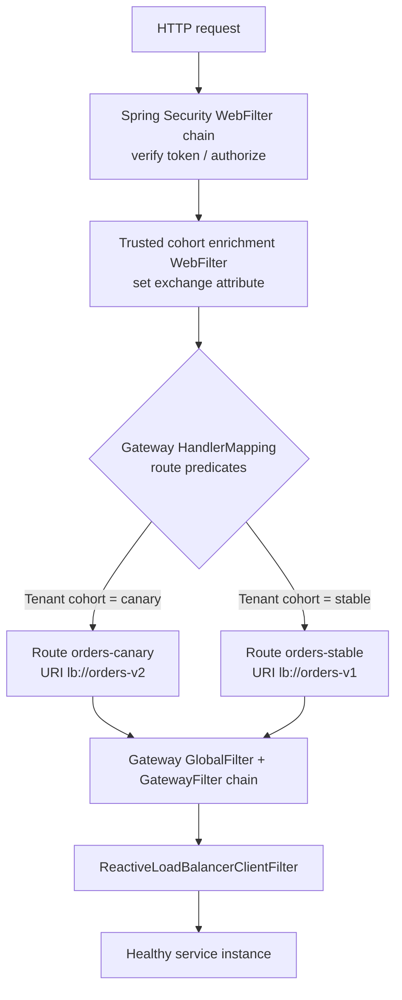
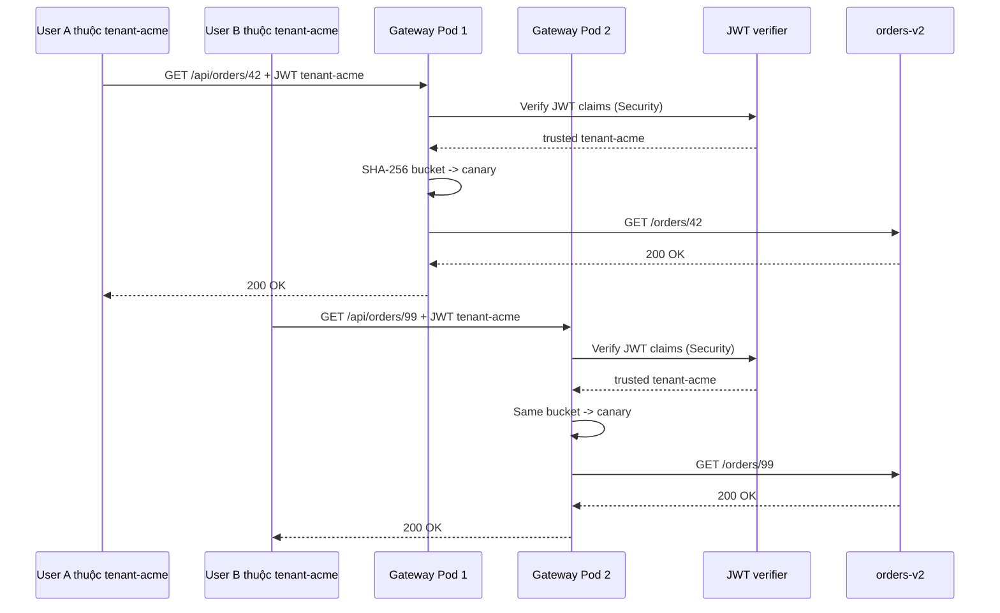
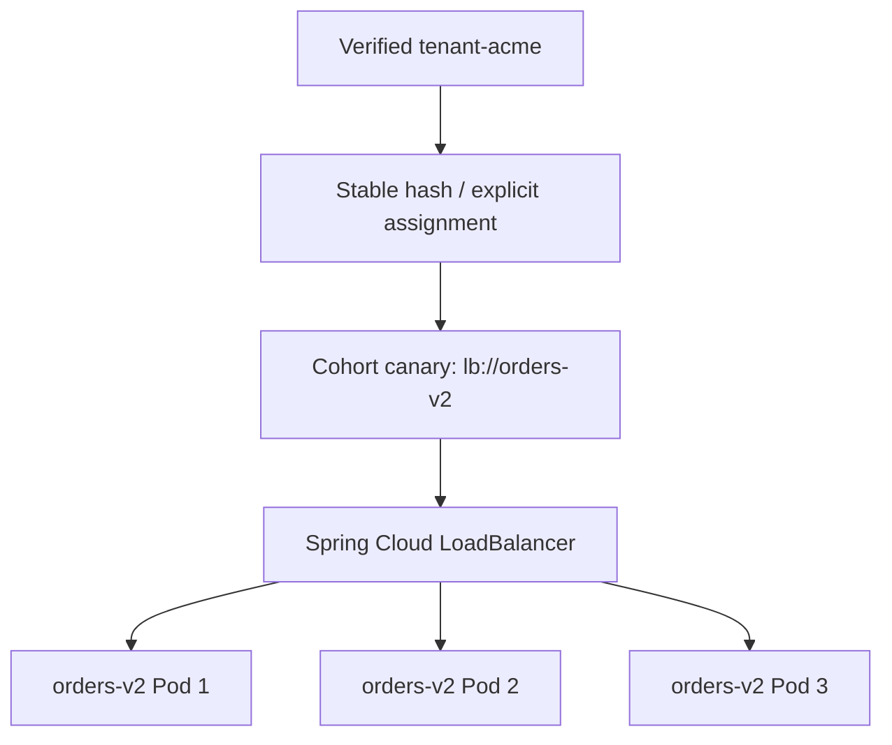
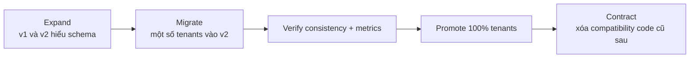

# Định tuyến nhất quán theo nhóm người dùng hoặc khách hàng

Giả sử hệ thống thương mại có hai phiên bản backend cho API đặt hàng: **`orders-v1`** ổn định và **`orders-v2`** đang thử nghiệm. Đội vận hành muốn cho 10% khách hàng dùng v2, 90% dùng v1, nhưng **một khách hàng phải đi cùng một phiên bản trong toàn bộ phiên làm việc**, kể cả khi gửi nhiều request, đổi trình duyệt hoặc request đi qua các Gateway pods khác nhau. Nếu một tenant lúc ghi đơn hàng vào v2, lúc đọc lại ở v1, dữ liệu hoặc contract có thể không nhất quán.

Đây là bài toán **định tuyến nhất quán theo nhóm người dùng hoặc khách hàng** (*stable cohort routing*, *tenant-aware routing*, *deterministic traffic split*). Nó khác **chia tải ngẫu nhiên theo tỷ lệ request**, và cũng khác **sticky session tới một backend instance**.

Trong chương **Mẫu định tuyến** của module **SPRING_CLOUD_GATEWAY**, bài học kết hợp route predicates, filter chain, rewrite path/header, khám phá dịch vụ, JWT/OAuth2, Redis rate limiting, circuit breaker, retry, TLS và observability để triển khai định tuyến ổn định, công bằng, kiểm soát được rollout và rollback.

**Kết quả học tập:**

1. Phân biệt **sticky theo user/tenant**, **chia tỷ trọng `Weight`** và **sticky theo service instance**.
2. Chọn một **identity tin cậy** để định tuyến: verified tenant claim, subject, entitlement hoặc signed assignment.
3. Tính một cohort bằng **stable hash** với policy ID không thay đổi giữa Gateway replicas.
4. Sử dụng `WebFilter` chạy sau Spring Security để gắn cohort vào `ServerWebExchange` trước route matching.
5. Tạo custom `RoutePredicateFactory` đồng bộ, khai báo routes stable/canary theo nhóm.
6. Mở rộng rollout 1% → 5% → 10% → 25% → 100% mà **không đảo nhóm cũ** ngoài chủ đích.
7. Phòng chống giả mạo `X-Tenant-ID`, cookie/headers tự chọn, token hợp lệ nhưng không thuộc tenant.
8. Kiểm thử thống nhất giữa nhiều người dùng, thiết bị, Gateway pods, backend instances và phiên bản policy.
9. Theo dõi traffic, error budget, rate limit, breaker và số tenant được gán mà không làm lộ PII trong metric labels.
10. Viết runbook rollback khi một nhóm khách hàng nhận sai phiên bản hoặc xảy ra config drift.

> **Phạm vi:** Ví dụ sử dụng **Spring Cloud Gateway Server WebFlux 5.x** và Spring Security reactive resource server. Cấu hình routes theo `spring.cloud.gateway.server.webflux.routes`. Với WebFlux 4.3.x, prefix routes thường là `spring.cloud.gateway.routes`; với Gateway Server Web MVC, API/ordering khác và cần một thiết kế riêng. Một số snippet là **mẫu giảng dạy**, cần tích hợp/kiểm thử với BOM Spring Boot–Spring Cloud và identity contract của dự án trước khi triển khai thật.

## 1. Tình huống: vì sao chia 90/10 request chưa đủ?

Khách hàng `tenant-acme` gọi một workflow:

```text
POST /api/orders            -> tạo đơn trên orders-v2
GET  /api/orders/123        -> muốn đọc đơn trên orders-v2
PUT  /api/orders/123/status -> thay trạng thái trên orders-v2
```

Nếu Gateway quyết định phiên bản bằng xác suất **mỗi request**:

```text
POST -> v2
GET  -> v1
PUT  -> v2
```

Đây có thể là lỗi nghiêm trọng nếu v1/v2 khác cấu trúc response, lưu dữ liệu khác nơi hoặc chưa tương thích đầy đủ. Ngược lại, nếu Gateway gán **tenant-acme** vào một cohort ổn định:

```text
tenant-acme -> canary -> orders-v2
tenant-beta -> stable -> orders-v1
tenant-gamma -> stable -> orders-v1
```

thì mọi request thuộc cùng tenant có thể được phục vụ nhất quán bất kể đi qua Gateway pod nào.

**Không nhất thiết mọi sản phẩm cần sticky cohort.** Nếu v1/v2 đã backward-compatible, stateless và cùng backend data store, chia request ngẫu nhiên có thể đủ để kiểm tra hiệu năng. Sticky cohort cần khi muốn **gắn nhất quán trải nghiệm, tenant migration, feature enablement hoặc điều tra lỗi theo nhóm**.

## 2. Định nghĩa ba kiểu “nhất quán” dễ bị nhầm

| Kiểu | Khóa/đối tượng ổn định | Điểm đến | Dùng khi |
| --- | --- | --- | --- |
| **Stable user cohort** | User ID đã xác thực | v1 hoặc v2 cho một user | A/B UX, tính năng cá nhân |
| **Stable tenant cohort** | Tenant/customer ID đã xác thực | v1 hoặc v2 cho **toàn khách hàng** | B2B SaaS, schema/logic migration |
| **Sticky backend instance** | Client/session ID hoặc instance cookie | Một instance trong một service | Stateful session tạm thời, cache affinity |
| **Weighted random split** | Không bảo đảm key ổn định | 80% requests vào v1, 20% vào v2 | Test stateless backend tương thích |
| **Geographic/zone routing** | Vùng mạng/tenant residency | Cluster/vùng đã phê duyệt | Latency và data residency |
| **Explicit allowlist** | ID có trong danh sách cho phép | Beta backend cụ thể | Khách hàng thử nghiệm ký hợp đồng |

**Tenant cohort không phải authorization.** Việc route một request sang `orders-v2` không có nghĩa user được phép truy cập đơn hàng của tenant khác. Gateway và backend vẫn phải kiểm chứng JWT claims, roles/scopes và quyền trên resource.

## 3. Vị trí ra quyết định trong Spring Cloud Gateway

Theo kiến trúc Server WebFlux, Spring Security chạy trong **WebFilter chain**; Gateway sử dụng `HandlerMapping` để tìm route phù hợp, rồi sau khi route match, `FilteringWebHandler` thực hiện `GlobalFilter` và `GatewayFilter`.



**Điểm kỹ thuật rất quan trọng:**

- `RoutePredicateFactory.apply(...)` trả về một `Predicate<ServerWebExchange>` **đồng bộ** để Gateway kiểm tra route.
- `exchange.getPrincipal()` trả về `Mono<Principal>` **reactive**; không được gọi `block()` trong route predicate trên event loop.
- `GlobalFilter` chạy **sau khi route đã được chọn**, vì vậy một GlobalFilter thông thường **quá muộn** để quyết định bản thân route đó.
- Nếu cần route theo JWT claims, có thể trích xuất **sau khi Spring Security đã xác thực** bằng một `WebFilter` phù hợp **trước HandlerMapping**, lưu giá trị tin cậy vào `exchange.getAttributes()`, rồi custom route predicate đọc attribute đó.
- Thứ tự giữa Spring Security và custom WebFilter phải được **kiểm tra bằng integration test**, không đoán từ một con số `@Order`.

**Không viết custom route predicate kiểu `exchange.getPrincipal().block()`.** Nó có thể block Netty event loop, tạo deadlock hoặc lỗi reactive subscription và làm Gateway kém an toàn trước tải lớn.

## 4. `Weight` predicate giải quyết bài toán gì?

Gateway WebFlux có built-in `Weight` route predicate với hai tham số: `group` và `weight`. Ví dụ chia khoảng **90% requests** vào v1 và **10% requests** vào v2:

```yaml
spring:
  cloud:
    gateway:
      server:
        webflux:
          routes:
            - id: orders-weighted-stable
              uri: lb://orders-v1
              predicates:
                - Path=/api/orders/**
                - Method=GET
                - Weight=orders-rollout, 90
              filters:
                - StripPrefix=1

            - id: orders-weighted-canary
              uri: lb://orders-v2
              predicates:
                - Path=/api/orders/**
                - Method=GET
                - Weight=orders-rollout, 10
              filters:
                - StripPrefix=1
```

Các route thuộc cùng `Weight` group được phân phối request theo tỷ trọng tương đối. Với `90` và `10`, tỷ lệ dài hạn xấp xỉ **90% và 10%** khi tập routes/predicates phù hợp.

**`Weight` không hứa hẹn cùng user/tenant luôn vào cùng backend version.** Một tenant gửi 100 requests có thể nhận cả v1 lẫn v2. Đây là **lựa chọn traffic split**, không phải stable cohort assignment.

### Khi dùng `Weight` là hợp lý?

- Hai backend revisions cùng schema và contract.
- Không giữ session/state riêng theo revision.
- Dữ liệu cùng source hoặc đã tương thích đọc/ghi.
- Mục tiêu là canary performance/errors theo **requests**, không cần per-tenant stickiness.
- Có cơ chế rollback và filter policies nhất quán.

### Khi không dùng `Weight` đơn độc?

- Tenant migrations giữa data partitions.
- Hai versions có hành vi ghi dữ liệu khác nhau.
- Workflow đa bước bắt buộc bám một phiên bản.
- Beta chỉ dành cho khách hàng cụ thể.
- A/B test cần một người dùng giữ cùng variant để dữ liệu đo lường có ý nghĩa.

## 5. Built-in `Cookie` và `Header` có dùng để sticky được không?

Gateway có route predicates:

- `Cookie=name, regexp`: khớp cookie **nội dung client gửi**.
- `Header=name, regexp`: khớp header **nội dung client gửi**.
- `Host`, `Path`, `Method`: xác định request context; có thể kết hợp bằng logical AND.

Ví dụ phân luồng bằng header:

```yaml
spring:
  cloud:
    gateway:
      server:
        webflux:
          routes:
            - id: beta-header-demo
              uri: lb://orders-v2
              predicates:
                - Path=/api/orders/**
                - Header=X-Cohort, beta
```

**Đây chỉ là demo matching, không phải chính sách trusted cohort.** Client có thể tự gửi `X-Cohort: beta` hoặc đặt cookie tùy ý. Regex predicate **không xác minh chữ ký, membership, quyền truy cập hay quota**. Nếu tin raw header/cookie, người dùng có thể tự chọn tenant/variant không được phép.

Một thiết kế an toàn hơn:

1. Gateway loại bỏ hoặc bỏ qua client-supplied internal routing headers.
2. Spring Security xác thực token/session.
3. Trusted WebFilter hoặc sidecar identity layer xác định cohort từ **claims đã verify**.
4. Gateway route predicate đọc **exchange attribute server-side** hoặc một signed/validated ticket đã được kiểm chứng.
5. Nếu cần header tới backend, Gateway **ghi đè** giá trị nội bộ sau validation, không chuyển tiếp header client nguyên trạng.

**Không tự coi cookie “có tên đặc biệt” là signed cookie.** Cần HMAC/signature verification, expiry, tenant binding và key rotation nếu cookie tham gia quyết định bảo mật.

## 6. Chọn khóa ổn định: subject, tenant hay tài khoản?

Việc chọn identity quyết định hành vi sticky:

| Identity | Ổn định theo | Ưu điểm | Rủi ro / điều kiện |
| --- | --- | --- | --- |
| JWT `sub` | Một user identity | Hợp UX A/B theo user | Một tenant nhiều users sẽ bị chia v1/v2 |
| Verified `tenant_id` | Một tenant/customer | Workflow và dữ liệu tenant nhất quán | Phải kiểm tenant membership |
| OAuth2 client ID | Một ứng dụng gọi API | Hợp B2B machine-to-machine | Một app có thể gọi nhiều tenants |
| Entitlement tier | Gold/Beta/Standard | Chia theo hợp đồng | Mọi tenant cùng tier có thể quá lớn |
| Signed rollout ticket | Một session/experiment | Điều khiển assignment có thời hạn | Phải ký, ràng buộc identity và chống replay |
| Trusted device ID | Một thiết bị | Hợp trải nghiệm thiết bị | Xoá cookie/đổi thiết bị làm đổi nhóm |
| Source IP | Một network address | Dễ lấy ở edge | NAT, proxy, mobile IP, spoofed forwarded headers |

**Với B2B SaaS có giao dịch theo tenant**, mặc định hợp lý là **verified tenant ID**. Với một tính năng thuần giao diện độc lập theo người dùng, **verified subject** có thể phù hợp hơn.

### Multi-tenant authorization phải được giữ nguyên

Một JWT có thể chứa `tenant_id` và `sub`; nhưng membership có thể thay đổi giữa lúc token phát hành và lúc request. Backend vẫn cần kiểm tra resource ownership. Nếu request mang `/tenants/{tenantId}/orders`, đối chiếu path tenant với tenant claim đã xác thực, không coi cohort routing là kiểm tra quyền.

## 7. Công thức stable cohort bằng hashing

Ta muốn chia các **tenant IDs** vào 10.000 buckets ổn định, từ `0` tới `9999`. Định nghĩa:

\[
b(t)=
\operatorname{U64}\big(\operatorname{SHA256}(p \;||\; ":" \;||\; t)[0:8]\big)
\bmod 10000
\]

Trong đó:

- `t`: verified tenant ID theo canonical form.
- `p`: **cohort policy ID** cố định, ví dụ `orders-cohort-v1`.
- `SHA256`: digest từ UTF-8 bytes.
- `U64`: diễn giải 8 byte đầu như unsigned 64-bit big-endian.
- `b(t)`: bucket trong `0..9999`.

Với rollout 10%:

\[
\operatorname{cohort}(t)=
\begin{cases}
\text{canary}, & b(t)<1000\\
\text{stable}, & b(t)\ge1000
\end{cases}
\]

Cùng `tenant_id`, `policy ID`, canonical encoding và threshold cho cùng kết quả trên mọi Gateway pods.

### Ví dụ minh họa bucket

| Tenant | Bucket giả định | Threshold = 1.000 (10%) | Kết quả |
| --- | ---: | ---: | --- |
| `tenant-acme` | 205 | 1.000 | canary |
| `tenant-beta` | 6.432 | 1.000 | stable |
| `tenant-gamma` | 985 | 1.000 | canary |
| `tenant-delta` | 9.118 | 1.000 | stable |

**Các giá trị bucket trong bảng là giả định để giải thích**, không phải output đã tính cho các tên tenant đó. Trong test thật, dùng **golden vectors** từ cùng hàm SHA-256 và so kết quả across JVMs/services.

**Bucket 10% là khoảng 10% tenant IDs**, không bảo đảm 10% traffic. Một tenant lớn có thể tạo 50% tổng requests; nếu tenant đó vào canary, lượng traffic canary có thể vượt dự kiến rất nhiều.

## 8. Tại sao không dùng `Math.random()`, `hashCode()` hay sticky IP?

### `Math.random()`

Nếu mỗi request tự lấy random, cùng tenant có thể đảo phiên bản liên tục. Phù hợp cho `Weight`-style traffic split, **không** phù hợp cho sticky cohort.

### `String.hashCode()`

Java `String.hashCode()` thực tế có kết quả xác định trên cùng chuỗi, nhưng không phải một chuẩn hash liên dịch vụ để chia experiment. Nó dễ tạo pattern theo dữ liệu đầu vào, collision và khó phối hợp với SDK ngôn ngữ khác. Chọn hash công khai có quy tắc encoding cố định, ví dụ SHA-256, giúp dễ có test vectors.

### `hashCode()` của object

Không dùng `Object.hashCode()` của object đại diện tenant hoặc đối tượng runtime; behavior có thể phụ thuộc implementation/instance và không đủ ổn định across JVMs.

### IP affinity

IP không định danh một khách hàng: NAT có thể đặt nhiều tenants chung IP, mobile client thay IP, còn `X-Forwarded-For` có thể bị giả mạo nếu proxy trust chain sai. Chỉ dùng IP cho policy có semantics network-level rõ và đã cấu hình trusted proxies.

### Hash không bảo mật authorization

Dù SHA-256 rất khó đảo ở tình huống tổng quát, bucket assignment **không phải chữ ký hoặc quyền**. Người dùng có thể gửi nhiều identities giả nếu identity source không được xác thực. Cần xác thực **trước**, sau đó mới hash.

## 9. Cố định policy ID, canonicalization và threshold

Một thuật toán tốt vẫn tạo config drift nếu Gateway pods dùng policy khác nhau.

**Các bất biến cần duy trì:**

1. Tất cả pods dùng cùng tên claim `tenant_id` và cùng identity normalization.
2. Cùng `policy ID` (`orders-cohort-v1`).
3. Cùng SHA-256/UTF-8/unsigned 64-bit/big-endian/modulo 10.000.
4. Cùng threshold trong cùng rollout revision.
5. Cùng mapping `canary -> lb://orders-v2`, `stable -> lb://orders-v1`.
6. Cùng allowlist/override policy nếu có.
7. Không dùng timestamp, random salt hay pod name trong input hash.

**Canonical tenant ID** nên được cấp bởi hệ thống định danh, ví dụ UUID/string ID duy nhất. Không tự lowercase email, trim tự do hay đổi Unicode normalization giữa microservices nếu có thể làm **gộp nhầm các tenants khác nhau**. Nếu phải chuẩn hóa, quy tắc phải được quản lý và test như một phần contract.

**Policy ID không phải secret** trong trường hợp hash để phân nhóm thống kê; tuy nhiên vẫn phải quản trị để tránh đổi ngẫu nhiên. Nếu assignment cần chống khả năng client dò cohort, có thể dùng HMAC với secret và quy trình rotation, nhưng không dùng HMAC thay auth.

## 10. Spring Security xác thực JWT trước khi chọn cohort

Trên WebFlux, Spring Security resource server có thể xác minh bearer token và cung cấp `JwtAuthenticationToken`. Ví dụ cấu hình **phác thảo một API chain bắt buộc authentication**:

```java
package example.gateway.cohort;

import org.springframework.context.annotation.Bean;
import org.springframework.context.annotation.Configuration;
import org.springframework.security.config.annotation.web.reactive.EnableWebFluxSecurity;
import org.springframework.security.config.web.server.ServerHttpSecurity;
import org.springframework.security.web.server.SecurityWebFilterChain;
import org.springframework.security.web.server.util.matcher.PathPatternParserServerWebExchangeMatcher;

@Configuration
@EnableWebFluxSecurity
public class ApiSecurityConfiguration {

    @Bean
    SecurityWebFilterChain ordersSecurity(ServerHttpSecurity http) {
        return http
            .securityMatcher(
                new PathPatternParserServerWebExchangeMatcher(
                    "/api/orders/**"))
            .authorizeExchange(exchanges ->
                exchanges.anyExchange().authenticated())
            .oauth2ResourceServer(oauth2 -> oauth2.jwt(
                org.springframework.security.config.Customizer.withDefaults()))
            .build();
    }
}
```

**Đây là cấu hình trích đoạn để giải thích route bảo vệ**, không phải cấu hình toàn bộ hệ thống. Nếu có nhiều `SecurityWebFilterChain`, phải cấu hình `@Order` và fallback chain để các endpoints khác cũng được bảo vệ phù hợp. Các import/DSL có thể thay đổi theo Spring Security major version; dự án cần test với BOM thực tế.

**Xác thực và cấp quyền khác nhau:** `authenticated()` chỉ yêu cầu token hợp lệ. Với lệnh ghi hoặc dữ liệu tenant nhạy cảm, phải yêu cầu scopes/roles và kiểm chứng tenant ownership. Không cho việc được gán `canary` thay thế authorization.

## 11. Tại sao không đặt cohort logic trong một GlobalFilter?

Xem trình tự chính xác:

```text
HTTP -> Security WebFilters -> HandlerMapping chooses Route
     -> FilteringWebHandler creates GlobalFilters + GatewayFilters
     -> ReactiveLoadBalancerClientFilter -> HTTP client
```

Nếu một custom `GlobalFilter` tính `tenant-cohort=canary`, route `orders-v1`/`orders-v2` đã được chọn **trước** khi GlobalFilter chạy, nên việc thêm attribute ở đó thường **không thể ảnh hưởng route selection hiện tại**.

Một custom `GatewayFilter` cũng chạy sau route matching. Đó là vị trí phù hợp để:

- Thêm header backend sau xác thực.
- Ghi metric cho route đã chọn.
- Áp Retry, CircuitBreaker, RedisRateLimiter và rewrite.
- Kiểm tra policy ở bước xử lý sau match.

Nó **không phải vị trí đầu tiên** để quyết định *route candidate nào được match* bằng `RoutePredicateFactory`.

**Mẫu phù hợp cho bài này:** `WebFilter` sau Security làm enrichment; `RoutePredicateFactory` đồng bộ đọc attribute. Đây là một lựa chọn; hệ thống lớn có thể dùng control plane/edge mesh có policy engine riêng hoặc custom `ReactiveLoadBalancer` được kiểm thử.

## 12. WebFilter sau xác thực: đặt trusted cohort attribute

Ví dụ một WebFilter chỉ tính cohort cho đường dẫn `/api/orders/**`, dựa trên **claim đã được Spring Security xác minh**:

```java
package example.gateway.cohort;

import java.util.Optional;
import org.springframework.core.annotation.Order;
import org.springframework.http.HttpStatus;
import org.springframework.security.oauth2.server.resource.authentication.JwtAuthenticationToken;
import org.springframework.stereotype.Component;
import org.springframework.web.server.ServerWebExchange;
import org.springframework.web.server.WebFilter;
import org.springframework.web.server.WebFilterChain;
import reactor.core.publisher.Mono;

@Component
@Order(0) // Kiểm tra chắc chắn chạy SAU Security WebFilter chain.
public final class TenantCohortWebFilter implements WebFilter {

    public static final String ATTR = "trusted.tenant.cohort";
    private final CohortDecider decider;

    public TenantCohortWebFilter(CohortDecider decider) {
        this.decider = decider;
    }

    @Override
    public Mono<Void> filter(ServerWebExchange exchange,
                             WebFilterChain chain) {
        String path = exchange.getRequest().getPath().value();
        if (!path.startsWith("/api/orders/")) {
            return chain.filter(exchange);
        }

        return exchange.getPrincipal()
            .ofType(JwtAuthenticationToken.class)
            .flatMap(jwt -> Mono.justOrEmpty(
                jwt.getToken().getClaimAsString("tenant_id")))
            .filter(tenant -> !tenant.isBlank())
            .map(Optional::of)
            .defaultIfEmpty(Optional.empty())
            .flatMap(tenant -> {
                if (tenant.isEmpty()) {
                    // Route yêu cầu verified tenant; fail closed.
                    exchange.getResponse()
                        .setStatusCode(HttpStatus.FORBIDDEN);
                    return exchange.getResponse().setComplete();
                }
                exchange.getAttributes()
                    .put(ATTR, decider.routeFor(tenant.get()));
                return chain.filter(exchange);
            });
    }
}
```

### Phân tích điểm an toàn

- `exchange.getPrincipal()` được dùng theo cách **reactive**, không gọi `block()`.
- `JwtAuthenticationToken` được Spring Security tạo sau khi xác minh JWT signature/issuer/audience theo cấu hình resource server.
- Claim `tenant_id` phải do **issuer đáng tin cậy** cấp và phù hợp với scope/membership; đừng chỉ tin tên claim nếu issuer không bảo đảm semantics.
- `map(Optional::of).defaultIfEmpty(Optional.empty())` bảo đảm chain chỉ đi qua một lần khi không có principal/claim.
- Nếu route yêu cầu tenant mà thiếu trusted claim, trả **403** có chủ đích; Security chain vẫn chịu trách nhiệm trả **401** khi chưa xác thực.
- Attribute tồn tại **trong request exchange**, không do client gửi và không bị mạo danh bằng `X-Tenant` raw.
- Đặt `@Order(0)` là minh họa; Spring Security WebFilterChainProxy thường có độ ưu tiên cao hơn, nhưng phải test **thứ tự thực tế**, nhất là nếu có custom WebFilters khác.
- Nếu chỉ xử lý `/api/orders/**`, tránh làm chậm các route khác; đừng gọi mạng/DB đồng bộ trong filter này.

**Quan trọng:** Không dùng `switchIfEmpty(chain.filter(exchange))` sau một `Mono<Void>` do `flatMap` trả về: `Mono<Void>` hoàn tất không phát giá trị và có thể kích hoạt nhánh fallback, dẫn đến thực thi chain **hai lần**. Mẫu `Optional` ở trên tránh lỗi điều khiển flow đó.

## 13. Thuật toán Java: quyết định cohort ổn định

Một component stateless nhận verified tenant ID và trả `stable` hoặc `canary`:

```java
package example.gateway.cohort;

import java.nio.ByteBuffer;
import java.nio.charset.StandardCharsets;
import java.security.MessageDigest;
import java.security.NoSuchAlgorithmException;

import org.springframework.beans.factory.annotation.Value;
import org.springframework.stereotype.Component;

@Component
public final class CohortDecider {

    private final String policyId;
    private final int canaryBasisPoints;

    public CohortDecider(
            @Value("${routing.orders.policy-id:orders-cohort-v1}")
            String policyId,
            @Value("${routing.orders.canary-bps:1000}")
            int canaryBasisPoints) {

        if (canaryBasisPoints < 0 || canaryBasisPoints > 10000) {
            throw new IllegalArgumentException(
                "canary-bps must be within [0, 10000]");
        }
        if (policyId == null || policyId.isBlank()) {
            throw new IllegalArgumentException("policy-id required");
        }
        this.policyId = policyId;
        this.canaryBasisPoints = canaryBasisPoints;
    }

    public String routeFor(String verifiedTenantId) {
        if (verifiedTenantId == null || verifiedTenantId.isBlank()) {
            throw new IllegalArgumentException(
                "Verified tenant id required");
        }
        return bucketFor(verifiedTenantId) < canaryBasisPoints
            ? "canary" : "stable";
    }

    public int bucketFor(String verifiedTenantId) {
        // Stable across JVM pods: UTF-8 + SHA-256 + first 8 bytes.
        String input = policyId + ":" + verifiedTenantId;
        try {
            MessageDigest sha = MessageDigest.getInstance("SHA-256");
            byte[] digest = sha.digest(
                input.getBytes(StandardCharsets.UTF_8));
            long first64 = ByteBuffer.wrap(digest, 0, 8).getLong();
            return (int) Long.remainderUnsigned(first64, 10_000L);
        } catch (NoSuchAlgorithmException e) {
            throw new IllegalStateException(
                "SHA-256 unavailable", e);
        }
    }
}
```

**Tính chất:**

- Cùng input và policy ID → cùng bucket trên các JVM/instances.
- `Long.remainderUnsigned` tránh lỗi với signed long âm khi lấy modulo.
- Threshold 0 → không tenant nào vào canary; 10.000 → mọi tenant vào canary.
- Tăng threshold nhưng giữ cùng `policyId` tạo rollout **monotonic**: tenant đã được gán canary không bị đảo về stable chỉ vì tăng phần trăm.
- Một request có một kết quả quyết định duy nhất; không dùng random mỗi lần.

**Điểm phải vận hành cẩn thận:** Component sử dụng `@Value` khi tạo bean; sửa file config bên ngoài không tự động đổi bean/route policy cho JVM đang chạy. Cần rolling config revision, controlled refresh có test hoặc một policy store có version riêng. Đừng thay `policyId` từ `orders-cohort-v1` thành `orders-cohort-v2` giữa rollout nếu không chủ ý **xáo trộn phân nhóm**.

## 14. Custom RoutePredicateFactory đọc attribute tin cậy

Spring Cloud Gateway Server WebFlux hỗ trợ custom route predicate bằng `AbstractRoutePredicateFactory`.

```java
package example.gateway.cohort;

import java.util.List;
import java.util.Objects;
import java.util.function.Predicate;

import org.springframework.cloud.gateway.handler.predicate.AbstractRoutePredicateFactory;
import org.springframework.stereotype.Component;
import org.springframework.web.server.ServerWebExchange;

@Component
public final class TenantCohortRoutePredicateFactory
    extends AbstractRoutePredicateFactory<
        TenantCohortRoutePredicateFactory.Config> {

    public TenantCohortRoutePredicateFactory() {
        super(Config.class);
    }

    @Override
    public List<String> shortcutFieldOrder() {
        return List.of("value");
    }

    @Override
    public Predicate<ServerWebExchange> apply(Config config) {
        String expected = Objects.requireNonNull(
            config.getValue(), "cohort value required");
        if (!expected.equals("stable") &&
            !expected.equals("canary")) {
            throw new IllegalArgumentException("Unsupported cohort");
        }

        // Route matching is synchronous; no network I/O or block().
        return exchange -> expected.equals(
            exchange.getAttribute(TenantCohortWebFilter.ATTR));
    }

    public static final class Config {
        private String value;

        public String getValue() {
            return value;
        }

        public void setValue(String value) {
            this.value = value;
        }
    }
}
```

Tên lớp kết thúc bằng `RoutePredicateFactory` nên Spring Cloud Gateway nhận tên cấu hình **`TenantCohort`** (convention của factory). `shortcutFieldOrder()` cho phép viết `TenantCohort=canary`.

**Không đặt logic xác thực JWT trong `Predicate.apply`**; việc xác thực/tra cứu principal là reactive, còn predicate là sync. Predicate chỉ đọc một **attribute đã được tin cậy**. Khi không có attribute, cả predicates stable/canary đều không match; với route được bảo vệ, Security/WebFilter phải xử lý 401/403 đúng trước đó.

## 15. Cấu hình hai routes theo cohort (WebFlux 5.x)

```yaml
routing:
  orders:
    policy-id: orders-cohort-v1
    canary-bps: 1000  # 10% của không gian buckets

spring:
  cloud:
    gateway:
      server:
        webflux:
          routes:
            - id: orders-canary
              order: -20
              uri: lb://orders-v2
              predicates:
                - Path=/api/orders/**
                - Method=GET
                - TenantCohort=canary
              filters:
                - StripPrefix=1

            - id: orders-stable
              order: -10
              uri: lb://orders-v1
              predicates:
                - Path=/api/orders/**
                - Method=GET
                - TenantCohort=stable
              filters:
                - StripPrefix=1
```

Đường đi:

```text
GET /api/orders/42
  -> Spring Security verifies JWT
  -> TenantCohortWebFilter reads verified tenant_id
  -> CohortDecider hashes tenant_id
  -> exchange.attr "trusted.tenant.cohort" = stable/canary
  -> HandlerMapping evaluates Path + Method + TenantCohort
  -> matching route orders-stable / orders-canary
  -> StripPrefix=1
  -> lb://orders-v1 or lb://orders-v2
  -> one service instance chosen by LoadBalancer
```

**Chú ý:**

- `Path`, `Method` và `TenantCohort` trên một route đều phải match.
- `order: -20` và `order: -10` làm thứ tự tường minh, nhưng predicates **loại trừ nhau** nên không phụ thuộc vào order để sửa một xung đột logic.
- Không tạo một route `Path=/api/orders/**` không có cohort predicate ở ưu tiên cao hơn; nó có thể “nuốt” toàn bộ requests trước hai routes.
- `orders-v1` và `orders-v2` cần có healthy ServiceInstances; thiếu v2 không có nghĩa sẽ **tự quay lại v1**.
- Nếu muốn POST/PUT cùng cohort, cần khai báo `Method=GET,POST,PUT` hoặc route riêng, nhưng **phải** kiểm tra idempotency, Authorization và schema compatibility trước khi cho phép writes ở v2.
- `StripPrefix=1` chuyển `/api/orders/42` thành `/orders/42` ở upstream; cả backend versions phải hiểu cùng contract hoặc có rewrite riêng đã kiểm thử.

## 16. Sơ đồ chuỗi cho hai users thuộc cùng tenant



**Đây là sơ đồ logic:** JWT resource server thường xác minh signature bằng JWK đã lấy/cache chứ không gọi IdP qua mạng ở mỗi request. “JWT verifier” biểu diễn quá trình xác minh tại Gateway, không nhất thiết là outbound RPC cho mỗi call.

## 17. Xử lý user không có tenant hợp lệ

Có ba trường hợp khác nhau:

| Request | Giải pháp |
| --- | --- |
| Không có token trên protected API | Spring Security trả `401` |
| Token hợp lệ nhưng không có `tenant_id` bắt buộc | Trả `403` hoặc policy-specific `4xx`; không route tùy tiện |
| Token hợp lệ, có `tenant_id` nhưng user không thuộc tenant yêu cầu | Trả `403` và backend tiếp tục kiểm ownership |
| Public endpoint thật sự anonymous | Thiết kế riêng anonymous routing/key, không lẫn tenant route |
| Cookie bị sửa hoặc header `X-Tenant-ID` tự điền | Bỏ qua hoặc reject; không tin để gán cohort |
| Identity service tạm mất (nếu cần lookup thêm) | Fail policy có kiểm soát, không mặc định allow all |

**Không biến thiếu tenant thành `stable` một cách im lặng trên API cần authorization**. Điều đó có thể biến lỗi identity thành bypass chính sách tenant. Ngược lại, với public static assets, không nên đòi JWT chỉ để gắn cohort.

### Về HTTP response code

Ở ví dụ WebFilter, thiếu verified tenant → 403, không có token đúng ra đã bị Spring Security trả 401 trước. Thực tế, security filters/order có thể làm status khác nếu cấu hình sai; **integration tests phải xác nhận 401/403 chính xác**. Không dựa vào tình cờ route không match rồi nhận 404 như một cơ chế authorization.

## 18. Khách hàng được chỉ định beta bằng allowlist

Không phải mọi rollout dùng tỷ lệ phần trăm. Doanh nghiệp có thể có **5 tenants đã ký beta agreement** mà bạn muốn đưa hẳn tới v2:

```text
Explicit canary tenants:
  tenant-acme
  tenant-rocket

Other tenants:
  Stable hash 5% canary, 95% stable
```

Thứ tự policy:

1. **Deny/disabled list** theo governance/security (nếu có).
2. **Explicit allowlist** được owner approve.
3. **Hash-based percentage** trên những tenants còn lại.
4. Default stable hoặc policy rõ cho những trường hợp đặc biệt.

Pseudocode:

```java
String cohortFor(String verifiedTenantId) {
    if (disabledTenants.contains(verifiedTenantId)) {
        return "stable";
    }
    if (betaTenants.contains(verifiedTenantId)) {
        return "canary";
    }
    return hashDecider.routeFor(verifiedTenantId);
}
```

**Đây là pseudocode**, `disabledTenants` và `betaTenants` phải đến từ config store có audit, TTL/revision và phân quyền. Khi số khách hàng nằm trong allowlist tăng, canary traffic có thể vượt mức `canary-bps`. Cần đo **mức lưu lượng thực**.

**Không để client tự set header `X-Beta: true` để thay allowlist**. Membership phải đến từ entitlement service hoặc JWT claims đã xác thực với issuer đáng tin.

## 19. Rollout 1% → 5% → 10% mà giữ nhóm đã chọn

Với cùng policy ID `orders-cohort-v1`:

| Giai đoạn | `canary-bps` | Khoảng bucket canary | Tính chất |
| --- | ---: | --- | --- |
| Baseline | 0 | Không có | Mọi tenant stable |
| Canary đầu | 100 | `0..99` | Xấp xỉ 1% tenant IDs |
| Mở rộng | 500 | `0..499` | Nhóm 1% cũ vẫn canary |
| Mở rộng | 1.000 | `0..999` | Nhóm 5% cũ vẫn canary |
| Mở rộng | 2.500 | `0..2499` | Xấp xỉ 25% tenants |
| Promote | 10.000 | `0..9999` | Mọi tenant canary/v2 |

**Monotonic rollout** nghĩa là khi **chỉ tăng threshold** và giữ chính sách/hash/identity, tenant đã được gán canary không bị chuyển về stable. Khi **giảm threshold để rollback**, một phần tenants sẽ trở về stable; cần đảm bảo backend v1 đọc dữ liệu do v2 đã ghi trước đó.

### Không đổi seed giữa 5% và 10%

Nếu policy ID đổi từ `orders-cohort-v1` sang `orders-cohort-v2`, toàn bộ buckets có thể thay đổi. Một tenant từng canary có thể về stable; một tenant từng stable có thể vào canary. Do đó phải đặt policy ID trong **versioned configuration** và kiểm tra cùng revision trên mọi Gateway pods.

## 20. 10% tenant không nhất thiết là 10% requests

Giả sử bạn có 1.000 tenants:

- 990 tenants nhỏ, mỗi tenant 1 req/s.
- 10 tenants lớn, mỗi tenant 500 req/s.

Hash 10% tenants ≈ 100 tenants. Nếu phân nhóm có **một tenant lớn**, canary traffic có thể tăng thêm **500 req/s** ngay cả khi canary chỉ chiếm ~10% tenant IDs.

**Không định nghĩa capacity canary chỉ từ số tenants.** Cần đo:

- Number of tenants assigned.
- RPS, 5xx, p95 theo route stable/canary.
- Số requests của nhóm **top tenants** theo dashboard có quyền (không tạo metric label per tenant).
- Backend CPU/DB/pool saturation.
- Retry attempts và breaker OPEN.
- Quota 429 per route/plan class.

### Chia tầng (stratified cohorts) khi tải rất lệch

Có thể chia tenants thành các nhóm kích thước/sử dụng (enterprise, medium, small) và hash **riêng trong từng nhóm**, hoặc pin top enterprise tenants vào allowlist có phê duyệt. Nhưng việc thay **phân tầng** cũng là thay cohort algorithm và cần version/test. Một cách khác là đặt **traffic budget/capacity gate** riêng cho canary, không coi 10% tenant như ngân sách traffic cứng.

**Lưu ý quyền riêng tư:** Không gửi toàn bộ danh sách tenant IDs thô vào Prometheus label. Hashing PII không tự làm nó vô hại; audit/retention vẫn cần áp dụng.


## 21. Cohort ổn định theo version khác sticky theo backend instance

Hai tầng định tuyến:



**Cohort routing** cố định **service version/nhóm backend** theo tenant, nhưng `lb://orders-v2` vẫn có thể chọn **bất cứ healthy instance** thuộc service `orders-v2`. Đây thường là thiết kế mong muốn cho backend stateless có shared data/session store.

**Sticky instance routing** lại cố giữ các requests cùng session trên cùng **instance ID**, ví dụ do session state lưu trong memory. Nó có những nhược điểm:

- Instance bị thay trong rolling update → affinity bị phá.
- HPA scale in/out làm session distribution lệch.
- Pod unhealthy cần failover, không thể giữ cứng vô điều kiện.
- Sticky instance không thay thế shared session state/DB replication.
- Một cookie do client cung cấp cần trust boundary rõ.

Spring Cloud LoadBalancer có các cơ chế **Same Instance Preference**, **Request-based Sticky Session** và **Hint-based LoadBalancing**. Các cơ chế đó hoạt động ở **tầng chọn instance** sau khi Gateway đã chọn route, không phải cơ chế mặc định chọn v1/v2 theo tenant.

## 22. LoadBalancer sticky session và giới hạn hỗ trợ

Spring Cloud Commons mô tả `RequestBasedStickySessionServiceInstanceListSupplier`, có thể ưu tiên instance ID nằm trong một cookie của request, mặc định liên quan tên `sc-lb-instance-id`. Có option để cập nhật cookie nếu instance ban đầu không còn sẵn sàng.

Ví dụ cấu hình tài liệu cho **LoadBalancer WebClient-backed flows**, không được sao chép vô điều kiện vào mọi Netty Gateway path:

```yaml
spring:
  cloud:
    loadbalancer:
      configurations: request-based-sticky-session
      sticky-session:
        add-service-instance-cookie: true
```

**Cần kiểm chứng đúng transport integration**: Tài liệu Spring Cloud LoadBalancer lưu ý tính năng request-based sticky session hiện hỗ trợ các luồng **WebClient-backed load-balancing**; Gateway Server WebFlux thường sử dụng **NettyRoutingFilter + ReactiveLoadBalancerClientFilter**, nên không thể mặc định suy ra nó sẽ duy trì cookie affinity đúng như ví dụ WebClient. Hãy kiểm tra release train và test request path thực.

Đồng thời, cookie `sc-lb-instance-id` nếu tồn tại **không phải bằng chứng quyền truy cập**. Backend vẫn phải xác thực token và resource ownership. Nếu một instance chết, một chiến lược tốt cần **failover** có kiểm soát.

**Ưu tiên kiến trúc:** Dùng **tenant-to-service-version stable hash**, rồi load balance **stateless** trong service version. Chỉ thêm instance affinity khi có một lý do về session/cache và kiểm chứng được hành vi failover.

## 23. Workflow nhiều HTTP methods phải đi cùng cohort

Một doanh nghiệp có thể tạo một đơn ở v2 rồi đọc ở v1 do chỉ route GET có cohort logic, còn POST match một route khác.

Ví dụ:

```text
POST /api/orders       -> orders-v1 (do route POST riêng)
GET  /api/orders/42    -> orders-v2 (do cohort canary)
PATCH /api/orders/42   -> orders-v1 (do fallback route chung)
```

Nếu v1/v2 chưa chia sẻ schema/state nhất quán, hệ thống có thể trả 404 hoặc tính toán sai.

**Thiết kế theo workflow:**

1. Liệt kê tất cả HTTP methods/endpoints liên quan một stateful business operation.
2. Định nghĩa một **routing scope** chung (tenant/customer/user) cho toàn workflow.
3. Gắn cùng verified identity, policy ID và version mapping cho các routes cần đồng bộ.
4. Kiểm tra chuyển tiếp từ API command (POST) sang query (GET) và async callback/webhook.
5. Nếu dùng background jobs/events, đưa một **version/tenant routing metadata** tin cậy vào event workflow hoặc thiết kế service consumer tương thích.
6. Khi client retry, không thay cohort theo random; POST phải có idempotency nếu có side effects.
7. Nếu một action đã commit ở v2, rollback về v1 cần quy tắc đọc/ghi tương thích.

**Không dùng sticky routing để che một database migration chưa hoàn chỉnh.** Nó giảm phạm vi tác động nhưng không giải quyết dual-write, stale events và schema compatibility.

## 24. Expand–migrate–contract cho dữ liệu và API contract

Canary tenant routing thường đi kèm thay đổi backend schema:



**Bước Expand:**

- Backend v1 vẫn đọc được dữ liệu mới ở mức cần thiết.
- Backend v2 đọc được dữ liệu cũ.
- Các fields mới là optional hoặc có default an toàn.
- Schema changes tránh renaming/dropping đột ngột.
- Event consumers chấp nhận cả old/new event versions.

**Bước Migrate:**

- Gắn cohort tenant theo policy stable.
- Thực hiện các migrations cần thiết theo tenant có audit/rollback plan.
- So business invariants, response contract, tỷ lệ lỗi và data quality.
- Với tenants lớn, có thể sử dụng **explicit allowlist** và time window riêng.

**Bước Contract:**

- Chỉ loại bỏ v1 support sau khi tất cả tenants và jobs/consumers đã chuyển.
- Có data reconciliation và disaster recovery.
- Không coi `canary-bps=10000` đồng nghĩa mọi historical data đã được migrate.

**Điểm rollback sống còn:** Nếu v2 ghi dữ liệu v1 không thể đọc, giảm `canary-bps` về 0 có thể **không an toàn**. Đội vận hành phải có kế hoạch restore/read-compatible behavior hoặc roll-forward fix, không tự động chuyển mọi tenant về v1.

## 25. Tenant affinity là vấn đề bảo mật, không phải chỉ trải nghiệm

Một user có JWT được xác minh nhưng có thể thuộc nhiều tenants. Nếu client chọn tenant bằng path/header, phải đối chiếu:

- Token issuer/audience hợp lệ.
- `sub` và roles/scopes cho API cụ thể.
- User có membership với **tenant đang được yêu cầu**.
- Tenant ID từ request path/body/query có khớp tenant context đã được server xác định không.
- Backend có kiểm tra authorization trên resource không.
- Nếu dùng BFF/session, có chống session fixation và CSRF theo contract không.

**Anti-pattern:**

```text
GET /api/orders/42
X-Tenant-ID: tenant-victim
X-Cohort: canary
Authorization: Bearer <valid-user-from-tenant-attacker>
```

Nếu Gateway lấy `X-Tenant-ID` làm hash key mà không xác thực membership, attacker có thể đổi tenant để chọn phiên bản khác, hoặc đánh lừa backend về context.

**Bất biến:** Routing identity đến từ **trusted JWT claims/entitlement**, không phải một trường tùy ý do client ghi. Nếu tenant switching là chức năng hợp lệ, phát hành lại token/authorized context hoặc kiểm membership server-side trước khi gán cohort. Không gửi raw token vào log/metric.

## 26. Nếu cần phiên bản theo signed cookie

Không phải mọi sản phẩm có JWT tenant claim ở gateway. Với public web app/BFF, có thể cấp **assignment cookie có ký**:

```text
assignment payload:
  subject_or_session: opaque-id
  cohort: canary
  policy_id: orders-cohort-v1
  expires_at: 2026-12-31T00:00:00Z

signature:
  HMAC-SHA-256 over canonical payload
```

Luồng chuẩn:

1. Server/BFF tạo assignment theo identity đáng tin.
2. Ký payload bằng key lưu trong secret manager.
3. Gửi cookie với `Secure`, `HttpOnly` (nếu không cần JS), `SameSite` phù hợp.
4. Gateway/BFF xác minh signature, expiry, audience và identity binding trước khi route.
5. Reject cookie bị sửa hoặc đã hết hạn; tạo assignment mới theo policy nếu được phép.
6. Hỗ trợ rotation key có overlap và audit.

**Không dùng built-in `Cookie` predicate một mình** để “xác minh signed cookie”. Predicate chỉ match regex. Việc verify phải diễn ra **trước route selection** trong một trusted WebFilter hoặc identity service. Nếu cookie chứa cohort value nhưng không ký, user có thể tự sửa để vào canary.

## 27. Header propagation, TLS và CORS: cùng một cohort nhưng contract vẫn phải đúng

Một route v2 có thể cần header nghiệp vụ mới, trong khi v1 vẫn dùng header cũ. Hãy xác định:

- `Authorization` được Gateway chuyển tiếp ra sao? Backend có cần token JWT riêng hoặc `TokenRelay` không?
- Có dùng `SetRequestHeader`/`AddRequestHeader` đưa tenant context vào upstream không?
- Mọi request headers kiểu `X-Internal-Tenant` do client gửi có được loại/ghi đè trước khi tin không?
- `Host`, `X-Forwarded-*` và forwarded scheme có trusted proxy policy không?
- `StripPrefix`/`RewritePath` có cùng semantics trên v1/v2 không?
- CORS allowed origins/methods/credentials có đồng bộ giữa versions không?
- Gateway→backend TLS/mTLS có đúng SNI/hostname/truststore cho `orders-v2` không?

Ví dụ cấu hình route-level filter **minh họa**, chỉ thêm header phục vụ điều tra, không dùng header này làm authorization:

```yaml
spring:
  cloud:
    gateway:
      server:
        webflux:
          routes:
            - id: orders-canary
              uri: lb://orders-v2
              predicates:
                - Path=/api/orders/**
                - TenantCohort=canary
              filters:
                - StripPrefix=1
                - SetRequestHeader=X-Backend-Variant, canary
```

**Không cho backend coi `X-Backend-Variant: canary` là bằng chứng user được phép truy cập dữ liệu canary.** Backend phải verify JWT/tenant ownership. Nếu dùng header bảo mật nội bộ, cần strip raw client header, set lại từ trusted data ở Gateway và bảo vệ kênh Gateway→backend (mTLS/network policies), không tin header trên public network.

## 28. RedisRateLimiter và quota theo user/tenant khi route bị chia

Rate limiting theo identity có thể độc lập với cohort routing, nhưng cách namespace keys có thể gây hiệu ứng bất ngờ.

| Chính sách | Điều cần kiểm tra |
| --- | --- |
| 100 requests/s/tenant cho cả v1+v2 | Quota có được dùng chung giữa hai routes không? |
| 10 requests/s/user | KeyResolver dùng verified principal, không phụ thuộc `X-User` |
| Quota riêng canary vì backend v2 còn yếu | Có chính sách explicit và alert 429 không? |
| Redis outage | Fail-open/closed/degraded có hard cap và test? |
| Rollout tăng từ 5% lên 25% | Backend v2 có đủ capacity và Redis QPS không? |
| Retry | Logical request bị charge một hay nhiều token tùy filter ordering? |

**Không mặc định cùng user/tenant sẽ tự chia sẻ một token bucket chỉ vì hai routes đều dùng Redis.** RedisRateLimiter có cách ghép route ID/key và state store theo implementation. Nếu route IDs khác nhau, quota có thể bị **tách bucket**, khiến một khách hàng luân chuyển v1/v2 có nhiều quota hơn dự kiến. Muốn quota chung, dùng policy/limiter được thiết kế cho **capacity group** và kiểm thử backend request count.

**Vấn đề tương tự với custom concurrency limiter:** 20 permits/pod là local JVM cap, không phải global tenant quota. Thêm Gateway pods có thể tăng tổng outbound concurrency; hãy đo backend capacity.

## 29. Retry, CircuitBreaker và fallback phải giữ semantic của cohort

Một request đã được chọn `orders-canary` thông thường nên tiếp tục sử dụng **orders-v2** cho các retry attempts của chính logical request đó. Không nên dùng random v1/v2 mỗi attempt vì dữ liệu có thể khác nhau.

### Khi backend canary trả 503

```text
Tenant-acme -> cohort canary -> orders-v2
  attempt #1 -> 503
  Retry       -> attempt #2 orders-v2 -> 503
  breaker OPEN / fallback 503
```

**Không tự động chuyển Retry attempt #2 sang orders-v1** nếu v1/v2 có state/schema khác nhau. Nếu muốn cross-version fallback, đó phải là **chính sách được phê duyệt** và có contract bảo đảm cùng dữ liệu/side-effect semantics. Có trường hợp fallback về v1 gây đọc dữ liệu cũ hoặc tạo duplicate orders.

### Breaker state là per instance

CircuitBreaker Resilience4j thường có state trong JVM. Hai Gateway pods có thể ở trạng thái OPEN/CLOSED khác nhau dù cùng tenant hash canary. Điều này không làm mất deterministic route assignment nhưng làm **client outcome khác nhau**. Dùng breaker/Retry metrics per pod và theo route.

### Fallback 200 có thể che lỗi

Nếu canary fallback trả HTTP 200 nhưng nội dung thiếu dữ liệu hợp lệ, đừng coi user-facing SLI “thành công” chỉ từ status. Theo dõi fallback indicator, business correctness và error budget.

## 30. Multi-pod, nhiều vùng và config consistency

Một stable hash **chỉ nhất quán khi các Gateway pods dùng cùng policy**:

```text
Gateway Pod A:
  policy_id = orders-cohort-v1
  canary_bps = 1000

Gateway Pod B:
  policy_id = orders-cohort-v1
  canary_bps = 1000

Gateway Pod C:
  policy_id = orders-cohort-v2  <-- drift!
  canary_bps = 1000
```

Pod C có thể gán cùng tenant vào cohort khác. Vì thế, ngoài config hash đã chọn, phải có **deployment configuration revision** và so các effective property values trên từng pod.

**Quy trình rollout an toàn:**

1. Version policy ID/threshold, route IDs và target services trong GitOps/ConfigMap/Config Server.
2. Validate config/hàm hash bằng test vectors **trước** deploy.
3. Có rollback bundle gồm image + route config + cohort policy revision.
4. Triển khai canary pods, so cohort decisions với current pods cho cùng test tenants.
5. Chỉ đổi threshold theo release đã duyệt, tránh mixed policy revision khi chưa có compatibility.
6. Quan sát cohorts/traffic/errors per revision.
7. Xác minh active routes trên **mỗi pod** (read-only Gateway Actuator).
8. Đánh dấu rollout successful khi pods hội tụ hoặc khi mixed-version window là chủ đích có giới hạn.

### `/actuator/gateway/refresh` không phải cluster broadcast

`POST /actuator/gateway/refresh` làm mới route cache trên instance nhận request; nó **không tự đảm bảo** mọi Gateway pods load cùng route definitions. Nếu gọi qua một load-balanced Service, chỉ một pod có thể nhận lời gọi. Cần reconcile/rolling restart hoặc cơ chế phân phối refresh đáng tin. **Refresh cache không sửa source config sai.**

## 31. Đặt ngưỡng rollout theo năng lực và SLO thực

Một backend orders-v2 có thể chỉ có **2 pods**, trong khi v1 có 10 pods. Đặt 10% tenants vào v2 có thể đưa 50% traffic vào v2 nếu khách hàng lớn lọt vào nhóm.

Cần xác định:

- Năng lực backend v2 an toàn theo **requests/s, concurrency và p95**.
- Peak RPS của tenants lớn và traffic mùa vụ.
- Retry amplification và tỷ lệ breaker OPEN/fallback.
- Redis/DB/queue capacity cho v2.
- Max number of tenants và **actual RPS** trong cohort.
- SLO availability/latency của v2 so với v1.
- Stop conditions cho 404/401/429/502/503/504 và data correctness.

**Ví dụ:** orders-v2 an toàn ở 200 backend attempts/s; hiện canary nhận 160 logical req/s, 20% requests retry một lần:

\[
160 \times 1{,}2=192\ \text{attempts/s}.
\]

Canary đã gần capacity 200 attempts/s; đừng tăng threshold từ 10% lên 25% trước khi tăng backend capacity/giảm Retry. **Tỷ lệ tenants không trực tiếp đo RPS**, do đó điều chỉnh bằng số liệu thực, không bằng phần trăm mong muốn.

## 32. Observability: cần thấy phiên bản đích, không cần lộ tenant IDs

Gateway MetricsFilter có meter `spring.cloud.gateway.requests` với các tags thường có `routeId`, `status`, `httpStatusCode`, `httpMethod` và `outcome` khi Actuator được bật. Prometheus/Micrometer thường export Timer count thành `spring_cloud_gateway_requests_seconds_count`.

Với hai routes có IDs riêng:

- `orders-stable` → v1.
- `orders-canary` → v2.

Có thể dùng `routeId` làm chiều cohort **có cardinality thấp**, không cần gắn raw tenant IDs vào labels.

| Chỉ số | Mục tiêu |
| --- | --- |
| RPS theo route stable/canary | Traffic thực của từng cohort |
| 5xx error ratio theo route | Detect backend canary regression |
| 401/403/404 | Detect auth/route mismatch |
| 429 | Detect quota/key resolver regression |
| p95/p99 latency theo route | Detect slow canary |
| Retry attempts/logical request | Detect amplification |
| CircuitBreaker OPEN/fallback | Detect backend v2 degradation |
| LoadBalancer no-instance 503 | Detect target service không Ready |
| Backend DB/cache/CPU/pool pending | Detect saturation |
| Cohort policy revision per pod | Detect hash/config drift |
| Number of tenants assigned | Đánh giá coverage (tổng hợp, không per-ID labels) |

**Không đặt `tenant_id`, `email`, `sub`, raw path hoặc JWT vào metrics label**, vì vừa tạo high-cardinality vừa có nguy cơ rò PII. Khi debug một tenant cụ thể, dùng logs/traces được phân quyền, retention và hashing phù hợp với chính sách dữ liệu.

## 33. PromQL minh họa cho hai cohorts

Các query sau giả định exporter thực tế có series `spring_cloud_gateway_requests_seconds_count` và label `routeId`/`httpStatusCode`. Phải **xem trước `/actuator/prometheus`** để xác nhận names trên phiên bản chạy thật.

RPS của hai route:

```promql
sum by (routeId) (
  rate(spring_cloud_gateway_requests_seconds_count{
    job="gateway-prod",
    routeId=~"orders-stable|orders-canary"
  }[5m])
)
```

5xx RPS theo cohort:

```promql
sum by (routeId) (
  rate(spring_cloud_gateway_requests_seconds_count{
    job="gateway-prod",
    routeId=~"orders-stable|orders-canary",
    httpStatusCode=~"5.."
  }[5m])
)
```

5xx ratio theo cohort, trong trường hợp đã có numerator series:

```promql
sum by (routeId) (
  rate(spring_cloud_gateway_requests_seconds_count{
    job="gateway-prod",
    routeId=~"orders-stable|orders-canary",
    httpStatusCode=~"5.."
  }[5m])
)
/
clamp_min(
  sum by (routeId) (
    rate(spring_cloud_gateway_requests_seconds_count{
      job="gateway-prod",
      routeId=~"orders-stable|orders-canary"
    }[5m])
  ),
  0.000001
)
```

Tỷ lệ RPS canary trên tổng traffic hai routes:

```promql
sum(
  rate(spring_cloud_gateway_requests_seconds_count{
    job="gateway-prod", routeId="orders-canary"
  }[5m])
)
/
clamp_min(
  sum(
    rate(spring_cloud_gateway_requests_seconds_count{
      job="gateway-prod",
      routeId=~"orders-stable|orders-canary"
    }[5m])
  ),
  0.000001
)
```

**Cẩn trọng khi hiểu kết quả:** 10% **tenants** không có nghĩa canary RPS ratio = 10%. Nếu một nhóm nhỏ tenants gửi tải lớn, tỷ lệ traffic có thể chênh rất xa.

**No-data không bằng zero errors:** Nếu không có series numerator 5xx, ratio có thể rỗng; dùng zero-fill có điều kiện khi denominator tồn tại cho dashboard. Nếu metric scrape down, cần alert `up`/missing series riêng. Nếu no-route 404 hoặc Security 401 xảy ra trước Gateway route timer, metrics này có thể **không nhìn thấy**, nên cần HTTP server/ingress metrics bổ sung.

## 34. A/B testing và canary rollout: cùng phân nhóm, khác mục tiêu

Cả hai có thể dùng deterministic cohort hashing, nhưng mục tiêu khác:

| Đặc điểm | A/B experiment | Canary release |
| --- | --- | --- |
| Câu hỏi | Tính năng nào tạo kết quả tốt hơn? | Bản mới có an toàn để deploy rộng không? |
| Unit phân nhóm | User/tenant/session phù hợp giả thuyết | Tenant/service/backend compatibility |
| Phân nhóm | Cần randomization/stickiness và phân tích thống kê | Có thể dùng allowlist hoặc progressive threshold |
| Thành công | Conversion, retention, business KPIs | 5xx, p95, crash, data correctness, security |
| Duration | Có thể kéo dài nhiều tuần | Thường ngắn, tăng dần theo gate |
| Rollback | Dừng experiment, vẫn phải xét side effects | Dừng rollout hoặc restore release/config |
| Rủi ro | Bias/mismatch mẫu đo | Outage, dữ liệu/schema không tương thích |

### Những sai lầm đo lường

- Gán cohort theo tenant nhưng đo conversion theo **user** như các observations độc lập hoàn toàn; users cùng tenant có tương quan, làm sai uncertainty.
- Đổi salt/policy ID giữa experiment khiến user **đổi nhóm**.
- Điều chỉnh threshold và không ghi exposure revision.
- Chỉ đo results của user quay lại, bỏ qua những người gặp 5xx/abandonment.
- Tỷ lệ traffic cohort không bằng tỷ lệ số tenants, gây sai giả định sampling.
- Dùng request-level `Weight` cho thí nghiệm cần user-level exposure ổn định.

Với A/B thật, hãy có **experiment assignment/exposure logging** riêng được phân quyền. Gateway routing chỉ là một phần của hệ thống experiment, không tự giải quyết randomization statistics, attribution và business KPI.

## 35. Unit test xác minh hashing và rollout monotonic

Vì `CohortDecider` không phụ thuộc mạng, unit tests nên chạy rất nhanh:

```java
package example.gateway.cohort;

import org.junit.jupiter.api.Test;
import static org.junit.jupiter.api.Assertions.*;

final class CohortDeciderTest {

    @Test
    void sameTenantAndPolicyAlwaysHaveSameBucket() {
        CohortDecider a = new CohortDecider(
            "orders-cohort-v1", 1000);
        CohortDecider b = new CohortDecider(
            "orders-cohort-v1", 1000);

        assertEquals(
            a.bucketFor("tenant-acme"),
            b.bucketFor("tenant-acme"));
        assertEquals(
            a.routeFor("tenant-acme"),
            b.routeFor("tenant-acme"));
    }

    @Test
    void percentageExpansionIsMonotonic() {
        CohortDecider fivePercent = new CohortDecider(
            "orders-cohort-v1", 500);
        CohortDecider tenPercent = new CohortDecider(
            "orders-cohort-v1", 1000);

        for (int i = 0; i < 10000; i++) {
            String tenant = "tenant-" + i;
            if ("canary".equals(fivePercent.routeFor(tenant))) {
                assertEquals("canary",
                    tenPercent.routeFor(tenant));
            }
        }
    }

    @Test
    void boundaryPercentagesBehaveCorrectly() {
        CohortDecider zero = new CohortDecider(
            "orders-cohort-v1", 0);
        CohortDecider all = new CohortDecider(
            "orders-cohort-v1", 10000);

        assertEquals("stable",
            zero.routeFor("tenant-acme"));
        assertEquals("canary",
            all.routeFor("tenant-acme"));
    }

    @Test
    void invalidThresholdFailsFast() {
        assertThrows(IllegalArgumentException.class,
            () -> new CohortDecider("orders-cohort-v1", -1));
        assertThrows(IllegalArgumentException.class,
            () -> new CohortDecider("orders-cohort-v1", 10001));
    }
}
```

**Nên có thêm golden vectors** cố định đầu ra hash/bucket cho một bộ tenant IDs đã quy định. Chúng đặc biệt cần thiết nếu một control plane viết bằng Go/TypeScript cũng phải tính cohort, vì chỉ test “hai đối tượng Java trả giống nhau” chưa chứng minh **cross-language compatibility**.

**Không kiểm tra** “đúng 1.000/10.000 tenants luôn vào canary”. Hash distribution trên một tập thực có thể chênh thống kê; acceptance cần khoảng sai số hợp lý và tài liệu hóa cách tạo sample.

## 36. Integration test: cùng tenant trên hai JWT và hai Gateway pods

Một integration test mạnh cần **Spring Boot Gateway WebFlux thật**, WebTestClient gửi HTTP vào port thực, backend stubs bằng WireMock và JWTs do **test issuer** ký hợp lệ. Những assertion cần có:

```text
Given:
  Gateway Pods A và B dùng cùng routes+cohort policy revision
  orders-v1 và orders-v2 là 2 WireMock stubs riêng
  JWT(User A) -> tenant-acme
  JWT(User B) -> tenant-acme
  JWT(User C) -> tenant-beta
  Canary threshold = 10% tenant buckets

When:
  User A GET /api/orders/42 qua Gateway A
  User B GET /api/orders/43 qua Gateway B
  User A GET /api/orders/44 qua Gateway B

Then:
  Ba request của tenant-acme đều tới CÙNG backend version
  Không nhất thiết tới cùng backend INSTANCE
  Tất cả requests đều giữ verified tenant isolation
  Không có client-controlled X-Cohort override
  Thay đổi 10% -> 25% với cùng policy ID không đảo tenant cũ
```

### Test JWT identity chứ không mock header

- `mockJwt()` trong Spring Security Test rất hữu ích cho **mock-WebFlux/server-side tests** được cấu hình đúng.
- Nếu test **HTTP socket thật** bằng `WebTestClient.bindToServer()`, cần gửi **JWT thực được test issuer ký** hoặc dùng test auth server; không thể giả định `mockJwt()` của in-memory test tự ký một HTTP bearer token hợp lệ.
- Cần test một JWT không có `tenant_id`; expected `403` theo policy của WebFilter.
- Cần test invalid signature, expired token, sai issuer/audience → Security từ chối.
- Cần test user chỉ có quyền tenant-A nhưng cố truy cập resource tenant-B → `403`/`404` theo security contract; không để hash quyết định thay authorization.
- Gửi `X-Cohort: canary`/`X-Tenant-ID: victim` tự chọn không được đổi route.

### Kiểm tra hiệu lực route

Sử dụng backend request journal để xác minh:

- Đúng số request và đúng path sau `StripPrefix`.
- Stable tenant không đột nhiên sang v2 khi request qua pod khác.
- Canaries đúng `lb://orders-v2`, stable đúng `lb://orders-v1`.
- Header nội bộ được ghi đè/bỏ client spoofed values.
- Khi backend version đích không có instance, Gateway **không lén dùng backend version khác** nếu policy không cho phép.

## 37. Test chính xác route predicate và WebFilter ordering

Trong ví dụ Java, custom `TenantCohortWebFilter` phải chạy **sau Spring Security verification** và **trước Gateway HandlerMapping route selection**. Đây là điều kiện **phải kiểm thử**, không chỉ viết comment `@Order(0)`.

Bộ kiểm thử cần:

1. Test token hợp lệ có `tenant_id` → attribute có giá trị trước predicate.
2. Test token không hợp lệ → Security trả 401, custom cohort logic không gọi backend.
3. Test token hợp lệ thiếu tenant → 403, **không** fallback thành unprotected stable route.
4. Test cùng tenant 100 requests liên tiếp → một cohort.
5. Test đổi Gateway pod → cohort không đổi.
6. Test route overlap order: route không có `TenantCohort` không bắt traffic trước hai routes.
7. Test `/api/orders` **không có dấu /** nếu endpoint này được phép: `Path` matcher và WebFilter path check phải có semantics thống nhất, không bỏ sót root path.
8. Test WebSocket/upgrade hoặc Method=POST nếu workflow yêu cầu; không áp GET-only predicate cho những methods khác rồi kỳ vọng sticky.

**Bẫy:** Trong `RoutePredicateFactory`, gọi `exchange.getPrincipal().block()` có thể gây blocking event loop. Trong `WebFilter`, dùng `switchIfEmpty(chain.filter(exchange))` sau `Mono<Void>` có nguy cơ **chạy chain hai lần**. Cần test backend attempt counts để phát hiện.

## 38. Các failure scenarios cần mô phỏng

| Case | Fault injection | Kỳ vọng |
| --- | --- | --- |
| 1 | Backend v2 trả 503 | Chỉ cohorts canary bị ảnh hưởng, breaker/Retry đúng |
| 2 | Backend v2 không có healthy instances | Không auto-route v1 trái policy; 503/fallback có contract |
| 3 | Một Gateway pod dùng policy ID khác | Config drift detected, dừng rollout |
| 4 | Một pod threshold 1000, pod khác 2500 | Consistency gate fail trong phase không cho mixed policies |
| 5 | Redis rate limiter down | Fail policy rõ; không biến tenant routing thành bypass |
| 6 | JWT thiếu tenant | 403, không chọn ngẫu nhiên |
| 7 | Header `X-Tenant` giả mạo | Không thay assignment |
| 8 | Cookie assignment bị sửa | Signature verification reject |
| 9 | User B cùng tenant A trên pod khác | Cùng service version |
| 10 | JWT subject khác nhưng same tenant | Cùng service version |
| 11 | Tenant-A vào canary, query data v1 | Không đọc state sai sau migration |
| 12 | Tăng threshold 5% → 10% | Tenant cũ đã canary không quay stable |
| 13 | Đổi salt/policy ID sai | Golden vectors/rollout gate fail |
| 14 | Lỗi JWK refresh | Security xử lý, không fallback anonymous |
| 15 | TLS handshake fail đến v2 | 502/handshake được phát hiện, không tắt verification |
| 16 | Header rewrite sai chỉ trên v2 | Security/contract test fail |
| 17 | Retry 503 ở v2 | Không gửi attempt sang v1 ngoài policy |
| 18 | Breaker OPEN trên một pod | Metrics theo pod, identity routing vẫn deterministic |
| 19 | Một tenant chiếm 50% traffic canary | Capacity guard chặn promotion |
| 20 | Gateway rolling deployment đổi config | Pod convergence/route snapshot được kiểm |

**Không tạo fault bằng cách trỏ Gateway tới host nội bộ không được phép hoặc metadata service thực**. Dùng test network/container backend do bạn kiểm soát.

## 39. Runbook: cùng tenant đi v1 và v2 xen kẽ

**Triệu chứng:** Khách hàng báo `GET /api/orders/42` lúc trả một schema, lúc trả schema khác.

**Điều tra có thứ tự:**

1. Lấy trace/request ID đã ẩn dữ liệu nhạy cảm; xem `routeId`, deployment revision và Gateway pod.
2. Kiểm tra token thực tế chứa verified `tenant_id` giống nhau ở các request không.
3. So policy ID, canary basis points và canonicalization của các pods.
4. So active routes/`order`/predicates; có route fallback chung bắt traffic không?
5. Xem request có đi qua một ingress/edge route khác hoặc gateway stack MVC khác không.
6. Xem một tầng sticky instance hoặc feature-flag service có tự chuyển backend version không.
7. Nếu đang chạy `Weight` thay vì cohort hash, xác định đó là **request-level random split**.
8. Đóng băng rollout và chuyển traffic về last-known-good nếu có regression khách hàng.
9. Rollback config policy/routes một cách **đồng bộ** hoặc canary traffic weight ở edge.
10. Xác minh 100+ requests cùng tenant qua nhiều pods đều tới đúng version.

**Không thay `Math.random()` bằng sticky cookie không ký** để sửa tạm. Cần chặn mạo danh và lưu policy revision trong nguồn cấu hình tin cậy.

## 40. Runbook: 10% tenants nhưng canary quá tải

**Triệu chứng:** Canary backend v2 chỉ có 2 pods, p95 tăng gấp 4 và 503 tăng; trên dashboard “tenants assigned = 10%”.

**Nguyên nhân khả dĩ:**

- Một tenant lớn đã được băm vào 10% canary.
- Explicit beta allowlist thêm nhiều enterprise tenants ngoài threshold.
- Retry amplification làm outbound attempts cao hơn logical requests.
- Config khác giữa pods dẫn tới một số traffic không mong muốn.
- v2 chưa scale backend/DB đúng.
- KeyResolver/Redis quota ở route v2 không như kỳ vọng.

**Mitigation:**

1. Dừng tăng threshold; áp circuit breaker, bounded retries và admission budget đúng policy.
2. Đo **actual canary RPS/attempts**, 5xx, pool pending, backend DB saturation.
3. Nếu có headroom và khả năng scale backend, tăng v2 capacity có kiểm chứng.
4. Nếu không, giảm threshold **với kiểm tra khả năng rollback dữ liệu**, không tự động chuyển tenants đã ghi state mới về v1.
5. Với enterprise tenant lớn, cân nhắc explicit placement/allowlist và migration window riêng.
6. Cập nhật runbook để dùng capacity-based gate thay vì chỉ tỷ lệ tenant IDs.

**Không giải quyết chỉ bằng tăng Gateway HTTP pool**; đó có thể đẩy nhiều requests hơn đến backend v2 đang nghẽn.

## 41. Troubleshooting theo triệu chứng

| Hiện tượng | Giả thuyết | Kiểm tra |
| --- | --- | --- |
| Cùng tenant đổi backend mỗi request | `Weight` hoặc random route, policy drift | Route predicates + hash test |
| User A/B cùng tenant đi khác backend | Đang hash `sub` thay `tenant_id` | Trusted key choice |
| Không có route match (404) | Attribute chưa đặt, wrong WebFilter ordering, Path | Security + predicate logs |
| Thiếu token nhận 404 thay 401 | Security chain chưa match path | Spring Security matcher/order |
| Verified token thiếu tenant và được vào v1 | Default stable không an toàn | Fail-closed policy |
| `X-Cohort` đổi được routing | Đang tin raw Header predicate | Strip/untrusted input tests |
| 10% tenants tạo 50% traffic | Tenant sizes không đồng đều | Per-tenant aggregate distribution |
| Tăng canary 5%→10% làm tenants cũ đảo | Salt/policy ID/algorithm thay | Golden vectors/config revision |
| Pods cùng image nhưng route khác | ConfigMap/Redis cache drift | Effective routes từng pod |
| v2 route nhận `503` | Không có ServiceInstance hoặc breaker OPEN | Discovery + CB metrics |
| Canary 401/403 tăng | TLS/OAuth/header rewrite mismatch | JWT scopes/issuer/TokenRelay |
| v2 502 tăng | Truststore/SNI/DNS/Netty client | TLS handshake diagnostics |
| 429 thay đổi khi route split | Token bucket theo route ID bị tách | RateLimiter key namespace |
| Fallback v1 tạo dữ liệu không nhất quán | Cross-version fallback sai | Data migration plan |
| WebSocket rớt khi pods thay | Instance/session affinity bị mất | Reconnect/replay |
| Sticky instance cookie không hoạt động | LoadBalancer integration không hỗ trợ transport | WebClient/Netty path xác minh |
| Route metrics không có 401 | Security xử lý trước route timer | Edge/HTTP server metrics |
| Prometheus cardinality tăng | Tenant ID đưa vào metric label | Cardinality budget, remove labels |
| Canary rate thay đổi sau HPA | Traffic split/aggregate quota hiểu sai | Ingress RPS, backend attempts |
| Hash khác giữa Java và Go | UTF-8, byte order, signedness, modulo | Cross-language vectors |
| 100% rollout nhưng dữ liệu chưa migrate | Threshold chỉ là routing policy | Schema/data reconciliation |

### Checklist gỡ lỗi nhanh

1. Nhóm cần nhất quán là **tenant, user, session** hay **instance**?
2. Gateway route decision đang dùng `Weight`, Header, Cookie hay custom hash?
3. Trusted identity có được xác minh/authorize **trước route selection** không?
4. Tất cả pods dùng cùng policy ID, algorithm, threshold và route target?
5. Hash input có canonical và không chứa dữ liệu ngẫu nhiên/timestamp?
6. Có route overlap/catch-all bắt request trước routes cohort không?
7. Backend có cùng schema/session/data compatibility qua versions không?
8. RedisRateLimiter/Retry/CB có làm sai capacity hoặc quota không?
9. Metrics routeId, 404/401/429/5xx/p95 có đủ không?
10. Rollback an toàn với dữ liệu do v2 đã ghi chưa?

## 42. Bài tập củng cố

### Bài 1 — Weight có sticky không?

Gateway định nghĩa `Weight=orders-rollout, 9` cho v1 và `Weight=orders-rollout, 1` cho v2. Tenant A gửi 30 requests.

**Đáp án:** Không có bảo đảm cả 30 requests đi cùng phiên bản. Weight chia tỷ lệ **requests** tương đối, không phải **tenants**.

### Bài 2 — Chọn hash key

Một khách hàng có 20 users, tất cả cùng sửa dữ liệu hợp đồng. Cần phiên bản nhất quán cho toàn khách hàng.

**Đáp án:** Ưu tiên **verified tenant ID**, không hash JWT `sub` của từng user.

### Bài 3 — Bucket threshold

Có bucket `b(tenant-A)=350`, canary threshold 500.

**Đáp án:** Tenant A thuộc canary khi rollout 5% (500/10.000). Tăng threshold lên 1.000 vẫn canary nếu algorithm/policy ID giữ nguyên.

### Bài 4 — Đổi policy ID

Gateway pod A dùng `orders-cohort-v1`, pod B dùng `orders-cohort-v2`; threshold đều 1.000.

**Đáp án:** Không bảo đảm cùng tenant được gán cùng cohort. Hai policy IDs có thể tạo buckets khác nhau; cần config convergence hoặc migration chủ đích.

### Bài 5 — Hash trên Gateway pod name

Một lập trình viên thêm `podName` vào input SHA-256 để “phân phối cân bằng”.

**Đáp án:** Sai với sticky cohort. Cùng tenant đổi pod có thể đổi bucket; không dùng pod/instance ID hay timestamp trong cohort hash.

### Bài 6 — Tin raw header

Client gửi `X-Tenant-ID: tenant-gold` và nhận v2 dù JWT thuộc tenant-basic.

**Đáp án:** Đó là lỗ hổng trust boundary. Chỉ dùng tenant đã verify và kiểm membership, bỏ qua raw header.

### Bài 7 — GlobalFilter tính cohort

Custom `GlobalFilter` thêm `cohort=canary` vào exchange sau route matching.

**Đáp án:** Đã quá muộn để chọn giữa hai routes bằng predicate. Dùng trusted WebFilter trước HandlerMapping hoặc kiến trúc route selection chuyên dụng.

### Bài 8 — Tại sao không block principal?

Custom `RoutePredicateFactory` dùng `exchange.getPrincipal().block()`.

**Đáp án:** Route predicate sync chạy trên event-loop path; blocking reactive principal ở đây dễ gây lỗi/đơ. Enrich attribute bằng reactive WebFilter trước khi HandlerMapping.

### Bài 9 — 10% tenant vs 10% traffic

10% tenant IDs thuộc canary, nhưng canary chiếm 40% RPS.

**Đáp án:** Không mâu thuẫn; tenants có quy mô khác nhau. Cần capacity gate dựa trên **traffic thật**.

### Bài 10 — Canaries dùng v2, breaker OPEN

Breaker trên Pod A OPEN, Pod B CLOSED; cùng tenant có response khác nhau.

**Đáp án:** Cohort vẫn được gán v2 nhất quán; circuit breaker state local thay đổi khả năng phục vụ trên từng pod. Theo dõi per-instance breaker metrics, không đánh đồng với hash drift.

### Bài 11 — Redis quota bị nhân đôi

Một tenant chuyển từ route `orders-stable` sang `orders-canary` và nhận quota tăng bất thường.

**Đáp án:** Có thể RedisRateLimiter namespace buckets theo route ID; cần bảo đảm chính sách quota chung hoặc migration rõ, không mặc định shared bucket.

### Bài 12 — Sticky instance khác cohort

Client muốn luôn vào `orders-v2` nhưng không nhất thiết cùng Pod v2.

**Đáp án:** Stable tenant cohort chọn service version; LoadBalancer có thể chọn nhiều healthy instances bên trong v2. Không cần session-affinity cookie nếu backend stateless/shared state.

### Bài 13 — Rollback khi v2 đổi schema

Tenant A ghi dữ liệu theo schema chỉ v2 hiểu. Canary xảy ra lỗi, vận hành giảm threshold về 0.

**Đáp án:** Có nguy cơ v1 không đọc được dữ liệu đã ghi. Phải có expand–migrate–contract và data rollback/roll-forward plan, không rollback routing mù quáng.

### Bài 14 — Token không có tenant

Một verified JWT không có `tenant_id` gọi protected orders endpoint.

**Đáp án:** Theo ví dụ, trả `403` có chủ đích; không route ngẫu nhiên hoặc coi thiếu key là stable customer.

## 43. Checklist triển khai production

- [ ] Định nghĩa rõ sticky theo **tenant, user, session hay backend instance**.
- [ ] Không dùng `Weight` request-level khi business cần deterministic user/tenant cohort.
- [ ] Quyết định identity key theo workflow và data boundary.
- [ ] Tenant ID đến từ verified JWT/entitlement, không lấy raw query/header/cookie.
- [ ] Kiểm JWT issuer/audience/signature, membership, scopes và resource ownership.
- [ ] Không coi cohort assignment là authorization.
- [ ] Nếu dùng signed cookie, verify signature/expiry/identity binding/key rotation.
- [ ] Có policy ID/hash algorithm/UTF-8/unsigned bucket specification duy nhất.
- [ ] Có **golden test vectors** và cross-language compatibility tests.
- [ ] Không đưa pod name/random/timestamp vào hash input.
- [ ] Không thay salt/policy ID giữa các bước nâng tỷ lệ ngoài chủ đích.
- [ ] Threshold 0..10000 và rollout monotonic được unit test.
- [ ] Explicit allowlist/denylist có revision/owner/audit/TTL nếu cần.
- [ ] WebFilter cohort chạy **sau Security** và trước HandlerMapping, đã test thứ tự.
- [ ] Không gọi `block()` trong RoutePredicateFactory.
- [ ] Không sử dụng `switchIfEmpty(chain.filter(...))` sai trên Mono<Void>.
- [ ] Custom predicate chỉ đọc trusted exchange attribute và xử lý missing key fail-closed.
- [ ] Routes stable/canary có unique IDs, Path/Method/order rõ ràng, không overlap ngoài chủ đích.
- [ ] Toàn bộ methods của workflow (GET/POST/PATCH/PUT) dùng cùng cohort policy khi cần.
- [ ] Không tự động cross-version Retry/fallback khi dữ liệu không tương thích.
- [ ] Backend v1/v2 có kế hoạch expand–migrate–contract cho schema/events.
- [ ] Gateway filters path/header/rewrite có contract được kiểm thử trên cả hai versions.
- [ ] OAuth2/TokenRelay, CORS, TLS/mTLS, service discovery trên v2 đã được kiểm tra.
- [ ] RedisRateLimiter quota không bị tăng đôi do đổi route IDs.
- [ ] Có per-tenant quota và aggregate backend capacity budget khi cần.
- [ ] Backend v2 có headroom cho top tenants và Retry amplification.
- [ ] Gateway pods cùng policy revision, threshold và route target mapping.
- [ ] Route cache refresh/reconcile được thực hiện tới **mọi instance**, không chỉ một Service call.
- [ ] Có readiness/synthetic tests và config drift alert sau rolling deployment.
- [ ] Không đưa tenant ID/PII/raw JWT vào Prometheus labels.
- [ ] Có dashboard routeId RPS, 5xx, 401/404/429, p95, Retry, CircuitBreaker và LoadBalancer 503.
- [ ] Đo **tenant share** và **traffic share** riêng, không đồng nhất hai tỷ lệ.
- [ ] A/B experiment có assignment/exposure instrumentation và thống kê phù hợp unit phân nhóm.
- [ ] Có integration tests với valid/invalid JWT, hai users cùng tenant và nhiều Gateway pods.
- [ ] Có transport tests cho WebSocket/SSE/long sessions nếu ứng dụng cần.
- [ ] Có stop conditions và runbook rollback, bao gồm data compatibility.
- [ ] Không rollback canary threshold trước khi đánh giá dữ liệu đã ghi bởi v2.
- [ ] Test case canary backend mất instances, TLS error, Redis outage, breaker OPEN, Retry storm.
- [ ] Không tuyên bố rollout thành công chỉ vì weighted % hoặc readiness xanh.
- [ ] Định kỳ audit explicit overrides và xóa những cấu hình beta hết hạn.

## Kết luận

**Định tuyến nhất quán theo nhóm người dùng hoặc khách hàng** trong Spring Cloud Gateway là bài toán **identity + policy + route selection**. `Weight` có ích khi muốn chia tỷ lệ **requests** tới các backend phiên bản tương thích, nhưng không bảo đảm một user hay tenant được giữ ở cùng phiên bản. Cookie và Header predicates chỉ khớp dữ liệu client gửi; chúng không tự xác minh identity hoặc chữ ký.

Với Gateway Server WebFlux, một cách triển khai rõ ràng là **Spring Security xác thực JWT → WebFilter lưu cohort tin cậy vào exchange attribute → custom RoutePredicateFactory đồng bộ chọn route → LoadBalancer phân phối đến healthy instances trong service version**. Stable hash với policy ID không đổi và threshold tăng dần giúp rollout theo tenant có tính dự đoán qua nhiều request, Gateway pods và thiết bị.

Tính nhất quán của định tuyến không đủ nếu **cấu hình trên các pods khác nhau**, JWT tenant context bị giả mạo, Redis quota tách theo route, Retry/fallback đổi backend version, hoặc v2 ghi dữ liệu mà v1 không đọc được. Vì vậy phải có **versioned policy, route tests, data compatibility, observability theo cohort và rollback có kiểm soát**. Khi những ranh giới đó được tôn trọng, Gateway trở thành công cụ triển khai canary, nhóm beta và migration B2B SaaS có thể đo lường được thay vì một phép tung đồng xu trên mỗi request.

## Tài liệu tham khảo

- [Spring Cloud Gateway Server WebFlux — Route Predicate Factories, Weight, Cookie, Header](https://docs.spring.io/spring-cloud-gateway/reference/spring-cloud-gateway-server-webflux/request-predicates-factories.html)
- [Spring Cloud Gateway Server WebFlux — Developer Guide, Custom RoutePredicateFactory](https://docs.spring.io/spring-cloud-gateway/reference/spring-cloud-gateway-server-webflux/developer-guide.html)
- [Spring Cloud Gateway Server WebFlux — How It Works (HandlerMapping trước Filter Chain)](https://docs.spring.io/spring-cloud-gateway/reference/spring-cloud-gateway-server-webflux/how-it-works.html)
- [Spring Cloud Gateway Server WebFlux — Global Filters and Gateway Metrics](https://docs.spring.io/spring-cloud-gateway/reference/spring-cloud-gateway-server-webflux/global-filters.html)
- [Spring Cloud Gateway Server WebFlux — Actuator Routes API và Route Cache Refresh](https://docs.spring.io/spring-cloud-gateway/reference/spring-cloud-gateway-server-webflux/actuator-api.html)
- [Spring Cloud Gateway Server WebFlux — RequestRateLimiter](https://docs.spring.io/spring-cloud-gateway/reference/spring-cloud-gateway-server-webflux/gatewayfilter-factories/requestratelimiter-factory.html)
- [Spring Cloud Gateway Server WebFlux — Retry Filter](https://docs.spring.io/spring-cloud-gateway/reference/spring-cloud-gateway-server-webflux/gatewayfilter-factories/retry-factory.html)
- [Spring Cloud Gateway Server WebFlux — CircuitBreaker Filter](https://docs.spring.io/spring-cloud-gateway/reference/spring-cloud-gateway-server-webflux/gatewayfilter-factories/circuitbreaker-filter-factory.html)
- [Spring Cloud LoadBalancer — Request-based Sticky Session, Hints và ServiceInstance Suppliers](https://docs.spring.io/spring-cloud-commons/reference/spring-cloud-commons/loadbalancer.html)
- [Spring Security — WebFlux Security, Multiple Filter Chains](https://docs.spring.io/spring-security/reference/reactive/configuration/webflux.html)
- [Spring Security — OAuth2 Resource Server JWT](https://docs.spring.io/spring-security/reference/reactive/oauth2/resource-server/jwt.html)
- [Spring Boot — Metrics and Actuator](https://docs.spring.io/spring-boot/reference/actuator/metrics.html)
- [Google SRE Workbook — Canarying Releases](https://sre.google/workbook/canarying-releases/)
- [Google SRE Book — Handling Overload](https://sre.google/sre-book/handling-overload/)
- [OWASP — JWT Cheat Sheet for Java](https://cheatsheetseries.owasp.org/cheatsheets/JSON_Web_Token_for_Java_Cheat_Sheet.html)
- [OWASP — Authorization Cheat Sheet](https://cheatsheetseries.owasp.org/cheatsheets/Authorization_Cheat_Sheet.html)
