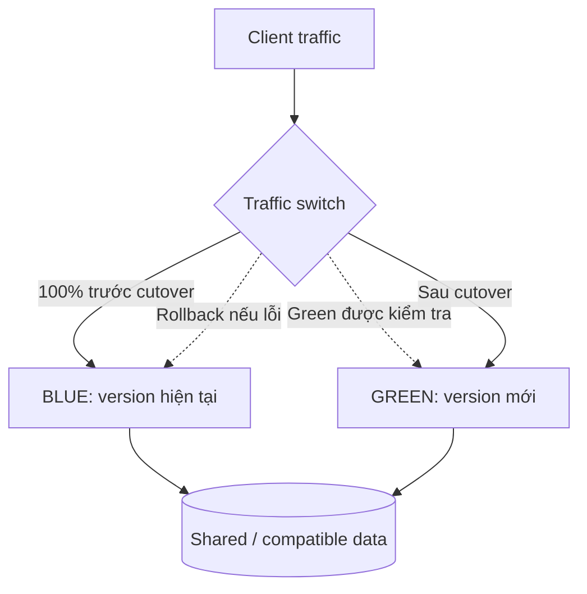
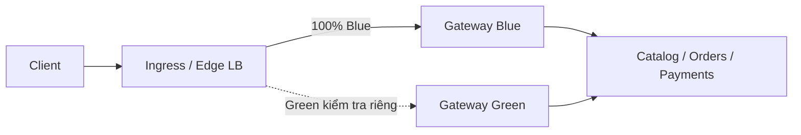
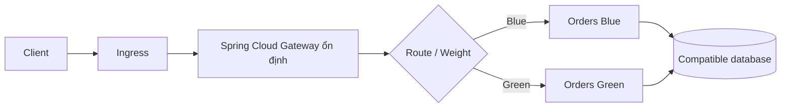
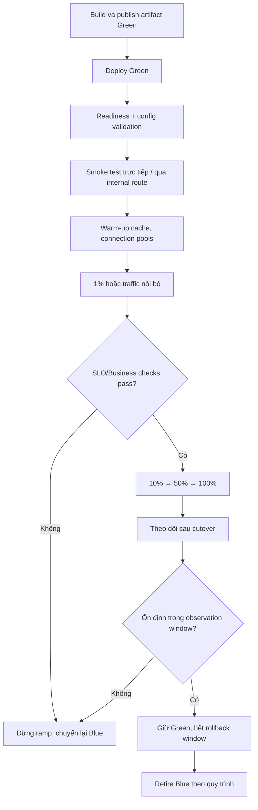
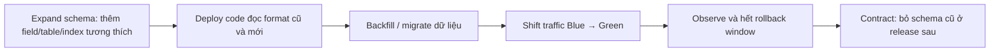

# Blue-green và chuyển lưu lượng có kế hoạch khôi phục

Một phiên bản mới của API Gateway hoặc microservice có thể khởi động thành công nhưng vẫn có lỗi chỉ xuất hiện khi nhận traffic thật: route rewrite path sai, JWT audience bị kiểm tra khác, connection pool chưa warm-up, schema response thay đổi, backend chậm hoặc một filter làm tăng tỷ lệ 5xx. Nếu cập nhật toàn bộ production cùng lúc, một lỗi nhỏ có thể ảnh hưởng mọi người dùng trước khi đội vận hành kịp phát hiện.

**Blue-green deployment** giảm rủi ro đó bằng cách duy trì hai môi trường có khả năng phục vụ: **Blue** đang nhận traffic ổn định và **Green** đã được triển khai, kiểm tra, làm nóng nhưng chưa nhận hoặc chỉ nhận một phần traffic. Khi Green đạt tiêu chí, hệ thống chuyển traffic theo kế hoạch. Nếu chỉ số vượt ngưỡng, traffic quay về Blue trong thời gian đã định.

Với **Spring Cloud Gateway**, blue-green có thể áp dụng ở hai vị trí khác nhau: chuyển traffic giữa các phiên bản Gateway phía sau ingress/load balancer, hoặc để một Gateway ổn định chuyển traffic giữa hai phiên bản backend bằng route predicates và service discovery. Hai cách có ranh giới, dữ liệu và cách rollback khác nhau; phải xác định rõ phiên bản nào đang được chuyển.

Bài thuộc chương **Mẫu định tuyến** của module `SPRING_CLOUD_GATEWAY`. Gateway định tuyến qua predicates/filter chain, biến đổi path/header, khám phá service và thực hiện authentication, rate limiting, circuit breaker, retry, TLS, observability. Blue-green phải bảo toàn các hợp đồng đó trong suốt quá trình chuyển lưu lượng.

**Kết quả học tập:**

1. Giải thích Blue/Green, cutover, weighted traffic shift, canary và rollback.
2. Phân biệt triển khai blue-green cho **Gateway application** với triển khai cho **downstream service**.
3. Dùng Spring Cloud Gateway `Weight` route predicate để chia traffic giữa các service IDs Blue/Green.
4. Chọn chuyển toàn bộ traffic tại ingress/LB hoặc chuyển dần theo tỷ lệ tại Gateway.
5. Chuẩn bị readiness, smoke test, warm-up, capacity, metrics và điều kiện dừng rollout.
6. Giữ database/API/event contracts tương thích khi hai phiên bản chạy song song.
7. Thực hiện rollback có kiểm soát, drain connections và xử lý WebSocket/SSE/session.
8. Kiểm thử cả happy path, negative path, dữ liệu ghi và khả năng quay lại phiên bản cũ.

> **Phạm vi:** Ví dụ chính dùng **Spring Cloud Gateway Server WebFlux** và Kubernetes. Route property prefix `spring.cloud.gateway.server.webflux.routes` áp dụng cho các nhánh Gateway mới; nhánh cũ thường dùng `spring.cloud.gateway.routes`. Server Web MVC có cấu hình/runtime khác. YAML, weights, Service selectors, actuator endpoint và rollout timings là ví dụ; hãy xác minh theo Spring Boot/Spring Cloud release train, ingress controller và nền tảng deploy đang dùng. Không xem ví dụ là cấu hình đã được deploy hay benchmark.

**Gateway Server Web MVC** cũng có mô hình route/filter và các cách tích hợp HTTP khác với WebFlux. Các YAML route prefix, actuator operations, custom filter APIs và khả năng hỗ trợ từng predicate trong bài phải được đối chiếu riêng với Server MVC version đang dùng; không sao chép nguyên config WebFlux rồi giả định tương đương.

## 1. Blue-green deployment là gì?

Blue và Green là hai môi trường/phiên bản có thể chạy song song. Mỗi môi trường có artifact, config, health và tập tài nguyên riêng đủ để phục vụ traffic được phân công.



**Blue** là phiên bản hiện đang phục vụ người dùng. **Green** là phiên bản thay thế đã được deploy và kiểm tra. Khi Green được xác nhận sẵn sàng, một điểm điều khiển (ingress, load balancer, service selector hoặc Gateway route config) thay đổi tỷ lệ traffic.

Điểm mạnh:
- Có thể chuẩn bị phiên bản mới trước khi chuyển người dùng.
- Có môi trường cũ để rollback nhanh nếu vẫn tương thích dữ liệu.
- Smoke test và kiểm tra cấu hình trước khi mở traffic.
- Có thể chuyển theo các bước nhỏ để quan sát hành vi.
- Deployment artifact được đóng gói và version rõ ràng.

Chi phí và rủi ro:
- Cần đủ capacity để chạy hai phiên bản cùng lúc.
- Hai phiên bản có thể cùng ghi vào database/event store.
- Cache, session, JWT keys, rate-limit state và route config phải tương thích.
- Rollback ứng dụng không tự rollback schema/database.
- Traffic switch không đóng ngay các TCP connections/WebSocket đã tồn tại.
- Một số lỗi chỉ xuất hiện dưới tải production hoặc theo tenant/region cụ thể.

### 1.1. Blue-green không đồng nghĩa canary

| Mô hình | Cách dùng | Mục tiêu |
| --- | --- | --- |
| **Blue-green** | Hai môi trường hoàn chỉnh; chuyển traffic từ môi trường cũ sang mới. | Có đường quay lại phiên bản trước. |
| **Canary** | Một phần traffic/users được gửi tới bản mới trước khi mở rộng. | Đánh giá rủi ro theo cohort/tỷ lệ nhỏ. |
| **Rolling update** | Thay instances cũ bằng mới theo batch. | Cập nhật dần mà không cần hai stack độc lập hoàn chỉnh. |
| **A/B test** | Phân nhóm người dùng để so sánh trải nghiệm/biến thể. | Đánh giá sản phẩm/hành vi. |

Một blue-green deployment có thể **kết hợp traffic ramp/canary**: Green ban đầu nhận 1%, sau đó 10%, 50% và 100%. Tuy nhiên, việc chia traffic không tự biến deployment thành một A/B experiment; cần cohort assignment và đo lường riêng.

### 1.2. “Rollback nhanh” có điều kiện

Rollback nhanh chỉ đúng khi:
- Blue vẫn còn chạy và đủ capacity nhận traffic.
- Blue vẫn tương thích schema dữ liệu hiện tại.
- Blue còn credentials/certificates/JWT keys hợp lệ.
- Các background workers/consumers không gây side effects xung đột.
- Route/ingress config có thể khôi phục.
- Database migrations chưa xóa hoặc đổi cấu trúc mà Blue cần.
- Stateful sessions/connections được xử lý.

Nếu Green đã ghi dữ liệu theo format mà Blue không đọc được, đổi traffic về Blue có thể biến một lỗi deploy thành outage dữ liệu.

## 2. Có hai lớp blue-green trong kiến trúc Gateway

Không nên gọi chung mọi traffic switch là “đổi Gateway”. Xác định chính xác đối tượng đang thay.

### 2.1. Blue-green cho chính Gateway application



Ví dụ:
- Blue chạy Gateway 4.x, Green chạy bản Gateway đã nâng cấp.
- Blue có route/filter config hiện tại, Green có route/filter config mới.
- Ingress/LB điều khiển traffic tới các Gateway replicas.
- Sau smoke test, chuyển dần hoặc cutover toàn bộ.
- Rollback tại ingress/LB nếu Green gây lỗi.

**Ưu điểm:** có thể kiểm tra thay đổi của Gateway runtime, dependencies, security filters, route config và observability.

**Rủi ro:** Green có thể tạo outbound load mới lên tất cả backends; nếu cả hai cùng nhận traffic thử nghiệm, backend cần capacity tương ứng.

### 2.2. Blue-green cho downstream microservice



Gateway không thay phiên bản, nhưng route đích thay đổi:
- Blue service ID: `orders-blue`.
- Green service ID: `orders-green`.
- Gateway route definitions điều khiển tỷ lệ.
- Có thể chuyển từ 100% Blue sang 100% Green mà không thay Gateway pods.
- Rollback bằng route weight/URI về Blue.

**Ưu điểm:** tách release của backend khỏi release Gateway.

**Rủi ro:** Gateway là điểm chuyển traffic, nên lỗi route refresh/config có thể ảnh hưởng ngay toàn bộ API. Cần bảo vệ control plane và có config revision/rollback.

### 2.3. Bảng chọn điểm chuyển traffic

| Mục tiêu | Điểm switch thường phù hợp |
| --- | --- |
| Nâng version Spring Cloud Gateway/JVM/dependencies | Ingress/LB trước các Gateway stacks. |
| Nâng version Orders Service | Gateway route/LoadBalancer hoặc mesh/LB trước Orders. |
| Chuyển một public hostname sang stack mới | Edge DNS/L7 LB/Ingress. |
| Chia 95/5 giữa hai backend service IDs | Gateway `Weight` predicate hoặc traffic management layer. |
| Phân cohort user ổn định | Identity-aware routing/custom policy đã xác thực. |
| Chuyển WebSocket sessions | Edge/Gateway session admission và reconnect; không chỉ route weight. |

**Một hệ thống có thể dùng hai lớp cùng lúc**, ví dụ ingress chuyển 10% traffic tới Gateway Green, và mỗi Gateway version có weighted routes riêng tới backend Blue/Green. Khi đó tổng tỷ lệ nhân qua nhiều lớp; phải tính rõ để không vô tình gửi quá nhiều traffic tới backend Green.

## 3. Kế hoạch cutover: từ Blue 100% sang Green 100%

Một luồng tiêu chuẩn:



Không cần mọi hệ thống dùng đúng tỷ lệ 1/10/50. Traffic shift phải dựa vào:
- Khả năng chia traffic của edge/Gateway.
- Mức độ rủi ro của release.
- Volume đủ để đo được lỗi.
- Khả năng rollback.
- Thời gian quan sát phù hợp với chu kỳ nghiệp vụ.

### 3.1. Các giai đoạn bắt buộc

1. **Prepare:** build artifact bất biến, config, secrets, schema compatibility, capacity.
2. **Deploy:** tạo Green nhưng chưa nhận public traffic.
3. **Verify:** readiness, smoke tests, auth, route, dependencies.
4. **Warm-up:** JVM/JIT, caches, DNS, TLS sessions, connection pools và backend dependencies.
5. **Shift:** chuyển traffic theo tỷ lệ/điểm switch đã chọn.
6. **Observe:** so sánh SLO, business outcomes, saturation và logs/traces.
7. **Commit:** xác nhận Green ổn định và Blue hết cần làm rollback target.
8. **Retire:** dừng Blue sau drain và thời gian giữ an toàn.

### 3.2. Định nghĩa trước “thành công”

Đừng chờ sau cutover mới quyết định thành công nghĩa là gì. Một release cần có:
- HTTP error ratio theo route/version.
- p95/p99 latency và timeout.
- Request volume đủ lớn.
- Business success/failure (ví dụ đơn tạo thành công, payment settlement).
- Authentication/authorization reject bất thường.
- Retry/circuit-breaker/fallback rates.
- CPU/memory/GC/connection pool saturation.
- Database errors/locks/connection pool.
- Queue lag và event consumer errors nếu có.

HTTP 200 không chứng minh business transaction hoàn tất; fallback 200 có thể che backend lỗi.

## 4. Service IDs riêng cho Blue và Green

Khi Gateway dùng service discovery, route:

```yaml
uri: lb://orders-service
```

thường để LoadBalancer chọn một instance thuộc service ID `orders-service`. Nếu Blue và Green cùng đăng ký **một service ID**, LoadBalancer có thể chọn instance từ cả hai tập theo supplier/policy; điều đó không tự cung cấp một blue-green control rõ ràng.

Một cách đơn giản là dùng **service IDs tách biệt**:

```text
orders-blue  → tập instances version Blue
orders-green → tập instances version Green
```

Có thể dùng Eureka, Consul, Kubernetes discovery hoặc một registry khác; điều quan trọng là **version membership** của từng service ID rõ ràng.

### 4.1. Khi dùng Kubernetes DNS trực tiếp

Nếu không có Spring Cloud discovery/LoadBalancer integration cho Kubernetes service IDs, Gateway có thể route tới DNS nội bộ:

```yaml
uri: http://orders-blue.orders.svc.cluster.local:8080
```

Trong trường hợp này, Kubernetes Service phân phối traffic tới Pods có selector phù hợp. Đừng đặt `lb://orders-blue` chỉ vì Kubernetes Service tên `orders-blue`; scheme `lb://` cần Spring Cloud LoadBalancer/discovery integration tương ứng.

### 4.2. Đăng ký chung service ID có thể phá mục tiêu version pinning

Nếu Blue và Green cùng đăng ký `orders-service`:
- Route `lb://orders-service` không nhất thiết chỉ đến Blue.
- Mở thêm Green replicas có thể tự làm thay đổi traffic ratio.
- Registry health/instance metadata có thể thay đổi trong lúc rollout.
- Rollback chỉ bằng route config không còn đủ nếu cả hai versions nằm trong cùng supplier.

Nếu muốn cùng service ID, phải có **custom ServiceInstanceListSupplier/filter policy** theo version/metadata hoặc traffic management khác đã được kiểm thử. Với bài toán blue-green rõ ràng, service IDs riêng thường dễ quan sát và rollback hơn.

## 5. Chia traffic bằng Weight Route Predicate

Spring Cloud Gateway Server WebFlux có **Weight Route Predicate Factory**. Routes trong cùng group dùng trọng số để chọn route theo tỷ lệ tương đối.

Ví dụ chia traffic cho Orders:

```yaml
spring:
  cloud:
    gateway:
      server:
        webflux:
          routes:
            - id: orders-blue
              uri: lb://orders-blue
              predicates:
                - Path=/api/orders/**
                - Weight=orders, 90
              filters:
                - StripPrefix=2

            - id: orders-green
              uri: lb://orders-green
              predicates:
                - Path=/api/orders/**
                - Weight=orders, 10
              filters:
                - StripPrefix=2
```

Giải thích:
- Hai routes có **route IDs khác nhau**.
- Cùng predicate `Path=/api/orders/**`.
- Cùng Weight group `orders`.
- Blue weight 90, Green weight 10: tỷ lệ kỳ vọng gần 90/10 theo cách chọn route.
- Mỗi route trỏ tới một service ID riêng.
- Cả hai áp dụng filter path giống nhau để backend nhận cùng API contract.

**Weight là trọng số tương đối, không phải lịch phân phối chính xác từng request.** Trong một cửa sổ traffic nhỏ, tỷ lệ thực có thể lệch; nhiều Gateway replicas cũng có thể tạo sai số thống kê. Đừng viết test “đúng chính xác 90 requests Blue và 10 Green trong 100 requests”.

### 5.1. Chuyển theo các bước

| Giai đoạn | Blue weight | Green weight | Mục đích |
| --- | ---: | ---: | --- |
| Baseline | 100 | Không active | Blue phục vụ toàn bộ. |
| Internal smoke | 100 | Chỉ test route nội bộ/host riêng | Green được kiểm tra trước public traffic. |
| First exposure | 99 | 1 | Phát hiện lỗi nghiêm trọng với traffic nhỏ. |
| Ramp 1 | 90 | 10 | Kiểm tra latency/error/business metrics. |
| Ramp 2 | 50 | 50 | Tăng sample size và backend load Green. |
| Ramp 3 | 10 | 90 | Kiểm tra Green gần tải production. |
| Cutover | Chỉ route Green | Green active | Green phục vụ toàn bộ. |

Với giai đoạn 100/0, **đừng mặc định khai route Green với weight 0**: cách validate/trọng số dương có thể phụ thuộc version. Cách đơn giản là chỉ bật route Blue trong group ở baseline, rồi thêm Green với weight dương khi bắt đầu ramp. Khi cutover, chỉ giữ Green active hoặc chuyển sang route URI Green.

### 5.2. Không dùng cùng route ID cho hai versions

Mỗi route cần ID duy nhất. Nếu cùng ID:
- Route definition có thể ghi đè/refresh khó đoán.
- Metrics/logs không phân biệt Blue và Green.
- Rollback/config diff không rõ.
- Actuator route inventory khó kiểm tra.

Nên dùng IDs ổn định như `orders-blue`/`orders-green` và labels version riêng trong telemetry.

### 5.3. Weight group phải thống nhất

Hai route muốn chia cùng traffic phải dùng cùng group name (ví dụ `orders`). Nếu route Blue dùng `Weight=orders,90` còn Green dùng `Weight=payments,10`, chúng thuộc hai group khác nhau và không tạo một phép chia 90/10 cho cùng API.

Không gộp các route khác API/khác path vào một group chỉ vì muốn dùng chung tên.

### 5.4. Route predicates khác vẫn cần giống nhau

Khi Blue và Green cùng phục vụ một API, kiểm tra:
- Cùng Path/method/host/header predicates (trừ cohort có chủ đích).
- Cùng auth/security requirements.
- Cùng CORS policy.
- Cùng path rewrite, request/response header behavior.
- Cùng retry/circuit-breaker/timeout contract.
- Cùng request body/response schema tương thích.

Nếu một route thiếu `Method=POST` hoặc khác `StripPrefix`, người dùng có thể thấy lỗi phụ thuộc route được chọn, khó tái hiện.

## 6. Traffic shift ở Gateway hay ingress?

### 6.1. Chuyển backend tại Gateway

Gateway giữ ổn định, dùng Weight route predicate hoặc dynamic route config. Phù hợp khi:
- Chỉ một hoặc vài backend services được release.
- Muốn phân traffic theo route.
- Có telemetry theo route ID và upstream service.
- Không cần thay Gateway runtime.

Rủi ro: route config control plane trở thành critical; phải bảo vệ refresh/admin endpoints và đồng bộ config giữa replicas.

### 6.2. Chuyển Gateway application tại ingress

Ingress/L7 LB có hai backend Services:

```text
public-api → gateway-blue Service
           → gateway-green Service
```

Phù hợp khi:
- Nâng Spring Cloud Gateway/JDK/dependencies.
- Thay global filters, security chain, HTTP client/pool.
- Muốn kiểm tra Gateway mới độc lập trước khi thay thế.
- Ingress/LB có weighted target groups hoặc blue-green switch được hỗ trợ.

Ingress annotation/weight syntax khác theo controller/cloud provider. Không dùng một annotation ingress-nginx rồi áp cho AWS ALB, Traefik hoặc Gateway API.

### 6.3. Chuyển qua Kubernetes Service selector

Có thể có một Service stable trỏ tới một version bằng selector. Thay selector từ Blue sang Green là một điểm switch, nhưng:
- EndpointSlice cập nhật bất đồng bộ.
- Existing connections có thể còn tới Pods cũ.
- Readiness và termination phải phối hợp.
- Không có tỷ lệ 90/10 tự nhiên từ một selector duy nhất.
- Rollback selector cần config revision/manifest có sẵn.

Nếu muốn traffic weight thực sự, dùng ingress/service mesh/controller có weighted routing hoặc Gateway Weight predicate.

### 6.4. Đừng dùng DNS TTL như công tắc rollback duy nhất

DNS cache ở client, resolver, CDN và ISP có thể sống lâu hơn TTL công bố. DNS cutover có thể hữu ích ở một số kiến trúc, nhưng **không đảm bảo mọi client chuyển ngay**, và rollback có độ trễ khó dự đoán. L7 traffic switch/Service selector thường quan sát được rõ hơn trong một cluster, nhưng cũng có propagation window.

## 7. Blue-green cho chính Gateway trên Kubernetes

Ví dụ chạy hai Deployments và hai Services:

```yaml
apiVersion: apps/v1
kind: Deployment
metadata:
  name: gateway-blue
  namespace: gateway
spec:
  replicas: 3
  selector:
    matchLabels:
      app: edge-gateway
      version: blue
  template:
    metadata:
      labels:
        app: edge-gateway
        version: blue
    spec:
      containers:
        - name: gateway
          image: registry.example.com/edge-gateway:1.8.4
          ports:
            - name: http
              containerPort: 8080
---
apiVersion: apps/v1
kind: Deployment
metadata:
  name: gateway-green
  namespace: gateway
spec:
  replicas: 3
  selector:
    matchLabels:
      app: edge-gateway
      version: green
  template:
    metadata:
      labels:
        app: edge-gateway
        version: green
    spec:
      containers:
        - name: gateway
          image: registry.example.com/edge-gateway:1.9.0
          ports:
            - name: http
              containerPort: 8080
```

Hai Services riêng:

```yaml
apiVersion: v1
kind: Service
metadata:
  name: gateway-blue
  namespace: gateway
spec:
  selector:
    app: edge-gateway
    version: blue
  ports:
    - name: http
      port: 80
      targetPort: http
---
apiVersion: v1
kind: Service
metadata:
  name: gateway-green
  namespace: gateway
spec:
  selector:
    app: edge-gateway
    version: green
  ports:
    - name: http
      port: 80
      targetPort: http
```

Ingress có thể trỏ tới Blue trước:

```yaml
apiVersion: networking.k8s.io/v1
kind: Ingress
metadata:
  name: public-api
  namespace: gateway
spec:
  ingressClassName: nginx
  rules:
    - host: api.example.com
      http:
        paths:
          - path: /
            pathType: Prefix
            backend:
              service:
                name: gateway-blue
                port:
                  name: http
```

Khi Green ready và test đạt, thay backend Service thành `gateway-green` qua manifest/release pipeline có kiểm soát. **Đây là cutover 100/0**, không phải weighted split. Nếu muốn ramp 10/90, cần tính năng traffic split của ingress/controller hoặc một Service/route management mechanism khác.

### 7.1. Probe, resources và security không được bỏ khỏi ví dụ

Manifest rút gọn phía trên cần bổ sung:
- Readiness/liveness/startup probes.
- Resource requests/limits.
- ServiceAccount, securityContext, secrets.
- Termination grace và graceful shutdown.
- PodDisruptionBudget/topology spread khi cần.
- NetworkPolicy.
- ConfigMap/Secret versioning.
- HPA/autoscaling và capacity.
- Image digest/signature policy.

Không copy nguyên manifest demo thành production deployment.

### 7.2. Blue và Green phải nhận cùng security contract

Cả hai Gateway stacks phải nhất quán về:
- JWT issuer/JWK cache và audience.
- TLS truststore/certificates/mTLS.
- Trusted proxy ranges và Forwarded/X-Forwarded-* sanitization.
- Rate limiter key/storage.
- CORS/CSRF/Host allowlist.
- Secrets và encryption keys.
- Route definitions/filters/deny policies.

Một rollout có thể “xanh” về HTTP status nhưng vô tình làm yếu authorization nếu Green có SecurityWebFilterChain khác.

## 8. Blue-green cho backend bằng Gateway routes

Nếu Gateway đang ổn định, route Blue/Green có thể dùng service IDs:

```yaml
spring:
  cloud:
    gateway:
      server:
        webflux:
          routes:
            - id: catalog-blue
              uri: lb://catalog-blue
              predicates:
                - Path=/api/catalog/**
                - Weight=catalog, 95
              filters:
                - StripPrefix=2

            - id: catalog-green
              uri: lb://catalog-green
              predicates:
                - Path=/api/catalog/**
                - Weight=catalog, 5
              filters:
                - StripPrefix=2
```

Đây là một ví dụ traffic 95/5. Trước khi áp dụng:
- Hai service IDs phải resolve được qua discovery.
- Chỉ instance Ready mới được supplier chọn.
- Blue/Green phải dùng API contract tương thích.
- Backend Green phải có capacity đủ cho tỷ lệ mới.
- Route IDs/weight config phải đồng bộ trên mọi Gateway replica.
- Gateway route metrics phải phân biệt Blue/Green.

### 8.1. Smoke test Green mà không gửi public traffic

Các cách thường dùng:
- Internal-only hostname/route test được bảo vệ.
- Một Gateway test instance riêng.
- Header/cookie predicate chỉ cho một cohort test được xác thực.
- Synthetic test chạy từ mạng nội bộ tới Green service ID.
- Direct service test trong cluster với auth/security tương đương.

Không mở một public debug route bỏ qua JWT/authorization chỉ để test Green.

### 8.2. Header canary cần nguồn đáng tin

Có thể dùng predicate:

```yaml
predicates:
  - Path=/api/catalog/**
  - Header=X-Release-Cohort,green
```

Nhưng nếu public client tự đặt `X-Release-Cohort: green`, họ có thể tự chọn phiên bản chưa sẵn sàng. Nếu dùng cohort:
- Header phải được edge strip từ Internet.
- Một proxy/identity-aware layer được tin mới gắn lại.
- Hoặc Gateway derive cohort từ principal/verified claim.
- Không coi cohort header là authorization.
- Test cả header giả và user không đủ quyền.

### 8.3. Weighted random không đảm bảo cùng user vào cùng version

`Weight` predicate phù hợp chia traffic thống kê, không mặc định bảo đảm sticky assignment cho một user giữa nhiều requests. Nếu user tạo order trên Green rồi truy vấn order trên Blue, hai phiên bản cần chia sẻ cùng database/schema và contract. Nếu không, cần stable cohort routing theo identity đã xác thực và đảm bảo các API liên quan dùng cùng cohort.

## 9. Chuẩn bị database và event contracts trước khi cutover

Đây là điều kiện quan trọng nhất của rollback. Blue và Green thường cùng tồn tại trong một khoảng thời gian; có thể cả hai cùng ghi dữ liệu.

Một chiến lược **expand–migrate–contract**:



### 9.1. Expand

- Thêm cột nullable/default an toàn.
- Thêm bảng/index không phá code cũ.
- Cho phép cả Blue và Green đọc schema mới.
- Nếu thêm event field, consumer cũ vẫn bỏ qua/đọc được.
- Tránh rename/drop cột ngay trong release cutover.

### 9.2. Migrate

- Backfill theo batch có checkpoint.
- Kiểm tra row counts, constraints, nulls, duplicates.
- Có thể dual-read/dual-write trong thời gian ngắn nếu semantics rõ.
- Tránh hai phiên bản cùng chạy migration phá nhau.
- Migration runner cần single-writer/lock/version control.

### 9.3. Contract

Chỉ xóa cột/table/field cũ sau khi:
- Blue đã hết rollback window.
- Không còn instances/workers cũ.
- Consumer/event retention đã hết.
- Backup/restore và data migration có kiểm chứng.
- Các release kế tiếp không còn phụ thuộc schema cũ.

**Rollback application không đồng nghĩa rollback database.** Không chạy migration ngược tự động khi đổi traffic về Blue nếu migration có data loss hoặc Green đã ghi dữ liệu mới.

### 9.4. Side effects và idempotency

Khi Blue/Green cùng phục vụ:
- Một client có thể retry qua một version khác.
- Một background job có thể được cả hai versions consume nếu consumer group sai.
- Hai versions có thể xử lý cùng webhook/event.
- Cache key hoặc idempotency key semantics có thể khác.

Dùng idempotency key/unique constraints, ownership rõ cho background consumers và backward-compatible event schemas. Không cho hai worker groups cùng thực hiện một business action nếu không có coordination.

## 10. Chuẩn bị Green: health, readiness và warm-up

Green cần đạt trạng thái “ready to serve” trước khi nhận traffic.

### 10.1. Liveness, readiness và startup

| Kiểm tra | Ý nghĩa | Điều không nên làm |
| --- | --- | --- |
| Startup | JVM/app đã qua khởi động. | Restart liên tục chỉ vì dependency chưa ready trong vài giây đầu. |
| Liveness | Process có thể tiếp tục chạy không? | Fail liveness vì một backend business đang outage. |
| Readiness | Pod có đủ điều kiện nhận request mới? | Chỉ kiểm tra TCP port mà bỏ qua route/security config. |
| Synthetic smoke | API thực có hoạt động qua Gateway không? | Đưa một synthetic account có quyền admin vào public endpoint. |

Với Spring Boot Actuator, có thể expose health groups readiness/liveness cho Kubernetes, nhưng **bảo vệ endpoint và chỉ expose trên management path/network phù hợp**. Readiness không nên phụ thuộc mọi downstream nếu điều đó khiến toàn bộ Gateway stack bị rút khỏi Service khi một backend đơn lẻ lỗi.

### 10.2. Smoke test theo API contract

Green cần test:
- Route ID/URI và route predicates đúng.
- Path rewrite/header forwarding đúng.
- JWT hợp lệ, token sai/expired bị từ chối.
- 401/403/404/429 đúng contract.
- Backend 5xx và timeout map đúng.
- Retry chỉ chạy cho method/status được phép.
- CircuitBreaker/fallback không che business failure.
- CORS/Host/Forwarded/TLS đúng khi qua edge.
- Actuator/admin endpoints không public.

### 10.3. Warm-up trước khi tăng traffic

Các tài nguyên có thể cần warm:
- JVM class loading/JIT.
- Route cache và DNS resolution.
- TLS trust/connection pool.
- JWK cache và discovery registry.
- Redis connection pool.
- Backend cache/query plans.
- Local caches (nếu có) và compiled templates.

Warm-up phải dùng traffic test được kiểm soát, không thực hiện business writes thật không thể rollback. Đo latency trước/sau warm-up; đừng giả định pod Ready là p99 đã ổn định.

### 10.4. Capacity cho Blue và Green cùng chạy

Nếu mỗi version cần 3 Gateway pods và Green bắt đầu nhận 50% traffic, tổng tài nguyên có thể gần gấp đôi trong thời gian overlap. Backend có thể nhận thêm synthetic/warm-up calls. Tính:
- CPU/memory/GC.
- Inbound/outbound sockets.
- Backend connections và DB pools.
- Redis quotas.
- Rate-limit state.
- Node capacity và autoscaling headroom.
- MaxSurge/PodDisruptionBudget.
- Chi phí hai môi trường.

## 11. Chuyển traffic theo tỷ lệ: kế hoạch có kiểm soát

Một rollout mẫu cho API có volume đủ:

| Bước | Blue | Green | Thời gian quan sát gợi ý | Điều kiện tiếp tục |
| --- | ---: | ---: | --- | --- |
| Baseline | 100% | 0% | Một baseline window | Blue ổn định, metrics đầy đủ. |
| Internal test | Public 100% | Synthetic/internal | Theo test suite | Green smoke/security pass. |
| First exposure | 99% | 1% | 5–15 phút hoặc đủ sample | Không có lỗi nghiêm trọng. |
| Low ramp | 90% | 10% | 10–30 phút hoặc đủ sample | Error/latency/business SLO đạt. |
| Mid ramp | 50% | 50% | 15–30 phút hoặc đủ sample | Backend Green chịu tải, DB ổn. |
| High ramp | 10% | 90% | Theo volume/SLO | Không có saturation/regression. |
| Cutover | 0% | 100% | Observation window | Green ổn định, rollback target còn sẵn. |

Thời lượng chỉ là ví dụ. Với API ít traffic hoặc chu kỳ nghiệp vụ theo ngày, 5 phút có thể không đủ sample; với endpoint thanh toán, một vài lỗi duplicate có thể nghiêm trọng dù tỷ lệ thấp.

### 11.1. Không tăng tỷ lệ chỉ vì HTTP 2xx tốt

Trước mỗi bước:
- Kiểm tra số lượng request đủ để kết luận.
- So sánh Blue/Green cùng route/method/region/cohort.
- Kiểm tra business completion/duplicate/consistency.
- Theo dõi 429/503/504 và upstream attempts.
- Kiểm tra database lock/connection pool/queue lag.
- Xem logs/traces của các errors mẫu.
- Xác nhận config revision đang chạy đúng.

### 11.2. Phân biệt traffic shift và capacity scale

Tăng Green từ 1% lên 50% vừa là thay đổi version exposure vừa tăng tải lên Green. Nếu HPA scale chậm hơn traffic switch, Green có thể overload. Warm-up và scale capacity trước bước tăng lớn; không coi HPA sẽ phản ứng tức thì.

### 11.3. Bảo vệ Blue trong khi rollback

Khi Green nhận 90%, Blue có thể ít traffic nhưng phải giữ đủ replicas/connection pools để nhận lại 100% trong rollback. Không scale Blue xuống zero trước khi rollback window kết thúc.

## 12. Thay đổi route config và refresh an toàn

Với Gateway WebFlux, routes có thể được khai báo bằng application properties/YAML hoặc quản lý động tùy kiến trúc. Nếu dùng dynamic routes:
- Có nguồn config/version rõ ràng.
- Thay đổi được validate trước khi publish.
- Mọi Gateway replicas nhận cùng config revision.
- Có audit log ai thay đổi và lúc nào.
- Có cơ chế rollback revision.
- Test route predicates/weights trước khi bật traffic.

### 12.1. Static config và dynamic config khác nhau

**Static configuration:** route definitions nằm trong application config/artifact; thay đổi thường đi qua config deployment/restart/refresh strategy đã thiết kế.

**Dynamic route repository:** route definitions được lưu/cập nhật qua repository/control plane và Gateway phát hiện thay đổi theo cơ chế implementation.

Đừng sửa file YAML trên một pod rồi cho rằng mọi replicas sẽ nhận cấu hình. Cũng đừng giả định ConfigMap volume update sẽ tự refresh route definitions trong Spring context.

### 12.2. Actuator Gateway refresh/admin endpoint

Một số Gateway versions cung cấp Actuator Gateway endpoints để đọc/refresh hoặc quản lý route definitions. Ví dụ conceptual endpoint:

```http
POST /actuator/gateway/refresh
```

Endpoint/operation này phụ thuộc version và exposure configuration. **Không public endpoint refresh/write ra Internet.** Nếu dùng:
- Management network/port riêng.
- Strong authentication/authorization.
- Role separation và audit.
- CSRF/network controls phù hợp.
- Route validation trước khi refresh.
- Config revision/rollback.
- Đồng bộ và xác minh effective routes trên từng Gateway instance.

Một endpoint refresh chỉ yêu cầu Gateway đọc lại routes; nó **không tự tạo blue-green rollout orchestration**, health gates hay traffic analysis.

### 12.3. Thay weight theo từng bước

Ví dụ 90/10 → 50/50 là thay route definitions. Phải kiểm tra:
- Cả hai routes còn cùng Weight group.
- Weight values đã nạp trên toàn bộ Gateway replicas.
- Route refresh không tạo khoảng trống route.
- Metrics phân biệt route IDs.
- Requests đang in-flight có thể hoàn thành với route cũ.
- Rollback config revision đã sẵn sàng.

### 12.4. Một config source duy nhất

Tránh đồng thời:
- Config Server đẩy route.
- Kubernetes ConfigMap mount route.
- Actuator API thay route trực tiếp.
- Script sửa route qua một repository khác.

Nhiều control planes có thể ghi đè nhau. Chọn một nguồn có ownership, versioning, review và audit rõ.

## 13. Rollback: định nghĩa trigger trước khi deploy

Rollback không nên dựa vào cảm giác. Đặt ngưỡng theo SLO/criticality của service. Ví dụ minh họa:

| Tín hiệu | Trigger minh họa | Hành động |
| --- | --- | --- |
| 5xx ratio Green | Cao hơn baseline và vượt error budget trong window. | Dừng ramp, điều tra hoặc rollback. |
| p95/p99 latency | Vượt latency SLO liên tục. | Không tăng traffic, kiểm tra downstream. |
| Business failure | Duplicate charge/order, data corruption hoặc invariant vi phạm. | Dừng traffic Green ngay, xử lý dữ liệu. |
| Auth/security | JWT acceptance/rejection bất thường hoặc policy bypass. | Rollback/disable route Green và incident response. |
| Saturation | CPU/GC/DB pool/queue vượt giới hạn vận hành. | Giảm traffic/scale có kiểm soát. |
| Dependency | Redis/discovery/DB errors tăng. | Dừng rollout và khôi phục dependency/config. |
| Observability gap | Metrics/traces của Green không có hoặc sai labels. | Không tiếp tục vì không đủ bằng chứng. |

Không áp cùng một threshold cho tất cả routes. Payment, login, catalog read và report export có latency/error/business risk khác nhau.

### 13.1. Ví dụ policy theo SLO

Giả sử API Orders có:
- Availability SLO: 99,9%.
- Latency SLO: p95 dưới 300 ms.
- Duplicate order: **không chấp nhận**.
- Minimum sample: 500 requests trong observation window.

Một rollout gate có thể yêu cầu:
1. Green 5xx ratio không cao hơn baseline quá mức đã thống nhất.
2. p95/p99 nằm trong SLO.
3. Không có duplicate/business invariant violation.
4. Có đủ sample.
5. Không có saturation của database/queue.
6. Error rate và trace coverage có thể quan sát.

Đây là ví dụ policy, không phải SLO mặc định của module.

### 13.2. Rollback phải có một thao tác cụ thể

Tùy điểm switch:
- Ingress/LB: route backend target về Blue.
- Gateway Weight: đặt Green inactive và Blue active/100%.
- Kubernetes Service selector: apply manifest selector về Blue.
- Service discovery: route lại service ID Blue hoặc khôi phục supplier policy.

Runbook phải có command/PR/config revision cụ thể, quyền thực thi, người phê duyệt nếu cần và tiêu chí xác nhận sau rollback. Không để “rollback” chỉ là một câu trong tài liệu.

## 14. Runbook chuyển traffic và rollback bằng Gateway Weight

Giả sử:
- Blue: `lb://orders-blue`.
- Green: `lb://orders-green`.
- Cùng path `/api/orders/**`.
- Gateway route config được quản lý qua repository/config pipeline.

### 14.1. Trước rollout

```text
[ ] Blue healthy và phục vụ 100%.
[ ] Green healthy, smoke test pass.
[ ] Blue/Green cùng tương thích schema và events.
[ ] Metrics có routeId orders-blue và orders-green.
[ ] Green capacity đủ cho bước traffic sắp nhận.
[ ] Rollback config revision đã được kiểm tra.
[ ] On-call và dashboard/runbook sẵn sàng.
```

### 14.2. Bắt đầu 99/1

Publish config route weights:
- Blue `Weight=orders,99`.
- Green `Weight=orders,1`.

Xác minh effective route config trên **mọi Gateway replicas**, sau đó quan sát traffic thực tế. Nếu config source/refresh không đồng bộ, dừng rollout.

### 14.3. Dừng ramp

Khi có bất kỳ trigger:
1. Không tăng Green weight.
2. Ghi lại thời điểm và config revision.
3. Kiểm tra source lỗi: Gateway route, backend, database, auth, rate limiter.
4. Nếu impact nghiêm trọng, chuyển traffic về Blue ngay theo runbook.
5. Giữ Green logs/metrics/traces để điều tra.
6. Không xóa Green trước khi thu thập bằng chứng.

### 14.4. Rollback về Blue 100%

Với cách dùng Weight predicate, một trạng thái rollback rõ là **chỉ active route Blue** trong group. Ví dụ route duy nhất:

```yaml
spring:
  cloud:
    gateway:
      server:
        webflux:
          routes:
            - id: orders-blue
              uri: lb://orders-blue
              predicates:
                - Path=/api/orders/**
              filters:
                - StripPrefix=2
```

Ở đây không có route Green tham gia Weight group, nên request hợp lệ được route Blue theo cấu hình này. Có thể dùng một route URI ổn định khác tùy kiến trúc. Sau refresh/deploy:
- Xác minh tất cả replicas đã áp dụng revision.
- Xác minh route Green không còn nhận requests mới.
- Theo dõi request in-flight/long-lived connections.
- Kiểm tra Blue capacity và error rate.
- Xác minh business data được Blue đọc/ghi đúng.
- Thông báo incident/status theo quy trình nội bộ.

**Rollback route không hủy các request Green đang chạy hoặc giao dịch Green đã commit.** Cần xử lý riêng các requests/side effects đang dở.

## 15. Kubernetes Service selector: cutover và rollback

Một stable Service có thể chọn một version bằng selector:

```yaml
apiVersion: v1
kind: Service
metadata:
  name: orders-active
  namespace: commerce
spec:
  selector:
    app: orders
    version: blue
  ports:
    - name: http
      port: 8080
      targetPort: http
```

Cutover selector sang Green:

```yaml
apiVersion: v1
kind: Service
metadata:
  name: orders-active
  namespace: commerce
spec:
  selector:
    app: orders
    version: green
  ports:
    - name: http
      port: 8080
      targetPort: http
```

Có thể apply manifest này qua release pipeline hoặc GitOps. Nhưng cần hiểu:
- EndpointSlice update là asynchronous.
- kube-proxy/mesh/ingress caches có propagation time.
- Existing keep-alive connections có thể còn tới Pod Blue.
- Service selector chỉ chọn **một tập endpoints**, không chia weighted 90/10.
- Blue vẫn cần giữ alive trong rollback window.
- Readiness phải xanh trước selector cutover.

Nếu muốn weighted traffic, dùng controller/mesh hỗ trợ weighted backends hoặc Gateway route weights. Đừng cố tạo hai Service selectors rồi mong một Service stable tự phân phối theo phần trăm.

## 16. Sessions, sticky routing và state trong blue-green

### 16.1. Stateless HTTP APIs

Nếu Gateway và backend stateless:
- JWT chứa identity/claims đã ký.
- Session/idempotency/quota lưu ở shared store.
- Route config/version nhất quán.
- Mọi replicas có thể phục vụ cùng user.
- Rollback ít phụ thuộc sticky session.

Đây là thiết kế dễ chuyển traffic nhất.

### 16.2. Sticky sessions

Sticky routing có thể giữ một user/connection trên cùng version, nhưng:
- Pod chết vẫn làm mất affinity.
- Cookie có thể trỏ về version đã retire.
- Browser mở nhiều connections có thể nhận route khác.
- User chuyển từ Blue sang Green giữa workflow có thể gặp state/schema khác.
- Sticky không thay shared session store hoặc database compatibility.

Nếu dùng sticky, đặt cookie/affinity version có TTL, fallback rõ khi target mất và test rollback.

### 16.3. WebSocket và SSE

Weight predicate chọn route lúc HTTP request/handshake bắt đầu. Một WebSocket đã Upgrade hoặc SSE stream đang mở thường **không chuyển giữa Blue và Green chỉ vì weight thay đổi**.

Cần:
- Giới hạn connection age hoặc drain policy.
- Heartbeat/close notification.
- Client reconnect với backoff/jitter.
- Replay cursor/event offset nếu cần.
- Active connection count theo version.
- Không retire Blue khi vẫn có sessions quan trọng mà chưa có kế hoạch.

### 16.4. Background jobs và event consumers

Một Blue/Green service có thể chạy worker process cùng HTTP server. Khi cả hai deployments cùng active:
- Có thể consume cùng queue.
- Scheduled job có thể chạy hai lần.
- Cron task có thể gửi email/charge trùng.
- Event schema mới có thể không tương thích consumer cũ.

Tách web replicas khỏi worker ownership nếu cần; dùng leader election, consumer group/partition semantics, idempotency và job leases. Không chỉ chuyển HTTP traffic rồi cho rằng Blue đã “ngừng hoạt động”.

## 17. Rate limiting, retries và circuit breakers trong lúc chuyển traffic

### 17.1. Rate limit state

Nếu Gateway Blue/Green có RedisRateLimiter:
- Cùng key namespace/algorithm để quota không reset bất ngờ.
- Redis storage được chia sẻ theo policy.
- Green không được có key resolver yếu hơn.
- Không để một Gateway version dùng raw X-Forwarded-For còn version kia dùng verified principal.
- Kiểm tra hành vi khi traffic chuyển giữa replicas.

Nếu rate limiter in-memory, quota có thể bị nhân lên theo số Gateway instances/version.

### 17.2. Retry amplification

Trong giai đoạn 10% Green, nếu Green chậm và Gateway Retry thêm attempts, tỷ lệ backend requests có thể vượt 10% mong đợi. Đo:
- Client requests theo route.
- Upstream attempts theo service version.
- Retry attempts/exhausted.
- Circuit breaker state.
- Backend concurrency/queue.

Không bật retry POST có side effects chỉ để “giảm lỗi” trong rollout.

### 17.3. CircuitBreaker và fallback

Fallback Green trả 200 có thể làm status dashboard xanh dù backend Green liên tục lỗi. Đặt rollout gates theo upstream health/business outcomes, không chỉ final HTTP status. Nếu circuit breaker mở, cân nhắc dừng traffic Green và rollback theo policy.

## 18. Observability theo route và version

Một dashboard rollout nên có:

| Panel | Phân chiều | Mục đích |
| --- | --- | --- |
| Client RPS | route, method, region | Traffic đang phân phối ra sao. |
| Upstream RPS/attempts | service version, instance | Green nhận bao nhiêu calls thực tế. |
| 4xx/5xx ratio | route, version, status | Phát hiện lỗi theo phiên bản. |
| p50/p95/p99 latency | route, version | Phát hiện regression. |
| Business success | operation/version | Đảm bảo giao dịch đúng. |
| Retry/fallback | route/version | Phát hiện lỗi bị che hoặc amplification. |
| CircuitBreaker | service/version/state | Biết downstream đang bị cô lập. |
| Saturation | CPU/GC/DB/Redis/pool | Green có đủ capacity không. |
| Deployment revision | version/config hash | Tương quan lỗi với release. |
| Health/ready endpoints | pod/version | Instance có nhận traffic hợp lệ không. |

### 18.1. Route ID phải phân biệt versions

Dùng `orders-blue` và `orders-green` để đo riêng. Đừng gắn Git SHA/request ID vào route ID hoặc metric labels nếu mỗi deploy tạo vô hạn series. Version label nên có cardinality bounded, ví dụ `release=1.9`.

### 18.2. PromQL minh họa cho traffic theo route

Nếu Gateway Prometheus exporter có meter timer được chuẩn hóa thành `spring_cloud_gateway_requests_seconds_count` và tag `routeId`:

```promql
sum by (routeId) (
  rate(spring_cloud_gateway_requests_seconds_count{
    routeId=~"orders-(blue|green)"
  }[5m])
)
```

Tỷ lệ Green trên tổng hai routes:

```promql
100 *
sum(rate(spring_cloud_gateway_requests_seconds_count{
  routeId="orders-green"
}[5m]))
/
clamp_min(
  sum(rate(spring_cloud_gateway_requests_seconds_count{
    routeId=~"orders-(blue|green)"
  }[5m])),
  0.001
)
```

Query này đo **route requests được Gateway meter ghi nhận**, không phải business success hoặc mọi upstream attempts sau Retry. Xác minh actual metric name/labels ở `/actuator/prometheus` trước khi sử dụng; tên và tags thay đổi theo Gateway/Micrometer version.

### 18.3. 5xx ratio Green

```promql
sum(rate(spring_cloud_gateway_requests_seconds_count{
  routeId="orders-green",
  httpStatusCode=~"5.."
}[5m]))
/
clamp_min(
  sum(rate(spring_cloud_gateway_requests_seconds_count{
    routeId="orders-green"
  }[5m])),
  0.001
)
```

Bổ sung minimum request volume và alert window; route ít traffic có thể có tỷ lệ 100% chỉ từ một request. Một route không có series có thể là chưa có traffic, scrape lỗi hoặc route chưa được nạp.

### 18.4. So sánh p95 nếu có histogram

```promql
histogram_quantile(
  0.95,
  sum by (le, routeId) (
    rate(spring_cloud_gateway_requests_seconds_bucket{
      routeId=~"orders-(blue|green)"
    }[5m])
  )
)
```

Chỉ chạy khi Gateway timer đã bật histogram buckets phù hợp. Không lấy trung bình p95 của Blue và Green để tính p95 tổng.

### 18.5. Không để dashboard tự tạo false confidence

- Green nhận 1% traffic nhưng chỉ có 4 requests: sample chưa đủ.
- Gateway trả 200 từ fallback: backend có thể vẫn lỗi.
- Ingress chặn 429: Gateway route metric không thấy.
- WebSocket session đã mở ở Blue: đổi weight không chuyển session.
- Backend ghi thành công nhưng response timeout: client có thể retry.
- Green và Blue dùng cùng route ID: metrics không phân biệt version.

Observability phải bao gồm edge, Gateway, upstream và business events.

## 19. Rollback data và xử lý giao dịch đang dở

Khi rollback:
- Không tự động xóa dữ liệu Green đã ghi.
- Không chạy migration down khi chưa đánh giá mất dữ liệu.
- Định danh giao dịch theo idempotency/correlation ID.
- Đối chiếu orders/payments/events đã commit trong cửa sổ rollout.
- Xác định các requests đã gửi tới Green nhưng client timeout.
- Kiểm tra queue messages đang in-flight/retry.
- Dừng Green background consumers theo quy trình riêng.
- Nếu data corruption xảy ra, kích hoạt incident/data repair runbook; traffic switch không sửa dữ liệu.

### 19.1. Write path có thể nguy hiểm hơn read path

Có thể cho 1% traffic đọc catalog sang Green trước vì read-only. Nhưng chuyển 1% POST payments cần:
- Idempotency keys.
- Transaction semantics tương thích.
- Database migration backward-compatible.
- Reconciliation.
- Side effects và event contracts.
- Rollback policy được security/business owners chấp thuận.

Không giả định mọi route đều có thể ramp theo cùng cách.

### 19.2. Dual-write không phải giải pháp mặc định

Nếu Blue và Green cùng ghi hai schemas hoặc hai databases, cần đảm bảo consistency, ordering, retries, dedup và reconciliation. Dual-write thiếu transaction/outbox design có thể tạo partial commits. Ưu tiên expand–migrate–contract và một nguồn dữ liệu có ownership rõ.

## 20. Bảo mật control plane và quyền thay đổi traffic

Blue-green route weights có thể quyết định phiên bản nào nhận dữ liệu production. Quyền thay đổi chúng là quyền nhạy cảm.

- Route config được review/version control.
- Actuator route write/refresh endpoints chỉ ở management network, có auth.
- Không cho public user tự gửi header chọn Green.
- Canary cohort phải dựa vào authenticated identity/verified claim hoặc edge-signed metadata.
- Mỗi config change có audit actor, timestamp, revision và diff.
- Green không được bỏ qua JWT/CORS/Host/Forwarded/rate-limit policy.
- Secret/certificate rotation phải tương thích Blue/Green trong overlap.
- Rollback quyền hạn và approval rõ theo incident policy.
- Không log token, cookie hay PII trong rollout traces.

Một người có thể thay route URI từ `lb://orders-blue` sang arbitrary URL nếu route CRUD endpoint không được bảo vệ; đó có thể tạo SSRF. Chỉ cho phép control plane ghi đích thuộc allowlist service IDs/schemes.

## 21. Kiểm thử blue-green trước production

### 21.1. Test route weight

- Gửi đủ sample requests qua một Gateway test instance.
- Xác nhận cả hai service IDs nhận request.
- Tỷ lệ quan sát gần weight sau đủ sample, có sai số thống kê.
- Xác nhận mỗi upstream nhận đúng path/header/method.
- Đổi weight, refresh, kiểm tra mọi Gateway replicas.
- Rollback route và xác nhận Green ngừng nhận requests mới.

Đừng assert một sequence random cố định hoặc tỷ lệ đúng tuyệt đối trong sample nhỏ.

### 21.2. Test negative cases

- Green không Ready: không mở traffic.
- Green trả 503: dừng ramp/rollback theo trigger.
- Discovery không có Green instance: hành vi lỗi rõ ràng.
- Route refresh lỗi: config cũ còn hiệu lực hoặc rollback.
- Một Gateway replica chưa nhận config mới: phát hiện drift.
- Auth/JWT/Host/CORS policy khác nhau: test fail trước rollout.
- Redis rate limiter state không đồng nhất: phát hiện quota regression.
- Database schema mới nhưng Blue cũ đọc: compatibility test.
- Green write rồi rollback Blue: Blue đọc được dữ liệu đã ghi.
- Long-lived sessions: drain/reconnect có kiểm soát.

### 21.3. Integration test với stub services

Một test có thể:
- Chạy Gateway WebFlux trên RANDOM_PORT.
- Khởi tạo hai HTTP stubs `orders-blue` và `orders-green`.
- Cấu hình hai route cùng Weight group.
- Gửi một số lượng request đủ lớn.
- Đếm hits từng stub, kiểm tra body/path/header.
- Thay config sang Blue-only, xác nhận request mới chỉ tới Blue.
- Ghi nhận requests in-flight trước/sau refresh.

Đây là test integration của Gateway routing; muốn kiểm tra ingress/cloud LB thật cần deployed test đi qua đúng edge controller.

### 21.4. Load test và failover

Trong staging:
- Ramp traffic lên Green theo tỷ lệ.
- Mô phỏng Green chậm/timeout/503.
- Tắt một Green instance.
- Scale Green từ 1 lên nhiều replicas.
- Restart một Gateway pod trong lúc ramp.
- Kiểm tra database connection pool/queue.
- Rollback giữa lúc có requests in-flight.
- Kiểm tra client retry/idempotency.

Không dùng production traffic hoặc tạo charge/order thật để test nếu chưa có phê duyệt và môi trường an toàn.

## 22. Ma trận tình huống và hành động

| Tình huống | Phát hiện | Hành động |
| --- | --- | --- |
| Green readiness fail | Pod not ready / smoke fail. | Không mở traffic, sửa Green. |
| Green route config không nạp | Route inventory thiếu ID. | Dừng rollout, khôi phục config revision. |
| 5xx Green tăng | Route/version status ratio. | Stop ramp, rollback nếu vượt gate. |
| p99 Green tăng | Histogram/trace. | Dừng tăng, kiểm tra backend/connection pool. |
| Green DB pool bão hòa | Pool active/pending/DB wait. | Giảm traffic, scale hoặc tối ưu. |
| Blue/Green schema không tương thích | Contract tests/data read errors. | Không cutover; sửa migration. |
| Redis quota bị nhân đôi | Rate limiter behavior theo version. | Chuẩn hóa shared state/key resolver. |
| Route refresh chỉ một pod thành công | Config revision drift. | Không tiếp tục ramp, đồng bộ lại. |
| CircuitBreaker fallback 200 tăng | Breaker/fallback metrics. | Đánh giá upstream health, không coi 200 là pass. |
| Green 1% chưa đủ sample | Request count thấp. | Kéo dài window hoặc synthetic test. |
| Blue pod đã scale về 0 | Không còn rollback capacity. | Khôi phục Blue trước khi cutover nếu có thể. |
| WebSocket đang ở Blue | Active sessions theo version. | Drain/reconnect; không giả định weight chuyển. |
| Green ghi dữ liệu mới | Audit/data version. | Xác nhận Blue đọc được trước rollback. |
| Retry duplicate POST | Idempotency/business metrics. | Dừng traffic và reconciliation. |
| Edge config đổi nhầm | Ingress/LB target drift. | Rollback edge revision. |
| Metrics mất | Scrape/labels absent. | Không mở rộng traffic khi không quan sát được. |

## 23. Bài tập thực hành có đáp án

### Bài 1 — Nhận diện hai lớp blue-green

Ingress chuyển traffic giữa Gateway Blue/Green, còn Gateway Blue có weighted routes tới Orders Blue/Green. Có bao nhiêu lớp chuyển traffic?

**Đáp án:** Hai lớp độc lập: ingress chọn **Gateway version**, sau đó Gateway chọn **backend service version**. Tỷ lệ tổng phải tính qua cả hai lớp.

### Bài 2 — Service ID riêng

Vì sao nên đăng ký `orders-blue` và `orders-green` thay vì cùng `orders-service` trong một rollout muốn pin version?

**Đáp án:** Service IDs riêng cho phép route chọn đúng tập instances. Một service ID chung có thể để LoadBalancer chọn lẫn cả hai versions.

### Bài 3 — Weight 90/10

`Weight=orders,90` và `Weight=orders,10` có nghĩa gì?

**Đáp án:** Hai route trong cùng group dùng trọng số tương đối 90:10; tỷ lệ thống kê kỳ vọng gần 90/10, không bảo đảm chính xác từng cửa sổ nhỏ.

### Bài 4 — Baseline 100/0

Có nên mặc định khai Green route với weight 0 không?

**Đáp án:** Không nên giả định mọi version chấp nhận zero weight. Có thể chỉ active Blue route ở baseline rồi thêm Green với weight dương khi bắt đầu ramp.

### Bài 5 — Route ID

Tại sao Blue và Green cần route IDs khác nhau?

**Đáp án:** Để route definitions, logs, metrics, rollback và config diff phân biệt được versions; IDs cần duy nhất.

### Bài 6 — Một group hay hai group?

Blue dùng `Weight=orders,90`, Green dùng `Weight=payments,10`. Có tạo traffic split 90/10 không?

**Đáp án:** Không. Hai group khác nhau nên không chia cùng một API traffic.

### Bài 7 — Random weights

Trong 100 requests với weight 90/10, có thể assert đúng 90 hits Blue và 10 hits Green không?

**Đáp án:** Không. Đây là lựa chọn xác suất/trọng số; sample nhỏ có thể lệch. Kiểm tra thống kê trên sample đủ lớn và contract từng route.

### Bài 8 — Same service ID

Blue và Green cùng đăng ký `orders-service`. Route `lb://orders-service` có bảo đảm 100% Blue không?

**Đáp án:** Không. Discovery supplier có thể trả instances của cả hai versions. Cần service IDs tách biệt hoặc supplier filter có kiểm soát.

### Bài 9 — Kubernetes DNS

Kubernetes Service tên `orders-green` có thể luôn dùng `lb://orders-green` mà không thêm Spring Cloud LoadBalancer không?

**Đáp án:** Không. `lb://` cần discovery/LoadBalancer integration; nếu không, dùng HTTP DNS URI của Service theo cấu hình Gateway.

### Bài 10 — Cutover Gateway version

Khi nâng Gateway global filter, nên switch ở đâu?

**Đáp án:** Thường ở ingress/LB trước hai Gateway stacks để Green được kiểm tra độc lập rồi chuyển traffic.

### Bài 11 — Cutover backend

Khi chỉ nâng Orders Service, điểm switch phù hợp có thể là gì?

**Đáp án:** Gateway route weight giữa `lb://orders-blue` và `lb://orders-green`, hoặc traffic management layer khác.

### Bài 12 — Rollback sau schema migration

Green đã drop cột Blue cần. Chuyển route về Blue có chắc khôi phục hệ thống không?

**Đáp án:** Không. Database rollback không tự xảy ra; cần expand–migrate–contract và backward-compatible schema trong rollback window.

### Bài 13 — Header canary

Client tự gửi `X-Release-Cohort: green` để vào Green. Có an toàn không?

**Đáp án:** Không nếu header không được strip/ghi lại bởi trusted edge hoặc xác minh từ authenticated principal. Client không được tự chọn bản mới ngoài policy.

### Bài 14 — Fallback 200

Green backend trả 503 nhưng CircuitBreaker fallback trả 200. Có thể tiếp tục tăng traffic chỉ vì 2xx ratio tốt không?

**Đáp án:** Không. Kiểm tra upstream errors, breaker/fallback metrics và business outcome.

### Bài 15 — WebSocket

Sau khi weight chuyển sang Green, WebSocket đang mở ở Blue có tự chuyển sang Green không?

**Đáp án:** Không. Session đã Upgrade thường giữ connection tới endpoint cũ cho tới khi đóng; cần drain/reconnect.

### Bài 16 — Blue scale to zero

Green nhận 100% và Blue bị scale về zero sau một phút. Có còn rollback nhanh không?

**Đáp án:** Không. Cần giữ Blue capacity trong rollback window hoặc có quy trình tái tạo/warm-up đã đo.

### Bài 17 — Retry

Ingress retry 2 lần và Gateway retry 3 lần. Trong kịch bản đơn giản, một client request có thể tạo tối đa bao nhiêu attempts?

**Đáp án:** Tối đa 6 attempts theo tích số nếu cả hai tầng đều thực hiện retry cho từng lần gọi; semantics thực tế phụ thuộc method/body/status và response commitment.

### Bài 18 — Readiness

Green process sống và port mở nhưng JWK cache/route config chưa nạp. Có nên cho nhận 10% traffic?

**Đáp án:** Chưa. Readiness/smoke test phải xác nhận các thành phần cần thiết cho request thật, không chỉ TCP port.

### Bài 19 — Sample size

Green nhận 1% traffic nhưng chỉ có 3 requests, tất cả 200. Có đủ bằng chứng release ổn định?

**Đáp án:** Không. Sample quá nhỏ; cần đủ volume, synthetic tests và observation window phù hợp chu kỳ nghiệp vụ.

### Bài 20 — Rollback đầy đủ

Kể ít nhất bốn việc sau khi đổi route về Blue.

**Đáp án:** Xác minh config trên mọi Gateway replicas; Green ngừng nhận requests mới; theo dõi Blue error/latency/capacity; kiểm tra in-flight/long-lived connections; đối soát giao dịch/data Green đã ghi; giữ logs/traces và xử lý worker/queue riêng.

## 24. Checklist trước khi mở traffic Green

- [ ] Đã xác định rõ rollout áp dụng cho Gateway application hay downstream service.
- [ ] Blue và Green artifacts/images có version/digest bất biến.
- [ ] Có hai tập service IDs/Services riêng nếu cần pin version.
- [ ] Gateway route IDs duy nhất và cùng API contract.
- [ ] Weight routes cùng group, weight dương và được test theo version.
- [ ] Baseline 100/0 được triển khai theo cách không phụ thuộc zero weight.
- [ ] Không dùng client-controlled header/cookie để tự chọn Green.
- [ ] Trusted cohort/identity được xác thực và edge sanitization rõ.
- [ ] Green pods ready, config/JWT/TLS/route/discovery đã kiểm tra.
- [ ] Smoke tests bao gồm auth, path rewrite, headers, CORS và negative cases.
- [ ] JVM/DNS/TLS/connection pools/caches đã warm-up.
- [ ] Blue và Green đủ capacity; Blue giữ đủ capacity rollback.
- [ ] Database schema dùng expand–migrate–contract và Blue đọc được dữ liệu Green.
- [ ] Event contracts, background workers, scheduled jobs và idempotency đã kiểm tra.
- [ ] Shared Redis/rate-limit state và key resolver nhất quán.
- [ ] Retry/CircuitBreaker/fallback metrics không che lỗi Green.
- [ ] Có SLO/error budgets và minimum sample size theo route.
- [ ] Dashboard tách Blue/Green RPS, status, latency, business success, saturation.
- [ ] Route config source/revision/audit/rollback rõ.
- [ ] Dynamic refresh/admin endpoints không public.
- [ ] Config được đồng bộ và xác minh trên tất cả Gateway replicas.
- [ ] Traffic ramp có từng bước, thời gian quan sát và owner quyết định.
- [ ] Có rollback command/config revision/manifest đã chuẩn bị và test.
- [ ] Ingress/LB health, readiness, EndpointSlices và drain được theo dõi.
- [ ] WebSocket/SSE active sessions có reconnect/drain plan.
- [ ] Không retire Blue trước khi rollback window và in-flight work kết thúc.
- [ ] Rollback data/business side effects có reconciliation runbook.
- [ ] Canary/load tests chạy trong môi trường được phép, không tạo production writes ngoài kế hoạch.
- [ ] Version compatibility của Gateway, Boot, LoadBalancer, Ingress controller đã đối chiếu.
- [ ] Không coi tài liệu này là bằng chứng rollout thật đã thành công hoặc Content QA STEP 6 đã hoàn tất.

## 25. Tài liệu tham khảo chính thức

Đối chiếu tài liệu của đúng version trước khi áp dụng:

1. **Spring Cloud Gateway Server WebFlux — Weight Route Predicate Factory** (group và relative weights):  
   https://docs.spring.io/spring-cloud-gateway/reference/spring-cloud-gateway-server-webflux/request-predicates-factories.html
2. **Spring Cloud Gateway — Actuator API** (route definitions/refresh và bảo vệ management operations):  
   https://docs.spring.io/spring-cloud-gateway/reference/spring-cloud-gateway-server-webflux/actuator-api.html
3. **Spring Cloud Gateway — Configuration Properties** (prefix mới/cũ, route properties):  
   https://docs.spring.io/spring-cloud-gateway/reference/configprops.html
4. **Spring Cloud Commons — Spring Cloud LoadBalancer** (service instances và selection):  
   https://docs.spring.io/spring-cloud-commons/reference/spring-cloud-commons/loadbalancer.html
5. **Kubernetes — Deployments** (rolling updates, rollout history, rollback):  
   https://kubernetes.io/docs/concepts/workloads/controllers/deployment/
6. **Kubernetes — Services** (selectors, endpoints và service discovery):  
   https://kubernetes.io/docs/concepts/services-networking/service/
7. **Kubernetes — Liveness, Readiness and Startup Probes**:  
   https://kubernetes.io/docs/concepts/configuration/liveness-readiness-startup-probes/
8. **Kubernetes — EndpointSlices** (endpoint propagation/representation):  
   https://kubernetes.io/docs/concepts/services-networking/endpoint-slices/
9. **Martin Fowler — BlueGreenDeployment** (mô hình và trade-offs):  
   https://martinfowler.com/bliki/BlueGreenDeployment.html

### 25.1. Quy tắc kiểm tra trước khi dùng snippets

- Kiểm tra `Weight` predicate và route config prefix theo Spring Cloud Gateway Server variant.
- Kiểm tra service ID có được discovery/LoadBalancer trả đúng tập instances.
- Kiểm tra cách config refresh áp dụng trên tất cả Gateway replicas.
- Kiểm tra ingress controller có hỗ trợ weighted targets nếu switch ở edge.
- Kiểm tra database migration có backward-compatible thật.
- Kiểm tra endpoint quản trị được expose/auth đúng.
- Chạy integration/staging tests với metrics và rollback thực tế.

## 26. Tổng kết

**Blue-green và chuyển lưu lượng có kế hoạch khôi phục** giúp phát hành phiên bản mới của `SPRING_CLOUD_GATEWAY` hoặc microservices với một đường quay lại đã chuẩn bị. Cần xác định chính xác điểm switch: ingress/LB nếu thay Gateway application; Gateway route/LoadBalancer nếu thay backend. Với Server WebFlux, `Weight` route predicate có thể chia traffic giữa hai service IDs Blue/Green trong cùng group, nhưng weight là tỷ lệ tương đối mang tính thống kê, không phải bảo đảm chính xác từng request hoặc sticky assignment cho từng user.

Một rollout an toàn phải chuẩn bị Green trước khi mở traffic: readiness, smoke/security tests, warm-up, capacity, schema compatibility và observability. Chuyển theo từng bước chỉ khi đủ sample và SLO/business outcomes đạt. **Rollback không chỉ là đổi weight về Blue**: Blue phải còn capacity, database phải tương thích, config phải đồng bộ, sessions/connections phải được drain và side effects đã ghi bởi Green cần được đối soát.

Khi quản lý route IDs/version rõ ràng, kiểm soát control plane, đo traffic/error/latency/business metrics và có rollback runbook đã kiểm thử, blue-green trở thành một chiến lược phát hành có thể quan sát và khôi phục, thay vì một lần đổi phiên bản đầy rủi ro.
