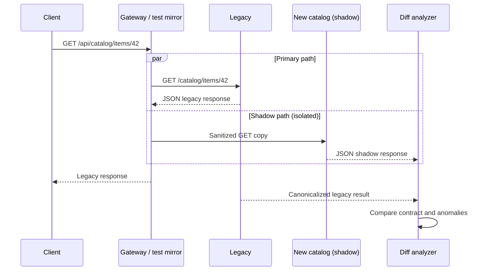
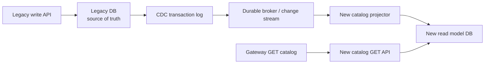
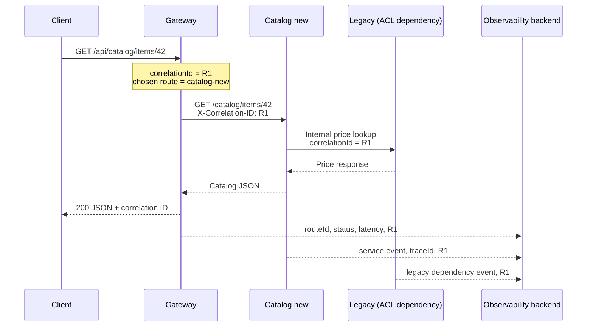
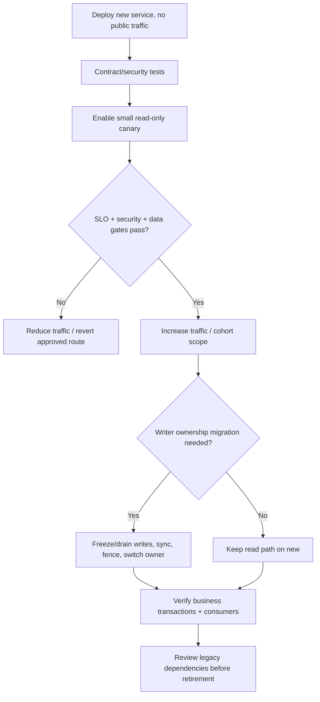

# Strangler pattern khi chuyển dần hệ thống cũ

Một doanh nghiệp có **monolith** xử lý đăng nhập, danh mục sản phẩm, giỏ hàng, đơn hàng và thanh toán. Monolith vẫn có người dùng thật, dữ liệu lớn và các kết nối với hệ thống đối tác. Nhóm kỹ thuật muốn đưa chức năng **danh mục** sang một microservice mới bằng Spring Boot, nhưng không thể yêu cầu mọi client cập nhật URL cùng lúc, cũng không thể ngừng hệ thống cũ để viết lại toàn bộ.

**Strangler Fig pattern** (thường gọi ngắn là *Strangler pattern*, hay mẫu thay thế dần) giải quyết bằng cách đặt một **lớp tiếp nhận/định tuyến ổn định** trước hệ thống cũ. Các chức năng chưa chuyển đổi tiếp tục được gửi đến monolith; từng capability hoàn thành dần được chuyển đến dịch vụ mới. Legacy và hệ thống mới cùng tồn tại trong giai đoạn chuyển tiếp, rồi những phần legacy không còn người dùng/dependency sẽ được ngừng.

Bài học thuộc chương **Mẫu định tuyến** của module **SPRING_CLOUD_GATEWAY**. Lớp định tuyến có thể là **Spring Cloud Gateway Server WebFlux**: dùng **route predicates** chọn tuyến theo path, method, host, header hoặc weight; dùng **Gateway filters** để chỉnh path/headers, thêm xác thực, giới hạn lưu lượng, circuit breaker/retry và quan sát requests. Những khả năng đó hỗ trợ chuyển dần hệ thống cũ, nhưng **Gateway không tự chuyển dữ liệu, quyền nghiệp vụ hay transaction semantics**. Đây chính là trọng tâm của bài.

**Mục tiêu học tập**

1. Giải thích mô hình **transform → coexist → eliminate** và những điều kiện để chọn một chức năng chuyển trước.
2. Dùng **Spring Cloud Gateway** giữ nguyên public API trong khi hướng request đến legacy hoặc service mới.
3. Chọn giữa **chuyển theo endpoint**, **canary theo trọng số**, **cohort theo tenant/user** và **shadow traffic**, không nhầm các chiến lược này.
4. Kiểm soát **thứ tự route, path rewrite, backward compatibility, authentication/authorization, dữ liệu và giao dịch ghi**.
5. Đặt các **tiêu chí go/no-go, rollback, quan sát SLO và kiểm thử** cho từng bước chuyển.
6. Hoàn thành một ví dụ có cấu hình Gateway, kiểm thử bằng stub, kịch bản tải nhẹ và checklist trước khi tắt legacy.

> **Phạm vi:** Các đoạn cấu hình chính sử dụng **Spring Cloud Gateway Server WebFlux** với namespace mới `spring.cloud.gateway.server.webflux.routes` (được dùng trong tài liệu Gateway 5.x và một số phiên bản mới). Dòng Gateway 4.x cũ thường sử dụng `spring.cloud.gateway.routes`; cần đối chiếu BOM và tài liệu chính xác của phiên bản đang chạy. **Gateway Server Web MVC** có namespace và runtime khác; **Proxy Exchange** là biến thể điều khiển bằng annotated controller, không tự áp dụng routes/filter factories của Gateway Server. Ví dụ hostname, services, dữ liệu và SLO trong bài đều mang tính minh họa, chưa được build hoặc deploy.

## 1. Strangler Fig pattern thực sự là gì?

Ẩn dụ của **Martin Fowler** là một loại cây leo bao quanh cây chủ và dần trở thành cấu trúc mới. Trong phần mềm, chúng ta xây các năng lực mới **xung quanh hệ thống đang hoạt động**, từng bước tách trách nhiệm của legacy thay vì làm một lần chuyển đổi *big bang*.

Theo cách diễn giải của AWS Prescriptive Guidance, có ba giai đoạn:

| Giai đoạn | Việc phải làm | Kết quả mong muốn |
| --- | --- | --- |
| **Transform** | Xác định capability, thiết kế contract và xây dịch vụ thay thế. | Có implementation mới đủ điều kiện kiểm thử mà chưa làm gián đoạn legacy. |
| **Coexist** | Đặt một proxy/facade ở ranh giới; định tuyến một phần yêu cầu sang dịch vụ mới, phần còn lại tới legacy. | Hai hệ thống phục vụ đồng thời theo quy tắc rõ ràng, có đường quay lại. |
| **Eliminate** | Chuyển hoàn toàn traffic, dữ liệu và callers; loại bỏ phần code/cơ sở hạ tầng legacy tương ứng. | Năng lực mới không còn phụ thuộc đường cũ; legacy được decommission an toàn. |

**Điều cốt lõi:** Đây là **một chiến lược kiến trúc, dữ liệu và thay đổi nghiệp vụ**, không chỉ là một bản YAML chia 90/10 lưu lượng. Nếu Gateway đưa 100% GET tới service mới nhưng mọi POST vẫn sửa database legacy và các batch jobs cũ còn giữ ownership dữ liệu, capability đó **chưa được thay thế hoàn toàn**.

### 1.1. Sơ đồ trước và sau khi bắt đầu

```mermaid
flowchart LR
    C["Web / Mobile / Partner clients"] --> G["Public API Gateway"]
    G -->|"Catalog: migrated GET"| N["catalog-service mới"]
    G -->|"Orders / Payments / các chức năng còn lại"| M["Legacy monolith"]
    N --> ND["Catalog-owned DB"]
    M --> MD["Legacy DB"]
    N -. "ACL / sync có kiểm soát"| M
```

Client vẫn dùng một địa chỉ ngoài:

```http
GET https://api.example.test/api/catalog/items/42
GET https://api.example.test/api/orders/1001
POST https://api.example.test/api/orders
```

Gateway chọn target phù hợp theo capability. Client không phải biết request danh mục đang vào monolith hay service mới; nếu public contract tương thích, frontend và đối tác không bắt buộc deploy đồng thời.

### 1.2. Vì sao không viết lại toàn bộ cùng lúc?

| Big bang replacement | Strangler migration |
| --- | --- |
| Cần chuẩn bị gần như toàn bộ chức năng trước cutover. | Chuyển từng khả năng hoặc từng nhóm đối tượng độc lập. |
| Một sự cố sau cutover có blast radius lớn. | Có thể giới hạn blast radius của bước chuyển, nếu ranh giới đúng. |
| Rollback khó vì schema/data có thể đổi toàn bộ. | Có đường rollback theo capability, **nếu** giữ tương thích dữ liệu và thay đổi có thể đảo ngược. |
| Khó xác minh behavior từng tính năng giữa hai hệ. | So sánh behavior thực tế từng tuyến và hợp đồng. |
| Có thể phù hợp nếu ứng dụng nhỏ và đơn giản. | Có overhead vận hành **hai** hệ thống, adapters và đồng bộ dữ liệu. |

Strangler **không luôn là lựa chọn tốt hơn**. Với một ứng dụng nhỏ, ít phụ thuộc và có thể dừng để thay thế, big bang có thể đơn giản hơn. Nếu requests không thể được chặn/định tuyến ở ranh giới, không sửa được call sites nội bộ và không có đường lấy dữ liệu cần thiết, mô hình strangler trở nên rất khó triển khai.

## 2. Vai trò chính xác của Spring Cloud Gateway

Gateway đóng vai trò **điểm vào ổn định**:

```text
Client request
   |
   v
Spring Security / WebFilter
   |
   v
RoutePredicateHandlerMapping  -- chọn MỘT route phù hợp
   |
   v
Gateway filter chain (StripPrefix, headers, retry, ...)
   |
   v
  +-----------------------------+
  | New service hoặc legacy app |
  +-----------------------------+
   |
   v
HTTP response qua Gateway
```

### 2.1. Gateway làm được gì?

- **`Path` / `Method` / `Host` / `Header`:** chọn nhóm requests phục vụ bởi implementation mới.
- **`Weight`:** chia tương đối request traffic giữa các routes cùng nhóm cho một **thử nghiệm canary phù hợp**.
- **`order` và predicate specificity:** bảo đảm routes chuyên biệt được xét trước route catch-all, theo cấu hình được kiểm chứng.
- **`StripPrefix`, `RewritePath`, `SetPath`:** chuyển public URI sang URI backend mà không đổi client.
- **`AddRequestHeader` / `SetRequestHeader` / `RemoveRequestHeader`:** thêm metadata phiên bản hoặc làm sạch headers khi forward.
- **`lb://service-id`:** phân giải service instance qua Spring Cloud LoadBalancer/Discovery khi được cấu hình.
- **Spring Security, RequestRateLimiter, CircuitBreaker/Retry:** bảo vệ và tăng khả năng chống chịu theo từng route/nhóm route.
- **Actuator, Micrometer và tracing:** quan sát request theo route ID, status, latency, trace ID.

### 2.2. Gateway không tự giải quyết điều gì?

| Vấn đề | Ai phải chịu trách nhiệm? |
| --- | --- |
| Hai database khác nhau, bản ghi không đồng bộ | Data migration/CDC/outbox/ETL và business owners |
| Đổi field/enum/error contract | Service adapter/anti-corruption layer và contract tests |
| User A được xem order của User B hay không | Backend ownership/tenant authorization, Gateway chỉ hỗ trợ tuyến bảo vệ |
| POST bị gửi lại sau timeout có gây ghi trùng không | Backend idempotency/transaction design |
| Eventual consistency giữa read model cũ/mới | Product SLA, data architecture và consumer handling |
| Monolith còn internal jobs/call sites gọi code cũ | Modernization plan, dependency inventory và ACL |
| Một dịch vụ mới không tương thích business rules | Golden-master/differential tests và product validation |

**Sai lầm phổ biến:** “Đã có Gateway chọn route nên coi như hoàn tất chuyển microservice.” Điều đó mới giải quyết **traffic interception**; còn data ownership, contract và caller dependencies quyết định liệu legacy có thể được tắt hay không.

## 3. Chọn capability đầu tiên để chuyển

Đơn vị chuyển đổi tốt thường là **một business capability hoặc một nhóm API thống nhất**, không phải “một class Java ngẫu nhiên trong monolith”.

Ví dụ:

| Capability | Mức phù hợp ban đầu | Lý do |
| --- | --- | --- |
| **Catalog read-only** | Cao | Chủ yếu GET, ít side effects; dễ đo và so response. |
| **Inventory availability read** | Trung bình | GET nhưng cần dữ liệu tươi và phụ thuộc kho hàng. |
| **Order tracking read** | Trung bình | Cần ownership/tenant, dữ liệu đơn hàng chính xác. |
| **Create order** | Thấp hơn ở bước đầu | Ghi dữ liệu, stock reservation, idempotency, events. |
| **Payment capture/refund** | Rất nhạy cảm | Transaction/đối soát/tuân thủ; sai lệch không thể chỉ rollback route. |
| **Authentication/session** | Nhạy cảm | Cookie/JWT/SSO/trust boundary và tương thích clients. |

Chấm điểm trước khi lựa chọn:

1. **Ranh giới API rõ:** Có thể quyết định target từ path/method/identity/tenant đáng tin cậy?
2. **Dữ liệu có thể tách:** Ai là người ghi chính? Có thay đổi schema, readers khác hoặc jobs cũ?
3. **Contract ổn định:** Có documented responses, error mapping, validation và compatibility tests?
4. **Phụ thuộc nội bộ:** Monolith có gọi chức năng này trực tiếp qua method/DB, bỏ qua Gateway không?
5. **Phục hồi được:** Nếu service mới lỗi, có thể route trở lại legacy mà dữ liệu vẫn hợp lệ?
6. **Đo được:** Có baseline latency, error budget, business reconciliation và source-of-truth logs không?

**Khuyến nghị trình tự trong bài:** Chuyển `GET /api/catalog/**` trước, sau đó mới đánh giá lệnh ghi/capabilities phụ thuộc nhiều dữ liệu. Đây là lựa chọn **theo giả định của lab**, không phải quy tắc bắt buộc cho mọi hệ thống.

## 4. Public API contract phải ổn định

Hệ thống hiện tại có:

```http
GET /api/catalog/items/42 HTTP/1.1
Host: api.example.test
Accept: application/json
```

Legacy trả:

```json
{
  "id": "42",
  "name": "Notebook",
  "price": 125000,
  "currency": "VND",
  "available": true
}
```

Service mới có database/schema riêng nhưng **public contract** vẫn phải đáp ứng cùng semantics, gồm:

- Method và path công khai.
- Status 200/404/400/401/403 và error schema.
- Field names, types (number/string), nullability, enum values, localization và sorting.
- Query parameters, pagination cursors, filters và default page sizes.
- Cache-Control, ETag/Last-Modified, Content-Type, CORS, cookies và redirects khi có.
- Quyền theo user/tenant, không chỉ một JSON payload của anonymous request.

Nếu service mới trả `priceInCents` nhưng legacy contract cần `price` VND, **adapter/ACL** phải chuyển đổi theo cách có kiểm thử. Gateway có thể sửa đường dẫn/header hoặc một số JSON attributes, nhưng không nên biến thành **nơi chứa toàn bộ business mapping**; mapping có quy tắc miền phức tạp nên thuộc service adapter.

### 4.1. Ghi rõ kết quả tại mỗi hop

Giả định:

```text
Public path:    /api/catalog/items/42
Gateway filter: StripPrefix=1
Backend path:   /catalog/items/42
```

Chỉ dùng `StripPrefix=1` khi **cả legacy target và service mới** chấp nhận path sau biến đổi, hoặc khai báo filter riêng cho từng route. Nếu monolith đòi `/legacy/catalog/items/42` còn service mới đòi `/v2/items/42`, phải định nghĩa rewrite riêng, không copy cùng một filter cho cả hai.

**Không dùng một status 200 để kết luận contract tương thích**. Cần assert body, headers, backend hit count và business semantics.

## 5. Giai đoạn 0: đặt Gateway trước legacy mà chưa chuyển chức năng

Bước đầu tiên là đưa clients đi qua **một địa chỉ public duy nhất** nhưng **chưa chuyển implementation nào**. Cần xác minh proxy không làm thay đổi method, URI, body, auth, TLS, timeout và response behavior ngoài chủ ý.

### 5.1. Cấu hình baseline Gateway Server WebFlux

```yaml
# application.yml — Gateway Server WebFlux namespace mới
spring:
  application:
    name: migration-gateway
  cloud:
    gateway:
      server:
        webflux:
          routes:
            - id: legacy-api
              order: 100
              uri: http://legacy-monolith:8080
              predicates:
                - Path=/api/**
              filters:
                - StripPrefix=1

server:
  port: 8080
```

Trong một mạng container/Kubernetes, `legacy-monolith` phải là hostname DNS hợp lệ. Nếu thử nghiệm trên máy local, có thể thay bằng `http://127.0.0.1:9090`, với backend chạy ngoài process Gateway. **`localhost` bên trong một Pod/container không trỏ đến Pod backend khác**.

Ánh xạ:

| Public URL | Path legacy nhận | Mục tiêu |
| --- | --- | --- |
| `GET /api/catalog/items/42` | `GET /catalog/items/42` | Legacy catalog |
| `POST /api/orders` | `POST /orders` | Legacy orders |
| `GET /api/orders/1001` | `GET /orders/1001` | Legacy orders |

Nếu legacy đã dùng nguyên prefix `/api/...` thì **bỏ `StripPrefix=1`**. Đây phải là kết quả của kiểm thử mapping, không là một quy tắc áp dụng mù quáng.

### 5.2. Mở Gateway không đồng nghĩa mở tất cả legacy APIs

Route `Path=/api/**` là **catch-all** cho các đường dẫn tương ứng. Nếu monolith có `/api/admin/reset`, route này cũng có thể chuyển tiếp request đến đó **trừ khi một lớp bảo vệ chặn trước**. Khi đặt Gateway public, cần inventory và policy deny/allow paths, methods và security riêng.

Ngay từ giai đoạn baseline, tối thiểu phải có:

- Public endpoint inventory được phê duyệt, không đơn giản mở toàn bộ `/api/**` ra Internet.
- TLS/ingress/forwarded header trust đúng.
- JWT/session/cookie handling nhất quán với legacy.
- Giới hạn kích thước request/headers và timeout.
- Actuator/route-management endpoints không public.
- Structured access logs/metrics cho route ID và upstream latency.
- Contract tests xác minh Gateway không đổi status/body/header trái mong đợi.

**Ví dụ catch-all ở đây dành cho môi trường lab có kiểm soát**, chưa phải production security allowlist.

### 5.3. Hai cách đặt Gateway trong thực tế

```text
Phương án A — tất cả client traffic đi qua Gateway:

Client -> API Gateway -> Legacy monolith

Phương án B — di chuyển dần DNS/ingress:

Client -> Existing ingress -> API Gateway -> Legacy monolith
                           \\-> legacy direct (cần loại bỏ theo kế hoạch)
```

Phương án B có thể giảm rủi ro khi lần đầu chèn Gateway vào đường đi, nhưng cũng có khả năng tạo **hai đường vào với chính sách security khác nhau**. Muốn Strangler thực sự đáng tin, phải biết requests nào còn đi thẳng legacy và có kế hoạch đóng các “cửa sau” đó.

## 6. Giai đoạn 1: chuyển riêng GET catalog sang service mới

Đây là bước chuyển theo **capability/endpoint**. Từ public client, URL không đổi; từ Gateway, một route cụ thể mới được chọn trước catch-all.

### 6.1. Cấu hình hai routes với độ ưu tiên tường minh

```yaml
spring:
  application:
    name: migration-gateway
  cloud:
    gateway:
      server:
        webflux:
          routes:
            - id: catalog-new-read
              order: -20
              uri: http://catalog-service:8080
              predicates:
                - Path=/api/catalog/**
                - Method=GET
              filters:
                - StripPrefix=1

            - id: legacy-api
              order: 100
              uri: http://legacy-monolith:8080
              predicates:
                - Path=/api/**
              filters:
                - StripPrefix=1

server:
  port: 8080
```

**Kết quả dự kiến nếu các backends có mapping như bài lab:**

| Request client | Route chọn | Backend nhận |
| --- | --- | --- |
| `GET /api/catalog/items/42` | `catalog-new-read` | `catalog-service:8080/catalog/items/42` |
| `GET /api/catalog/items/42?lang=vi` | `catalog-new-read` | `catalog-service:8080/catalog/items/42?lang=vi` |
| `POST /api/catalog/items` | `legacy-api` | `legacy-monolith:8080/catalog/items` |
| `GET /api/orders/1001` | `legacy-api` | `legacy-monolith:8080/orders/1001` |

Các predicates **trong cùng một route được kết hợp bằng AND**; route `catalog-new-read` chỉ match khi path **và** method đều đúng. Thuộc tính `order` có giá trị **nhỏ hơn được ưu tiên xét trước**. Catch-all cần đặt sau routes chuyên biệt để tránh bắt nhầm.

**Đừng xem bảng trên là kết quả đã chạy.** Cần test thực với Gateway version/BOM, route matcher, ingress prefix, backend stub và SecurityWebFilterChain cụ thể.

### 6.2. Không tự động biến GET thành “không có tác dụng phụ”

Theo ngữ nghĩa HTTP, GET nên safe/read-only. Nhưng legacy thực tế đôi khi dùng GET để ghi audit, mark-as-read hoặc khởi tạo sessions. Nếu `GET /catalog/...` có side effects ẩn, chuyển/copy GET không còn rủi ro thấp như tưởng. Trước migration:

1. Inventory DB writes/events/third-party calls do endpoint tạo ra.
2. Xác định cache headers, ETag và conditional GET.
3. Kiểm tra GDPR/PII/authorization ngay cả với API “chỉ đọc”.
4. Kiểm tra traffic đi qua CDN có cache response của users khác không.

Nếu endpoint thực sự có tác dụng phụ, cần sửa semantics hoặc áp chiến lược chuyển dữ liệu/ownership tương ứng.

### 6.3. Vì sao không dùng mỗi tên service mới ở URI?

`lb://catalog-service` giúp Service Discovery/LoadBalancer chọn các instances, nhưng nó **không tự bảo đảm** instance đó đã sẵn sàng đọc dữ liệu mới, có TLS đúng hoặc tương thích contract.

Một phương án tương đương trong môi trường có discovery:

```yaml
spring:
  cloud:
    gateway:
      server:
        webflux:
          routes:
            - id: catalog-new-read
              order: -20
              uri: lb://catalog-service
              predicates:
                - Path=/api/catalog/**
                - Method=GET
              filters:
                - StripPrefix=1
```

Muốn dùng `lb://` cần các dependency/infrastructure cho load balancing/discovery tương ứng. Nếu không có service instance, Gateway có thể trả 503 theo mặc định (và có thể cấu hình 404 theo version). Test trường hợp registry stale, không có instance, partial readiness và rolling update.

### 6.4. Đổi URI không có nghĩa đã chuyển *writes*

Sau khi GET catalog sang new service mà POST catalog vẫn về legacy:

```text
Read catalog --> New catalog-service
Write catalog -> Legacy monolith
```

Nếu new service đọc từ một database **khác**, cần một đường đồng bộ dữ liệu từ legacy sang new. Không được tạo hai nguồn dữ liệu có thể lệch nhau rồi đánh giá thành công chỉ bằng GET fixture tĩnh. Đây là chiến lược **read migration trước write migration** có chủ đích, yêu cầu replication/CDC/sync và được phép chịu một khoảng trễ xác định.

## 7. Route selection: specificity, order và fallback đúng chỗ

Spring Cloud Gateway Server WebFlux chọn route phù hợp dựa trên **predicates** và thứ tự route. Nếu nhiều routes có thể match cùng request, cấu hình `order` cần rõ ràng và phải test collision thực tế.

### 7.1. Ví dụ bắt nhầm route

```yaml
spring:
  cloud:
    gateway:
      server:
        webflux:
          routes:
            - id: legacy-all
              order: -100
              uri: http://legacy-monolith:8080
              predicates:
                - Path=/api/**

            - id: catalog-new
              order: 0
              uri: http://catalog-service:8080
              predicates:
                - Path=/api/catalog/**
```

**Rủi ro:** `legacy-all` có độ ưu tiên cao hơn nên nó có thể chặn route catalog. Predicate `Path=/api/catalog/**` **không mặc định thắng** route `/api/**` chỉ vì trông “cụ thể” hơn; phải cấu hình/kiểm chứng thứ tự.

### 7.2. Bảng route conflict

| Route | Predicate | Order | Vai trò |
| --- | --- | ---: | --- |
| `catalog-new-read` | GET + `/api/catalog/**` | -30 | Capability đã chuyển |
| `admin-deny-or-internal` | Internal host/role + `/api/admin/**` | -20 | Tách rõ vùng quản trị; authz vẫn do Security |
| `legacy-orders` | `/api/orders/**` | 0 | Orders chưa chuyển |
| `legacy-catchall` | `/api/**` | 100 | Fallback có kiểm soát |

**Không coi một route “admin-deny-or-internal” tự cấp quyền.** Route predicates chỉ chọn target; Spring Security và backend vẫn phải quyết định ai được gọi và dữ liệu nào được đọc/sửa. Đôi khi an toàn nhất là **không có public route** cho admin endpoints, kết hợp deny-all/security policy và ingress network restriction.

### 7.3. Thứ tự route khác thứ tự Gateway filters

- **Route order:** chọn route nào trong các route candidates.
- **Filter order:** sau khi có route, GlobalFilters và route-specific GatewayFilters được sắp theo `Ordered` để xử lý request/response.

Một custom `GlobalFilter` thông thường **không phải nơi quyết định lại route trước predicate matching**. Nếu cần xác định cohort dựa trên principal trước khi chọn route, phải đặt logic vào **đúng tầng trước route mapping**, hoặc dùng một trusted ingress/control-plane header. Thêm `X-Cohort` ở GlobalFilter **sau khi route đã match** là quá muộn để thay đổi route đã chọn cho lần xử lý đó.

### 7.4. Không dùng Route ID làm hợp đồng public

`id: catalog-new-read` là **metadata vận hành**. Client không nên cần biết route ID, và route ID có thể đổi khi tổ chức lại cấu hình. Public contract nên dựa trên URL/method/headers được tài liệu hóa; logs/traces và dashboards mới dùng route ID để phân biệt phiên bản implementation.

## 8. Biến đổi path mà không làm sai contract

Trong thời gian coexist, legacy và service mới có thể có **đường dẫn nội bộ khác nhau**:

```text
Client:  GET /api/catalog/items/42
Legacy:  GET /legacy/products/42
New:     GET /v2/catalog/items/42
```

Không có quy tắc `StripPrefix=1` nào tự chuyển mọi đường dẫn này. Cần thiết kế:

1. **Adapter trong service mới:** Dịch vụ mới nhận `/catalog/items/42` từ Gateway rồi tự ánh xạ logic nội bộ.
2. **Gateway RewritePath có kiểm soát:** Khi mapping là thuần cú pháp và ổn định.
3. **Anti-corruption layer riêng:** Khi phải chuyển field meanings, status, business identifier hoặc gọi nhiều services.

### 8.1. Dùng RewritePath cho prefix cố định

Ví dụ backend mới chấp nhận `/v2/catalog/items/**`:

```yaml
spring:
  cloud:
    gateway:
      server:
        webflux:
          routes:
            - id: catalog-v2
              order: -20
              uri: http://catalog-service:8080
              predicates:
                - Path=/api/catalog/**
                - Method=GET
              filters:
                - name: RewritePath
                  args:
                    regexp: /api/catalog/?(?<remaining>.*)
                    replacement: '/v2/catalog/$\{remaining}'
```

Trong YAML, replacement sử dụng **named regex capture** và cú pháp escape `/v2/catalog/$\{remaining}` theo hướng dẫn Gateway WebFlux; dùng single quotes để giữ nguyên dấu backslash trong scalar. Với request `GET /api/catalog/items/42`, backend kỳ vọng path `/v2/catalog/items/42`. **Vẫn phải test actual rewrite** trên release đang dùng, nhất là encoded paths, query và dấu slash cuối.

### 8.2. Khuyến nghị thực tế cho path transformation

- Giữ logic rewrite **ngắn, dễ review** và kiểm tra với nhiều paths (root, trailing slash, encoded slash, query params).
- Với request chứa dynamic ID, luôn xác minh canonicalization/percent encoding và backend nhận đúng ID.
- Không dùng regex rewrite để bypass authentication path match hoặc mở internal admin route.
- Khi chuyển URI có query và encoded data, test end-to-end với HTTP stub thay vì suy luận chỉ từ chuỗi string.
- Xem response `Location`/cookies/links: backend mới trả internal path/host có thể cần response header rewriting; **đừng cho internal hostname lộ ra client**.

Khi mapping vượt quá “đổi prefix”, hãy để **service adapter/ACL** chuyển contract thay vì xếp hàng chục regex và JSON rewrite filters khó bảo trì vào Gateway.

## 9. Giai đoạn 2: canary bằng Weight Route Predicate

Đôi khi service mới đã đáp ứng contract GET catalog nhưng nhóm muốn cho **10% lượng request** đi qua nó để đo p95/p99, error rate và sự khác biệt theo thực tế, thay vì chuyển 100% ngay.

Gateway Server WebFlux có **`Weight` Route Predicate Factory**:

```yaml
spring:
  cloud:
    gateway:
      server:
        webflux:
          routes:
            - id: catalog-legacy-canary
              order: -20
              uri: http://legacy-monolith:8080
              predicates:
                - Path=/api/catalog/**
                - Method=GET
                - Weight=catalog-read-migration, 90
              filters:
                - StripPrefix=1

            - id: catalog-new-canary
              order: -20
              uri: http://catalog-service:8080
              predicates:
                - Path=/api/catalog/**
                - Method=GET
                - Weight=catalog-read-migration, 10
              filters:
                - StripPrefix=1

            - id: legacy-other
              order: 100
              uri: http://legacy-monolith:8080
              predicates:
                - Path=/api/**
              filters:
                - StripPrefix=1
```

**Đọc đúng ý nghĩa của cấu hình:**

- Hai routes catalog ở cùng **Weight group** `catalog-read-migration`.
- Tỷ trọng logic trong group là **90 phần legacy / 10 phần new**, với các conditions về path và method giống nhau.
- Gateway phân phối **xấp xỉ** 90%/10% requests khi có đủ mẫu, **không bảo đảm chính xác 9 requests legacy rồi 1 request new**.
- `order=-20` giúp nhóm canary được xét trước fallback `legacy-other`; nhóm routes có cùng conditions để không làm kết quả khó dự đoán.
- Những requests ngoài GET catalog (ví dụ POST catalog hoặc GET orders) đi vào route legacy catch-all.

**Điều kiện cần:** Cả new và legacy phải có contract tương thích đối với GET catalog. Không dùng mẫu này làm kiểm thử chính cho POST/payment có state nếu chưa giải quyết ownership/idempotency.

### 9.1. Weight không tự “dính” theo user/tenant

Rất quan trọng: **Weight chia lựa chọn route theo request, không phải built-in sticky session**.

Ví dụ một người dùng gọi:

```text
GET /api/catalog/items/42  -> new service
GET /api/catalog/items/42  -> legacy service
GET /api/catalog/items/43  -> new service
```

Điều này có thể chấp nhận được với catalog GET có dữ liệu đã đồng bộ, contract tương thích và cache behavior nhất quán. Nhưng nếu cùng một user gửi lệnh ghi vào hai data stores khác nhau theo mỗi lần request, bạn dễ gặp:

- Read-after-write sai (ghi bên A, đọc bên B).
- ID sequencing hoặc inventory counts khác nhau.
- Hai nơi cùng gửi email/charge/payment.
- Session/cookie gắn với backend mà route sau không hiểu.
- Không biết hệ nào là source of truth.

Vì vậy **Weight không phải chiến lược phân vùng ownership dữ liệu**. Muốn chuyển write workloads, ưu tiên **cohort cố định theo user/tenant/aggregate**, hoặc đơn giản chuyển nguyên capability với một writer duy nhất khi readiness/data sync đã đạt.

### 9.2. Weight group phải tách theo capability

Không dùng cùng group `migration` cho cả catalog và payments nếu chúng có request patterns, methods và lifecycle khác nhau:

```text
Group catalog-read-canary:
  catalog-old GET 90
  catalog-new GET 10

Group shipping-read-canary:
  shipping-old GET 95
  shipping-new GET 5
```

Khi nhiều routes chung group nhưng predicates không tương thích, việc chọn route weighted có thể tạo kết quả khó kiểm soát và fallback path không như mong đợi. **Mỗi group chỉ nên bao một nhóm routes có cùng request eligibility contract**, sau đó test xác suất và route precedence thực tế.

### 9.3. Các giai đoạn canary khuyến nghị

| Nấc | Traffic tới service mới | Điều kiện nâng nấc |
| --- | ---: | --- |
| S0 | 0% | Service mới được kiểm thử qua đường test/internal riêng. |
| S1 | ~1% | Canary thật có đầy đủ tracing, không có security/contract violation. |
| S2 | ~5% | p95/p99, 5xx, data reconciliation vẫn trong giới hạn. |
| S3 | ~10% | Phân tích theo user segment, cache, response consistency. |
| S4 | ~25% | Gateway/backend có đủ capacity và rollout drain tốt. |
| S5 | ~50% | No significant regression, báo cáo dữ liệu đáng tin. |
| S6 | 100% | Bỏ canary split, dùng **một route new duy nhất**. |

Đây là **nhịp ví dụ**, không phải quy chuẩn. Một hệ thống ít traffic cần thời gian dài hơn để có đủ mẫu, trong khi dịch vụ thanh toán có thể yêu cầu gating thủ công dựa trên transaction reconciliation thay vì traffic percentages.

**Tránh cấu hình `Weight=0` như một cách “tắt route” lâu dài mà không kiểm tra behavior release.** Khi muốn 0%/100%, cách dễ hiểu và dễ audit hơn là thay route configuration với một đích rõ và giữ rollback snapshot.

### 9.4. So sánh tương đối bằng math đơn giản

Với 10.000 requests **đủ điều kiện** trong cửa sổ đo và cấu hình 10/90:

\[
\mathbb{E}[N_{\text{new}}] = 10{,}000 \times 0.10 = 1{,}000
\]

Nếu 10% request rơi vào 1.050 lần thực tế, chưa thể kết luận có bug chỉ vì không đúng 1.000. Cần xem số mẫu, phiên bản Gateway, cân bằng traffic qua replicas, từng route group và sự phân phối ngẫu nhiên. Nếu kết quả đo từ **backend requests** khác Gateway route metrics, có thể do retry, cache, proxy errors hoặc traffic bypass.

### 9.5. Không quên backend capacity

Đưa 10% traffic sang new service không có nghĩa new service chỉ chịu 10% tài nguyên legacy:

- Startup/JIT/cold caches có thể làm p99 cao hơn.
- New service có thể gọi một API legacy nhiều lần để tổng hợp response.
- Retry một request có thể tăng outbound attempts.
- New service xử lý dữ liệu theo cách nặng hơn.
- Canary requests có thể tập trung vào một loại query/tenant chứ không đều.

Theo dõi **RPS, concurrency, backend DB queries, errors, connection pools và business metrics** độc lập tại new service trước khi nâng tỷ trọng.

## 10. Cohort routing: chuyển một nhóm khách hàng ổn định

**Cohort** là nhóm requests được chọn theo một thuộc tính ổn định: tenant, user, tổ chức, vùng địa lý hoặc feature entitlement. Nếu dữ liệu của một tenant đã chuyển sang database mới, mọi request của tenant đó nên đi tới đúng owner để tránh “split brain”.

### 10.1. Ví dụ Header predicate — chỉ dùng với header đáng tin cậy

Giả định một **trusted ingress/BFF** đã xác thực request và **ghi đè** header `X-Trusted-Migration-Cohort` theo một policy được bảo vệ:

```yaml
spring:
  cloud:
    gateway:
      server:
        webflux:
          routes:
            - id: catalog-new-cohort
              order: -30
              uri: lb://catalog-service
              predicates:
                - Path=/api/catalog/**
                - Method=GET
                - Header=X-Trusted-Migration-Cohort, new
              filters:
                - StripPrefix=1

            - id: catalog-legacy-default
              order: 20
              uri: lb://legacy-monolith
              predicates:
                - Path=/api/catalog/**
                - Method=GET
              filters:
                - StripPrefix=1
```

**Cảnh báo bảo mật:** `Header=X-Trusted-Migration-Cohort, new` chỉ kiểm tra **chuỗi header**, không xác thực người gửi. Client Internet hoàn toàn có thể tự gửi header này **nếu ingress/Gateway không xóa hoặc xác minh nó**. Vì thế mẫu chỉ phù hợp khi:

1. Ingress loại mọi giá trị header do client gửi.
2. Một thành phần tin cậy xác định cohort từ principal/tenant đã xác thực hoặc routing policy server-side.
3. Ingress/BFF ghi lại header mới, không dùng query/cookie tùy ý làm security decision.
4. Gateway chỉ nhận traffic từ trusted ingress (network policy/mTLS và forwarded-header policy).
5. New và legacy đều thực thi **authorization tương đương**, không dùng cohort header làm “vé vào” admin API.

Không cho người dùng chọn target/tenant mới bằng header nếu điều đó có thể dẫn tới quyền dữ liệu hoặc tiền bạc khác nhau.

### 10.2. Chọn cohort bằng hash ổn định

Tại **một thành phần quyết định trước route matching**, có thể dùng nguyên tắc:

```text
identity = verifiedTenantId
bucket = stableHash(identity + migrationSalt) mod 100

if tenant is in approvedMigrationSet
    and bucket < configuredPercentage
then route to new-service
else route to legacy-service
```

Đây là **pseudocode kiến trúc**, không phải Gateway built-in predicate có sẵn tên `stableHash`. Việc triển khai cần:

- Dữ liệu **đã xác thực** (verified tenant ID), không `X-Tenant` do client tự gửi.
- Hash algorithm/seed **ổn định** giữa replicas và deployments.
- Quy tắc versioning khi tăng phần trăm; nếu dùng một mapping khác gây thay đổi cohort ngoài dự kiến, có thể tạo migration churn.
- Cơ chế override có audit/approval cho tenants nhạy cảm.
- Một nơi lưu **ownership state** để biết tenant đang đọc/ghi hệ nào, tránh chỉ tính hash từ tỷ trọng traffic.

**Quan trọng về thời điểm:** Route predicates chạy trong giai đoạn chọn route, nên không thể trông đợi một **Gateway `GlobalFilter` chạy sau khi route đã chọn** tự tạo header rồi giúp predicate `Header` của cùng request match lại. Nếu tính cohort trong Gateway, cần WebFilter/auth integration ở đúng thứ tự **trước route mapping**, hoặc external trusted ingress.

### 10.3. Weighted canary và cohort: so sánh nhanh

| Tiêu chí | Weight theo request | Cohort ổn định |
| --- | --- | --- |
| Phân phối | Xấp xỉ % mỗi request | Theo nhóm user/tenant/hash bucket |
| Built-in Gateway | Có `Weight` predicate | Phối hợp `Header`/custom routing/trusted upstream |
| Sticky theo tenant | **Không** | Có nếu mapping ổn định |
| Phù hợp GET stateless | Thường phù hợp | Phù hợp |
| Phù hợp write/data ownership | **Không tự bảo đảm** | Phù hợp hơn với một writer cho mỗi aggregate |
| Thay % canary | Tương đối đơn giản | Cần quản lý cohort, lịch sử owner và data sync |
| Security | Không mặc định tăng quyền | Header/identity phải được xác thực, không tin user input |
| Rollback | Chuyển route weighting | Có thể cần rollback data/ownership theo từng cohort |

### 10.4. Cohort sau xác thực không có nghĩa cùng một session backend

Nếu legacy dùng session cookie giữ trạng thái local trên instance còn service mới dùng JWT/stateless, chuyển tenant sang new không tự “di chuyển” session. Cần:

- SSO/OIDC/session exchange hoặc re-login policy rõ.
- Cookie domain/path/SameSite/CSRF tương thích với client.
- Token audience và claims mapping phù hợp new service.
- Ownership/tenant claims được xác minh ở backend.
- Kế hoạch xử lý sessions đã tồn tại và WebSocket/SSE connections dài.

Không cho phép session/cookie của legacy được chấp nhận “mặc định” ở new service nếu không có trust model/validation rõ ràng.

## 11. Shadow traffic khác canary: xem trước response mà không ảnh hưởng client

**Canary**: Gateway chọn **một** implementation để trả response thật cho một request.

**Shadow/mirroring**: Traffic chính vẫn đến legacy và trả kết quả legacy; một bản copy được đưa tới service mới **để quan sát/so sánh**, nhưng response shadow không trả client.



**Không có nghĩa Spring Cloud Gateway mặc định có một filter “ShadowTraffic” sẵn hoạt động chỉ nhờ YAML.** Đây là một **mẫu kiến trúc bổ sung**, cần custom filter/ingress mirroring/test harness hoặc một proxy được thiết kế để nhân traffic an toàn.

### 11.1. Rủi ro khi copy requests

- **POST/PUT/DELETE** có side effects → bản copy có thể ghi trùng hoặc thanh toán hai lần.
- Ngay cả GET legacy có thể cập nhật session, view counters, audit records hoặc quota.
- Bản copy có thể chứa Authorization, Cookie, PII, địa chỉ email và thông tin payment.
- Shadow service có thể gọi bên thứ ba thật, gửi email hoặc thay inventory.
- Traffic shadow tăng tải database/service mới dù response không dùng.
- Nếu mirror được thực hiện đồng bộ, shadow bị chậm có thể kéo dài response path chính.

**Thiết kế an toàn:** shadow chỉ với read-only endpoints đã kiểm chứng, dùng masked/synthetic payloads hoặc allowlisted fields, network/data isolation, chặn side effects và **không để latency/error của shadow làm ảnh hưởng primary response**.

### 11.2. So sánh đúng nghĩa, không so raw JSON strings

Hai hệ có thể trả cùng semantics nhưng khác:

- Thứ tự trường JSON.
- Timestamp được làm tròn hoặc timezone.
- Generated IDs/trace IDs.
- Sắp xếp list khi API không hứa thứ tự.
- Eventual consistency lag.
- Headers động như `Date`, `Server`, request ID.

Nên **canonicalize** response:

```text
legacy JSON --------+
                    +--> normalize schema & stable fields
new JSON -----------+
                          |
                          v
                  semantic contract diff
                          |
                +---------+---------+
                |                   |
           expected variance   true mismatch
```

Phân loại sai lệch theo mức độ:

| Loại | Ví dụ | Hành động |
| --- | --- | --- |
| **Bảo mật nghiêm trọng** | New trả thông tin của tenant khác | Dừng canary, chặn rollout ngay. |
| **Nghiệp vụ nghiêm trọng** | Giá tiền/tồn kho sai | Dừng, đối soát và sửa data ownership. |
| **Contract** | New đổi kiểu `price` string thành number | Sửa adapter/contract hoặc version API. |
| **Độ tươi dữ liệu** | New chậm hơn legacy 5 giây khi SLA cho tối đa 2 giây | Xem CDC lag, không “làm ngơ” vô hạn. |
| **Hình thức không có nghĩa** | JSON field order khác | Normalize trước khi coi là lỗi. |

Shadow không thể thay **authenticated positive/negative integration tests**, bởi shadow thường chỉ bao một tập input và có thể bị masking/isolated side-effects.

## 12. Dữ liệu: nơi Strangler khó hơn việc đổi route

Khi hai implementations cùng tồn tại, nguy cơ lớn nhất không chỉ là định tuyến nhầm mà là **hai hệ có hai sự thật khác nhau về cùng một nghiệp vụ**.

```text
Legacy monolith                   New catalog service
----------------------------      ----------------------------
legacy_db.products                catalog_db.items
legacy_db.stock                   catalog_db.availability
legacy_db.price_rules             catalog_db.price_snapshots
```

Nếu GET chuyển sang new nhưng admin tools cũ vẫn viết vào `legacy_db.products`, new service cần đồng bộ. Nếu chuyển cả POST/PUT sang new nhưng một batch job cũ vẫn sửa legacy DB, **hai writers cạnh tranh** dẫn đến lost updates hoặc dữ liệu hợp nhất không đúng.

### 12.1. Phân biệt ba hướng chuyển

| Hướng chuyển | Request path | Nguồn ghi chính | Rủi ro |
| --- | --- | --- | --- |
| **Read path trước** | GET → new, POST/PUT → legacy | Legacy | New read replica/read model có thể trễ. |
| **Write path trước** | POST/PUT → new, GET → legacy | New | Legacy reads phải nhận dữ liệu đồng bộ ngược; dễ stale. |
| **Theo aggregate/tenant** | Reads/writes của tenant A → new, tenant B → legacy | Một writer cho mỗi aggregate/tenant | Cần routing ownership ổn định và xử lý workflows qua ranh giới. |

**Không chọn một chiến lược duy nhất cho mọi domain.** Catalog reference data có thể chấp nhận eventual consistency; inventory reservation và payment balance có thể cần transaction constraints chặt hơn.

### 12.2. Một writer cho mỗi aggregate là nguyên tắc an toàn

Đối với lệnh ghi:

```text
ownership(orderId=1001) = LEGACY
ownership(orderId=1002) = NEW
```

Tại thời điểm quyết định owner, mọi lệnh mutate order 1001 phải đi qua **một authority duy nhất**; hệ còn lại có thể đọc bản sao/được sync nhưng không cùng lúc nhận quyền ghi cho chính aggregate đó.

Nếu migration theo tenant:

```text
tenant A -> NEW writes and primary reads
tenant B -> LEGACY writes and primary reads
```

**Giới hạn:** Từ HTTP path `/api/orders/1001`, Gateway chưa chắc biết tenant của order. Không nên quyết định write ownership từ query/header không tin cậy. Có thể cần một **routing/ownership service** đã xác thực hoặc để backend/domain layer nhận request rồi chuyển tiếp có kiểm soát.

### 12.3. Tại sao dual-write là bẫy?

Một thiết kế nghe đơn giản:

```text
POST order -> write legacy DB
           -> write new DB
```

Nhưng nếu legacy write thành công còn new write thất bại, hệ thống đã **partial commit**. Nếu retry cả hai, legacy có thể tạo đơn thứ hai. Hai databases không tự cùng commit atomic transaction qua một HTTP proxy.

| Anti-pattern | Hậu quả |
| --- | --- |
| Gateway gọi đồng thời hai backends cho một POST | Hai side effects; khó biết response nào đúng. |
| New ghi DB rồi gọi legacy DB không có idempotency | Partial failure, duplicate writes. |
| Hai DB đều có trigger sửa bản sao bên kia | Update loops, conflict, mất source of truth. |
| Dùng Redis flag không version để chọn owner | Race giữa pods, chuyển owner ngoài kiểm soát. |
| Rollback route khi data mới chưa sync ngược | Legacy không thấy transactions đã commit ở new. |

**Gateway không thể tạo exactly-once semantics cho hai data stores.** Cần domain transaction, idempotency, conflict resolution và reconciliation có chủ đích.

### 12.4. CDC cho giai đoạn read migration

**Change Data Capture (CDC)** đọc thay đổi từ log giao dịch/database stream của legacy và đưa vào read model mới:



Legacy tiếp tục là writer trong lúc new service được kiểm chứng bằng dữ liệu thật. Nhưng cần:

- Initial snapshot + CDC catch-up để không bỏ sót thay đổi giữa lúc backfill và stream.
- Schema evolution, out-of-order events, duplicated delivery.
- Idempotent consumer/projection và checkpoint.
- Tính nhất quán theo key/partition; consumer lag được giới hạn.
- Xử lý xóa dữ liệu/PII theo privacy và retention policy.
- Theo dõi replication lag p95/p99, stale key count và max lag.

Nếu new API trả dữ liệu stale vượt SLA, **không nên chỉ giảm Weight rồi tuyên bố data migration đạt**. Phải đối soát các trường nghiệp vụ quan trọng.

### 12.5. Transactional outbox cho write/event migration

Khi new service trở thành writer chính, có thể dùng **transactional outbox**:

```text
New service transaction:
  1. UPDATE aggregate in new DB
  2. INSERT outbox_event in same DB transaction
  3. COMMIT

Outbox relay:
  4. Publish event to durable broker (at least once)
  5. Consumers update legacy read model / external integrations
```

Business data và outbox record nằm trong **một transaction của DB**, giảm nguy cơ “DB commit nhưng event mất”. Tuy nhiên relay có thể publish lặp, nên consumer cần idempotency/inbox/deduplication. **Không tự hứa exactly-once toàn hệ thống**.

### 12.6. Rollback sau khi new đã ghi dữ liệu

Trước khi chuyển lệnh ghi sang new, phải trả lời:

1. New lỗi sau 24 giờ thì legacy có đủ data để phục vụ readers/writers không?
2. Có đường sync **new → legacy** được kiểm soát, versioned và audit không?
3. Có schema/enum/ID mới mà legacy không hiểu không?
4. Có irreversible actions như payment capture, email hoặc external dispatch không?
5. Mỗi aggregate hiện thuộc owner nào; ai có quyền thay ownership state?
6. Có **fencing/version token** để ngăn writers cũ/ mới đồng thời ghi không?

Nếu chưa rollback được dữ liệu, cần **giảm bước chuyển, chuẩn bị forward-fix/runbook và kiểm soát blast radius**. Không tuyên bố rollback chỉ bằng cách đổi URI từ new về legacy.

## 13. Anti-Corruption Layer (ACL) bảo vệ miền nghiệp vụ mới

Một **Anti-Corruption Layer** là adapter giữa các mô hình dữ liệu/nghiệp vụ khác nhau. Nó có thể nằm trong new service, một integration adapter riêng hoặc facade của monolith; **không nhất thiết nằm ở Gateway**.

### 13.1. Ví dụ chuyển đổi contract

Legacy có:

```json
{
  "PROD_ID": 42,
  "PRICE_VND": 125000,
  "STOCK_STATUS": "Y"
}
```

Trong new domain:

```json
{
  "sku": "ITEM-42",
  "price": {"amount": 125000, "currency": "VND"},
  "availability": "IN_STOCK"
}
```

Public contract vẫn cần:

```json
{
  "id": "42",
  "price": 125000,
  "currency": "VND",
  "available": true
}
```

ACL giải quyết:

- Mapping dữ liệu và enum có ý nghĩa nghiệp vụ.
- Semantic differences: giá đã gồm thuế chưa, timezone, trạng thái tồn kho.
- Legacy error codes → domain errors → public HTTP status.
- ID translation, validation, dữ liệu thiếu và versioning.
- Gọi legacy capability chưa chuyển với resilience và tracing.

**Đừng dồn toàn bộ logic này vào hàng loạt `ModifyResponseBody`/`RewritePath` filters của Gateway.** Filters thích hợp cho cross-cutting transformation đơn giản; domain translation có test riêng và owner rõ.

### 13.2. Monolith còn gọi capability đã chuyển

Một vấn đề không thấy từ Gateway logs: monolith có thể gọi `ProductRepository.findById` **trực tiếp**. Dù public GET đã chuyển sang new service, luồng nội bộ vẫn sử dụng code/data cũ.

Phương án facade:

```text
Legacy order module
     |
     v
Legacy CatalogFacade (ACL)
     |
     +-- not yet migrated --> legacy implementation
     |
     +-- already migrated --> catalog-service internal API
```

Caller legacy không cần biết implementation nhưng phải sửa internal call sites, kiểm thử recursion/circular dependencies và decommission adapter khi migration kết thúc.

### 13.3. Tránh vòng lặp service calls

```text
Gateway -> New catalog
             -> Legacy monolith for price
                   -> Gateway catalog endpoint
                         -> New catalog
                             -> ...
```

Vòng dependency có thể gây cạn connection pools, tăng latency và timeout dây chuyền. ACL cần **đường gọi nội bộ có phân quyền** đến capability thực, không quay lại public Gateway route với cùng path.

Sơ đồ dependency phải làm rõ:

- Client → Gateway → service được chọn.
- New → legacy internal API **khác public migrated endpoint**.
- Legacy → new qua ACL/adapter có versioning.
- Không cho request chọn target tùy ý qua `X-Backend-Url` do client gửi.

## 14. Kế hoạch di chuyển dữ liệu theo các mốc có thể kiểm chứng

| Mốc | Source of truth | Gateway routing | Điều kiện hoàn tất |
| --- | --- | --- | --- |
| **A. Inventory** | Legacy | 100% legacy | Writers/readers/batch jobs được liệt kê. |
| **B. Backfill** | Legacy | 100% legacy | Snapshot đủ bản ghi, checksum/key coverage. |
| **C. CDC catch-up** | Legacy | 100% legacy | Consumer lag và reconciliation đạt SLA. |
| **D. Shadow GET** | Legacy | Response từ legacy | New responses được so semantics an toàn. |
| **E. Canary GET** | Legacy | GET phân phần trăm new | Error/latency/data diff đạt gates. |
| **F. New GET full** | Legacy | GET 100% new | Read model đồng bộ theo SLA. |
| **G. Write ownership cutover** | Đổi có kiểm soát theo tenant/aggregate | Writes đến owner mới | Không hai writers; idempotency/fencing đạt. |
| **H. New write full** | New | Capability → new | Legacy callers đã redirect hoặc sync. |
| **I. Retire legacy** | New | Không còn legacy route cho capability | Internal jobs, data dependencies, ACL đã kiểm tra. |

**Không bắt buộc mọi domain phải theo cùng lịch**, nhưng bỏ qua mốc ownership thường gây rollback không an toàn.

### 14.1. Đo replication lag

Nếu new read model cập nhật từ sự kiện tại `t_event` và apply xong tại `t_apply`:

\[
\text{replication lag} = t_{\text{apply}} - t_{\text{event}}
\]

Đo **p95/p99 lag**, max lag và stale key count, không chỉ trung bình. Nếu clocks khác nhau, cần đồng bộ thời gian hoặc dùng broker offset/cursor đáng tin. Với API tồn kho/giá, đặt tolerance theo nghiệp vụ chứ không chỉ “lag nhỏ chắc ổn”.

### 14.2. Write cutover cần một quy trình điều phối

Trước khi một tenant chuyển từ legacy writer sang new writer:

1. Block/drain write requests cũ theo tenant hoặc dùng fencing/versioning hợp lệ.
2. Chờ in-flight transactions hoàn tất, ghi checkpoint/offset rõ.
3. Sync trạng thái cuối; verify checksums, ownership và business totals.
4. Switch authoritative owner bằng thao tác atomic/được kiểm soát.
5. Chỉ sau đó mới cho writes tới new service.
6. Giám sát duplicate transactions, consistency và error budget.
7. Có đường rollback dữ liệu đã kiểm thử **hoặc** forward-fix plan nếu không đảo ngược.

**Một flag ở Gateway không thay thế distributed coordination** nếu workers/batch jobs của monolith vẫn ghi trực tiếp vào cùng aggregate.

### 14.3. Dependency map để biết khi nào loại bỏ legacy

Các thành phần ngoài HTTP cần được kiểm kê:

| Thành phần | Có thể còn phụ thuộc legacy | Phải làm gì? |
| --- | --- | --- |
| Scheduled batch/report | SQL trực tiếp trên legacy DB | Chuyển sang API/read model có contract mới. |
| ETL/analytics | Bảng và schema cũ | Đổi ingestion feed và data ownership. |
| Messaging consumers | Legacy topic/event schema | Hỗ trợ schema evolution và chuyển consumers. |
| Mobile apps cũ | Endpoint/cookie/version không còn docs | Telemetry theo API versions và deprecation. |
| Partner integrations | Whitelisted legacy IP/URL | Phối hợp thay endpoint/cert/DNS. |
| Auth/SSO | Session store/trust key cũ | Migration session/token policy. |
| Jobs nội bộ monolith | Method calls không qua Gateway | Tạo facade/ACL và chuyển call sites. |
| Monitoring/alerts | Tên route/metric/log cũ | Cập nhật dashboard, triage/runbooks. |

**Không coi “Gateway có 0 requests tới legacy API” là bằng chứng legacy đã hết người dùng** nếu internal batch jobs còn truy cập trực tiếp.

## 15. Authentication, authorization và identity trong lúc coexist

Hai implementations có thể dùng hai cơ chế khác nhau:

```text
Legacy:
  browser session cookie + legacy role table

New service:
  OAuth2/OIDC JWT + fine-grained scopes / tenant claims
```

Gateway có thể làm security perimeter chung, nhưng không được **tự suy ra quyền object-level** của backend. Cần bảo vệ đồng thời:

1. **Incoming identity:** Client thật, issuer/audience/token expiry.
2. **Route-level policy:** Method/path nào và scope nào được phép.
3. **Service-to-service identity:** Gateway/new service chứng minh danh tính với backend/legacy.
4. **Object/tenant ownership:** Backend xác minh user có quyền đọc/sửa object cụ thể.
5. **Session/cookie compatibility:** Legacy browser flows, CSRF và redirect URLs vẫn đúng.

### 15.1. Spring Security reactive policy mẫu

Ví dụ Gateway chỉ công khai GET catalog và một số operations orders:

```java
package com.example.gateway.security;

import org.springframework.context.annotation.Bean;
import org.springframework.context.annotation.Configuration;
import org.springframework.http.HttpMethod;
import org.springframework.security.config.Customizer;
import org.springframework.security.config.annotation.web.reactive.EnableWebFluxSecurity;
import org.springframework.security.config.web.server.ServerHttpSecurity;
import org.springframework.security.web.server.SecurityWebFilterChain;

@Configuration
@EnableWebFluxSecurity
public class GatewaySecurityConfiguration {

    @Bean
    SecurityWebFilterChain security(ServerHttpSecurity http) {
        return http
            // Chỉ phù hợp API stateless Bearer-only.
            .csrf(ServerHttpSecurity.CsrfSpec::disable)
            .authorizeExchange(exchanges -> exchanges
                .pathMatchers(HttpMethod.GET, "/api/catalog/**")
                    .permitAll()
                .pathMatchers(HttpMethod.GET, "/api/orders/**")
                    .hasAuthority("SCOPE_orders.read")
                .pathMatchers(HttpMethod.POST, "/api/orders/**")
                    .hasAuthority("SCOPE_orders.write")
                .anyExchange().denyAll())
            .oauth2ResourceServer(oauth2 ->
                oauth2.jwt(Customizer.withDefaults()))
            .build();
    }
}
```

Muốn chạy cần dependency JWT Resource Server và decoder/issuer/trust configuration đúng version. Đây là **ví dụ WebFlux**. Trong Gateway Server Web MVC, dùng Servlet `SecurityFilterChain` và `HttpSecurity`, không copy reactive type.

**Giới hạn của ví dụ:**

- Không áp dụng nguyên mẫu `csrf.disable()` nếu Gateway sử dụng browser cookie/session login; khi đó CSRF protection vẫn phải được thiết kế và test.
- `permitAll` cho catalog chỉ là quyết định của bài lab, có thể không phù hợp với catalog dữ liệu riêng.
- Issuer, signature, expiry và **audience** phải được validate theo business policy; không mặc định JWT scope converter chính xác nếu issuer dùng custom claims.
- `anyExchange().denyAll()` bảo vệ routes không khai báo, nhưng cần có rules rõ cho health endpoints/actuator nếu được expose; không mở management routes ra Internet để làm test.
- Ownership như “order 42 của tenant A” **không thể biết chỉ từ scope**; backend phải kiểm tra.

### 15.2. Route predicates không thay thế quyền truy cập

Ví dụ một client gửi:

```http
GET /api/orders/42 HTTP/1.1
X-Trusted-Migration-Cohort: new
Authorization: Bearer <invalid-token>
```

Cho dù `Header` route predicate match, **Spring Security phải từ chối** request không hợp lệ. Không dùng header cohort làm authorization token; nếu muốn client chỉ thử new service trong sandbox, vẫn phải bảo vệ theo account/test entitlement được xác thực.

### 15.3. Token Relay và service credentials khác nhau

Khi legacy và new đồng thời cần identity:

| Cách truyền | Dùng khi nào | Nguy cơ |
| --- | --- | --- |
| Relay client bearer token | Backend được phép nhận/kiểm tra token có audience/issuer thích hợp. | Rò token tới trust zone không phù hợp; audience mismatch. |
| Gateway gửi service-to-service token | Backend tin service identity, còn user context gửi riêng có ký/xác thực. | Dễ nhầm service authority với end-user authority. |
| Legacy session adapter | Browser cookie contract chưa được thay. | CSRF, SameSite, session fixation, cookie sharing. |
| mTLS giữa Gateway và backends | Xác thực machine/service identity. | mTLS **không thay** end-user/object authz. |

Spring Cloud Gateway có `TokenRelay` filter cho những mô hình OAuth2 client phù hợp khi dependencies/security context hỗ trợ. **Không cho rằng thêm `TokenRelay` YAML tự biến một Gateway resource server nhận JWT thành một token exchange đầy đủ**, hoặc tự tạo bearer token đúng audience cho legacy. Cần thiết kế explicitly, cấu hình security starter/client registration đúng và test token headers thực tới backend stub.

### 15.4. Chặn client-supplied identity headers

Những headers cần review trước khi forward:

- `X-User-Id`, `X-Tenant-Id`, `X-Role`, `X-Scopes`.
- `X-Trusted-Migration-Cohort`.
- `Forwarded` / `X-Forwarded-For` / `X-Forwarded-Host`.
- `Authorization`, `Cookie`, `Set-Cookie`.
- `Host`, `X-Original-Uri` và các headers do ingress/service mesh thêm.

**Anti-pattern:** Backend tin `X-User-Id: admin` do client gửi. Nếu Gateway cần đưa identity xuống backend, dùng metadata do **một thành phần đã xác thực** phát, xóa giá trị từ client ở trusted boundary, ràng buộc network/mTLS hoặc ký nội dung theo policy và backend xác minh nguồn.

### 15.5. CORS, redirects, cookies và browser flows

Khi chuyển login/account flows, cần test:

- CORS preflight qua Gateway trước JWT policy phù hợp.
- Cookie `Domain`/`Path`/`SameSite`/`Secure`/`HttpOnly`.
- Redirect `Location` không trỏ tới host nội bộ hoặc vòng lặp `legacy → gateway → legacy`.
- Session logout/refresh/revocation vẫn đúng.
- CSRF token không bị vô hiệu khi route chuyển backend.
- SPA browser không bị mixed content khi external HTTPS chuyển sang internal HTTP.

**Đừng chọn di chuyển authentication/session làm capability đầu tiên chỉ vì nó có ít endpoints**; phạm vi security có thể rộng hơn nhiều.

## 16. Resilience và fallback: khi new service lỗi thì làm gì?

Rollback traffic có thể giảm rủi ro, nhưng **fallback tự động per request** không phải lúc nào cũng an toàn. Cần phân biệt:

| Trường hợp | Có thể cân nhắc | Cần tránh |
| --- | --- | --- |
| GET catalog stateless, dữ liệu legacy vẫn đủ mới | Chuyển route về legacy hoặc controlled read fallback | Phơi dữ liệu stale hoặc contract lỗi. |
| GET order sau writes đã chuyển sang new | Chỉ fallback nếu legacy read model có cùng dữ liệu/ownership | Trả 404 sai, làm lộ object khác tenant. |
| POST tạo đơn/payment | Trả lỗi rõ và retry theo idempotency contract | Gọi legacy tự động sau timeout của new (có thể double commit). |
| New service thiếu instance | Alert/discovery recovery, rollback có điều kiện | Âm thầm đổi domain owner bằng 503 → legacy. |
| Rate limiter/identity provider lỗi | Fail-open/closed theo security policy | Tắt xác thực để “giữ availability”. |

### 16.1. Circuit breaker là bảo vệ, không phải nút rollback dữ liệu

Spring Cloud Gateway Server WebFlux tích hợp Spring Cloud CircuitBreaker/Resilience4J bằng starter phù hợp. Một ví dụ cho read-only GET:

```yaml
spring:
  cloud:
    gateway:
      server:
        webflux:
          routes:
            - id: catalog-new-resilient
              uri: lb://catalog-service
              predicates:
                - Path=/api/catalog/**
                - Method=GET
              filters:
                - StripPrefix=1
                - name: CircuitBreaker
                  args:
                    name: catalogReadBreaker
                    fallbackUri: forward:/catalog-read-fallback
```

**Lưu ý:** `fallbackUri: forward:/catalog-read-fallback` là một **internal forward URI**; bạn phải tự cung cấp controller/handler hoặc route đã được thiết kế để xử lý fallback. Nó **không tự động** biết cần gọi legacy app hay map schema. Cần dependency Resilience4J và cấu hình breaker thresholds/timeouts đúng; nếu fallback handler proxy tới legacy, phải test authorization, path, no-loops, data consistency và prevent double side effects.

Một lựa chọn đơn giản hơn khi dịch vụ mới mất ổn định là **đổi cấu hình routes có version/audit** về legacy cho capability đọc, sau khi xác nhận legacy data còn đáp ứng contract. Cách này tránh “mỗi request thử new, lỗi mới về old” gây tải gấp đôi trong sự cố.

### 16.2. Retry và amplification

Gateway Retry Filter cho phép retry theo statuses/methods/exceptions/backoff, nhưng:

- Retries tạo thêm upstream attempts; client 100 RPS có thể thành 300 attempts/s nếu cấu hình hai retries và toàn bộ requests lỗi.
- **Filter sau Retry có thể chạy lại**, phải kiểm tra side effects trong custom filters.
- Retry POST có body có thể cần cache bytes và tăng áp lực memory.
- POST/payment có thể đã commit trước khi timeout; retry vào legacy tạo trùng giao dịch.
- Retries và circuit breaker budgets cần phối hợp, không độc lập nhân lẫn nhau.

Mẫu cân nhắc cho GET:

```yaml
- name: Retry
  args:
    retries: 1
    statuses: BAD_GATEWAY
    methods: GET
    backoff:
      firstBackoff: 100ms
      maxBackoff: 200ms
      factor: 2
      basedOnPreviousValue: false
```

Đoạn này là **filter fragment** đặt dưới `filters:` của một route thích hợp, không phải một `application.yml` đầy đủ. Nó chỉ retry status đã liệt kê, không xử lý mọi network failure trừ khi exceptions cũng được cấu hình/theo mặc định phiên bản. Test total client deadline, upstream attempts và exception mapping thực tế.

### 16.3. Bảo vệ backend legacy khi traffic quay lại

Một sự cố new service có thể khiến 50–100% traffic quay về legacy ngay:

```text
Normal state:   Legacy 30% load, New 70%
Rollback state: Legacy 100% load, New 0%
```

Nếu legacy đã bị giảm replicas/connection pool, nó **có thể không còn capacity phục vụ 100% traffic**. Trước canary phải biết:

1. Legacy tối đa chịu bao nhiêu RPS ở SLO?
2. Cần bao nhiêu thời gian scale up nó khi rollback?
3. Có cache/DB connections đủ không?
4. Liệu new writes tạo dữ liệu mà legacy không hiểu không?
5. Có thể thực hiện rollback theo từng cohort thay vì tất cả đồng thời không?

**Rollback thành công đòi hỏi capacity và data compatibility**, không chỉ khả năng cập nhật Gateway routes.

### 16.4. Health checks không tự chứng minh contract readiness

New service có thể trả HTTP 200 trên `/actuator/health` nhưng:

- DB migration/backfill chưa hoàn tất.
- JWK/OIDC keys chưa sẵn sàng.
- Read model chưa bắt kịp CDC.
- ACL tới legacy còn timeout.
- Security policy/tenant data chưa đúng.

Đặt **functional smoke/contract probe** riêng trong release gate và metrics cho critical dependencies. Không đưa **mọi shared downstream dependency** vào liveness của Gateway, vì lỗi Redis/legacy có thể gây restart hàng loạt Gateway pods.

## 17. Observability: đo riêng legacy, new và những gì Gateway thật sự chọn

Một kế hoạch Strangler cần chứng minh **luồng request thực tế đi đâu, người dùng chịu tác động gì và dữ liệu đúng hay sai**. Gateway metrics theo route ID, backend logs/traces và business reconciliation phải cùng xuất hiện trên dashboard.

### 17.1. Một correlation ID xuyên nhiều hops



**Correlation ID không tự tạo distributed spans**. Nếu dùng Micrometer Tracing/OpenTelemetry, để tracing SDK quản lý W3C `traceparent`, `traceId`, `spanId` và sampling; có thể thêm `X-Correlation-ID` hợp đồng hỗ trợ riêng.

### 17.2. Gateway Metrics Filter

Spring Cloud Gateway Server WebFlux có metric timer thường tên **`spring.cloud.gateway.requests`** khi Actuator/Micrometer đã tích hợp. Các tags có thể gồm:

| Tag/field | Dùng để làm gì? |
| --- | --- |
| `routeId` | Phân biệt `catalog-legacy-canary` và `catalog-new-canary`. |
| `routeUri` | Xác định logical backend URI; cẩn trọng nếu URI nhạy cảm. |
| `status` / `httpStatusCode` | Theo dõi tỉ lệ 2xx/4xx/5xx per route. |
| `outcome` | Nhóm kết quả HTTP. |
| `httpMethod` | So sánh GET/POST khi chuyển capability. |
| Histogram/timer | Latency p95/p99 của từng route theo instrument/query. |

Ví dụ cấu hình observability:

```yaml
spring:
  application:
    name: migration-gateway
  cloud:
    gateway:
      server:
        webflux:
          metrics:
            path-tags:
              enabled: false

management:
  endpoints:
    web:
      exposure:
        include: health,info,metrics,prometheus
```

Muốn Prometheus endpoint cần thêm Micrometer Prometheus registry cùng Actuator thích hợp. **Chỉ expose Actuator qua management network/identity được bảo vệ**, không đưa route-management/write hoặc thông tin cấu hình nhạy cảm ra Internet.

**Không thêm** `userId`, `tenantId`, `correlationId`, raw path động hoặc token vào Prometheus labels: cardinality cực cao và có thể lộ dữ liệu. Với tenants cần đối soát, dùng logs có kiểm soát quyền, analytics hoặc dimension có giới hạn.

### 17.3. Migration scorecard đề xuất

| Chỉ số | Nguồn | Gate minh họa |
| --- | --- | --- |
| Canary share theo route | Gateway route metrics | Gần phân phối dự kiến trong cửa sổ đủ lớn. |
| Unexpected 5xx | Gateway + backend | Không vượt error budget. |
| P95/P99 latency | Gateway/client + tracing | Không regression theo SLO. |
| Auth errors | Security logs/metrics | Không tăng bất thường cho users hợp lệ. |
| Security violations | Integration/security tests | **0** violations nghiêm trọng. |
| Contract mismatches | Differential/contract tests | 0 critical, low-severity có ngưỡng rõ. |
| CDC lag | Broker/projector metrics | Trong SLA dữ liệu, kể cả p99/max. |
| Reconciliation drift | Data diff jobs | 0 critical business drift. |
| Duplicate side effects | Backend idempotency metrics | Không tăng ngoài policy. |
| Outbound dependency calls | New service tracing | Không làm legacy/DB overload. |
| Owner drift | Ownership control plane | 0 aggregate với hai primary writers. |
| Rollback capacity | Legacy load test | Đủ gánh traffic theo recovery plan. |

**Những thresholds này phải do product/SRE/security/data owners phê duyệt**. Không có một con số p95/CDC lag đúng cho mọi hệ thống.

### 17.4. Không nhầm gateway route share với backend share

Giả sử 10.000 requests được Gateway chọn:

```text
Gateway route: new 1,000, legacy 9,000
New backend inbound logs: 1,120 attempts
```

Chênh lệch có thể do Retry Filter, HTTP client retries, ingress/proxy retries, internal calls hoặc có clients đi thẳng new service. **Không dùng backend hit count làm bằng chứng thuần túy rằng Weight đã chọn 11,2%**. Phải tách:

1. **Client inbound requests**.
2. **Gateway route selection count**.
3. **Gateway outbound attempts**.
4. **Backend inbound requests**.
5. **Business transactions thực tế hoàn tất**.

Tương tự, một backend trả cached response khiến Gateway request count vẫn tăng nhưng database query count không tăng, không thể kết luận route đã bỏ qua backend.

### 17.5. Structured logs minh họa

```json
{"event":"gateway.route.selected","correlationId":"req-a9c1","routeId":"catalog-new-canary","httpMethod":"GET","tenantSegment":"masked","message":"Routed request"}
{"event":"catalog.read.completed","correlationId":"req-a9c1","service":"catalog-service","result":"found","durationMs":83}
{"event":"migration.data.diff","capability":"catalog","field":"availability","severity":"low","source":"shadow-test","message":"Observed a tolerated difference"}
```

Đây là **schema minh họa**, không phải logs Spring tự phát. Tránh log dữ liệu cá nhân, raw request bodies, JWT/cookies, credentials và query tokens. Trong số nhiều events cần chọn một tên nhất quán, thêm service/environment/release/route revision khi cần, và tuân thủ retention/access controls.

## 18. Quản lý cấu hình route như một thay đổi có version

Vì một route change có thể quyết định **backend nào xử lý dữ liệu và ai được tiếp cận**, hãy quản lý định tuyến bằng cùng kỷ luật với một production code deployment.

### 18.1. Route change manifest

Mỗi thay đổi nên có metadata:

```yaml
# Đây là schema vận hành tự định nghĩa, KHÔNG phải Gateway application.yml.
changeId: catalog-2026-11-canary-10
capability: catalog-read
gatewayVariant: server-webflux
routeSetRevision: 1042
source: legacy-monolith
target: catalog-service
trafficPolicy:
  mode: weighted-request
  newSharePercent: 10
  eligibleMethods:
    - GET
  eligiblePaths:
    - /api/catalog/**
data:
  primaryWriter: legacy-monolith
  maximumReplicationLag: "2s"
controls:
  rollbackRouteRevision: 1041
  requireSecurityAndContractTests: true
  requireDataReconciliation: true
approval:
  status: pending
```

**Đừng cho manifest minh họa này vào `spring.cloud.gateway.*`**; nó là artifact quản lý rollout riêng. Source of truth nên là GitOps/config repository hoặc control plane có revision, audit, RBAC, approvals và rollback.

### 18.2. Đừng chỉnh một route trực tiếp bằng thao tác không có audit

Gateway Actuator có khả năng xem/manage/refresh routes tùy version và cấu hình exposure. Nếu public access cho phép thay URI thành `http://internal-admin` hoặc một host ngoài allowlist, chính Gateway có thể trở thành công cụ SSRF/exfiltration.

Policy gợi ý:

- Route definitions được phê duyệt qua PR/security review.
- URI/scheme/host targets theo allowlist, network egress chặn out-of-policy.
- Authenticated control plane với least privilege, mTLS khi cần.
- Không expose actuator route **write/delete/refresh** trên public ingress.
- Mọi publish có revision/hash và audit actor.
- Cập nhật và rollback theo cohort/route scope, không override toàn bộ route set ngoài ý định.

### 18.3. Đa replicas không tự đổi routes đồng thời

```text
Control plane desired route revision = 1042
Gateway Pod A observed = 1042
Gateway Pod B observed = 1041
Gateway Pod C observed = 1042
```

Nếu B còn version 1041, traffic của cùng một tenant có thể đi legacy ở B nhưng new ở A/C. Với read-only canary có thể chỉ gây số liệu sai; với write ownership có thể tạo **hai writers**.

Vì vậy:

1. Publish revision mới theo cơ chế của tổ chức.
2. Kiểm tra **effective routes** trên từng replica nếu có diagnostic bảo vệ.
3. Chạy HTTP probes với instance markers/route ID test.
4. Dừng traffic đến instance chưa hội tụ nếu có nguy cơ security/data breach.
5. Chỉ công bố rollout hoàn tất sau khi tất cả active instances đạt revision yêu cầu.

**`RefreshRoutesEvent` hoặc HTTP refresh trả success không tự bảo đảm các nodes đã hội tụ**. Cần readback cấu hình/behavior thực tế.

### 18.4. Deploy new service và đổi route có thể là hai bước khác nhau

Triển khai service mới khi chưa có public traffic:

```text
Step 1: Deploy catalog-service replicas with readiness/health.
Step 2: Run smoke/contract tests through internal/test route.
Step 3: Enable 1% production GET catalog canary via config.
Step 4: Observe SLO/security/data diff.
Step 5: Increase cohort/percentage as approved.
```

Tách hai thay đổi giúp rollout app code không đồng thời làm đổi đường đi của khách hàng. Nếu new service chưa ready hoặc không có instances, không nên thay route public trước khi có đủ replicas, TLS/headers và data sync.

## 19. Rollout/rollback theo nhiều chiều

Có **ba loại rollback** phải được phân biệt:

| Loại | Tác động | Có thể làm nhanh không? |
| --- | --- | --- |
| **Routing rollback** | Chuyển new → legacy hoặc giảm weight/cohort. | Có thể nhanh khi config/version control tốt. |
| **Application rollback** | Đổi image/version của new service. | Cần capacity và compatibility; chạy qua rolling update. |
| **Data ownership rollback** | Đưa writes/primary reads về legacy. | **Có thể khó hoặc không an toàn**, cần sync/fencing/reconciliation. |

Một rollout plan tốt không chỉ có lệnh “đổi URI”. Nó phải ghi **điều kiện nào được rollback routing**, **điều kiện nào cần rollback data** và **khi nào chỉ có forward-fix**.

### 19.1. Trước rollout

1. Chốt capability boundary, callers và contract.
2. Kiểm tra new service đã ready, có đủ capacity, limits, TLS/secret trust.
3. Chạy golden-master/contract/security tests.
4. Đo data lag, reconciliation và trạng thái ownership.
5. Xác định fallback target, legacy headroom và rollback latency.
6. Xác định một owner phê duyệt traffic weight/tenant cohort changes.
7. Chuẩn bị dashboard routeId, 5xx, p95/p99, retries, dependency, CDC lag.

### 19.2. Trong rollout



### 19.3. Khi một canary không đạt

Trong cửa sổ an toàn:

- Nếu chỉ **read-only** và legacy còn là writer: giảm weight/new traffic về 0 bằng route revision được phê duyệt, kiểm tra behavior.
- Nếu đã **write cutover**: không tự động quay lại legacy khi new lỗi; dừng ảnh hưởng, dùng idempotent recovery, xác minh trạng thái transaction và owner.
- Nếu lỗi **security critical** (đọc dữ liệu tenant khác), chặn rollout/canary ngay, không đợi đủ số mẫu latency.
- Nếu new lỗi chỉ với một phân khúc, có thể rút cohort đó khỏi new **nếu data ownership chưa bị chuyển** hoặc đã có rollback dữ liệu hợp lệ.
- Luôn kiểm tra tất cả Gateway replicas đã nhận config rollback.

### 19.4. Khi nào có thể loại legacy?

Một capability chỉ sẵn sàng decommission khi:

1. Không còn public traffic cần capability cũ, kể cả mobile/partner versions được hỗ trợ.
2. Không còn **internal calls, scheduled jobs, event consumers hoặc raw SQL** phụ thuộc code/DB cũ.
3. Dữ liệu/ID/schema/backups/retention đã chuyển và được đối soát.
4. Nguồn writer duy nhất đã ở new service.
5. Các nghĩa vụ compliance/audit/legal retention đã được kiểm tra.
6. Monitoring/runbooks/SLAs được thay thế.
7. Security policy của new path và direct service ingress đã được test.
8. Kế hoạch rollback/forward-fix không còn đòi code cũ hoặc đã hết giai đoạn hỗ trợ.
9. Đã có một **decommission plan** bao gồm backup, stop services, revoke credentials, xóa routes, firewall/network policy và DNS cleanup.

**Không xóa monolith chỉ vì routeId `legacy-api` có 0 requests trong một ngày**. Có thể còn cron hàng tuần, client offline, đối tác hàng tháng hoặc dữ liệu cần giữ theo luật.

## 20. Chiến lược kiểm thử theo từng lớp

Mỗi lần đổi route cần test nhiều hơn HTTP status:

```text
                    Migration verification pyramid
                    ------------------------------
                         Data reconciliation
                          Business invariants
                     Security / contract regression
                   Gateway + backend HTTP integration
                Route predicate/filter unit validation
                   Config validation / policy-as-code
```

### 20.1. Route selection test: đúng backend, đúng path

Dùng **hai HTTP stubs** trong môi trường lab:

```text
Gateway :8080
   |
   +-- legacy stub :9090  -> responds X-Lab-Backend: legacy
   |
   +-- new stub :9091     -> responds X-Lab-Backend: new
```

Tại mỗi stub, record:

- Request method, raw path, normalized path, query string.
- Headers được phép quan sát; **không log raw Authorization/Cookie**.
- Timestamp, correlation ID/trace ID dạng đã lọc.
- Tổng số calls và HTTP response status/body marker.

Chạy với URL Gateway:

```bash
# Giả định các routes/stubs đã chạy trên cổng lab.
curl -i 'http://127.0.0.1:8080/api/catalog/items/42?lang=vi'
curl -i -X POST 'http://127.0.0.1:8080/api/catalog/items'
curl -i 'http://127.0.0.1:8080/api/orders/1001'
```

Các expected assertions ở giai đoạn GET catalog full cutover:

| Request | Gateway route | Stub thực nhận |
| --- | --- | --- |
| GET catalog | `catalog-new-read` | New :9091, path `/catalog/items/42`, query `lang=vi`. |
| POST catalog | `legacy-api` | Legacy :9090, path `/catalog/items`. |
| GET orders | `legacy-api` | Legacy :9090, path `/orders/1001`. |

**Bằng chứng mạnh:** New stub nhận đúng một GET; legacy stub không nhận GET catalog; POST vẫn chỉ tới legacy. Không coi một response 200 đến từ route khác/cache/fallback là PASS.

### 20.2. WebTestClient chỉ là một phần của integration test

Ví dụ đoạn assertions với một `WebTestClient` đã cấu hình gọi tới Gateway test HTTP server và hai backend stubs:

```java
webTestClient.get()
    .uri("/api/catalog/items/42?lang=vi")
    .exchange()
    .expectStatus().isOk()
    .expectHeader()
    .valueEquals("X-Lab-Backend", "new")
    .expectBody()
    .jsonPath("$.id").isEqualTo("42");
```

Đây là **đoạn kiểm tra**, không phải một class test biên dịch độc lập. Backend stub phải trả header test-only và JSON tương ứng. Test đầy đủ cần:

1. `@SpringBootTest(webEnvironment=RANDOM_PORT)` hoặc cấu hình real HTTP server phù hợp.
2. Spring test/client dependencies và test-specific routes để trỏ vào stubs.
3. Reset request journals trước mỗi test.
4. Verify **backend hit count và actual forwarded path**.
5. Chạy với SecurityWebFilterChain/JWT fixtures hợp lệ nếu API không public.

**Không dùng `mockJwt()` gắn vào một HTTP client gọi Gateway đang chạy ở process/port khác rồi giả định JWT verification sẽ bị bỏ qua**. Mock security context chỉ áp dụng trong test application context được bind đúng; end-to-end JWT tests cần test IdP/JWK/token có chữ ký.

### 20.3. Golden-master / differential contract tests

Với API chuyển đổi, dùng tập fixtures đại diện:

- Object có đầy đủ fields, null values và giá trị boundary.
- Invalid ID, object không tồn tại, unauthorized cross-tenant.
- Search filters, pagination, sorting, UTF-8/unicode, timezone.
- HTTP cache validators, redirects, response headers.
- Dữ liệu đang được thay đổi nhanh và dữ liệu vừa cập nhật.
- Người dùng thực tế thuộc các role/tenant khác nhau (dùng data test).

Chạy cùng **logical request** qua legacy và new trong test environment, sau đó so sánh schema/semantic equivalence. Khi cùng nguồn dữ liệu được đồng bộ eventual consistency, chờ một **max tolerated lag** có định nghĩa trước khi đánh mismatch cuối cùng.

### 20.4. Contract tests không thay security tests

Ví dụ new service trả JSON đúng cho `GET /orders/42` nhưng cũng trả được cho User B không sở hữu order 42. JSON schema test vẫn xanh; **authorization là FAIL**. Phải kiểm tra:

| Kiểm thử | Expected |
| --- | --- |
| Anonymous gọi protected GET | 401; nếu Gateway chặn trước, backend hit count = 0. |
| JWT hết hạn/sai chữ ký/sai issuer | Bị từ chối; không lộ backend details. |
| User thiếu scope | 403 hoặc contract đã xác định; không bị forward nếu Gateway thực thi scope. |
| User đúng scope nhưng sai tenant | Backend từ chối; không lộ dữ liệu hoặc side effects. |
| Header `X-Role: admin` do client gửi | Không được nâng quyền. |
| Client tự gán migration cohort | Không thay security/owner trái phép. |
| Route catch-all trùng path admin | Không mở internal admin endpoint. |
| Direct access tới new service | Network/mTLS/authz policy vẫn chặn bypass Gateway. |

### 20.5. Phân biệt data integrity với HTTP correctness

Đối với catalog:

```text
HTTP correctness:
  GET 200, JSON schema đúng, route chọn đúng.

Data correctness:
  giá tiền đúng, mã SKU không bị map nhầm,
  trạng thái tồn kho đủ tươi, không lộ sản phẩm tenant khác.
```

Một route test chỉ kiểm tra response status **không phát hiện** CDC lag làm dữ liệu sai. Với lệnh ghi, còn cần assert transaction count, unique constraints, outbox delivery và idempotency.

## 21. Kiểm thử tải canary bằng k6

Chỉ chạy ở **môi trường được cho phép** và với dữ liệu giả. Ví dụ sau không tự đổi route weight; nó gửi GET đủ điều kiện trong 2 phút để thu số liệu cùng Gateway metrics.

### 21.1. Kịch bản k6

```javascript
import http from 'k6/http';
import { check } from 'k6';
import { Rate } from 'k6/metrics';

const BASE = __ENV.BASE_URL || 'http://127.0.0.1:8080';
const failures = new Rate('migration_contract_failure');
const newShare = new Rate('migration_new_backend_share');

export const options = {
  scenarios: {
    catalog_read: {
      executor: 'constant-arrival-rate',
      exec: 'readCatalog',
      rate: 20,
      timeUnit: '1s',
      duration: '2m',
      preAllocatedVUs: 30,
      maxVUs: 50,
    },
  },
  thresholds: {
    migration_contract_failure: ['rate<0.01'],
    http_req_duration: ['p(95)<400', 'p(99)<900'],
    dropped_iterations: ['count<1'],
  },
};

export function readCatalog() {
  const response = http.get(
    BASE + '/api/catalog/items/42?lang=vi',
    { tags: { operation: 'catalog-read' }, timeout: '5s' },
  );

  const valid = check(response, {
    'status 200': (r) => r.status === 200,
    'response contains expected item': (r) =>
      String(r.body || '').includes('"id":"42"'),
  });

  failures.add(!valid);

  // Test-only stub header; KHÔNG thêm host nội bộ vào public
  // production response chỉ để đo canary.
  const backend = response.headers['X-Lab-Backend'] || '';
  if (backend === 'new' || backend === 'legacy') {
    newShare.add(backend === 'new');
  }
}
```

**Lưu ý về kiểm thử thực tế:**

- Script kỳ vọng response có JSON snippet không có khoảng trắng theo ví dụ stub; với production API nên parse JSON và so kiểu dữ liệu/field quan trọng, không so raw string.
- Header `X-Lab-Backend` là **marker do stubs test tạo**, không có sẵn trong Gateway và không nên được public ở production.
- `newShare` chỉ ghi nhận khi marker hợp lệ; số mẫu của metric này có thể ít hơn số request nếu lỗi transport/response không có marker. Vì vậy **Gateway route metrics và backend logs** vẫn là nguồn xác minh tỷ trọng chính.
- `migration_contract_failure` đánh giá status/body cho test GET public; nếu endpoint cần JWT, phải inject một **test token hợp lệ** từ secret store, không tắt auth để chạy tải.
- `check()` bản thân không khiến toàn bộ k6 run thất bại nếu không có thresholds phù hợp; ở đây dùng custom Rate threshold.
- `dropped_iterations` giúp phát hiện load generator không đạt arrival rate. Một test đặt 20/s nhưng thực chỉ đạt 5/s **không chứng minh** Gateway chịu 20/s.

### 21.2. Lệnh chạy và cách đọc tỷ trọng

```bash
# Chỉ trong staging/lab đã được phép:
k6 run --env BASE_URL=http://127.0.0.1:8080 canary-catalog.js
```

Với 20 requests/s trong 120 giây, mục tiêu là khoảng **2.400 iterations** nếu mỗi iteration tạo đúng một HTTP request và không có dropped iterations. Weighted 90/10 có thể cho xấp xỉ vài trăm responses từ new, nhưng không cần **đúng 240**. Nếu client follow redirects hoặc retry, số HTTP requests có thể khác số iterations.

Đối chiếu:

1. Route metrics cho `catalog-new-canary` vs `catalog-legacy-canary`.
2. New/legacy backend requests, phân biệt retry attempts.
3. p95/p99 riêng theo route, CPU/memory, cache hit rate và DB latencies.
4. Contract mismatch và CDC lag trong cùng time range.
5. Auth/tenant security test results trước khi nâng traffic.

**Không coi tỷ trọng đúng 10% là bằng chứng new service đã an toàn**. Nếu 1% canary làm lộ dữ liệu tenant, phải dừng ngay dù p99 rất tốt.

### 21.3. Nâng traffic có yêu cầu thời gian quan sát

Một bước nâng từ 1% lên 10% phải có:

- Thời điểm bắt đầu/kết thúc cửa sổ đo.
- Số requests/tenants đủ đại diện.
- Ngưỡng SLO, lag và mismatch đã phê duyệt.
- Lưu route-set revision và image version.
- Điều kiện stop, owner và thời gian rollback mong đợi.
- Xác minh các Gateway replicas đã nhận routing revision trước khi bắt đầu đo.

Nếu cửa sổ test chỉ có 30 requests, p99 và tỉ lệ 5xx không ổn định về thống kê. Không dùng một con số “0 lỗi” từ vài request để quyết định mở 100% production traffic.

## 22. Ma trận kiểm thử Strangler trước mỗi lần nâng tỷ trọng

Danh sách sau là **test specification**; mỗi case cần test data, owner, actual evidence và quyết định PASS/FAIL/INCONCLUSIVE. Một số cases áp dụng mỗi PR, một số cần staging release gate hoặc data reconciliation jobs.

### 22.1. Routing, predicates và HTTP contract

| ID | Tình huống | Kỳ vọng |
| --- | --- | --- |
| RT01 | Chưa bật migration | Mọi public route được phép còn đi legacy như contract. |
| RT02 | GET catalog sau bật specific route | Chỉ new stub nhận GET, path/query đúng. |
| RT03 | POST catalog khi chỉ chuyển GET | Vẫn tới legacy, không tới new writer. |
| RT04 | GET orders chưa chuyển | Đi legacy, không bị route catalog bắt. |
| RT05 | Route catch-all có order cao | Không che route chuyên biệt. |
| RT06 | Trùng `Path` nhưng khác `Method` | Method quyết định đúng route. |
| RT07 | Trailing slash và query params | Không thay contract ngoài ý định. |
| RT08 | Percent-encoded path segments | Không bypass path/security rules. |
| RT09 | Host không thuộc virtual host đã duyệt | Không route sang tenant/backend khác. |
| RT10 | Backend path đổi prefix | `StripPrefix`/`RewritePath` tạo target chính xác. |
| RT11 | Backend trả 301/302 `Location` | Không lộ hostname private, redirect đúng. |
| RT12 | Response có `Set-Cookie`/ETag | Domain/path/cache validation đúng. |
| RT13 | New trả 400/404/500 | Status/error body giữ contract, không biến mọi lỗi thành 200. |
| RT14 | Service discovery thiếu instance | Lỗi rõ, không route tới server không được phép. |
| RT15 | Weight group chỉ dùng cùng path/method eligibility | Tỷ trọng/route selection nhất quán. |
| RT16 | Weight 90/10 đủ mẫu | Xấp xỉ tỷ trọng, không đòi 9:1 mỗi 10 request. |

### 22.2. Cohort, security và privacy

| ID | Tình huống | Kỳ vọng |
| --- | --- | --- |
| SC01 | Client tự gán `X-Trusted-Migration-Cohort:new` | Bị strip/ghi đè ở trust boundary, không tăng quyền. |
| SC02 | Tenant A đã chuyển, tenant B chưa | Mọi reads/writes được phép đến đúng owner theo migration state. |
| SC03 | Cohort hash trên 3 replicas | Stable bucket/target theo verified identity. |
| SC04 | Anonymous vào protected route | 401 và không forward nếu Gateway chặn trước. |
| SC05 | JWT hết hạn/sai chữ ký/issuer/audience | Bị từ chối theo policy. |
| SC06 | Token thiếu scope | 403 hoặc API contract đã phê duyệt. |
| SC07 | User A đọc object của user B | Backend chặn BOLA, không lộ dữ liệu. |
| SC08 | Tenant A truy cập tenant B | Không lộ data/side effects. |
| SC09 | Client giả mạo `X-User-Id`/`X-Role` | Không được tin như principal đã xác thực. |
| SC10 | Legacy session cookie qua Gateway | CSRF, cookie flags, redirects và logout đúng. |
| SC11 | New OAuth2 token relay | Audience/trust zone được xác minh, không forward token tùy tiện. |
| SC12 | Direct URL truy cập backend mới | Bị network/auth policy chặn ngoài đường cho phép. |
| SC13 | Header Host/Forwarded bị giả | Không SSRF/redirect poisoning/tenant bypass. |
| SC14 | Shadow request chứa PII/token | Data được mask hoặc không mirror; không lộ secrets. |
| SC15 | Admin/Actuator route management | Không public; write cần approval/audit. |
| SC16 | Có custom 503 fallback handler | Không bỏ qua authorization/tenant ownership. |

### 22.3. Data consistency, side effects và resilience

| ID | Tình huống | Kỳ vọng |
| --- | --- | --- |
| DT01 | Initial backfill đã chạy | Key coverage, checksums/business totals đúng. |
| DT02 | CDC snapshot → streaming handoff | Không mất thay đổi ở thời điểm cutover. |
| DT03 | Event gửi trùng | Consumer projection idempotent. |
| DT04 | Event out-of-order | Version/ordering rule ngăn ghi trạng thái cũ. |
| DT05 | CDC consumer lag vượt SLA | Canary bị giữ/dừng theo data gate. |
| DT06 | Legacy write và new GET ngay sau đó | Read freshness tuân thủ contract. |
| DT07 | Hai writers cùng aggregate | Fencing/ownership kiểm soát, không split brain. |
| DT08 | New write commit nhưng response mất | Retry idempotency không tạo bản ghi thứ hai. |
| DT09 | New database ghi thành công, outbox relay lỗi | Event được publish khi relay phục hồi. |
| DT10 | Legacy rollback sau new writes | Không mất những writes mà legacy chưa hiểu. |
| DT11 | New gọi legacy qua ACL | Không có request loop/deadlock và timeout budget đúng. |
| DT12 | Có batch job cũ viết trực tiếp legacy | Inventory phát hiện và chuyển/fence writer. |
| DT13 | Legacy nhận 100% khi route rollback | Capacity SLO vẫn đạt hoặc có mitigation. |
| DT14 | Retry 503 cho GET | Số outbound attempts không vượt ngân sách. |
| DT15 | Retry POST có side effects | Không tự bật hoặc phải có idempotency. |
| DT16 | Circuit breaker mở/fallback | Không làm quá tải legacy và không sai data rights. |

### 22.4. Control plane, multi-instance và decommission

| ID | Tình huống | Kỳ vọng |
| --- | --- | --- |
| OP01 | Route revision cập nhật | Có commit/audit/approval và version hash. |
| OP02 | Gateway A/B/C nhận revision khác nhau | Detected, không đánh dấu toàn cụm ready. |
| OP03 | Refresh API trả 200 | Vẫn verify actual routes/probes, không suy ra hoàn tất. |
| OP04 | Rollback read-only route | Target trở về legacy, data contract vẫn đúng. |
| OP05 | Rollback khi ownership đã đổi | Không tự re-enable legacy writer nếu chưa đồng bộ. |
| OP06 | New service rollout khi chưa có traffic | Smoke/readiness/authz và capacity PASS trước canary. |
| OP07 | Autoscaling/rolling restart trong canary | Không mất routing/security state; SLO ổn định. |
| OP08 | Long-lived WebSocket/SSE | Session/connection migration/reconnect policy rõ nếu liên quan. |
| OP09 | Partner/mobile client cũ còn truy cập legacy | Có telemetry/deprecation plan. |
| OP10 | Legacy scheduler/ETL/reporting chưa chuyển | Không decommission sớm. |
| OP11 | Route legacy hết traffic trong thời gian ngắn | Không tự suy ra đủ điều kiện tắt hệ thống. |
| OP12 | Decommission xong | Credentials/network routes/jobs/backups được xử lý theo policy. |

### 22.5. Kiểm thử tính đúng trước kiểm thử phân phối

**Không dùng test 90/10 để thay một test 100% contract đúng.** Trình tự:

1. **Security/contract positive và negative tests** đầy đủ với new service ở sandbox.
2. Data reconciliation và schema compatibility.
3. Backend stub route selection (method/path/headers/target).
4. Canary load với số mẫu đủ và observability.
5. Fault/rollback/restore test.
6. Chỉ sau đó mới cân nhắc nâng tỷ trọng.

Nếu test harness không đủ VUs, backend stub lỗi hoặc logging không thu được routeId, run có thể là **INCONCLUSIVE** cho hiệu năng/canary share; **nhưng một security violation được quan sát vẫn là FAIL**, không được bỏ qua vì test harness yếu.

## 23. Từ test sang CI/CD: áp cổng kiểm chứng theo thay đổi

Mỗi pull request hoặc config revision có thể gây ảnh hưởng khác nhau:

| Thay đổi | Tests nên chạy |
| --- | --- |
| Đổi Path/Method/order | Route conflict, negative security, path mapping, 404/405. |
| Đổi Weight | Probabilistic selection, traffic share, p95/p99, backend capacity. |
| Đổi trusted cohort header/decision | Verified identity, header forgery, stable hashing, owner routing. |
| Đổi RewritePath/response headers | URL encoding, redirects, cookies, CORS, contract. |
| Đổi auth/token propagation | JWT, audience/scope, BOLA, token privacy, CSRF. |
| Đổi database writer/CDC | Reconciliation, fencing, idempotency, rollback data readiness. |
| Đổi Retry/CircuitBreaker | Attempts, timeout budget, fallback authz, load amplification. |
| Đổi Actuator/dynamic route store | RBAC, public exposure, SSRF, config drift. |
| Chuyển 100% new | Full functional/security/load tests, legacy dependency map. |
| Tắt legacy | Direct callers/batch/reporting inventory, data retention, backups. |

### 23.1. Một pipeline minh họa

```yaml
# PSEUDO-CI: không phải file CI vendor nào chạy ngay.
pipeline:
  - stage: static-config-policy
    checks:
      - route-allowlist
      - route-overlap-order
      - gateway-variant-and-bom
      - sensitive-headers-and-actuator
  - stage: contract-and-security
    checks:
      - legacy-new-contract-diff
      - jwt-scope-tenant-regression
      - backend-hit-counts
  - stage: data-reconciliation
    checks:
      - cdc-lag-and-checkpoint
      - aggregate-owner-fencing
      - no-critical-business-diff
  - stage: canary-load
    checks:
      - target-and-achieved-rps
      - gateway-route-share
      - p95-p99-and-errors
  - stage: rollout
    checks:
      - approved-route-revision
      - observed-revision-all-instances
      - rollback-readiness
```

**Đây là một gợi ý quy trình**, không phải Spring Cloud Gateway/k6 manifest. Nhóm cần cụ thể hóa thành Jobs cho GitHub Actions, Jenkins, GitLab CI hoặc hệ thống CI nội bộ theo môi trường.

### 23.2. Bằng chứng phải lưu cho mỗi đợt chuyển

- Source commit/image digest và Spring Boot/Cloud/Gateway versions.
- Route-set revision/hash, policy rules, migration cohort specification.
- Current/target data ownership per capability, CDC offsets và lag.
- Security, contract và business reconciliation results.
- Số client requests, route shares, backend attempts, p95/p99, errors.
- Staging/production canary start/end time và sample size.
- Rollback revision được phê duyệt, legacy headroom và khả năng sync.
- Người phê duyệt và trigger dùng để stop/revert.

**Không ghi raw JWT, credentials, customer payloads hoặc sensitive tenant identifiers trong CI artifacts**. Tài liệu điều tra nên sử dụng masked IDs/correlation IDs và dashboard có phân quyền.

## 24. Chẩn đoán các sự cố khi chuyển dần hệ thống cũ

### 24.1. GET catalog vẫn vào legacy dù route mới đã được thêm

Kiểm tra:

1. `spring.cloud.gateway.server.webflux.routes` có đúng namespace theo release train không?
2. Route `catalog-new-read` có `order` cao hơn về thứ tự ưu tiên (giá trị **nhỏ hơn**) so với catch-all không?
3. Request có đúng `Path`/`Method`/`Host`/`Header` predicate không?
4. Route config đã được nạp trên **tất cả Gateway replicas** chưa?
5. Có route cache/dynamic route store cần refresh đúng cơ chế không?
6. Backend stub có ghi đúng hit count để phân biệt Gateway route với cache/fallback không?

Không sửa bằng cách xóa mọi route legacy khi chưa rõ nguyên nhân; có thể khiến các chức năng chưa chuyển bị 404/503.

### 24.2. Weight 90/10 thực tế là 80/20

Phân loại:

- Số mẫu quá nhỏ, traffic mix ngẫu nhiên hoặc cửa sổ đo quá ngắn.
- Group có routes với path/method predicates không tương đương.
- Metrics đang đếm **backend attempts** thay vì route selections.
- Một số requests đi đường khác, cache hoặc fallback.
- Các Gateway replicas chạy route revisions/weights khác nhau.
- Một số requests bị loại trước route matching bởi Spring Security.

Từ đó kiểm tra actual route share trong cùng time range với **eligible requests**, không áp tỷ trọng lên tất cả requests của Gateway.

### 24.3. Cohort header hoạt động nhưng user có thể tự bật new

Nếu route dùng `Header=X-Trusted-Migration-Cohort,new` mà ingress không ghi đè giá trị từ client, một caller có thể tự chọn new. Đây có thể là **security vulnerability** nếu new service có policy yếu hơn hoặc dữ liệu tenant chưa được chuyển.

Giải pháp: loại client-provided header ở public boundary, tính cohort từ identity verified, chỉ cho trusted ingress gửi header, network/mTLS restrictions và backend authz nhất quán.

### 24.4. GET trả dữ liệu cũ ngay sau POST

Nếu POST viết legacy nhưng GET đọc new read model:

```text
T0: POST catalog price=130000  -> legacy DB
T1: GET catalog                -> new read DB (125000)
T2: CDC event arrives           -> new read DB (130000)
```

Đây có thể là **eventual consistency lag**, không nhất thiết routing bug. Nhưng nếu client contract đòi read-your-writes, việc này vẫn là **lỗi nghiệp vụ**. Giải pháp có thể gồm: giữ read trên owner tạm thời, sync commit checkpoint, read-your-writes token hoặc đổi cutover boundaries; phải đánh giá theo SLA, không chấp nhận stale vô hạn.

### 24.5. Rollback route rồi đơn hàng mới biến mất

Sau khi writes chuyển sang new, legacy chưa được sync ngược. Đổi route về legacy làm client không thấy orders vừa tạo. Đây là **rollback dữ liệu không an toàn**. Ngừng routing rollback tự động cho writes, kiểm tra source-of-truth, thiết kế forward-fix/idempotency/reconciliation và chuyển ownership có fencing.

### 24.6. Một GET qua new service làm monolith overload

New catalog có thể gọi legacy pricing API nhiều lần cho mỗi catalog GET:

```text
1 client GET catalog -> 1 Gateway request
                     -> 1 new catalog request
                     -> 10 calls tới legacy pricing
```

Canary 10% traffic không tương đương legacy load chỉ giảm 10%. Kiểm tra fan-out, N+1 calls, caching, connection pools và backpressure; có thể cần precompute/read model hoặc ACL batch API.

### 24.7. 401 tăng sau khi chuyển route

Nguyên nhân có thể:

- New service yêu cầu JWT audience khác legacy.
- Gateway token relay không được cấu hình/không mang đúng principal.
- New/legacy xử lý cookie/session khác nhau.
- Security matcher áp theo public path nhưng rewrite làm backend authorization không khớp.
- JWK issuer/scope converter hoặc clock skew không đồng nhất.

Không giải quyết bằng cách tắt JWT signature/audience validation. Dùng test IdP/JWKS, token claims hợp lệ, per-hop logs đã redacted và positive/negative tests.

### 24.8. Client thấy redirect lặp hoặc host nội bộ

Legacy có thể redirect từ `/catalog` sang `http://legacy-internal:8080/catalog`, trong khi Gateway public dùng HTTPS. Nếu client follow, có thể lộ host nội bộ hoặc quay vào vòng redirect. Cần xem `Location`, trusted forwarded headers, scheme/host rewrite, cookie path/domain và đúng authority của mỗi hop. Gateway có filters hỗ trợ sửa response header nhưng phải test theo contract.

### 24.9. JSON schema đúng nhưng totals sai

Hai service có thể cùng trường `price`/`quantity` nhưng dùng logic thuế, rounding, timezone hay inventory availability khác nhau. Contract syntax test xanh nhưng **business reconciliation FAIL**. Giải quyết bằng golden-master tests, xác nhận semantics/fixtures của domain và một ACL có trách nhiệm rõ.

### 24.10. Chuyển sang new rồi retry làm backend nhận nhiều POST

Khi response bị timeout, Gateway hoặc client retry POST qua route khác. Nếu request đầu đã commit, lần sau có thể tạo side effect thứ hai. Cần kiểm tra attempt counts, idempotency keys, body replay, retry filter order và ownership. **Không dùng Retry Filter như công cụ đồng bộ state giữa legacy/new**.

### 24.11. Actuator refresh trả 200 nhưng các pod vẫn khác nhau

API refresh có thể xử lý cache trong instance/route repository theo cách bất đồng bộ; một response 200 không có nghĩa tất cả Gateway pods đã nạp revision. Kiểm tra effective route table và test HTTP trên từng node/revision khi được phép. Nên có GitOps/control plane theo dõi desired/observed revision.

### 24.12. Metrics đã 0 legacy traffic, vẫn không tắt được monolith

Rà soát scheduled jobs, message consumers, SQL clients, partner integrations, old mobile versions, ACL calls, reports và dữ liệu giữ theo retention. HTTP request metrics ở Gateway chỉ phản ánh traffic đi qua Gateway, **không đại diện toàn bộ dependencies**.

### 24.13. Fallback GET trả 200 nhưng dữ liệu thuộc sai tenant

Một fallback legacy có thể bỏ qua tenant claim của new service hoặc dùng cookie từ session khác. **Status 200 là một lỗi nghiêm trọng** trong trường hợp này. Test object-level authorization/response data, không chỉ service availability; nếu không bảo đảm, fail closed thay vì fallback.

### 24.14. Chuyển 100% new làm latency p99 tăng đột biến

Có thể:

- New cache lạnh, database connection pool quá nhỏ.
- New service fan-out sang legacy nhiều lần.
- Load balancer/readiness chỉ có một pod mới ready.
- GC/CPU throttling/TLS handshake.
- Tracing/logger blocking hoặc retry amplification.
- CDC read model bị backpressure khi đồng thời xử lý nhiều queries.

Đo resource/connection metrics, identify dependency spans, so p95/p99 theo route/cohort; không tự đặt `weight: 100` rồi suy luận new có capacity tương đương legacy.

## 25. Bài tập tình huống tự kiểm tra

### Tình huống A — GET chuyển new, POST vẫn legacy

Client vừa đổi giá trong admin bằng POST, GET ngay sau đó thấy giá cũ trên new service.

**Đáp án:** Đó là read-after-write consistency problem. Legacy là writer, new read model phải sync hoặc GET cần tạm đọc owner để đáp ứng contract. Kiểm tra CDC lag, không chỉ Gateway path.

### Tình huống B — Dùng Weight cho writes của tenant A

Cấu hình `Weight=90,10` được áp vào POST tạo đơn, new và legacy có hai databases độc lập.

**Đáp án:** Không an toàn nếu một tenant/aggregate có thể được ghi vào cả hai nơi. Cần stable ownership, fencing/idempotency, không dùng per-request random split cho write semantics.

### Tình huống C — Header test-candidate từ client

Một người dùng gửi `X-Trusted-Migration-Cohort:new` để được chuyển sang new API.

**Đáp án:** Header predicate không authenticate. Nếu client có thể tự gán, cohort không đáng tin; ingress phải strip và tái tạo từ identity chính xác, backend vẫn enforce authz.

### Tình huống D — Bảng route có catch-all ưu tiên cao

Route `/api/**` có `order:-100`, route `/api/catalog/**` có `order:0`.

**Đáp án:** Catch-all có thể được xét trước, cướp requests catalog. Đặt specific route với order nhỏ hơn, giữ tests route collision khi đổi config.

### Tình huống E — Shadow POST tới new service

Team muốn shadow mọi POST thanh toán để so business results.

**Đáp án:** Nguy hiểm vì có thể tạo hai payments. Phải dùng synthetic/sandbox data, isolate side effects hoặc chỉ dùng safe GET/differential tests có kiểm soát. Không copy raw card/token tới shadow.

### Tình huống F — 10% Weight tạo đúng 9/1 cho mọi 10 requests?

**Đáp án:** Không. Weight là phân phối tương đối theo group/request, có biến thiên thống kê và không sticky theo user. Cần đủ mẫu, xem Gateway route metrics.

### Tình huống G — Một hệ thống đã chuyển 100% GET

Có thể tắt monolith catalog không nếu monolith order module vẫn gọi `ProductRepository` nội bộ?

**Đáp án:** Chưa. Phải chuyển internal caller qua ACL/service API hoặc loại dependency và kiểm tra jobs/DB consumers.

### Tình huống H — New service trả `priceInCents` nhưng client chờ `price` VND

**Đáp án:** Giữ public contract hoặc version API có chủ đích; dùng ACL/adapter domain mapping, không chỉ thay URI. Test rounding, currency và total semantics.

### Tình huống I — New service timeout sau khi đã commit POST

Gateway thử gọi legacy ngay để “chữa lỗi”.

**Đáp án:** Có thể ghi trùng. Trả lỗi/unknown outcome đúng contract, dùng idempotency/transaction lookup và owner-aware recovery, không fallback write tự động.

### Tình huống J — Sự cố new service, legacy đã thu nhỏ capacity

Đổi weight từ 10% legacy thành 100% legacy nhưng backend legacy quá tải.

**Đáp án:** Rollback cần headroom đã đo và scaling plan; route revert không tạo tài nguyên ở legacy.

### Tình huống K — Truy vết cùng request qua Gateway → new → legacy

Log của Gateway có correlationId nhưng new service không truyền tiếp sang legacy.

**Đáp án:** Correlation ID là metadata qua network cần propagate rõ, tracing SDK truyền W3C context khi instrumented. Test headers/correlation ở các HTTP hops, không dựa MDC ThreadLocal giữa processes.

### Tình huống L — Một pod route revision 1041, pod khác 1042

**Đáp án:** Trạng thái config drift. Dừng xác nhận rollout, đánh dấu instance mismatch, kiểm tra effective routes/headers/ownership và reconcile; nếu write ownership bị ảnh hưởng, tránh để cả hai cùng nhận writes.

### Tình huống M — New GET trả dữ liệu từ tenant khác

Canary chỉ là 1% traffic; có nên chờ đủ samples rồi mới dừng không?

**Đáp án:** Không. Đây là security-critical violation; phải ngừng canary ngay, điều tra nguyên nhân, kiểm tra backend authorization và phạm vi dữ liệu đã lộ.

### Tình huống N — New read model lag 30 giây, SLA 2 giây

**Đáp án:** Data gate FAIL dù HTTP p95 50ms. Không nâng traffic; sửa CDC/backfill/reconciliation hoặc điều chỉnh contract sau phê duyệt nghiệp vụ.

### Tình huống O — Mọi test API pass nhưng batch monthly chưa chạy

**Đáp án:** Không đủ bằng chứng decommission monolith. Inventory jobs/partners có chu kỳ dài và hoàn thành các checks về dữ liệu/pháp lý trước khi tắt.

## 26. Checklist triển khai Strangler pattern với Spring Cloud Gateway

1. **Chọn capability đúng ranh giới nghiệp vụ**, không tách một class tùy tiện.
2. **Inventory public/internal callers:** Web, mobile, partner, batch, DB jobs, messages và CLI integrations.
3. **Giữ public contract**, hoặc có kế hoạch API versioning/adapter rõ.
4. **Đưa Gateway vào trước legacy bằng một giai đoạn baseline**, đo được thay đổi behavior/latency.
5. **Chọn đúng Gateway variant/BOM:** Server WebFlux vs Server Web MVC vs Proxy Exchange.
6. **Cấu hình route priority tường minh:** Routes chuyên biệt trước catch-all; test collisions.
7. **Giới hạn route theo method/path/host**, không vô tình expose admin/legacy internals.
8. **Kiểm thử StripPrefix/RewritePath trên HTTP stub** với query, encoded path và trailing slash.
9. **Chỉ dùng Weight khi phù hợp stateless/read-only**, hiểu đây là request-level distribution không sticky.
10. **Cohort theo verified identity** nếu cần phân vùng user/tenant ổn định; không tin raw client-supplied headers.
11. **Bảo vệ trust boundary:** Strip identity headers, TLS/mTLS, forwarded headers, token audience và ACL.
12. **Spring Security ở Gateway và authorization tại backend:** Test JWT, scopes, ownership và cross-tenant cases.
13. **Không nhân shadow traffic có side effects**, và không copy raw PII/tokens tới shadow backend.
14. **Một primary writer cho mỗi aggregate** trong write migration, với ownership/fencing rõ.
15. **CDC/outbox/replication có checkpoint**, idempotent consumer và SLA về data freshness.
16. **Lập anti-corruption layer khi domain models khác nhau**, tránh business logic phức tạp nằm trong Gateway.
17. **Vẽ sơ đồ dependency hai chiều** để tránh New → Legacy → Gateway → New loop.
18. **Retry/circuit breaker có ngân sách**, đặc biệt tránh retry/fallback POST thiếu idempotency.
19. **Không mặc định rollback dữ liệu được**, ghi cách xử lý giao dịch đã commit ở new.
20. **Giữ legacy rollback capacity** cho những capability được phép revert, không scale-down quá sớm.
21. **Ghi route-set revision và observed revision của mọi active Gateway replicas**.
22. **Dynamic route management có RBAC/audit/allowlist**, Actuator writes không public.
23. **Kết hợp route metrics, tracing, structured logs và data reconciliation** trong scorecard.
24. **Không dùng correlationId/userId/tenantId làm Prometheus label** gây cardinality cao hoặc lộ dữ liệu.
25. **Đo target vs achieved RPS, p95/p99, 5xx**, route selection count và backend attempts riêng.
26. **Security-critical/data-critical mismatch chặn rollout ngay**, không đợi đủ canary samples.
27. **Canary từng nấc với owner/approval/stop criteria rõ**, không nâng Weight theo cảm giác.
28. **Có ba chiến lược rollback tách biệt:** route, ứng dụng và data ownership.
29. **Test rolling update/scale-down và config drift**, không chỉ test một Gateway instance.
30. **Decommission legacy chỉ sau dependency inventory**, data retention, audit và security review.

## 27. Ghi nhớ

1. **Strangler là thay thế dần capability**, không chỉ chia traffic giữa hai backends.
2. **Gateway là lớp chặn/định tuyến public requests**, không phải công cụ di chuyển transaction state.
3. **Transform → coexist → eliminate** là hành trình nhiều đợt phát hành với test và rollback riêng.
4. **`Path`/`Method`/`Header` + `order`** quyết định target; filter chain chạy sau route selection.
5. **`Weight` chia request theo tỷ lệ trong group**, không bảo đảm sticky user/session/tenant.
6. **Cohort routing phải dựa trên identity đáng tin và ownership ổn định**, không raw header do client tự cấp.
7. **Shadow traffic không được nhân bản các side effects**, và phải bảo vệ dữ liệu khách hàng.
8. **Một writer cho mỗi aggregate**, CDC/outbox và ACL là yếu tố quan trọng khi tách dữ liệu.
9. **JWT/scope ở Gateway không thay object-level authorization** và khác với quyền chuyển dữ liệu giữa hai hệ.
10. **Circuit breaker/fallback không thay rollback ownership**, retry POST thiếu idempotency có thể nhân giao dịch.
11. **Quan sát route share + backend attempts + business reconciliation** để hiểu cả hiệu năng lẫn tính đúng.
12. **Route rollback, application rollback và data rollback là ba quyết định khác nhau**.
13. **Chỉ loại bỏ legacy khi mọi direct callers, internal jobs và data obligations đã được kiểm chứng**.

**Kết luận thực hành:** Để áp dụng Strangler pattern bằng **Spring Cloud Gateway**, hãy giữ một **public API ổn định**, định tuyến từng capability bằng predicates có thứ tự rõ, và chỉ mở canary khi implementation mới đã chứng minh **contract, security, dữ liệu và capacity**. Dùng `Weight` cho giai đoạn canary request-level phù hợp, dùng cohort/ownership cho các giao dịch có trạng thái, và quản lý mọi thay đổi qua route revisions có audit. Migration thành công không kết thúc ở con số “100% requests tới service mới”; nó kết thúc khi source of truth, internal dependencies, operational policies và dữ liệu đã được chuyển đủ để **ngừng legacy an toàn**.

### Tài liệu tham khảo

- [Martin Fowler — Strangler Fig](https://martinfowler.com/bliki/StranglerFigApplication.html): nguồn gốc mẫu thay thế dần hệ thống.
- [AWS Prescriptive Guidance — Strangler Fig Pattern](https://docs.aws.amazon.com/prescriptive-guidance/latest/modernization-decomposing-monoliths/strangler-fig.html): transform, coexist, eliminate và cân nhắc về điểm chặn requests.
- [AWS Prescriptive Guidance — Strangler Fig, Anti-corruption Layer và Data Synchronization](https://docs.aws.amazon.com/prescriptive-guidance/latest/cloud-design-patterns/strangler-fig.html): facade/ACL, đồng bộ dữ liệu và loại bỏ legacy.
- [Microsoft Azure Architecture Center — Strangler Fig Pattern](https://learn.microsoft.com/en-us/azure/architecture/patterns/strangler-fig): giới hạn pattern, cross-system dependencies và ACL.
- [Spring Cloud Gateway Server WebFlux — Route Predicate Factories](https://docs.spring.io/spring-cloud-gateway/reference/spring-cloud-gateway-server-webflux/request-predicates-factories.html): `Path`, `Method`, `Host`, `Header`, `Weight` và các điều kiện chọn route.
- [Spring Cloud Gateway — Route/Filter Configuration](https://docs.spring.io/spring-cloud-gateway/reference/spring-cloud-gateway-server-webflux/configuring-route-predicate-factories-and-filter-factories.html): shortcut và fully expanded arguments.
- [Spring Cloud Gateway Server WebFlux — RewritePath](https://docs.spring.io/spring-cloud-gateway/reference/spring-cloud-gateway-server-webflux/gatewayfilter-factories/rewritepath-factory.html): named regex capture và escape trong YAML.
- [Spring Cloud Gateway Server WebFlux — Global Filters](https://docs.spring.io/spring-cloud-gateway/reference/spring-cloud-gateway-server-webflux/global-filters.html): route handling, filter order, `lb://` routing và Gateway metrics.
- [Spring Cloud Gateway Server WebFlux — CircuitBreaker Filter](https://docs.spring.io/spring-cloud-gateway/reference/spring-cloud-gateway-server-webflux/gatewayfilter-factories/circuitbreaker-filter-factory.html): fallback URI và integration với Resilience4J.
- [Spring Cloud Gateway Server WebFlux — Retry Filter](https://docs.spring.io/spring-cloud-gateway/reference/spring-cloud-gateway-server-webflux/gatewayfilter-factories/retry-factory.html): retries, backoff, method và body caching.
- [Spring Cloud Gateway Server WebFlux — RequestRateLimiter](https://docs.spring.io/spring-cloud-gateway/reference/spring-cloud-gateway-server-webflux/gatewayfilter-factories/requestratelimiter-factory.html): Redis/token bucket, quota keys và 429.
- [Spring Cloud Gateway — Actuator API](https://docs.spring.io/spring-cloud-gateway/reference/spring-cloud-gateway-server-webflux/actuator-api.html): xem effective routes, refresh và giới hạn route write.
- [Spring Cloud Gateway — Configuration Properties](https://docs.spring.io/spring-cloud-gateway/reference/configprops.html): prefix cấu hình và options theo phiên bản.
- [Spring Security — Reactive OAuth2 Resource Server JWT](https://docs.spring.io/spring-security/reference/reactive/oauth2/resource-server/jwt.html): token validation, issuer và scope conversion.
- [Spring Security — Reactive Authorization](https://docs.spring.io/spring-security/reference/reactive/authorization/authorize-http-requests.html): `SecurityWebFilterChain` và default deny.
- [OWASP API Security Top 10 (2023)](https://owasp.org/API-Security/editions/2023/en/0x11-t10/): BOLA, broken authentication, SSRF và resource consumption.
- [Grafana k6 — Constant Arrival Rate](https://grafana.com/docs/k6/latest/using-k6/scenarios/executors/constant-arrival-rate/): open-model load tests cho canary.
- [Grafana k6 — Thresholds](https://grafana.com/docs/k6/latest/using-k6/thresholds/): pass/fail theo latency và contract metrics.
