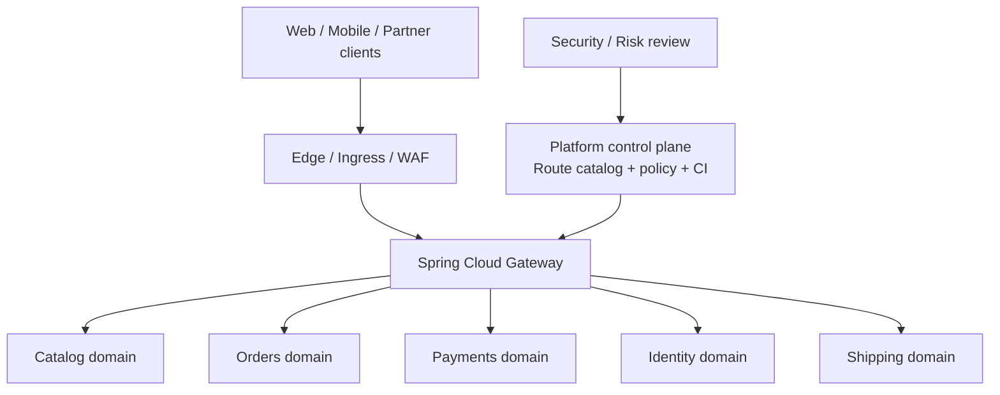

# Tách tuyến theo miền nghiệp vụ và phân quyền quản lý

## Mục tiêu bài học

Trong chương **Mẫu định tuyến** của module **SPRING_CLOUD_GATEWAY**, bài học này hướng dẫn tổ chức route của API Gateway theo **miền nghiệp vụ (business domain / bounded context)** và xác định rõ **ai được sở hữu, thay đổi, phê duyệt và vận hành từng tuyến**. Khi hệ thống có nhiều microservices và nhiều nhóm phát triển, một file `application.yml` lớn với hàng trăm route rất dễ trở thành nơi trùng path, thiếu phân quyền, thay đổi nhầm upstream hoặc không ai chịu trách nhiệm khi một API gặp sự cố.

Spring Cloud Gateway định tuyến request bằng **route predicates**, chạy **filter chain**, biến đổi path/header, tích hợp service discovery và load balancing, xác thực/ủy quyền, rate limiting, retry, circuit breaker, TLS và quan sát request. Việc chia route theo miền nghiệp vụ giúp API công khai ổn định theo ngôn ngữ của sản phẩm; việc phân quyền quản lý giúp thay đổi route có chủ sở hữu, kiểm tra và dấu vết kiểm toán.

Sau bài học, bạn có thể:

- Xác định ranh giới miền nghiệp vụ và phân biệt **domain, bounded context, service, route và API resource**.
- Thiết kế public API paths/hosts theo domain thay vì để lộ cấu trúc nội bộ của microservices.
- Chia route theo **catalog, orders, payments, identity, shipping** hoặc các miền tương ứng với sản phẩm.
- Đặt tên route ID, metadata owner, version, upstream, policy và SLO nhất quán.
- Kết hợp `Path`, `Host`, `Method`, `Header`, `Query`, `Version` và các predicates khác; hiểu điều kiện AND/route overlap.
- Chọn giữa YAML, Java `RouteLocatorBuilder`, `DiscoveryClient` và dynamic `RouteDefinitionLocator`.
- Phân biệt filter chung của nền tảng với filter thuộc miền nghiệp vụ; đặt authentication/authorization đúng lớp.
- Thiết lập quyền quản lý route theo **least privilege**, separation of duties, CODEOWNERS, review và audit.
- Hạn chế rủi ro khi dùng discovery locator, Actuator route mutation và route URI động.
- Kiểm thử route ownership, predicate precedence, path rewrite, security scopes, upstream selection, route drift và rollback.
- Theo dõi hiệu năng/lỗi theo `routeId`, domain owner và upstream mà không đưa dữ liệu nhạy cảm vào metric labels.

> **Phạm vi:** các ví dụ tập trung vào **Spring Cloud Gateway Server WebFlux**. Gateway Server Web MVC/Servlet có cách cấu hình và runtime khác. Namespace trong các ví dụ dùng dạng hiện hành `spring.cloud.gateway.server.webflux.*` của tài liệu Gateway 5.1; các dòng trước có thể dùng `spring.cloud.gateway.*`. Luôn đối chiếu BOM và config properties của phiên bản dự án. Những giá trị `lb://catalog-service`, host và scope trong bài là dữ liệu minh họa.

## 1. Vì sao cần tách route theo miền nghiệp vụ?

Giả sử một hệ thống thương mại điện tử có các miền:

```text
Catalog       — danh mục, sản phẩm, giá hiển thị
Orders        — giỏ hàng, đơn hàng, trạng thái đơn
Payments      — thanh toán, hoàn tiền, giao dịch
Identity      — tài khoản, đăng nhập, hồ sơ
Shipping      — vận chuyển, theo dõi giao hàng
```

Một Gateway nhỏ có thể bắt đầu bằng:

```yaml
spring:
  cloud:
    gateway:
      server:
        webflux:
          routes:
            - id: route-1
              uri: lb://service-a
              predicates:
                - Path=/api/**
            - id: route-2
              uri: lb://service-b
              predicates:
                - Path=/admin/**
```

Khi số lượng routes tăng, những ID như `route-1` không cho biết tuyến thuộc miền nào, ai sở hữu hoặc thay đổi nào có thể ảnh hưởng đến nó. Route `/api/**` cũng có thể vô tình trở thành một tuyến tổng quát che phủ nhiều miền.

Một cách tổ chức rõ hơn:

```text
Public API
  ├── /api/catalog/**  → catalog-service
  ├── /api/orders/**   → order-service
  ├── /api/payments/** → payment-service
  ├── /api/identity/** → identity-service
  └── /api/shipping/** → shipping-service
```

Mỗi miền có thể có một hoặc nhiều microservices phía sau. **Route là ranh giới truy cập API**, không nhất thiết là bản sao tên của một service.

### 1.1. Lợi ích của domain-aligned routing

- **Ngôn ngữ ổn định:** public API dùng khái niệm sản phẩm, không buộc client biết service nào đang triển khai.
- **Ownership rõ:** đội Orders chịu trách nhiệm contract và upstream của `/api/orders/**`.
- **Authorization theo ngữ cảnh:** scope `orders.read` khác `payments.refund`.
- **Change isolation:** thay service nội bộ có thể không làm đổi public URL.
- **Observability:** có thể theo dõi lỗi, latency và traffic theo domain/route.
- **Governance:** review một route change có thể xác định nhóm cần tham gia.
- **Migration:** một domain có thể chuyển dần từ service cũ sang service mới mà client không cần đổi URL.

### 1.2. Không đồng nhất domain với microservice

Một bounded context có thể gồm:

```text
Orders domain
  ├── order-query-service
  ├── order-command-service
  └── order-history-service
```

Public API có thể giữ một nhóm routes:

```text
/api/orders/**          → query hoặc command service tùy method
/api/orders/history/**  → history service
```

Ngược lại, một microservice có thể phục vụ nhiều API resources thuộc những nhóm route khác nhau. Không nên tự động tạo public route cho mọi service chỉ vì service đó xuất hiện trong registry.

### 1.3. Gateway định tuyến, domain service giữ nghiệp vụ

Gateway phù hợp với:

- Chọn upstream và load balance.
- Chuẩn hóa một số path/header theo contract.
- Xác thực token, áp security policy ở edge.
- Rate limiting, timeout, retry và circuit breaker theo route.
- Correlation IDs, logging và metrics.

Gateway không nên trở thành nơi chứa:

- Quy tắc tính giá, tồn kho, trạng thái đơn hoặc điều kiện hoàn tiền.
- Điều phối nhiều bước nghiệp vụ dài hạn.
- Quyền truy cập chi tiết vào từng bản ghi nếu backend phải kiểm tra ownership.
- Mô hình dữ liệu và transaction của các bounded contexts.

**Tách route theo domain không có nghĩa chuyển business logic vào Gateway.** Gateway chọn đường đi và áp policy truy cập; domain service vẫn chịu trách nhiệm về nghiệp vụ và dữ liệu của mình.

## 2. Mô hình kiến trúc và ranh giới sở hữu

Một cấu trúc tổ chức có thể như sau:



### 2.1. Ba loại ownership cần tách

| Loại ownership | Trách nhiệm | Ví dụ |
| --- | --- | --- |
| **Domain/API owner** | Contract, resource path, upstream semantics, scopes nghiệp vụ, SLO và deprecation | Orders team |
| **Gateway/platform owner** | Runtime, shared filters, route schema, deployment, ingress, discovery và guardrails | Platform team |
| **Security owner** | Quy tắc trust, token claims, sensitive routes, admin access và threat review | Security team |

Một domain team có thể đề xuất route và chịu trách nhiệm backend, nhưng không nên có quyền tự do tạo URI tùy ý tới bất kỳ host nội bộ nào. Platform team quản lý control plane và validate policy; Security team review những tuyến có quyền cao hoặc dữ liệu nhạy cảm.

### 2.2. Ma trận quyền đề xuất

| Hành động | Domain owner | Gateway platform | Security reviewer | SRE/operator |
| --- | --- | --- | --- | --- |
| Đề xuất public path/method | Có | Review | Review nếu nhạy cảm | Không |
| Chọn upstream thuộc domain | Đề xuất | Validate allowlist | Review trust boundary | Không |
| Đổi filter dùng chung | Không tự merge | Sở hữu | Phê duyệt khi ảnh hưởng security | Vận hành |
| Đổi scope/role policy | Đề xuất nghiệp vụ | Implement integration | Phê duyệt policy | Audit |
| Tạo route dynamic | Theo quy trình | Kiểm soát API | Review quyền | Có thể thực thi |
| Xem route runtime | Có thể theo phạm vi | Có | Có | Có |
| Xóa/refresh route production | Không mặc định | Theo quyền quản trị | Audit nếu nhạy cảm | Theo change |
| Rollback route | Đề xuất | Điều phối | Tham gia khi security impact | Thực thi theo runbook |

Đây là **mô hình governance tham khảo**, không phải role mặc định do Spring Cloud Gateway tự tạo. Bạn cần hiện thực hóa bằng Git permissions, CODEOWNERS, CI approvals, management security và quy trình thay đổi.

### 2.3. Separation of duties

Với route có thể gọi payment/admin/internal service, nên tách:

1. Người đề xuất thay đổi.
2. Người review contract và upstream.
3. Người phê duyệt security khi policy nhạy cảm.
4. Pipeline hoặc operator thực hiện deployment.
5. Người kiểm tra effective route sau triển khai.

Không để một tài khoản CI có quyền ghi route runtime tùy ý, đọc mọi secret và đồng thời bỏ qua approval. Quyền nên giới hạn theo môi trường và domain.

## 3. Thiết kế public API theo domain

Có ba kiểu phân vùng thường dùng:

| Kiểu | Ví dụ | Khi phù hợp |
| --- | --- | --- |
| **Path-based** | `api.example.com/api/orders/**` | Một API host, nhiều domain resources |
| **Host-based** | `orders.api.example.com/**` | Domain có hostname, certificate, policy hoặc audience riêng |
| **Versioned path** | `/api/v1/orders/**` | Version contract được biểu đạt trong URL |

Có thể kết hợp Host + Path + Method để làm route cụ thể hơn.

### 3.1. Path-based routing

Ví dụ:

```text
GET  /api/catalog/products/42
POST /api/orders
GET  /api/payments/transactions/tx-42
GET  /api/shipping/shipments/sh-42
```

Ưu điểm:

- Dễ đọc và dễ tài liệu hóa.
- Một hostname/TLS certificate có thể phục vụ nhiều domain.
- Route predicates có thể phân chia theo path và method.
- Dễ giữ public API ổn định khi đổi upstream.

Rủi ro:

- Prefix tổng quát như `/api/**` có thể overlap.
- Path rewrite sai có thể làm backend nhận resource khác.
- Một số domain cần security policy khác nhưng dùng chung prefix rộng.

### 3.2. Host-based routing

Ví dụ:

```text
catalog.api.example.com/products/**
orders.api.example.com/orders/**
payments.api.example.com/transactions/**
```

Gateway `Host` predicate dùng Ant-style host patterns và có thể kết hợp `Path` predicate. Host routing hữu ích khi domain có:

- Certificate/TLS hoặc DNS boundary riêng.
- CORS allowlist khác nhau.
- Partner-specific hostname.
- Rate limits hoặc WAF policies riêng.
- Audience/identity contract riêng.

Host header phải được kiểm soát bởi edge và proxy chain đáng tin. Không coi `Host` do client gửi là danh tính người dùng hoặc tenant đã xác thực.

### 3.3. Versioning

Version có thể được biểu đạt bằng:

```text
/api/v1/orders/**
/api/v2/orders/**
```

hoặc một version header/media type theo contract. Path version thường dễ quan sát, cache và debug hơn. Nếu dùng `Header` predicate, cần bảo đảm client không thể dùng header version để bypass security policy của một API khác.

Spring Cloud Gateway 5.1 có `Version` route predicate tích hợp với API versioning của Spring Framework; predicate này cần `ApiVersionStrategy` được cấu hình. Nếu không có strategy bean, tài liệu nêu predicate vẫn được đăng ký nhưng luôn pass. Vì vậy **không bật Version predicate rồi mặc định nó đã từ chối request thiếu version**.

### 3.4. Không để public URL phụ thuộc tên service nội bộ

Không nên buộc client gọi:

```text
/catalog-service/**
/order-command-service/**
/payment-adapter-v3/**
```

vì khi đổi kiến trúc, public API phải đổi theo. Thay vào đó:

```text
/api/catalog/**
/api/orders/**
/api/payments/**
```

Gateway có thể map public contract tới một hay nhiều service nội bộ. Đây là một lợi ích quan trọng của domain-aligned routes.

## 4. Route là một hợp đồng có thể kiểm toán

Trong Spring Cloud Gateway, một route cơ bản có:

- `id`: định danh ổn định.
- `uri`: upstream URI hoặc logical service URI.
- `predicates`: điều kiện match request.
- `filters`: các bước biến đổi/xử lý request và response.
- `order`: thứ tự route khi có nhiều route có thể match.
- `metadata`: thông tin bổ sung gắn với route.

### 4.1. Quy ước route ID

Đề xuất:

```text
<domain>-<resource>-<version>-<operation>
```

Ví dụ:

```text
catalog-products-v1-read
catalog-products-v1-search
orders-v1-create
orders-v1-read
orders-v1-update
payments-v1-refund
identity-v1-profile-read
shipping-v1-tracking-read
```

Route ID nên:

- Ổn định qua những lần thay đổi upstream không ảnh hưởng public contract.
- Duy nhất trong một Gateway route collection.
- Không chứa user ID, tenant ID hay request-specific values.
- Có thể tìm được trong logs, traces, dashboards và change requests.
- Được review khi đổi route semantics.

### 4.2. Metadata cho ownership và policy

Ví dụ:

```yaml
metadata:
  domain: orders
  owner: team-orders
  apiVersion: v1
  authPolicy: orders.read
  dataClassification: confidential
  serviceTier: critical
  changeTicket: API-482
```

Metadata giúp inventory/audit, nhưng **không tự cấp quyền hoặc tạo enforcement**. Nếu `authPolicy: orders.read` chỉ là text trong metadata, Spring Security không tự hiểu nó như scope. Cần có code/config map policy metadata vào enforcement, hoặc khai báo security matchers rõ ràng.

### 4.3. Route catalog

Một route catalog có thể ghi:

| Field | Ví dụ | Mục đích |
| --- | --- | --- |
| Route ID | `orders-v1-create` | Tìm trong runtime |
| Domain | `orders` | Phân loại nghiệp vụ |
| Owner | `team-orders` | Người chịu trách nhiệm |
| Public path | `POST /api/orders` | Contract client |
| Upstream | `lb://order-service` | Đích logic |
| Rewrite | `StripPrefix=1` | Mapping path |
| Auth policy | `orders.write` | Quyền yêu cầu |
| Rate policy | `orders-write-standard` | Hạn mức |
| Timeout class | `interactive-write` | Budget |
| Data class | `confidential` | Kiểm soát dữ liệu |
| SLO | `99.9% / 1.5s` | Vận hành |
| Owner contact | `team-orders` | Escalation |
| Version/status | `v1 / active` | Lifecycle |

Đây là **catalog quản trị** do tổ chức duy trì; không phải mọi field đều được Gateway tự xuất thành một API contract.

## 5. Kết hợp route predicates để phân miền chính xác

Spring Cloud Gateway match routes trong WebFlux `HandlerMapping`. Nhiều predicates trong **cùng một route** được kết hợp bằng logic **AND**. Ví dụ route có `Path`, `Method` và `Host` chỉ match khi các điều kiện đó cùng đúng.

### 5.1. Ví dụ route Catalog

```yaml
spring:
  cloud:
    gateway:
      server:
        webflux:
          routes:
            - id: catalog-products-v1-read
              uri: lb://catalog-service
              order: 10
              predicates:
                - Host=api.example.com
                - Path=/api/catalog/products/**
                - Method=GET,HEAD
              filters:
                - StripPrefix=2
              metadata:
                domain: catalog
                owner: team-catalog
                apiVersion: v1
                authPolicy: catalog.read
```

Request:

```http
GET /api/catalog/products/42
Host: api.example.com
```

Path sau `StripPrefix=2`:

```text
/products/42
```

### 5.2. Ví dụ Orders read và write

```yaml
spring:
  cloud:
    gateway:
      server:
        webflux:
          routes:
            - id: orders-v1-read
              uri: lb://order-query-service
              order: 20
              predicates:
                - Path=/api/orders/**
                - Method=GET
              filters:
                - StripPrefix=2
              metadata:
                domain: orders
                owner: team-orders
                authPolicy: orders.read

            - id: orders-v1-write
              uri: lb://order-command-service
              order: 20
              predicates:
                - Path=/api/orders/**
                - Method=POST,PUT,PATCH
              filters:
                - StripPrefix=2
                - RequestSize=1MB
              metadata:
                domain: orders
                owner: team-orders
                authPolicy: orders.write
```

Hai routes dùng chung public resource path nhưng tách query/command backend theo method. Route `orders-v1-write` dùng `RequestSize` như một giới hạn body minh họa; giá trị thực phải dựa trên API contract và giới hạn Ingress.

### 5.3. Ví dụ Payments chỉ qua hostname đối tác

```yaml
spring:
  cloud:
    gateway:
      server:
        webflux:
          routes:
            - id: payments-partner-v1-callback
              uri: lb://payment-service
              order: 30
              predicates:
                - Host=payments.partner.example.com
                - Path=/callbacks/**
                - Method=POST
              filters:
                - StripPrefix=1
              metadata:
                domain: payments
                owner: team-payments
                dataClassification: restricted
```

Host predicate chỉ chọn route. **Nó không xác thực đối tác**. Callback cần chữ ký webhook, mTLS hoặc cơ chế xác minh tương ứng tại domain service/Gateway security layer; không cho phép request chỉ vì Host đúng.

### 5.4. Predicate thường dùng

| Predicate | Dùng cho | Lưu ý |
| --- | --- | --- |
| `Path` | Resource path/domain prefix | Kiểm tra trailing slash và path overlap |
| `Host` | Hostname/subdomain | Host phải được trust/validate |
| `Method` | GET/POST/PUT/DELETE | Dùng tách read/write |
| `Header` | Header value/pattern | Không dùng header do client tự gửi làm identity |
| `Query` | Query parameter | Không đặt authorization quan trọng vào query |
| `Cookie` | Cookie name/value | Cookie matching không thay session validation |
| `RemoteAddr` | IP nguồn kết nối | Sau proxy cần resolver/trusted proxy đúng |
| `XForwardedRemoteAddr` | IP trong forwarded chain | Chỉ dùng nếu ingress sanitize |
| `After`, `Before`, `Between` | Maintenance/time window | Chú ý timezone và rollout |
| `Weight` | Canary/weighted routing | Cùng group có tổng weight được tính |
| `Version` | API version | Cần `ApiVersionStrategy` theo tài liệu |

### 5.5. Không biến Header predicate thành authorization

Ví dụ không an toàn:

```yaml
predicates:
  - Header=X-Role, ADMIN
```

Header trên có thể do client tự gửi. Nếu route admin chỉ dựa vào nó, người gọi có thể tự khai quyền. Hãy dùng Spring Security xác minh JWT/session và authorities; header predicate chỉ là điều kiện routing sau khi nguồn header đã được xác thực/ghi đè bởi trusted component.

### 5.6. RemoteAddr sau reverse proxy

`RemoteAddr` mặc định dựa vào remote address mà Gateway nhìn thấy, có thể là Ingress IP chứ không phải client IP. `XForwardedRemoteAddr` hoặc custom `RemoteAddressResolver` cần trusted proxy chain. Không tin `X-Forwarded-For` do public client tự thêm.

## 6. Quản lý route overlap và thứ tự

Một lỗi phổ biến là route cụ thể bị một route tổng quát match trước:

```yaml
routes:
  - id: generic-api
    uri: lb://generic-service
    predicates:
      - Path=/api/**

  - id: orders-api
    uri: lb://order-service
    predicates:
      - Path=/api/orders/**
```

Cả hai có thể match `/api/orders/42`. Route order quyết định thứ tự xét; không nên dựa vào vị trí YAML một cách mơ hồ.

### 6.1. Quy tắc thiết kế

- Route **cụ thể** trước route fallback/catch-all theo `order` đã định nghĩa.
- Dùng explicit `order` thay vì để nhiều route overlap đều mặc định cùng giá trị.
- Tránh route `/api/**` trỏ tới một service tổng quát nếu không có chủ đích rõ.
- Route fallback phải có scope hẹp và không làm lộ internal APIs.
- Test request path/method/host có nhiều routes match.
- Kiểm tra route thực tế bằng Actuator trong môi trường test/staging.

`order` là một phần của route definition; Gateway Actuator hiển thị `order` cùng route ID, predicate, filters và URI. Sau khi thay đổi, kiểm tra **route đã được chọn**, không chỉ xem YAML có chứa route.

### 6.2. OR được biểu diễn bằng nhiều routes

Các predicates trong một route là AND. Nếu muốn:

```text
Host A OR Host B
```

có thể cấu hình nhiều host patterns trong một Host predicate nếu phù hợp, hoặc tạo các routes có cùng destination/policy. Nếu muốn:

```text
GET /api/orders/** OR POST /api/orders/**
```

có thể dùng `Method=GET,POST` trong một route nếu filters/policy giống nhau; nếu read và write có scopes/rate limits khác nhau, nên tách thành hai routes.

### 6.3. Trailing slash và path matching

`Path` predicate có tùy chọn `matchTrailingSlash` (mặc định tài liệu hiện hành nêu `true`). Ví dụ `/api/orders/42` và `/api/orders/42/` có thể cùng match theo default. Nếu backend hoặc security layer phân biệt trailing slash, hãy thống nhất contract và viết tests.

### 6.4. Route order không thay security matcher order

Gateway route `order` quyết định chọn route. Spring Security `authorizeExchange` matcher order quyết định rule authorization nào áp dụng. Đây là **hai thứ tự khác nhau**. Một route có `order: 1` không làm cho `.pathMatchers("/api/admin/**").hasRole("ADMIN")` tự chạy trước các security matchers khác.

## 7. Tổ chức filters: nền tảng và domain

Filter chain có logic **pre** trước khi proxy request và **post** sau khi response trở về. Gateway kết hợp `GlobalFilter` và route-specific `GatewayFilter` trong một chain theo `Ordered`.

### 7.1. Filter dùng chung

Những concerns thường thuộc platform:

- Correlation/request ID.
- Chuẩn hóa hoặc xóa headers không được phép.
- Security response headers.
- Logging/metrics/tracing chung.
- Timeout mặc định và error mapping chung.
- Chặn các destination/route không hợp lệ theo policy.

Gateway có `default-filters` áp dụng cho mọi route; `GlobalFilter` có thể xử lý các concerns toàn cục tùy điều kiện. Không nhân bản cùng một filter definition vào mọi domain nếu policy thực sự giống nhau.

### 7.2. Filter thuộc domain

Ví dụ:

| Domain | Filter/policy có thể khác |
| --- | --- |
| Catalog | Cache read-only, public read rate limit |
| Orders | Request body size, write timeout, idempotency handling contract |
| Payments | Strict timeout, audit metadata, callback signature verification contract |
| Identity | Cookie/session, OAuth2 login, token relay |
| Shipping | Partner headers, webhook verification, long polling policy |

Những ví dụ này là **định hướng**, không có nghĩa tất cả phải được implement bằng GatewayFilter. Business-level idempotency, payment signature và ownership validation thường phải được thực thi ở service/domain layer.

### 7.3. Ví dụ default filters

```yaml
spring:
  cloud:
    gateway:
      server:
        webflux:
          default-filters:
            - name: AddResponseHeader
              args:
                name: X-Gateway
                value: public-api
          routes:
            - id: catalog-v1-read
              uri: lb://catalog-service
              predicates:
                - Path=/api/catalog/**
                - Method=GET
              filters:
                - StripPrefix=2
```

`default-filters` được áp dụng trên các routes theo cấu hình Gateway; không nhầm nó với filter có thể chỉ áp cho một domain. Nếu có routes nội bộ hoặc health/actuator đi qua cùng Gateway, cần cân nhắc phạm vi và management separation.

### 7.4. Không để domain team tự định nghĩa GlobalFilter tùy ý

Một `GlobalFilter` có thể ảnh hưởng tất cả routes. Nếu domain team thêm custom global behavior vào shared application, thay đổi đó có thể tác động Catalog, Payments và Identity dù PR chỉ nhắc Orders.

Governance nên:

- Giữ global filters trong module/platform package do platform team review.
- Dùng route-specific filters cho policy hẹp.
- Có integration tests cho filter order.
- Đặt rõ pre/post behavior, exception handling và cancellation.
- Không cho một route bypass security filter chung bằng config không được kiểm soát.

## 8. Phân quyền theo miền trong Spring Security WebFlux

Route selection và authorization phải phối hợp nhưng không thay thế nhau. Ví dụ:

```text
GET  /api/catalog/**  → catalog.read
GET  /api/orders/**   → orders.read
POST /api/orders/**   → orders.write
POST /api/payments/** → payments.charge
POST /api/refunds/**  → payments.refund
```

### 8.1. Ví dụ SecurityWebFilterChain

```java
import org.springframework.context.annotation.Bean;
import org.springframework.context.annotation.Configuration;
import org.springframework.http.HttpMethod;
import org.springframework.security.config.Customizer;
import org.springframework.security.config.web.server.ServerHttpSecurity;
import org.springframework.security.web.server.SecurityWebFilterChain;

@Configuration
class ApiSecurityConfiguration {

    @Bean
    SecurityWebFilterChain apiSecurity(ServerHttpSecurity http) {
        return http
            .authorizeExchange(exchanges -> exchanges
                .pathMatchers(
                    HttpMethod.GET,
                    "/api/catalog/**"
                ).hasAuthority("SCOPE_catalog.read")
                .pathMatchers(
                    HttpMethod.GET,
                    "/api/orders/**"
                ).hasAuthority("SCOPE_orders.read")
                .pathMatchers(
                    HttpMethod.POST,
                    "/api/orders/**"
                ).hasAuthority("SCOPE_orders.write")
                .pathMatchers(
                    HttpMethod.POST,
                    "/api/payments/**"
                ).hasAuthority("SCOPE_payments.charge")
                .pathMatchers(
                    HttpMethod.POST,
                    "/api/refunds/**"
                ).hasAuthority("SCOPE_payments.refund")
                .anyExchange().denyAll()
            )
            .oauth2ResourceServer(oauth2 ->
                oauth2.jwt(Customizer.withDefaults())
            )
            .build();
    }
}
```

Đây là **mẫu policy cho API bearer JWT**; cần bổ sung CORS, CSRF phù hợp mô hình client, management endpoints và JWT issuer/audience validation thực tế. Spring Security thường map scopes thành authorities có prefix `SCOPE_`; nếu app custom claim converter thì phải test authority mapping.

### 8.2. Vì sao `.anyExchange().denyAll()` hữu ích?

Khi một route mới được thêm nhưng security rule chưa cập nhật, request không tự được cho phép bởi một rule rộng. Đây là cách fail-closed cho API routes. Tuy nhiên, nếu app còn health/actuator/login endpoints, hãy khai báo explicit matchers cho chúng trước rule cuối.

### 8.3. Domain owner đề xuất scope, Security owner quản lý semantics

Ví dụ:

| Scope | Domain owner mô tả | Security policy |
| --- | --- | --- |
| `catalog.read` | Xem catalog | Public hoặc authenticated theo dữ liệu |
| `orders.read` | Xem đơn thuộc user/tenant | Backend còn kiểm tra ownership |
| `orders.write` | Tạo/cập nhật đơn | Chỉ actor có quyền |
| `payments.charge` | Khởi tạo thanh toán | Audience, idempotency, risk checks |
| `payments.refund` | Hoàn tiền | Privileged scope + approval/audit |

Scope `orders.read` không tự chứng minh user được xem mọi order. Backend cần so sánh `sub`/tenant với resource owner và các quy tắc domain.

### 8.4. Không dùng route predicates để kiểm tra quyền chi tiết

Không thiết kế:

```yaml
predicates:
  - Header=X-User-Role, ADMIN
```

thay cho verified JWT authorities. Không route theo query `?isAdmin=true`, cookie chưa xác minh hoặc custom header client-controlled. Predicate là điều kiện chọn route, không phải một identity provider.

## 9. Tổ chức YAML theo domain

### 9.1. Một file lớn hay nhiều nguồn route?

Hai lựa chọn thường gặp:

**Một application YAML:** phù hợp hệ thống nhỏ/vừa, route count ít, platform team kiểm soát thay đổi.

**Nhiều module/config sources:** phù hợp hệ thống lớn, route ownership phân theo domain, cần pipeline validate và aggregate.

Spring Cloud Gateway sử dụng các `RouteDefinitionLocator` để nạp route definitions; mặc định có `PropertiesRouteDefinitionLocator` đọc Spring Boot configuration properties. Có thể bổ sung nguồn khác nếu hệ thống triển khai `RouteDefinitionLocator`/repository phù hợp.

### 9.2. Quy tắc tách file

Một cấu trúc repository minh họa:

```text
gateway-config/
  platform/
    defaults.yml
    global-filters.yml
    security-baseline.yml
  domains/
    catalog/
      routes.yml
      policy.yml
    orders/
      routes.yml
      policy.yml
    payments/
      routes.yml
      policy.yml
    identity/
      routes.yml
      policy.yml
  tests/
    route-contracts/
    security-matrix/
```

Đây là **cấu trúc repository do đội ngũ chọn**, không phải Spring Cloud Gateway tự nạp mọi file trong thư mục. CI/CD hoặc config loader phải aggregate các file thành cấu hình được Gateway hỗ trợ, hoặc chuyển thành Java beans/dynamic route definitions.

### 9.3. Không tạo nhiều route ID trùng nhau

Trong pipeline, validate:

- `id` duy nhất.
- `uri` thuộc allowlist service IDs/schemes.
- Path/host/method không conflict ngoài dự kiến.
- Metadata owner tồn tại.
- Policy/scope được khai báo.
- Route không mở public endpoint quản trị.
- Filter factories có sẵn trong classpath/version.
- Timeout, body/header limits và rate policies phù hợp.

Một route sai cấu hình có thể khiến application startup fail hoặc route không hoạt động. Tài liệu configprops hiện hành có `fail-on-route-definition-error`; không tắt nó để che route errors mà không có lý do và alert.

## 10. Java RouteLocatorBuilder cho domain-specific routes

YAML phù hợp cấu hình declarative. Khi cần composition bằng Java, `RouteLocatorBuilder` cung cấp fluent API.

```java
import org.springframework.cloud.gateway.route.RouteLocator;
import org.springframework.cloud.gateway.route.builder.RouteLocatorBuilder;
import org.springframework.context.annotation.Bean;
import org.springframework.context.annotation.Configuration;
import org.springframework.http.HttpMethod;

@Configuration
class DomainRouteConfiguration {

    @Bean
    RouteLocator domainRoutes(RouteLocatorBuilder builder) {
        return builder.routes()
            .route("catalog-products-v1-read", route -> route
                .host("api.example.com")
                .and()
                .path("/api/catalog/products/**")
                .and()
                .method(HttpMethod.GET)
                .filters(filters -> filters
                    .stripPrefix(2)
                )
                .uri("lb://catalog-service")
            )
            .route("orders-v1-read", route -> route
                .path("/api/orders/**")
                .and()
                .method(HttpMethod.GET)
                .filters(filters -> filters
                    .stripPrefix(2)
                )
                .uri("lb://order-query-service")
            )
            .build();
    }
}
```

Mẫu này minh họa **cùng nguyên tắc predicates AND filters** như YAML. Khi chuyển sang production, bổ sung metadata, order, common policies, route IDs, security tests và cấu hình URI/service discovery thực. Tránh để một class Java hàng nghìn dòng trở thành nơi tập trung tất cả domain routes.

### 10.1. Tách Java config theo domain

Có thể tạo các `@Configuration` riêng:

```text
CatalogRoutesConfiguration
OrdersRoutesConfiguration
PaymentsRoutesConfiguration
IdentityRoutesConfiguration
PlatformGlobalFiltersConfiguration
```

Mỗi class cần được scan/import theo module. Đảm bảo không có nhiều beans cùng khai báo route ID giống nhau hoặc cùng path/host/method với order không rõ.

### 10.2. Khi nào dùng Java thay YAML?

| YAML | Java DSL |
| --- | --- |
| Dễ review cấu hình và so sánh diff | Có thể composition bằng code |
| Phù hợp routes tĩnh | Phù hợp logic khai báo route phức tạp |
| Dễ sinh từ config repo | Dễ inject beans/custom filters |
| Ít cần compile cho route-only changes | Route change gắn với app build/deploy |
| Cần validate schema/config | Cần unit/integration tests cho bean |

Không chọn Java chỉ vì route count lớn; một registry/catalog + generator có thể quản lý YAML declarative tốt hơn. Chọn theo lifecycle, ownership và audit requirements.

## 11. DiscoveryClient routes: tiện lợi nhưng không nên mở tất cả service

Spring Cloud Gateway có `DiscoveryClient` Route Definition Locator. Khi bật, Gateway có thể tạo routes từ services đăng ký trong registry. Mặc định, route dùng `lb://service-name`, path `/serviceId/**`, và filter rewrite bỏ service ID khỏi path.

### 11.1. Cấu hình discovery

```yaml
spring:
  cloud:
    gateway:
      server:
        webflux:
          discovery:
            locator:
              enabled: true
              lower-case-service-id: true
```

Cần DiscoveryClient implementation (Eureka, Consul, Zookeeper, Kubernetes...) và Spring Cloud LoadBalancer dependency khi route dùng `lb://`.

### 11.2. Default path mapping

Nếu registry trả `catalog-service`, route mặc định có thể dùng:

```text
/catalog-service/**
  → lb://catalog-service
  → rewrite bỏ /catalog-service
```

Điều này hữu ích cho internal tooling hoặc lab, nhưng public API thường nên dùng domain paths ổn định như `/api/catalog/**`.

### 11.3. Rủi ro tự động expose mọi service

Nếu mọi service trong registry đều có route public, một service nội bộ mới đăng ký có thể vô tình được truy cập từ bên ngoài. Registry membership **không đồng nghĩa public API approval**.

Ưu tiên:

- `include-expression`/allowlist theo service IDs.
- Host/path predicates giới hạn.
- Tách public và internal Gateway instances nếu cần.
- Network policy không cho public edge gọi admin/internal services.
- Security rules riêng cho mỗi domain.

### 11.4. Khi customize Discovery filters, đừng mất RewritePath mặc định

Tài liệu Spring Cloud Gateway lưu ý nếu cấu hình `discovery.locator.filters` để thêm custom filters, cấu hình mới **thay thế toàn bộ default filter list**. Nếu không khai báo lại `RewritePath` mặc định, service ID có thể không bị bỏ khỏi path và backend trả 404.

Đây là một lỗi thực tế dễ gặp:

```text
Client path: /catalog-service/products/42
Backend mong đợi: /products/42
Gateway forward nhầm: /catalog-service/products/42
```

Khi customize discovery routes, hãy khai báo lại rewrite filter cần thiết và test actual backend path.

### 11.5. Discovery routes vẫn cần domain ownership

Service registry có thể biết:

```text
catalog-service
order-command-service
payment-adapter
admin-console
```

Nhưng Gateway route policy cần biết:

```text
public domain?
owner team?
allowed methods?
required scope?
data classification?
allowed client population?
```

Discovery trả lời **service instance nào đang tồn tại**; route catalog/governance trả lời **dịch vụ nào được expose, cho ai và theo hợp đồng nào**.

## 12. Dynamic routes và quyền quản lý

Khi route cần thay đổi mà không rebuild image, có thể dùng nguồn route động như custom `RouteDefinitionLocator`/repository hoặc Actuator API theo phiên bản. Khả năng này rất mạnh và vì vậy cần **control plane riêng**.

### 12.1. Quy trình dynamic route an toàn

```text
Domain owner đề xuất
  ↓
Schema + policy validation
  ↓
Security/platform approval
  ↓
Persist route definition + revision
  ↓
Refresh route cache / distribute event
  ↓
Read back effective routes
  ↓
Smoke tests + audit
```

### 12.2. Actuator Gateway endpoint

Tài liệu Gateway hiện hành nêu `/actuator/gateway` **bị disabled access mặc định**. Khi cần đọc routes, cấu hình read-only:

```yaml
management:
  endpoint:
    gateway:
      access: read-only
  endpoints:
    web:
      exposure:
        include: health,info,gateway
```

Read-only cho phép quan sát theo endpoint/version nhưng không cho phép create/delete/refresh routes. Nếu bật quyền mutation (`unrestricted` hoặc cấu hình tương ứng của version), phải bảo vệ Actuator endpoints bằng authentication, authorization và network isolation.

### 12.3. Không public route mutation API

Một người có quyền tạo route tùy ý có thể:

- Tạo upstream tới internal admin/metadata service.
- Bypass một domain route đã có auth policy.
- Gửi credentials tới host không được phép.
- Tạo path overlap để che route an toàn.
- Thay route payment/identity trong giờ cao điểm.

Vì vậy:

- Management port/private ingress riêng.
- RBAC theo role/environment/domain.
- URI scheme/host allowlist.
- Path/method/predicate validation.
- Không cho caller tùy ý tạo SpEL/regex/filter args không được kiểm soát.
- Audit actor, ticket, diff, timestamp, revision và result.
- Có approval/rollback và readback per instance.

### 12.4. Route definitions từ config là read-only với actuator mutation

Tài liệu Actuator nêu routes được định nghĩa bằng `application.yml` hoặc `@Bean` là config-defined routes và không thể tùy ý xóa bằng các endpoint mutation như routes được tạo qua actuator. Đừng xây quy trình vận hành giả định một `DELETE` có thể xóa mọi route source.

## 13. Route lifecycle và phân quyền thay đổi

Mỗi route nên có lifecycle:

```text
PROPOSED
  → REVIEWED
  → APPROVED
  → DEPLOYED
  → VERIFIED
  → ACTIVE
  → DEPRECATED
  → REMOVED
```

Các trạng thái này là **workflow do tổ chức định nghĩa**, không phải status field mặc định của Spring Cloud Gateway.

### 13.1. Khi tạo route

Yêu cầu tối thiểu:

- Route ID/domain/owner.
- Public host/path/method.
- Upstream service ID thuộc allowlist.
- Path rewrite rõ.
- Authentication/authorization policy.
- Rate limit/timeout class.
- Data classification.
- SLO và runbook.
- Test cases và rollback plan.

### 13.2. Khi đổi upstream

Không nên đổi:

```text
lb://order-query-service
```

sang:

```text
https://arbitrary-host.example
```

chỉ bằng một thay đổi YAML chưa review. Thay upstream có thể đổi trust boundary, TLS verification, network path, token audience, data residency và error semantics.

### 13.3. Khi deprecate route

Quy trình:

1. Thông báo client và owner.
2. Có thời hạn migration.
3. Theo dõi traffic route cũ.
4. Có thể trả deprecation/sunset metadata nếu contract hỗ trợ.
5. Chặn tạo client mới.
6. Sau thời hạn, xóa route bằng pipeline có approval.
7. Kiểm tra không còn client cần route cũ.

Không xóa route chỉ vì một tuần không thấy traffic nếu batch/partner clients hoạt động theo chu kỳ dài hơn.

### 13.4. Route owner không nhất thiết là người có quyền production

Domain owner có thể sở hữu semantics và review PR; platform pipeline mới là actor triển khai production. Điều này giảm rủi ro thao tác trực tiếp và giữ audit trail.

## 14. Route ordering, canary và migration

### 14.1. Hai upstream cho một domain

Trong quá trình migration:

```text
orders-v1 → order-service-v1
orders-v2 → order-service-v2
```

Có thể dùng versioned path:

```text
/api/v1/orders/** → order-service-v1
/api/v2/orders/** → order-service-v2
```

Hoặc `Weight` predicate để phân traffic giữa các routes trong cùng group khi đã xác định tiêu chí canary.

### 14.2. Weighted routes

Ví dụ minh họa:

```yaml
spring:
  cloud:
    gateway:
      server:
        webflux:
          routes:
            - id: orders-canary-v2
              uri: lb://order-service-v2
              predicates:
                - Path=/api/orders/**
                - Weight=orders-rollout,10
              filters:
                - StripPrefix=1

            - id: orders-stable-v1
              uri: lb://order-service-v1
              predicates:
                - Path=/api/orders/**
                - Weight=orders-rollout,90
              filters:
                - StripPrefix=1
```

`Weight` predicate phân phối xấp xỉ theo weights trong group, không phải bảo đảm từng cửa sổ ngắn có đúng 10%/90%. Không dùng weight canary nếu hai backend chưa tương thích request/response/schema hoặc chưa có khả năng rollback.

### 14.3. Route order và Weight là hai khái niệm khác

- `order` quyết định precedence khi route predicates overlap.
- `Weight` chọn một route trong một group theo weighted routing behavior.

Không thêm một catch-all route `Path=/api/**` có order cao hơn rồi kỳ vọng `Weight` trong domain routes vẫn chạy như thiết kế. Test selected route ID và phân phối traffic.

### 14.4. Không route theo header canary chưa trust

Nếu dùng `Header=X-Canary, true`, header đó phải được set bởi trusted gateway/edge hoặc được kiểm soát bởi canary policy. Không cho public client tự chọn phiên bản backend nhạy cảm bằng cách gửi header tùy ý.

## 15. Quản lý API version và domain contract

### 15.1. Public version không phải version nội bộ

```text
Public API v1
  → Gateway route
  → Adapter / compatibility layer
  → Internal service v3
```

Client không cần biết internal service v3. Domain owner chịu trách nhiệm đảm bảo adapter/contract giữ semantics v1 hoặc công bố breaking change.

### 15.2. Versioning bằng path

```yaml
routes:
  - id: orders-api-v1
    uri: lb://order-service-v1
    predicates:
      - Path=/api/v1/orders/**
  - id: orders-api-v2
    uri: lb://order-service-v2
    predicates:
      - Path=/api/v2/orders/**
```

Đây là đoạn rút gọn; thêm full prefix `spring.cloud.gateway.server.webflux.routes` trong cấu hình ứng dụng thực.

### 15.3. Versioning bằng API version support của Spring

Gateway 5.1 tài liệu hóa `Version` predicate dựa trên `ApiVersionStrategy` của Spring Framework. Có thể chọn fixed version hoặc baseline version (`version+`). Tuy nhiên:

- Phải cấu hình strategy, nguồn version và resolver.
- Test thiếu version, malformed version và version không hỗ trợ.
- Không dựa vào predicate nếu strategy chưa được bật.
- Security scopes và rate policies phải tương thích với version.

### 15.4. Deprecation policy theo domain

Mỗi domain công bố:

- Ngày bắt đầu deprecation.
- Ngày ngừng hỗ trợ.
- Replacement endpoint.
- Breaking changes.
- Migration guide.
- Owner và contact.

Gateway có thể hỗ trợ routing version cũ trong thời gian migration, nhưng domain service vẫn phải quản lý semantics và data compatibility.

## 16. Kiểm thử domain routes và quyền sở hữu

Kiểm thử cần xác nhận **route đúng**, **filter đúng**, **owner/policy đúng** và **backend đúng**. Chỉ assert status 200 không đủ.

### 16.1. Route contract test

Với mỗi route:

```text
Input:
  method
  host
  path
  required headers
  principal/scopes

Expected:
  selected route ID
  upstream service
  outbound path
  outbound headers
  auth result
  rate policy
  response contract
```

### 16.2. Backend stub

Dùng MockWebServer/WireMock hoặc HTTP stub riêng để ghi:

```text
method
path
Host
selected synthetic request ID
safe headers
body length
```

Không ghi JWT/cookie/PII. Stub có thể trả response khác nhau theo path để xác minh routing.

### 16.3. Ma trận route overlap

| Request | Route mong đợi | Điều cần kiểm tra |
| --- | --- | --- |
| `GET /api/catalog/products/42` | `catalog-products-v1-read` | Path + Method + Host |
| `POST /api/orders` | `orders-v1-write` | Write route |
| `GET /api/orders/42` | `orders-v1-read` | Read route |
| `DELETE /api/orders/42` | Không match hoặc route delete riêng | Không rơi vào write route rộng |
| `GET /api/admin/users` | Admin route có policy riêng | Không match generic API |
| `GET /api/payments/transactions/42` | Payment read route | Không bị generic `/api/**` che |
| Host sai + path đúng | Không match host-specific route | Host validation |
| Path đúng + method sai | Không match method-specific route | Method restriction |
| Header canary giả | Stable/default route | Header trust |

### 16.4. Security test matrix

| Principal | Route | Kết quả mong đợi |
| --- | --- | --- |
| Anonymous | Public catalog GET | Theo public policy |
| Anonymous | Orders GET | 401/redirect theo API contract |
| `catalog.read` | Catalog GET | Cho phép |
| `catalog.read` | Orders GET | 403 |
| `orders.read` | Orders GET | Qua Gateway; backend còn kiểm tra ownership |
| `orders.write` | Orders POST | Qua Gateway |
| `orders.read` | Orders POST | 403 |
| `payments.charge` | Payments POST | Qua Gateway và payment risk checks |
| `payments.charge` | Refund POST | 403 nếu thiếu `payments.refund` |
| `payments.refund` | Admin management endpoint | Không tự được phép |

### 16.5. Test route ownership metadata

Pipeline có thể validate:

```text
Every route has:
  id
  domain
  owner
  uri from approved service registry
  authPolicy
  version
  dataClassification
  change reference
```

Đây là **custom policy-as-code test**, không phải một built-in Gateway validator. Viết kiểm tra cấu hình trước deploy và thất bại nếu metadata bắt buộc thiếu.

### 16.6. Test path rewrite

Ví dụ:

```text
Public:   /api/orders/42
Filter:   StripPrefix=2
Backend:  /42
```

Nếu backend mong `/orders/42`, cần dùng `StripPrefix=1` thay vì 2. Luôn viết bảng before/after cho từng route và assert path ở stub.

### 16.7. Test DiscoveryClient exposure

Khi bật discovery locator:

- Service trong allowlist có route.
- Service admin/internal không có public route.
- Lowercase service ID hoạt động đúng nếu registry uppercase.
- Custom filters vẫn giữ RewritePath mặc định nếu cần.
- Service bị deregister không còn được chọn theo discovery semantics.

### 16.8. Test route refresh và rollback

Nếu dynamic:

- Tạo route mới trong test repository.
- Refresh route cache.
- Xác minh route được chọn.
- Gửi request smoke test.
- Xóa route và refresh.
- Xác minh không còn route.
- Test lỗi refresh không để hệ thống sử dụng config sai một cách âm thầm.

## 17. Quan sát routes theo domain

### 17.1. Route metrics

Gateway có route metrics khi Actuator/Micrometer được cấu hình. Tài liệu Gateway mô tả metric route request `spring.cloud.gateway.requests` và gauge route definitions count `spring.cloud.gateway.routes.count` trong các phiên bản hỗ trợ.

Những dimension hữu ích:

```text
routeId=orders-v1-read
domain=orders
owner=team-orders
method=GET
status=200
```

Metadata owner/domain có thể cần custom instrumentation để xuất thành metric tags; không mặc định mọi metadata đều tự thành metric dimension.

### 17.2. Không tạo high-cardinality labels

Không dùng:

```text
userId
orderId
sessionId
JWT
full request URL với IDs
query string tùy ý
```

làm metric labels. Chúng tạo cardinality lớn và có thể rò dữ liệu. Dùng `routeId`, domain, method, status, bounded error category và trace IDs trong tracing theo retention/security policy.

### 17.3. Route inventory qua Actuator

Actuator Gateway endpoint có thể liệt kê:

- Route ID.
- Predicate.
- Filters.
- URI.
- Order.

Endpoint `/actuator/gateway/routes` rất hữu ích để đối chiếu effective runtime configuration. Mặc định endpoint access bị disabled; tài liệu đề xuất `read-only` khi chỉ cần quan sát. Chỉ bật quyền mutation khi được bảo vệ trong admin plane.

### 17.4. Dashboard theo owner

Một dashboard theo domain có thể hiển thị:

| Domain | RPS | p95 | 5xx rate | 429 rate | Owner |
| --- | ---: | ---: | ---: | ---: | --- |
| Catalog | 1.200 | 85ms | 0,1% | 0,4% | team-catalog |
| Orders | 450 | 220ms | 0,3% | 1,2% | team-orders |
| Payments | 120 | 310ms | 0,05% | 0,1% | team-payments |
| Identity | 800 | 110ms | 0,2% | 0,8% | team-identity |

Số liệu chỉ là ví dụ. Dashboard phải gắn với route IDs ổn định và metric source thực tế.

## 18. Các lỗi thiết kế thường gặp

### 18.1. Một route `/api/**` trỏ tới một service tổng hợp

Khi route tổng quát nhận mọi domain, policy, upstream và observability khó tách. Nên dùng route cụ thể theo domain hoặc một API composition layer có contract rõ.

### 18.2. Route ID không thể tìm owner

`route-42` không cho biết ai chịu trách nhiệm. Dùng convention ổn định và metadata owner.

### 18.3. Bật discovery locator cho tất cả services

Registry không phải public API catalog. Allowlist các services được expose, giới hạn hosts/paths và review security.

### 18.4. Domain team tự thêm global filter

Global behavior ảnh hưởng toàn Gateway. Shared filters cần platform ownership và regression tests.

### 18.5. Dùng header client gửi để quyết định admin route

Header predicate không xác minh identity. Dùng Spring Security JWT/session authorities.

### 18.6. Bỏ qua route order và overlap

Một catch-all có thể nhận request trước route domain. Dùng explicit order và test selected route.

### 18.7. Cho route URI tùy ý

Dynamic route API có thể trở thành SSRF path. Allowlist schemes/hosts/service IDs, validate predicates/filters và audit mọi mutation.

### 18.8. Gateway là nơi duy nhất kiểm tra authorization

Backend direct access, route confusion hoặc service-to-service call có thể bypass. Backend vẫn kiểm tra resource ownership và business permission.

### 18.9. Thay route không có contract tests

Route có thể vẫn trả 200 nhưng backend path sai hoặc filter thiếu. Assert route ID, upstream, method, path và safe headers.

### 18.10. Actuator mutation public

Quyền tạo/xóa route có thể thay đổi đích đến và security boundary. Dùng private management plane, read-only cho quan sát.

### 18.11. Versioning không đồng bộ security

Route v2 có thể được tạo nhưng chưa có security matcher, hoặc scopes v1/v2 khác nhau. Kiểm tra route và security policy trong cùng một change.

### 18.12. Route metadata được coi là enforcement

`metadata.authPolicy: orders.read` chỉ là metadata nếu chưa có code đọc và áp dụng. Đừng dùng label thay cho authorization.

## 19. Checklist governance trước production

| Nhóm | Câu hỏi |
| --- | --- |
| Domain boundary | Route thuộc bounded context nào? Public contract có dùng ngôn ngữ domain? |
| Owner | Có owner team và escalation contact? |
| Route ID | Duy nhất, ổn định, theo naming convention? |
| Metadata | Domain, owner, version, auth policy, data class có đầy đủ? |
| URI | Upstream thuộc service allowlist? Scheme/host có an toàn? |
| Predicates | Path/Host/Method/Header/Query có match chính xác? |
| Overlap | Có route nào che route cụ thể? `order` được định nghĩa và test? |
| Rewrite | Public path và backend path có mapping rõ? |
| Authorization | JWT/session scopes/roles áp đúng method/domain? |
| Backend security | Backend kiểm tra ownership/tenant và identity riêng? |
| Filters | Global/default/route filters có owner và order rõ? |
| Rate/timeout | Policy phù hợp SLO và business operation? |
| Discovery | Chỉ expose services được phê duyệt? |
| Dynamic routes | Admin plane private, RBAC, audit, approval, rollback? |
| Versioning | Deprecation/sunset và backward compatibility có tài liệu? |
| Testing | Contract, overlap, security, rewrite, discovery, rollback tests? |
| Observability | Metrics theo route/domain/owner, không có sensitive labels? |
| Operations | Có runbook và người nhận alert? |
| Change control | CODEOWNERS/CI approvals và route revision? |
| Recovery | Rollback không làm lệch backend/schema/security? |

## 20. Bài tập có đáp án

### Bài 1 — Chọn ranh giới route

Hệ thống có `order-query-service` và `order-command-service`. Có nên public hai paths theo tên service?

**Đáp án:** không nhất thiết. Có thể giữ `/api/orders/**`, route GET tới query service và POST/PUT/PATCH tới command service. Public contract phản ánh domain Orders, không lộ service decomposition.

### Bài 2 — Ai sở hữu route?

Orders team muốn đổi `/api/orders/**` sang một upstream mới; Platform team quản lý Gateway runtime.

**Đáp án:** Orders owner đề xuất và chịu trách nhiệm contract/upstream semantics; Platform validate allowlist, filter, runtime và triển khai; Security review nếu trust/scope/data policy thay đổi.

### Bài 3 — Header predicate admin

Một route yêu cầu `Header=X-Role, ADMIN`.

**Đáp án:** không an toàn nếu header đến từ client. Dùng Spring Security verified principal/authority. Header chỉ là predicate phụ khi nguồn đã được tin và sanitize.

### Bài 4 — Path overlap

Có `/api/**` order 0 và `/api/orders/**` order 10. Cần làm gì?

**Đáp án:** kiểm tra precedence thực tế và chọn explicit order để route Orders cụ thể được match theo ý định; tốt nhất thu hẹp generic route. Viết integration test xác nhận selected route ID.

### Bài 5 — Discovery locator

Registry chứa cả `catalog-service`, `admin-service`, `secret-manager`. Có nên enable locator không filter?

**Đáp án:** không. Registry membership không phải approval public. Dùng include allowlist, predicates và security/network boundaries.

### Bài 6 — Custom discovery filters

Sau khi thêm CircuitBreaker vào `discovery.locator.filters`, backend trả 404 vì path vẫn còn service ID.

**Đáp án:** cấu hình filters đã thay default list; khai báo lại `RewritePath` mặc định nếu muốn bỏ service ID.

### Bài 7 — Metadata authorization

Route có `metadata.authPolicy: payments.refund`, nhưng Security config không đọc metadata.

**Đáp án:** metadata chưa enforce quyền. Phải khai báo security matcher hoặc implement policy resolver thực sự.

### Bài 8 — Route URI tùy ý

Admin API cho phép team nhập `uri` bất kỳ.

**Đáp án:** nguy cơ SSRF và data exfiltration. Chỉ cho phép service IDs/schemes/hosts đã phê duyệt, validate và audit.

### Bài 9 — Canary theo header

Public client có thể gửi `X-Canary: true` để vào backend v2.

**Đáp án:** không an toàn nếu v2 chưa dành cho mọi client. Header phải do trusted routing layer gắn hoặc được policy kiểm soát.

### Bài 10 — Actuator route mutation

Domain owner muốn tự POST route lên `/actuator/gateway/routes`.

**Đáp án:** chỉ thực hiện qua private control plane với RBAC/approval/audit. Actuator read-only là lựa chọn quan sát an toàn hơn; không expose mutation công khai.

### Bài 11 — Route version mới

`/api/v2/orders/**` được thêm nhưng chưa có scope matcher.

**Đáp án:** phải cập nhật route và security contract trong cùng change; `.anyExchange().denyAll()` giúp route chưa có rule không tự được mở.

### Bài 12 — Route trả 200 nhưng sai backend path

Gateway strip hai segments trong khi backend mong strip một.

**Đáp án:** assert outbound path ở backend stub, lập bảng public-to-internal mapping cho từng route; status 200 đơn lẻ không đủ.

## 21. Quy trình thực hành từng bước

### Bước 1 — Lập domain map

Ghi các bounded contexts, service owners, public resources và security scopes. Đừng bắt đầu bằng service registry list.

### Bước 2 — Thiết kế public API

Chọn host/path/version conventions. Xác định method, trailing slash, rewrite và deprecation.

### Bước 3 — Tạo route catalog

Gán ID, domain, owner, URI, predicates, filters, auth policy, rate policy, timeout và data classification.

### Bước 4 — Viết route definitions

Dùng YAML hoặc Java DSL theo lifecycle. Tránh route catch-all và auto-expose services chưa duyệt.

### Bước 5 — Viết authorization rules

Map method/path/domain tới verified JWT authorities/scopes. Backend tiếp tục kiểm tra resource ownership.

### Bước 6 — Thiết lập ownership và CI

CODEOWNERS, platform/security approvals, schema validation, upstream allowlist và route overlap tests.

### Bước 7 — Kiểm thử end-to-end

Dùng WebTestClient + backend stub; xác minh route ID, upstream, path, headers, scopes và rate behavior.

### Bước 8 — Triển khai canary

Kiểm tra route state qua Actuator read-only, metrics theo domain, p95/p99, 4xx/5xx và backend version.

### Bước 9 — Rollback và deprecation

Lưu route revision, test rollback, thông báo clients và chỉ xóa route sau khi hết thời hạn migration.

## 22. Tài liệu tham khảo chính thức

- [Spring Cloud Gateway Server WebFlux — Configuration](https://docs.spring.io/spring-cloud-gateway/reference/spring-cloud-gateway-server-webflux/configuration.html): `RouteDefinitionLocator`, YAML properties, route definition sources và metrics.
- [Spring Cloud Gateway Server WebFlux — Route Predicate Factories](https://docs.spring.io/spring-cloud-gateway/reference/spring-cloud-gateway-server-webflux/request-predicates-factories.html): Path, Host, Method, Header, Query, RemoteAddr, Weight, Version và các predicates khác.
- [Spring Cloud Gateway Server WebFlux — How It Works](https://docs.spring.io/spring-cloud-gateway/reference/spring-cloud-gateway-server-webflux/how-it-works.html): route matching và pre/post filter chain.
- [Spring Cloud Gateway Server WebFlux — DiscoveryClient Route Definition Locator](https://docs.spring.io/spring-cloud-gateway/reference/spring-cloud-gateway-server-webflux/the-discoveryclient-route-definition-locator.html): routes từ registry, `lb://`, default Path/RewritePath và lưu ý khi thay filter list.
- [Spring Cloud Gateway Server WebFlux — Actuator API](https://docs.spring.io/spring-cloud-gateway/reference/spring-cloud-gateway-server-webflux/actuator-api.html): route inspection, refresh, mutation và access control.
- [Spring Cloud Gateway — Configuration Properties](https://docs.spring.io/spring-cloud-gateway/reference/configprops.html): namespace Server WebFlux và property names theo release.
- [Spring Security — Reactive Authorization](https://docs.spring.io/spring-security/reference/reactive/authorization/authorize-http-requests.html): authorization rules trong WebFlux.
- [Spring Cloud LoadBalancer](https://docs.spring.io/spring-cloud-commons/reference/spring-cloud-commons/loadbalancer.html): lựa chọn service instances cho `lb://`.

## Tổng kết

**Tách tuyến theo miền nghiệp vụ và phân quyền quản lý** giúp Gateway trở thành một API boundary có cấu trúc: public paths/hosts phản ánh domain, route IDs và metadata chỉ rõ owner, predicates chọn đúng resource/method/host, filters áp policy ở đúng phạm vi, còn domain services vẫn giữ business rules và resource authorization. Một bounded context có thể dùng nhiều services phía sau; public contract không cần lộ cách tổ chức nội bộ.

Trong **Spring Cloud Gateway Server WebFlux**, có thể khai báo routes bằng YAML, Java `RouteLocatorBuilder`, DiscoveryClient hoặc nguồn dynamic `RouteDefinitionLocator`. Mỗi lựa chọn cần lifecycle và governance riêng. Predicates trong cùng route kết hợp AND; route overlap cần `order` rõ và integration tests. Discovery không đồng nghĩa mọi service trong registry được public; `Header` predicate không thay authentication; route metadata không tự enforce quyền; Actuator mutation phải được bảo vệ trong private control plane.

Một route chỉ nên được đưa vào production khi có **domain owner, upstream allowlist, security policy, route contract tests, observability, approval và rollback plan**. Kết hợp platform guardrails với quyền đề xuất có kiểm soát của domain teams sẽ giúp hệ thống mở rộng route mà vẫn giữ được tính nhất quán, an toàn và trách nhiệm vận hành.
