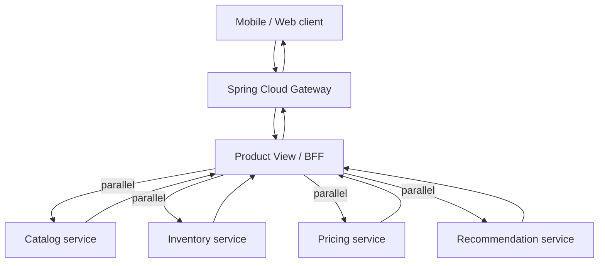
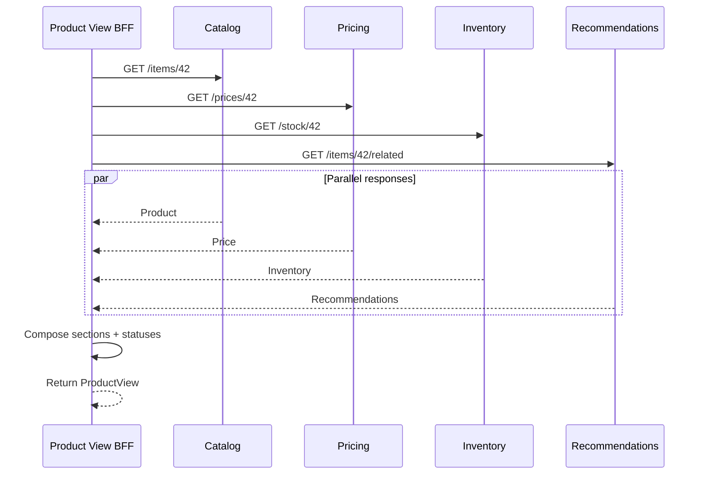
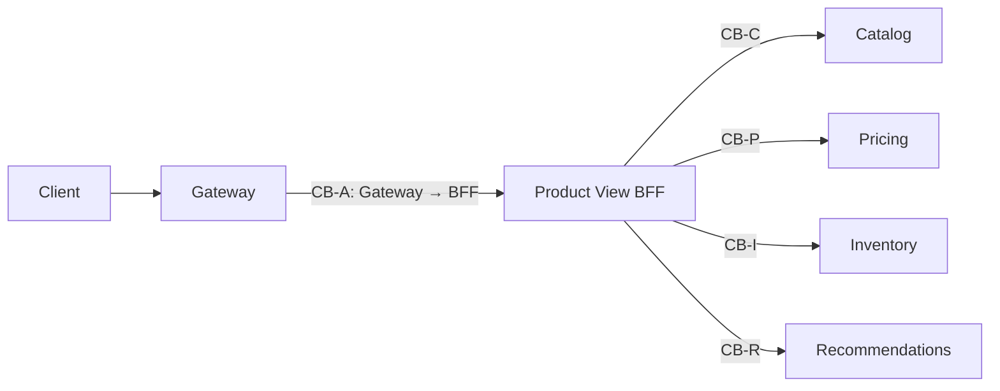

# Giới hạn tổng hợp dữ liệu tại gateway và xử lý lỗi một phần

## 1. Khi một API cần dữ liệu từ nhiều microservices

Một màn hình chi tiết sản phẩm có thể cần thông tin từ nhiều dịch vụ: catalog cung cấp tên và mô tả, pricing cung cấp giá, inventory cung cấp số lượng, còn recommendation cung cấp gợi ý liên quan. Nếu client gọi từng dịch vụ, client phải biết topology nội bộ, tự ghép dữ liệu, tự đặt timeout và xử lý lỗi ở từng nơi. Đây là gánh nặng lớn với browser/mobile và làm thay đổi API client mỗi khi kiến trúc backend đổi.

**API Gateway** có thể cung cấp một điểm vào thống nhất. Tuy nhiên, cần phân biệt hai nhiệm vụ:

- **Routing tại Gateway:** nhận request, match route predicates, chạy filter chain, đổi path/header, chọn backend qua service discovery, áp dụng xác thực, rate limit, TLS, circuit breaker, retry và observability.
- **Tổng hợp dữ liệu (aggregation/composition):** gọi nhiều dịch vụ, ghép kết quả theo nghiệp vụ, quyết định phần nào bắt buộc, phần nào có thể thiếu, và trả một response nhất quán.

Một kiến trúc thường dùng là **Gateway định tuyến tới một BFF/composition service**, còn dịch vụ đó thực hiện fan-out và tổng hợp. Nếu có lý do đặc biệt để tổng hợp ngay trong Gateway, phải thiết kế rõ custom filter/handler, timeout, body lifecycle và backpressure; không biến một `GlobalFilter` dùng chung thành nơi chứa nghiệp vụ của mọi API.

### Ví dụ xuyên suốt

Client gọi:

```http
GET /api/product-view/42
```

Gateway chuyển tới `product-view-service`. Composition service gọi song song:



**Catalog là nguồn bắt buộc** để xác định sản phẩm có tồn tại và tên sản phẩm. Inventory, pricing và recommendations có thể được đánh dấu là phần bổ sung tùy hợp đồng API. Nếu một nguồn bổ sung timeout, API vẫn có thể trả thông tin catalog cùng trạng thái degraded rõ ràng. Nếu catalog không tìm thấy sản phẩm, trả 404; nếu catalog không khả dụng, trả 503/504 theo nguyên nhân.

### Mục tiêu học tập

Sau bài này, bạn có thể:

1. Chọn ranh giới giữa Gateway routing và một BFF/composition service.
2. Thiết kế fan-out có giới hạn, gọi song song các upstream bằng reactive WebClient.
3. Cô lập lỗi từng nhánh thay vì để một dependency tùy chọn làm hỏng toàn bộ response.
4. Đặt deadline tổng thể và timeout cho từng downstream, tránh để một request giữ tài nguyên vô hạn.
5. Xây dựng response contract phân biệt `COMPLETE`, `PARTIAL`, `NOT_FOUND` và `UNAVAILABLE`.
6. Kết hợp rate limit, circuit breaker, retry và cache mà không khuếch đại sự cố.
7. Kiểm thử lỗi một phần, cancellation, empty response, service discovery và các trường hợp backend chậm.

> **Phạm vi:** Spring Cloud Gateway Server WebFlux 5.0.x, Spring Boot 4.x, Reactor và WebClient. Các hostname/service IDs và response trong bài là dữ liệu ví dụ. Những đoạn code là mẫu kiến trúc cần được tích hợp với DTO, authentication, service discovery và error policy của ứng dụng thực tế.

## 2. Xác định hợp đồng tổng hợp trước khi gọi nhiều dịch vụ

### 2.1. Phân loại nguồn dữ liệu theo mức độ quan trọng

Không phải mọi nhánh fan-out đều có cùng ý nghĩa. Trước khi code, lập bảng dependency:

| Nguồn | Dữ liệu | Vai trò trong API | Khi không khả dụng |
|---|---|---|---|
| Catalog | ID, tên, mô tả | **Bắt buộc** | Không xác định được sản phẩm; trả lỗi toàn request |
| Pricing | Giá hiện tại, tiền tệ | Tùy use case; ví dụ này là bổ sung | Đánh dấu unavailable; không giả giá bằng 0 |
| Inventory | Tình trạng còn hàng | Bổ sung | Đánh dấu unavailable; không suy ra hết hàng |
| Recommendations | Danh sách gợi ý | Tùy chọn | Có thể thiếu phần gợi ý, phần sản phẩm vẫn dùng được |

Phân loại này là **business contract**, không chỉ là kỹ thuật. Nếu API dùng để xác nhận đơn hàng, giá và inventory có thể là **bắt buộc**; nếu API dùng để hiển thị trang tham khảo, chúng có thể được trả ở trạng thái không đầy đủ. Không áp dụng một quy tắc “mọi lỗi backend đều trả 200” cho tất cả endpoint.

### 2.2. Thiết kế response để không che giấu dữ liệu thiếu

Ví dụ response khi mọi dịch vụ thành công:

```json
{
  "overallStatus": "COMPLETE",
  "product": {
    "status": "AVAILABLE",
    "data": {
      "id": 42,
      "name": "Wireless Headphones"
    },
    "reason": null
  },
  "price": {
    "status": "AVAILABLE",
    "data": {
      "amount": 129.99,
      "currency": "USD"
    },
    "reason": null
  },
  "inventory": {
    "status": "AVAILABLE",
    "data": {
      "available": 8
    },
    "reason": null
  },
  "recommendations": {
    "status": "AVAILABLE",
    "data": [
      {"id": 51, "name": "Travel Case"}
    ],
    "reason": null
  }
}
```

Ví dụ khi pricing timeout:

```json
{
  "overallStatus": "PARTIAL",
  "product": {
    "status": "AVAILABLE",
    "data": {"id": 42, "name": "Wireless Headphones"},
    "reason": null
  },
  "price": {
    "status": "UNAVAILABLE",
    "data": null,
    "reason": "TIMEOUT"
  },
  "inventory": {
    "status": "AVAILABLE",
    "data": {"available": 8},
    "reason": null
  },
  "recommendations": {
    "status": "AVAILABLE",
    "data": [],
    "reason": null
  }
}
```

`data: null` cùng `status: UNAVAILABLE` khác với `data: []` cùng `status: AVAILABLE`: trường hợp thứ hai có nghĩa service đã trả thành công nhưng không có gợi ý nào. Tương tự, `available: 0` là dữ liệu inventory đã xác nhận, còn `inventory.status=UNAVAILABLE` nghĩa là chưa biết số lượng.

### 2.3. Chọn HTTP status theo ngữ nghĩa, không dùng mã để che lỗi

| Tình huống | HTTP status gợi ý | Body/contract |
|---|---:|---|
| Nguồn bắt buộc trả sản phẩm | 200 | `overallStatus=COMPLETE` hoặc `PARTIAL` |
| Nguồn bổ sung lỗi nhưng sản phẩm chính hợp lệ | 200 | `overallStatus=PARTIAL`, từng section chỉ rõ `UNAVAILABLE` |
| Catalog xác nhận không có sản phẩm | 404 | Không có product view |
| Catalog là nguồn bắt buộc nhưng không khả dụng | 503 | Có thể kèm error envelope ổn định, không lộ exception |
| Deadline toàn request vượt quá | 504 | Gateway/composition deadline exceeded |
| Upstream trả response sai contract | 502 hoặc policy lỗi upstream | Ghi nhận lỗi contract, không biến thành dữ liệu mặc định |

**Không dùng HTTP 206 Partial Content** chỉ để biểu thị “một microservice bị lỗi”. 206 có ngữ nghĩa HTTP Range/partial representation. 207 Multi-Status cũng thuộc WebDAV và thường không phải lựa chọn phù hợp cho API composition thông thường. Hãy dùng HTTP status phản ánh kết quả tổng thể và một field `overallStatus`/section status trong JSON.

### 2.4. Không bao giờ thay lỗi bằng dữ liệu giả có vẻ hợp lệ

Các fallback nguy hiểm:

- Pricing lỗi → trả `amount: 0`: người dùng có thể hiểu sản phẩm miễn phí.
- Inventory lỗi → trả `available: 0`: biến “không biết” thành “hết hàng”.
- Catalog lỗi → trả object mặc định với tên rỗng: che outage và tạo cache sai.
- Recommendations lỗi → trả `[]` nhưng không đánh dấu trạng thái: client không biết “không có gợi ý” hay “service không trả lời”.

Fallback phải **giữ nguyên ý nghĩa của dữ liệu**. Nếu không thể cung cấp, trả `null`/unavailable cùng reason code; nếu có giá trị stale đã được cache, đánh dấu rõ `STALE` và timestamp theo hợp đồng.

## 3. Gateway định tuyến tới BFF thay vì ôm toàn bộ nghiệp vụ tổng hợp

### 3.1. Route đến composition service

Gateway chỉ cần một route công khai cho product view:

```yaml
spring:
  cloud:
    gateway:
      server:
        webflux:
          routes:
            - id: product-view
              uri: lb://product-view-service
              predicates:
                - Path=/api/product-view/**
                - Method=GET
              filters:
                - StripPrefix=2
```

Với request `/api/product-view/42`, `StripPrefix=2` loại bỏ hai segment `api` và `product-view`; BFF nhận `GET /42`. URI `lb://product-view-service` yêu cầu Spring Cloud LoadBalancer và một discovery source tương ứng (Eureka, Consul, Kubernetes integration hoặc cấu hình service instance phù hợp). Nếu dùng DNS Kubernetes trực tiếp, có thể dùng URI HTTPS/HTTP tới service DNS thay cho `lb://`.

Gateway vẫn chịu trách nhiệm:

- Xác thực client và áp dụng authorization phù hợp.
- Rate limit ở API tổng hợp để ngăn một client tạo fan-out quá lớn.
- TLS inbound và policy outbound tới BFF.
- Correlation ID, metrics, tracing, access log.
- Circuit breaker bảo vệ **hop Gateway → BFF** nếu BFF không đáp ứng.

### 3.2. BFF chịu trách nhiệm composition

Composition service quyết định:

- Các nguồn dữ liệu cần gọi cho từng use case.
- Nhánh nào bắt buộc, nhánh nào optional.
- Timeout riêng, overall deadline và mức concurrency.
- Response schema, partial status và lỗi nghiệp vụ.
- Cache key, TTL và tính nhất quán dữ liệu.

Đặt logic này ở BFF giúp route Gateway tiếp tục dễ hiểu, có thể reuse các dịch vụ độc lập, và tránh việc một filter chung phải đọc/ghép body của mọi route.

### 3.3. Vì sao không ghép response body trong GlobalFilter một cách tùy tiện?

Gateway filters chủ yếu xử lý request/response của **một proxied exchange**. Muốn aggregate body từ nhiều upstream, một custom filter phải quản lý:

- Việc consume và replay `DataBuffer`, tránh leak bộ nhớ.
- Backpressure và giới hạn kích thước response.
- Cancellation khi client ngắt kết nối.
- Status/header/content-type khi nhiều upstream có kết quả khác nhau.
- Authentication context, tenant context và propagation tới từng service.
- Error handling cho body đã được commit một phần.

Đây là công việc của một composition endpoint có hợp đồng rõ ràng. Nếu có yêu cầu latency/ownership đặc biệt khiến aggregation phải nằm ngay trong Gateway, nên xây **một handler/module chuyên biệt**, test memory/backpressure/cancellation đầy đủ, không nhồi vào filter logging hoặc rewrite path hiện có.

### 3.4. Bảo vệ hop Gateway → BFF

Nếu BFF chỉ phục vụ Gateway, hãy giới hạn network access và xác thực service-to-service (mTLS/workload identity hoặc token audience riêng). Không tin một header `X-Internal-Request: true` do client Internet có thể tự gửi. Gateway nên xóa/ghi đè các internal headers do client cung cấp trước khi proxy và BFF vẫn phải kiểm tra identity.

## 4. Fan-out song song bằng reactive WebClient

### 4.1. Vì sao không gọi tuần tự?

Nếu bốn dịch vụ lần lượt mất 120 ms, 180 ms, 240 ms và 300 ms, cách tuần tự có thể mất khoảng 840 ms cộng overhead. Nếu gọi song song, thời gian gần với nhánh chậm nhất (khoảng 300 ms) cộng overhead, miễn là tài nguyên và connection pools đủ.



Trong Reactor, `Mono.zip(...)` có thể kết hợp các publisher độc lập. Nhưng cần hiểu ngữ nghĩa: **một nhánh phát error hoặc hoàn tất empty có thể làm `zip` không tạo được kết quả**. Nếu muốn một nhánh lỗi không làm mất cả response, phải chuyển lỗi của nhánh đó thành một giá trị `Part.UNAVAILABLE` **ngay tại nhánh**, trước khi ghép.

### 4.2. Dependency cho composition service

Một ứng dụng Spring Boot WebFlux có thể dùng:

```xml
<dependencies>
  <dependency>
    <groupId>org.springframework.boot</groupId>
    <artifactId>spring-boot-starter-webflux</artifactId>
  </dependency>
  <dependency>
    <groupId>org.springframework.cloud</groupId>
    <artifactId>spring-cloud-starter-loadbalancer</artifactId>
  </dependency>
</dependencies>
```

Nếu dùng Eureka/Consul/Kubernetes discovery, thêm đúng discovery client tương ứng. `spring-cloud-starter-loadbalancer` cho phép WebClient sử dụng service ID khi builder được đánh dấu `@LoadBalanced`. Nếu BFF dùng DNS/service mesh trực tiếp, có thể bỏ load-balancer annotation và dùng URL cấu hình.

### 4.3. Tạo load-balanced WebClient.Builder

```java
package com.example.productview;

import org.springframework.cloud.client.loadbalancer.LoadBalanced;
import org.springframework.context.annotation.Bean;
import org.springframework.context.annotation.Configuration;
import org.springframework.web.reactive.function.client.WebClient;

@Configuration(proxyBeanMethods = false)
class DownstreamClientConfiguration {

    @Bean
    @LoadBalanced
    WebClient.Builder loadBalancedWebClientBuilder() {
        return WebClient.builder();
    }
}
```

Service IDs `catalog-service`, `pricing-service`, `inventory-service` và `recommendation-service` phải được đăng ký/resolve bởi discovery mechanism đang chạy. **Không** dùng tên service tùy ý rồi kỳ vọng DNS tự hiểu nếu môi trường không có discovery/load-balancing tương ứng.

### 4.4. Kiểu dữ liệu biểu diễn trạng thái của từng nhánh

```java
package com.example.productview;

enum PartStatus {
    AVAILABLE,
    NOT_FOUND,
    UNAVAILABLE
}

record Part<T>(PartStatus status, T data, String reason) {

    static <T> Part<T> available(T data) {
        return new Part<>(PartStatus.AVAILABLE, data, null);
    }

    static <T> Part<T> notFound() {
        return new Part<>(PartStatus.NOT_FOUND, null, null);
    }

    static <T> Part<T> unavailable(String reason) {
        return new Part<>(PartStatus.UNAVAILABLE, null, reason);
    }
}

record CatalogItem(long id, String name) {}
record Price(java.math.BigDecimal amount, String currency) {}
record Inventory(int available) {}
record Recommendation(long id, String name) {}

record ProductView(
    String overallStatus,
    Part<CatalogItem> product,
    Part<Price> price,
    Part<Inventory> inventory,
    Part<java.util.List<Recommendation>> recommendations
) {}
```

`reason` là mã lỗi ổn định như `TIMEOUT`, `UPSTREAM_5XX`, `CONNECTIVITY` hoặc `INVALID_RESPONSE`; **không trả stack trace, internal hostname, URL có credential hay exception message thô cho client**.

## 5. Những lỗi thiết kế thường gặp và cách khắc phục

### 5.1. Đặt onErrorResume quá muộn

**Sai:**

```java
return Mono.zip(loadCatalog(id), loadPrice(id), loadInventory(id))
    .onErrorResume(error -> Mono.just(defaultView()));
```

Một lỗi ở bất kỳ nhánh nào làm `zip` lỗi; fallback ở ngoài chỉ còn biết **toàn bộ composition thất bại** và thay cả response bằng default. Dữ liệu thành công từ các nhánh khác bị bỏ mất.

**Đúng cho partial composition:** chuyển lỗi thành một `Part.UNAVAILABLE` ngay trong từng publisher trước khi gọi `zip`. Chỉ dùng fallback ngoài cho lỗi tổng thể không thể phục hồi, như overall deadline vượt hoặc lỗi lập trình ngoài dự kiến.

### 5.2. Dùng zipDelayError nhưng tưởng đã có partial response

`Mono.zipDelayError(...)` có thể trì hoãn phát lỗi cho tới khi các nguồn hoàn tất, nhưng **không tự biến lỗi thành một section trong JSON**. Khi một nhánh vẫn error, kết quả cuối cùng vẫn là error. Partial response cần các nhánh chuyển error thành **giá trị trạng thái** hoặc một mô hình `Result` rõ ràng.

### 5.3. Retry và circuit breaker cùng hoạt động nhưng không có ngân sách

Nếu Gateway retry hai lần, BFF retry hai lần và từng dependency cũng retry, một client request có thể tạo rất nhiều upstream attempts. Circuit breaker lại đo tỷ lệ lỗi trên attempts, có thể mở nhanh hơn dự kiến. Hãy thống nhất:

- Ai là tầng sở hữu retry cho mỗi dependency.
- Số attempts tối đa end-to-end.
- Retryable exception/status.
- Backoff/jitter và deadline.
- Cách ghi nhận **logical request** khác **physical attempt**.

### 5.4. Dùng onErrorContinue để bỏ qua lỗi nhánh

`onErrorContinue` không phải một cách tổng quát để xử lý lỗi fan-out. Nó phụ thuộc operator và upstream, có thể bỏ qua lỗi không đúng phần tử dự định và làm behavior khó đoán. Hãy dùng `onErrorResume` ở **đúng nhánh**, chuyển sang kiểu kết quả có trạng thái rõ.

### 5.5. Bỏ timeout vì đã có circuit breaker

Circuit breaker không thay timeout. Nếu một upstream treo và không trả kết quả, breaker không nhất thiết mở ngay; nó cần các events/threshold để đánh giá. Timeout đặt giới hạn cho từng request, còn breaker ngăn tiếp tục gọi một dependency đang lỗi.

### 5.6. Chỉ có timeout tổng thể, không có timeout từng nhánh

Nếu BFF chỉ timeout ở 800 ms, một pricing call có thể giữ connection gần hết ngân sách trước khi bị hủy; các nhánh khác phải chờ `zip`. Đặt timeout cho từng upstream và deadline tổng thể, rồi kiểm tra pool/queue để tránh các request chờ connection quá lâu.

### 5.7. Không kiểm tra kích thước response

Một recommendations service trả 100.000 items có thể làm BFF tiêu thụ nhiều memory dù thời gian phản hồi nhanh. Giới hạn:

- Số items tối đa/page size.
- Payload bytes/response size nếu client stack hỗ trợ.
- Depth/size của nested objects.
- Timeout và concurrency.
- Serialization output và compression policy.

Nếu cần danh sách lớn, dùng pagination/streaming endpoint riêng thay vì ghép tất cả vào một response màn hình.

### 5.8. Bỏ qua service discovery và load balancer failures

`lb://product-view-service` chỉ hoạt động khi Gateway tìm được instance. BFF WebClient `http://catalog-service` chỉ resolve được khi builder có LoadBalancer và discovery source phù hợp. Khi không có instance, lỗi có thể xuất hiện như `ServiceInstanceNotFoundException` hoặc lỗi request; phân loại reason thành `UPSTREAM_UNAVAILABLE`, không lộ class/stack cho client.

Đặt health checks, discovery refresh và timeout hợp lý; không fallback sang một hostname khác không được allowlist khi discovery lỗi.

### 5.9. Partial 200 nhưng dashboard báo mọi thứ xanh

HTTP status tổng vẫn là 200 khi một optional source unavailable. Nếu SLO chỉ đo 5xx, pricing có thể outage hàng giờ mà không có alert. Đo thêm:

- Tỷ lệ `PARTIAL` trên tổng aggregate responses.
- Tỷ lệ unavailable theo từng dependency.
- p95/p99 latency và timeout rate theo dependency.
- Circuit breaker open/half-open transitions.
- Cache stale/age distribution.

Định nghĩa error budget theo **chất lượng dữ liệu của API**, không chỉ HTTP 5xx.

### 5.10. Trả response partial mà không version contract

Client cần biết field nào có thể `null`, trạng thái `NOT_FOUND`/`UNAVAILABLE`, reason code và `overallStatus`. Thay đổi schema phải có versioning/compatibility policy; không bất ngờ đổi `data: null` thành `[]` hoặc `amount: 0`. Hãy có contract tests cho client/server và tài liệu semantics.

## 6. Troubleshooting theo triệu chứng

| Triệu chứng | Nguyên nhân có thể | Cách xác minh |
|---|---|---|
| Một service timeout làm toàn API 500 | `zip` nhận error trước khi branch fallback | Đặt `onErrorResume` ở từng branch; test lỗi một nhánh |
| `zip` không phát ProductView nhưng không thấy exception | Một `Mono` hoàn tất empty | Kiểm tra 204/empty body; dùng `switchIfEmpty`/Optional |
| Product view chậm gần tổng thời gian các upstream | Gọi tuần tự hoặc chờ dependencies theo chuỗi | Trace spans và parallelize các nhánh độc lập |
| Response 200 nhưng giá hiển thị 0 khi pricing down | Fallback dùng default có vẻ hợp lệ | Trả `UNAVAILABLE` + `data=null`, không giả giá |
| Inventory hiển thị hết hàng khi inventory timeout | Timeout bị ánh xạ thành `available=0` | Tách `UNKNOWN` khỏi số lượng 0 |
| Catalog 404 nhưng API trả 200 object rỗng | Required source bị fallback thành default | Giữ 404 nghiệp vụ riêng |
| Catalog timeout nhưng overallStatus là COMPLETE | Tính status chỉ dựa trên optional branches | Required branch unavailable phải đặt overall UNAVAILABLE |
| Gateway trả 504 dù BFF hoàn thành partial | Gateway response timeout nhỏ hơn BFF deadline | Căn chỉnh timeout theo ngân sách end-to-end |
| BFF vẫn gọi downstream sau client disconnect | Có `subscribe()` thủ công hoặc async task tách lifecycle | Trả publisher, theo dõi cancellation |
| Một request tạo hàng trăm calls | N+1 fan-out hoặc list không giới hạn | Batch APIs, pagination, concurrency limit |
| Downstream bị quá tải khi Gateway vẫn 200 | Aggregate QPS × fan-out × retry quá lớn | Rate limit, bulkhead, pool limits, giảm retry |
| Circuit breaker không mở dù upstream treo | Thiếu timeout hoặc threshold không phù hợp | Đặt timeout; kiểm metrics và breaker config |
| Circuit breaker open làm mọi sections unavailable | Dùng một breaker chung cho mọi dependencies | Breaker riêng theo downstream |
| Pricing 404 làm cả product view lỗi | 404 chưa được phân loại theo semantics | Quyết định 404 optional là NOT_FOUND hay fatal |
| Recommendations rỗng bị đánh dấu unavailable | Empty list bị nhầm với empty Mono | `collectList()` và phân biệt empty body vs empty collection |
| BFF không resolve catalog-service | Thiếu LoadBalancer/discovery client hoặc service ID sai | Kiểm dependency, service registry và instance list |
| Một route Gateway trả 404 | Path/StripPrefix mapping sai | Kiểm request path, số segment bị strip, BFF mapping |
| Một route Gateway trả 503 | BFF down, service discovery không có instance, breaker open | Gateway route logs, LB metrics, BFF readiness |
| Metrics không thấy partial responses | Chỉ instrument HTTP status | Thêm aggregate_status và dependency outcome |
| Prometheus cardinality tăng nhanh | Metric labels chứa product/user IDs | Chỉ dùng labels hữu hạn như service/outcome/routeId |
| Trace không có downstream spans | WebClient không instrument hoặc context không propagate | Kiểm Micrometer Observation/tracing bridge |
| Cache trả PARTIAL lâu sau khi service phục hồi | Cache partial dùng TTL dài | TTL riêng, không promote partial thành complete |
| Giá cache của tenant A xuất hiện ở tenant B | Cache key thiếu tenant/market/currency | Thêm scope vào key, purge cache sai |
| Retry làm tăng đơn hàng trùng | Retry POST không idempotent | Idempotency key và workflow owner |
| BFF trả exception message có hostname nội bộ | Error body lấy raw exception | Chuẩn hóa reason code, log nội bộ đã sanitize |

## 7. Checklist trước khi đưa API aggregation lên production

### 7.1. Hợp đồng và ranh giới

- [ ] Xác định Gateway chỉ route tới BFF/composition service hay có handler aggregation chuyên biệt.
- [ ] Có danh sách dependencies và đánh dấu **required/optional**.
- [ ] Response contract phân biệt complete/partial/not found/unavailable.
- [ ] Không dùng 206 để biểu thị upstream lỗi một phần.
- [ ] Không thay timeout bằng giá trị giả như giá 0 hoặc inventory 0.
- [ ] Có versioning và contract tests cho client.

### 7.2. Resilience và giới hạn

- [ ] Có timeout riêng cho từng downstream và overall deadline.
- [ ] Timeout ngân sách phù hợp với Gateway/client, có overhead cho queue/TLS/serialization.
- [ ] Các nhánh độc lập được gọi song song và lỗi được cô lập trước khi ghép.
- [ ] Empty body/204 được xử lý theo semantics.
- [ ] Có giới hạn concurrency, connection pools, payload size và list/page size.
- [ ] Có Gateway rate limit và BFF/downstream bulkhead.
- [ ] Retry bounded, backoff/jitter và chỉ dùng khi idempotent.
- [ ] Circuit breaker theo từng dependency và một breaker riêng cho Gateway → BFF nếu cần.
- [ ] Cancellation gắn với request lifecycle, không manual `subscribe()`.

### 7.3. Security và dữ liệu

- [ ] Gateway/BFF/downstreams xác thực identity theo đúng hop.
- [ ] Không relay nguyên client bearer token tới mọi downstream mặc định.
- [ ] Internal headers do client gửi được xóa/ghi đè theo trust policy.
- [ ] Mỗi service kiểm tra quyền theo tenant/resource.
- [ ] Cache key không lẫn tenant/user/currency/market.
- [ ] Logs/traces không chứa token, PII, raw query hoặc exception nội bộ.

### 7.4. Observability và test

- [ ] Có metric COMPLETE/PARTIAL/UNAVAILABLE và outcome từng dependency.
- [ ] Có latency histograms/p95/p99, timeout rate, breaker state và retry attempts.
- [ ] Có trace spans từ Gateway qua BFF đến từng downstream.
- [ ] Tests bao phủ success, optional failure, required failure, 404, timeout, empty body, cancel.
- [ ] Load tests có một upstream chậm, một upstream 5xx và client vượt rate limit.
- [ ] Alert theo partial ratio/dependency SLO, không chỉ HTTP 5xx.
- [ ] Rollback/feature disable có thể thực hiện mà không thay đổi semantics bất ngờ.

## 8. Ma trận kiểm thử mở rộng

| ID | Kịch bản | Assertion |
|---|---|---|
| T13 | Pricing 404 là trường hợp không có giá | Section `NOT_FOUND`, không đánh dấu lỗi hệ thống nếu contract cho phép |
| T14 | Optional Mono hoàn tất empty body | `UNAVAILABLE/INVALID_RESPONSE` hoặc empty semantics đã định nghĩa |
| T15 | Recommendations trả 200 với danh sách rỗng | `AVAILABLE`, `data=[]` |
| T16 | Catalog 404 và recommendations delay | Response 404 theo contract; đo latency/cancellation policy |
| T17 | Catalog 5xx | Không trả product object mặc định |
| T18 | Pricing 5xx | Product vẫn trả nếu catalog thành công; overall partial |
| T19 | Tất cả optional branches timeout | Product trả partial, không chờ quá deadline |
| T20 | Overall deadline hết | 504, các publisher còn lại bị cancel theo lifecycle |
| T21 | Client disconnect giữa fan-out | Không manual subscription tiếp tục chạy ngoài request |
| T22 | LoadBalancer không tìm thấy catalog instance | Required source unavailable, reason code an toàn |
| T23 | Một service discovery instance unhealthy | Request không bị chuyển sang endpoint ngoài allowlist |
| T24 | Gateway rate limit vượt ngưỡng | 429 trước khi BFF fan-out |
| T25 | BFF concurrency limit đạt ngưỡng | Reject/queue theo policy, không tăng unbounded memory |
| T26 | 100 IDs trong một request | Bị giới hạn page size/batch hoặc concurrency |
| T27 | Recommendations payload quá lớn | Response-size/item limit được áp dụng |
| T28 | Retry GET một lần với lỗi tạm thời | Attempt count bounded, deadline vẫn được giữ |
| T29 | Retry POST không idempotent | Không retry hoặc có idempotency key |
| T30 | Pricing circuit breaker OPEN | Chỉ price section unavailable; catalog vẫn hoạt động |
| T31 | BFF circuit breaker ở Gateway OPEN | Fallback toàn endpoint, status rõ ràng |
| T32 | Gateway timeout nhỏ hơn BFF timeout | Test phát hiện mismatch budget trước release |
| T33 | Cache có PARTIAL response | TTL ngắn/không cache; không bị trả như COMPLETE |
| T34 | Cache response tenant-specific | Tenant khác không nhận dữ liệu cached |
| T35 | Inventory timeout | Không chuyển thành `available=0` |
| T36 | Optional 404 | Contract phân biệt không có dữ liệu với upstream failure |
| T37 | Trace propagation qua WebClient | Một trace chứa các spans downstream |
| T38 | Metric labels theo dependency | Cardinality hữu hạn, không có user/product IDs |
| T39 | Một dependency phục hồi sau outage | Partial ratio giảm và cache stale hết hạn/được refresh |
| T40 | BFF trả exception nội bộ | Public response chỉ có reason code, log nội bộ có diagnostic an toàn |

Các test T01–T12 ở mục 10.1 và T13–T40 ở đây tạo thành bộ matrix tham khảo. Chạy bằng mock services/staging cô lập; không tạo outage có chủ đích trên production.

## 9. Bài tập và câu hỏi tự kiểm tra

**Bài 1 — Ranh giới kiến trúc.** Vì sao Gateway thường route tới một BFF/composition service thay vì để mọi GlobalFilter tự ghép response body?

**Bài 2 — Required và optional.** Catalog trả 404, pricing timeout, inventory 200. API product view nên trả gì theo hợp đồng của bài? Vì sao không trả một object rỗng?

**Bài 3 — HTTP semantics.** Vì sao không dùng HTTP 206 chỉ vì pricing service lỗi?

**Bài 4 — Empty vs unavailable.** Phân biệt recommendations trả 200 với `[]`, trả 204, timeout và 500. Mỗi trường hợp nên được biểu diễn thế nào?

**Bài 5 — Mono.zip.** Điều gì xảy ra nếu một nguồn trong Mono.zip phát error? Vì sao onErrorResume ở ngoài zip không tạo được partial response?

**Bài 6 — Partial handling.** Viết ý tưởng đặt onErrorResume ở từng nhánh để đổi timeout thành Part.unavailable("TIMEOUT").

**Bài 7 — Timeout budget.** Nếu client timeout 1.5 giây, Gateway→BFF timeout 1 giây, BFF deadline 800 ms và mỗi branch timeout 300 ms, các timeout liên hệ thế nào?

**Bài 8 — Parallel fan-out.** Bốn upstream có latency 120/180/240/300 ms. Vì sao parallel composition thường nhanh hơn tuần tự? Nêu ít nhất hai overhead còn lại.

**Bài 9 — N+1.** Một trang có 50 sản phẩm và mỗi sản phẩm gọi price + inventory riêng. Có thể tạo bao nhiêu downstream calls? Đề xuất hai cách giảm.

**Bài 10 — Concurrency.** flatMap(fetch, 8) giới hạn điều gì? Vì sao 500 request đồng thời vẫn có thể tạo hàng nghìn in-flight calls?

**Bài 11 — Cancellation.** Vì sao không gọi subscribe() thủ công trong controller để lấy recommendation?

**Bài 12 — Required failure.** Catalog timeout nhưng các nhánh khác thành công. Vì sao controller nên trả 504/503 theo nguyên nhân thay vì PARTIAL 200?

**Bài 13 — Optional failure.** Pricing timeout nhưng catalog thành công. Thiết kế response section ra sao để client không nhầm giá 0?

**Bài 14 — Retry amplification.** Gateway, BFF và pricing đều retry hai lần. Vì sao có thể tạo số attempts lớn? Đề xuất cách quản lý retry.

**Bài 15 — Circuit breaker.** Khác nhau giữa breaker ở Gateway→BFF và breaker ở BFF→pricing là gì?

**Bài 16 — Fallback.** Khi BFF hoàn toàn down, Gateway fallback có thể trả partial pricing/inventory không? Vì sao?

**Bài 17 — Cache.** Vì sao không cache response PARTIAL như response COMPLETE với TTL dài?

**Bài 18 — Tenant.** Một composed view có currency và promotion khác theo tenant. Cache key phải chứa những yếu tố nào?

**Bài 19 — Transaction.** Vì sao tổng hợp catalog, pricing và inventory không tạo một snapshot transaction nhất quán để xác nhận đơn hàng?

**Bài 20 — Rate limiting.** Một request tạo bốn downstream calls. Gateway rate limit có thay được bulkhead trong BFF không?

**Bài 21 — Authorization.** Vì sao không relay nguyên JWT của client tới mọi downstream?

**Bài 22 — Observability.** Những metric nào giúp phát hiện API trả 200 nhưng một dependency đang outage?

**Bài 23 — Trace.** Làm thế nào để một trace thể hiện Gateway → BFF → bốn upstream calls?

**Bài 24 — Error details.** Vì sao không trả raw ConnectException hoặc internal hostname trong response?

**Bài 25 — Service discovery.** lb://product-view-service và WebClient http://catalog-service cần những thành phần discovery/load-balancing nào?

**Bài 26 — Response size.** Recommendations service trả 100.000 items. Vì sao timeout đơn thuần không đủ bảo vệ BFF?

**Bài 27 — Status semantics.** Optional pricing trả 404. Khi nào nên đánh dấu NOT_FOUND bình thường, khi nào cần coi là UNAVAILABLE/UPSTREAM_ERROR?

**Bài 28 — Test strategy.** Nêu bộ test tối thiểu cho success, optional timeout, required timeout, 404 và client cancellation.

### Gợi ý đáp án

1. Gateway filter không phải nơi tốt để quản lý business composition, body lifecycle, backpressure, cancellation và response contract. BFF có endpoint/domain riêng dễ test và reuse.
2. Catalog 404 là nguồn bắt buộc không tồn tại; trả 404. Pricing timeout không cần thay đổi kết quả 404. Không trả object rỗng vì sẽ che ngữ nghĩa.
3. 206 dành cho partial representation theo HTTP Range; partial microservice failure nên được mô tả bằng contract JSON và status tổng thể phù hợp.
4. 200 `[]` là không có items; 204 có thể là empty hợp lệ nếu contract cho phép; timeout là unavailable/TIMEOUT; 500 là upstream error. Không gộp mọi trường hợp.
5. zip kết thúc bằng error hoặc empty completion; outer fallback thay cả composition. Cần đổi error thành giá trị status tại từng branch trước khi zip.
6. branch.timeout(...).map(Part::available).onErrorResume(e -> Mono.just(Part.unavailable(classify(e)))).
7. Mỗi branch có tối đa 300 ms; BFF deadline 800 ms bao toàn aggregate; Gateway chờ tối đa 1 giây; client chờ tối đa 1.5 giây, có overhead. Phải đo p95/p99 và căn chỉnh.
8. Các calls chạy đồng thời nên thời gian gần nhánh chậm nhất thay vì tổng. DNS/service discovery, queue, TLS, connection acquisition và serialization vẫn cộng overhead.
9. Có 100 downstream calls. Dùng batch endpoints, pagination, cache hoặc bỏ nguồn không cần.
10. Giới hạn 8 calls đồng thời trong một subscription. Nhiều HTTP requests chạy song song nhân số calls; cần bulkhead cấp ứng dụng/dependency.
11. Subscription tách khỏi lifecycle của client request, có thể tiếp tục sau khi client disconnect và làm mất error/cancellation propagation.
12. Catalog là required source; không thể tạo product view đúng nếu không xác định sản phẩm. 504 cho timeout, 503 cho unavailable khác.
13. status=UNAVAILABLE, data=null, reason=TIMEOUT; không đặt amount=0.
14. Retry nhiều tầng nhân attempts và khuếch đại outage. Chọn một owner, attempts bounded, backoff/jitter, retryable errors và deadline.
15. Gateway breaker bảo vệ toàn BFF; breaker trong BFF chỉ bảo vệ pricing, cho các nhánh khác tiếp tục.
16. Không có. Gateway không nhận được kết quả từ BFF để ghép partial; fallback chỉ trả lỗi/fallback toàn endpoint.
17. Nó có thể giữ trạng thái lỗi lâu sau khi dependency phục hồi và client tưởng đó là dữ liệu đầy đủ. Không cache hoặc dùng TTL ngắn, giữ nguyên PARTIAL.
18. Tenant, currency, market/region, user/customer tier, locale, permission/feature flags và product ID tùy response.
19. Các services trả dữ liệu tại các thời điểm khác nhau; không có distributed transaction/snapshot. Giao dịch ghi phải do workflow/service sở hữu điều phối.
20. Không. Gateway chặn request vào; BFF cần concurrency, pool và bulkhead riêng để bảo vệ từng dependency.
21. Audience/scope có thể không phù hợp và token có thể lộ tới service không cần nó. Dùng service identity/token exchange hoặc relay theo policy.
22. Partial ratio, unavailable ratio theo dependency, dependency timeout/error rates, p95/p99, breaker state và stale cache age.
23. Dùng Micrometer Tracing/Observation, propagation qua Gateway và WebClient, spans riêng cho từng downstream.
24. Lộ topology/internal hostnames và thông tin vận hành; dùng reason code ổn định, logs nội bộ đã sanitize.
25. Gateway cần LoadBalancer/discovery cho lb://; WebClient cần @LoadBalanced builder và Spring Cloud LoadBalancer/discovery source, hoặc DNS service naming tương ứng.
26. Payload lớn làm tăng memory/serialization/network, dù phản hồi nhanh. Cần limit item count/bytes, pagination, bounded concurrency.
27. NOT_FOUND nếu không có giá là một trạng thái nghiệp vụ hợp lệ; UNAVAILABLE/UPSTREAM_ERROR nếu 404 cho thấy ID mapping/API contract sai hoặc service không thể cung cấp dữ liệu theo yêu cầu.
28. Một test all-success; một optional branch timeout trả partial; required branch timeout trả 504; catalog 404 trả 404; client disconnect phát cancellation và không có manual subscription.

## 10. Rate limiting, authentication và service-to-service context

### 10.1. Rate limit endpoint tổng hợp ở Gateway

Vì một request có thể tạo bốn hoặc nhiều downstream calls, endpoint tổng hợp thường cần quota riêng. Ví dụ Gateway route có thể thêm `RequestRateLimiter` (cần Redis rate limiter hoặc implementation phù hợp và một `KeyResolver` được cấu hình):

```yaml
spring:
  cloud:
    gateway:
      server:
        webflux:
          routes:
            - id: product-view
              uri: lb://product-view-service
              predicates:
                - Path=/api/product-view/**
                - Method=GET
              filters:
                - StripPrefix=2
                - name: RequestRateLimiter
                  args:
                    key-resolver: "#{@principalKeyResolver}"
                    redis-rate-limiter.replenishRate: 20
                    redis-rate-limiter.burstCapacity: 40
```

Các con số `20/40` chỉ là giá trị minh họa. `principalKeyResolver` phải được tạo trong Gateway app và trả key đã xác thực (ví dụ tenant/client ID); **không dùng IP hoặc header client tự khai báo làm identity nếu không có trust policy**. Redis/KeyResolver lỗi cũng cần được xử lý theo policy fail-open/fail-closed đã phê duyệt.

Rate limit Gateway bảo vệ entry point, nhưng BFF vẫn cần:

- Giới hạn tổng số aggregations đồng thời.
- Giới hạn concurrency cho từng downstream.
- Giới hạn kích thước danh sách ID/page size.
- Quota nội bộ cho từng caller/service.

### 10.2. Không truyền mọi thông tin xác thực của client xuống mọi nhánh

Gateway có thể xác thực user bằng JWT/OAuth2. Nhưng BFF gọi bốn downstream services không có nghĩa cần relay nguyên bearer token của user tới tất cả dịch vụ. Hãy xác định:

- Downstream cần **service identity** hay **user identity**?
- Nếu cần user context, token có audience/scope đúng service đó không?
- Có thể dùng token exchange/on-behalf-of thay vì relay token gốc không?
- Có dữ liệu nào cần authorization theo tenant/owner ở service nguồn không?

BFF phải bảo đảm từng downstream kiểm tra quyền dữ liệu, không tin một header `X-User-Id` tự gửi từ client. Gateway/BFF nên xóa header identity do client tự cung cấp rồi thiết lập lại từ identity đã xác minh; downstream vẫn xác thực caller.

### 10.3. Không fan-out tới service mà user không được phép xem

Nếu một response có trường giá chỉ dành cho nhóm khách hàng nhất định, đừng gọi pricing cho mọi user rồi xóa trường sau cùng như biện pháp duy nhất. Tính quyền trước hoặc để service sở hữu dữ liệu trả kết quả đã authorization. Điều này giảm nguy cơ:

- Dữ liệu nhạy cảm xuất hiện trong BFF memory/logs dù không trả cho client.
- Cache dùng chung lẫn dữ liệu giữa tenants.
- Trace/debug data chứa giá hoặc thông tin không được phép.

### 10.4. Gateway filter chain không thay business authorization trong BFF

Gateway có thể kiểm tra scope ở route `/api/product-view/**`, nhưng BFF vẫn cần authorization cho product/tenant cụ thể và các downstream service vẫn cần kiểm tra quyền theo tài nguyên. Một route match thành công chỉ chứng minh predicates đúng; nó không chứng minh caller được phép đọc sản phẩm ID 42.

## 11. Kiểm thử tổng hợp và lỗi một phần

### 11.1. Ma trận các tình huống quan trọng

| Test | Catalog | Pricing | Inventory | Recommendations | Kết quả tổng thể |
|---|---|---|---|---|---|
| T01 | 200 | 200 | 200 | 200 | 200 `COMPLETE` |
| T02 | 200 | Timeout | 200 | 200 | 200 `PARTIAL`, price unavailable |
| T03 | 200 | 500 | Timeout | 200 | 200 `PARTIAL`, hai section unavailable |
| T04 | 200 | 404 | 200 | 204/empty list | Theo contract: complete nếu 404/empty là kết quả bình thường |
| T05 | 404 | bất kỳ | bất kỳ | bất kỳ | 404 sản phẩm không tồn tại |
| T06 | Timeout | 200 | 200 | 200 | 504 nếu nguồn bắt buộc hết deadline |
| T07 | 500 | 200 | 200 | 200 | 503 nếu catalog bắt buộc không khả dụng |
| T08 | Empty body bất ngờ | 200 | 200 | 200 | 503/502 theo error mapping; không tạo product rỗng |
| T09 | 200 | 200 | 200 | 500 | 200 `PARTIAL` nếu recommendations optional |
| T10 | 200 | 200 | 200 | 200 nhưng body quá lớn | Bị giới hạn payload/response size, không tiêu thụ memory vô hạn |
| T11 | 200 | 200 | 200 | 200 nhưng BFF deadline hết | 504; cancellation được quan sát |
| T12 | 200 | 200 | 200 | 200 nhưng client disconnect | Cancellation, không ghi ERROR giả |

Các status là kết quả gợi ý theo contract ở bài này; API thực tế phải thống nhất với client và business. Đặc biệt, một upstream 404 có thể có nghĩa “không có dữ liệu bổ sung” hoặc là lỗi tham chiếu; không gán một semantics cho mọi dịch vụ.

### 11.2. Kiểm thử bằng WebTestClient và mock upstreams

Trong integration tests, có thể chạy BFF trên random port và dùng MockWebServer/WireMock cho từng downstream. Các bước:

1. Trả response thành công từ cả bốn mock servers; assert body có đủ sections và `COMPLETE`.
2. Delay pricing vượt timeout branch; assert response vẫn 200 và `price.status=UNAVAILABLE`, `reason=TIMEOUT`.
3. Trả 500 từ inventory; assert inventory unavailable, các sections khác giữ nguyên.
4. Trả 404 catalog; assert HTTP 404.
5. Làm catalog chậm vượt required timeout; assert 504.
6. Trả body rỗng bất ngờ; assert contract error, không có giá trị mặc định giả.
7. Ghi nhận số calls để xác nhận fan-out và giới hạn concurrency.
8. Ngắt client giữa request; kiểm tra cancellation và không có manual background subscription.

### 11.3. Ví dụ kiểm thử response partial bằng WebTestClient

Đoạn dưới giả định BFF được khởi động trong Spring Boot test và mock pricing server được cấu hình trả chậm hơn timeout. Đây là **mẫu test**, phần khởi tạo mock servers và dynamic ports phụ thuộc project:

```java
package com.example.productview;

import org.junit.jupiter.api.Test;
import org.junit.jupiter.api.BeforeEach;
import org.springframework.boot.test.context.SpringBootTest;
import org.springframework.boot.test.web.server.LocalServerPort;
import org.springframework.test.web.reactive.server.WebTestClient;

@SpringBootTest(webEnvironment = SpringBootTest.WebEnvironment.RANDOM_PORT)
class ProductViewPartialFailureTest {

    @LocalServerPort
    int port;

    WebTestClient webTestClient;

    @BeforeEach
    void setUp() {
        webTestClient = WebTestClient.bindToServer()
            .baseUrl("http://127.0.0.1:" + port)
            .build();
    }

    @Test
    void returnsProductWhenOptionalPricingTimesOut() {
        // Test fixture phải cấu hình:
        // catalog -> 200 product JSON
        // pricing -> delay > 300 ms
        // inventory -> 200 inventory JSON
        // recommendations -> 200 list JSON

        webTestClient.get()
            .uri("/42")
            .exchange()
            .expectStatus().isOk()
            .expectHeader().valueEquals(
                "X-Aggregation-Status", "PARTIAL")
            .expectBody()
            .jsonPath("$.overallStatus").isEqualTo("PARTIAL")
            .jsonPath("$.product.status").isEqualTo("AVAILABLE")
            .jsonPath("$.price.status").isEqualTo("UNAVAILABLE")
            .jsonPath("$.price.reason").isEqualTo("TIMEOUT")
            .jsonPath("$.inventory.status").isEqualTo("AVAILABLE");
    }
}
```

`@LocalServerPort` được dùng để bind `WebTestClient` tới cổng ngẫu nhiên của BFF. Trong project thật, cần cấu hình các service IDs/URLs của WebClient trỏ tới mock servers bằng dynamic properties/test configuration; nếu mock server không được nối vào các client này, test có thể vô tình gọi nhầm môi trường.

### 11.4. Test cancellation và timeout cần phân biệt

- **Timeout:** một deadline cụ thể hết hạn; có thể trả 504 hoặc đánh dấu section unavailable.
- **Cancellation:** client/người gọi không còn subscribe; pipeline bị hủy. Thường không cần gửi response vì kết nối đã đóng.
- **Upstream error:** nhận HTTP 5xx/4xx hoặc lỗi kết nối; xử lý theo dependency contract.
- **Empty response:** upstream hoàn tất không có body; có thể là valid empty hoặc invalid response tùy API.

Đừng assert rằng mọi trường hợp không có body đều là timeout. Kiểm tra signal/exception type và HTTP exchange lifecycle.

### 11.5. Load test để xác nhận giới hạn tổng hợp

Tạo workload với:

- Tỷ lệ request tổng hợp dự kiến ở mức bình thường và peak.
- Một dependency chậm hơn bình thường.
- Một dependency trả 5xx theo tỷ lệ định trước.
- Một client vượt rate limit.
- Payload list có kích thước tối đa hợp lệ và một payload vượt giới hạn.

Theo dõi p95/p99 của aggregate, downstream attempts, in-flight requests, connection pool pending acquires, CPU/memory, timeout/partial ratio và Gateway 429/5xx. Một API trả partial 200 nhiều hơn bình thường vẫn có thể là sự cố availability của pricing/inventory; cần alert theo **dependency SLO**, không chỉ theo HTTP status tổng.

## 12. Mẫu triển khai fan-out bằng WebClient

### 12.1. Fan-out và xử lý lỗi tại từng nhánh

Ví dụ service dưới đây nhận một `WebClient.Builder` đã được đánh dấu `@LoadBalanced`. Mỗi client có service ID riêng:

```java
package com.example.productview;

import java.time.Duration;
import java.util.List;
import java.util.concurrent.TimeoutException;

import org.springframework.beans.factory.annotation.Qualifier;
import org.springframework.stereotype.Service;
import org.springframework.web.reactive.function.client.WebClient;
import org.springframework.web.reactive.function.client.WebClientRequestException;
import org.springframework.web.reactive.function.client.WebClientResponseException;

import reactor.core.publisher.Mono;

@Service
public class ProductAggregator {

    private static final Duration REQUIRED_TIMEOUT = Duration.ofMillis(250);
    private static final Duration OPTIONAL_TIMEOUT = Duration.ofMillis(300);

    private final WebClient catalog;
    private final WebClient pricing;
    private final WebClient inventory;
    private final WebClient recommendations;

    public ProductAggregator(
            @Qualifier("loadBalancedWebClientBuilder")
            WebClient.Builder builder) {
        this.catalog = builder.clone()
            .baseUrl("http://catalog-service").build();
        this.pricing = builder.clone()
            .baseUrl("http://pricing-service").build();
        this.inventory = builder.clone()
            .baseUrl("http://inventory-service").build();
        this.recommendations = builder.clone()
            .baseUrl("http://recommendation-service").build();
    }

    public Mono<ProductView> aggregate(long productId) {
        Mono<Part<CatalogItem>> product = loadCatalog(productId);
        Mono<Part<Price>> price = optional(
            pricing.get().uri("/prices/{id}", productId)
                .retrieve().bodyToMono(Price.class));
        Mono<Part<Inventory>> stock = optional(
            inventory.get().uri("/stock/{id}", productId)
                .retrieve().bodyToMono(Inventory.class));
        Mono<Part<List<Recommendation>>> related = optional(
            recommendations.get()
                .uri("/items/{id}/related", productId)
                .retrieve().bodyToFlux(Recommendation.class)
                .collectList());

        // Mỗi nhánh được xử lý lỗi riêng trước khi ghép.
        return Mono.zip(product, price, stock, related)
            .map(tuple -> {
                Part<CatalogItem> p = tuple.getT1();
                Part<Price> pr = tuple.getT2();
                Part<Inventory> in = tuple.getT3();
                Part<List<Recommendation>> rec = tuple.getT4();

                boolean partial =
                    pr.status() == PartStatus.UNAVAILABLE
                    || in.status() == PartStatus.UNAVAILABLE
                    || rec.status() == PartStatus.UNAVAILABLE;

                String overallStatus =
                    p.status() == PartStatus.UNAVAILABLE
                        ? "UNAVAILABLE"
                        : (partial ? "PARTIAL" : "COMPLETE");

                return new ProductView(
                    overallStatus,
                    p, pr, in, rec);
            });
    }

    private Mono<Part<CatalogItem>> loadCatalog(long id) {
        return catalog.get().uri("/items/{id}", id)
            .retrieve()
            .bodyToMono(CatalogItem.class)
            .switchIfEmpty(Mono.error(
                new IllegalStateException("EMPTY_CATALOG_RESPONSE")))
            .timeout(REQUIRED_TIMEOUT)
            .map(value -> Part.available(value))
            .onErrorResume(
                WebClientResponseException.NotFound.class,
                error -> Mono.just(Part.notFound()))
            .onErrorResume(error ->
                Mono.just(Part.unavailable(reason(error))));
    }

    private <T> Mono<Part<T>> optional(Mono<T> request) {
        return request
            .switchIfEmpty(Mono.error(
                new IllegalStateException("EMPTY_UPSTREAM_RESPONSE")))
            .timeout(OPTIONAL_TIMEOUT)
            .map(value -> Part.available(value))
            .onErrorResume(
                WebClientResponseException.NotFound.class,
                error -> Mono.just(Part.notFound()))
            .onErrorResume(error ->
                Mono.just(Part.unavailable(reason(error))));
    }

    private static String reason(Throwable error) {
        if (error instanceof TimeoutException) {
            return "TIMEOUT";
        }
        if (error instanceof WebClientResponseException response) {
            return response.getStatusCode().is5xxServerError()
                ? "UPSTREAM_5XX" : "UPSTREAM_ERROR";
        }
        if (error instanceof WebClientRequestException) {
            return "CONNECTIVITY";
        }
        return "INVALID_RESPONSE";
    }
}
```

**Cách hoạt động:**

1. Bốn request được tạo dưới dạng reactive publishers; `Mono.zip` subscribe các nhánh độc lập để chúng có thể chạy đồng thời.
2. Mỗi nhánh có timeout riêng.
3. `onErrorResume` được đặt **trên từng nhánh**, biến lỗi thành `Part.unavailable(...)` thay vì để error truyền tới `zip`.
4. Catalog 404 được biểu diễn thành `Part.notFound()` để controller có thể trả 404.
5. Recommendations dùng `collectList()`: danh sách rỗng là kết quả hợp lệ `[]`, khác với lỗi HTTP/timeout.
6. `reason()` chỉ phát mã lỗi đã chuẩn hóa, không trả nội dung exception cho client.

Trong ví dụ này, nếu catalog trả 404, các nhánh optional vẫn đã được gọi song song và `zip` đợi chúng hoàn tất trong timeout. Nếu trường hợp 404 phổ biến và các nhánh phụ tốn tài nguyên, có thể **tra catalog trước rồi mới fan-out**, hoặc thiết kế cancellation rõ ràng để dừng các nhánh còn lại khi catalog xác nhận không tồn tại.

### 12.2. Controller áp dụng deadline toàn request và status tổng thể

```java
package com.example.productview;

import java.time.Duration;
import java.util.concurrent.TimeoutException;

import org.springframework.http.HttpStatus;
import org.springframework.http.ResponseEntity;
import org.springframework.web.bind.annotation.GetMapping;
import org.springframework.web.bind.annotation.PathVariable;
import org.springframework.web.bind.annotation.RequestMapping;
import org.springframework.web.bind.annotation.RestController;

import reactor.core.publisher.Mono;

@RestController
@RequestMapping
public class ProductViewController {

    private static final Duration REQUEST_DEADLINE =
        Duration.ofMillis(800);

    private final ProductAggregator aggregator;

    public ProductViewController(ProductAggregator aggregator) {
        this.aggregator = aggregator;
    }

    @GetMapping("/{id}")
    public Mono<ResponseEntity<ProductView>> get(
        @PathVariable("id") long id) {

        return aggregator.aggregate(id)
            .map(view -> {
                Part<CatalogItem> product = view.product();

                if (product.status() == PartStatus.NOT_FOUND) {
                    return ResponseEntity
                        .<ProductView>status(HttpStatus.NOT_FOUND)
                        .build();
                }

                if (product.status() == PartStatus.UNAVAILABLE) {
                    HttpStatus status =
                        "TIMEOUT".equals(product.reason())
                            ? HttpStatus.GATEWAY_TIMEOUT
                            : HttpStatus.SERVICE_UNAVAILABLE;
                    return ResponseEntity.status(status).body(view);
                }

                return ResponseEntity.ok()
                    .header("X-Aggregation-Status", view.overallStatus())
                    .body(view);
            })
            .timeout(REQUEST_DEADLINE)
            .onErrorResume(TimeoutException.class, error ->
                Mono.just(ResponseEntity
                    .<ProductView>status(HttpStatus.GATEWAY_TIMEOUT)
                    .build()));
    }
}
```

Để khớp route ở mục 3, controller nhận `GET /42` vì Gateway đã `StripPrefix=2`. Nếu BFF muốn nhận `/products/42`, hãy đổi route filter hoặc mapping; **không để hai bên tự giả định path**.

### 12.3. Ý nghĩa của các trạng thái trong code

| Trạng thái catalog | Hành vi controller | Ý nghĩa |
|---|---|---|
| `AVAILABLE` | Tiếp tục trả 200 hoặc partial 200 | Nguồn chính có dữ liệu |
| `NOT_FOUND` | 404 | Catalog xác nhận không có sản phẩm |
| `UNAVAILABLE` + `TIMEOUT` | 504 | Nguồn bắt buộc quá thời hạn |
| `UNAVAILABLE` + lỗi khác | 503 | Nguồn bắt buộc không khả dụng |

Với optional sections:

- `AVAILABLE` + `data: []`: service trả thành công nhưng không có dữ liệu.
- `NOT_FOUND`: upstream xác nhận không có record/offer cho đối tượng này; semantics do API contract quy định.
- `UNAVAILABLE`: không thể xác định dữ liệu do timeout, kết nối hoặc lỗi upstream; `overallStatus=PARTIAL`.

Nếu một optional source trả 404, ví dụ không có giá cho một sản phẩm chưa mở bán, không nhất thiết là degraded. Hãy xác định `NOT_FOUND` có phải trạng thái nghiệp vụ bình thường hay không.

### 12.4. Tránh các lỗi reactive phổ biến

**Không viết:**

```java
// PHẢN VÍ DỤ: block event-loop thread.
Price price = pricingClient.get()
    .uri("/prices/{id}", id)
    .retrieve()
    .bodyToMono(Price.class)
    .block();

// PHẢN VÍ DỤ: tự subscribe và tách request khỏi response lifecycle.
pricingClient.get()
    .uri("/prices/{id}", id)
    .retrieve()
    .bodyToMono(Price.class)
    .subscribe(this::savePrice);
```

`block()` có thể làm nghẽn event-loop nếu được gọi trên reactive request path. `subscribe()` thủ công khiến lỗi, cancellation và thời gian sống của fan-out tách khỏi HTTP exchange; client có thể đã nhận response trong khi side-effect vẫn chạy. Hãy **trả publisher** để framework quản lý subscription.

### 12.5. Không để một publisher hoàn tất empty ngoài dự kiến

`Mono.zip` cần mỗi nguồn phát ra một giá trị. Nếu `bodyToMono(...)` hoàn tất empty (ví dụ upstream trả 204 hoặc body không có nội dung), `zip` có thể hoàn tất mà không tạo ProductView. Ví dụ dùng `switchIfEmpty(...)` để biến empty body thành một lỗi có kiểm soát rồi branch fallback xử lý. Với một nguồn mà empty là bình thường, hãy chuyển nó thành một giá trị nghiệp vụ cụ thể, ví dụ `Optional.empty()` hoặc danh sách rỗng, **và đánh dấu trạng thái phù hợp**.

## 13. Giới hạn thời gian và concurrency để fan-out không khuếch đại tải

### 13.1. Một request tổng hợp tạo nhiều request nội bộ

Nếu một client gọi endpoint 100 lần/giây và mỗi request fan-out tới bốn service, hệ thống có thể nhận khoảng **400 downstream calls/giây** chưa tính retry. Nếu mỗi API client có thể gửi 1.000 request/giây, một endpoint tổng hợp có thể biến thành nguồn áp lực lớn cho các service vốn không được thiết kế để nhận fan-out như vậy.

Do đó cần kiểm soát ở nhiều lớp:

| Lớp | Giới hạn | Mục đích |
|---|---|---|
| Gateway | Rate limit theo client/tenant/API key | Chặn burst trước khi BFF tạo fan-out |
| BFF | Concurrent requests/in-flight aggregations | Giữ số aggregate đang chạy trong mức an toàn |
| BFF → từng service | Timeout, connection pool, concurrency per dependency | Tránh một upstream chiếm hết tài nguyên |
| Downstream | Server-side quotas, bulkhead, queue limits | Bảo vệ chính service khỏi callers khác |
| Infrastructure | CPU/memory/network/connection limits | Giữ hệ thống ổn định khi traffic tăng |

**Rate limit tại Gateway không thay giới hạn nội bộ BFF.** Một request hợp lệ vẫn có thể tạo nhiều calls; BFF phải có ngân sách và bulkhead của riêng nó.

### 13.2. Deadline tổng thể phải lớn hơn timeout nhánh nhưng nhỏ hơn ngân sách client

Ví dụ ngân sách:

```text
Client timeout:                    1,500 ms
Gateway → BFF response timeout:    1,000 ms
BFF aggregate deadline:             800 ms
Each downstream timeout:            300 ms
Response serialization/overhead:   remaining budget
```

Các nhánh chạy song song nên thời gian composition gần với nhánh chậm nhất, không phải tổng timeout của mọi nhánh. Tuy nhiên, còn overhead của DNS/discovery, connection acquisition, TLS handshake, serialization và queueing. Hãy đo p95/p99 để đặt deadline; không cộng các timeout tùy tiện vượt quá timeout của hop bên ngoài.

Ví dụ Gateway HTTP client:

```yaml
spring:
  cloud:
    gateway:
      server:
        webflux:
          httpclient:
            connect-timeout: 200
            response-timeout: 1s
```

`response-timeout` ở Gateway là timeout cho hop **Gateway → BFF** trong ví dụ này; nó không thay timeout của BFF gọi catalog/pricing. Trong BFF, các timeout branch `250/300 ms` và deadline `800 ms` cần được cấu hình/đo riêng. Không đặt Gateway timeout nhỏ hơn deadline BFF quá nhiều, nếu không Gateway có thể hủy request khi BFF vẫn đang làm việc.

### 13.3. Hủy request khi client đã rời đi

Reactive pipeline truyền tín hiệu cancellation khi downstream subscriber không còn cần kết quả, chẳng hạn client đóng kết nối. Hãy để các WebClient publishers **gắn với lifecycle của request**; không `subscribe()` thủ công để chúng tiếp tục gọi dịch vụ sau khi client đã ngắt.

Cancellation không phải lỗi nghiệp vụ giống timeout. Không nên biến mọi cancel thành `PARTIAL` rồi ghi log ERROR. Metrics nên phân biệt:

- Request hoàn tất bình thường.
- Timeout do deadline.
- Upstream trả lỗi.
- Client disconnect/cancel.

Các request đã được gửi tới backend có thể đã bắt đầu xử lý trước khi cancellation đến; không giả định cancellation sẽ rollback side effects. Vì vậy fan-out cho endpoint đọc thường đơn giản hơn endpoint ghi.

### 13.4. Giới hạn concurrency với danh sách động

Nếu API cần gọi cùng một service cho một danh sách ID, không tạo một publisher không giới hạn cho hàng nghìn phần tử. Dùng `flatMap` có concurrency rõ ràng:

```java
Flux.fromIterable(productIds)
    .flatMap(this::loadOneProduct, 8)
    .collectList();
```

Ở đây tối đa tám calls trong nhánh `flatMap` được xử lý đồng thời trong subscription đó. Nếu cần giữ thứ tự đầu vào, dùng `flatMapSequential` với concurrency phù hợp. Concurrency theo một request **không phải** giới hạn tổng toàn ứng dụng: 500 requests đồng thời vẫn có thể tạo tới 4.000 in-flight calls. Cần bulkhead/semaphore/connection-pool limits ở cấp dependency và tổng service.

### 13.5. Tránh N+1 fan-out

Nếu product view có 50 sản phẩm, rồi mỗi sản phẩm gọi pricing và inventory riêng, một request có thể tạo 100 downstream calls. Ưu tiên:

- Batch endpoint: `POST /prices:batch` hoặc `GET /prices?ids=...` theo contract phù hợp.
- API bulk read ở service sở hữu dữ liệu.
- Cache đúng scope/TTL cho dữ liệu ổn định.
- Giới hạn page size và số IDs.
- Bỏ các nguồn không cần cho use case hiện tại.

Không dùng batch endpoint để vượt quota hoặc bỏ authorization theo từng record; downstream vẫn phải xác thực tenant/ownership và giới hạn payload size.

## 14. Circuit breaker, retry và fallback ở đúng ranh giới

### 14.1. Có hai lớp circuit breaker khác nhau



- **Gateway circuit breaker** bảo vệ hop tới **toàn bộ composition service**. Nếu BFF down hoặc quá chậm, Gateway có thể trả fallback/error cho toàn endpoint.
- **Circuit breaker trong BFF** bảo vệ từng downstream. Ví dụ pricing mở circuit nhưng catalog vẫn chạy, BFF có thể trả product view `PARTIAL`.

Nếu chỉ đặt breaker ở Gateway, lỗi pricing có thể làm BFF lỗi toàn bộ request nếu BFF không cô lập branch. Nếu chỉ đặt breaker ở BFF, Gateway vẫn cần timeout/circuit breaker để bảo vệ client khi BFF chết.

### 14.2. Ví dụ Gateway route với circuit breaker (tùy chọn)

Khi đã thêm Spring Cloud CircuitBreaker Reactor Resilience4j dependency và cấu hình fallback handler, route có thể dùng:

```yaml
spring:
  cloud:
    gateway:
      server:
        webflux:
          routes:
            - id: product-view
              uri: lb://product-view-service
              predicates:
                - Path=/api/product-view/**
                - Method=GET
              filters:
                - StripPrefix=2
                - name: CircuitBreaker
                  args:
                    name: productViewGateway
                    fallbackUri: forward:/fallback/product-view
```

Fallback URI `forward:/fallback/product-view` là một handler **trong Gateway app**, không phải route tự động đến một service. Handler nên trả response contract lỗi rõ ràng (ví dụ 503) và không lộ exception. Đây là fallback khi **toàn BFF không khả dụng**; nó không có dữ liệu từ các nhánh để trả `PARTIAL`.

### 14.3. Retry chỉ dùng khi an toàn và có giới hạn

Retry có thể giúp vượt qua lỗi tạm thời, nhưng cũng có thể khuếch đại tải:

```text
1 client request
  └─ Gateway retry 2 lần
       └─ BFF retry 2 lần
            └─ Pricing retry 2 lần

Số attempts có thể nhân lên nếu nhiều tầng cùng retry.
```

Khuyến nghị:

- Chỉ retry lỗi tạm thời có khả năng phục hồi (một số network errors/5xx), theo policy đã đo.
- Không retry 400/401/403/404 như một quy tắc chung.
- Chỉ retry thao tác **idempotent** hoặc có idempotency key và semantics được thiết kế.
- Giới hạn attempts, backoff và jitter; tránh retry đồng loạt.
- Không retry sau khi đã vượt overall deadline.
- Tránh cấu hình retry độc lập ở mọi tầng mà không tính tổng số attempts.

Với product view GET, retry có thể chấp nhận một lần cho lỗi kết nối rất ngắn. Với POST tạo đơn hàng/thanh toán, không retry mù quáng nếu backend có thể đã commit nhưng response bị mất.

### 14.4. Fallback không được ngụy trang outage thành thành công

| Kiểu fallback | Có thể dùng? | Điều kiện |
|---|---|---|
| Recommendations unavailable → section unavailable | Có | Optional section, client hiểu partial |
| Pricing unavailable → lấy giá stale từ cache | Có điều kiện | Có timestamp, TTL và nhãn STALE; business chấp nhận |
| Inventory unavailable → giả available=0 | Không | Sai ngữ nghĩa, có thể chặn bán nhầm |
| Catalog unavailable → object rỗng, status 200 | Không | Che mất nguồn bắt buộc |
| BFF down → Gateway trả 503 ổn định | Có | Error contract, không lộ internals |
| Backend lỗi → retry vô hạn | Không | Khuếch đại outage |

Một fallback tốt **nói rõ điều gì không biết**. Nó không nên làm client tưởng dữ liệu đã được xác nhận.

## 15. Cache và tính nhất quán của dữ liệu tổng hợp

### 15.1. Cache từng phần hay cache cả view?

Có thể cache ở từng downstream, ở BFF hoặc ở Gateway/CDN tùy ownership:

| Vị trí | Dữ liệu phù hợp | Lưu ý |
|---|---|---|
| Catalog service cache | Product metadata ít thay đổi | Cache key/version theo sản phẩm/locale |
| Pricing cache | Giá có TTL ngắn | Phải phản ánh vùng, tiền tệ, customer tier, promotion |
| Inventory cache | Số lượng biến động nhanh | Không dùng làm quyết định commit đơn hàng |
| BFF composed-view cache | View phục vụ read-heavy UI | TTL phải xét freshness của mọi thành phần |
| Gateway/CDN cache | Response công khai, cacheable | Cẩn thận Authorization, tenant, cookies và `Vary` |

### 15.2. Không cache partial response như complete response

Nếu pricing timeout và BFF trả `PARTIAL`, không lưu response đó vào cache “complete product view” với TTL dài. Các lựa chọn:

- Không cache partial.
- Cache partial với TTL rất ngắn và giữ nguyên `overallStatus=PARTIAL`.
- Cache riêng các phần thành công theo policy từng nguồn.
- Khi có dữ liệu mới, tạo view mới với timestamp/version rõ ràng.

Không cache một `UNAVAILABLE` như thể giá trị rỗng là kết quả nghiệp vụ hợp lệ. Nếu cache negative results (404), đặt TTL và invalidation rõ để sản phẩm vừa được tạo không tiếp tục 404 quá lâu.

### 15.3. Cache key phải bao gồm mọi yếu tố ảnh hưởng response

Nếu response thay đổi theo tenant, user, locale, currency, market, permissions hoặc feature flags, cache key phải phản ánh những yếu tố đó. **Không chia sẻ cache response cá nhân hóa giữa các tenants** chỉ vì product ID giống nhau. Không đưa raw JWT/access token vào cache key logs hoặc metrics.

### 15.4. Dữ liệu tổng hợp không tự tạo một transaction phân tán

Các nhánh được gọi đồng thời có thể phản ánh **những thời điểm dữ liệu khác nhau**. Ví dụ inventory đã giảm nhưng pricing chưa cập nhật promotion. Một response composition không đảm bảo snapshot transaction across services.

Nếu nghiệp vụ cần quyết định nhất quán (đặt hàng, thanh toán, giữ kho), hãy dùng **API nghiệp vụ/transaction workflow** ở service sở hữu quy trình, idempotency, reservation/saga hoặc consistency contract phù hợp. BFF read aggregation không phải transaction coordinator.

## 16. Quan sát lỗi từng nhánh và bảo vệ dữ liệu

### 16.1. Ghi nhận dependency outcomes

Nên đo từng dependency bằng metric và trace span:

| Metric/field | Ví dụ | Mục đích |
|---|---|---|
| `dependency` | `catalog`, `pricing`, `inventory` | Nhóm theo upstream cố định |
| `outcome` | `success`, `timeout`, `5xx`, `not_found`, `connectivity` | Tìm nhánh gây partial |
| `duration` | timer/histogram | p50/p95/p99 theo dependency |
| `aggregate_status` | `complete`, `partial`, `unavailable` | Theo dõi chất lượng response |
| `route_id` | `product-view` | Liên hệ Gateway route |
| `trace_id` | W3C trace ID | Ghép span Gateway/BFF/downstream |

Không dùng product ID, user ID, email, token, raw URL/query hoặc exception message làm metric labels; cardinality tăng và có nguy cơ lộ dữ liệu.

### 16.2. Log partial response theo mức độ phù hợp

Ví dụ log có cấu trúc:

```text
event=aggregation.completed
aggregate=product-view
status=PARTIAL
dependency=pricing
reason=TIMEOUT
duration_ms=312
trace_id=...
```

Không ghi `Authorization`, cookies, request/response body đầy đủ hoặc raw exception message. `PARTIAL` có thể là trạng thái chấp nhận được trong một API đọc, nên không nhất thiết log ở ERROR cho mọi request; hãy dùng metric/error budget để cảnh báo theo tỷ lệ.

### 16.3. Trace fan-out

Một trace có thể có cấu trúc:

```text
Client span
  └─ Gateway server span (routeId=product-view)
       └─ BFF server span
            ├─ catalog client span
            ├─ pricing client span
            ├─ inventory client span
            └─ recommendation client span
```

Để trace nối đúng, cần Micrometer Tracing/Observation hoặc instrumentation phù hợp và context propagation qua WebClient. Đừng tạo trace ID mới độc lập cho từng nhánh hoặc truyền token người dùng tới mọi downstream nếu không cần. Mỗi service vẫn phải xác thực identity/service audience.

### 16.4. Không lộ lỗi nội bộ qua reason code

Client nên nhận các mã ổn định:

- `TIMEOUT`
- `UPSTREAM_UNAVAILABLE`
- `UPSTREAM_ERROR`
- `INVALID_RESPONSE`
- `NOT_FOUND`

Operator logs/traces mới có exception type, service identity và diagnostic đã sanitize theo quyền. Tránh trả `ConnectException: connection refused to pricing-prod-7.internal:8443` cho public client.

## Tài liệu tham khảo chính thức

- [Spring Cloud Gateway Server WebFlux 5.0 — How It Works](https://docs.spring.io/spring-cloud-gateway/reference/5.0/spring-cloud-gateway-server-webflux/how-it-works.html) — route selection, handler mapping và filter chain.
- [Spring Cloud Gateway Server WebFlux 5.0 — Route Predicate Factories](https://docs.spring.io/spring-cloud-gateway/reference/5.0/spring-cloud-gateway-server-webflux/request-predicates-factories.html) — Path/Method và các predicate.
- [Spring Cloud Gateway Server WebFlux 5.0 — GatewayFilter Factories](https://docs.spring.io/spring-cloud-gateway/reference/5.0/spring-cloud-gateway-server-webflux/gatewayfilter-factories.html) — StripPrefix, RequestRateLimiter, CircuitBreaker, Retry và filters.
- [Spring Cloud Gateway 5.0 — Configuration Properties](https://docs.spring.io/spring-cloud-gateway/reference/5.0/configprops.html) — WebFlux HTTP client timeouts, pool và route properties.
- [Spring Framework — WebClient](https://docs.spring.io/spring-framework/reference/web/webflux-webclient.html) — reactive HTTP client, response handling và error mapping.
- [Project Reactor — Reactor Core Reference](https://projectreactor.io/docs/core/release/reference/) — Mono/Flux, zip, error handling, timeout, cancellation, backpressure và concurrency.
- [Spring Cloud LoadBalancer](https://docs.spring.io/spring-cloud-commons/reference/spring-cloud-commons/loadbalancer.html) — service instance selection và load-balanced clients.
- [Spring Boot — WebTestClient](https://docs.spring.io/spring-boot/reference/testing/spring-boot-applications.html) — reactive HTTP integration testing.
- [Resilience4j — Reactor Operators](https://resilience4j.readme.io/docs/examples-1) — circuit breaker/bulkhead operators cho Reactor.
- [HTTP Semantics — RFC 9110](https://www.rfc-editor.org/rfc/rfc9110.html) — semantics của HTTP status codes.
