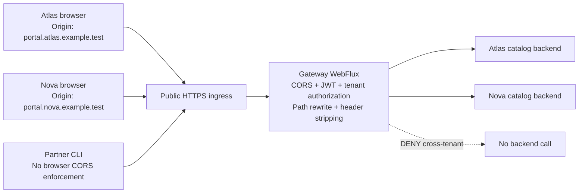
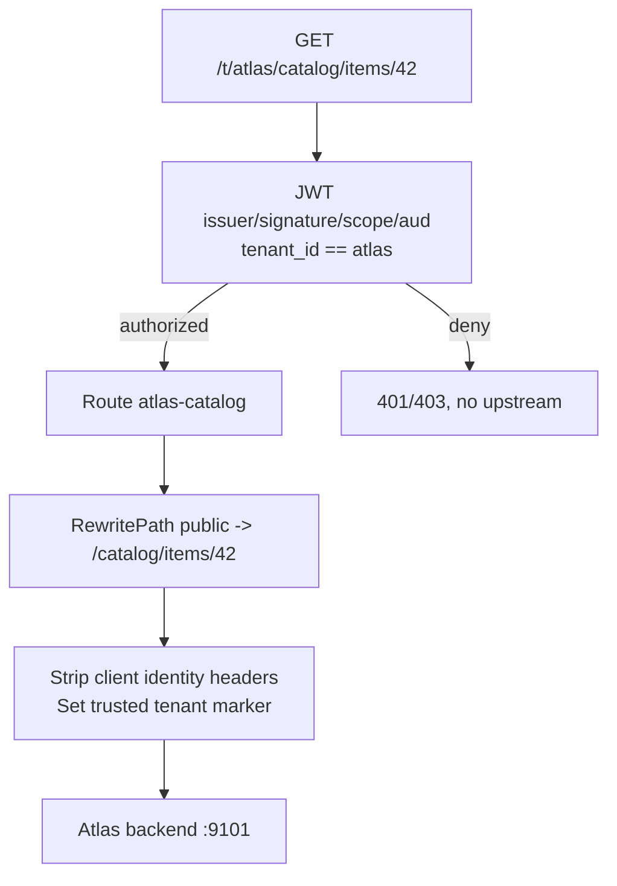
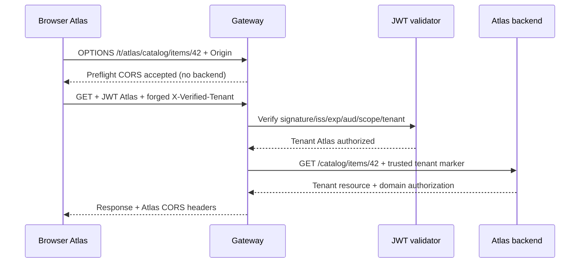
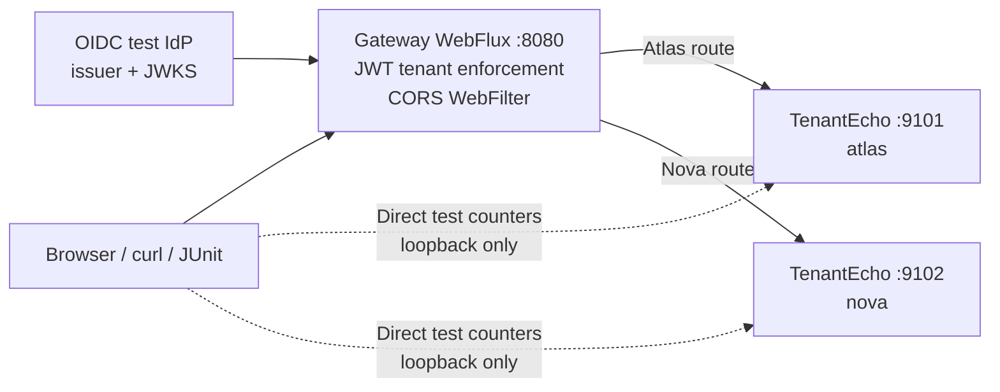
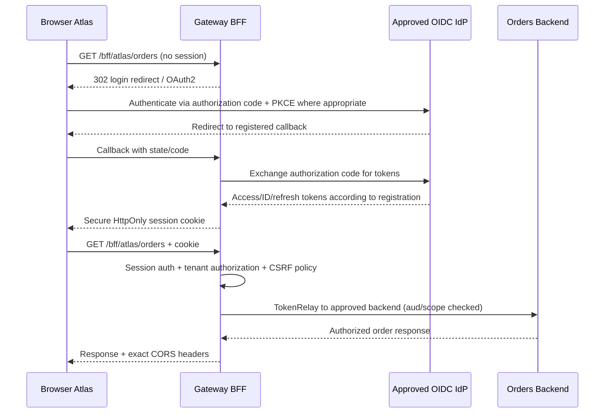

# Quản lý CORS, token và rewrite trong cổng vào nhiều khách hàng với Spring Cloud Gateway

Trong kiến trúc SaaS nhiều khách hàng (*multi-tenant*), cùng một API Gateway có thể phục vụ hàng trăm tổ chức, nhiều web application, mobile application, đối tác và các microservices phía sau. **Spring Cloud Gateway** giúp chọn route bằng predicate, chạy filter chain, rewrite đường dẫn và headers, tích hợp discovery, OAuth2/JWT, rate limiting, circuit breaker, retry, TLS và metrics. Nhưng một quyết định định tuyến sai có thể gửi request của khách hàng A sang backend B hoặc cho phép trình duyệt đọc phản hồi ngoài phạm vi được cấp quyền.

Bài trong chương **Mẫu định tuyến** của module `SPRING_CLOUD_GATEWAY` tập trung phối hợp đúng ba cơ chế thường bị trộn lẫn:

- **CORS** quyết định *trình duyệt ở một web origin có thể đọc response của tài nguyên cross-origin hay không*; không phải cơ chế xác thực hay kiểm tra tenant.
- **Token** (OAuth2 access token, JWT, session credentials) chứng minh danh tính, quyền, issuer và audience; phải được validate, kiểm tra tenant trước khi gửi request tới upstream.
- **Rewrite** ánh xạ URL công khai sang backend path; không được làm mất tenant boundary hoặc khiến Security kiểm tra sai URL so với request mà client đã gửi.

Mẫu trong bài dùng **Spring Cloud Gateway Server WebFlux 5.0.x**, **Spring Boot 4.x** và **Spring Security 7.x** thuộc các phiên bản tương thích, với cách triển khai theo đường dẫn `/t/{tenant}/...`. Cuối bài có biến thể định tuyến theo `Host` và đối chiếu **Server Web MVC**. Ví dụ dùng host `*.example.test` hoặc `*.example.invalid` chỉ là miền minh họa, không đại diện cho endpoint thật.

> **Điểm then chốt:** Đường dẫn, `Origin`, `Host`, issuer trong JWT và tenant claim là **các mẩu thông tin khác nhau**. Không được coi việc `Origin` được CORS cho phép hay `Host` match route là bằng chứng người gọi có quyền đọc dữ liệu của tenant đó. Backend vẫn cần authorization theo resource/tenant.

## 1. Mục tiêu học tập

Sau bài này, bạn có thể:

1. Phân biệt **tenant, OAuth2 client, browser origin, API resource, route ID, audience** và service đích.
2. Thiết kế route và policy matrix theo tenant, origin, method, audience/scope và upstream.
3. Cấu hình CORS toàn cục, theo route hoặc bằng `CorsWebFilter` một cách có chủ đích; xử lý `OPTIONS` preflight đúng trước Security.
4. Dùng `Path`/`Host` predicates cùng `RewritePath`/`StripPrefix`, kiểm thử chính xác backend path và route precedence.
5. Xây `SecurityWebFilterChain` xác thực JWT, kiểm tra `iss`, `exp`, `nbf`, audience, scope và **tenant claim khớp với tenant trong URL**.
6. Phân biệt **Bearer Resource Server** với **OAuth2 Login / TokenRelay BFF**; tránh forward access token nhầm audience hoặc lộ cookie.
7. Giải thích vì sao không nên lấy `Origin`/`Host`/header `X-Tenant` chưa tin cậy để tự chọn destination hoặc cấp quyền.
8. Kiểm thử cả cross-tenant attempts, CORS preflight, header spoofing, rewrite, cookie, CSRF và cache/rate-limit isolation.
9. Triển khai an toàn khi thêm tenant động, đổi IdP, thay route và mở rộng Gateway nhiều replicas.
10. Chẩn đoán 401/403/404/CORS errors dựa trên **lớp phát sinh**, không chỉ nhìn status ở DevTools.

## 2. Các khái niệm không được đánh đồng

### 2.1. Ví dụ ba khách hàng và hai kiểu client

Giả sử một SaaS cung cấp API Catalog, Orders và Reporting:

| Thực thể | Ví dụ | Ai kiểm soát? | Vai trò |
|---|---|---|---|
| **Tenant** | `atlas`, `nova`, `harbor` | Hệ thống SaaS/tenant registry | Ranh giới dữ liệu và chính sách |
| **Browser origin** | `https://portal.atlas.example.test` | Triển khai frontend/browser URL | Origin của JS khởi tạo fetch |
| **Public API origin** | `https://api.example.test` | Gateway/ingress operator | Cổng API |
| **OAuth2 client** | `atlas-spa`, `partner-cli` | IdP/admin | Client registration và grant type |
| **Issuer** | `https://idp.example.test/realms/saas` | IdP tin cậy | Phát hành/ ký token |
| **Token audience** | `gateway-api`, `orders-api` | IdP/resource server | Token được cấp cho tài nguyên nào |
| **Tenant claim** | `tenant_id=atlas` | IdP tin cậy sau xác minh chữ ký | Nêu tenant được xác thực cấp quyền |
| **Public path** | `/t/atlas/catalog/items/42` | Client có thể tự gõ | Dữ liệu định tuyến **không đáng tin** |
| **Backend path** | `/catalog/items/42` | Gateway rewrite | Đường dẫn microservice |
| **Upstream service** | `catalog-atlas.internal:8443` | Control plane/discovery tin cậy | Nơi xử lý tenant Atlas |

Một browser đang ở `portal.atlas.example.test` **có thể gửi** request tới `/t/nova/...`, sửa `Origin` bằng HTTP client riêng hoặc tự đặt `X-Tenant: nova`. Chính sách phải phát hiện sự không khớp giữa tenant **đã xác minh từ token** và tenant **được yêu cầu**.

### 2.2. Biên giới tin cậy



Phân loại chính sách:

| Lớp | Câu hỏi | Nguồn tin cậy | Kết quả |
|---|---|---|---|
| TLS ingress | Client đang nói chuyện với Gateway thật? | CA/cert/ingress | Chặn MITM, đúng origin TLS |
| CORS | Browser JS origin nào có thể đọc response? | Origin + server allowlist | CORS headers/deny preflight |
| Authentication | Credential có hợp lệ? | Signature/JWK/issuer/expiry | 401 khi thiếu/sai bearer |
| Audience/scope | Token được dùng cho API/capability này? | Token claims **đã verify** | 403 hoặc authentication failure theo policy |
| Tenant authorization | User có quyền truy cập `/t/atlas/**`? | Auth claims + tenant registry/ACL | 403 khi token/tenant không khớp |
| Route matching | Route Atlas hay Nova? | Path/Host/Method sau chính sách security | Chọn đúng route |
| Rewrite | Backend nhận URI/path nào? | Route config đã duyệt | Chuyển từ public path sang internal path |
| Upstream authorization | User có quyền object ID 42? | Domain ACL/ownership | 403/404 ở backend khi không có quyền |

**CORS là một lớp bảo vệ browser, không phải thay thế authentication/authorization.** `curl`, Postman, mobile apps hoặc attacker sử dụng client không phải browser có thể gửi request dù server không cấp `Access-Control-Allow-Origin`. CORS không chặn HTTP request được gửi từ mọi loại client.

### 2.3. Hai kiến trúc hợp lệ nhưng cách xử lý token khác nhau

**Kiểu A — Stateless bearer API:** SPA/mobile/CLI gửi `Authorization: Bearer ...`. Gateway đóng vai trò OAuth2 **Resource Server**, xác minh token và phân quyền tenant. Gateway có thể **không forward** bearer token xuống backend, thay bằng identity assertion có bảo vệ/mTLS, hoặc chỉ forward/token-exchange nếu downstream thật sự cần và audience phù hợp.

**Kiểu B — BFF / OAuth2 login:** Browser nói chuyện với Gateway bằng **session cookie HttpOnly**; Gateway là OAuth2 **Client**, thực hiện authorization-code login và dùng `TokenRelay`/token exchange đến backend. Kiểu này cần CSRF, session store và OAuth2 authorized-client persistence khi scale.

**Không ghép “disable CSRF + browser cookie auth + TokenRelay” chỉ vì thấy JWT trong kiến trúc.** CSRF policy phụ thuộc credential tự động được browser gửi, không chỉ phụ thuộc việc backend cuối có sử dụng bearer token.

## 3. Thiết kế ma trận tenant × origin × route × quyền

Một policy minh họa:

| Tenant | Frontend origin được duyệt | Public route | Backend | Scope bắt buộc |
|---|---|---|---|---|
| Atlas | `https://portal.atlas.example.test` | `/t/atlas/catalog/**` | Catalog Atlas | `catalog.read` |
| Nova | `https://portal.nova.example.test` | `/t/nova/catalog/**` | Catalog Nova | `catalog.read` |
| Atlas | `https://admin.atlas.example.test` | `/t/atlas/orders/**` | Orders Atlas | `orders.read`/`orders.write` |
| Nova | `https://portal.nova.example.test` | `/t/nova/orders/**` | Orders Nova | `orders.read`/`orders.write` |
| Partner | Không phụ thuộc browser origin | `/partner/**` | Partner API | `partner.access` + tenant relationship |

Trong triển khai thật, các quyền có thể phụ thuộc **user membership, role, resource ownership, tenant status** và không thể rút gọn toàn bộ vào một `tenant_id` nếu user được phép làm việc trên nhiều tenants. Bài lab dùng một `tenant_id` để dễ kiểm tra; thiết kế nhiều membership nên lấy danh sách quyền từ nguồn tin cậy sau authentication.

Các quy tắc:

1. **Tenant registry** do control plane quản lý là nguồn sự thật cho tenant ID → approved origins → routes → service identities.
2. **Origin** không tự chọn tenant; chỉ được so với allowed origins của tuyến/public path đang gọi.
3. **Public path** cho biết tài nguyên mà client **yêu cầu**, nhưng tenant thật trong token/ACL quyết định có được dùng không.
4. **Route destination** không được tạo bằng cách nội suy một hostname từ `tenant` tùy ý, ví dụ `http://${tenant}.internal`.
5. **Token issuer** phải thuộc trusted issuer allowlist, không được lấy `iss` chưa xác minh rồi tự tải JWK từ URI tùy ý.
6. **Backend** phải tự kiểm tra quyền dữ liệu hoặc chỉ tin identity assertion được Gateway phát ra qua một kênh có kiểm soát.
7. Mọi biến thể tenant trên cache, rate-limit, retries, traces và audit phải giữ được ranh giới; một cache key chỉ theo `/items/42` có thể làm lộ dữ liệu khi hai tenant có cùng object ID.

## 4. CORS: preflight, actual request và credential modes

### 4.1. Browser CORS dùng bộ ba scheme–host–port

Hai URL sau **khác origin**:

```text
Frontend: https://portal.atlas.example.test
API:      https://api.example.test
```

Origin của browser gồm **scheme, hostname, effective port**, không gồm path, query hay fragment. `https://portal.atlas.example.test` khác `http://portal.atlas.example.test` và khác `https://portal.atlas.example.test:8443`.

Browser gửi:

```http
Origin: https://portal.atlas.example.test
```

Đây là **HTTP header cung cấp bối cảnh cho browser CORS**, **không phải chứng cứ user thuộc Atlas**. Một chương trình HTTP tự viết có thể đặt giá trị `Origin` tùy ý.

### 4.2. Preflight `OPTIONS`

Khi JavaScript thực hiện cross-origin fetch với `Authorization` hoặc header không thuộc safelist, browser thường gửi preflight:

```http
OPTIONS /t/atlas/catalog/items/42 HTTP/1.1
Origin: https://portal.atlas.example.test
Access-Control-Request-Method: GET
Access-Control-Request-Headers: authorization
```

Nếu được duyệt, Gateway có thể trả:

```http
HTTP/1.1 200 OK
Access-Control-Allow-Origin: https://portal.atlas.example.test
Access-Control-Allow-Methods: GET,POST,OPTIONS
Access-Control-Allow-Headers: Authorization,Content-Type
Access-Control-Max-Age: 600
Vary: Origin, Access-Control-Request-Method, Access-Control-Request-Headers
```

Status có thể là 200/204 tùy WebFlux/handler; điều cần assert là **preflight được giải quyết trước upstream và không đòi JWT** vì preflight không gửi bearer Authorization của actual request. Trong một số môi trường, response headers `Vary` có nhiều dòng hoặc giá trị hợp nhất; không dùng string equality không chuẩn để suy CORS lỗi.

Sau đó **actual request**:

```http
GET /t/atlas/catalog/items/42 HTTP/1.1
Origin: https://portal.atlas.example.test
Authorization: Bearer <synthetic-atlas-token>
```

Vẫn phải qua **JWT validation + scope + tenant authorization**. Preflight pass **không có nghĩa GET/POST sẽ pass**.

### 4.3. `Access-Control-Allow-Origin` và credentials

| Mô hình | CORS policy | Lưu ý |
|---|---|---|
| Browser dùng bearer header | Exact allowed origin, allowedHeaders có Authorization | Token validation bắt buộc |
| Browser dùng session cookie | Exact origin, `allowCredentials=true`, Cookie Secure/SameSite phù hợp | **CSRF protection bắt buộc** theo threat model |
| Public read-only endpoint | Có thể dùng `allowedOrigins=*` khi thực sự public | Không dùng wildcard để lộ data riêng |
| Nhiều tenant origins | Allowlist cụ thể cho từng URL path/tenant | Không lấy request Origin rồi echo vô điều kiện |
| Server-to-server/CLI | CORS không phải cơ chế quyết định quyền | Token/mTLS/client auth |
| WebSocket | Browser Origin/handshake policy riêng | HTTP CORS không tự bảo vệ WebSocket |

**Không cấu hình `allowedOrigins=*` cùng `allowCredentials=true`**. Trường hợp hỗ trợ pattern origin với credentials cần đánh giá cẩn thận; Spring có `allowedOriginPatterns` nhưng một pattern quá rộng vẫn có thể lộ tenant data. Với SaaS B2B, ưu tiên danh sách exact origins do tenant admin được phê duyệt.

### 4.4. Preflight có thể không match route `Method=GET`

Nếu Gateway route yêu cầu `Method=GET`, preflight có method **OPTIONS** và có thể không match route. Theo tài liệu Gateway 5.0.x, `spring.cloud.gateway.server.webflux.globalcors.add-to-simple-url-handler-mapping=true` giúp áp CORS toàn cục cho một số request preflight không match route predicates.

Đừng sửa bằng cách:

- Cho `OPTIONS` đi đến mọi upstream tự do.
- Yêu cầu bearer token cho preflight vì “mọi request đều cần auth”.
- Mở `/**` with `allowedOrigins=*` để tất cả preflight trả 200.
- Tắt CORS trong Security rồi **không** thiết lập CorsWebFilter hoặc Gateway CORS xử lý trước Security.

Spring Security WebFlux khuyến nghị CORS xử lý **trước** Security vì preflight thường không có cookie/session. Chọn **một nguồn chính sách CORS có hiệu lực** và kiểm tra từng lớp, tránh để Gateway, Security, backend và ingress tạo các header mâu thuẫn nhau.


## 5. Ba cách đặt chính sách CORS và khi nào dùng

### 5.1. Gateway global CORS theo path pattern

Gateway WebFlux 5.0 có property chính thức:

```yaml
spring:
  cloud:
    gateway:
      server:
        webflux:
          globalcors:
            add-to-simple-url-handler-mapping: true
            cors-configurations:
              '[/t/atlas/**]':
                allowedOrigins:
                  - https://portal.atlas.example.test
                allowedMethods:
                  - GET
                  - POST
                  - OPTIONS
                allowedHeaders:
                  - Authorization
                  - Content-Type
                exposedHeaders:
                  - X-Request-Id
                allowCredentials: false
                maxAge: 600

              '[/t/nova/**]':
                allowedOrigins:
                  - https://portal.nova.example.test
                allowedMethods:
                  - GET
                  - POST
                  - OPTIONS
                allowedHeaders:
                  - Authorization
                  - Content-Type
                exposedHeaders:
                  - X-Request-Id
                allowCredentials: false
                maxAge: 600
```

Các key `'[/t/atlas/**]'` tuân theo cú pháp map URL pattern của Gateway. Các field bên trong là `CorsConfiguration` của Spring Framework. Với browser bearer API, `allowCredentials=false` phù hợp khi JavaScript **không gửi cookies**; việc browser gửi bearer `Authorization` theo lập trình vẫn cần `allowedHeaders` và JWT validation riêng. Nếu dự án sử dụng cookie/session, chính sách credentials thay đổi và cần CSRF.

**Dùng khi:** chính sách ổn định theo prefix URL và bạn muốn Gateway quản lý preflight ngay cả khi `Method=GET`/`POST` predicates không match OPTIONS.

**Đừng đồng thời áp dụng thêm một `CorsWebFilter` khác với chính sách khác nhau** trên cùng paths, hoặc để backend/ingress chèn thêm `Access-Control-Allow-Origin` trùng nhau. Trùng header CORS thường làm browser từ chối cả response lẽ ra hợp lệ.

### 5.2. CORS metadata theo route

Cách khác là cấu hình `metadata.cors`:

```yaml
spring:
  cloud:
    gateway:
      server:
        webflux:
          routes:
            - id: atlas-catalog
              uri: https://catalog.atlas.internal.example.test:8443
              predicates:
                - Path=/t/atlas/catalog/**
                - Method=GET
              metadata:
                cors:
                  allowedOrigins:
                    - https://portal.atlas.example.test
                  allowedMethods:
                    - GET
                  allowedHeaders:
                    - Authorization
                  allowCredentials: false
                  maxAge: 600
```

**Dùng khi:** mỗi route có policy CORS đơn giản, không bị trùng chéo và bạn đã kiểm chứng preflight trong trường hợp RoutePredicate không match OPTIONS.

**Cẩn trọng:** CORS metadata ở route có thể phụ thuộc `Path` pattern để tìm CORS config; nếu nhiều routes phân biệt tenant **chỉ bằng `Host` nhưng có cùng `Path`**, phải kiểm chứng cách CORS source chọn policy. Không suy rằng metadata của “route được chọn” luôn xử lý được OPTIONS khi route Method/Host không match. Nếu cần policy chính xác cả **Host + Path + Origin**, dùng một `CorsConfigurationSource` custom đánh giá Host tin cậy, hoặc cấu trúc path tenant rõ ràng.

### 5.3. `CorsWebFilter` lập trình theo tenant registry

Với nhiều tenants cần cập nhật nguồn chính sách ở runtime, có thể đặt một `CorsWebFilter` duy nhất, sử dụng `CorsConfigurationSource` theo path/Host đã được chuẩn hóa và danh sách origins đã approve.

Điều kiện khi chọn cách này:

1. **Một nguồn CORS có thẩm quyền**: không bật trùng Gateway `globalcors`/route `metadata.cors` cho cùng URL patterns.
2. Nguồn tenant policy **chỉ đọc từ control plane tin cậy**, không để request `Origin` quyết định danh sách được phép.
3. Preflight được xử lý **trước Spring Security**.
4. Config là snapshot immutable/versioned khi cập nhật; tenant mới chỉ được kích hoạt sau approval.
5. Test đối chứng giữa các tenants, đặc biệt khi Host/Path overlap và trong quá trình dynamic route refresh.

Trong lab ở phần sau ta chọn `CorsWebFilter` với **hai path prefixes cố định** để dễ thấy ranh giới. Production có thể trích policy thành service/registry, nhưng không dùng lookup database đồng bộ ngay trên Reactor Netty event loop mỗi OPTIONS request.

### 5.4. Quy tắc kiểm thử CORS tối thiểu

| Request | Kết quả đúng khi Atlas route |
|---|---|
| `Origin: https://portal.atlas.example.test` | Cho phép khi method/headers hợp lệ |
| `Origin: https://portal.nova.example.test` | Không cấp allow-origin cho Atlas API; preflight reject |
| `Origin: http://portal.atlas.example.test` | Từ chối do scheme khác |
| `Origin: https://portal.atlas.example.test:8443` | Từ chối do port khác |
| `Origin: https://portal.atlas.example.test.evil.test` | Từ chối do host khác |
| Không `Origin`, là CLI/client backend | **Không có CORS decision**; vẫn cần token |
| OPTIONS hỏi method `DELETE` nhưng chỉ cho GET/POST | Preflight từ chối |
| OPTIONS hỏi header `X-Unapproved` | Preflight từ chối |
| OPTIONS không có JWT | Có thể hợp lệ, không trả 401 chỉ vì thiếu bearer |
| Actual GET có Origin đúng nhưng token Nova | **403** do tenant authorization |
| Actual GET có Origin đúng nhưng không token | **401** do authentication |
| Cookie/credentials từ origin khác | Không mở rộng allowlist chỉ để “đăng nhập được” |

**Đừng dùng curl một request với `Origin` đúng rồi kết luận CORS hoạt động.** Cần test *preflight* `OPTIONS` với `Access-Control-Request-Method`/`Access-Control-Request-Headers`, actual response và browser fetch thật. Bản thân curl không áp browser same-origin policy.

## 6. Mẫu route và rewrite không đánh rơi tenant boundary

### 6.1. Path-based multi-tenancy

Định nghĩa URL công khai:

```text
GET https://api.example.test/t/atlas/catalog/items/42
GET https://api.example.test/t/nova/catalog/items/42
```

Nhằm bảo toàn contract backend:

```text
Gateway route atlas-catalog --> http://127.0.0.1:9101/catalog/items/42
Gateway route nova-catalog  --> http://127.0.0.1:9102/catalog/items/42
```

`/t/atlas` và `/t/nova` được loại khỏi **upstream path**, nhưng vẫn là thông tin cần kiểm tra **trước rewrite**.



Đừng áp Security rule `pathMatchers("/catalog/**")` để bảo vệ **public request `/t/atlas/catalog/**`** rồi hy vọng RewritePath sẽ xảy ra trước Security. Reactive Security WebFilter thường xử lý yêu cầu **trước** Gateway routing/filter transformations. Viết authorization matcher theo **URL client thực sự gọi**.

### 6.2. `RewritePath` và escape `$` trong YAML

Một route mẫu:

```yaml
- id: atlas-catalog
  order: -10
  uri: http://127.0.0.1:9101
  predicates:
    - Path=/t/atlas/catalog/**
    - Method=GET
  filters:
    - 'RewritePath=/t/atlas/(?<segment>.*), /$\{segment}'
    - RemoveRequestHeader=Cookie
    - RemoveRequestHeader=Authorization
    - SetRequestHeader=X-Verified-Tenant,atlas
```

Trong YAML, replacement cần giữ dấu `$\{segment}` theo ví dụ tài liệu Gateway. Dùng **single-quoted YAML scalar** để backslash không bị YAML escape, và test URI thật tại backend. Không dùng JavaScript string interpolation hoặc shell expansion trên snippet này; với file cấu hình Spring, đây là **route filter argument**.

Ví dụ:

| Public request | Sau RewritePath | Route |
|---|---|---|
| `/t/atlas/catalog/items/42` | `/catalog/items/42` | `atlas-catalog` |
| `/t/atlas/catalog/items/42?lang=vi` | `/catalog/items/42?lang=vi` | `atlas-catalog` |
| `/t/nova/catalog/items/42` | **Không match Atlas** | `nova-catalog` |
| `/t/atlas/orders/42` | Không match catalog route | Route orders nếu được khai báo |
| `/t/atlas/catalog/../admin` | Phụ thuộc normalization/firewall; không cho bypass | Reject/deny theo policy |

`RewritePath` dùng Java regex: cần giới hạn sự phức tạp của regex và kiểm tra encoded slash, duplicate slash, percent-encoding, trailing slash, Unicode và các paths có thể né route/security matcher. Không tự nới `StrictHttpFirewall` chỉ để nhận path encoding mơ hồ.

### 6.3. `StripPrefix` là lựa chọn đơn giản khi hình dạng URL phù hợp

Nếu chỉ muốn bỏ đúng hai segments `t` và `atlas`, một filter:

```yaml
filters:
  - StripPrefix=2
```

cũng biến `/t/atlas/catalog/items/42` thành `/catalog/items/42`. **Không đặt cả `StripPrefix=2` và `RewritePath` ở trên cùng route nếu không có mục đích hai lần biến đổi**: thứ tự filter dễ tạo `/items/42` không mong muốn.

Dùng `StripPrefix` khi URL prefix có số segments ổn định; dùng `RewritePath` khi cần regex hoặc điều chỉnh phức tạp, nhưng phải có test per-route.

### 6.4. Định tuyến theo Host/subdomain

Một mô hình khác:

```yaml
- id: atlas-host-catalog
  uri: https://catalog.atlas.internal.example.test:8443
  predicates:
    - Host=atlas.api.example.test
    - Path=/catalog/**
    - Method=GET
  filters:
    - SetRequestHeader=X-Verified-Tenant,atlas
```

Với `GET https://atlas.api.example.test/catalog/items/42`, route `Host` nhận biết public virtual host. Tuy nhiên **Host không phải chứng cứ tenant ownership**: client HTTP có thể chọn `Host`/`:authority`, còn reverse proxy có thể chuyển `X-Forwarded-Host`. Token phải được kiểm tra tenant=atlas; ingress phải sanitize forwarded headers và cấu hình TLS/SNI/virtual hosts.

Nếu hai tenant dùng **cùng path `/catalog/**`** và phân biệt bằng Host, cấu hình CORS theo path đơn thuần không đủ. CORS source phải xác định **host đã được ingress xác nhận + path + allowed browser origins**, hoặc tách public paths theo tenant. Không cho một pattern `/catalog/**` trả origin của mọi tenant.

### 6.5. Thứ tự route và catch-all

| Route ID | Path | Order | Rủi ro |
|---|---|---:|---|
| `atlas-catalog` | `/t/atlas/catalog/**` | -10 | Quyền Atlas |
| `nova-catalog` | `/t/nova/catalog/**` | -10 | Quyền Nova |
| `tenant-generic` | `/t/**` | 100 | Dễ shadow hoặc vô tình proxy khác tenant |
| `unsafe-catchall` | `/**` | -100 | Có thể bắt mọi request trước routes cụ thể |

Tốt nhất không định nghĩa route catch-all proxy tới backend nhạy cảm. Nếu buộc có fallback, xác định rõ Security deny, order và expected 404/403. **Route precedence không thay thế authorization**; nếu route generic tới đúng backend nhưng bỏ filter tenant, đó vẫn là bug bảo mật.

### 6.6. Identity headers qua rewrite

Một số backend cần tenant marker. Hãy:

- Loại bỏ `X-Tenant`/`X-Verified-Tenant`/`X-User-Id` do client gửi nếu chúng không có quyền.
- **Set** giá trị mới (không chỉ Add) sau khi Security đã xác minh tenant/token.
- Chỉ cho backend tin marker khi **không thể truy cập backend trực tiếp** từ client không đáng tin và kết nối Gateway→backend được mTLS/network policy bảo vệ.
- Với dịch vụ quan trọng, ưu tiên backend verify token thích hợp hoặc token exchange; không chỉ tin marker chữ ký rỗng.
- Bảo toàn correlation/trace ID nhưng không log raw bearer/cookies.

Một `SetRequestHeader=X-Verified-Tenant,atlas` trên route không tự xác thực client. Nó chỉ có ý nghĩa **khi route đó thực sự được bảo vệ** và không có route thay thế bypass Security.


## 7. Token: issuer, audience, tenant và scope là bốn kiểm tra khác nhau

### 7.1. Access token hợp lệ phải được **xác minh**, không chỉ decode

Một JWT dùng trong API có thể chứa:

```json
{
  "iss": "https://idp.example.test/realms/saas",
  "sub": "user-42",
  "aud": ["gateway-api"],
  "tenant_id": "atlas",
  "scope": "catalog.read orders.read",
  "exp": 1900000000,
  "nbf": 1800000000
}
```

Đây là **payload minh họa, không phải JWT có chữ ký hay token được cấp quyền**. Không dùng các giá trị thời gian này làm token production. Backend/Gateway chỉ được tin các claims sau khi:

1. Xác minh chữ ký/ký thuật toán và khóa công khai từ **issuer được phép**.
2. Kiểm tra `exp`/`nbf`, `iss` và các thuộc tính chuẩn theo Resource Server.
3. Kiểm tra **audience** đúng tài nguyên nhận token; JWT Resource Server mặc định không có nghĩa tự validate audience nghiệp vụ của bạn.
4. Kiểm tra `tenant_id` hoặc membership đã được xác minh khớp tenant **được yêu cầu trong path/Host**.
5. Kiểm tra `scope`/role cần cho operation và các quyền dữ liệu ở backend.

Một token của Nova có chữ ký hợp lệ không được đi vào Atlas backend chỉ vì người gọi thay URL `/t/atlas/**`. Một token đúng tenant nhưng thiếu `orders.write` không được sửa đơn. Một token đã ký có `aud=mobile-app` không nên được tái dùng để gọi `orders-api` nếu audience không khớp.

### 7.2. Ma trận quyết định authorization

| Request | Token | Kết quả |
|---|---|---|
| `GET /t/atlas/catalog/items` | issuer đúng, tenant atlas, aud gateway-api, scope catalog.read | Cho đi tiếp |
| `GET /t/atlas/catalog/items` | **Không** Authorization | 401 |
| `GET /t/atlas/catalog/items` | token sai chữ ký/expired/issuer | 401 |
| `GET /t/atlas/catalog/items` | token Nova, đủ scope | **403** vì khác tenant |
| `GET /t/atlas/catalog/items` | token Atlas, aud khác | **403** theo access policy, hoặc 401 nếu validator coi token không hợp lệ |
| `GET /t/atlas/catalog/items` | token Atlas, thiếu scope | 403 |
| `GET /t/nova/catalog/items` | token Nova, đủ scope | Cho đi tiếp Nova |
| `GET /t/unknown/catalog/items` | token bất kỳ | Deny/no route, không tự mở tenant mới |
| `GET /t/atlas/orders/42` | Atlas, catalog.read nhưng không có orders.read | 403 |
| `POST /t/atlas/orders` | Atlas, orders.read nhưng không có orders.write | 403 |
| Atlas browser Origin với token Nova | Có thể preflight thành công cho URL Atlas nhưng actual request 403 | **CORS không quyết định quyền** |

HTTP status cụ thể phụ thuộc authentication entry point/exception handler của bạn; trong ví dụ bài này, **401 cho credential không hợp lệ/thiếu**, **403 cho danh tính đã xác thực nhưng không đủ tenant/audience/scope**. Lúc thử production, xác nhận exception mapping thực tế thay vì coi mọi 401/403 do một nơi phát sinh.

### 7.3. Bearer forwarding là một quyết định về trust boundary

Ba lựa chọn có tính chất khác nhau:

| Mẫu | Gateway → Backend | Dùng khi |
|---|---|---|
| **Gateway-only validation** | Bỏ Authorization; gửi signed/mTLS-bound identity assertion hoặc trusted header | Backend thuộc cùng trust domain và còn thực thi domain ACL |
| **Pass-through bearer** | Giữ access token tới backend | Backend được thiết kế để verify token/aud/tenant **độc lập** |
| **Token exchange** | Đổi token inbound thành token có `aud=orders-api` | Nhiều backend khác audiences, cần least privilege |

Không tự chuyển token `aud=gateway-api` đến một service `payments-api` rồi để service đó chấp nhận mọi audience. Không chuyển refresh token cho backend qua request headers. Nếu Gateway làm OAuth2 Client, `TokenRelay` có thể chuyển access token **được authorized client quản lý**; nó không tự thay quyền/tăng audience. Các luồng token exchange phải được thiết kế trong OAuth2 Authorization Server/IdP.

### 7.4. Multi-issuer / multi-IdP

Một số SaaS cho tenant Atlas và Nova dùng hai IdP khác nhau:

```text
Atlas token iss = https://idp.atlas.example.test/issuer
Nova token  iss = https://idp.nova.example.test/issuer
```

Spring Security Reactive Resource Server có `JwtIssuerReactiveAuthenticationManagerResolver.fromTrustedIssuers(...)`. Ví dụ cấu hình (minh họa cho hai issuer đã được duyệt):

```java
JwtIssuerReactiveAuthenticationManagerResolver resolver =
    JwtIssuerReactiveAuthenticationManagerResolver
        .fromTrustedIssuers(
            "https://idp.atlas.example.test/issuer",
            "https://idp.nova.example.test/issuer");

return http
    .authorizeExchange(exchange -> exchange
        .anyExchange().authenticated())
    .oauth2ResourceServer(oauth2 ->
        oauth2.authenticationManagerResolver(resolver))
    .build();
```

Đoạn này là **một phần của `SecurityWebFilterChain`**, không phải class chạy độc lập. Và **trusted issuers không tự thay tenant authorization**: sau khi token của Atlas được xác thực, vẫn phải check issuer/tenant mapping được duyệt, `aud`, scopes và path/Host khách hàng. Không nhận `iss` tùy ý từ JWT chưa kiểm tra để tự tải JWK — sẽ tạo vấn đề trust/SSRF và chấp nhận issuer không kiểm soát.

Khi tenant mới được onboard, cần verify issuer URL/audience/CA/JWK policy trong control plane, bổ sung vào trusted resolver một cách an toàn, không coi tenant tự gửi `issuer-uri` là lệnh tạo authentication manager.

## 8. OAuth2 `TokenRelay` và hai mô hình browser

### 8.1. `TokenRelay` thực sự làm gì?

Spring Cloud Gateway Server WebFlux có `TokenRelay` GatewayFilter, nhận tham số tùy chọn `clientRegistrationId`. Khi có Spring Security OAuth2 Client/authorized-client configuration tương ứng, filter có thể lấy OAuth2 access token của authenticated principal hoặc client registration và gắn vào outbound `Authorization` header. Ví dụ route:

```yaml
- id: bff-orders
  uri: https://orders.svc.example.test:8443
  predicates:
    - Path=/bff/orders/**
  filters:
    - StripPrefix=1
    - TokenRelay=
```

**Lưu ý:** Đây là ví dụ theo **mô hình OAuth2 Client/BFF**, cần dependency `spring-boot-starter-oauth2-client` và `spring.security.oauth2.client.registration.*`/`provider.*` đúng, cùng `oauth2Login()` hoặc client authorization phù hợp. Nếu không có `ReactiveClientRegistrationRepository`/authorized client cần thiết, đừng giả định filter tồn tại hoặc tự động relay token.

`TokenRelay` **không phải** bộ lọc tenant authorization; dù access token được relay, Gateway và backend vẫn phải kiểm tra quyền. Nếu BFF chọn sai client registration hoặc token audience, backend phải reject.

### 8.2. Hai kiểu client thường gặp

**Kiểu Bearer SPA:**

```text
Browser (Atlas) -- Authorization: Bearer JWT --> Gateway Resource Server
Gateway -- remove inbound bearer / exchange if needed --> Atlas backend
```

- Browser có thể giữ token trong memory và gửi qua JS, nhưng phải bảo vệ chống XSS và token leakage.
- CORS exact origins, Authorization trong allowedHeaders, HTTPS.
- Stateless Gateway không dựa vào browser session cookie.
- CSRF có thể disabled **chỉ trên bearer-only endpoints không dùng ambient browser credentials**, sau khi threat model được xác nhận.

**Kiểu BFF cookie session:**

```text
Browser (Atlas) -- HttpOnly Secure session cookie --> Gateway OAuth2 Client
Gateway -- TokenRelay / authorized client token --> Approved backend
```

- Browser không cần lưu access token trực tiếp.
- CORS có thể cần `allowCredentials=true` và exact origin; frontend `fetch(..., {credentials:"include"})` chỉ khi cookie policy cho phép.
- Cookie `Secure`, `HttpOnly`, `SameSite`, `Domain`/`Path` phải phù hợp thiết kế.
- **CSRF được bật** cho cookie-based state-changing requests, dù Gateway gửi bearer token xuống backend.
- Session fixation, login/logout, timeout và session store phải được kiểm tra cho nhiều replicas.

### 8.3. TokenRelay không giải quyết lifecycle tự động trên nhiều replicas

Theo tài liệu Gateway 5.0, mặc định `ReactiveOAuth2AuthorizedClientService` dùng in-memory data store. Nếu Gateway A giữ authorized-client state mà request tiếp theo tới Gateway B, relay có thể thất bại hoặc state không nhất quán.

Giải pháp tùy kiến trúc: shared authorized-client repository/service được bảo vệ, Spring Session nếu lưu session/authorization state liên quan, hoặc token acquisition/exchange được thiết kế lại; kiểm tra cụ thể thành phần nào đang lưu authorized-client state. **Không giả định chỉ thêm Redis session là TokenRelay đã có distributed authorized-client store**.

Ma trận kiểm thử phải gồm login ở A, request routed tới B, token refresh, logout/revocation, rotation, login callback sau ingress restart và Redis/IdP outage. Không log refresh/access tokens.

### 8.4. CORS và CSRF trong BFF

CORS là **browser read policy**. CSRF bảo vệ các request có side effect khi trình duyệt **tự gửi** session cookie và user không chủ động thực hiện hành động. Ví dụ Atlas BFF:

```text
POST https://api.example.test/bff/orders
Cookie: SESSION=...
X-CSRF-TOKEN: <synthetic-token>
Origin: https://portal.atlas.example.test
```

Cần CSRF repository/handler tương thích WebFlux và cookie/header strategy nếu frontend đọc token, kèm kiểm tra Origin/Referer khi phù hợp. Không đặt `csrf.disable()` toàn cục chỉ để OAuth2 login hoặc CORS preflight “dễ chạy”. Preflight không tự mang session credential nhưng actual request có thể mang cookie và cần cả authentication lẫn CSRF.

### 8.5. Vị trí chuẩn hóa token/headers

- Nếu sử dụng Gateway Resource Server, **verify trước proxy**; chỉ forward token theo policy rõ, không mặc định tất cả backend sẽ hiểu JWT.
- Nếu dùng `TokenRelay`, tránh route khác ghi đè `Authorization` không phù hợp.
- Với client-supplied `X-User-Id`/`X-Tenant`, luôn strip/overwrite theo identity đã verify.
- Với static tenant routes, `SetRequestHeader=X-Verified-Tenant,atlas` không thể thay JWT validation. Backend chỉ tin khi path/route được protect và Gateway→backend mTLS/network isolation.
- Hạn chế identity headers ở outbound `Host`/scheme đúng và không gửi bearer/cookie sang redirect/fallback origin khác.
- Scope/tenant để làm việc với đơn hàng/hoá đơn vẫn phải được backend kiểm tra khi có quyền object-level.

## 9. Một route tốt cần cùng lúc thoả ba hợp đồng

Giả sử client gửi:

```http
GET /t/atlas/catalog/items/42 HTTP/1.1
Origin: https://portal.atlas.example.test
Authorization: Bearer <atlas-token>
X-Verified-Tenant: nova
```

Gateway phải xử lý theo thứ tự **khái niệm**:

1. CORS đánh giá Atlas origin với **public path** `/t/atlas/**`.
2. Resource Server xác minh JWT, issuer, signature, expiry, audience.
3. Authorization kiểm tra `tenant_id=atlas`, scope `catalog.read`.
4. Route `atlas-catalog` match `/t/atlas/catalog/**`.
5. Rewrite bỏ `/t/atlas` để backend thấy `/catalog/items/42`.
6. Loại `Cookie`/`Authorization` nếu đây là mẫu Gateway-only validation; ghi đè `X-Verified-Tenant=atlas`, không tin header `nova`.
7. Proxy chỉ đến **approved Atlas backend**; mTLS/NetworkPolicy bảo vệ destination.
8. Backend thực thi quyền item 42 thuộc Atlas và trả kết quả.
9. Response CORS headers đúng origin, không duplicate; cache policy không làm lẫn dữ liệu Nova/Atlas.



**Nếu bất kỳ kiểm tra nào fail:** không gửi request tới backend nhạy cảm. Trạng thái 401/403/404 phải thể hiện đúng lớp từ chối, không bị retry/circuit breaker fallback biến thành 200 hoặc chuyển sang backend tenant khác.


## 10. Lab: Gateway WebFlux nhiều tenant với hai upstream độc lập

Lab triển khai **một ứng dụng Gateway** và **hai backend độc lập**. Mục tiêu: có thể chứng minh request từ Atlas/Nova không bị định tuyến sai, CORS preflight đúng, và JWT sai tenant bị từ chối **trước upstream**.



**Các ràng buộc an toàn của lab:**

- Tất cả servers Gateway và backend đều bind `127.0.0.1`; không mở Internet.
- CORS config chỉ có **một `CorsWebFilter`** do lab tự khai báo; **không bật thêm** `globalcors` hoặc `metadata.cors` trên những paths đó.
- Chỉ có `GET /t/{tenant}/catalog/**`. Chưa triển khai session/BFF/`TokenRelay` trong cùng lab để không trộn hai credential schemes.
- JWT được cấp bởi **IdP thử nghiệm có thật** và hợp lệ về chữ ký/JWK/issuer. Ví dụ không bịa JWT hoặc làm tắt signature verification.
- Chỉ dùng synthetic tenant identities, synthetic tokens, synthetic items.
- Route chặt theo từng tenant ID, không nội suy hostname tùy ý từ path hay header.

### 10.1. Maven dependencies tối thiểu

Tạo project Spring Boot 4.x cùng Spring Cloud BOM 2025.1.x tương thích. Các dependencies chính:

```xml
<dependencies>
    <dependency>
        <groupId>org.springframework.cloud</groupId>
        <artifactId>spring-cloud-starter-gateway-server-webflux</artifactId>
    </dependency>
    <dependency>
        <groupId>org.springframework.boot</groupId>
        <artifactId>spring-boot-starter-oauth2-resource-server</artifactId>
    </dependency>
    <dependency>
        <groupId>org.springframework.boot</groupId>
        <artifactId>spring-boot-starter-actuator</artifactId>
    </dependency>
    <dependency>
        <groupId>org.springframework.boot</groupId>
        <artifactId>spring-boot-starter-test</artifactId>
        <scope>test</scope>
    </dependency>
</dependencies>
```

Đây **không phải `pom.xml` hoàn chỉnh**: cần Boot parent/build plugin và Spring Cloud BOM đã được kiểm tra compatibility. Spring Security JWT còn cần JOSE, được starter phù hợp kéo vào; không tự thêm servlet Security Web MVC vào reactive project.

Class khởi động `TenantGatewayApplication.java`:

```java
import org.springframework.boot.SpringApplication;
import org.springframework.boot.autoconfigure.SpringBootApplication;

@SpringBootApplication
public class TenantGatewayApplication {
    public static void main(String[] args) {
        SpringApplication.run(TenantGatewayApplication.class, args);
    }
}
```

### 10.2. Gateway `application.yml` — hai routes không chồng lấn

```yaml
server:
  address: 127.0.0.1
  port: 8080

spring:
  application:
    name: gateway-multitenant-routing-lab

  security:
    oauth2:
      resourceserver:
        jwt:
          # Phải là issuer có thật của IdP thử nghiệm.
          # Ví dụ chưa kèm một IdP; thiết lập biến môi trường khi chạy.
          issuer-uri: "${TEST_ISSUER_URI}"

  cloud:
    gateway:
      server:
        webflux:
          routes:
            - id: atlas-catalog
              order: -10
              uri: http://127.0.0.1:9101
              predicates:
                - Path=/t/atlas/catalog/**
                - Method=GET
              filters:
                - 'RewritePath=/t/atlas/(?<segment>.*), /$\{segment}'
                - RemoveRequestHeader=Authorization
                - RemoveRequestHeader=Cookie
                - SetRequestHeader=X-Verified-Tenant,atlas
                - SetRequestHeader=X-Gateway-Route,atlas-catalog

            - id: nova-catalog
              order: -10
              uri: http://127.0.0.1:9102
              predicates:
                - Path=/t/nova/catalog/**
                - Method=GET
              filters:
                - 'RewritePath=/t/nova/(?<segment>.*), /$\{segment}'
                - RemoveRequestHeader=Authorization
                - RemoveRequestHeader=Cookie
                - SetRequestHeader=X-Verified-Tenant,nova
                - SetRequestHeader=X-Gateway-Route,nova-catalog

management:
  endpoints:
    web:
      exposure:
        include: health,info
```

Không có route `/t/{tenant}/**` wildcard tự chọn URI, không có route `/**` catch-all. `RouteId` và backend URL đều là cấu hình do operator kiểm soát.

`issuer-uri: "${TEST_ISSUER_URI}"` là **placeholder Spring Boot** yêu cầu môi trường cung cấp; vì vậy Gateway không thể thử **actual authenticated GET** trước khi có IdP/JWKS và token hợp lệ. Đừng “sửa” bằng cách tắt signature verification hoặc cho phép mọi request. CORS preflight có thể được thử độc lập với JWT ngay sau khi ứng dụng khởi động thành công.

Tại đây có `RemoveRequestHeader=Authorization` vì contract lab là **Gateway-only JWT validation** với backend echo. **Không áp dụng vô điều kiện** nếu backend production là OAuth2 Resource Server cần bearer token. Khi đó cân nhắc token exchange/pass-through với đúng audience/issuer và kiểm tra ở backend.

### 10.3. Chọn đúng CORS authority của lab

Không thêm YAML `spring.cloud.gateway.server.webflux.globalcors` cho lab này. Thay vào đó dùng một `CorsWebFilter` do Spring Framework cung cấp, đặt trước Spring Security và dùng hai nguồn `CorsConfiguration` riêng theo URL public.

Tạo `TenantCorsConfig.java`:

```java
import java.util.List;

import org.springframework.context.annotation.Bean;
import org.springframework.context.annotation.Configuration;
import org.springframework.core.Ordered;
import org.springframework.core.annotation.Order;
import org.springframework.web.cors.CorsConfiguration;
import org.springframework.web.cors.reactive.CorsWebFilter;
import org.springframework.web.cors.reactive.UrlBasedCorsConfigurationSource;

@Configuration
public class TenantCorsConfig {

    @Bean
    @Order(Ordered.HIGHEST_PRECEDENCE)
    CorsWebFilter corsWebFilter() {
        UrlBasedCorsConfigurationSource source =
                new UrlBasedCorsConfigurationSource();

        source.registerCorsConfiguration(
                "/t/atlas/**",
                cors("https://portal.atlas.example.test"));

        source.registerCorsConfiguration(
                "/t/nova/**",
                cors("https://portal.nova.example.test"));

        return new CorsWebFilter(source);
    }

    private static CorsConfiguration cors(String origin) {
        CorsConfiguration config = new CorsConfiguration();

        config.setAllowedOrigins(List.of(origin));
        config.setAllowedMethods(List.of("GET", "OPTIONS"));
        config.setAllowedHeaders(List.of(
                "Authorization", "Content-Type", "X-Request-Id"));
        config.setExposedHeaders(List.of("X-Request-Id"));

        // Stateless bearer lab: no browser session cookies.
        config.setAllowCredentials(false);
        config.setMaxAge(600L);
        return config;
    }
}
```

CORS source này dựa trên **public request path**, nên `/t/atlas/**` chỉ cấp origin của Atlas và tương tự Nova. `CorsWebFilter` xử lý OPTIONS trước JWT security filter; Gateway route có `Method=GET` không cần match preflight.

**Đây là lựa chọn lab, không phải lệnh “mọi Gateway phải dùng CorsWebFilter thay vì globalcors”.** Nếu dự án đã dùng Gateway `globalcors` hoặc `metadata.cors` và chạy đúng tests, có thể giữ; đừng tạo thêm một lớp sinh header mâu thuẫn. Với route theo **Host** và path chung, cần source tenant-aware kiểm tra Host/ingress trust, không sao chép nguyên source phân biệt bằng `/t/...` này.

### 10.4. Điểm nào xử lý Security và điểm nào rewrite?

Với mỗi actual GET:

1. `TenantCorsConfig` quyết định browser CORS từ public path.
2. `SecurityWebFilterChain` xác thực JWT và check tenant/scope/audience.
3. `RoutePredicateHandlerMapping` chọn một route Atlas hoặc Nova.
4. `RewritePath` tạo backend path không chứa `/t/{tenant}`.
5. Outbound filters strip Authorization/Cookie và set identity marker.
6. Netty proxy tới backend đã cấu hình; backend response được viết lại cho client.

Các bước ở trên là **thứ tự logic** cho lab; thời điểm chính xác của mọi framework filter/Netty routing chịu ảnh hưởng cấu hình và order runtime. Điều bất biến phải test là **không upstream call khi token sai/thiếu**, và **không rewrite làm thay đổi tenant authorization decision**.

## 11. Spring Security: JWT resource server + tenant authorization

Tạo `TenantSecurityConfig.java`:

```java
import org.springframework.context.annotation.Bean;
import org.springframework.context.annotation.Configuration;
import org.springframework.http.HttpMethod;
import org.springframework.security.authorization.AuthorizationDecision;
import org.springframework.security.authorization.ReactiveAuthorizationManager;
import org.springframework.security.config.annotation.web.reactive.EnableWebFluxSecurity;
import org.springframework.security.config.web.server.ServerHttpSecurity;
import org.springframework.security.core.Authentication;
import org.springframework.security.oauth2.jwt.Jwt;
import org.springframework.security.web.server.SecurityWebFilterChain;
import org.springframework.security.web.server.authorization.AuthorizationContext;

@Configuration
@EnableWebFluxSecurity
public class TenantSecurityConfig {

    @Bean
    SecurityWebFilterChain apiSecurity(ServerHttpSecurity http) {
        return http
            // CHỈ cho stateless bearer API trong lab.
            // Cookie-based BFF phải bảo vệ CSRF.
            .csrf(ServerHttpSecurity.CsrfSpec::disable)
            .httpBasic(ServerHttpSecurity.HttpBasicSpec::disable)
            .formLogin(ServerHttpSecurity.FormLoginSpec::disable)
            .authorizeExchange(exchanges -> exchanges
                // CORS WebFilter đặt trước Security xử lý preflight;
                // OPTIONS không phải cách bypass GET authorization.
                .pathMatchers(HttpMethod.OPTIONS, "/t/**")
                    .permitAll()
                .pathMatchers(HttpMethod.GET,
                        "/t/atlas/catalog/**")
                    .access(requireTenant("atlas"))
                .pathMatchers(HttpMethod.GET,
                        "/t/nova/catalog/**")
                    .access(requireTenant("nova"))
                .anyExchange().denyAll())
            .oauth2ResourceServer(oauth2 -> oauth2.jwt(jwt -> { }))
            .build();
    }

    private static ReactiveAuthorizationManager<AuthorizationContext>
    requireTenant(String expectedTenant) {

        return (authenticationMono, context) ->
            authenticationMono
                .map(auth -> new AuthorizationDecision(
                    permitted(auth, expectedTenant)))
                .defaultIfEmpty(new AuthorizationDecision(false));
    }

    private static boolean permitted(
            Authentication auth, String expectedTenant) {

        if (!auth.isAuthenticated()
                || !(auth.getPrincipal() instanceof Jwt jwt)) {
            return false;
        }

        boolean tenantMatches = expectedTenant.equals(
                jwt.getClaimAsString("tenant_id"));

        // Audience check is an explicit application requirement.
        boolean audienceMatches =
                jwt.getAudience().contains("gateway-api");

        boolean hasScope = auth.getAuthorities().stream()
            .anyMatch(authority ->
                "SCOPE_catalog.read".equals(authority.getAuthority()));

        return tenantMatches && audienceMatches && hasScope;
    }
}
```

**Những điều cần hiểu ở code:**

- `issuer-uri` cấu hình Resource Server xác minh chữ ký, `iss` và thời hạn JWT thông qua issuer/JWK metadata theo Spring Security. Đừng dùng API chỉ *decode payload* không verify.
- `jwt.getAudience().contains("gateway-api")` là check **bổ sung** của ứng dụng; với hệ thống lớn nên dùng một `OAuth2TokenValidator<Jwt>` đáng tin để reject token sai audience **ngay ở authentication phase**. Ở lab, check audience nằm tại authorization và trả 403.
- `jwt.getClaimAsString("tenant_id")` giả định hợp đồng IdP có claim đã được ký. Nếu IdP không có claim hoặc user có nhiều memberships, cần thiết kế lại policy theo registry/ACL, không nhận `tenant_id` từ HTTP header.
- `SCOPE_catalog.read` là mapping mặc định thường dùng cho `scope`/`scp`; phải xác nhận IdP và converter thực tế.
- Mọi request ngoài hai prefixes GET được `denyAll`. Một route thêm mới không tự thành public.
- Vì dự án ở đây **chỉ nhận bearer** và không dùng session credentials, code disable CSRF có phạm vi lab. **Không dùng cấu hình này cho BFF cookie auth**.

Với resource server hiệu năng, validate chữ ký có CPU cost, JWK cache/rotation, timeout và issuer discovery cần quan sát. Đừng xây custom JWT parser từ đầu hoặc thực hiện JWK fetch đồng bộ mỗi request trên Reactor Netty event loop.

### 11.1. Kiểm tra quyền đối với tenant Host-based

Nếu chọn `Host=atlas.api.example.test` với path chung, cần một authorization manager lấy tenant từ **host đã được ingress chuẩn hóa**, rồi so với JWT và tenant registry. Không chỉ tin `X-Forwarded-Host` do client đặt.

Trong lab hiện tại, `Path` tĩnh xác định tenant; đó là cách giảm bề mặt lỗi. Nếu production dùng nhiều custom domains, cần mapping **verified custom domain → tenant** trong database quản trị, domain ownership validation và cache có version; không dùng `Host.substring(...)` để suy tenant từ domain tùy ý.

### 11.2. Audience check và backend authorization là hai hàng rào

Access token có `aud=gateway-api` được chấp nhận bởi Gateway nhưng **không nên tự chuyển xuống Orders Backend** nếu Orders chỉ chấp nhận `aud=orders-api`. Mô hình hợp lệ:

- Gateway verify JWT có `aud=gateway-api`, strip inbound Authorization.
- Gateway gửi **signed internal assertion** hoặc token exchange dành riêng cho Orders, qua mTLS.
- Backend xác thực identity assertion/service identity, kiểm tra ACL object.

Ở lab, backend chỉ echo `X-Verified-Tenant`; đây **không phải mô hình bảo mật hoàn chỉnh cho production**. Không được cho backend reachable trực tiếp từ Internet rồi tin header dễ giả.

## 12. Backend Java độc lập để chứng minh route không lẫn tenant

Tạo `TenantEchoBackend.java` ở thư mục lab riêng, không phải package của Gateway:

```java
import com.sun.net.httpserver.HttpExchange;
import com.sun.net.httpserver.HttpServer;
import java.net.InetSocketAddress;
import java.nio.charset.StandardCharsets;
import java.util.concurrent.Executors;
import java.util.concurrent.atomic.AtomicInteger;

public class TenantEchoBackend {

    public static void main(String[] args) throws Exception {
        if (args.length != 2) {
            throw new IllegalArgumentException(
                "Usage: java TenantEchoBackend.java <port> <tenant>");
        }

        int port = Integer.parseInt(args[0]);
        String tenant = args[1];
        AtomicInteger calls = new AtomicInteger();

        HttpServer server = HttpServer.create(
            new InetSocketAddress("127.0.0.1", port), 0);

        server.createContext("/__lab/count", exchange -> {
            reply(exchange, 200, "calls=" + calls.get(), tenant);
        });

        server.createContext("/__lab/reset", exchange -> {
            if (!"POST".equals(exchange.getRequestMethod())) {
                reply(exchange, 405, "method-not-allowed", tenant);
                return;
            }
            calls.set(0);
            reply(exchange, 200, "reset=ok", tenant);
        });

        server.createContext("/", exchange -> {
            calls.incrementAndGet();
            String path = exchange.getRequestURI().getRawPath();

            String marker = exchange.getRequestHeaders()
                    .getFirst("X-Verified-Tenant");
            String route = exchange.getRequestHeaders()
                    .getFirst("X-Gateway-Route");

            boolean cookie = exchange.getRequestHeaders()
                    .containsKey("Cookie");
            boolean authorization = exchange.getRequestHeaders()
                    .containsKey("Authorization");

            String body = "backendTenant=" + tenant
                + "\npath=" + path
                + "\nverifiedTenant=" + marker
                + "\nroute=" + route
                + "\ncookiePresent=" + cookie
                + "\nauthorizationPresent=" + authorization + "\n";

            reply(exchange, path.startsWith("/catalog/")
                    ? 200 : 404, body, tenant);
        });

        server.setExecutor(Executors.newFixedThreadPool(4));
        server.start();
        System.out.println(
            "Tenant backend " + tenant + " on 127.0.0.1:" + port);
    }

    private static void reply(HttpExchange exchange, int status,
                              String body, String tenant)
            throws java.io.IOException {

        byte[] bytes = body.getBytes(StandardCharsets.UTF_8);
        exchange.getResponseHeaders().set(
            "Content-Type", "text/plain; charset=utf-8");
        exchange.getResponseHeaders().set(
            "Cache-Control", "no-store");
        exchange.getResponseHeaders().set(
            "X-Upstream-Lab", tenant);

        exchange.sendResponseHeaders(status, bytes.length);
        try (var out = exchange.getResponseBody()) {
            out.write(bytes);
        }
    }
}
```

Chạy hai terminal riêng:

```bash
# Terminal backend Atlas
java --add-modules jdk.httpserver TenantEchoBackend.java 9101 atlas

# Terminal backend Nova
java --add-modules jdk.httpserver TenantEchoBackend.java 9102 nova
```

Backend bind **loopback** và cố ý có `/__lab/count`/`/__lab/reset` không authentication. Những endpoints chỉ để kiểm thử bằng HTTP trực tiếp từ máy local; không triển khai vào production hoặc public network.

### 12.1. Khởi động Gateway cần IdP thử nghiệm

Trước khi chạy, chuẩn bị một OIDC/JWT test issuer phát JWT có chữ ký/JWK hợp lệ, và hai **synthetic** token:

```text
ATLAS_TOKEN:
  iss = value of TEST_ISSUER_URI
  aud contains gateway-api
  tenant_id = atlas
  scope contains catalog.read

NOVA_TOKEN:
  iss = value of TEST_ISSUER_URI
  aud contains gateway-api
  tenant_id = nova
  scope contains catalog.read
```

Trên Linux/macOS:

```bash
export TEST_ISSUER_URI="https://your-controlled-test-idp.example.test/issuer"
./mvnw spring-boot:run
```

Trên Windows PowerShell:

```powershell
$env:TEST_ISSUER_URI = 'https://your-controlled-test-idp.example.test/issuer'
.\mvnw.cmd spring-boot:run
```

**Tên miền trên chỉ là placeholder.** Phải thay bằng issuer thực của test IdP; không bịa JWT và không tắt validation để chạy “cho nhanh”. Các đoạn mã trên là phần cốt lõi của lab, còn Maven project/IdP/JWK test fixture cần được tạo hoặc dùng hạ tầng thử nghiệm sẵn có. Việc cấp token thuộc quy trình của IdP bạn chọn.

Nếu chưa có IdP, vẫn có thể **kiểm tra cấu hình CORS preflight** sau khi Gateway khởi động đúng issuer configuration; chưa thể xác nhận các actual authorized GET. Một thiết lập với issuer không tồn tại có thể fail ở bước truy vấn metadata/JWK khi token đầu tiên được gửi.


## 13. Thực hành CORS, token và rewrite bằng `curl`

### 13.1. Reset backend counters

Trước mỗi nhóm test:

```bash
curl -s -X POST http://127.0.0.1:9101/__lab/reset
curl -s -X POST http://127.0.0.1:9102/__lab/reset

curl -s http://127.0.0.1:9101/__lab/count
curl -s http://127.0.0.1:9102/__lab/count
```

Expected `calls=0` trên mỗi backend. Nếu nhiều tests chạy song song, dùng stub server riêng theo test hoặc request journal gắn test ID: counter toàn cục có thể bị nhiễu và không còn chứng minh đúng.

### 13.2. Preflight Atlas **không có token**

```bash
curl -i -X OPTIONS \
  -H "Origin: https://portal.atlas.example.test" \
  -H "Access-Control-Request-Method: GET" \
  -H "Access-Control-Request-Headers: authorization" \
  http://127.0.0.1:8080/t/atlas/catalog/items/42
```

Kỳ vọng:

- Status preflight thành công (thường `200`/`204` tùy runtime), không yêu cầu bearer token.
- `Access-Control-Allow-Origin: https://portal.atlas.example.test`.
- Cho phép method GET và header Authorization.
- Không có upstream `X-Upstream-Lab`; counters Atlas/Nova giữ nguyên.
- `Vary` phân biệt Origin, requested method/headers; không cache sai preflight giữa tenants.

**Preflight pass chưa cho phép GET.** Browser sẽ gửi actual GET, nơi Spring Security kiểm tra JWT và tenant.

### 13.3. Preflight cross-tenant bị từ chối

```bash
curl -i -X OPTIONS \
  -H "Origin: https://portal.nova.example.test" \
  -H "Access-Control-Request-Method: GET" \
  -H "Access-Control-Request-Headers: authorization" \
  http://127.0.0.1:8080/t/atlas/catalog/items/42
```

Nova origin **không** được cấp phép cho Atlas public path. Spring `CorsWebFilter` có thể trả 403 `Invalid CORS request` hoặc không cấp allow-origin phù hợp (tùy xử lý cụ thể); điều quan trọng là browser **không nhận CORS approval** và backend **không được gọi**.

Đây là tình huống browser policy. CLI vẫn có thể gọi HTTP với Origin tự đặt; không coi CORS là tenant authorization.

### 13.4. Method/header không nằm chính sách

```bash
curl -i -X OPTIONS \
  -H "Origin: https://portal.atlas.example.test" \
  -H "Access-Control-Request-Method: DELETE" \
  -H "Access-Control-Request-Headers: x-unapproved" \
  http://127.0.0.1:8080/t/atlas/catalog/items/42
```

Kỳ vọng preflight không được approve. Đừng chỉ thử một trường hợp cả method và header sai rồi kết luận cả hai rule đúng; nên test riêng `DELETE` sai method và `X-Unapproved` sai header để xác định nguồn từ chối.

### 13.5. GET thiếu bearer

```bash
curl -i \
  -H "Origin: https://portal.atlas.example.test" \
  http://127.0.0.1:8080/t/atlas/catalog/items/42
```

Kỳ vọng `401 Unauthorized` từ Resource Server/Security (nếu chưa bị CORS chặn bởi cấu hình sai). Counter Atlas/Nova không tăng. Lưu ý browser DevTools có thể báo lỗi CORS nếu response authentication lỗi thiếu CORS headers; phải điều tra cả CORS lẫn Security, không kết luận một phía.

### 13.6. GET Atlas token hợp lệ

**Chỉ thử sau khi đã có token tổng hợp được IdP test ký hợp lệ:**

```bash
# Thiết lập từ credential store của môi trường lab;
# không gõ real token vào terminal ghi history trên máy dùng chung.
curl -i \
  -H "Origin: https://portal.atlas.example.test" \
  -H "Authorization: Bearer $ATLAS_TOKEN" \
  -H "X-Verified-Tenant: nova" \
  http://127.0.0.1:8080/t/atlas/catalog/items/42
```

Ở đây `$ATLAS_TOKEN` là **placeholder**: lệnh ví dụ **không tự lấy token**, và trong Bash lệnh sẽ chỉ có token thật nếu biến shell đã được thiết lập thích hợp. Không dán token đã thật vào log, báo cáo CI hoặc bài viết.

Kỳ vọng response từ Atlas backend:

```http
HTTP/1.1 200 OK
X-Upstream-Lab: atlas
Content-Type: text/plain; charset=utf-8

backendTenant=atlas
path=/catalog/items/42
verifiedTenant=atlas
route=atlas-catalog
cookiePresent=false
authorizationPresent=false
```

`verifiedTenant=atlas` dù client gửi `X-Verified-Tenant: nova` chứng minh `SetRequestHeader` đã overwrite. `authorizationPresent=false` phản ánh **chính sách lab strip bearer**. Nó không tự chứng minh backend dữ liệu đã an toàn nếu backend có public port hoặc trust header từ bất kỳ nguồn nào.

### 13.7. Token Atlas vào route Nova

```bash
curl -i \
  -H "Origin: https://portal.nova.example.test" \
  -H "Authorization: Bearer $ATLAS_TOKEN" \
  http://127.0.0.1:8080/t/nova/catalog/items/42
```

Ở đây **Nova CORS có thể hợp lệ** vì Origin phù hợp public path Nova, nhưng authentication/tenant authorization phải trả **403 Forbidden** vì token có `tenant_id=atlas`. Counter Nova **không tăng**; không được proxy đến backend Nova.

Đây là một trong các tests quan trọng nhất của bài. Không đánh đồng “preflight được phép” với “token được phép”.

### 13.8. GET Nova token hợp lệ

```bash
curl -i \
  -H "Origin: https://portal.nova.example.test" \
  -H "Authorization: Bearer $NOVA_TOKEN" \
  http://127.0.0.1:8080/t/nova/catalog/items/42
```

Expected `X-Upstream-Lab: nova`, `backendTenant=nova`, `path=/catalog/items/42`, `verifiedTenant=nova` và `route=nova-catalog`.

### 13.9. CLI không gửi Origin vẫn cần token

```bash
curl -i \
  -H "Authorization: Bearer $ATLAS_TOKEN" \
  http://127.0.0.1:8080/t/atlas/catalog/items/42
```

Một `curl` không có `Origin` không cần browser CORS approval; nếu JWT hợp lệ và scope/tenant đúng, GET có thể được proxy thành công. Đó là hành vi bình thường. **Không** thêm rule bắt buộc `Origin` cho mọi API request để “chống request từ script”; dùng authentication, authorization, rate limits và anomaly detection.

### 13.10. Unknown tenant và path lạ

```bash
curl -i \
  -H "Authorization: Bearer $ATLAS_TOKEN" \
  http://127.0.0.1:8080/t/unknown/catalog/items/42

curl -i \
  -H "Authorization: Bearer $ATLAS_TOKEN" \
  http://127.0.0.1:8080/t/atlas/orders/42
```

Vì `TenantSecurityConfig` có `anyExchange().denyAll()`, những paths chưa được bảo vệ/định nghĩa sẽ bị chặn (thường 403 sau authentication), thay vì tự trượt sang route catch-all hoặc backend khác. Một ứng dụng bỏ `denyAll` có thể trả 404 route miss; **quan trọng là không có backend call** và không xuất hiện đường bypass.

### 13.11. Vì sao kiểm thử “không forward” cần counter và trace?

Một 403 có thể sinh bởi CORS, Security, Gateway filter, WAF hoặc backend. Để khẳng định **request đã bị ngăn trước proxy**, đọc counter Atlas và Nova trước/sau một test âm tính trên môi trường không có traffic khác.

Trong CI, có thể dùng MockWebServer/WireMock request journal theo test ID và assert upstream attempts = 0. Khi dùng tracing production, cần so route ID, upstream span presence và exception/source stage, nhưng không ghi raw JWT, cookies hoặc personal data.

## 14. JUnit 5: hợp đồng HTTP kiểm thử chung cho tenants

Một bộ integration test *black-box* dùng `java.net.http.HttpClient` có thể kiểm tra thực tế CORS/route/Security trên HTTP server thật mà không phụ thuộc vào implementation nội bộ của Gateway.

Lưu ý: Bộ test dưới đây cần hai backends ở `9101/9102`, Gateway ở `8080`, cùng synthetic Atlas/Nova JWT đã được IdP test phát hợp lệ. Nó **không** tự tạo IdP hay JWT. Chạy tuần tự hoặc cô lập counters, không dùng user real.

Tạo `TenantGatewayContractTest.java` trong project test JUnit 5:

```java
import static org.junit.jupiter.api.Assertions.*;

import java.net.URI;
import java.net.http.HttpClient;
import java.net.http.HttpRequest;
import java.net.http.HttpResponse;
import java.nio.charset.StandardCharsets;
import java.time.Duration;

import org.junit.jupiter.api.BeforeEach;
import org.junit.jupiter.api.Test;

public class TenantGatewayContractTest {

    private static final HttpClient CLIENT = HttpClient.newBuilder()
        .connectTimeout(Duration.ofSeconds(3))
        .followRedirects(HttpClient.Redirect.NEVER)
        .build();

    private static final String API = "http://127.0.0.1:8080";

    private static HttpRequest.Builder req(String path) {
        return HttpRequest.newBuilder(URI.create(API + path))
            .timeout(Duration.ofSeconds(5));
    }

    private static HttpResponse<String> send(HttpRequest request)
            throws Exception {
        return CLIENT.send(request,
            HttpResponse.BodyHandlers.ofString(StandardCharsets.UTF_8));
    }

    private static String token(String name) {
        String value = System.getenv(name);
        if (value == null || value.isBlank()) {
            throw new IllegalStateException(
                "Test-only env token missing: " + name);
        }
        return value;
    }

    private static int calls(int port) throws Exception {
        HttpRequest request = HttpRequest.newBuilder(
            URI.create("http://127.0.0.1:" + port + "/__lab/count"))
            .timeout(Duration.ofSeconds(3)).GET().build();
        String body = send(request).body();
        return Integer.parseInt(body.replace("calls=", "").trim());
    }

    private static void reset(int port) throws Exception {
        HttpRequest request = HttpRequest.newBuilder(
            URI.create("http://127.0.0.1:" + port + "/__lab/reset"))
            .timeout(Duration.ofSeconds(3))
            .POST(HttpRequest.BodyPublishers.noBody()).build();
        assertEquals(200, send(request).statusCode());
    }

    @BeforeEach
    void resetFixture() throws Exception {
        reset(9101);
        reset(9102);
    }

    @Test
    void atlasPreflightNeedsNoJwtOrBackendCall() throws Exception {
        HttpRequest request = req("/t/atlas/catalog/items/42")
            .header("Origin", "https://portal.atlas.example.test")
            .header("Access-Control-Request-Method", "GET")
            .header("Access-Control-Request-Headers", "authorization")
            .method("OPTIONS", HttpRequest.BodyPublishers.noBody())
            .build();

        var response = send(request);

        assertTrue(response.statusCode() >= 200
                && response.statusCode() < 300);
        assertEquals("https://portal.atlas.example.test",
            response.headers().firstValue(
                "Access-Control-Allow-Origin").orElse(null));
        assertEquals(0, calls(9101));
        assertEquals(0, calls(9102));
    }

    @Test
    void crossTenantPreflightIsNotApproved() throws Exception {
        var request = req("/t/atlas/catalog/items/42")
            .header("Origin", "https://portal.nova.example.test")
            .header("Access-Control-Request-Method", "GET")
            .header("Access-Control-Request-Headers", "authorization")
            .method("OPTIONS", HttpRequest.BodyPublishers.noBody())
            .build();

        var response = send(request);
        assertNotEquals("https://portal.nova.example.test",
            response.headers().firstValue(
                "Access-Control-Allow-Origin").orElse(null));
        assertEquals(0, calls(9101));
    }

    @Test
    void unauthenticatedAtlasRequestHasNoBackendSideEffect()
            throws Exception {
        var response = send(req("/t/atlas/catalog/items/42")
            .header("Origin", "https://portal.atlas.example.test")
            .GET().build());

        assertEquals(401, response.statusCode());
        assertEquals(0, calls(9101));
        assertEquals(0, calls(9102));
    }

    @Test
    void atlasTokenCannotReadNovaBackend() throws Exception {
        var response = send(req("/t/nova/catalog/items/42")
            .header("Origin", "https://portal.nova.example.test")
            .header("Authorization", "Bearer " + token("ATLAS_TOKEN"))
            .GET().build());

        assertEquals(403, response.statusCode());
        assertEquals(0, calls(9101));
        assertEquals(0, calls(9102));
    }

    @Test
    void atlasPathIsRewrittenAndSpoofedHeaderOverwritten()
            throws Exception {
        var response = send(req("/t/atlas/catalog/items/42")
            .header("Origin", "https://portal.atlas.example.test")
            .header("Authorization", "Bearer " + token("ATLAS_TOKEN"))
            .header("X-Verified-Tenant", "nova")
            .GET().build());

        assertEquals(200, response.statusCode());
        assertEquals("atlas", response.headers()
            .firstValue("X-Upstream-Lab").orElse(null));
        assertTrue(response.body().contains("backendTenant=atlas"));
        assertTrue(response.body().contains("verifiedTenant=atlas"));
        assertTrue(response.body().contains("path=/catalog/items/42"));
        assertTrue(response.body().contains("authorizationPresent=false"));
        assertEquals(1, calls(9101));
        assertEquals(0, calls(9102));
    }

    @Test
    void novaTokenRoutesOnlyToNovaBackend() throws Exception {
        var response = send(req("/t/nova/catalog/items/42")
            .header("Authorization", "Bearer " + token("NOVA_TOKEN"))
            .GET().build());

        assertEquals(200, response.statusCode());
        assertTrue(response.body().contains("backendTenant=nova"));
        assertTrue(response.body().contains("verifiedTenant=nova"));
        assertEquals(0, calls(9101));
        assertEquals(1, calls(9102));
    }
}
```

**Mục đích của bộ test:** Cùng một contract đo được **CORS preflight**, authn/authz, route, rewrite và upstream selection. `@BeforeEach` reset counter giúp dễ hiểu, nhưng test class **không nên chạy song song** với một test suite khác dùng chung backends. Với CI production, nên tự khởi động isolated stub per test/case hoặc dùng request journal có correlation ID.

Để chạy JUnit 5 trên một lab đã khởi động sẵn:

```bash
# ATLAS_TOKEN, NOVA_TOKEN lấy từ test IdP và đặt vào môi trường.
./mvnw -Dtest=TenantGatewayContractTest test
```

Đừng truyền access token qua `-Datlas.token=...` trên command line, vì có thể lộ trong process listing, shell history và CI logs. Env variables cũng phải được giới hạn quyền/retention và dùng **test credentials ngắn hạn**; CI nên dùng secret injection của runner và mask logs.

### 14.1. Kiểm thử Security bằng test utilities ở tầng thấp hơn

Bên cạnh live HTTP, dùng `WebTestClient` + Spring Security reactive test support để:

- Mock authenticated `JwtAuthenticationToken` có/không có scope và tenant claim.
- Kiểm tra `ReactiveAuthorizationManager` với issuer/audience/tenant combinations.
- Kiểm tra URL matcher **trước RewritePath**.
- Bảo đảm `anyExchange().denyAll()` còn hiệu lực khi route mới được thêm.

Một test mock JWT principal **không tự chứng minh chữ ký thật được xác minh**. Cần integration test với test issuer/JWKs để chứng minh signature, issuer, expiry và audience trên runtime thật.

## 15. Mở rộng mẫu từ hai tenants lên nhiều khách hàng

### 15.1. Không sinh route/URI một cách tùy tiện

Cấu hình không an toàn:

```java
// ANTI-PATTERN - không xây target từ path chưa kiểm tra.
String tenant = requestPathVariable;
URI destination = URI.create(
    "http://" + tenant + ".internal:8080");
```

Nếu tenant do attacker kiểm soát, có thể dẫn tới SSRF, route spoofing, sai DNS hoặc gọi nhầm namespace khác. Thay bằng:

1. Tenant ID phải là khóa chuẩn hóa thuộc **approved tenant registry**.
2. Registry map tenant ID → canonical public host/path → trusted IdP/issuer/audience → approved backend origin/service ID.
3. Client chỉ yêu cầu tenant ID, còn policy kiểm tra user membership và backend mapping.
4. Dynamic routes được duyệt trước activation, versioned và có khả năng rollback.
5. Những route/filter có thể thay outbound URI phải được kiểm soát theo allowlist scheme–host–port/egress policy.

### 15.2. CORS và route cùng một nguồn dữ liệu

Một tenant registry có thể có mô hình:

```yaml
tenants:
  atlas:
    status: ACTIVE
    allowed-browser-origins:
      - https://portal.atlas.example.test
    api-prefix: /t/atlas
    trusted-issuers:
      - https://idp.example.test/realms/saas
    allowed-token-audience: gateway-api
    catalog-backend: https://catalog.atlas.internal.example.test:8443

  nova:
    status: ACTIVE
    allowed-browser-origins:
      - https://portal.nova.example.test
    api-prefix: /t/nova
    trusted-issuers:
      - https://idp.example.test/realms/saas
    allowed-token-audience: gateway-api
    catalog-backend: https://catalog.nova.internal.example.test:8443
```

**Đây là schema minh họa do hệ thống tự định nghĩa, không phải property Spring Cloud Gateway.** Từ snapshot đã approve, control plane sinh route definitions/CORS policy/authorization mapping đồng bộ. Nếu CORS được đổi trước nhưng JWT tenant policy chưa đổi, có thể xảy ra inconsistent behavior; vì vậy cần **versioned config activation** với tests và rollback.

### 15.3. Tenant onboarding / offboarding

| Giai đoạn | Việc cần làm |
|---|---|
| Đăng ký tenant | Chứng minh domain ownership, validate tenant ID, owner, allowed origins |
| Đăng ký IdP | Xác minh issuer/JWK/CA, auth policy, audience, algorithm |
| Đăng ký backend | Allowlist scheme/host/port, mTLS, egress, service identity |
| Sinh routes | IDs duy nhất, order/Host/Path không shadow tenant khác |
| Tạo CORS source | Exact origins, methods, headers, credentials, Vary |
| Cập nhật authorization | Tenant membership/scope mapping và `denyAll` catch-all |
| Kích hoạt | Atomic/versioned policy snapshot, refresh mọi Gateway replicas |
| Kiểm thử | Positive Atlas, negative Nova, preflight, wrong token, no upstream |
| Quan sát | Route metrics, CORS denial, 401/403, cache/rate keys |
| Tạm dừng tenant | Stop routing, revoke tokens/sessions, invalidate tenant cache |
| Xóa tenant | Retain audit/records theo policy, xóa routes/keys/config và verify replicas |

CORS preflight caches có thể còn sống trong browser tới `maxAge` đã cấu hình. Khi revoke tenant/origin cần hiểu rằng **authorization phải từ chối actual requests ngay**, không chỉ dựa vào việc preflight cache hết hạn.

### 15.4. Multi-issuer trust và rủi ro SSRF

Không dùng JWT claim `iss` chưa verify để cho backend tự gọi `https://{iss}/.well-known/jwks.json` tùy ý. Spring Security cung cấp issuer resolver theo **trusted issuers**; dynamic issuer onboarding phải kiểm tra domain, TLS, issuer allowlist và egress.

Một issuer không nằm trong whitelist phải bị reject **ngay cả khi nó công bố JWKS có chữ ký trông hợp lệ**. Đừng mở issuer resolver theo danh sách domain do browser tự đăng ký mà không approval.


## 16. Mẫu BFF / OAuth2 Client cho nhiều frontend origins

Lab trước dùng **stateless Bearer Resource Server**. Một số SaaS lại muốn browser chỉ nhận cookie HttpOnly, còn Gateway giữ OAuth2 access token ở server. Khi đó cần một **cấu hình riêng**, không trộn bừa vào Security chain trong lab.

### 16.1. Kiến trúc BFF theo tenant



Cả login callback `redirect_uri` và post-login target đều phải được ràng buộc vào **approved client registrations/origins**. Không dùng arbitrary `return_to` hoặc `Origin` để tạo OAuth2 callback URL. Đặc biệt với nhiều custom domains, cần xác nhận tenant-domain ownership trước khi cấu hình redirect URIs.

### 16.2. Cấu hình client registration (khung ví dụ)

Để dùng OAuth2 Client, cần `spring-boot-starter-oauth2-client` cùng cấu hình IdP thật:

```yaml
spring:
  security:
    oauth2:
      client:
        registration:
          saas:
            provider: saas-idp
            client-id: "${OIDC_CLIENT_ID}"
            client-secret: "${OIDC_CLIENT_SECRET}"
            authorization-grant-type: authorization_code
            scope:
              - openid
              - profile
        provider:
          saas-idp:
            issuer-uri: "${OIDC_ISSUER_URI}"
```

**Đây là ví dụ khung chưa chạy độc lập.** Phải đăng ký redirect URIs chính xác với IdP, cấu hình OAuth2 login Security chain, cookie/CSRF và token persistence. Không hard-code client secrets trong YAML commit; dùng secret manager hoặc injected environment ở runtime.

Ví dụ route `TokenRelay`:

```yaml
spring:
  cloud:
    gateway:
      server:
        webflux:
          routes:
            - id: atlas-orders-bff
              uri: https://orders.atlas.svc.example.test:8443
              predicates:
                - Path=/bff/atlas/orders/**
              filters:
                - StripPrefix=2
                - RemoveRequestHeader=Cookie
                - TokenRelay=
```

`StripPrefix=2` bỏ `bff` và `atlas`, backend còn `/orders/**`. `TokenRelay=` sử dụng authorized client/user token theo cấu hình; **không** đảm bảo audience của token phù hợp Orders. Backend phải validate token và audience/tenant, hoặc dùng token exchange để cấp token dành riêng cho Orders.

**Không dùng cùng route lab `RemoveRequestHeader=Authorization` sau `TokenRelay` nếu bạn muốn token thực sự tới backend**; thứ tự filter/hop phải được kiểm chứng. Ở BFF route, loại browser Cookie nhưng dùng OAuth2 Client token do server quản lý; tránh forward session cookie xuống Orders Backend.

### 16.3. CORS credentials trong BFF

Nếu frontend Atlas thật sự cần gửi cookie:

```java
CorsConfiguration atlasBff = new CorsConfiguration();
atlasBff.setAllowedOrigins(
    List.of("https://portal.atlas.example.test"));
atlasBff.setAllowedMethods(
    List.of("GET", "POST", "PUT", "DELETE", "OPTIONS"));
atlasBff.setAllowedHeaders(
    List.of("Content-Type", "X-CSRF-TOKEN"));
atlasBff.setAllowCredentials(true);
atlasBff.setMaxAge(300L);
```

Thêm rules **riêng** cho Nova; không dùng `allowedOrigins("*")`. Browser fetch có thể cần `credentials:"include"` khi cross-origin, nhưng cookie có được gửi còn phụ thuộc `SameSite`, `Secure`, `Domain` và `Path`.

**Cross-origin không luôn là cross-site.** Hai subdomains cùng scheme + registrable domain có thể là *same-site* dù khác *origin*; không mặc định mọi CORS request cần `SameSite=None`. Nếu hai sites khác nhau thật sự và cần cross-site cookie, `SameSite=None; Secure` thường là điều kiện cần, còn CSRF/XSS/tracking restrictions vẫn phải xét.

### 16.4. CSRF và OAuth2 login state

Trong cookie-based BFF:

- Bật CSRF protection cho các state-changing operations (POST/PUT/PATCH/DELETE) và test thiếu/sai CSRF token.
- OAuth2 login có `state`/PKCE/client registration checks; không trộn với CSRF token của business endpoints.
- Session cookie chỉ mang opaque session ID, không dùng access token làm cookie mở cho JavaScript trừ khi có thiết kế an toàn riêng.
- Session fixation protection, logout/invalidate, idle timeout, absolute lifetime và refresh-token revocation cần chính sách rõ.
- Nếu dùng Spring Session Redis/JDBC nhiều replicas, test sharing session và **OAuth2 authorized-client state** đúng repository; default TokenRelay authorized-client service có thể in-memory.
- Login redirect/location và cookie domain phải tương thích reverse proxy **đã sanitize** `Forwarded`/`X-Forwarded-*`.

Một API Bearer-only và một BFF cookie path có thể cùng Gateway, nhưng nên có **hai SecurityWebFilterChain với `securityMatcher` và `@Order` rõ ràng**, mỗi chain có CSRF/session/entrypoint phù hợp. Không dùng cùng `csrf.disable()` toàn cục chỉ vì một nhóm route stateless.

### 16.5. Token Relay và downstream privacy

| Backend | Token audience yêu cầu | Chiến lược |
|---|---|---|
| Catalog Atlas | `catalog-api` | Token exchange hoặc token đã cấp cho Catalog |
| Orders Atlas | `orders-api` | Token exchange/authorized-client registration riêng |
| Reporting Nova | `reporting-api` | Không relay Atlas token |
| Public assets | Không cần user token | Loại Authorization/Cookie nếu không cần |
| Internal admin | Admin token + mTLS + separate route | Không dùng catch-all relay |

Backend nên kiểm tra authorization ở dữ liệu/thực thể (order belongs to tenant, user has membership). Nếu Gateway route sai hoặc token bị phát quá rộng, backend vẫn cần một lớp bảo vệ chống cross-tenant access.

## 17. CORS, token và rewrite tác động tới cache/rate limit/resilience

### 17.1. Cache key và `Vary`

Hai tenants có thể có **cùng backend path** sau rewrite:

```text
Atlas public: /t/atlas/catalog/items/42 --> /catalog/items/42
Nova public:  /t/nova/catalog/items/42  --> /catalog/items/42
```

Nếu response cache ở Gateway/CDN/backend dùng key **chỉ theo rewritten path**, Atlas data có thể được phục vụ cho Nova. Các nguyên tắc:

- Với response có data riêng, ưu tiên `Cache-Control: private, no-store` nếu chưa chứng minh key partition theo tenant/identity.
- Nếu cache public, key phải gồm đúng tenant/resource/representation variation; xét `Origin`, `Accept-Language`, query và `Vary`.
- CORS response headers phụ thuộc `Origin` cần bảo đảm `Vary: Origin` (và preflight request headers/method khi cần); CDN không được tái dùng `Access-Control-Allow-Origin` Atlas cho Nova.
- LocalResponseCache có thể là per-instance; scale-out làm hit rate khác nhau. **Không suy từ một cache hit rằng mọi replicas có cùng policy/freshness.**
- Authenticated responses không được cache chung nếu key không phân biệt identity/tenant; không giải quyết bằng “bỏ Authorization trước khi tới backend” mà quên kiểm tra cache layer.

### 17.2. Rate-limit key phải được phân vùng đúng

Một `KeyResolver` cho RequestRateLimiter nên dựa vào **principal/tenant đã xác minh** hoặc client identity tin cậy, không chỉ `Origin` hoặc path string:

```text
GOOD: tenant_id + verified-subject + route-class
RISKY: only X-Tenant header (client-controlled)
RISKY: only Origin (can be spoofed outside browsers)
RISKY: only backend rewritten path (/catalog/items/42)
```

Nếu dùng Redis rate limiter, key nên có namespace tenant/client với quota đã phê duyệt, và phải xét concurrency qua nhiều Gateway replicas. Nhãn Redis keys/metrics không được vô tình lộ user IDs hoặc tăng cardinality quá lớn. Authentication fail nên bị chặn hoặc tính quota pre-auth riêng; **đừng cho request không xác minh tenant dùng quota của tenant khác**.

### 17.3. Circuit breaker và fallback phải giữ nguyên tenant context

Một fallback có thể trả cached/default response khi Catalog Atlas lỗi. Những kiểm tra bắt buộc:

- Fallback Atlas không bao giờ trả dữ liệu Nova.
- Retry không tự chuyển sang instance Nova hoặc service ID khác chỉ vì cùng path backend.
- `401`/`403` do authn/authz không bị coi là upstream availability failure và chuyển thành 200 từ fallback.
- `404`/`409`/`422` nghiệp vụ không tự bị che bởi fallback.
- POST order/payment không retry mù khi thiếu idempotency key.
- Timeout/circuit breaker không làm mất correlation hoặc verified tenant context.

Các rules của Reactor `GlobalFilter`/`GatewayFilter` và `Ordered` có thể làm đổi pre/post execution. Integration tests phải theo **effective route/filter chain**, không chỉ unit-test một filter riêng.

### 17.4. CORS preflight là một dạng traffic thật

Một đợt traffic từ SPA có thể tạo thêm OPTIONS preflight. Cần:

- Cấu hình `maxAge` hợp lý để giảm preflight churn, nhưng chấp nhận browser có thể cache policy cũ tới hết TTL.
- Limit/bảo vệ preflight flood ở ingress; đừng đòi JWT của preflight.
- Metrics riêng preflight/actual, error rate, 4xx, p95 và route ID nếu có.
- CORS layer không cần gọi upstream hay DB lookup đồng bộ mỗi OPTIONS request.
- No wildcard “cho nhanh”; quy tắc exact origins không phải bottleneck đáng kể nếu policy snapshot được cache/compile tốt.

### 17.5. WebSocket khác HTTP CORS

Một browser WebSocket handshake có thể mang `Origin`, nhưng **WebSocket không dùng cơ chế CORS preflight giống fetch/XHR**. Nếu Gateway proxy `ws/wss`, cần Origin allowlist riêng, token/session handshake policy, per-message authorization và size/rate limits. Không dùng HTTP `CorsWebFilter` pass làm bằng chứng WebSocket an toàn.

### 17.6. Redirect URL và Location response headers

Sau rewrite, backend có thể trả `Location: http://internal-service/login` hoặc `Location: /catalog/items/42`. Cần kiểm tra:

- `RewriteLocationResponseHeader`/`Location` rewriting có biến internal host thành public HTTPS URL đúng không?
- `Host`/`X-Forwarded-Host` đã được ingress normalize; không tạo open redirect theo header giả.
- OAuth2 login/callback redirect URIs ở mỗi tenant **phải nằm trong allowlist của IdP**.
- CORS response header không bị bỏ sót sau 302/401/403.
- Response status/cookies không bị rewrite khiến browser gửi session sang domain tenant khác.

CORS, redirect handling và token relay đều là những **trust boundaries riêng**. Không dùng một `SetResponseHeader=Access-Control-Allow-Origin,*` để “sửa” login redirect bị browser từ chối.

## 18. Quan sát theo tenant nhưng không làm lộ dữ liệu

Một báo cáo vận hành hữu ích phải phân biệt các nguồn lỗi:

| Chỉ số / sự kiện | Câu hỏi |
|---|---|
| `spring.cloud.gateway.requests` | Route nào, status/outcome nào đang tăng lỗi? |
| CORS denied counter (custom) | Origin nào/route nào bị từ chối trước auth? |
| JWT validation failure | Sai issuer, chữ ký, expiry, audience? |
| Tenant authorization denied (custom) | Token tenant khác requested path/Host? |
| Route not found | Tenant chưa onboard hay Path/Host predicate sai? |
| Backend request journal | Request bị từ chối có bị proxy nhầm không? |
| Rate limit rejects | Quota theo verified tenant/client đang hết? |
| Cache hit/miss/eviction | Có trả response sai tenant/Origin không? |
| TokenRelay authorized client errors | Session/client registration state bị thiếu? |
| IdP/JWK latency | JWKS rotation/discovery/timeout gây 401/5xx? |
| Effective config revision | Gateway replicas có cùng CORS/routes/Security policy không? |

**Tất cả custom metrics trong bảng cần tự instrument** nếu framework chưa phát. Không ghi `Authorization`, refresh token, raw session cookie, raw `X-CSRF-TOKEN` hoặc JWT claims chứa PII vào logs/metrics. Số lượng tenant lớn làm `tenant_id` trở thành high-cardinality label; theo dõi route class/plan/tier tổng hợp ở metrics, và giữ opaque tenant IDs trong audit logs có RBAC khi cần điều tra.

Một structured audit event minh họa:

```json
{
  "event": "gateway.tenant.authorization.denied",
  "routeId": "nova-catalog",
  "requestedTenant": "nova",
  "reason": "VERIFIED_TENANT_MISMATCH",
  "configRevision": "tenant-r42",
  "upstreamAttempted": false,
  "correlationId": "opaque-test-trace-id"
}
```

Đây là **schema do đội dự án đề xuất**, không phải output tự động của Gateway. Không lưu token/raw identifiers vào evidence khi không cần.


## 19. Ma trận kiểm thử multi-client/multi-tenant trước release

Mỗi ca cần **đầu vào, nguồn tenant được xác minh, route kỳ vọng, HTTP outcome và upstream call count**. Không lấy status 200/403 làm bằng chứng duy nhất vì cả Gateway lẫn backend có thể phát cùng mã.

| ID | Loại | Input / tình huống | Expected outcome |
|---|---|---|---|
| T01 | CORS | Atlas preflight vào Atlas API | 2xx + ACAO Atlas; backend 0 |
| T02 | CORS | Nova preflight vào Atlas API | Deny; không ACAO Nova; backend 0 |
| T03 | CORS | Atlas origin với `http` thay vì `https` | Deny |
| T04 | CORS | Atlas origin có port `8443` không trong policy | Deny |
| T05 | CORS | `portal.atlas.example.test.evil.test` | Deny exact origin |
| T06 | CORS | OPTIONS yêu cầu method DELETE | Deny method |
| T07 | CORS | OPTIONS hỏi `X-Unapproved` | Deny header |
| T08 | CORS | OPTIONS không bearer JWT | Không yêu cầu JWT nếu preflight hợp lệ |
| T09 | CORS | OPTIONS sai URL/tenant path | Không CORS approve cho route khác |
| T10 | CORS | Actual GET Origin đúng nhưng JWT sai | 401/403, không proxy |
| T11 | CORS | CLI GET không có Origin + token đúng | Có thể 200, vì CORS không thay auth |
| T12 | CORS | Backend cũng thêm ACAO | Không duplicate; policy authority duy nhất |
| T13 | CORS | `Vary`/CDN cache với Origin Atlas/Nova | Không dùng ACAO Atlas cho Nova |
| T14 | CORS | Browser preflight cache `maxAge` hết hạn | Nhận policy mới qua OPTIONS |
| T15 | Auth | Không Authorization | 401; backend 0 |
| T16 | Auth | JWT sai chữ ký | 401; backend 0 |
| T17 | Auth | JWT hết hạn/`nbf` chưa tới | 401; backend 0 |
| T18 | Auth | JWT sai issuer | 401; backend 0 |
| T19 | Auth | JWT aud không phải gateway-api | 403 ở lab; không proxy |
| T20 | Auth | JWT thiếu `tenant_id` | 403, không mặc định chọn tenant |
| T21 | Auth | Atlas JWT vào Atlas path, đủ scope | 200 từ Atlas backend |
| T22 | Auth | Nova JWT vào Nova path, đủ scope | 200 từ Nova backend |
| T23 | Auth | Atlas JWT vào Nova path | 403; Nova backend 0 |
| T24 | Auth | Nova JWT vào Atlas path | 403; Atlas backend 0 |
| T25 | Auth | Atlas JWT thiếu `catalog.read` | 403 |
| T26 | Auth | Token chỉ có `orders.read` vào Catalog | 403 |
| T27 | Auth | JWT có tenant claim do client tự decode rồi sửa | Chữ ký fail; 401 |
| T28 | Auth | Issuer URL lạ trong dynamic-issuer mode | Reject trước trusted resolver |
| T29 | Route | `GET /t/atlas/catalog/items/42` | Backend Atlas path `/catalog/items/42` |
| T30 | Route | `GET /t/nova/catalog/items/42` | Backend Nova path `/catalog/items/42` |
| T31 | Route | Client gửi `X-Verified-Tenant: nova` vào Atlas | Backend thấy marker atlas |
| T32 | Route | Client gửi Cookie/Authorization vào lab | Hai headers không tới echo backend |
| T33 | Route | Query `?lang=vi` | Query được bảo toàn, không đổi route |
| T34 | Route | Path `/t/unknown/catalog/**` | `denyAll`/no route, backend 0 |
| T35 | Route | Method POST vào GET-only route | Deny, backend 0 |
| T36 | Route | Thêm route `/**` order rất cao | CI phát hiện shadow/authorization bypass |
| T37 | Route | Trailing slash khác | Behavior đúng contract đã ký |
| T38 | Route | Encoded slash/double slash/path traversal | Không bypass Security hoặc route tenant |
| T39 | Route | Header `Host` giả, path Atlas | Không tự chuyển sang backend Nova |
| T40 | Route | Custom domain chưa verified | Không kích hoạt Host route |
| T41 | Route | Rewrite sai `$\{segment}` trong YAML | Regression test phát hiện path sai |
| T42 | Tenant | Token Atlas nhưng Origin Nova vào Atlas API | Không dùng Origin quyết định tenant; CORS có thể deny |
| T43 | Tenant | Atlas user không sở hữu item 42 | Backend ACL từ chối dù JWT đủ scope |
| T44 | Tenant | User có hai tenant memberships | Policy kiểm tra selected tenant + membership rõ |
| T45 | Tenant | Tenant vừa bị suspended | Actual request bị từ chối dù preflight cache còn |
| T46 | Tenant | Một Gateway replica chưa refresh policy | Detect revision drift/deny |
| T47 | TokenRelay | BFF session hợp lệ và authorized client present | Relay token đúng client/aud |
| T48 | TokenRelay | Authorized client missing trên replica B | Không fail-open; điều tra store/session |
| T49 | TokenRelay | OAuth2 callback `redirect_uri` khác approved | IdP/Gateway từ chối, không open redirect |
| T50 | TokenRelay | Refresh/access token expired | Refresh/re-auth hoặc deny theo chính sách |
| T51 | Cookie/CSRF | BFF POST thiếu CSRF token | 403, không ghi dữ liệu |
| T52 | Cookie/CSRF | BFF session cookie sau logout | Không thể tiếp tục gọi route |
| T53 | Cookie/CSRF | Cross-site cookie Origin không approved | CORS/CSRF/authorization từ chối |
| T54 | Headers | `PreserveHostHeader` nhận Host giả | Không ảnh hưởng tenant/redirect trust |
| T55 | Cache | Hai tenants chung backend path | Không cache response Atlas cho Nova |
| T56 | Cache | Response `private,no-store` | Không lưu ở shared cache |
| T57 | Rate limit | Hai tenants nhiều users cùng request | Quota keys được phân vùng đúng |
| T58 | Retry | Atlas backend timeout, fallback | Không chuyển sang Nova hoặc trả wrong-tenant data |
| T59 | Security | Bật `TokenRelay` cho route không approved | Không chuyển token vào service sai audience |
| T60 | Streaming | WebSocket từ Origin lạ hoặc token tenant khác | Handshake/message auth deny |
| T61 | Control plane | Route tenant mới chưa approved | Không active, audit reject |
| T62 | Control plane | Config route/CORS revision lệch nhau | Fail safe, báo drift |
| T63 | Metrics | Ghi tenant IDs/token raw làm tags | Security/observability test fail |
| T64 | TLS | Gateway→backend đổi `https` xuống `http` | Egress/TLS policy deny |
| T65 | Failure | Redis/session/JWKs unavailable | Không fail-open auth/quota; có alert |
| T66 | MVC parity | Di chuyển sang Gateway Server MVC | CORS/Security/route contract được test lại |

**Các status có thể khác theo lớp xử lý và variant.** Ví dụ unknown route có thể là 404 nếu Gateway routing được chạy, nhưng với `anyExchange().denyAll()` có thể thành 403 trước routing. Ma trận phải ghi **expected stage** và backend call count, không áp cùng mã HTTP cho mọi cấu hình.

### 19.1. Phân nhóm ưu tiên P0/P1/P2

| Mức | Ví dụ | Release gate |
|---|---|---|
| **P0** | Cross-tenant data leak, auth bypass, token relay sai audience, cookie/CSRF bypass, cache lẫn tenant | Không phát hành khi fail |
| **P1** | CORS preflight regression, rewrite sai backend, wrong Host forwarding, retry/fallback lẫn tenant | Không phát hành trước khi xử lý rủi ro |
| **P2** | Cosmetic header order, log message formatting, non-critical preflight maxAge difference | Có thể xử lý theo policy |

Đây là **hệ ưu tiên do đội dự án đặt**, không phải chuẩn chính thức của Spring. Một P0 fail đủ để chặn release dù 99% tests khác pass.

### 19.2. Coverage theo 3 trục chính

\[
\text{Tenant-Route Coverage} =
\frac{\text{tenant-route pairs có positive và negative cases đạt}}
{\text{tổng tenant-route pairs thuộc phạm vi}} \times 100\%.
\]

\[
\text{Cross-Tenant Isolation Coverage} =
\frac{\text{cặp tenant attacker/victim quan trọng đã test deny}}
{\text{cặp tenant cần test theo threat model}} \times 100\%.
\]

Không nhất thiết thử mọi cặp trong hệ thống hàng nghìn tenants; dùng **representative tenant classes**, pairwise và targeted high-risk cases (admin, cross-region, regulated tenant, different IdP). Nhưng phải có cơ chế chứng minh **không tồn tại cache key/route wildcard chung** làm mất boundary, không chỉ chọn vài case tiện nhất.

## 20. Lỗi thường gặp: CORS đỏ không luôn là CORS bug

| Triệu chứng | Nguyên nhân có thể | Bước xác minh |
|---|---|---|
| DevTools báo CORS error, backend trả 401 | Security xử lý trước CORS hoặc response thiếu CORS headers | Kiểm tra preflight riêng, filter order, actual 401 |
| OPTIONS trả 404 nhưng GET match | Route Method=GET không match OPTIONS | `CorsWebFilter`/`globalcors.add-to-simple-url-handler-mapping` |
| OPTIONS trả 401 | Auth filter yêu cầu JWT/cookie ở preflight | Đặt CORS trước Security, không disable auth actual |
| OPTIONS 200 nhưng GET 403 | Token tenant/scope/audience không hợp lệ | Decode chỉ để debug, **verify** bằng Resource Server, xem denied reason |
| Browser Atlas đọc response Nova | `allowedOrigins=*`/Origin reflection hoặc cache/CORS sai | Exact tenant origin + path, `Vary`, cross-tenant tests |
| Browser không gửi cookie BFF | `SameSite`/`Secure`/`Domain`/`Path`/fetch credentials không phù hợp | Inspect cookie policy, HTTPS, site vs origin |
| BFF POST 403 dù GET 200 | CSRF protection đúng nhưng frontend thiếu token | Cung cấp token/handler hợp lệ, không disable CSRF |
| BFF POST thành công cross-site không mong muốn | CSRF disabled/trusted Origin quá rộng | Bật CSRF + exact origins, tests |
| JWT có chữ ký hợp lệ nhưng bị 403 | `tenant_id`/`aud`/scope không khớp | Compare verified claims và requested public path |
| JWT từ issuer không tồn tại treo/tạo 5xx | IdP/JWK metadata network failure | Trusted issuers, timeouts/caching/alert, không trust arbitrary issuer |
| TokenRelay filter bean không có | Chưa bật OAuth2 Client registration/repository | Boot OAuth2 client deps và `spring.security.oauth2.client.*` |
| TokenRelay lúc được lúc không khi scale | Authorized client in-memory/session pinning | Shared authorized-client storage + cross-replica tests |
| Backend nhìn thấy Bearer dù lab muốn strip | Thiếu/sai `RemoveRequestHeader=Authorization` | Inspect outgoing request journal |
| Backend không nhận TokenRelay token | Filter order/authorized client/registration khác | Kiểm tra relay output/audience và configured route |
| `X-Verified-Tenant` bị giả mạo | Dùng Add thay Set hoặc backend public reachable | Strip/set từ verified claims, mTLS/network policy |
| Atlas token gọi Nova backend được | Security matcher thiếu tenant/route fallback | P0; deny all, endpoint ownership, backend ACL |
| GET tới Atlas nhưng backend thấy `/items/42` | Bỏ quá nhiều prefix bằng StripPrefix/RewritePath | Verify effective filters và upstream path |
| Route Atlas bị route `/**` bắt trước | `order` của catch-all quá cao | List effective routes/order, regression matrix |
| CORS headers bị lặp | Gateway+Security+backend+ingress cùng chèn | Chọn một CORS authority, inspect raw response |
| `Access-Control-Allow-Origin: *` không dùng được với cookie | Credentials + wildcard origin không hợp lệ | Exact origins, allowCredentials true có chủ đích |
| CORS từ custom domain vừa được thêm không hoạt động | Policy chưa refresh ở mọi replicas | Version snapshot, per-instance tests |
| Host-based tenant route tới tenant sai | Ingress forwarded header không sanitize, Host predicate overlap | Validate domain ownership + JWT tenant |
| Backend Location trỏ internal host | RewriteLocationResponseHeader/forwarded host sai | Test 302/Location với public HTTPS origin |
| Cache trả Nova JSON ở Atlas URL | Cache key dựa trên post-rewrite path/shared state | Tắt cache riêng tư, partition tenant/identity, audit |
| RateLimiter dùng `Origin` làm key | CLI spoof Origin hoặc browser Origin không phải identity | Dùng verified principal/tenant |
| Microservices chấp nhận token `aud=gateway-api` | Backend bỏ kiểm audience | Resource server validate downstream aud; token exchange |
| SSO login chạy một pod, request pod khác mất state | Spring Session/authorized-client store chưa phân tán | Redis/JDBC shared state phù hợp, LB/rolling update test |
| OPTIONS bị tính quota như actual GET | RateLimiter/ingress không phân biệt method | Thiết kế preflight quota/bulkhead riêng |
| Spring Cloud Gateway MVC dùng sai property | Copy prefix `webflux` vào `webmvc` | Kiểm tra starter và route config namespace |
| Status 403 không có route ID | Spring Security/CORS chặn trước Gateway route | Quan sát filter stage, không gán nhầm backend |
| Request có trailing slash/encoded slash bypass | Path normalization/regex/firewall không nhất quán | Security paths matched before rewrite, negative tests |

### 20.1. Quy trình debug một báo lỗi browser trong 6 bước

1. **Xác minh URL thật:** browser page origin, API origin, method, path, scheme, port và request headers.
2. **Gọi preflight riêng:** dùng `curl -i -X OPTIONS`, kiểm tra `Access-Control-Request-*` và `Access-Control-Allow-*`.
3. **Tách actual request:** khi preflight đúng, xem actual response 401/403/404 hay 5xx và token có đang được gửi không.
4. **Kiểm tra verified token:** issuer, signature, expiry, audience, scope, tenant claim sau verification; không in token raw.
5. **Kiểm tra route/rewrite:** selected route ID, effective upstream path, Host/headers và backend call count.
6. **Kiểm tra cache/ingress:** có duplicate CORS headers, `Vary` bị CDN bỏ, route policy drift hoặc response fallback không đúng tenant không?

**Không** sửa mọi trường hợp bằng `allowedOrigins=*`, `anyExchange().permitAll()`, tắt CSRF, disable JWT signature hoặc bỏ tenant check. Những cách này chỉ che lỗi và mở lỗ hổng dữ liệu.


## 21. Checklist triển khai Gateway nhiều khách hàng

### 21.1. CORS và frontend origins

- [ ] Đã thống kê tất cả browser origins (scheme, host, port) theo tenant/client.
- [ ] Allowed origins đến từ tenant registry/control plane **đã phê duyệt**, không tự echo `Origin`.
- [ ] Không dùng wildcard `*` cho API chứa private tenant data.
- [ ] `allowCredentials=true` chỉ trên các cookie-based routes có lý do; không dùng wildcard cùng credentials.
- [ ] Allowed methods/headers đúng nhu cầu, không mở mọi method/header nếu không cần.
- [ ] Exposed headers không gồm secrets, signed URLs hoặc private internal metadata.
- [ ] OPTIONS preflight xử lý **trước Security**, không yêu cầu JWT/cookie.
- [ ] Có tests Method=GET/POST route không vô tình chặn OPTIONS.
- [ ] Chọn một CORS authority: Gateway global/route metadata **hoặc** custom CorsWebFilter, tránh duplicate.
- [ ] Có `Vary`/CDN caching tests khi response khác theo Origin.
- [ ] Test origin với scheme/port sai, subdomain giả và tenant khác.
- [ ] Thời gian cache preflight `maxAge` phù hợp tốc độ revoke policy; actual authorization vẫn enforced ngay.

### 21.2. Authentication, token và tenant authorization

- [ ] Dùng đúng `SecurityWebFilterChain` cho Server WebFlux hoặc `SecurityFilterChain` cho Server Web MVC.
- [ ] JWT được verify signature/algorithm, `iss`, `exp`, `nbf`, audience và scope theo contract.
- [ ] Tập trusted issuers/JWK endpoints được allowlist; không tin issuer URI tùy ý từ token/client.
- [ ] Tenant trong path/Host được so với verified tenant claim hoặc quyền membership.
- [ ] User có nhiều tenant memberships được đánh giá bằng policy rõ, không tự chọn tenant chỉ từ header.
- [ ] Role/scope theo HTTP method và resource; GET/POST/DELETE không cùng quyền ngầm định.
- [ ] Backend vẫn thực thi domain/resource authorization với object ownership/tenant.
- [ ] Không dựa vào CORS như authentication hoặc tenant isolation.
- [ ] Không dùng `X-Tenant`/`X-User-Id` từ client làm identity header đáng tin.
- [ ] Client-supplied identity headers được strip/set từ principal xác thực.
- [ ] Không forward token `aud=gateway-api` sang backend khác audience; dùng token exchange khi cần.
- [ ] Access/refresh tokens, session IDs và CSRF tokens không xuất hiện trong logs/metrics.
- [ ] WebSocket handshake và per-message authorization được kiểm tra riêng.

### 21.3. Routes và rewrite

- [ ] Route IDs duy nhất, approved backend URIs/`lb://` service IDs, đúng order/predicates.
- [ ] Public path Security matcher dùng URL **trước rewrite**, không chỉ backend path.
- [ ] `RewritePath` regex/YAML escaping đúng và có tests query/encoded path/trailing slash.
- [ ] Không đặt `StripPrefix` và `RewritePath` trùng lặp nếu không có mục đích.
- [ ] Không có route `/**` bắt trước routes nhạy cảm.
- [ ] Routes tenant không lấy hostname upstream từ tenant/query/header tùy ý.
- [ ] Host-based routing có trusted ingress, domain ownership validation và Host header tests.
- [ ] Gateway→backend TLS/mTLS/NetworkPolicy bảo vệ trường hợp backend tin identity assertion.
- [ ] Authorization/Cookie forwarding tuân trust boundary từng route, không dùng “luôn relay”.
- [ ] Location/redirect headers không làm lộ internal host hoặc open redirect.
- [ ] Dynamic routes đi qua approval, revisioning, per-replica refresh và rollback.

### 21.4. BFF/OAuth2 TokenRelay khi được dùng

- [ ] OAuth2 Client registration/redirect URIs chỉ thuộc danh sách đã đăng ký.
- [ ] `TokenRelay` chỉ trên routes cần access token, đúng `clientRegistrationId` hoặc user authorized client.
- [ ] Token audience phù hợp downstream; refresh token không bị gửi cho backend.
- [ ] Browser session cookie có `Secure`/`HttpOnly`/`SameSite`/Domain/Path phù hợp.
- [ ] Cookie-based state-changing actions có **CSRF protection** và test token thiếu/sai.
- [ ] Session fixation, logout, revocation, timeout và authorized-client persistence được kiểm tra.
- [ ] Nhiều Gateway replicas dùng session store/authorized-client repository thích hợp, không giả định in-memory scale.
- [ ] Bearer-only chain và BFF cookie chain có matchers/order riêng; không tắt CSRF toàn app.

### 21.5. Cache, resilience, quan sát và phát hành

- [ ] Shared cache key/`Vary` phân vùng đúng theo tenant/Origin/identity; private responses không cache nhầm.
- [ ] RateLimit KeyResolver dùng verified principal/tenant, không dùng Origin làm identity.
- [ ] Retry/circuit breaker/fallback không chuyển tenant hoặc biến 401/403 thành 200.
- [ ] Có metrics RPS/p95/p99/status theo route, nhưng không tag raw token/tenant unbounded.
- [ ] CORS, JWT, tenant deny, route misses và upstream failures có audit nguồn rõ.
- [ ] Có security tests khi thêm tenant/new custom domain, IdP và backend.
- [ ] Có CI regressions cho cross-tenant, route order, CORS preflight, cache leak, TokenRelay và CSRF.
- [ ] Có protected read-only Actuator cho route introspection; không public route admin/refresh.
- [ ] Có rollback plan khi policy CORS/routes/TokenRelay không đồng nhất trên replicas.
- [ ] Phiên bản Boot/Spring Cloud/Security tương thích, dependencies được vá và SBOM được theo dõi.

## 22. Câu hỏi tự kiểm tra

**Câu 1.** Browser ở `https://portal.atlas.example.test` gọi `https://api.example.test` có cùng origin không?

**Đáp án:** Không. Host khác nên cross-origin, dù chúng có thể thuộc cùng *site* theo chính sách cookie. Cần CORS nếu JavaScript muốn đọc response cross-origin.

**Câu 2.** CORS origin được phép có chứng minh user thuộc tenant đó không?

**Đáp án:** Không. Origin là bối cảnh browser; người dùng/CLI có thể gửi request, còn tenant phải được xác minh qua token, session và authorization riêng.

**Câu 3.** Vì sao preflight `OPTIONS` thường không mang JWT?

**Đáp án:** Browser gửi preflight để hỏi quyền method/headers trước actual request; nó không gửi bearer Authorization theo cách actual request sẽ gửi. CORS nên xử lý trước Security.

**Câu 4.** Một route có `Method=GET` bị OPTIONS 404 thì sửa bằng cách nào?

**Đáp án:** Đảm bảo CorsWebFilter hoặc Gateway globalcors xử lý preflight trước routing; có thể dùng `add-to-simple-url-handler-mapping=true` khi dùng global CORS. Không mở catch-all proxy hoặc tắt JWT auth actual.

**Câu 5.** Vì sao `allowedOrigins=*` nguy hiểm với private SaaS API?

**Đáp án:** Nó cho phép nhiều browser origins đọc response cross-origin (trừ hạn chế credentials), làm chính sách browser quá rộng. Vẫn cần authorization, nhưng không nên biến private tenant API thành public CORS.

**Câu 6.** `allowCredentials=true` có dùng cùng `allowedOrigins=*` được không?

**Đáp án:** Không đúng theo yêu cầu CORS credentials. Dùng exact allowed origins và cookie/CSRF policy tương ứng.

**Câu 7.** CORS metadata của route có luôn giải quyết được preflight khi route predicate yêu cầu GET không?

**Đáp án:** Không nên giả định. OPTIONS có thể không match route; phải kiểm tra source/mapping thực tế hoặc dùng CorsWebFilter/globalcors phù hợp.

**Câu 8.** Public `/t/atlas/catalog/items/42` có thể thành backend path nào sau rewrite trong lab?

**Đáp án:** `/catalog/items/42`. Gateway loại `/t/atlas` nhưng Security check tenant theo public path đã thực hiện trước đó.

**Câu 9.** Vì sao không viết Security matcher `/catalog/**` cho client gọi `/t/atlas/catalog/**`?

**Đáp án:** Security thường chạy trước Gateway RewritePath; matcher đó không bảo vệ URL inbound đã gọi. Dùng matcher theo public path.

**Câu 10.** `StripPrefix=2` và `RewritePath` như lab có nên dùng cùng một route không?

**Đáp án:** Không nếu cả hai cùng bỏ `/t/atlas`, vì có thể rewrite hai lần làm path sai. Chọn một cách có hợp đồng rõ.

**Câu 11.** `Host=atlas.api.example.test` có phải bằng chứng JWT thuộc Atlas không?

**Đáp án:** Không. Client có thể kiểm soát Host header; xác thực identity/tenant từ signed token và tenant registry đã được duyệt.

**Câu 12.** Phân biệt `iss`, `aud`, `scope`, `tenant_id`?

**Đáp án:** `iss` xác định issuer, `aud` xác định API được token cấp cho, `scope` mô tả quyền chức năng, `tenant_id` mô tả tenant context theo hợp đồng IdP. Cần kiểm tra tất cả đúng phạm vi.

**Câu 13.** Token ký đúng nhưng `aud` sai thì có tự được chấp nhận không?

**Đáp án:** Không. Chữ ký hợp lệ chỉ chứng minh issuer ký token; audience cần được kiểm tra riêng theo API/backend.

**Câu 14.** Token Atlas có `catalog.read` gọi Nova path thì outcome gì?

**Đáp án:** 403 vì tenant mismatch, không proxy tới Nova. Việc Nova CORS preflight thành công không làm token Atlas hợp lệ.

**Câu 15.** Client gửi `X-Verified-Tenant: nova` vào route Atlas, điều gì phải xảy ra?

**Đáp án:** Gateway không tin giá trị đó; nếu route đã auth thành công thì ghi đè từ verified tenant/approved mapping. Backend trong lab phải thấy atlas.

**Câu 16.** Backend nhận `X-Verified-Tenant` có cần kiểm soát thêm không?

**Đáp án:** Có. Nếu backend public reachable, attacker có thể tự đặt header. Phải dùng mTLS/network isolation hoặc token/identity assertion có chữ ký và domain authorization.

**Câu 17.** `TokenRelay` có phải là JWT verifier/tenant authorization manager không?

**Đáp án:** Không. Nó chuyển OAuth2 access token từ authorized client theo cấu hình. Authentication/authorization/audience và backend ACL là chính sách khác.

**Câu 18.** Vì sao TokenRelay có thể lỗi khi request chuyển replica?

**Đáp án:** Default authorized-client service có thể dùng in-memory state; cần repository/persistence phù hợp nếu scale. Spring Session không mặc định lưu mọi authorized-client state của TokenRelay.

**Câu 19.** Có thể tắt CSRF cho browser dùng HttpOnly session cookie vì backend nhận bearer token không?

**Đáp án:** Không. Browser gửi session cookie tự động; state-changing BFF requests vẫn cần CSRF protection theo threat model.

**Câu 20.** SameSite và CORS Origin có giống nhau không?

**Đáp án:** Không. CORS là scheme/host/port origin; SameSite dựa trên schemeful site/registrable domain. Hai subdomain có thể khác origin nhưng cùng site.

**Câu 21.** Vì sao cache key chỉ theo rewritten `/catalog/items/42` nguy hiểm?

**Đáp án:** Atlas và Nova có thể cùng rewritten path, dẫn đến trả sai dữ liệu nếu cache không phân vùng theo tenant/identity/Origin. Private response nên `no-store` nếu không có thiết kế an toàn.

**Câu 22.** Có nên dùng `Origin` làm Redis rate limiter key không?

**Đáp án:** Không như identity. Origin có thể spoof ngoài browser và nhiều users/tenants chia sẻ origin. Dùng principal/tenant được verify theo policy.

**Câu 23.** Vì sao CORS không bảo vệ WebSocket như fetch?

**Đáp án:** WebSocket handshake có Origin và security rules riêng, không dùng CORS preflight giống fetch/XHR; phải kiểm tra Origin/auth/message-level permissions riêng.

**Câu 24.** Vì sao không để một tenant mới tự gửi arbitrary `issuer-uri` để Gateway verify JWT?

**Đáp án:** Nó có thể mở trust tới issuer chưa được kiểm soát hoặc tạo SSRF qua metadata/JWK fetch. Issuer onboarding cần trusted allowlist/approval.

**Câu 25.** Khi DevTools báo CORS nhưng backend logs có 401, nên làm gì?

**Đáp án:** Tách preflight và actual request, xem ACAO headers trên lỗi, xác định Security/CORS order, validate token và status origin. Không mở wildcard CORS để “sửa” 401.

**Câu 26.** Nếu route `/**` có order ưu tiên quá cao, rủi ro là gì?

**Đáp án:** Có thể shadow tenant routes, chạy filter khác và proxy sai backend. Cần route precedence tests và authorization deny-all cho paths chưa approved.

**Câu 27.** Khi thay đổi allowed origin trong tenant registry, preflight cache có cập nhật ngay không?

**Đáp án:** Không nhất thiết. Browser có thể cache preflight theo maxAge; actual authentication/authorization vẫn phải enforce ngay, và Gateway replicas cần activate revision đồng bộ.

**Câu 28.** Vì sao JUnit suite trong lab cần backend counter?

**Đáp án:** Status 403 có thể do nhiều lớp phát sinh; counter xác minh request bị từ chối trước upstream và không lẫn tenant.

**Câu 29.** JWT trong test được tạo bằng việc base64 payload rồi thay `tenant_id` có hợp lệ không?

**Đáp án:** Không. Payload tự sửa không có chữ ký hợp lệ. Test thực phải dùng IdP/JWK fixture phát JWT có chữ ký đúng; mock JWT chỉ dành cho unit tests.

**Câu 30.** Tại sao cần cả Gateways và backend cùng kiểm tra tenant?

**Đáp án:** Defense-in-depth: Gateway bảo vệ route/tokens/headers, backend bảo vệ domain ownership/ACL. Một sai sót route hoặc proxy không được làm lộ dữ liệu tenant khác.

## 23. Bài tập thực hành mở rộng

### 23.1. Bài 1 — CORS preflight matrix

Xây một bảng cho Atlas/Nova với GET/POST/DELETE và ba origins đúng, sai tenant, sai scheme. Dùng `curl` gửi `OPTIONS`, ghi status/ACAO/allow-method/allow-headers/upstreamCalls. Test riêng mỗi method và header không được phép.

Điều kiện đạt: không có trường hợp origin Nova được cấp ACAO cho Atlas public path. Không dùng bearer cho preflight; actual request vẫn bị Security kiểm tra.

### 23.2. Bài 2 — JWT tenant isolation

Dùng hai test JWT có chữ ký đúng do IdP thử nghiệm cấp. Kiểm tra Atlas→Atlas, Nova→Nova, Atlas→Nova, Nova→Atlas, thiếu audience và thiếu scope.

Điều kiện đạt: hai case cross-tenant bị 403; backend counter không tăng, không có fallback 200.

### 23.3. Bài 3 — Rewrite vs StripPrefix

Thử thay `RewritePath` bằng `StripPrefix=2` trên lab, so sánh backend paths cho item ID, query Unicode, trailing slash và encoded slash. Không dùng cả hai cùng lúc khi mục tiêu là một lần bỏ prefix.

Điều kiện đạt: không có đường `/t/{otherTenant}/...` bị rewrite sang backend của tenant này.

### 23.4. Bài 4 — Host-based tenant routing

Dựng các domains loopback test thuộc quyền kiểm soát của bạn (hosts file hoặc DNS local) và hai routes phân biệt Host. Thiết kế CORS source kiểm tra **trusted Host + path + Origin** chứ không chỉ path chung.

Điều kiện đạt: Host Atlas + JWT Nova bị deny; client tự gửi `X-Forwarded-Host` không đổi selected tenant.

### 23.5. Bài 5 — BFF OAuth2 Client và TokenRelay

Tạo một project/profile **riêng** với IdP thử nghiệm, OAuth2 login, `TokenRelay` và cookie-based session. Test callback `redirect_uri`, CSRF POST, token relay audience và logout.

Điều kiện đạt: cookie/session không tới backend, backend chỉ nhận token được ủy quyền, logout làm session/authorized client không còn dùng được theo policy.

### 23.6. Bài 6 — Token exchange theo backend audience

Giả định Gateway xác minh token `aud=gateway-api` nhưng Orders chỉ tin `aud=orders-api`. Thiết kế luồng token exchange với test IdP và không truyền raw access token Gateway xuống Orders.

Điều kiện đạt: Orders verify đúng audience, tenant và scopes, không tin header tự khai từ client.

### 23.7. Bài 7 — Cache leak test

Bật cache có kiểm soát trên GET public fixtures; tạo cùng item ID 42 với giá trị khác ở Atlas/Nova. Warm cache Atlas rồi GET Nova. Đảm bảo không có cross-tenant response. Với private routes dùng `no-store` nếu chưa có key partition an toàn.

### 23.8. Bài 8 — RateLimiter chia theo verified tenant

Dùng Redis test riêng và synthetic principals. Thiết kế KeyResolver cho tenant + principal đã verify, thử burst qua hai Gateway replicas. Không sử dụng Origin hoặc client-supplied `X-Tenant` làm key đáng tin.

### 23.9. Bài 9 — Dynamic tenant onboarding

Thêm tenant Harbor vào approved registry; tạo CORS origin, backend route, trusted issuer mapping và authorization policy có revision. Test trước activation fail-closed, sau activation positive/negative, rollback khi một replica chưa refresh.

### 23.10. Bài 10 — Security log và audit

Tạo structured audit event cho tenant mismatch, CORS denial, TokenRelay failure và unexpected route. Viết test khẳng định logs không chứa JWT, session cookie, refresh token hoặc CSRF token. Không gắn raw tenant IDs/user IDs với cardinality cao vào Prometheus.

### 23.11. Bài 11 — WebSocket/streaming

Thiết lập route WebSocket hoặc SSE thuộc Atlas. Kiểm tra WebSocket Origin/handshake/per-message auth riêng và SSE CORS/streaming. Không để buffering/body rewrite phá stream hay bỏ qua tenant identity sau handshake.

### 23.12. Bài 12 — Migration WebFlux → Web MVC

Tạo Gateway Server Web MVC độc lập, dùng cùng HTTP contract CORS/tenant/route nhưng đổi Servlet `SecurityFilterChain` và WebMvc.fn filters. Viết bảng so sánh 401/403/OPTIONS/route precedence/TokenRelay, không sao chép reactive `GlobalFilter` thành MVC mặc định.


## 24. Tài liệu tham khảo và bản đồ quyết định

### 24.1. Chọn mẫu theo tình huống

| Câu hỏi | Lựa chọn khởi đầu | Điều không được bỏ qua |
|---|---|---|
| Nhiều SPA/browser origins, API dùng bearer | Exact per-path CORS + Resource Server JWT | Tenant claim/aud/scope + backend ACL |
| Browser không nên giữ access token | OAuth2 Client BFF + HttpOnly session + TokenRelay/token exchange | CSRF, session/authorized-client persistence |
| Các tenant phân biệt bằng path | `Path=/t/<tenant>/**` + RewritePath/StripPrefix | Authorization theo public path trước rewrite |
| Các tenant dùng custom domains | Verified Host/domain registry + host-aware CORS source | Host spoof, TLS/SNI, tenant claim comparison |
| Nhiều IdP | Trusted issuer resolver + tenant mapping | Không tin issuer URI tùy ý/SSRF |
| Backend cần quyền tài nguyên riêng | Downstream Resource Server hoặc signed assertion/mTLS | Object-level authorization |
| Cần rate limits theo tenant | KeyResolver từ verified identity | Redis keys phân vùng, multi-replica |
| Cần edge cache | Public/tenant-aware key và `Vary` | Không cache private/cross-tenant |
| Cần fallback/retry | Route/tenant-bound resilience policy | Không che 401/403, không chuyển tenant |
| Nâng Gateway lên MVC | Tái thiết kế Servlet Security/CORS/functional filters | Không đem reactive API sang MVC |

### 24.2. Nguồn chính thức

1. [Spring Cloud Gateway 5.0 — Overview](https://docs.spring.io/spring-cloud-gateway/reference/5.0/index.html). Tổng quan hai biến thể Server WebFlux/Server Web MVC, dependencies và phạm vi release.
2. [Spring Cloud Gateway 5.0 — CORS Configuration](https://docs.spring.io/spring-cloud-gateway/reference/5.0/spring-cloud-gateway-server-webflux/cors-configuration.html). `globalcors`, `add-to-simple-url-handler-mapping` và route `metadata.cors`.
3. [Spring Cloud Gateway 5.0 — RewritePath Filter](https://docs.spring.io/spring-cloud-gateway/reference/5.0/spring-cloud-gateway-server-webflux/gatewayfilter-factories/rewritepath-factory.html). Regex replacement và escape `$\{segment}` trong YAML.
4. [Spring Cloud Gateway 5.0 — StripPrefix Filter](https://docs.spring.io/spring-cloud-gateway/reference/5.0/spring-cloud-gateway-server-webflux/gatewayfilter-factories/stripprefix-factory.html). Xóa số đoạn prefix trong path.
5. [Spring Cloud Gateway Server WebFlux — Host Route Predicate](https://docs.spring.io/spring-cloud-gateway/reference/spring-cloud-gateway-server-webflux/route-predicate-factories/host-route-predicate-factory.html). Host predicate theo public hostname.
6. [Spring Cloud Gateway Server WebFlux — Path Route Predicate](https://docs.spring.io/spring-cloud-gateway/reference/spring-cloud-gateway-server-webflux/route-predicate-factories/path-route-predicate-factory.html). Path matching và URI variables.
7. [Spring Cloud Gateway Server WebFlux — TokenRelay Filter](https://docs.spring.io/spring-cloud-gateway/reference/spring-cloud-gateway-server-webflux/gatewayfilter-factories/tokenrelay-factory.html). OAuth2 Client, `clientRegistrationId`, authorized-client service và relay access token.
8. [Spring Cloud Gateway Server Web MVC — TokenRelay](https://docs.spring.io/spring-cloud-gateway/reference/spring-cloud-gateway-server-webmvc/filters/tokenrelay.html). Servlet/MVC implementation và state persistence.
9. [Spring Cloud Gateway 5.0 — Configuration Properties](https://docs.spring.io/spring-cloud-gateway/reference/5.0/configprops.html). Prefix `spring.cloud.gateway.server.webflux` và các filter/actuator flags.
10. [Spring Cloud Gateway Server WebFlux — How It Works](https://docs.spring.io/spring-cloud-gateway/reference/5.0/spring-cloud-gateway-server-webflux/how-it-works.html). RoutePredicateHandlerMapping, GatewayFilter chain và route handling.
11. [Spring Cloud Gateway Server Web MVC — How It Works](https://docs.spring.io/spring-cloud-gateway/reference/5.0/spring-cloud-gateway-server-webmvc/how-it-works.html). Servlet/WebMvc.fn routing; không dùng cùng reactive filters.
12. [Spring Security 7.0 — Reactive CORS](https://docs.spring.io/spring-security/reference/7.0/reactive/integrations/cors.html). CORS trước Security, `CorsWebFilter` và `CorsConfigurationSource`.
13. [Spring Security 7.0 — Reactive OAuth2 Resource Server JWT](https://docs.spring.io/spring-security/reference/7.0/reactive/oauth2/resource-server/jwt.html). JWT signature, issuer, timestamp validation và scope mapping.
14. [Spring Security 7.0 — Reactive OAuth2 Resource Server Multi-tenancy](https://docs.spring.io/spring-security/reference/7.0/reactive/oauth2/resource-server/multitenancy.html). `JwtIssuerReactiveAuthenticationManagerResolver` và trusted issuers.
15. [Spring Security — OAuth2 Reactive Client and Login](https://docs.spring.io/spring-security/reference/reactive/oauth2/index.html). Resource Server vs OAuth2 Client, login và token acquisition.
16. [Spring Security — Reactive CSRF](https://docs.spring.io/spring-security/reference/reactive/exploits/csrf.html). Bảo vệ browser session/cookie và state-changing requests.
17. [Spring Framework — CORS](https://docs.spring.io/spring-framework/reference/web/webflux-cors.html). CorsConfiguration, preflight, allowed origins/headers/methods.
18. [Spring Security — Reactive Authorization](https://docs.spring.io/spring-security/reference/reactive/authorization/authorize-http-requests.html). Authorization rules theo path/method và deny-by-default.
19. [Spring Session — Reactive WebSession](https://docs.spring.io/spring-session/reference/webflux.html). Shared session state cho WebFlux khi scale.
20. [RFC 9110 — HTTP Semantics](https://www.rfc-editor.org/rfc/rfc9110). HTTP methods, status, headers và semantics liên quan preflight/redirect.
21. [WHATWG Fetch Standard — CORS protocol](https://fetch.spec.whatwg.org/). Origin, credentials, preflight cache và browser enforcement.
22. [RFC 9700 — Best Current Practice for OAuth 2.0 Security](https://www.rfc-editor.org/rfc/rfc9700). OAuth2 threat mitigation, redirect URIs, token handling và client security.
23. [OWASP — Cross-Site Request Forgery Prevention Cheat Sheet](https://cheatsheetseries.owasp.org/cheatsheets/Cross-Site_Request_Forgery_Prevention_Cheat_Sheet.html). CSRF tokens, SameSite, cookie-based authentication.
24. [OWASP — API Security: Broken Object Level Authorization](https://owasp.org/API-Security/editions/2023/en/0xa1-broken-object-level-authorization/). Domain ACL và cross-tenant resource access.
25. [OWASP — Server-Side Request Forgery Prevention](https://cheatsheetseries.owasp.org/cheatsheets/Server_Side_Request_Forgery_Prevention_Cheat_Sheet.html). Không tạo backend URI/issuer/redirect từ input chưa tin cậy.
26. [Spring Boot 4 — Actuator Metrics](https://docs.spring.io/spring-boot/4.0/reference/actuator/metrics.html). Request metrics và Micrometer; giới hạn tag cardinality.
27. [Kubernetes — Network Policies](https://kubernetes.io/docs/concepts/services-networking/network-policies/). Egress/ingress isolation cho Gateway và backend microservices.

**Ghi nhớ:** Với **Spring Cloud Gateway nhiều khách hàng**, **CORS** chỉ trả lời browser origin nào được đọc phản hồi; **JWT/OAuth2** trả lời *ai đang gọi, token dùng cho API nào và quyền tenant nào*; **RewritePath/StripPrefix** trả lời upstream nhận URL nào. Không dùng Origin/Host/path/header chưa kiểm tra làm nguồn cấp quyền. Hãy kiểm tra token và tenant trên **public request path trước rewrite**, strip hoặc relay token **đúng trust boundary**, đặt CORS policy exact theo tenant, bảo vệ cache/rate limits/fallback khỏi lẫn khách hàng, và kiểm thử bằng **response cùng bằng chứng backend không bị gọi** khi request sai quyền. Nếu triển khai BFF cookie auth, CSRF và session/TokenRelay storage phải được xem như phần bắt buộc, không phải tùy chọn sau cùng.
