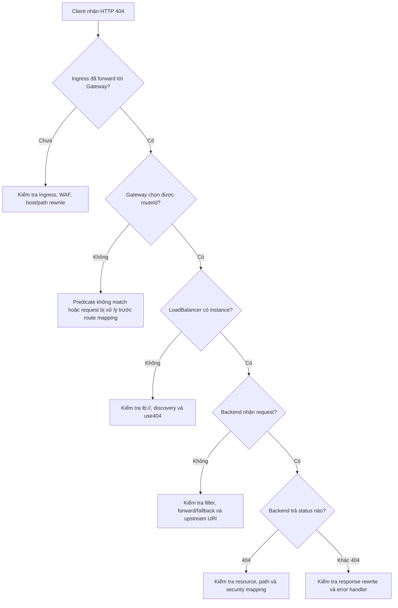
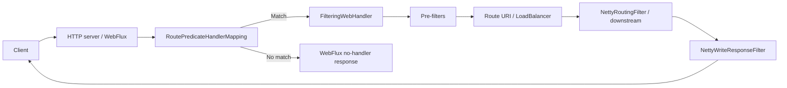

# 404 tại gateway: không khớp tuyến hay lỗi từ dịch vụ phía sau

HTTP **404 Not Found** trả về từ API Gateway không đủ để kết luận route bị thiếu. Trong Spring Cloud Gateway, cùng status 404 có thể phát sinh khi request không khớp route predicate; route đã khớp nhưng filter thay đổi path sai; backend nhận request và trả 404; service discovery không tìm được instance nhưng cấu hình LoadBalancer trả 404; hoặc Security/fallback/custom filter cố ý che giấu tài nguyên. Chỉ nhìn response body hay một lần gọi `curl` rất dễ khiến ta sửa nhầm tầng.

Bài thuộc chương **Chẩn đoán sự cố** của module **SPRING_CLOUD_GATEWAY**. Bối cảnh là API Gateway với route predicates, filter chain, path/header rewriting, service discovery/load balancing, xác thực, rate limiting, circuit breaker, retry, TLS và observability. Mục tiêu là xác định **Gateway có chọn route không, upstream nhận path nào, tầng nào tạo 404 và bằng chứng nào xác nhận nguyên nhân**.

> **Phạm vi:** Ví dụ tập trung vào **Spring Cloud Gateway Server WebFlux** với Reactor Netty. Cấu hình namespace, Actuator và logger có thể khác giữa Gateway 4.x/5.x và Spring Boot/Cloud release trains. Đối chiếu phiên bản thực tế trước khi áp dụng.

## 1. Một status 404, nhiều nguồn phát sinh

| Nguồn tạo 404 | Route match? | Backend nhận request? | Dấu hiệu đầu tiên |
| --- | --- | --- | --- |
| **Không có route match** | Không. | Không. | Không có routeId; không có backend access log tương ứng. |
| **Gateway filter/fallback tạo 404** | Thường có route hoặc xử lý local. | Có thể không. | Filter/fallback/controller có log hoặc trace. |
| **Downstream service trả 404** | Có. | Có. | Backend access log ghi request và status 404. |
| **LoadBalancer không tìm thấy instance** | Có route lb://. | Không có instance để gửi tới. | Mặc định thường là 503; cấu hình use404=true có thể đổi thành 404. |
| **Security/Ingress phía trước trả 404** | Có thể chưa tới route mapping. | Không. | Ingress/Security log có request; Gateway route log có thể không xuất hiện. |

### Cây quyết định



**404 là kết quả cuối cùng nhìn từ client, không phải nhãn nguồn gốc.** Một filter, fallback controller, backend hoặc LoadBalancer đều có thể tạo status này. Dùng request ID tương quan qua Ingress, Gateway và backend để nối bằng chứng.

## 2. Gateway xử lý request ở đâu trước khi proxy?

Trong Gateway Server WebFlux, luồng đơn giản hóa:



Khi route match, Gateway đưa request vào Gateway Web Handler và filter chain của route. Nếu không route nào match, filter chain dành cho route không chạy như một request đã chọn tuyến.

- **Không có route:** không có Route được gắn vào exchange theo luồng route thông thường.
- **Đã có route:** exchange có route metadata và Gateway có thể tạo downstream URI.

GlobalFilter chỉ chạy trong Gateway filtering chain sau khi route được chọn. Không thấy log của nó là manh mối request chưa vào chain, nhưng **không tự chứng minh** Path predicate sai: Security WebFilter, custom WebFilter, Ingress hoặc handler khác có thể xử lý trước.

## 3. Đọc response 404 có hệ thống

Khi thử:

```bash
curl -i "https://api.example.com/api/catalog/products/42"
```

hãy ghi HTTP status, response headers, body đã redacted, method, Host, path, query, scheme, request/correlation ID, thời điểm/Gateway pod nhận request và backend access log/status tương ứng.

### Không dựa vào body hoặc Server header một mình

Body kiểu:

```json
{"timestamp":"...","status":404,"error":"Not Found","path":"/api/catalog/products/42"}
```

có thể do Spring Boot error handling tạo ra, nhưng không chứng minh Gateway hay backend là nơi đầu tiên tạo status. Backend cũng có thể trả body giống vậy; Ingress hoặc custom error handler có thể chuẩn hóa response.

Các header như `Server: nginx` hoặc `Server: ReactorNetty` có thể bị xóa/thay đổi trên đường đi. Chỉ dùng làm manh mối, không dùng làm bằng chứng cuối cùng.

### So từng chặng

| Điểm thử | Mục đích |
| --- | --- |
| Backend trực tiếp trong mạng lab | Resource có tồn tại với đúng method/path không? |
| Gateway pod trực tiếp, bỏ Ingress | Route, filter và upstream path có đúng không? |
| Gateway Service nội bộ | Service endpoints, DNS và network có đúng không? |
| Public hostname qua CDN/Ingress/WAF | Host/path/TLS/header rewrite ở edge có thay request không? |

Nếu backend trực tiếp đã trả 404 cho cùng method/path, sửa route Gateway không làm resource tự xuất hiện. Nếu backend trực tiếp trả 200 nhưng qua Gateway 404, kiểm tra route match, upstream path, instance selection và response rewriting.

## 4. Không khớp route predicate

Một route gồm ID, destination URI, predicates, filters và order. **Tổ hợp predicates phải thỏa mãn** thì route mới được chọn. Đừng kiểm tra mỗi Path rồi cho rằng route chắc chắn match.

| Predicate | Điều cần đối chiếu | Lỗi thường gặp |
| --- | --- | --- |
| Path | Path Gateway thực nhận sau proxy prefix/context path. | Client gọi /catalog/** nhưng route khai báo /api/catalog/**. |
| Host | Host hoặc :authority Gateway thực nhận. | Ingress rewrite Host hoặc client dùng hostname khác. |
| Method | GET/POST/PUT/DELETE/OPTIONS. | Browser preflight gửi OPTIONS nhưng route chỉ cho GET. |
| Header | Tên header và regex/value. | Thiếu X-API-Version hoặc gửi v1 thay vì v2. |
| Query | Tên/giá trị query parameter. | Thiếu version=2 hoặc encoding khác. |
| Cookie | Cookie name và regex. | Browser/proxy không gửi cookie dự kiến. |
| RemoteAddr | Địa chỉ peer Gateway nhìn thấy. | Gateway chỉ thấy IP Ingress, không phải client. |
| After/Before | Thời gian và timezone. | Route chưa active hoặc đã hết maintenance window. |

### Ví dụ nhiều predicates

```yaml
spring:
  cloud:
    gateway:
      server:
        webflux:
          routes:
            - id: catalog-v2
              order: 10
              uri: http://localhost:8081
              predicates:
                - Path=/api/catalog/**
                - Method=GET
                - Host=api.example.com
                - Header=X-API-Version, v2
```

Route này cần đồng thời Path, Method, Host và Header đúng. Request GET đúng path nhưng thiếu X-API-Version vẫn không match; nếu không route nào khác phù hợp, Gateway có thể trả 404.

### Kiểm tra từng điều kiện

```bash
curl -i -H "Host: api.example.com" -H "X-API-Version: v2" \
  "http://localhost:8080/api/catalog/products/42"

curl -i -H "Host: api.example.com" \
  "http://localhost:8080/api/catalog/products/42"

curl -i -H "Host: api.example.com" -H "X-API-Version: v2" \
  -X POST "http://localhost:8080/api/catalog/products/42"
```

Lệnh đầu thỏa predicates; lệnh hai thiếu Header; lệnh ba sai Method. Nếu kết quả khác dự kiến, kiểm tra headers **Gateway thực nhận**, không chỉ headers trong lệnh client.

## 5. Path mismatch: URL public khác path backend

Giả sử client gọi GET /api/catalog/products/42 nhưng backend chỉ có GET /products/42. Route có thể dùng:

```yaml
spring:
  cloud:
    gateway:
      server:
        webflux:
          routes:
            - id: catalog
              uri: http://localhost:8081
              predicates:
                - Path=/api/catalog/**
              filters:
                - StripPrefix=2
```

StripPrefix=2 bỏ hai segment đầu (api và catalog), nên backend nhận /products/42. Nếu thiếu filter, backend có thể nhận /api/catalog/products/42 rồi trả 404.

### Đừng nhầm route URI path với path filter

URI route như `http://localhost:8081/catalog` **không có nghĩa** Gateway tự nối /catalog vào request path. Theo tài liệu Gateway, path khai báo trong route URI bị bỏ qua khi tạo destination URI. Muốn thêm/bớt prefix, dùng PrefixPath, StripPrefix, SetPath hoặc RewritePath và xác minh upstream path thực tế.

| Public path | Predicate | Filter | Path backend mong đợi |
| --- | --- | --- | --- |
| /api/catalog/products/42 | Path=/api/catalog/** | StripPrefix=2 | /products/42 |
| /api/v2/orders/123 | Path=/api/v2/orders/** | StripPrefix=2 | /orders/123 |
| /legacy/items/7 | Path=/legacy/** | RewritePath/SetPath theo contract | /items/7 hoặc path đã định nghĩa |

## 6. Trailing slash, encoding và normalization

Các request gần giống nhau có thể được xử lý khác nhau ở client, Ingress, HTTP server, Gateway matcher và backend: path có/không trailing slash, query string, encoded slash (%2F), slash lặp, dot segments (%2e/%2e%2e), Unicode hoặc double encoding.

Tài liệu Path predicate của các dòng Gateway hiện hành có tham số matchTrailingSlash; giá trị mặc định phụ thuộc version (một số bản mặc định true). Kiểm tra version và thử cả /products/42 lẫn /products/42/. Chuẩn hóa theo API contract ở một tầng có chủ đích.

Khi điều tra path encoding:

- Ghi raw request target ở edge và path Gateway đã parse.
- Ghi upstream URI sau filter, đã redacted.
- Thử backend trực tiếp với cùng representation trong lab.
- Kiểm tra Ingress có decode/normalize path trước khi forward không.
- Đảm bảo authorization matcher và backend mapping dùng cùng semantics.

Normalization không nhất quán không chỉ gây 404; nó còn có thể tạo **authorization bypass/path traversal**. Không thử payload độc hại trên production.

## 7. Host, forwarded headers và Ingress rewrite

Nếu route có Host=api.example.com và Path=/api/catalog/** nhưng Ingress forward Host=api-gateway.default.svc.cluster.local, Host predicate có thể không match. Một số Ingress giữ Host gốc; một số proxy/service có thể rewrite.

| Chặng | Giá trị cần biết |
| --- | --- |
| Client → Ingress | URL hostname và Host/:authority client gửi. |
| Ingress → Gateway | Host thực tế và forwarded headers. |
| Gateway route matching | Host predicate nhìn thấy giá trị nào? |
| Gateway → backend | Host header được giữ, thay hay set lại? |

Kiểm tra Host/:authority, Forwarded, X-Forwarded-Host, X-Forwarded-Proto, X-Forwarded-Prefix và X-Forwarded-Port. Chỉ tin forwarded headers từ **proxy đã được cấu hình trust**; không cho client Internet tự quyết định upstream host hoặc security context bằng header giả mạo.

### CORS preflight

Browser có thể gửi OPTIONS trước cross-origin request. Nếu route chỉ có Method=GET/POST, OPTIONS có thể không match và trả 404. Kiểm tra request preflight có tới Gateway, CORS global/route config và Security WebFlux CORS integration. Không mở wildcard origin + credentials tùy tiện để làm request chạy.

**Một OPTIONS 404 không nhất thiết là backend thiếu resource**; có thể route predicate chỉ cho method khác.

## 8. Route order, route overlap và route chưa được nạp

Một số hệ thống có routes chồng lấn:

```yaml
spring:
  cloud:
    gateway:
      server:
        webflux:
          routes:
            - id: catalog-specific
              order: 0
              uri: http://localhost:8081
              predicates:
                - Path=/api/catalog/**
            - id: api-catch-all
              order: 100
              uri: http://localhost:8082
              predicates:
                - Path=/api/**
```

Hai routes đều có thể khớp `/api/catalog/products/42`; route order quyết định thứ tự xét/chọn theo semantics của Gateway. Trong điều tra, đừng chỉ nhìn thấy route cụ thể tồn tại rồi cho rằng nó đã được chọn. **Ghi routeId thực tế** trong log/trace và kiểm tra order trong route inventory.

### Route definition có thể chưa tồn tại ở runtime

Nguồn route có thể là:

- `application.yml` hoặc Java `RouteLocator` bean.
- `RouteDefinitionLocator` từ properties/config source.
- Dynamic `RouteDefinitionRepository`.
- DiscoveryClient route locator.
- Route được quản lý qua Actuator API.

Một route có trong file cấu hình nhưng không xuất hiện trong runtime có thể do profile không active, namespace sai, route definition parse/bind lỗi, bean không được tạo hoặc refresh chưa xảy ra. Với dynamic routes, hãy kiểm tra **active route snapshot/revision**, không chỉ file Git.

### Route refresh

Gateway có route cache. Actuator cung cấp endpoint refresh trong các phiên bản hỗ trợ; thao tác refresh có thể cập nhật route definitions nhưng **không nên gọi POST refresh ngẫu nhiên trong production**. Trước khi refresh, xác minh nguồn cấu hình đã sửa và có thể rollback; ghi route revision trước/sau.

## 9. Downstream trả 404: chứng minh bằng request mà backend thực nhận

Nếu route đã match và LoadBalancer chọn được instance, Gateway có thể gửi request qua Netty HTTP client. Backend trả HTTP 404 thì Gateway thường proxy status đó về caller, trừ khi một filter/error handler thay đổi response.

### Những nguyên nhân backend thường gặp

| Nguyên nhân | Ví dụ | Bằng chứng cần lấy |
| --- | --- | --- |
| **Path sai** | Backend có `/products/42`, Gateway gửi `/api/catalog/products/42`. | Backend access log ghi exact request URI. |
| **HTTP method sai** | Backend chỉ có GET nhưng Gateway nhận POST. | Backend method/path mapping và access log. |
| **Context path/base path** | Backend chạy dưới `/catalog` nhưng Gateway bỏ hoặc thêm prefix sai. | Runtime context path và upstream URI. |
| **API version khác** | Gateway gửi `/v2/products`, backend mới chỉ deploy `/v1`. | Service revision/API contract. |
| **Resource không tồn tại** | ID 42 không có trong dữ liệu. | Backend domain response/lookup, không chỉ route config. |
| **Backend Security che giấu tài nguyên** | Anonymous hoặc tenant khác nhận 404 thay vì 403. | Authorization decision/audit log đã redacted. |
| **Backend host/instance khác** | LoadBalancer chọn instance cũ hoặc sai service ID. | Instance ID, pod/revision, backend access log. |
| **Header ảnh hưởng mapping** | Accept, Content-Type, tenant/version header khác. | Header allowlist và handler negotiation. |

### Kiểm tra backend trực tiếp với path đã tính

Giả sử Gateway route dùng `StripPrefix=2`:

```bash
curl -i "http://localhost:8081/products/42"
curl -i "http://localhost:8081/api/catalog/products/42"
```

Nếu lệnh đầu 200 và lệnh hai 404, còn Gateway đang gửi path thứ hai, nguyên nhân nằm ở mapping prefix/filter. Nếu cả hai đều 404, kiểm tra resource, API version, context path và backend security.

### Backend có thể cố ý trả 404 cho caller không được phép

Một số ứng dụng dùng 404 để không tiết lộ resource tồn tại hay không. Vì vậy:

- Đừng đổi 404 thành 200 hoặc bỏ authorization để “sửa lỗi”.
- Kiểm tra tenant/principal/scope và resource ownership.
- So sánh cùng resource với danh tính test được cấp quyền trong lab.
- Giữ body, logs và traces không chứa token/PII.

## 10. Filter chain có thể tạo hoặc làm thay đổi 404

Route đã match không có nghĩa request chắc chắn được gửi tới backend. Các filter có thể chặn, chuyển hướng, forward local, rewrite path hoặc thay response.

| Filter/nhóm filter | Cách có thể liên quan đến 404 |
| --- | --- |
| `StripPrefix`, `RewritePath`, `SetPath`, `PrefixPath` | Tạo upstream path khác với endpoint backend. |
| `SetStatus` hoặc custom response filter | Tạo 404 mà không gọi backend. |
| `CircuitBreaker` + fallback | Fallback controller/route có thể trả 404. |
| `Retry` | Có thể lặp lại request nếu status 404 được cấu hình là status retry. |
| `ForwardRoutingFilter` / `forward:` | Chuyển request tới handler local; local handler có thể không tồn tại và trả 404. |
| Custom `GlobalFilter` / `GatewayFilter` | Có thể dừng chain, set status hoặc thay path/header. |
| Security/WebFilter | Có thể trả 404 để che endpoint hoặc chặn trước route mapping. |

### DiscoveryClient route locator: lỗi 404 đặc biệt hay gặp

Gateway có thể tự tạo routes từ service registry. Route mặc định có dạng `/serviceId/**` và filter mặc định rewrite path để bỏ service ID trước khi gửi tới backend.

Ví dụ client gọi `GET /CATALOG-SERVICE/products/42`; Gateway discovery route mặc định bỏ segment service ID và chuyển tới backend path `/products/42`.

**Lỗi quan trọng:** khi cấu hình `spring.cloud.gateway.discovery.locator.filters[x]`, danh sách filter tùy chỉnh có thể **thay thế toàn bộ danh sách filter mặc định**. Nếu chỉ thêm CircuitBreaker/RequestRateLimiter mà quên khai báo lại RewritePath, service ID vẫn nằm trong upstream path; backend nhận `/CATALOG-SERVICE/products/42` rồi trả 404.

Vì vậy, khi discovery-generated route trả 404:

1. Xem active route predicate/filter qua Actuator.
2. Xác định route có phải discovery-generated hay route tĩnh.
3. Kiểm tra filter list còn RewritePath bỏ service ID không.
4. Ghi exact upstream path trong backend access log.
5. Kiểm tra service ID capitalization; một số registry trả service IDs viết hoa, còn path client dùng chữ thường.

### Kiểm tra filter order

Gateway kết hợp `GlobalFilter` và route-specific `GatewayFilter` thành filter chain rồi sắp xếp theo `Ordered`. Pre-phase và post-phase chạy theo thứ tự ngược nhau ở một số chiều. Nếu filter rewrite, security, fallback và routing chạy sai thứ tự, response cuối có thể khác dự kiến.

Không suy luận filter order chỉ từ thứ tự YAML khi cần điều tra. Xem runtime filter list và test trên đúng Gateway version.

## 11. lb:// không tìm thấy instance: 404 hay 503?

Một route như:

```yaml
spring:
  cloud:
    gateway:
      server:
        webflux:
          routes:
            - id: catalog
              uri: lb://catalog-service
              predicates:
                - Path=/api/catalog/**
              filters:
                - StripPrefix=2
```

đã match route ngay cả khi service registry không có instance khỏe. Đây là **lỗi resolve downstream instance**, không phải “route predicate không match”.

Theo tài liệu Spring Cloud Gateway WebFlux hiện hành, khi Reactor LoadBalancer không tìm được service instance, mặc định Gateway trả **503 Service Unavailable**. Có thể cấu hình:

```yaml
spring:
  cloud:
    gateway:
      loadbalancer:
        use404: true
```

để chuyển trường hợp không có instance thành **404**. Property namespace/đường binding cần được xác minh theo release train đang dùng; tài liệu hiện hành mô tả tên `spring.cloud.gateway.loadbalancer.use404`.

### Phân biệt ba trường hợp

| Trường hợp | Route ID | Instance được chọn? | Backend access log? | Status thường gặp |
| --- | --- | --- | --- | --- |
| Không route predicate match | Không. | Không. | Không. | 404. |
| Route match, không có instance `lb://` | Có. | Không. | Không. | 503 mặc định; có thể 404 khi bật use404. |
| Route match, backend có instance nhưng resource không tồn tại | Có. | Có. | Có. | Backend 404 được proxy về. |

### Checklist khi service discovery trả lỗi

- Service ID trong `lb://` có đúng tên registry không?
- Có dependency Spring Cloud LoadBalancer và DiscoveryClient implementation phù hợp không?
- Service có đăng ký instance chưa, instance có trạng thái healthy/ready không?
- Registry trả service ID uppercase/lowercase thế nào?
- Có cache/stale instance list hoặc namespace/zone filter không?
- `StripPrefix`/`RewritePath` sau khi resolve service có đúng không?
- `use404` có được bật và có khiến alert/client hiểu nhầm không?

**Không đổi use404 để che lỗi discovery.** Nếu không có instance, 503 thường diễn đạt rõ hơn rằng service tạm không sẵn sàng; chỉ dùng 404 khi hợp đồng API/compatibility yêu cầu và hệ thống có cách phân biệt nguyên nhân trong logs/metrics.

## 12. Dùng Actuator để xem route definitions và filter chain

Trong Spring Cloud Gateway, Actuator Gateway endpoint có thể cho biết **route nào đang được đăng ký**, predicate, filters, destination URI và order. Endpoint này bị tắt/không mở access mặc định trong một số cấu hình; chỉ expose read-only trên management network đã được bảo vệ.

Ví dụ cấu hình cho các phiên bản hỗ trợ access control kiểu mới:

```yaml
management:
  endpoint:
    gateway:
      access: read-only
  endpoints:
    web:
      exposure:
        include: health,info,gateway
```

Đây là ví dụ **version-sensitive**. Kiểm tra Actuator endpoint access model của Spring Boot/Gateway đang dùng. Nếu phiên bản cũ không hỗ trợ thuộc tính access trên, dùng cơ chế enable/exposure/security tương ứng; không mở toàn bộ Actuator cho Internet.

### Các request hữu ích

```http
GET /actuator/gateway/routes
GET /actuator/gateway/routes/catalog
GET /actuator/gateway/globalfilters
GET /actuator/gateway/routefilters
```

`GET /actuator/gateway/routes` có thể hiển thị route_id, predicate, filters, URI và order. `GET /actuator/gateway/globalfilters` giúp xem global filters và order; `routefilters` liệt kê filter factories có sẵn. Tùy Gateway version và cấu hình verbose, format chi tiết có thể khác.

### Actuator routes không phải log của request

`/actuator/gateway/routes` cho biết **route definitions đã được đăng ký**, không cho biết request cụ thể đã match route nào. Một route tồn tại nhưng predicates không match vẫn có thể không được chọn. Để xác định request, cần log/trace theo request ID hoặc instrumentation của route.

### Endpoint quản trị cần được bảo vệ

- Chỉ cho phép operator/scraper nội bộ truy cập.
- Ưu tiên read-only khi chỉ điều tra.
- Không expose POST/DELETE/refresh/create route cho client công khai.
- Không đưa URI chứa credentials hoặc internal topology ra response public.
- Ghi audit nếu operator thay đổi dynamic routes.

## 13. Logging, DEBUG/TRACE và Reactor Netty wiretap

Spring Cloud Gateway troubleshooting guide khuyến nghị xem các logger sau khi cần điều tra:

```yaml
logging:
  level:
    org.springframework.cloud.gateway: DEBUG
    org.springframework.http.server.reactive: DEBUG
    org.springframework.web.reactive: DEBUG
    org.springframework.boot.autoconfigure.web: DEBUG
    reactor.netty: DEBUG
    redisratelimiter: DEBUG
```

Các logger có thể cung cấp thông tin route matching, WebFlux handling, auto-configuration, network client/server và Redis rate limiter. Logger cụ thể/chi tiết phụ thuộc version.

### Bật wiretap có kiểm soát

Reactor Netty HttpServer/HttpClient có thể bật wiretap để quan sát traffic qua Gateway. Tên property trong tài liệu hiện hành gồm:

```yaml
spring:
  cloud:
    gateway:
      httpserver:
        wiretap: true
      httpclient:
        wiretap: true
```

**Tên property có thể dùng namespace cũ** ở một số dòng Gateway; kiểm tra configprops/reference đúng version. Wiretap kết hợp logger Reactor Netty DEBUG/TRACE có thể ghi headers và bodies trên wire.

**Cảnh báo bảo mật:** wiretap có thể làm lộ Authorization, Cookie, API keys, request bodies và dữ liệu cá nhân. Chỉ bật ngắn hạn trong lab/staging hoặc incident window đã được phê duyệt; redaction, access control và retention phải rõ. Không để wiretap TRACE kéo dài trên public Gateway.

### Đọc log theo câu hỏi

| Câu hỏi | Tìm bằng chứng |
| --- | --- |
| Gateway có nhận request không? | Ingress access log, main HTTP server log, request ID. |
| Route nào được chọn? | Route ID trong Gateway logs/custom filter/tracing. |
| Vì sao route match? | Predicate config/runtime route inventory và request attributes. |
| Upstream URI/path nào được tạo? | Routing filter logs hoặc instrumentation đã redacted. |
| Backend có nhận request? | Backend access log cùng request ID/trace ID. |
| Ai trả 404? | Backend status, Gateway response status, filter/fallback logs và ingress response. |

## 14. Ghi routeId và response status cho request đã match

Một GlobalFilter nhỏ có thể ghi route ID và final response status trong môi trường điều tra. Filter này chỉ chạy **sau khi route được chọn**, do đó không ghi nhận requests không match route.

```java
package com.example.gateway.diagnostics;

import org.slf4j.Logger;
import org.slf4j.LoggerFactory;
import org.springframework.cloud.gateway.filter.GatewayFilterChain;
import org.springframework.cloud.gateway.filter.GlobalFilter;
import org.springframework.cloud.gateway.route.Route;
import org.springframework.cloud.gateway.support.ServerWebExchangeUtils;
import org.springframework.core.Ordered;
import org.springframework.stereotype.Component;
import org.springframework.web.server.ServerWebExchange;
import reactor.core.publisher.Mono;

@Component
public class RouteResponseLogFilter implements GlobalFilter, Ordered {

    private static final Logger log =
        LoggerFactory.getLogger(RouteResponseLogFilter.class);

    @Override
    public Mono<Void> filter(
            ServerWebExchange exchange,
            GatewayFilterChain chain) {

        Route route = exchange.getAttribute(
            ServerWebExchangeUtils.GATEWAY_ROUTE_ATTR);

        String routeId = route == null ? "unknown" : route.getId();
        String method = exchange.getRequest().getMethod() == null
            ? "unknown"
            : exchange.getRequest().getMethod().name();

        return chain.filter(exchange)
            .doFinally(signal -> {
                var status = exchange.getResponse().getStatusCode();
                log.debug(
                    "gateway route completed routeId={} method={} status={} signal={}",
                    routeId, method, status, signal);
            });
    }

    @Override
    public int getOrder() {
        return Ordered.LOWEST_PRECEDENCE;
    }
}
```

Ví dụ dùng Java hiện đại với `var`; nếu project dùng Java baseline cũ hơn, thay bằng kiểu trả về cụ thể của `getStatusCode()`. Đây là **diagnostic filter**, không phải bộ logging production hoàn chỉnh.

### Giới hạn của filter này

- Không chạy nếu request không match route và không vào Gateway filter chain.
- HTTP 404 là response status, không phải Reactor error; `doOnError` không thể dùng để bắt mọi 404.
- Filter chỉ ghi final status nhìn từ Gateway; muốn biết backend có thật sự trả 404 phải đối chiếu upstream/backend access log hoặc tracing span.
- Không log raw query, full URI, cookies, tokens hoặc body. Chỉ thêm request ID/trace ID đã được kiểm soát.
- Nếu filter khác set status sau đó, order và post-phase có thể ảnh hưởng status cuối; kiểm tra runtime filter order.

### Correlation ID

Nên có request ID/trace ID đi xuyên qua:

```text
Ingress request ID
    -> Gateway inbound span / routeId
        -> Gateway outbound client span
            -> Backend server span / access log
```

Nếu client gửi X-Request-ID, validate độ dài/ký tự và tránh dùng giá trị tùy ý làm metric tag. Có thể sinh ID nội bộ khi thiếu; không dùng request ID làm high-cardinality Prometheus label.

## 15. Phân biệt 404 từ Gateway với 404 từ backend bằng bằng chứng

| Bằng chứng | Không match route | Downstream 404 |
| --- | --- | --- |
| Route ID được ghi bởi GlobalFilter | Không có. | Có route ID. |
| Backend access log cùng request ID | Không có. | Có. |
| Upstream client span | Không có outbound span tương ứng. | Có outbound span và status 404. |
| Gateway route timer/metrics | Có thể không có routeId vì request chưa match. | Có routeId và status cuối có thể là 404. |
| Backend trực tiếp với upstream path | Không liên quan nếu chưa có upstream request. | Thường tái hiện 404 nếu đúng instance/path/identity. |

**Lưu ý:** không phải mọi setup đều export đúng các spans/metrics này; sampling, Security filters, custom routing và instrumentation có thể tạo khoảng trống. Không có backend log cũng chưa đủ chứng minh không có request: log có thể bị sampling/drop hoặc request bị chặn ở network trước ứng dụng.

### Khi Gateway route timer không có routeId

Đây có thể là request bị xử lý trước route mapping hoặc không match route. So với HTTP server metrics/access logs, WebFlux handler/Security logs và Ingress logs. Không dùng một metric route timer làm mẫu số cho toàn bộ inbound traffic nếu timer chỉ đo requests đã match route.

## 16. Quy trình chẩn đoán 404 theo thứ tự

### Bước 1 — Tái hiện một request cụ thể

Chọn một method/path/host/query/header cụ thể và ghi request ID. Tránh dùng một tập request không kiểm soát vì có thể có route khác nhau theo tenant, API version hoặc method.

```bash
curl -i \
  -H "X-Request-ID: diag-404-001" \
  -H "Host: api.example.com" \
  -H "X-API-Version: v2" \
  "http://localhost:8080/api/catalog/products/42"
```

Request ID trên chỉ dùng trong lab; production nên dùng ID sinh/validate theo policy.

### Bước 2 — Bỏ Ingress và gọi Gateway trực tiếp

Nếu public endpoint 404 nhưng pod Gateway trực tiếp 200, điều tra Ingress/WAF/TLS/Host/path rewrite. Nếu cả hai đều 404, tiếp tục ở Gateway route matching và downstream.

### Bước 3 — Kiểm tra route runtime

Đọc danh sách routes/predicates/filters/order qua Actuator đã bảo vệ. Xác nhận route có tồn tại trong đúng pod, profile và revision. Không chỉ đọc file cấu hình trên repository.

### Bước 4 — Xác nhận routeId

Dùng DEBUG logs, tracing hoặc diagnostic GlobalFilter. Nếu không có routeId, kiểm tra predicates và các WebFilters chạy trước route mapping. Nếu có routeId, tiếp tục.

### Bước 5 — Tính upstream URI/path

Kiểm tra StripPrefix, RewritePath, SetPath, PrefixPath, context path, discovery locator và route URI. Ghi path sau filter, không đoán từ URL public.

### Bước 6 — Xác nhận instance và backend request

Với lb://, kiểm tra service instance và LoadBalancer resolution. Đối chiếu backend access log cùng request ID; nếu backend nhận request, lấy exact method/path/headers đã redacted.

### Bước 7 — Kiểm tra backend và response filters

Test backend trực tiếp với đúng instance/path/identity. Nếu backend 200 nhưng Gateway 404, xem post-filters, fallback, SetStatus, local forward hoặc error handler.

### Bước 8 — Sửa một nguyên nhân, chạy regression

Thay đổi một biến (predicate, path filter, discovery rewrite, Host forwarding hoặc security mapping), chạy lại test và kiểm tra routes khác không bị ảnh hưởng.

## 17. Ma trận kiểm thử phân biệt route 404 và downstream 404

Bảng sau là test plan cho môi trường lab/staging. Các response là kết quả mong đợi theo cấu hình ví dụ; backend, Security và error handler của từng hệ thống có thể dùng status/body khác.

| ID | Thay đổi/kịch bản | Route ID mong đợi | Backend nhận request? | Kết quả cần xác minh |
| --- | --- | --- | --- | --- |
| T01 | GET đúng Path/Host/Method/Header | catalog-v2 | Có. | Backend trả 200 cho resource tồn tại. |
| T02 | Thiếu X-API-Version | Không có route phù hợp. | Không. | 404 do no route match nếu không có route khác. |
| T03 | Sai Host | Không có route phù hợp. | Không. | Xác minh Host Gateway thực nhận. |
| T04 | POST vào route chỉ cho GET | Không có route phù hợp. | Không. | OPTIONS/POST không bị nhầm là backend 404. |
| T05 | Trailing slash khác | Tùy matchTrailingSlash/version. | Tùy route. | Xác minh predicate thực tế. |
| T06 | Thiếu StripPrefix=2 | catalog | Có. | Backend nhận prefix dư và có thể trả 404. |
| T07 | StripPrefix đúng | catalog | Có. | Backend nhận /products/42 và trả 200. |
| T08 | Backend không có resource ID | catalog | Có. | Downstream 404 được proxy về. |
| T09 | Backend security ẩn resource | catalog | Có thể có. | 404 do authorization policy, không bỏ auth để sửa. |
| T10 | Discovery locator không có RewritePath | discovery-generated route | Có. | Backend nhận serviceId trong path và trả 404. |
| T11 | Discovery locator có RewritePath | discovery-generated route | Có. | Service ID được bỏ, path backend đúng. |
| T12 | lb:// không có instance | catalog | Không. | 503 mặc định hoặc 404 nếu use404. |
| T13 | Fallback forward tới endpoint local sai | catalog/fallback | Có thể không. | Fallback handler trả 404; backend không nhận request. |
| T14 | SetStatus=404 trong custom filter | Route có match. | Không nhất thiết. | Gateway filter tự tạo status 404. |
| T15 | Retry cấu hình status 404 | Route có match. | Có thể nhiều lần. | Xác minh retry count và final status. |
| T16 | OPTIONS preflight không có CORS handling | Có thể không. | Không. | 404 có thể phát sinh trước backend. |
| T17 | Public Ingress rewrite path | Có thể thay đổi. | Tùy. | So direct pod request với public hostname. |
| T18 | Route chưa refresh sau config change | Route runtime cũ. | Tùy. | Actuator route snapshot/revision khác file mong đợi. |
| T19 | Overlapping routes/order | Một route cụ thể được chọn. | Có. | RouteId thực tế đúng theo order. |
| T20 | Security WebFilter trả 404 trước route mapping | Không có routeId. | Không. | Security audit log chứng minh request bị che. |

### Bằng chứng cần lưu cho mỗi test

```text
test ID + test timestamp
request method / host / path / query
request ID / trace ID
Gateway pod + image/config revision
selected routeId (nếu có)
upstream service ID / instance ID (nếu có)
upstream path (đã redacted)
backend received? + backend status
client final status
logs / trace references
```

Không lưu Authorization, Cookie, raw JWT, API key hoặc body chứa PII vào kết quả test. Dùng identities và dữ liệu giả lập.

## 18. Bảng chẩn đoán nhanh theo triệu chứng

| Triệu chứng | Nguyên nhân có thể | Bước xác minh đầu tiên |
| --- | --- | --- |
| 404 và không có routeId | Predicate không match; Security/WebFilter xử lý trước. | So Host/Path/Method/Header và log WebFlux/Security. |
| RouteId có nhưng không có backend log | LB không có instance, filter short-circuit, local forward/fallback. | Kiểm tra LoadBalancer, filter chain và trace outbound. |
| Backend log ghi path có thêm /api/catalog | Thiếu StripPrefix/RewritePath. | So upstream path với endpoint backend. |
| Backend direct 200 nhưng Gateway 404 | Path/header/Host rewrite, instance khác hoặc post-filter. | Gọi đúng instance với exact upstream request. |
| Một route cụ thể luôn 404 sau deploy | Route config/profile/revision chưa nạp hoặc order đổi. | Actuator routes trên từng pod. |
| Chỉ OPTIONS 404 | Method predicate/CORS preflight chưa được xử lý. | Gửi OPTIONS với Origin và Access-Control-Request-Method. |
| Chỉ Host predicate route 404 sau Ingress change | Host bị rewrite hoặc forwarded headers không tin cậy. | Ghi Host/:authority ở Ingress → Gateway. |
| Discovery-generated routes 404 | Default RewritePath bị thay thế khi custom filters được khai báo. | Kiểm tra active discovery route filters và backend path. |
| lb:// trả 404, backend không có log | use404 bật và LoadBalancer không có instance. | Kiểm tra service registry/instance list và property. |
| 404 chỉ xảy ra với user/tenant cụ thể | Backend Security hoặc tenant resource mapping. | So authorization decision bằng test identities. |
| 404 xuất hiện sau thêm CircuitBreaker | Fallback URI/handler trả 404 hoặc filter order sai. | Gọi fallback local handler trong lab, xem breaker logs. |
| Actuator có route nhưng request không match | Predicate condition khác request thực nhận. | Không nhầm route definition với route selection; bật diagnostics. |
| Một pod trả 200, pod khác 404 | Route revision/config drift hoặc backend instance khác. | So pod image, route snapshot, discovery instance. |
| 404 sau khi đổi service ID capitalization | Discovery service ID và path casing không khớp. | So registry service ID, locator settings và URL. |
| Response body giống Spring Boot error nhưng không biết tầng | Body bị chuẩn hóa ở nhiều tầng. | Correlation ID qua Gateway/backend/Ingress; không suy từ body. |

## 19. Những lỗi sửa sai thường gặp

### Thêm catch-all route để biến mọi 404 thành 200

Một route `Path=/**` trỏ tới backend chung có thể che việc route cụ thể không match và vô tình gửi request tới service không phù hợp. Chỉ thêm fallback/catch-all nếu API contract yêu cầu, có thứ tự, security và observability rõ.

### Xóa Host/Method/Header predicates chỉ để request chạy

Nếu route cần Host hoặc API version để tách backend, xóa predicate có thể làm route overlap hoặc định tuyến nhầm tenant/version. Sửa nguồn header ở Ingress/client hoặc cấu hình predicate đúng.

### Dùng RewritePath ngẫu nhiên

Một regex rewrite có thể làm path hợp lệ thành path sai, hoặc normalize encoded segments khác backend. Viết test input/output cho path trước khi đưa filter vào production.

### Tắt Security vì backend trả 404

Backend có thể chủ động trả 404 để che resource khỏi user không có quyền. Không biến lỗi authorization thành quyền truy cập rộng hơn. Kiểm tra principal, scope, tenant và ownership.

### Bật use404 để che no-instance

Khi LoadBalancer không có instance, 404 làm client nghĩ resource không tồn tại. Nếu API contract không bắt buộc 404, giữ 503 giúp phân biệt availability với resource lookup; dù dùng use404, phải có metric/log riêng cho no-instance.

### Mở Actuator hoặc wiretap công khai

Route inventory có thể lộ service IDs, internal URIs và filter configuration; wiretap có thể ghi tokens/bodies. Chỉ expose management endpoint nội bộ, read-only, access controlled; wiretap ngắn hạn và redacted.

## 20. Runbook ngắn cho incident 404

1. **Xác định blast radius:** một route, một method, một tenant, một pod hay mọi API?
2. **Lấy request mẫu:** method, Host, path, query, request ID, thời điểm.
3. **So Ingress và Gateway:** request có tới pod đúng không, Host/path có bị rewrite?
4. **Kiểm tra route runtime:** routeId, predicates, filters, URI, order, revision.
5. **Nếu có routeId:** xác minh LoadBalancer instance và upstream path.
6. **Đối chiếu backend access log:** backend có nhận request và trả 404 không?
7. **Kiểm tra Security/fallback/custom filter:** có chủ động trả 404 không?
8. **Thay một cấu hình nhỏ:** không thêm catch-all hoặc tắt auth để che lỗi.
9. **Regression test:** positive route, negative predicate, path rewrite, backend 404, no-instance 503/404 và Security.
10. **Theo dõi sau sửa:** 404 theo route, 5xx, backend request counts, route revision và p95/p99.

Nếu incident có dấu hiệu path traversal, cross-tenant access hoặc routing tới host không tin cậy, chuyển sang quy trình security incident và giữ evidence đã redacted. Không chạy payload khai thác trên production để xác minh.

## 21. Câu hỏi tự kiểm tra

1. Vì sao HTTP 404 từ Gateway không đủ chứng minh route predicate không match?
2. Route match và filter chain bắt đầu ở giai đoạn nào của Gateway Server WebFlux?
3. Tại sao GlobalFilter không ghi log cho request không match route?
4. Một route có Path, Host, Method và Header predicates cần những điều kiện nào cùng đúng?
5. Vì sao OPTIONS preflight có thể nhận 404 dù GET route hoạt động?
6. Ingress rewrite Host có thể làm Host predicate không match như thế nào?
7. StripPrefix=2 thay đổi path /api/catalog/products/42 ra sao?
8. Vì sao path trong route URI không thay thế cho StripPrefix/RewritePath?
9. Khi nào trailing slash hoặc percent-encoding có thể làm route match khác?
10. Làm sao phân biệt route definition tồn tại với request thực sự match route đó?
11. Actuator /actuator/gateway/routes cho biết thông tin gì, và không cho biết điều gì?
12. Vì sao Actuator Gateway endpoint nên read-only và chỉ expose trong mạng nội bộ?
13. Khi nào downstream 404 được Gateway proxy nguyên trạng về caller?
14. Backend có thể cố ý trả 404 thay cho 403 trong trường hợp nào?
15. DiscoveryClient route locator mặc định làm gì với service ID trong path?
16. Vì sao cấu hình custom discovery locator filters có thể vô tình xóa RewritePath mặc định?
17. LoadBalancer không tìm được instance mặc định trả status gì theo tài liệu Gateway hiện hành?
18. Property use404 thay đổi hành vi no-instance như thế nào?
19. Vì sao no-instance 404 khác downstream resource 404 dù client thấy cùng status?
20. CircuitBreaker fallback hoặc ForwardRoutingFilter có thể tạo 404 mà không gọi backend không?
21. Retry có thể lặp request 404 khi nào?
22. Những logger nào hữu ích khi bật DEBUG/TRACE để điều tra route matching?
23. Wiretap có thể làm lộ dữ liệu nào và vì sao chỉ bật ngắn hạn?
24. Vì sao không thể dùng doOnError để bắt mọi HTTP 404?
25. Cần những bằng chứng nào để kết luận backend thực sự đã nhận request?
26. Nếu backend direct 200 nhưng Gateway trả 404, thứ tự kiểm tra nên là gì?
27. Nếu một pod trả 200 nhưng pod khác 404, cần so sánh các dữ liệu runtime nào?
28. Vì sao thêm catch-all route hoặc tắt Security không phải cách sửa an toàn?
29. Khi nào nên giữ 503 thay vì đổi no-instance thành 404?
30. Một regression suite tối thiểu cho 404 troubleshooting cần những ca nào?

## 22. Tài liệu tham khảo

Các nguồn Spring chính thức dưới đây mô tả route matching, filter chain, Actuator, LoadBalancer, discovery locator và troubleshooting. **Đối chiếu phiên bản Gateway đang triển khai** vì namespace/property và format Actuator có thể thay đổi:

- [Spring Cloud Gateway Server WebFlux — How It Works](https://docs.spring.io/spring-cloud-gateway/reference/spring-cloud-gateway-server-webflux/how-it-works.html) — route handler mapping, Gateway Web Handler và filter chain.
- [Spring Cloud Gateway Server WebFlux — Route Predicate Factories](https://docs.spring.io/spring-cloud-gateway/reference/spring-cloud-gateway-server-webflux/request-predicates-factories.html) — Path, Host, Method, Header và predicate arguments.
- [Spring Cloud Gateway Server WebFlux — Global Filters](https://docs.spring.io/spring-cloud-gateway/reference/spring-cloud-gateway-server-webflux/global-filters.html) — Netty routing, LoadBalancer và no-instance behavior.
- [Spring Cloud Gateway Server WebFlux — Actuator API](https://docs.spring.io/spring-cloud-gateway/reference/spring-cloud-gateway-server-webflux/actuator-api.html) — routes, predicates, filters, order và access control.
- [Spring Cloud Gateway Server WebFlux — Troubleshooting](https://docs.spring.io/spring-cloud-gateway/reference/spring-cloud-gateway-server-webflux/troubleshooting.html) — logger DEBUG/TRACE và Reactor Netty wiretap.
- [Spring Cloud Gateway Server WebFlux — DiscoveryClient Route Definition Locator](https://docs.spring.io/spring-cloud-gateway/reference/spring-cloud-gateway-server-webflux/the-discoveryclient-route-definition-locator.html) — default Path predicate, RewritePath và custom filter list.
- [Spring Cloud Gateway Server WebFlux — GatewayFilter Factories](https://docs.spring.io/spring-cloud-gateway/reference/spring-cloud-gateway-server-webflux/gatewayfilter-factories.html) — StripPrefix, RewritePath, SetPath, PrefixPath và các filter khác.
- [Spring Cloud Commons — LoadBalancer](https://docs.spring.io/spring-cloud-commons/reference/spring-cloud-commons/loadbalancer.html) — service instance selection và integration.
- [Spring Framework WebFlux](https://docs.spring.io/spring-framework/reference/web/webflux.html) — WebFlux handler mapping và reactive request processing.

**Ghi nhớ:** Khi gặp 404 ở API Gateway, hãy phân loại theo thứ tự **Ingress → route matching → filter/path transformation → LoadBalancer/discovery → backend → response/fallback**. Route không match thường không có routeId và không tạo backend request; route đã match có thể vẫn gửi path sai; LoadBalancer không có instance mặc định thường trả 503 nhưng có thể được cấu hình thành 404; backend có thể trả 404 vì resource, API version hoặc authorization. **Chỉ sửa sau khi đã xác định tầng tạo status bằng routeId, exact upstream path, backend access log và request/trace ID tương quan.** Không dùng catch-all, tắt Security, wildcard Host hay use404 để che một lỗi routing chưa được hiểu rõ.
