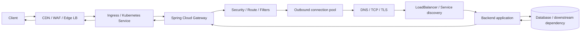

# 502, 504 và lỗi timeout theo từng chặng

Khi một request đi qua **Spring Cloud Gateway** rồi nhận HTTP **502 Bad Gateway**, **504 Gateway Timeout** hoặc bị timeout ở client, chỉ nhìn status code thường không đủ để tìm nguyên nhân. Lỗi có thể bắt đầu ở Ingress, Gateway, DNS, TCP/TLS, connection pool, service discovery, backend application, database hoặc dependency phía sau backend. Một response 504 cũng có thể do **Ingress** tạo ra trước khi Gateway kịp trả lời; 502 có thể là lỗi Gateway proxy, nhưng cũng có thể chính backend đã trả status đó.

Bài thuộc chương **Chẩn đoán sự cố**, tập trung vào **502, 504 và lỗi timeout theo từng chặng** trong hệ thống API Gateway. Phạm vi liên kết với route predicates, filter chain, rewrite path/header, khám phá dịch vụ `lb://`, authentication, Redis rate limiting, Retry, CircuitBreaker, TLS và observability. Mục tiêu là tìm **hop đầu tiên bắt đầu chậm hoặc thất bại**, xác định thành phần phát status code và chọn cách khắc phục đúng tầng.

Các ví dụ chính dùng **Spring Cloud Gateway Server WebFlux với Reactor Netty**. Nếu triển khai Gateway Server Web MVC, cần đối chiếu Servlet container, HTTP client và timeout settings của stack MVC. Tên property, metric và exception mapping có thể thay đổi theo phiên bản Spring Boot/Spring Cloud Gateway/Reactor Netty; luôn xác minh trên version đã pin trong hệ thống.

> **Nguyên tắc điều tra:** Không tăng timeout, tăng connection pool, retry thêm hoặc restart toàn bộ pods trước khi biết lỗi xảy ra ở hop nào. Những thay đổi đó có thể che triệu chứng, tăng concurrency và làm backend/Redis quá tải hơn. Các lệnh và fault-injection trong bài chỉ thực hiện trên môi trường được phép.

## 1. Đường đi của một request qua Gateway



Ở mỗi chặng có thể có queue, timeout và status riêng:

| Hop | Công việc | Lỗi thường gặp |
| --- | --- | --- |
| Client → Edge | DNS public, TCP/TLS, gửi request | DNS error, connect timeout, client deadline |
| Edge → Ingress | Load balancing, WAF, TLS termination | 502/503/504 do edge/ingress |
| Ingress → Gateway | Chọn Gateway pod, upstream connection | No endpoint, connect/reset, timeout |
| Gateway filters | Security, predicates, rewrite, rate limit | 401/403/404/429, custom 5xx |
| Gateway outbound pool | Acquire connection/stream | Pending acquire, pool acquire timeout |
| Gateway → backend network | DNS, TCP, TLS/mTLS | Unknown host, refused, handshake failure |
| Service discovery/LB | Chọn instance backend | No instance, stale instance |
| Backend HTTP server | Accept, queue, parse, dispatch | Connection reset, server overload |
| Backend application | Business logic, thread/event loop | Slow handler, internal timeout, exception |
| Backend dependencies | DB, Redis, external API | Pool wait, query timeout, downstream 5xx |
| Response path | Serialize, stream, proxy ngược | Broken pipe, premature close, slow consumer |

**Điểm quan trọng:** HTTP status chỉ mô tả kết quả tại một ranh giới. Nó không tự cho biết hop nào là nguyên nhân gốc.

## 2. Phân biệt 502, 504 và các status liên quan

### 502 Bad Gateway

Một proxy/gateway nhận được phản hồi không hợp lệ hoặc không thể hoàn thành vai trò proxy với upstream. Các tình huống có thể dẫn đến 502 tùy implementation:

- TCP connection bị reset hoặc đóng bất thường.
- Backend đóng socket trước khi gửi response hợp lệ.
- Upstream trả malformed HTTP response.
- TLS handshake/certificate/hostname verification thất bại ở outbound hop.
- DNS/connect failure được proxy error handler ánh xạ thành 502.
- Một reverse proxy phía trước không thể sử dụng response từ Gateway.

**502 không nhất thiết có nghĩa backend trả HTTP 502.** Có thể proxy tự tạo response 502 vì không lấy được response hợp lệ từ upstream.

### 504 Gateway Timeout

Một gateway/proxy không nhận được response kịp thời từ upstream theo timeout policy của nó. Ví dụ:

- Gateway chờ backend quá `response-timeout`.
- Ingress chờ Gateway quá `proxy-read-timeout`.
- Edge LB chờ Ingress quá idle/response timeout.
- Backend chờ DB quá lâu, rồi lớp proxy phía ngoài timeout trước khi backend hoàn tất.

**504 không chứng minh backend đã dừng xử lý.** Client có thể đã nhận 504 trong khi backend vẫn tiếp tục transaction hoặc external API call.

### Những status không nên nhầm

| Status | Ý nghĩa thường gặp | Hướng điều tra |
| --- | --- | --- |
| **401** | Thiếu hoặc credential không hợp lệ | AuthN, JWT issuer/audience/expiry |
| **403** | Đã xác thực nhưng không đủ quyền | Scope, role, tenant, resource authorization |
| **404** | Route/resource không tồn tại hoặc được che theo policy | Predicate, rewrite, backend mapping |
| **405** | Method không được endpoint hỗ trợ | Method predicate/controller/security |
| **429** | Rate limit/admission policy từ chối | Redis limiter, key resolver, quota |
| **500** | Application/proxy error nội bộ | Exception, filter, backend logs |
| **502** | Proxy không nhận được response upstream hợp lệ | TCP/TLS/reset/malformed response |
| **503** | Service unavailable/no instance/breaker/load shedding | Discovery, readiness, CircuitBreaker |
| **504** | Gateway/proxy chờ upstream quá deadline | Tìm timeout ở hop phát response |
| **499** | Một số proxy (ví dụ Nginx) dùng để ghi client đóng request | Client cancellation; không phải status chuẩn để backend trả |

Status mapping cụ thể phụ thuộc error handler và proxy chain. Một backend cũng có thể chủ động trả 502 hoặc 504. Phải xác định **ai phát status**, không suy từ tên mã.

## 3. “Theo từng chặng” nghĩa là gì?

Giả sử client gửi request lúc `t0` và nhận 504 lúc `t1`. Ta cần biết thời gian được tiêu thụ ở đâu:

```text
t0  Client bắt đầu request
t1  Edge nhận request
t2  Ingress chuyển tới Gateway
t3  Gateway match route / chạy filters
t4  Gateway lấy outbound connection
t5  DNS/TCP/TLS hoàn tất
t6  Backend nhận request
t7  Backend bắt đầu xử lý
t8  Backend gọi database/dependency
t9  Backend trả response
t10 Gateway hoàn tất proxy response
t11 Ingress/Edge trả response
t12 Client nhận response
```

Đây là timeline khái niệm. Thực tế một số bước có thể chồng lấp; DNS có thể cache, TLS có thể reuse, body upload/download diễn ra song song với xử lý.

Đừng cộng các timestamp ở nhiều hệ thống nếu **clock chưa đồng bộ**. Distributed tracing hoặc monotonic duration trong từng process thường đáng tin hơn việc trừ hai wall-clock timestamps từ pods khác nhau.

## 4. Phân biệt nơi phát status với nơi tạo nguyên nhân

Ví dụ:

```text
Backend bắt đầu xử lý request và chờ database 5 giây.
Ingress timeout sau 2 giây.
Client nhận 504 từ Ingress.
Backend tiếp tục query đến giây thứ 5 rồi commit.
```

- **Nơi phát status:** Ingress.
- **Nguyên nhân gốc:** DB latency hoặc backend deadline không được kiểm soát.
- **Hệ quả:** Client có thể retry và tạo thao tác lặp, dù request ban đầu đã commit.

Ví dụ khác:

```text
Gateway gửi request đến backend.
Backend đóng connection ngay, không gửi HTTP response.
Gateway ánh xạ lỗi transport thành 502.
Client nhận 502 từ Gateway.
```

- **Nơi phát status:** Gateway.
- **Nguyên nhân:** Backend process/connection lifecycle, network reset hoặc protocol issue.

Cần xác định cả hai để tránh sửa sai thành phần.

## 5. Thu thập bằng chứng trước khi thay đổi

Khi nhận incident 502/504, ghi lại:

1. Thời điểm bắt đầu/kết thúc, timezone và độ chính xác đồng hồ.
2. URL/method/route ID, không ghi dữ liệu nhạy cảm trong query/body.
3. Request/correlation ID và trace ID nếu có.
4. Status code, response headers, response body đã được làm sạch.
5. Client connect/TTFB/total timings.
6. Ingress/Gateway/backend logs cùng cửa sổ thời gian.
7. Gateway pod nhận request và backend instance được chọn.
8. Pool active/idle/pending/acquire timeout.
9. DNS/TCP/TLS timings và lỗi.
10. Backend handler/DB/external dependency durations.
11. Retry attempts, CircuitBreaker state, Redis limiter latency.
12. Deploy/scale/route config changes trùng thời điểm.

**Không yêu cầu khách hàng gửi bearer token, cookie, password hoặc full payload nhạy cảm để debug.** Dùng request ID và synthetic reproduction.

## 6. Đọc response headers nhưng không tin chúng tuyệt đối

Một response có thể chứa:

```http
HTTP/1.1 504 Gateway Timeout
content-type: application/json
date: Tue, 24 Nov 2026 08:00:00 GMT
server: edge-proxy
x-request-id: synthetic-req-123
```

`Server` hoặc `Via` có thể gợi ý proxy phát response, nhưng headers có thể bị loại bỏ, ghi đè hoặc giả mạo. Correlate request ID với **logs của từng hop** để xác định nguồn.

Nếu response không có Gateway request metric nhưng Ingress có 504, request có thể chưa tới Gateway hoặc bị chặn trước instrumentation. Nếu Gateway có request span nhưng backend không có server span, điều tra pool/DNS/TCP/TLS/routing trước backend application.

## 7. Latency budget và deadline chain

Một request có nhiều timeout. Ví dụ minh họa:

| Tầng | Deadline/timeout minh họa |
| --- | ---: |
| DB query | 300 ms |
| Backend operation budget | 700 ms |
| Gateway upstream response timeout | 1.000 ms |
| Ingress upstream read timeout | 1.300 ms |
| Client total deadline | 1.600 ms |

Thiết kế hướng từ trong ra ngoài: dependency cần đủ thời gian hoàn tất trong budget backend; backend nên kết thúc hoặc trả lỗi trước khi Gateway timeout; Gateway nên phản hồi trước Ingress; Ingress nên phản hồi trước client deadline. Chừa margin cho serialization, response transfer, scheduling và network jitter.

Đây là **mẫu**, không phải quy tắc mọi hop phải có con số tăng đều. Upload/streaming, async processing và long polling cần ngân sách khác.

### Tổng thời gian end-to-end

Có thể mô hình hóa:

\[
T_{\text{client}} =
T_{\text{edge}} + T_{\text{ingress}} +
T_{\text{gateway}} + T_{\text{network}} +
T_{\text{backend}} + T_{\text{return}}
\]

Trong đó `T_gateway` có thể bao gồm filter execution, pool acquire, routing và proxy overhead; `T_backend` có thể gồm queue, application và dependencies. Không cộng trùng cùng một khoảng thời gian được đo từ hai spans lồng nhau.

### Deadline khác timeout

- **Timeout** là giới hạn cho một thao tác hoặc khoảng chờ.
- **Deadline** là thời điểm cuối cùng request còn hữu ích.
- Một request có thể có nhiều timeout nhỏ hơn deadline tổng.
- Retry/backoff phải dùng chung deadline; không được reset toàn bộ budget cho mỗi attempt.

Một chuỗi timeout 1 giây × 3 attempts + backoff 2 giây không còn nằm trong client deadline 2 giây.

## 8. Timeout nào đang hết hạn?

| Loại | Chờ điều gì? | Biểu hiện |
| --- | --- | --- |
| DNS resolution timeout | Phân giải hostname | UnknownHost, resolver timeout |
| TCP connect timeout | Thiết lập socket tới địa chỉ | Connection refused/timeout |
| TLS handshake timeout | Hoàn thành TLS negotiation | Handshake timeout, certificate error |
| Pool acquire timeout | Mượn connection/stream từ pool | Pending acquire timeout |
| Response timeout | Chờ upstream response theo client policy | Read/response timeout |
| Backend server queue timeout | Chờ worker/event loop/thread pool | Queue timeout hoặc server 503/504 |
| DB connection pool timeout | Chờ connection DB | Pool acquisition timeout |
| DB statement/query timeout | Chờ câu query | SQL timeout/cancel |
| External API timeout | Chờ dependency khác | Connect/read timeout |
| Ingress upstream timeout | Chờ Gateway response | Ingress 504 |
| Client total timeout | Chờ toàn bộ request | Client abort/timeout |

**“Timeout” không phải một loại lỗi duy nhất.** Log phải ghi rõ operation và phase nếu có thể.

## 9. Timeout không giống connection refused hay connection reset

| Lỗi | Nghĩa | Gợi ý |
| --- | --- | --- |
| **Connection refused** | Đích từ chối kết nối hoặc không có listener | Sai port, pod chưa listen, endpoint stale |
| **Connection timed out** | Không hoàn tất TCP connect trong budget | Network path, firewall, packet drop, overload |
| **Connection reset** | Kết nối bị reset bất thường | Backend restart, proxy reset, stale socket |
| **Premature close** | Upstream đóng trước khi response hoàn tất | Backend crash, protocol/stream abort |
| **Read/response timeout** | Kết nối có thể đã lập nhưng response không đến kịp | Backend queue/handler/dependency chậm |
| **Pool acquire timeout** | Chưa lấy được connection từ pool | Pool đầy, requests giữ lâu |
| **TLS handshake failure** | TLS negotiation/certificate verification thất bại | Truststore, SNI, expiry, protocol/cipher |

Nếu TCP refused ngay, tăng `response-timeout` thường không có ích. Nếu pool acquire timeout, tăng connect timeout cũng không giải quyết vì chưa bắt đầu connect mới.

## 10. Phân biệt DNS, service discovery và LoadBalancer

Một route `lb://order-service` thường cần hai việc khác nhau:

1. Spring Cloud LoadBalancer/DiscoveryClient chọn một **service instance**.
2. HTTP client kết nối đến host/port của instance đó, qua DNS/TCP/TLS theo URI/metadata.

Các failure modes:

- Không có instance healthy → thường có thể trả `503` hoặc status theo cấu hình.
- Instance list stale → chọn pod đã terminate.
- DNS hostname của instance không resolve → transport error.
- Pod IP reachable nhưng application chưa listen → refused.
- Endpoint port/protocol sai → connect/TLS failure.
- Load balancing phân bố lệch → một instance nóng trong khi instance khác rảnh.

**No instance** khác với **instance tồn tại nhưng không kết nối được**. Đừng gộp chúng thành “DNS lỗi”.

### Kiểm tra Kubernetes endpoints

Trong namespace được cấp phép:

```bash
kubectl -n shop get svc order-service
kubectl -n shop get endpointslices \
  -l kubernetes.io/service-name=order-service
kubectl -n shop get pods -l app=order-service -o wide
kubectl -n shop describe svc order-service
```

Kiểm tra:

- Selector của Service có match backend pods không?
- EndpointSlice có địa chỉ và port đúng không?
- Pod Ready hay chỉ Running?
- TargetPort khớp listener backend không?
- Pod mới/terminating có còn bị chọn không?
- Service mesh sidecar có policy/port interception phù hợp không?

Một Service có thể tồn tại nhưng không có ready endpoints.

## 11. Gateway route match và rewrite: lỗi 404 không phải 502

Ví dụ:

```yaml
spring:
  cloud:
    gateway:
      routes:
        - id: orders
          uri: lb://order-service
          predicates:
            - Path=/api/orders/**
            - Method=GET
          filters:
            - StripPrefix=1
```

Request:

```text
GET /api/orders/42
Gateway StripPrefix=1
Backend nhận /orders/42
```

Nếu backend chỉ có `/api/orders/42` hoặc Gateway strip sai số segment, backend có thể trả 404. Đây thường là **routing/contract issue**, không phải upstream timeout.

Kiểm tra route ID, Path/Method/Host predicates, RewritePath/StripPrefix/SetPath, backend access log, HTTP method, query string và encoded path.

**Không retry 404 hoặc tăng timeout để sửa sai path.**

## 12. Route không tồn tại và không có service instance

Phân biệt:

- **Không route match:** Gateway có thể trả 404 vì không có route phù hợp.
- **Route match nhưng service không có instance:** LoadBalancer thường báo no instance và có thể ánh xạ thành 503.
- **Route match, instance có nhưng connect fail:** Có thể thành 502/503 tùy error handler.
- **Backend nhận request nhưng resource không tồn tại:** Backend trả 404.

Các trường hợp đều có thể trông như “API không hoạt động”, nhưng cần sửa khác nhau. Xem Gateway route actuator/route definitions chỉ trong môi trường management đã bảo vệ; không public toàn bộ route table cho người dùng.

## 13. Outbound connection pool: điểm nghẽn thường bị nhầm là backend timeout

Reactor Netty HTTP client tái sử dụng connections qua `ConnectionProvider`. Một request có thể phải **đợi pool cấp connection** trước khi DNS/TCP/TLS hoặc gửi request.

```text
Gateway request
    |
    v
ConnectionProvider
    |
    +-- idle connection -> reuse
    |
    +-- available capacity -> create connection
    |
    +-- pool at max -> pending acquire queue
                              |
                              +-- available before deadline -> continue
                              +-- acquire timeout -> fail
```

Các chỉ số thường gặp (tên meter chính xác tùy version/registry):

- `reactor.netty.connection.provider.active.connections`
- `reactor.netty.connection.provider.idle.connections`
- `reactor.netty.connection.provider.total.connections`
- `reactor.netty.connection.provider.max.connections`
- `reactor.netty.connection.provider.pending.connections`
- `reactor.netty.connection.provider.pending.connections.time`

### Failure pattern

```text
Backend response chậm
  -> active connections giữ lâu
  -> idle giảm
  -> active tiến gần max
  -> pending acquire tăng
  -> acquire wait tăng
  -> pool acquire timeout
  -> client thấy 5xx/timeout
```

Gateway có thể báo pool acquisition timeout dù backend **chưa nhận request mới**. Đó là lý do không thể kết luận backend đã timeout chỉ từ client 504.

## 14. Pool pending timeout khác response timeout

| Quan sát | Pool acquire timeout | Response timeout |
| --- | --- | --- |
| Request đã có outbound connection? | Có thể chưa | Thường đã gửi/đợi response |
| Backend access log có request? | Có thể không | Thường có nếu đã gửi |
| Active pool | Có thể sát max | Có thể cao |
| Pending acquire | Thường tăng | Không nhất thiết |
| Backend handler duration | Có thể không có span | Có thể dài |
| Hướng xử lý | Pool/concurrency/response duration | Backend/dependency/response budget |

Không tăng `maxConnections` ngay. Nếu backend đang quá tải, tăng pool max có thể làm nhiều request đồng thời hơn và khiến backend/DB sụp nhanh hơn.

## 15. Cấu hình HTTP client timeout của Spring Cloud Gateway

Ở các phiên bản Spring Cloud Gateway WebFlux phổ biến, cấu hình có dạng:

```yaml
spring:
  cloud:
    gateway:
      httpclient:
        connect-timeout: 500
        response-timeout: 2s
        pool:
          type: fixed
          max-connections: 500
          acquire-timeout: 1000
```

Ý nghĩa minh họa:

- `connect-timeout` thường là thời gian TCP connection setup, tính bằng milliseconds trong property này.
- `response-timeout` là thời gian chờ response theo HTTP client policy; thường nhận Duration.
- Với Reactor Netty, `responseTimeout` thường giới hạn khoảng chờ giữa các lần đọc dữ liệu mạng khi nhận response; không mặc định là total deadline của toàn bộ request/stream. Đo và kiểm tra semantics của phiên bản đang dùng.
- `pool.max-connections` giới hạn connections theo pool configuration.
- `pool.acquire-timeout` giới hạn thời gian chờ lấy connection khi pool bị giới hạn.

**Cực kỳ quan trọng:** Property prefix và khả năng hỗ trợ pool fields thay đổi theo dòng Gateway. Các bản mới có thể đặt properties dưới prefix dạng `spring.cloud.gateway.server.webflux.httpclient`. Kiểm tra configuration metadata và reference docs đúng version trước khi copy. Không tự tạo cả hai prefix rồi giả định chúng cùng hoạt động.

### Connect timeout không phải tổng request timeout

Một `connect-timeout: 500` không có nghĩa toàn request sẽ timeout sau 500 ms. Request có thể reuse connection, chờ pool, xử lý backend hoặc stream response lâu hơn. Cần đo từng phase và outer deadline.

### Response timeout không phải timeout DB

Gateway không thể trực tiếp biết backend đang chờ DB, Redis hay external API. Nó chỉ thấy response upstream chưa đến trong budget. Backend cần timeout và tracing riêng cho dependencies.

## 16. Timeout theo route

Một số phiên bản Spring Cloud Gateway cho phép route metadata:

```yaml
spring:
  cloud:
    gateway:
      routes:
        - id: orders-fast
          uri: lb://order-service
          predicates:
            - Path=/api/orders/**
          metadata:
            connect-timeout: 300
            response-timeout: 1200
```

Các giá trị minh họa: connect 300 ms và response 1.200 ms. Xác minh units và support theo version.

Dùng route-specific timeouts khi workload khác nhau rõ: catalog read, report generation, upload/download và WebSocket/SSE cần policy riêng. Với report dài, cân nhắc async job + polling thay vì giữ HTTP connection lâu.

**Không tạo route timeout quá lớn chỉ để tránh 504.** Request chờ lâu giữ concurrency, memory và connection resources.

## 17. Backend cần deadline nội bộ riêng

Backend cũng cần giới hạn:

- Thread/worker queue wait.
- DB connection pool acquire.
- DB query/statement.
- Redis command.
- External HTTP connect/read.
- Business operation total budget.
- Serialization/response streaming.

Ví dụ minh họa:

```text
Backend total budget:      700 ms
  DB pool acquire:          50 ms
  DB query:                250 ms
  external API:            250 ms
  business/serialize:      100 ms
  margin:                   50 ms
```

Các phase không nhất thiết chạy tuần tự; đây là budget để thiết kế, không phải phép cộng bắt buộc cho mọi request.

Nếu backend không có timeout riêng, một request có thể giữ thread/connection lâu sau khi Gateway/client đã từ bỏ. **Cancellation propagation phải được kiểm tra**, không mặc định client timeout làm database query tự dừng.

## 18. Ingress timeout có thể phát 504 trước Gateway

Ví dụ Nginx Ingress:

```yaml
metadata:
  annotations:
    nginx.ingress.kubernetes.io/proxy-connect-timeout: "2"
    nginx.ingress.kubernetes.io/proxy-read-timeout: "3"
    nginx.ingress.kubernetes.io/proxy-send-timeout: "3"
```

Đây là ví dụ annotation **phụ thuộc Nginx Ingress Controller**, không áp dụng cho mọi Ingress implementation. Units/semantics cần kiểm tra theo controller version.

Với Nginx, `proxy_read_timeout` và `proxy_send_timeout` thường giới hạn khoảng thời gian giữa hai lần đọc/ghi liên tiếp trên upstream connection, **không phải tổng thời gian tuyệt đối của toàn response**. Một stream gửi dữ liệu đều đặn có thể sống lâu hơn giá trị này; một response không phát byte mới trong khoảng timeout có thể bị đóng. Đối chiếu đúng semantics của controller trước khi so với total deadline ở client.

Nếu Gateway response timeout là 5 giây nhưng Ingress read timeout chỉ 3 giây, Ingress có thể trả 504 cho client ở giây thứ 3; Gateway/backend vẫn tiếp tục xử lý. **Timeout ngoài ngắn hơn timeout trong** có thể khiến lớp ngoài kết thúc request trước khi lớp trong có cơ hội trả lỗi chi tiết.

Không copy annotation Nginx vào Traefik, Envoy, cloud load balancer hoặc Kubernetes Gateway API rồi mong nó có hiệu lực.

## 19. Client deadline có thể che nguồn lỗi

Client có `timeout=1s` nhưng Gateway/Ingress timeout là 2s/3s. Client tự hủy sau 1 giây, nên:

- Gateway có thể ghi cancellation/client disconnect.
- Backend có thể vẫn xử lý.
- Ingress có thể ghi client closed request.
- Client không nhận được 504 từ server; thư viện client ném timeout exception.

Ngược lại, nếu client timeout 10 giây còn Gateway response timeout 2 giây, client thường nhận HTTP 504 nhanh hơn. Cần phân biệt **HTTP status nhận từ server** với **timeout exception do client tự phát sinh**.

## 20. Client disconnect và cancellation

Một số tình huống:

```text
t=0.0s Client gửi request
t=0.8s Client timeout/đóng socket
t=0.9s Gateway phát hiện cancel (có thể trễ)
t=2.0s Backend vẫn đang query DB
t=3.0s Backend hoàn tất write
```

Với GET, việc backend tiếp tục có thể lãng phí tài nguyên. Với POST/charge/refund, nó có thể là vấn đề correctness nếu client retry vì tưởng request chưa chạy.

Cần kiểm tra Gateway cancellation, backend server cancellation, DB driver statement cancellation, external HTTP abort, transaction rollback và idempotency key.

**Client timeout không chứng minh server chưa commit.** API write phải có idempotency và cách tra cứu kết quả operation.

## 21. DNS timeout và DNS sai

Khi route dùng hostname trực tiếp hoặc service instance trả hostname, DNS có thể là một phase riêng.

Các triệu chứng:

- `UnknownHostException`.
- Resolver timeout hoặc NXDOMAIN.
- DNS trả IP cũ/stale.
- Chỉ một Gateway pod không resolve được.
- DNS latency tăng khi scale-out tạo nhiều pods/connection churn.

Kiểm tra từ đúng network namespace/pod của Gateway hoặc test pod cùng policy:

```bash
kubectl -n edge exec deploy/api-gateway -- \
  getent hosts order-service.shop.svc.cluster.local
```

Lệnh phụ thuộc image có `getent`; distroless container có thể không có shell/tools. Dùng ephemeral debug container hoặc test pod đã được cấp phép thay vì cài tool vào production image.

So sánh DNS resolution, Kubernetes Service/EndpointSlice, CoreDNS metrics, hostname được LoadBalancer chọn, resolver cache/TTL và IPv4/IPv6. Đừng đổi sang hard-coded Pod IP làm giải pháp lâu dài; pod IP thay đổi theo lifecycle.

## 22. TCP connect timeout, refused và reset

Một khi có địa chỉ IP:

```bash
nc -vz -w 2 10.20.1.15 8080
```

Đây là ví dụ kết nối test tới backend IP/port trong lab. Diễn giải:

- **Succeeded:** TCP handshake được; không chứng minh HTTP route/AuthZ/backend healthy.
- **Connection refused:** Host reachable nhưng không có listener hoặc firewall chủ động reject.
- **Timed out:** Không hoàn tất trong budget; có thể packet drop, network path, security policy hoặc endpoint overload.
- **Reset:** Connection bị đóng/reset bởi peer hoặc middlebox.

Kiểm tra listener/backend container port, Service targetPort, readiness và NetworkPolicy/CNI. Không mở firewall/NetworkPolicy rộng để “xem có hết lỗi không”.

## 23. TLS handshake và certificate failure

Khi Gateway gọi backend HTTPS, lỗi có thể xuất hiện trước HTTP request:

- Certificate expired.
- Certificate SAN không khớp hostname/SNI.
- CA/intermediate chain không nằm trong truststore.
- Mutual TLS yêu cầu client certificate nhưng Gateway không gửi hoặc cert hết hạn.
- Backend/sidecar chỉ hỗ trợ protocol/cipher khác.
- Service discovery đổi hostname nhưng trust configuration không theo.
- TLS handshake bị chậm hoặc reset.

Lệnh lab:

```bash
openssl s_client \
  -connect order-service.shop.svc.cluster.local:8443 \
  -servername order-service.shop.svc.cluster.local \
  -showcerts
```

Chỉ chạy trong môi trường được cấp phép và từ network có quyền. Kiểm tra chain, SAN, expiry và handshake; lệnh không tự xác minh toàn bộ application trust policy nếu thiếu CA options phù hợp.

**Không bật insecure trust manager hoặc tắt hostname verification để sửa 502.** Điều đó biến lỗi cấu hình TLS thành lỗ hổng MITM.

## 24. Service discovery, stale connections và rolling deploy

Khi backend pods rollout:

1. Pod cũ bắt đầu terminating.
2. Readiness/EndpointSlice cập nhật.
3. Gateway/LoadBalancer refresh instance list theo cache policy.
4. Connection pool có thể còn socket tới pod cũ.
5. Backend đóng connection hoặc process thoát.
6. Request đang dùng socket cũ có thể gặp reset/premature close.

Nếu lỗi chỉ xảy ra trong vài giây khi rollout, hãy xem **connection draining, endpoint propagation, stale pool entries và graceful shutdown**. Đừng mặc định tăng response timeout.

Cần test backend graceful shutdown, readiness false trước termination, discovery cache refresh, connection max idle/lifetime, HTTP keep-alive, safe retry và in-flight request handling.

## 25. Backend queue và application latency

TCP/TLS thành công không có nghĩa backend xử lý ngay. Request có thể chờ:

- Tomcat/Jetty worker thread.
- WebFlux event loop/scheduler.
- Application semaphore/bulkhead.
- DB connection pool.
- Lock, synchronized block hoặc thread contention.
- GC pause/CPU throttling.
- Downstream HTTP connection pool.
- Rate limiter nội bộ.

Ví dụ backend có 100 worker threads, tất cả đang đợi external API 4 giây. Requests mới có thể nằm trong accept/worker queue dù CPU không cao.

Cần đo **queue wait** riêng với **handler execution time**. Một backend span dài 2 giây không cho biết handler dùng 2 giây CPU hay chờ DB 1,9 giây.

## 26. Database timeout thường xuất hiện thành Gateway 504

Một đường đi:

```text
Gateway request
  -> order-service HTTP handler
      -> Hikari connection pool acquire
          -> SQL query
              -> lock wait / disk / DB overload
      <- query result or timeout
  <- backend response
<- Gateway response
```

Các metric cần xem: Hikari active/idle/pending connections, connection acquisition timeouts, query duration, slow query, lock wait, DB CPU/IOPS/connections, transaction duration và Gateway response timeout.

Nếu Gateway timeout sau 1 giây nhưng DB query có timeout 5 giây, backend có thể tiếp tục giữ DB resources sau khi client đã bỏ cuộc. **Điều chỉnh deadline backend/DB và cancellation** thay vì chỉ tăng Gateway timeout.

## 27. Redis rate limiter không phải upstream backend timeout

Gateway có thể chạy `RequestRateLimiter` với Redis. Nếu Redis chậm:

- Gateway đợi quyết định allow/deny.
- Request có thể chưa tới backend.
- Redis connection pool/command latency tăng.
- Client có thể thấy timeout hoặc 5xx tùy error handling.
- Redis unavailable không mặc định luôn trả 429; behavior phụ thuộc version và custom policy.

| Quan sát | Rate limiter/Redis issue | Backend issue |
| --- | --- | --- |
| Redis command p95 | Cao | Bình thường có thể |
| Backend access log | Có thể không có request | Thường có request nếu đã proxy |
| Gateway route duration | Cao trước upstream | Cao sau khi gọi upstream |
| Pool outbound backend | Có thể bình thường | Có thể active/pending cao |
| 429 | Có thể tăng nếu quota deny | Không phải biểu hiện mặc định |
| Redis errors | Có | Không nhất thiết |

Không bypass limiter/fail-open để debug production. Dùng synthetic test key và Redis test instance, xác định fail-open/closed policy trước.

## 28. Authentication/authorization latency và lỗi không phải timeout upstream

JWT verification có thể dùng cached JWK public key; lần đầu hoặc key rotation có thể gọi JWKS endpoint. Opaque token introspection có thể gọi Authorization Server trên mỗi request hoặc theo cache policy.

Các lỗi: JWKS/IdP timeout, TLS/DNS tới IdP lỗi, opaque token introspection chậm, auth service rate limiting, custom authorization service lookup tenant/ACL chậm.

Nếu Gateway filter/Security chain timeout trước khi route, backend không hề nhận request. Tracing nên thể hiện **security/auth span** và dependency. Không nhầm IdP timeout thành order-service 504.

**Không tự fail-open authentication** vì IdP không phản hồi. Chọn fail policy theo risk và contract; privileged APIs không được cho qua khi không xác minh được credential.

## 29. Body upload/download và streaming timeout

Một request có body lớn hoặc response streaming có nhiều thời gian: client upload, Gateway đọc/aggregate, Gateway rewrite body, backend nhận body, backend stream response và client đọc response chậm.

Một timeout đo thời gian chờ response headers có thể khác **idle timeout giữa các chunks** và **total stream lifetime**. Đừng dùng một response timeout ngắn cho WebSocket/SSE/download sống lâu nếu semantics không phù hợp.

Kiểm tra body size limits ở Edge/Gateway/backend, upload/read idle timeout, first-byte time và inter-chunk gaps, backpressure/slow consumers, DataBuffer memory, client cancellation, HTTP/2 flow control và Gateway body aggregation.

Nếu stream đã gửi headers và một phần body rồi bị reset, server không thể đổi response thành 504 mới; client thường thấy **incomplete response/stream reset**. Phải kiểm tra transport logs.

## 30. HTTP/2, keep-alive và connection reuse

HTTP/1.1 thường dùng connection reuse theo keep-alive; HTTP/2 có multiplex nhiều streams trên một connection. Do đó:

- Active TCP connection count không bằng request concurrency.
- Một HTTP/2 stream reset có thể không làm hỏng toàn bộ TCP connection.
- Connection idle timeout và max lifetime ảnh hưởng reuse.
- Backend rollout có thể reset nhiều streams.
- TLS handshake rate tăng nếu connection churn.
- Pool metrics theo connections không luôn biểu diễn logical requests.

Khi điều tra, ghi cả **request/stream counts**, status và connection-level errors nếu stack expose. Không kết luận “pool còn 50% connection nên không nghẽn” khi pending stream/requests tăng.
## 31. Retry có thể che lỗi hoặc khuếch đại tải

Một request có thể đi qua nhiều upstream attempts:

```text
Client GET /orders/42
  attempt 1 -> backend A: timeout
  attempt 2 -> backend B: 503
  attempt 3 -> backend C: 200
Client nhận 200
```

Client-visible success che hai upstream failures. Nếu 500 logical RPS và trung bình 2 attempts/request, backend nhận khoảng 1.000 attempts/s. Retry có thể hữu ích cho lỗi transient và operation idempotent, nhưng khi backend saturated nó tạo **retry storm**.

Nguyên tắc:

- Chỉ retry status/exception đã xác định.
- Ưu tiên GET/HEAD hoặc operation có idempotency contract.
- Đặt max retries, backoff và jitter.
- Dùng một total deadline chung.
- Không retry 401/403/404 hoặc 429 vô điều kiện.
- Không retry POST payment/refund nếu backend không enforce idempotency.
- Đo logical requests và upstream attempts riêng.
- Phối hợp CircuitBreaker/bulkhead.

## 32. Cấu hình Retry minh họa cho GET

```yaml
spring:
  cloud:
    gateway:
      routes:
        - id: orders-read
          uri: lb://order-service
          predicates:
            - Path=/api/orders/**
            - Method=GET
          filters:
            - name: Retry
              args:
                retries: 1
                methods:
                  - GET
                statuses:
                  - BAD_GATEWAY
                  - SERVICE_UNAVAILABLE
                backoff:
                  firstBackoff: 50ms
                  maxBackoff: 150ms
                  factor: 2
                  basedOnPreviousValue: false
            - StripPrefix=1
```

Cú pháp và enum values cần xác minh theo Gateway version. Ví dụ này chỉ cho một retry và một nhóm status; nó **không phải khuyến nghị retry mọi 502/503**. Nếu backend thực sự unavailable, retry có thể chỉ thêm tải.

**Đếm attempts:** `retries: 1` thường có nghĩa tối đa một lần retry sau attempt đầu (tổng tối đa hai attempts) khi conditions phù hợp. Xác nhận bằng integration test và metrics của version đang dùng.

## 33. CircuitBreaker và fallback có thể đổi status

Gateway CircuitBreaker filter có thể bảo vệ backend:

```yaml
spring:
  cloud:
    gateway:
      routes:
        - id: orders
          uri: lb://order-service
          predicates:
            - Path=/api/orders/**
          filters:
            - name: CircuitBreaker
              args:
                name: orders
                fallbackUri: forward:/fallback/orders
            - StripPrefix=1
```

Fallback handler có thể trả 503, response cached hoặc degraded response theo API contract. Một fallback trả 200 không có nghĩa backend khỏe; cần đo breaker state, fallback activations và upstream calls.

- OPEN: calls không được gửi tới backend theo protected boundary.
- HALF_OPEN: một số probe calls được thử.
- CLOSED: calls đi qua và outcome được ghi nhận.

Nếu CircuitBreaker và Retry lồng nhau, thứ tự filter/decoration ảnh hưởng số attempts và việc breaker ghi nhận logical request hay từng attempt. **Đọc filter order thực tế và test**, không suy từ YAML thứ tự đơn giản.

## 34. Không retry request bị từ chối hoặc timeout vô hạn

Các anti-pattern:

- Retry `429` ngay lập tức, không backoff.
- Retry `401`/`403`.
- Retry 404 do path sai.
- Retry mọi exception, kể cả certificate mismatch.
- Retry POST có side effect không có idempotency.
- Mỗi attempt có timeout 5 giây, 3 attempts, client deadline 2 giây.
- CircuitBreaker OPEN nhưng outer Retry vẫn tạo thêm calls.
- Retry sau khi client đã disconnect.
- Retry cùng một backend instance đang unhealthy mà không có LB behavior phù hợp.

Retry chỉ nên áp dụng cho **lỗi transient, operation an toàn và còn đủ deadline**.

## 35. Timeout tăng quá lớn có thể làm outage nặng hơn

Giả sử backend capacity là 300 concurrent requests. Khi backend latency tăng từ 100 ms lên 5 giây:

```text
300 RPS × 0.1s ≈ 30 in-flight requests
300 RPS × 5s   ≈ 1500 in-flight requests
```

Theo Little's Law:

\[
L=\lambda W
\]

Nếu tăng timeout từ 1 giây lên 30 giây, requests có thể giữ resource lâu hơn, queue dài hơn, pool pending nhiều hơn và retry chậm hơn. **Timeout dài hơn không tăng capacity backend**.

Cần tìm latency nguyên nhân, bounded concurrency, queue limit, bulkhead, admission control và deadline phù hợp.

## 36. Timeout khác idle timeout và total timeout

Một số cấu hình phân biệt:

- **Connect timeout:** TCP connect phase.
- **Response/read timeout:** Chờ response hoặc dữ liệu theo semantics client.
- **Idle timeout:** Connection không có traffic trong một khoảng.
- **Pool acquire timeout:** Chờ connection.
- **Total request deadline:** Toàn bộ request.
- **Stream idle timeout:** Khoảng không có chunk/message trên stream.
- **Keep-alive timeout:** Thời gian connection được giữ để reuse.

Một response streaming gửi chunk mỗi 10 giây có thể sống lâu mà không idle; một stream ngừng phát chunk 30 giây có thể bị idle timeout dù request chưa hoàn tất.

Không suy `response-timeout` và `keep-alive timeout` là cùng một setting.

## 37. Client-side timing bằng curl

```bash
curl -sS -o /dev/null \
  --connect-timeout 2 \
  --max-time 5 \
  -w 'http=%{http_code} dns=%{time_namelookup}s connect=%{time_connect}s tls=%{time_appconnect}s ttfb=%{time_starttransfer}s total=%{time_total}s\n' \
  https://gateway.test.example.invalid/api/orders/42
```

Các giá trị: `time_namelookup` là DNS lookup duration; `time_connect` là thời điểm hoàn tất TCP connection; `time_appconnect` là thời điểm TLS handshake hoàn tất; `time_starttransfer` là thời điểm nhận byte đầu tiên; `time_total` là tổng thời gian curl.

Các time fields thường là **cumulative timestamps từ lúc bắt đầu**, không phải mọi field đều là duration độc lập để cộng. Có thể lấy hiệu giữa các mốc nếu hiểu đúng semantics.

Lệnh này đo **client → Gateway endpoint**, không cho biết thời gian riêng Gateway → backend. Lặp direct backend test từ network được phép để so sánh, nhưng giữ cùng identity, route/operation và dữ liệu synthetic.

## 38. Dùng curl để phân biệt client timeout và HTTP 504

```bash
curl -v \
  --connect-timeout 2 \
  --max-time 4 \
  https://gateway.test.example.invalid/api/orders/42
```

- Nếu curl in ra response `HTTP/1.1 504`, đó là HTTP response nhận được từ một proxy/server.
- Nếu curl báo Operation timed out mà không có HTTP status, client có thể tự hết deadline.
- Nếu TLS handshake fail trước HTTP, chưa có status HTTP từ application.
- Nếu connection reset, client có thể báo lỗi transport.

**Đừng ghi “API trả 504” khi thực tế client library tự timeout sau 4 giây.**

## 39. So sánh qua Gateway và direct backend

Trong staging, dùng cùng synthetic token/operation:

```bash
# Qua Gateway.
curl -sS -o /dev/null \
  -w 'gateway status=%{http_code} ttfb=%{time_starttransfer}s total=%{time_total}s\n' \
  -H "Authorization: Bearer $TEST_ACCESS_TOKEN" \
  https://gateway.test.example.invalid/api/orders/42

# Trực tiếp backend từ network được phép.
curl -sS -o /dev/null \
  -w 'backend status=%{http_code} ttfb=%{time_starttransfer}s total=%{time_total}s\n' \
  -H "Authorization: Bearer $TEST_ACCESS_TOKEN" \
  http://order-service.shop.svc.cluster.local:8080/orders/42
```

Không dùng direct path để bypass production security. Direct test chỉ thực hiện từ test pod/operator có quyền. Nếu direct backend nhanh nhưng Gateway chậm, xem Gateway filters, Redis, pool, DNS/TLS hoặc Ingress. Nếu cả hai chậm tương tự, nghiêng về backend/dependency, nhưng vẫn cần traces.

## 40. Kubernetes commands cho điều tra từng tầng

Trong namespace được cấp phép:

```bash
kubectl -n edge get pods -l app=api-gateway -o wide
kubectl -n edge get svc
kubectl -n shop get pods -l app=order-service -o wide
kubectl -n shop get endpointslices \
  -l kubernetes.io/service-name=order-service
kubectl -n edge describe pod <gateway-pod>
kubectl -n shop describe pod <order-pod>
```

Xem logs với request ID (thay bằng ID synthetic):

```bash
kubectl -n edge logs <gateway-pod> --since=15m
kubectl -n shop logs <order-pod> --since=15m
```

Nếu có nhiều containers/sidecars, chỉ định container phù hợp. Không dump toàn bộ environment variables/config secrets vào incident channel. Dùng log query có filter và redaction.

### Cần chú ý Events

`kubectl describe pod` và events có thể cho thấy readiness probe failure, OOMKilled/restart, ImagePullBackOff, scheduling/CPU pressure, node not ready, container terminated trong rollout hoặc startup/liveness failures.

Một Gateway pod restart đúng thời điểm 502 có thể là nguyên nhân gần; nhưng cần kiểm tra tại sao pod restart (OOM, rollout, liveness, node).

## 41. Actuator và route/metric inspection

Trong môi trường management được bảo vệ, có thể dùng:

```bash
curl -sS http://127.0.0.1:9090/actuator/health
curl -sS http://127.0.0.1:9090/actuator/metrics
curl -sS http://127.0.0.1:9090/actuator/prometheus
```

Một số meter thường gặp:

- `spring.cloud.gateway.requests`: Gateway request duration/count theo tags, nếu instrumentation được bật.
- `http.server.requests`: HTTP server request metrics.
- `reactor.netty.connection.provider.*`: outbound connection pool.
- `reactor.netty.eventloop.*`: event loop metrics.
- `jvm.*`: JVM heap/GC.
- `resilience4j.circuitbreaker.*`: breaker metrics nếu binder tích hợp.

**Tên Prometheus series và tags phụ thuộc Micrometer/version/exporter.** Đọc raw endpoint hoặc `/actuator/metrics` để xác minh trước khi viết alert/PromQL. Không mở Actuator công khai; bảo vệ management port bằng network/authentication.

## 42. PromQL: RPS và status distribution

Ví dụ Gateway request count đã được export:

```promql
sum by (routeId) (
  rate(spring_cloud_gateway_requests_seconds_count[5m])
)
```

Tỷ lệ 5xx theo route, nếu exporter có label `httpStatusCode`:

```promql
sum by (routeId) (
  rate(spring_cloud_gateway_requests_seconds_count{
    httpStatusCode=~"5.."
  }[5m])
)
/
clamp_min(
  sum by (routeId) (
    rate(spring_cloud_gateway_requests_seconds_count[5m])
  ),
  0.001
)
```

p95 nếu histogram buckets được bật:

```promql
histogram_quantile(
  0.95,
  sum by (le, routeId) (
    rate(spring_cloud_gateway_requests_seconds_bucket[5m])
  )
)
```

Không lấy trung bình p95 của từng pod. Tổng hợp histogram buckets theo dimensions phù hợp. Kiểm tra tag names thực tế trước khi dùng query.

## 43. PromQL: pool saturation và pending acquire

Nếu có series tương ứng:

```promql
reactor_netty_connection_provider_active_connections
```

```promql
reactor_netty_connection_provider_pending_connections
```

```promql
reactor_netty_connection_provider_pending_connections_time_seconds_max
```

Tên timer export có thể khác. Pending là gauge; không dùng `rate(pending_connections[5m])` để gọi đó là pending RPS.

Nếu so active/max, labels của tử và mẫu phải khớp cùng pool/remote scope. Một pool tới backend-A đầy không nên bị che bởi pool backend-B còn rảnh.

## 44. Distributed tracing: tìm span đầu tiên kéo dài

Một trace minh họa:

```text
GET /api/orders/42
  ingress/server span             12 ms
  gateway route/filter span       18 ms
  outbound acquire/connect         5 ms
  order-service server span     1,450 ms
    DB connection acquire         20 ms
    SQL query                   1,380 ms
  gateway response                4 ms
```

Trong ví dụ, DB query là span kéo dài đầu tiên. Gateway response timeout 1 giây có thể xảy ra trước khi backend span kết thúc ở 1,45 giây. Backend log có thể ghi query hoàn tất sau khi client đã nhận 504.

Trace hữu ích khi context propagation hoạt động, sampling giữ lại traces lỗi/latency cao, spans có đúng boundaries và duration, trace IDs được correlate với logs, và không ghi token/PII vào span attributes.

**Trace thiếu backend span không tự chứng minh Gateway chưa gọi backend**: instrumentation có thể thiếu, sampling khác nhau hoặc propagation bị đứt. Kết hợp access logs/metrics.

## 45. Logging exception theo tầng

Các exception thường thấy trong hệ WebFlux/Reactor Netty:

| Dạng lỗi/exception | Hướng xem |
| --- | --- |
| `UnknownHostException` | DNS/service hostname |
| `ConnectException: Connection refused` | Listener/port/endpoint |
| `ConnectTimeoutException` | TCP/network connect |
| `SslHandshakeTimeoutException` / SSL errors | TLS handshake/trust/SNI |
| `PrematureCloseException` | Peer đóng sớm/stale connection |
| `PoolAcquireTimeoutException` | ConnectionProvider capacity |
| `ReadTimeoutException` | Read/response wait |
| `TimeoutException` | Cần xem operation nào phát |
| `DataBufferLimitException` | Body aggregation limit, không phải upstream timeout |
| `RejectedExecutionException` | Scheduler/event loop/thread pool pressure |
| `CancellationException` | Client/outer layer cancel hoặc pipeline cancellation |

Tên/class có thể khác theo version. Đừng dựa duy nhất exception string. Ghi route ID (nếu đã match), selected backend service/instance, phase/operation, timeout value và elapsed duration, request ID/trace ID, pod/version, status/source, exception class và cause chain đã redacted.

## 46. Lập bảng thời gian cho một request lỗi

Một incident 504 có thể ghi:

| Event | Timestamp/duration | Nguồn |
| --- | --- | --- |
| Client request start | 08:00:00.000 | Client |
| Ingress received | 08:00:00.014 | Ingress |
| Gateway route start | 08:00:00.022 | Gateway |
| Redis rate decision | 08:00:00.028, 6 ms | Gateway/Redis |
| Pool acquire complete | 08:00:00.032, 4 ms | Gateway |
| Backend request received | 08:00:00.040 | Backend |
| DB query start | 08:00:00.060 | Backend |
| Ingress timeout | 08:00:01.314 | Ingress |
| Client receives 504 | 08:00:01.320 | Client |
| DB query completes | 08:00:02.400 | Backend |

Ví dụ cho thấy Ingress timeout trước khi DB query hoàn tất. Gateway có thể vẫn chờ backend, và backend có thể tiếp tục làm việc.

Nếu timestamps từ nhiều hosts, đồng bộ NTP/chrony và dùng trace durations. Không kết luận phase 6 ms/4 ms nếu clock skew lớn hơn khoảng đó.

## 47. Phân biệt 502 từ TLS/connect với 502 do backend response

### TLS/connect failure

- Không có backend HTTP access log.
- Gateway outbound log có connect/handshake error.
- Trace thiếu backend server span.
- DNS/TCP/TLS probe có lỗi.
- Backend listener có thể không thấy connection.

### Backend trả HTTP 502

- Backend access log có request và status 502.
- Backend application logs có thể có upstream failure riêng.
- Gateway có thể proxy nguyên status 502.
- Gateway route metrics thấy 502 nhưng transport connection vẫn thành công.

Cần xem response headers/body, backend logs và trace. Một gateway 502 và backend 502 có thể giống nhau ở client nhưng nguyên nhân khác.

## 48. Phân biệt 504 từ Gateway với 504 từ Ingress

### Gateway-generated 504

- Gateway có route/request metric và log response timeout.
- Gateway outbound client ghi timeout.
- Ingress access log có upstream status 504 (nếu controller ghi).
- Backend có thể có request kéo dài hoặc không có request nếu timeout ở pool.

### Ingress-generated 504

- Ingress ghi upstream timed out/response timeout.
- Gateway có thể tiếp tục xử lý sau khi Ingress ngừng chờ.
- Gateway có thể log cancellation sau đó hoặc không có HTTP response completion.
- Client nhận body/headers đặc trưng của Ingress (chỉ là gợi ý, không phải bằng chứng tuyệt đối).

**Xác định source bằng logs của Ingress và Gateway**, không chỉ dựa `Server` header.

## 49. Backend trả 504 của chính nó

Backend có thể có deadline tới DB hoặc external API và tự trả 504. Trong trường hợp đó:

- Gateway upstream connection/response vẫn thành công.
- Gateway có thể ghi status 504 như upstream response.
- Backend logs ghi timeout từ dependency.
- Backend server span có error hoặc status phù hợp.
- DB/external client logs cho thấy query/call timeout.

Nếu Gateway timeout ngắn hơn backend, Gateway có thể trả 504 trước khi backend trả status 504. Nếu backend timeout ngắn hơn, client có thể nhận response backend 504. **Chọn deadline theo contract, không chỉ đồng nhất mọi con số.**

## 50. Lỗi chỉ xảy ra khi tải cao

Dấu hiệu:

- Pool pending acquire tăng.
- CPU throttling hoặc event loop pending tăng.
- Backend DB pool active=max.
- Redis command latency tăng.
- Retry attempts tăng cùng 5xx.
- Ingress queues hoặc upstream connections tăng.
- Một số pods có latency cao hơn hẳn.
- Autoscaling desired tăng nhưng Ready replicas chưa tăng.

Đây có thể là **saturation**, không phải timeout value quá nhỏ. Xem offered vs admitted vs completed RPS, p95/p99 theo route/status, in-flight/pending queue, per-pod pool/CPU/memory, backend per-instance/DB pool, Redis/IdP latency, retry amplification và HPA desired/current/ready replicas.

Tăng timeout khi hệ thống đã saturation thường giữ requests lâu hơn và làm queue lớn hơn.

## 51. Lỗi chỉ xảy ra sau deploy hoặc scale event

Kiểm tra backend readiness và EndpointSlice update, Gateway route refresh/config version, DNS/discovery cache, stale keep-alive connections, TLS certificate/secret rotation, JVM startup/warm-up, HPA scale-out và cold connection pools, scale-in termination/graceful drain, Ingress endpoint propagation, Redis route ID/KeyResolver drift và backend response contract.

Nếu 502/504 tập trung vào pod/version cụ thể, nhóm lỗi theo pod và deployment revision. Không restart tất cả replicas trước khi giữ lại logs/events cần cho root-cause.

## 52. Ma trận kiểm thử timeout theo từng hop

| ID | Fault injection trong lab | Bằng chứng mong đợi |
| --- | --- | --- |
| T01 | DNS NXDOMAIN | Resolver error, không có backend HTTP request |
| T02 | DNS delay | Resolver phase tăng |
| T03 | TCP connection refused | Connect error, listener/port kiểm tra |
| T04 | TCP packets drop | Connect timeout/network policy |
| T05 | TLS cert expired | Handshake/validation failure |
| T06 | TLS hostname mismatch | Trust/SAN/SNI failure |
| T07 | Pool max connections thấp | Pending acquire tăng |
| T08 | Backend accept chậm | TCP thành công, backend queue tăng |
| T09 | Backend delay 500 ms | Response duration tăng có kiểm soát |
| T10 | Backend delay vượt Gateway timeout | Gateway response timeout |
| T11 | Ingress timeout ngắn hơn Gateway | Ingress phát 504 trước |
| T12 | Client deadline ngắn hơn Ingress | Client timeout/cancel |
| T13 | Backend trả 502 có chủ đích | Upstream status 502, connection hợp lệ |
| T14 | Backend đóng socket trước response | Premature close/reset |
| T15 | No service instances | LB no-instance/503 theo policy |
| T16 | Một backend instance unhealthy | LB/discovery selection và errors |
| T17 | DB pool exhausted | Backend pool acquisition timeout |
| T18 | DB query chậm | Backend DB span/query duration cao |
| T19 | Redis limiter chậm | Admission latency, backend có thể chưa nhận |
| T20 | JWKS/introspection chậm | Security phase latency, route có thể chưa chạy |
| T21 | Retry bật với GET | Attempts và deadline đo được |
| T22 | Retry với POST không idempotent (test negative) | Policy không tạo duplicate write |
| T23 | CircuitBreaker OPEN | Calls bị chặn/fallback theo contract |
| T24 | Client disconnect | Cancellation/cleanup được ghi |
| T25 | Large response/slow consumer | Stream idle/backpressure/memory |
| T26 | Backend rollout | Endpoint drain/stale connection behavior |
| T27 | HTTP/2 stream reset | Phân biệt stream và connection errors |
| T28 | High load pool saturation | Pending/acquire/timeout correlation |
| T29 | HPA scale-out | Desired vs Ready vs served traffic |
| T30 | Recovery sau fault | Latency/queues/resources về baseline |

Chỉ inject fault vào backend/Redis/network **test resources**. Ghi rõ thời điểm bắt đầu/kết thúc fault và stop conditions.

## 53. Runbook: Gateway trả 502

1. Lấy request ID, route ID, Gateway pod, backend service/instance và thời điểm.
2. Xác định 502 do Gateway, Ingress hay backend.
3. Kiểm tra Gateway log exception/cause chain.
4. Xem backend access log có nhận request không.
5. Nếu không nhận: kiểm DNS, Service/EndpointSlice, TCP, TLS và pool.
6. Nếu có nhận: xem backend status, connection close, response protocol và logs.
7. Kiểm tra certificate expiry/SAN/SNI/truststore nếu HTTPS.
8. Kiểm tra backend rollout/restart/OOM và stale connections.
9. Xem `PrematureCloseException`, reset, refused, unknown host hoặc pool acquire errors.
10. Không tắt TLS verification và không retry vô hạn để “hết 502”.
11. Sau mitigation, xác minh một route/request synthetic và theo dõi error rate theo pod.

## 54. Runbook: Gateway trả 504

1. Xác định HTTP 504 do client nhận từ server hay client tự timeout.
2. Tìm nơi phát status: edge, Ingress, Gateway hay backend.
3. So timeout configs theo hop và actual elapsed time.
4. Kiểm tra Gateway route span và outbound response timer.
5. Xem pool pending/acquire timeout; backend có nhận request không?
6. Nếu backend nhận: xem handler queue, DB pool, query và external dependencies.
7. So client deadline, Ingress read timeout, Gateway response timeout và backend total budget.
8. Kiểm tra retry attempts/backoff có vượt deadline không.
9. Kiểm tra client cancellation có để backend tiếp tục write không.
10. Không tăng mọi timeout đồng loạt; sửa phase gây chậm.
11. Đo lại p95/p99, in-flight, queues và recovery.

## 55. Runbook: Client timeout nhưng server không ghi 504

1. Xác nhận client exception và `--max-time`/SDK deadline.
2. Tìm request ID trong Ingress/Gateway logs.
3. Kiểm tra Gateway có nhận request và route không.
4. Xem client disconnect/cancellation logs.
5. Xem backend có tiếp tục xử lý sau client timeout không.
6. Nếu write, kiểm tra transaction/idempotency/result lookup.
7. Kiểm tra timeout của từng HTTP client/DB ở backend.
8. Xác định proxy có log 499/client-closed tương đương không.
9. Không coi “không có 504” là không có lỗi.
10. Thêm observability cho cancellations và unfinished work.

## 56. Runbook: 504 tăng chỉ khi tải cao

1. Kiểm offered/admitted/completed RPS và dropped load-generator iterations.
2. Xem per-pod CPU/throttling, memory/GC và event loop.
3. Xem pool active/max/pending/acquire duration.
4. Xem backend concurrency, queue, DB pool và query latency.
5. Xem Redis/IdP dependencies.
6. Đếm Retry attempts per logical request.
7. Kiểm tra HPA desired/current/ready và node scheduling lag.
8. Xác định bottleneck đầu tiên theo trace.
9. Áp bounded concurrency/admission/load shedding nếu cần.
10. Chỉ scale component có thể tăng capacity thực.
11. Chạy controlled load/recovery test sau thay đổi.

## 57. Runbook: 502/504 sau rolling deployment

1. Ghi version/pod nào phát sinh lỗi.
2. Xem pod termination/restart/rollout events.
3. Kiểm tra readiness và EndpointSlice propagation.
4. Xem connection pool có socket tới backend pod cũ không.
5. Kiểm tra graceful shutdown và in-flight requests.
6. Xem route config, service ID, port, scheme và TLS trust.
7. So image/config/secret version giữa replicas.
8. Nếu có canary, so error rate theo version.
9. Rollback theo quy trình nếu release gây incident.
10. Giữ regression test về stale connections/drain/config trước release tiếp.

## 58. Bảng quyết định nhanh theo bằng chứng

| Bằng chứng đầu tiên | Nghi ngờ ưu tiên | Việc tiếp theo |
| --- | --- | --- |
| Không có Gateway access/route metric | Edge/Ingress/DNS trước Gateway | Ingress logs, endpoints, client timings |
| Gateway route metric có, backend log không có | Pool/DNS/TCP/TLS/LB | Gateway outbound logs/traces |
| Pool pending tăng | Outbound pool hoặc backend giữ connection lâu | Active/max, acquire duration, backend latency |
| Backend nhận request, handler span dài | Backend app/dependency | DB/Redis/external spans |
| DB pool pending tăng | DB connection capacity/query | Hikari/DB metrics, slow query |
| Redis decision latency cao, backend không nhận | Rate limiter dependency | Redis commands/connections |
| Ingress 504, Gateway vẫn xử lý | Timeout ngoài ngắn hơn trong | Align deadline chain |
| Client timeout, server tiếp tục | Client deadline/cancellation | Idempotency/cancel propagation |
| Lỗi chỉ ở một pod | Pod/node/config skew | Per-pod metrics, restarts, versions |
| Lỗi sau rollout | Readiness/drain/stale pools | EndpointSlice, connection lifecycle |
| 503 no instance | Discovery/readiness | Instance list and service endpoints |
| 404 | Route/path/method/resource | Predicate/rewrite/controller |
| 429 | Rate policy | Key resolver, Redis, quota |

Bảng này giúp ưu tiên điều tra, không phải quy tắc kết luận tự động.

## 59. Báo cáo incident có thể tái lập

Một báo cáo 502/504 tốt ghi:

```text
Incident ID:
Environment / namespace:
Gateway version / WebFlux or MVC:
Ingress / edge implementation:
Route ID / method / path template:
Gateway pod / backend instance:
Client request ID / trace ID:
First observed / recovered time:

Client:
  connect / TLS / TTFB / total:
  HTTP status vs client timeout:
  request body/response size:

Timeout policy:
  client deadline:
  edge/Ingress connect/read timeout:
  Gateway pool acquire/connect/response timeout:
  backend total budget:
  DB/Redis/external timeouts:

Evidence:
  Ingress logs:
  Gateway logs / exception cause:
  Backend access/application logs:
  DNS/TCP/TLS checks:
  pool active/idle/pending:
  backend queue/DB pool:
  Retry attempts / CircuitBreaker state:
  trace first slow span:

Root cause:
  first failing/slow hop:
  status producer:
  contributing factors:
  why alerts did/did not detect:

Mitigation:
  change:
  owner:
  rollback:
  validation:
  residual risk:
```

Không ghi raw access token, cookie, password, database URL hoặc full PII payload trong incident document. Dùng synthetic reproduction và redacted identifiers.

## 60. Checklist phòng ngừa

- [ ] Timeout/deadline được xác định cho client, edge, Ingress, Gateway, backend và dependencies.
- [ ] Gateway response timeout nhỏ hơn hoặc phối hợp đúng với timeout ngoài.
- [ ] Backend/DB có timeout riêng và bounded pools/queues.
- [ ] Pool acquire/connect/response phases có metrics.
- [ ] DNS/Service/EndpointSlice được giám sát.
- [ ] TLS certificate/SAN/SNI/truststore được kiểm tra và rotate.
- [ ] No-instance, connection refused, reset, 502, 503, 504 được phân loại.
- [ ] Route predicate/rewrite path có integration tests.
- [ ] Retry chỉ áp dụng cho operation/status/exception an toàn.
- [ ] Retry budget không vượt client deadline.
- [ ] CircuitBreaker/fallback có contract và metrics.
- [ ] Client cancellation/idempotency được test cho writes.
- [ ] Ingress/Gateway/backend logs có correlation IDs đã làm sạch.
- [ ] Tracing spans theo từng hop/dependency.
- [ ] Prometheus labels có cardinality thấp và units đúng.
- [ ] Actuator/management endpoint được bảo vệ.
- [ ] Load test bao gồm pool saturation, backend delay, Redis/DNS/TLS faults.
- [ ] Rolling deploy/scale-in có graceful drain tests.
- [ ] Streaming/WebSocket có idle/total timeout phù hợp.
- [ ] Runbook xác định status producer và first failing hop.

## 61. Bài tập tổng hợp: điều tra một 504 của orders API

Hệ thống lab:

- Spring Cloud Gateway Server WebFlux có route `orders` tới `lb://order-service`.
- Gateway dùng JWT Resource Server, RedisRateLimiter, `StripPrefix=1`.
- Ingress có proxy read timeout 2 giây.
- Gateway HTTP client response timeout 1,5 giây.
- Backend order-service gọi DB, query timeout 4 giây.
- Client SDK total deadline 3 giây.
- GET `/api/orders/42` thỉnh thoảng trả 504 khi traffic tăng.

### Nhiệm vụ A — Xác định source

Lấy cùng request ID từ Ingress/Gateway/backend. Xác định 504 được phát bởi Ingress, Gateway hay backend; không dùng riêng `Server` header làm kết luận.

### Nhiệm vụ B — Xem từng phase

Đo Redis admission, pool acquire, DNS/connect/TLS, backend handler, DB pool/query. Xác định request có tới backend hay không.

### Nhiệm vụ C — Đối chiếu deadline

Ingress 2 giây ngắn hơn client 3 giây và dài hơn Gateway response timeout 1,5 giây. Dự đoán lớp nào có thể phát status trước, sau đó kiểm tra thực tế bằng logs và fault test. DB timeout 4 giây có thể khiến backend còn xử lý sau khi Gateway đã timeout.

### Nhiệm vụ D — Kiểm tra Retry

Nếu Gateway retry GET một lần, tổng upstream attempts có thể tăng. Kiểm tra backoff và total deadline; không để outer timeout hết trước khi attempts kết thúc.

### Nhiệm vụ E — Tái tạo fault

Trong staging, làm backend chậm 2 giây, sau đó làm DB query chậm 5 giây. Quan sát backend access log, Gateway timeout, DB query continuation sau client 504, pool pending và retry attempts.

### Nhiệm vụ F — Khắc phục

Chọn một root cause được chứng minh, ví dụ DB pool/query saturation hoặc Ingress timeout mismatch. Điều chỉnh đúng tầng, thêm alert và lặp test cùng traffic profile. Xác nhận p95/p99, 5xx, pool pending, DB load và recovery đều cải thiện.

## 62. Câu hỏi tự kiểm tra

1. 502 và 504 khác nhau về ngữ nghĩa proxy như thế nào?
2. Vì sao 502 không nhất thiết do backend trả status 502?
3. Vì sao 504 không chứng minh backend đã dừng xử lý?
4. Một 504 có thể được phát bởi những hop nào?
5. Làm sao xác định status producer?
6. DNS timeout khác TCP connect timeout ra sao?
7. Connection refused khác connection reset như thế nào?
8. TLS handshake failure có thể xảy ra trước HTTP request không?
9. Pool acquire timeout khác response timeout ra sao?
10. Vì sao backend access log có thể không có request khi Gateway timeout?
11. Service discovery no-instance khác stale endpoint thế nào?
12. Vì sao route rewrite sai thường tạo 404 thay vì 504?
13. `connect-timeout` có phải total request timeout không?
14. Gateway response timeout có phải DB query timeout không?
15. Vì sao timeout budget nên thiết kế từ dependency ra ngoài?
16. Client deadline ngắn hơn Gateway timeout tạo hành vi gì?
17. Ingress timeout ngắn hơn Gateway timeout có thể gây ra điều gì?
18. Vì sao client tự timeout có thể không nhận HTTP 504?
19. Client disconnect có chắc backend/DB query bị cancel không?
20. Tại sao POST/payment cần idempotency khi có timeout?
21. Vì sao tăng timeout quá lớn có thể làm saturation nặng hơn?
22. Little's Law giải thích concurrency tăng khi latency tăng như thế nào?
23. Active/max connection pool cao cần đọc cùng metric nào?
24. Tại sao không tăng maxConnections khi backend đã saturated?
25. DNS hard-code IP có phải cách sửa bền vững không?
26. Vì sao TLS verification không được tắt để chữa 502?
27. Retry có thể khuếch đại upstream attempts ra sao?
28. Vì sao không retry 401/403/404/429 vô điều kiện?
29. CircuitBreaker OPEN có thể làm client nhận status gì theo fallback contract?
30. Một fallback 200 có chứng minh backend khỏe không?
31. Redis rate limiter timeout khác order-service timeout như thế nào?
32. JWKS/introspection latency có thể làm request chậm trước routing không?
33. Vì sao response timeout không đồng nghĩa stream idle timeout?
34. HTTP/2 connection count có phản ánh logical request concurrency không?
35. Vì sao Ingress có thể trả 504 trong khi Gateway/backend tiếp tục xử lý?
36. Làm sao phân biệt Gateway-generated 502 với backend-generated 502?
37. Những metric nào giúp phát hiện pool saturation?
38. Distributed trace thiếu backend span có chứng minh backend chưa nhận request không?
39. Vì sao không cộng trùng durations của nested spans?
40. Khi 504 tăng chỉ dưới tải, cần kiểm tra offered/admitted/completed RPS thế nào?
41. HPA desired tăng nhưng Ready replicas chưa tăng ảnh hưởng incident ra sao?
42. Tại sao 404 và 429 không nên được điều trị như 502/504?
43. Một deployment/scale event có thể gây stale connection thế nào?
44. Làm sao dùng curl phân biệt client timeout và HTTP response timeout?
45. Vì sao curl đo client-to-Gateway không cho biết Gateway-to-backend duration?
46. Tại sao direct backend comparison phải dùng cùng identity và operation?
47. Những thông tin nào phải ghi trong incident report để tái lập?
48. Vì sao raw tokens/PII không được đưa vào logs/traces?
49. Khi nào cần test cancellation và body streaming?
50. Điều gì chứng minh đã tìm đúng hop đầu tiên gây lỗi?

**Ghi nhớ:** Khi gặp **502, 504 hoặc timeout**, hãy xác định **ai phát status, request đã đi tới hop nào và phase nào bắt đầu chậm/thất bại**. Tách pool acquire, DNS, TCP, TLS, service discovery, backend queue, database và client/Ingress deadlines; correlate logs, metrics và traces theo request ID. Đặt timeout theo một deadline chain có ngân sách, giữ queue/concurrency hữu hạn, retry có điều kiện và idempotency, CircuitBreaker có fallback rõ ràng. **Sửa đúng hop đầu tiên gây lỗi thay vì tăng timeout mọi nơi** để tránh che nguyên nhân và làm hệ thống quá tải nặng hơn.


