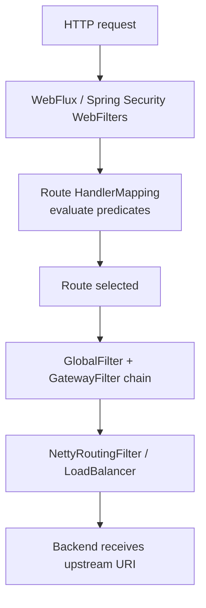

# Path bị mất đoạn, lặp tiền tố hoặc mã hóa sai sau rewrite
Một route của **Spring Cloud Gateway** có thể match đúng, backend vẫn healthy và Gateway vẫn trả HTTP response, nhưng URL tới backend lại sai. Ví dụ client gọi `GET /api/v1/orders/42` nhưng backend nhận `/orders/42` thay vì `/v1/orders/42`; một route khác lại gửi `/api/api/orders/42` do cả Ingress và Gateway cùng thêm tiền tố; hoặc path chứa dấu cách/Unicode/%2F bị encode hai lần thành `%252F`. Các lỗi này thường xuất hiện sau khi thay `StripPrefix`, `PrefixPath`, `SetPath`, `RewritePath`, context path hoặc cấu hình reverse proxy.

Bài này hướng dẫn chẩn đoán **path bị mất đoạn, lặp tiền tố hoặc mã hóa sai sau rewrite** trong **Spring Cloud Gateway Server WebFlux**. Hãy theo dõi cùng một request qua client → CDN/Ingress/reverse proxy → Spring WebFlux context path → route predicate → Gateway filter chain → Reactor Netty HTTP client → backend. Khi biết chính xác lớp nào đã thay đổi path, bạn có thể sửa đúng một nơi và tránh tạo thêm rewrite khác để che lỗi.

Trong module **SPRING_CLOUD_GATEWAY**, chủ đề này liên quan trực tiếp đến route predicates, filter chain, biến đổi đường dẫn/header, khám phá dịch vụ, xác thực, giới hạn lưu lượng, circuit breaker, retry, TLS và quan sát request. **Path rewrite là một phần của routing contract và security boundary**: thay đổi path có thể làm request đi nhầm resource, bỏ qua prefix bảo vệ hoặc thay đổi ý nghĩa authorization.

**Mục tiêu học tập:**

1. Phân biệt request target ban đầu, path sau Ingress, context path, path dùng để match route và URL upstream.
2. Chọn đúng `StripPrefix`, `PrefixPath`, `SetPath` hoặc `RewritePath`.
3. Tính số segment bị bỏ/thêm và thứ tự filters.
4. Chẩn đoán double prefix, missing segment, regex capture sai và trailing slash.
5. Hiểu raw path, decoded path, percent encoding, Unicode, encoded slash và double decoding.
6. Phân biệt path với query string, fragment và forwarded headers.
7. Xác định lỗi do reverse proxy, Gateway, LoadBalancer hay backend bằng request IDs và logs.
8. Viết integration tests dùng WebTestClient/WireMock để xác minh **path thực tế backend nhận được**.
9. Tránh path traversal, open redirect, authorization bypass và khác biệt canonicalization giữa các proxy.
10. Xây runbook phục hồi route/path config an toàn.

> **Phạm vi:** Ví dụ chính dùng **Spring Cloud Gateway Server WebFlux 5.x**, routes dưới `spring.cloud.gateway.server.webflux.routes`. Gateway WebFlux 4.x thường dùng prefix `spring.cloud.gateway.routes`. Gateway Server Web MVC dùng stack khác. Spring Framework, Reactor Netty, Ingress và backend server có thể khác nhau trong cách xử lý encoded slash, trailing slash và forwarded headers; cần test trên release train/hạ tầng thực tế. Đường dẫn trong bài là ví dụ lab.
## 1. Nhận diện ba triệu chứng chính

| Triệu chứng | Request client gửi | Backend nhận | Nghi ngờ đầu tiên |
| --- | --- | --- | --- |
| **Mất đoạn** | `/api/v1/orders/42` | `/orders/42` | `StripPrefix` bỏ quá nhiều segments |
| **Lặp tiền tố** | `/api/orders/42` | `/api/api/orders/42` | Ingress + Gateway cùng prepend/rewrite |
| **Mã hóa sai** | `/api/files/a%20b` | `/files/a%2520b` | Encode `%` lần thứ hai |
| **Sai vị trí tiền tố** | `/public/api/orders` | `/api/orders` hoặc `/public/public/api/orders` | Nhầm context path với route prefix |
| **Sai path variable** | `/api/orders/42` | `/orders/{id}` hoặc `/orders/` | `RewritePath` capture/replacement không đúng |
| **Trailing slash không khớp** | `/api/orders/42/` | `/orders/42` | Normalize slash không đồng nhất |
| **Encoded slash bị tách segment** | `/files/a%2Fb` | `/files/a/b` hoặc 400/404 | Proxy/server decode `%2F` |
| **Query bị mất** | `/api/search?q=a%20b` | `/search` | Custom filter thay URI mà bỏ query |
| **Route match sai** | `/api/admin/orders` | Backend public | Predicate overlap/order hoặc canonicalization |

**Đừng sửa ngay bằng cách thêm một `RewritePath` nữa.** Trước tiên hãy ghi nhận path ở từng boundary. Nếu Ingress đã bỏ `/api`, Gateway không nên tiếp tục bỏ thêm segment mà chưa xác minh contract.

## 2. Bản đồ path qua các lớp

Dùng một request minh họa:

```text
Client:
  GET https://edge.example.com/store/api/v1/orders/42?expand=items

Ingress:
  external prefix /store
  forwards /api/v1/orders/42?expand=items

Gateway WebFlux:
  base path: empty
  Path predicate: /api/v1/orders/**
  StripPrefix=1
  upstream: lb://orders-service

Backend receives:
  GET /v1/orders/42?expand=items
```

| Lớp | Ví dụ | Ý nghĩa |
| --- | --- | --- |
| External URL | `https://edge.example.com/store/api/v1/orders/42` | URL client nhìn thấy |
| Proxy forwarded URI | `/api/v1/orders/42` | Path proxy gửi Gateway sau rewrite |
| WebFlux application path | `/api/v1/orders/42` | Path trong application context |
| Route predicate | `Path=/api/v1/orders/**` | Điều kiện chọn route |
| Gateway filter output | `/v1/orders/42` | Path sau transformation |
| Upstream request URI | `http://orders-host/v1/orders/42` | URI Reactor Netty gửi |
| Backend request target | `/v1/orders/42?expand=items` | Path/query backend nhận |

Mỗi lớp có thể thêm, bỏ hoặc chuẩn hóa path. Với một request có correlation ID, thu thập request target client gửi, URI/forwarded headers tại Gateway ingress, Route ID/predicates match, path trước/sau custom filters, upstream URI và request target backend. Không log raw Authorization, cookies hoặc PII trong path.

## 3. Path, query và fragment là ba thành phần khác nhau

Một URI có dạng:

```text
scheme://authority/path?query#fragment
```

- **Path** xác định resource, ví dụ `/api/orders/42`.
- **Query** chứa tham số, ví dụ `?expand=items&page=2`.
- **Fragment** `#...` được client/browser xử lý; không gửi như một phần HTTP request target thông thường.

`StripPrefix`/`RewritePath` tác động path. Nếu custom code tạo URI mới từ path mà không giữ query, backend có thể mất `?page=2`.

Client gửi:

```http
GET /api/search?q=coffee%20shop&sort=price HTTP/1.1
Host: edge.example.com
```

Backend mong muốn:

```http
GET /search?q=coffee%20shop&sort=price HTTP/1.1
Host: search-service
```

Path prefix `/api` có thể được bỏ, nhưng query `q` và `sort` cần được bảo toàn. Kiểm tra query trong backend request journal, không chỉ path.
## 4. Route predicate match path nào?

Trong Gateway WebFlux, `Path` là một **Route Predicate Factory**. Nó đánh giá path trong ngữ cảnh WebFlux để quyết định route có phù hợp không. Predicate không tự rewrite path; nó chỉ chọn route.

```yaml
spring:
  cloud:
    gateway:
      server:
        webflux:
          routes:
            - id: orders-api
              uri: lb://orders-service
              predicates:
                - Path=/api/v1/orders/**
```

Route match namespace `/api/v1/orders/**` theo path matching của version Gateway/Spring Framework đang dùng. Nó không tự bỏ `/api/v1` trước khi gửi backend.

**Phân biệt:** “Request có match route không?” → predicates. “Backend nhận path gì?” → filters và upstream URI. Request match đúng nhưng backend nhận path sai là **rewrite/filter issue**, không nhất thiết predicate issue.

### Route order và overlap

Nếu nhiều routes cùng match một path, thứ tự route có thể ảnh hưởng route được chọn. Giá trị `order` thấp hơn có độ ưu tiên cao hơn. Tránh catch-all rộng match trước route cụ thể.

```yaml
spring:
  cloud:
    gateway:
      server:
        webflux:
          routes:
            - id: admin-orders
              order: -10
              uri: lb://admin-service
              predicates:
                - Path=/api/admin/**
            - id: public-api
              order: 0
              uri: lb://public-service
              predicates:
                - Path=/api/**
```

`/api/admin/orders` phải vào `admin-orders`. Nếu catch-all có order ưu tiên cao hơn, request có thể đi public backend và tạo lỗi bảo mật.

## 5. Gateway filter chạy sau khi route đã được chọn

Một request đi qua các bước khái quát:



**Route predicates chọn route trước filter chain.** GatewayFilter thông thường không sửa path rồi khiến route predicate được chạy lại. Nếu muốn route match dựa trên path chuẩn hóa, thiết kế normalization trước HandlerMapping hoặc ở proxy layer; đừng giả định GatewayFilter thay đổi route selection sau khi match.

Code trước `chain.filter(exchange)` thường là pre-phase; code trong `then(...)`/`doOnSuccess` có thể chạy ở post-phase. Filter order ảnh hưởng thứ tự. Với custom filters, xác minh thứ tự tương đối với `RouteToRequestUrlFilter`/LoadBalancer bằng debug logs và integration tests.

## 6. `StripPrefix`: bỏ số segment, không phải số ký tự

`StripPrefix=n` loại bỏ **n path segments đầu tiên** khỏi request path trước khi gửi upstream.

| Path trước filter | Filter | Path sau filter |
| --- | --- | --- |
| `/api/v1/orders/42` | `StripPrefix=1` | `/v1/orders/42` |
| `/api/v1/orders/42` | `StripPrefix=2` | `/orders/42` |
| `/api/v1/orders/42` | `StripPrefix=3` | `/42` |
| `/orders/42` | `StripPrefix=1` | `/42` |

Cấu hình:

```yaml
filters:
  - StripPrefix=1
```

Nếu public API là `/api/v1/orders/**` và backend controller map `/v1/orders/**`, bỏ một segment `api` là đúng. Nếu backend map `/orders/**`, cần bỏ hai segments `api` và `v1`.

Client gọi `/api/v1/orders/42`, backend log `/orders/42`, nhưng team muốn `/v1/orders/42`. Có thể route đang dùng `StripPrefix=2` trong khi chỉ cần `StripPrefix=1`. Điều chỉnh số segment theo contract public → backend, rồi test backend nhận đúng request target.

`StripPrefix` đếm segment theo path parser của Gateway. Với path có slash lặp, trailing slash hoặc encoded slash, cách phân đoạn có thể không giống suy đoán từ chuỗi raw. Tạo test vectors cho `/api/orders`, `/api/orders/`, `/api//orders/42` và `/api/files/a%2Fb`.

## 7. `PrefixPath`: thêm prefix vào đầu path

`PrefixPath=/prefix` thêm một path prefix vào request trước khi proxy.

```yaml
filters:
  - PrefixPath=/internal
```

| Path trước | PrefixPath | Path sau |
| --- | --- | --- |
| `/orders/42` | `/internal` | `/internal/orders/42` |
| `/v1/catalog` | `/api` | `/api/v1/catalog` |

Dùng khi backend có base path khác public API. Nếu Ingress đã thêm `/internal` hoặc application base path đã chứa prefix tương đương, Gateway có thể tạo `/internal/internal/orders/42`.

**PrefixPath không phải công cụ để sửa path bị mất đoạn một cách tùy tiện.** Trước khi thêm prefix, kiểm tra path backend mong muốn và những lớp đã prepend trước đó.

## 8. `SetPath`: đặt path theo template variables

`SetPath` thay path bằng URI template có thể dùng biến đã capture từ route predicate.

```yaml
spring:
  cloud:
    gateway:
      server:
        webflux:
          routes:
            - id: legacy-order-path
              uri: lb://orders-service
              predicates:
                - Path=/legacy/orders/{orderId}
              filters:
                - SetPath=/v1/orders/{orderId}
```

Request `/legacy/orders/42` được chuyển thành `/v1/orders/42` nếu path variable `orderId` được capture đúng.

Dùng `SetPath` khi public path và backend path có cấu trúc đơn giản, tương ứng rõ; muốn đổi prefix/version nhưng giữ variables; hoặc không cần regex rewrite phức tạp. Kiểm tra template variable có trong predicate, query parameters được giữ theo contract và không có SetPath chồng lên RewritePath/PrefixPath.

## 9. `RewritePath`: thay path bằng regular expression

`RewritePath` dùng Java regular expression để capture và tạo path mới.

```yaml
spring:
  cloud:
    gateway:
      server:
        webflux:
          routes:
            - id: rewrite-orders
              uri: lb://orders-service
              predicates:
                - Path=/api/**
              filters:
                - name: RewritePath
                  args:
                    regexp: "/api/(?<remaining>.*)"
                    replacement: "/<capture>"
```

Trong cấu hình thật, replacement tham chiếu capture group có cú pháp escape tùy property source; tài liệu Gateway minh họa việc escape dấu mở ngoặc nhọn để tránh Spring placeholder resolution. Kiểm tra giá trị bind thực tế trên YAML, environment variables, Java DSL hoặc Config Server; không tự thêm backslash vào runtime replacement mà chưa test.

Regex `/api/(?<remaining>.*)` capture phần sau `/api/`. Nếu path là `/api/orders/42`, remaining là `orders/42` và replacement mong muốn là `/orders/42`. Regex khác như `/api/(.*)/(.*)` có greedy group có thể lấy nhiều hơn dự kiến. Thử path ngắn, nhiều segments, trailing slash và encoded characters.

## 10. Chọn đúng filter: bảng quyết định

| Mục tiêu | Filter phù hợp | Ví dụ |
| --- | --- | --- |
| Bỏ N segment đầu | `StripPrefix=N` | `/api/v1/x` → `/v1/x` |
| Thêm prefix cố định | `PrefixPath=/internal` | `/x` → `/internal/x` |
| Thay toàn bộ path bằng template | `SetPath=/v1/orders/{id}` | `/legacy/{id}` → `/v1/orders/{id}` |
| Thay path theo regex/capture | `RewritePath` | `/api/(?<r>.*)` → phần capture |
| Thay query parameter | Query filter/custom query logic | Không dùng path rewrite |
| Đổi host/authority | URI/Host filter theo mục tiêu | Không nhầm với path |
| Đổi response Location | `RewriteLocationResponseHeader` | Không phải rewrite request path |
| Mô tả public prefix cho backend | Forwarded header policy | Không tự coi header là path rewrite |

**Ưu tiên filter đơn giản nhất có thể giải thích được.** Một route chỉ cần bỏ `/api` thì `StripPrefix=1` thường dễ review hơn một regex phức tạp. Một route cần đổi `/legacy/orders/{id}` sang `/v1/orders/{id}` có thể dùng `SetPath` dễ đọc hơn nhiều capture groups.
## 11. Lặp tiền tố: nguyên nhân từ nhiều lớp prepend

Ví dụ:

```text
External URL:
  /store/api/orders/42

Ingress:
  rewrite-target -> /api/orders/42

Gateway:
  PrefixPath=/api

Backend receives:
  /api/api/orders/42
```

Đội vận hành thấy `/api/api` và thêm `StripPrefix=1`. Nhưng nếu Ingress behavior sau đó đổi hoặc Gateway prefix được gỡ, lỗi lại xuất hiện.

### Cách điều tra

1. Xem Ingress rewrite annotation/config và đường dẫn upstream thực gửi.
2. Xem Gateway request path trước filter.
3. Kiểm tra route filter list: có `PrefixPath`/`SetPath`/`RewritePath` nào khác không?
4. Kiểm tra `spring.webflux.base-path` hoặc context path.
5. Kiểm tra backend controller/base path.
6. Vẽ mapping duy nhất **external → gateway → backend**.

### Cách sửa

Chọn một lớp làm owner cho mỗi biến đổi:

- Ingress: bỏ external prefix `/store` nếu đó là trách nhiệm của edge.
- Gateway: bỏ `/api` nếu public API có prefix nhưng backend không dùng.
- Backend: không tự thêm lại prefix nếu Gateway đã chuyển đúng path.

Không để cả Ingress và Gateway cùng sở hữu một phép rewrite mà không có contract.

## 12. Path bị mất đoạn: StripPrefix, regex hoặc base path

Ví dụ backend cần `/v1/orders/42` nhưng nhận `/orders/42`.

Kiểm tra lần lượt:

- `StripPrefix=2` có bỏ cả `api` và `v1` không?
- `RewritePath` có replacement bắt đầu bằng slash nhưng capture không gồm `v1` không?
- `SetPath` có dùng nhầm template `/orders/{id}` không?
- Ingress đã bỏ `/v1` trước khi Gateway match chưa?
- `spring.webflux.base-path` có được tính hai lần trong test/proxy?
- Custom GlobalFilter có mutate request URI thêm lần nữa không?

**Đừng cộng/trừ số segment cho tới khi biết path ở đúng boundary.** Nếu Gateway nhận `/orders/42` ngay từ Ingress, thì StripPrefix không phải nơi làm mất `v1`.

## 13. Trailing slash và slash lặp

Các path sau có thể không tương đương trong mọi proxy/server/framework:

```text
/api/orders
/api/orders/
/api//orders/42
/api/orders//42
```

Tùy path matcher và upstream server, trailing slash có thể được coi là cùng route hoặc route khác; slash lặp có thể được giữ, collapse hoặc bị reject. Đừng dựa vào behavior mặc định khi API contract yêu cầu chính xác.

### Quy tắc khuyến nghị

- Chọn một canonical form, ví dụ không có trailing slash ngoại trừ root.
- Quy định rõ slash lặp bị reject hay normalize.
- Nếu redirect canonical path, dùng status/method semantics phù hợp; không redirect POST tùy tiện.
- Không để proxy normalize trước nhưng Gateway normalize khác backend.
- Test cả path có/không trailing slash và encoded separators.

**Không dùng regex `/{2,}` thay thế path tùy tiện** nếu nó có thể làm thay đổi dữ liệu segment hoặc encoded slash. Normalize phải có hiểu biết URI và security policy.

## 14. Context path / base path không phải route prefix

Một số ứng dụng WebFlux chạy với base path, ví dụ `spring.webflux.base-path=/edge`. Khi đó public path và path trong application có thể khác nhau tùy request processing/config.

**Không nhầm:**

- `spring.webflux.base-path`: base path của ứng dụng WebFlux.
- `server.servlet.context-path`: property cho Servlet stack, không nên áp dụng máy móc vào WebFlux.
- `Path=/api/**`: predicate của Gateway route.
- `PrefixPath=/internal`: filter thêm path upstream.
- `X-Forwarded-Prefix`: header mô tả prefix ở proxy boundary; không mặc định là route rewrite.
- Ingress rewrite: thay request path trước khi request tới Gateway.

Nếu Gateway chạy dưới base path và route predicates cũng chứa base path, cần xác minh path mà HandlerMapping thực sự nhìn thấy trên version đang dùng. Đừng copy path external vào predicate rồi thêm một lần nữa mà chưa test.

Ví dụ cần kiểm chứng:

```yaml
spring:
  webflux:
    base-path: /edge
  cloud:
    gateway:
      server:
        webflux:
          routes:
            - id: orders
              uri: lb://orders-service
              predicates:
                - Path=/api/orders/**
```

Trong deployment thật, chạy request `/edge/api/orders/42` qua server và xác minh route có match như mong đợi. Nếu context path/prefix được xử lý ở ingress/forwarded transformer, kết quả có thể khác so với test không có proxy.

## 15. Forwarded headers không tự đồng nghĩa với rewrite path

Reverse proxy thường gửi:

```http
X-Forwarded-Proto: https
X-Forwarded-Host: edge.example.com
X-Forwarded-Port: 443
X-Forwarded-Prefix: /store
Forwarded: proto=https;host=edge.example.com
```

Các headers này có thể mô tả URL bên ngoài khi proxy đã thay đổi scheme/host/prefix. Nhưng **đừng mặc định `X-Forwarded-Prefix` làm Gateway tự bỏ hoặc thêm path theo ý bạn**. Behavior phụ thuộc vào:

- Proxy/Ingress có thực sự rewrite path không.
- Spring Framework forwarded-header handling có bật không.
- Gateway ForwardedHeadersFilter và cấu hình liên quan.
- Trusted proxy chain và thứ tự các proxies.
- Path/context path được tính ở thời điểm route matching.

**Bảo mật:** Không tin `X-Forwarded-*` do client Internet tự gửi. Proxy tin cậy phải xóa/ghi đè forwarded headers từ client trước khi thêm giá trị của nó; chỉ tin các hop nằm trong trust boundary.
## 16. Percent encoding: `%20` và `%2520` khác nhau

Trong URI:

- `%20` là percent-encoded space.
- `%2520` là ký tự `%` được encode thành `%25`, theo sau là `20`. Decode một lần sẽ thành chuỗi `%20`, chưa phải space.
- `%2F` là encoded slash.
- `%252F` là encoded literal `%2F` (double-encoded so với ý định biểu diễn slash).

Ví dụ client gửi:

```text
GET /api/files/my%20report.pdf
```

Backend mong đợi một path segment chứa tên `my report.pdf` (tùy framework decode). Nếu custom filter lấy raw encoded path rồi gọi encoder lần nữa, backend có thể thấy:

```text
/files/my%2520report.pdf
```

Đây là lỗi **encode hai lần**.

Quy tắc:

1. Phân biệt encoded URI representation với decoded application path.
2. Chỉ encode khi chuyển từ dữ liệu path segment thành URI component, không encode cả một URI đã encoded.
3. Không gọi `URLEncoder` cho path; `URLEncoder` dành cho form/query encoding và có semantics `+` khác.
4. Tránh decode thủ công rồi đưa chuỗi vào URI builder mà không chỉ định encoding mode.
5. Xác minh raw upstream request target trong WireMock/backend logs.

## 17. `URI.getRawPath()` và `URI.getPath()` không giống nhau

Java `java.net.URI` cung cấp:

- `getRawPath()`: path còn percent-encoded.
- `getPath()`: path đã percent-decoded theo URI parser.

Ví dụ:

```java
URI uri = URI.create("https://edge.example.com/files/a%20b");

System.out.println(uri.getRawPath()); // /files/a%20b
System.out.println(uri.getPath());    // /files/a b
```

Nếu code đọc `getPath()`, sau đó đưa giá trị vào API đang kỳ vọng raw encoded URI string và encode lại, dấu `%`/space có thể bị chuyển đổi thêm. Nếu code đọc `getRawPath()` rồi gọi encode whole-path, `%` có thể thành `%25`.

### Khi debug WebFlux

Ghi nhận các đại diện có mục đích khác nhau:

- `exchange.getRequest().getURI().getRawPath()`: raw URI path từ request URI.
- `exchange.getRequest().getURI().getPath()`: decoded URI path theo Java URI.
- `exchange.getRequest().getPath()`: Spring Framework RequestPath abstraction; inspect `value()` và các path elements theo API version.
- `exchange.getRequest().getPath().pathWithinApplication()`: phần path trong application context, nếu có context path.

**Đừng giả định tất cả các API trên trả cùng một chuỗi.** Spring Framework có thể parse context path/pathWithinApplication và decode path elements theo rules riêng. Khi log, ghi rõ tên field; không log một field rồi gọi chung là “raw path”.

## 18. Encoded slash `%2F`: ranh giới nhạy cảm

`%2F` có thể được xử lý khác nhau ở CDN, Ingress, Gateway HTTP server, Spring path parser và backend. Một số proxies/server có thể:

- Giữ nguyên `%2F` như một phần segment.
- Decode thành `/` trước route matching.
- Reject request vì encoded slash bị cấm.
- Chuyển thành path khác khi proxy tới upstream.

Ví dụ:

```text
/files/a%2Fb
```

Có thể được hiểu là **một segment** chứa slash encoded hoặc **hai segments** `a` và `b` tùy layer. Nếu authorization match `/files/{fileId}` nhưng backend decode thành `/files/a/b`, policy có thể bị bypass.

Hướng xử lý:

- Chỉ cho phép encoded slash nếu API contract thật sự cần.
- Đặt cùng policy ở CDN/Ingress/Gateway/backend.
- Test `%2F`, `%2f`, `%252F` và malformed percent encodings.
- Không decode path nhiều lần.
- Authorization nên dựa trên canonical resource identity và backend vẫn kiểm tra resource ownership.
- Với file/object IDs, cân nhắc base64url hoặc UUID thay vì nhúng slash vào một path segment.

**Không bật tùy chọn allow encoded slash trên server/proxy chỉ để sửa một 404** mà chưa phân tích security implications.

## 19. Unicode, dấu cách và normalization

Path có thể chứa Unicode:

```text
/api/customers/Nguyễn-Văn-A
/api/files/café menu.pdf
```

Trong HTTP request target, non-ASCII thường được percent-encode bằng UTF-8. Các chuỗi Unicode có thể có nhiều representation tương đương về hiển thị nhưng byte sequence khác nhau (ví dụ composed/decomposed accents).

Điều cần thống nhất:

- Client encode UTF-8.
- Proxy giữ encoded path theo contract.
- Gateway và backend dùng cùng quy tắc decode.
- Nếu business identity yêu cầu Unicode normalization (NFC/NFKC), thực hiện ở tầng domain có policy rõ; không normalize tùy tiện trong routing.
- Không log/so sánh raw byte path và normalized string như thể chúng luôn giống nhau.
- Test tiếng Việt có dấu, emoji nếu API cho phép, dấu cách và ký tự reserved.

**Không lowercase toàn bộ path** nếu resource IDs có phân biệt hoa/thường hoặc chữ ký URL phụ thuộc chính xác path.

## 20. Dấu `+`, `?`, `#`, `%` và reserved characters

Một số ký tự có semantics khác nhau tùy URI component:

| Ký tự | Trong path | Trong query/form | Rủi ro |
| --- | --- | --- | --- |
| Space | Phải percent-encode, thường `%20` | Form encoding có thể dùng `+` | `+` trong path không mặc định là space |
| `+` | Có thể là literal plus | Form decoder thường giải mã thành space | Dùng URLDecoder cho path có thể sai |
| `?` | Bắt đầu query nếu không encode | Dấu phân tách query | Dữ liệu path cần `%3F` |
| `#` | Bắt đầu fragment ở URI client, không gửi fragment | Không phải query separator thông thường | Dữ liệu path cần `%23` |
| `%` | Bắt đầu escape sequence | Bắt đầu escape sequence | `%` literal phải encode `%25` |
| `/` | Segment separator | Có thể là data trong query | `%2F` semantics khác nhau |
| `;` | Có thể tham gia path parameters tùy framework | Data | Parser khác nhau |
| `&`/`=` | Có thể là data trong path nếu encoded | Phân tách query key/value | Encode theo component |

### Lỗi thường gặp: URLDecoder cho path

```java
// SAI cho URI path: URLDecoder xử lý application/x-www-form-urlencoded,
// nên dấu '+' có thể biến thành space.
String path = java.net.URLDecoder.decode(
    rawPath, java.nio.charset.StandardCharsets.UTF_8);
```

Dùng API decode URI/path component đúng mục đích và theo một lần duy nhất. Không lấy một chuỗi chứa cả path/query rồi gọi form decoder.

## 21. Double decoding và path traversal

Một path có thể được decode ở nhiều lớp:

```text
Client sends:      /files/%252e%252e%252fsecret
Proxy decodes:     /files/%2e%2e%2fsecret
Backend decodes:   /files/../secret
```

Nếu Gateway kiểm tra path trước lần decode thứ hai, backend có thể nhìn thấy `..` và slash sau đó. Đây là **path traversal/canonicalization mismatch**, không chỉ là lỗi hiển thị.

Phòng chống:

- Không decode path nhiều lần ở nhiều lớp.
- Canonicalize và validate resource identifiers theo một contract duy nhất.
- Reject malformed percent escapes, dot segments hoặc encoded traversal theo policy.
- Dùng allowlist route patterns và backend authorization.
- Không nối chuỗi path từ user input rồi tin rằng Gateway predicate đã bảo vệ backend.
- Test `%2e`, `%2e%2e`, `%252e`, `%2f`, `%5c` và mixed-case encodings nếu hệ thống hỗ trợ.
- Đảm bảo file service/object storage không normalize path khác Gateway.

**Route predicate match đúng không chứng minh path an toàn.** Backend phải kiểm tra quyền trên resource cuối cùng sau mọi normalization mà nó thực hiện.
## 22. Không tự dựng URI bằng string concatenation

Anti-pattern:

```java
String target = "http://orders-service/api/" + userPath;
URI uri = URI.create(target);
```

Nếu `userPath` chứa `?`, `#`, `%`, `..` hoặc encoded slash, string concatenation có thể thay đổi authority/path/query semantics hoặc tạo URI sai.

Ưu tiên API URI builder phù hợp và phân biệt **path segment** với **whole path**:

```java
URI target = UriComponentsBuilder
    .fromUriString("http://orders-service")
    .pathSegment("api", "orders", orderId)
    .build()
    .encode()
    .toUri();
```

Ở đây `orderId` được đưa vào như một **segment**, để builder encode ký tự đặc biệt phù hợp. Nếu bạn đã có một URI hoàn chỉnh được encode đúng, không encode thêm lần nữa. URI builder API/encoding mode có thể khác theo Spring Framework version; test space, plus, Unicode, percent và slash, đồng thời reject slash nếu ID không được chứa slash.

## 23. Route rewrite và security authorization phải cùng canonical path

Một sai lầm nguy hiểm:

```text
Public request: /api/admin/users/42
Gateway route: Path=/api/**
RewritePath removes /api
Security rule checks only /admin/**
Backend sees /admin/users/42
```

Nếu security matcher và routing matcher dùng **hai path representations khác nhau**, có thể tạo bypass. Đặc biệt khi Ingress/Gateway/backend decode encoded separators hoặc normalize `..` khác nhau.

Bất biến bảo mật:

1. Authentication xảy ra trước route selection.
2. Authorization gắn với identity và resource, không chỉ raw prefix.
3. Route config không được làm lộ admin endpoints qua rewrite.
4. Gateway không tin forwarded path/header từ client chưa được proxy tin cậy.
5. Backend vẫn xác minh authorization theo canonical resource.
6. Test encoded path variants và slash normalization qua **toàn bộ chain**, không chỉ unit test predicate.

## 24. Kết hợp nhiều filters: tính thứ tự, không đoán

Một route có:

```yaml
filters:
  - PrefixPath=/internal
  - StripPrefix=1
  - name: RewritePath
    args:
      regexp: "/internal/orders/(?<id>.*)"
      replacement: "/<capture>"
```

Mỗi filter có thể đọc path đã bị filter trước thay đổi, nên thứ tự làm kết quả khác. Ví dụ logic:

```text
Initial path: /api/orders/42
PrefixPath=/internal:
  /internal/api/orders/42
StripPrefix=1:
  /api/orders/42
RewritePath=/api/orders/(?<id>.*) -> /orders/42
```

Đây là phép tính minh họa; hãy kiểm tra filter ordering và path representation thực tế của Gateway version. Thông thường có thể đạt cùng kết quả bằng **một filter rewrite đơn giản hơn**.

Khuyến nghị: một route nên có một canonical public path và một canonical backend path; hạn chế nhiều filter cùng mutate path; ghi rõ trước/sau từng filter trong test; xác minh custom GlobalFilter order so với built-in filters và `RouteToRequestUrlFilter`. Không dùng `@Order` tùy tiện chỉ để sửa path khi chưa xác định request URI được tạo ở phase nào.

## 25. Query string bị mất sau custom rewrite

Một custom filter có thể thay URI bằng path mới nhưng vô tình bỏ query:

```java
// Pseudocode minh họa lỗi: dựng URI chỉ từ path,
// không giữ query params gốc.
URI newUri = URI.create("http://orders-service" + rewrittenPath);
```

Nếu request ban đầu `/api/orders?q=abc&page=2`, backend chỉ nhận `/orders`. Để sửa:

- Giữ query component khi mutate URI, nếu contract yêu cầu.
- Dùng API builder có thể copy query params.
- Không tự nối query string từ raw text.
- Test query rỗng, nhiều values, encoded `&`, `=`, `+` và Unicode.
- Kiểm tra fragments không được chuyển như HTTP request target.

Với built-in `StripPrefix`/`RewritePath`, query thường được giữ theo behavior của Gateway filter; nhưng custom filters/URI mutation cần test riêng.

## 26. Path rewrite với service discovery và LoadBalancer

Khi route dùng `lb://orders-service`, path transformation vẫn xảy ra trước request được gửi tới backend instance. LoadBalancer chọn **host/port**; nó không quyết định bỏ prefix.

```yaml
spring:
  cloud:
    gateway:
      server:
        webflux:
          routes:
            - id: orders
              uri: lb://orders-service
              predicates:
                - Path=/api/v1/orders/**
              filters:
                - StripPrefix=1
```

Nếu backend instance A nhận `/v1/orders/42` nhưng instance B nhận `/orders/42`, nghi ngờ backend instances khác version/path mapping, sidecar rewrite riêng, Gateway config revision khác hoặc logs ghi path ở boundary khác nhau.

**Không sửa Gateway bằng random path rewrite theo instance** để che backend contract drift. Đảm bảo mọi instances trong một service ID tương thích cùng path contract hoặc tách service IDs/versions.

## 27. Phân biệt route URI path với request path

Route URI có thể có path component, ví dụ `http://orders-service/internal`. Gateway có thể kết hợp URI path với request path theo quy tắc của URI/filter pipeline. Điều này có thể tạo tiền tố thêm ngoài ý muốn.

```yaml
spring:
  cloud:
    gateway:
      server:
        webflux:
          routes:
            - id: orders-base-uri
              uri: http://orders-service/internal
              predicates:
                - Path=/api/orders/**
              filters:
                - StripPrefix=1
```

Đừng mặc định backend sẽ nhận `/internal/orders/42` hay `/internal/api/orders/42` chỉ bằng cách nối chuỗi. Kiểm tra route URI đã resolve, request URI sau filter chain và raw request target backend nhận được. Trong production nên ưu tiên route URI không có path base nếu có thể, rồi dùng một filter rõ ràng để xây backend path.

## 28. WebFlux base path và Servlet context path khác nhau

Nếu module chạy Gateway Server WebFlux:

- `spring.webflux.base-path` thuộc cấu hình WebFlux application.
- `server.servlet.context-path` là property cho Servlet stack, không nên áp dụng máy móc vào WebFlux Gateway.
- Gateway Server Web MVC dùng Servlet stack và có behavior context path khác.
- Reverse proxy có thể prepend/rewrite path trước cả hai.

Ví dụ cần kiểm chứng:

```yaml
spring:
  webflux:
    base-path: /edge
  cloud:
    gateway:
      server:
        webflux:
          routes:
            - id: orders
              uri: lb://orders-service
              predicates:
                - Path=/api/orders/**
```

Trong deployment thật, chạy request `/edge/api/orders/42` qua server và xác minh route có match như mong đợi. Nếu context path/prefix được xử lý ở ingress/forwarded transformer, kết quả có thể khác so với test không có proxy.

## 29. Forwarded prefix và public URL generation

Reverse proxy thường gửi:

```http
X-Forwarded-Proto: https
X-Forwarded-Host: edge.example.com
X-Forwarded-Port: 443
X-Forwarded-Prefix: /store
Forwarded: proto=https;host=edge.example.com
```

Các headers này có thể mô tả URL bên ngoài khi proxy đã thay đổi scheme/host/prefix. Nhưng **đừng mặc định `X-Forwarded-Prefix` làm Gateway tự bỏ hoặc thêm path theo ý bạn**. Behavior phụ thuộc proxy/Ingress rewrite, Spring forwarded-header handling, Gateway ForwardedHeadersFilter, trusted proxy chain và path/context path tại thời điểm route matching.

**Bảo mật:** Không tin `X-Forwarded-*` do client Internet tự gửi. Proxy tin cậy phải xóa/ghi đè forwarded headers từ client trước khi thêm giá trị của nó; chỉ tin các hop nằm trong trust boundary.

Có trường hợp backend tạo absolute URL trong response:

```http
Location: http://orders-service:8080/orders/42
```

Client bên ngoài cần:

```http
Location: https://edge.example.com/store/api/orders/42
```

Đây là **response Location header rewriting**, không phải request path rewrite. Gateway có `RewriteLocationResponseHeader` cho một số trường hợp. Kiểm tra backend tạo relative hay absolute Location; forwarded host/proto có trusted không; redirect giữ query không; host trong Location có thể bị user điều khiển không. Không trả internal hostname hoặc scheme `http` không an toàn ra Internet.

## 30. Quan sát path qua từng boundary

Một log chẩn đoán tốt nên có các field có tên rõ:

```text
requestId=...
gatewayPod=edge-gateway-7b8d...
routeId=orders-api
method=GET
requestUriRawPath=/api/v1/orders/42
requestUriDecodedPath=/api/v1/orders/42
contextPath=
pathWithinApplication=/api/v1/orders/42
upstreamService=orders-service
upstreamPath=/v1/orders/42
status=200
```

**Không bật full wiretap trong production vô thời hạn** nếu logs có thể chứa Authorization, Cookie, request body hoặc PII. Wiretap hữu ích trong lab/staging, nhưng cần redact và giới hạn thời gian.

Actuator/Gateway metrics thường có `routeId`, status, outcome và method; timer không nhất thiết có upstream path. Dùng logs/traces với request ID để biết path cụ thể. Tránh metric labels chứa raw path variable như order ID, tenant ID hoặc filename vì high cardinality và privacy.

Backend access log cần ghi request target/path mà server thật nhận được, cùng correlation ID được truyền qua Gateway. Nếu Gateway log upstream URI đúng nhưng backend log khác, kiểm tra service mesh/sidecar/ingress phía sau Gateway.

## 31. Debug logging và Actuator route inspection

Trong môi trường phát triển, có thể bật log có chọn lọc:

```yaml
logging:
  level:
    org.springframework.cloud.gateway: DEBUG
    org.springframework.web.reactive: DEBUG
```

Tên logger chi tiết có thể thay đổi theo version. Dùng logging để xác định route ID nào được match, filter chain nào áp dụng, URI/path được tạo trước routing và LoadBalancer chọn service instance nào.

**Actuator Gateway endpoint** (nếu được bật và có quyền):

- `GET /actuator/gateway/routes` để xem routes active.
- `GET /actuator/gateway/routes/{id}` để xem một route cụ thể.
- Route details có thể lộ URI/filter topology; bảo vệ management network.
- Production nên ưu tiên **read-only**; không public endpoint mutate routes.

Actuator route definition cho biết cấu hình; nó **không thay thế backend request log** để chứng minh path cuối cùng.
## 32. Test path rewrite với WebTestClient và WireMock

Unit test predicate/filter có thể hữu ích, nhưng lỗi path thường xuất hiện khi nhiều filters/URI components kết hợp. Hãy dùng integration test với:

- Spring Boot Gateway WebFlux chạy **real HTTP port**.
- WebTestClient gửi request qua listener.
- WireMock backend trên dynamic port.
- WireMock request journal xác minh **path/query** thực nhận.
- Một test qua Ingress/staging nếu production có proxy rewrite.

Cấu hình test route:

```yaml
spring:
  cloud:
    gateway:
      server:
        webflux:
          routes:
            - id: orders-strip-one
              uri: ${test.backend-url}
              predicates:
                - Path=/api/v1/orders/**
              filters:
                - StripPrefix=1
```

Với request `/api/v1/orders/42?expand=items`, backend kỳ vọng `/v1/orders/42?expand=items`.

Java integration test:

```java
import static com.github.tomakehurst.wiremock.client.WireMock.*;

import org.junit.jupiter.api.Test;

@Test
void stripOneSegmentAndPreserveQuery() {
    backend.stubFor(get(urlPathEqualTo("/v1/orders/42"))
        .withQueryParam("expand", equalTo("items"))
        .willReturn(aResponse()
            .withStatus(200)
            .withBody("{\"id\":42}")));

    webTestClient.get()
        .uri("/api/v1/orders/42?expand=items")
        .exchange()
        .expectStatus().isOk()
        .expectBody()
        .jsonPath("$.id").isEqualTo(42);

    backend.verify(1,
        getRequestedFor(urlPathEqualTo("/v1/orders/42"))
            .withQueryParam("expand", equalTo("items")));
}
```

Đây là **mảnh test** cần fixture SpringBootTest/WebTestClient/WireMock và `test.backend-url` dynamic property. Assertion quan trọng: backend nhận `/v1/orders/42`, không chỉ client nhận HTTP 200.

## 33. Test ma trận StripPrefix, PrefixPath, SetPath và RewritePath

Tạo các test độc lập, mỗi test một behavior:

| Test | Input path | Filter | Expected backend path |
| --- | --- | --- | --- |
| T01 | `/api/v1/orders/42` | `StripPrefix=1` | `/v1/orders/42` |
| T02 | `/api/v1/orders/42` | `StripPrefix=2` | `/orders/42` |
| T03 | `/orders/42` | `PrefixPath=/internal` | `/internal/orders/42` |
| T04 | `/legacy/orders/42` | `SetPath=/v1/orders/{id}` | `/v1/orders/42` |
| T05 | `/api/orders/42` | `RewritePath` capture remainder | `/orders/42` |
| T06 | `/api/api/orders/42` | No rewrite (diagnostic) | Giữ nguyên để xác định lớp đã thêm prefix |
| T07 | `/api/orders/42?x=1` | `StripPrefix=1` | `/orders/42?x=1` |
| T08 | `/api/files/a%20b` | Rewrite một lần | Không thành `%2520` |
| T09 | `/api/files/a%2Fb` | No decode/re-encode | Giữ hoặc reject theo policy |
| T10 | `/api/orders/42/` | Slash policy rõ | Expected canonical form |
| T11 | `/api//orders/42` | Reject/normalize theo policy | Không tạo route bypass |
| T12 | `/api/files/caf%C3%A9` | UTF-8 | Backend decode đúng `café` |
| T13 | `/api/search?q=a+b` | Path rewrite | Query semantics giữ nguyên |
| T14 | `/api/search?q=a%2Bb` | Path rewrite | Query value là literal `a+b` |
| T15 | `/api/files/%252e%252e%252fsecret` | Security policy | Reject nếu traversal encoding không được phép |

**Không so sánh chỉ response status.** Hai path khác nhau đều có thể trả 200 nhưng đọc nhầm resource. Assertion phải xem backend path, query, headers và resource identity.

## 34. Test percent encoding đúng tầng

WireMock APIs có thể hiển thị decoded URL/path tùy matcher; vì vậy test encoded path nên kiểm tra thêm **raw request target** ở backend fixture hoặc một HTTP server test ghi URI/raw URI. Không giả định `urlPathEqualTo` luôn giữ nguyên mọi percent-escape representation.

Các test cases nên gồm:

```text
/files/a%20b
/files/a%2520b
/files/a%2Fb
/files/a%252Fb
/files/a+b
/files/a%2Bb
/files/caf%C3%A9
/files/%2e%2e/secret
/files/%252e%252e%252fsecret
```

Expected behavior cần định nghĩa theo contract:

- Space là một ký tự trong segment.
- Literal `%20` trong tên file khác space.
- Encoded slash có thể bị reject.
- Plus trong path khác plus trong form query.
- Unicode được decode theo UTF-8 một lần.
- Traversal encoding bị reject hoặc xử lý an toàn.

Nếu HTTP client library tự normalize URI trước khi gửi, dùng **raw socket/test server** hoặc fixture thích hợp để xác minh bytes/request target; đừng kết luận Gateway encode sai từ một test client đã tự thay đổi URL.

## 35. Test route matching và filter ordering

Một bộ integration tests cần:

1. Route cụ thể `/api/admin/**` được chọn trước catch-all `/api/**`.
2. Route predicate match đúng external path sau ingress rewrite.
3. `StripPrefix` chỉ tác động sau khi route được chọn.
4. `PrefixPath` không khiến route khác match lại.
5. `RewritePath` capture đúng path variables.
6. GlobalFilter custom không mutate URI ngoài dự kiến.
7. Query string được bảo toàn.
8. LoadBalancer URI/path tới service đúng.
9. No-route trả response theo contract.
10. Security policy vẫn bảo vệ resource sau canonicalization.

**Nếu một custom GlobalFilter sửa path trước routing URI được tạo**, cần hiểu đúng filter order; đừng chỉ assert `getOrder()` mà không chạy request thật. Backend journal là nguồn bằng chứng tốt.

## 36. Test sau Ingress/reverse proxy

Local WebTestClient gọi trực tiếp Gateway **không tái hiện** các rewrite tại CDN/Ingress. Nếu production có path prefix:

```text
Client -> CDN -> Ingress -> Gateway -> backend
```

Hãy tạo một staging smoke test đi qua **đúng ingress host/TLS/listener**:

- Gửi external URL thực.
- Ghi Ingress request URI/upstream URI (nếu controller hỗ trợ).
- Ghi Gateway incoming raw path và route ID.
- Xác minh Gateway upstream path.
- Xác minh backend request target.
- Kiểm forwarded headers từ trusted proxy.
- Gửi path encoded/Unicode/trailing slash variants.

**Không để một staging ingress rewrite khác production** rồi dùng kết quả làm bằng chứng production behavior.

## 37. Troubleshooting: path mất đoạn

**Triệu chứng:** Backend nhận `/orders/42`, trong khi contract cần `/v1/orders/42`.

Điều tra:

1. Client gửi `/api/v1/orders/42` hay đã gửi `/api/orders/42`?
2. Ingress có bỏ `/v1` hoặc rewrite target không?
3. Gateway route predicate đang match path nào?
4. Có `StripPrefix=2` hay `RewritePath` capture bỏ v1?
5. `SetPath` có template thiếu `/v1`?
6. Route URI có base path khác không?
7. Backend access log xác nhận request target nào?

**Khắc phục:** chỉ điều chỉnh lớp đang làm mất segment. Viết regression test cho exact input → exact backend path.

## 38. Troubleshooting: path lặp tiền tố

**Triệu chứng:** Backend nhận `/api/api/orders/42`.

Điều tra:

1. Ingress rewrite có prepend `/api` không?
2. Gateway có `PrefixPath=/api`?
3. Gateway `RewritePath` replacement có prepend `/api`?
4. Backend/sidecar có thêm base path?
5. `spring.webflux.base-path` có được áp dụng cùng route prefix?
6. Có custom filter mutate request URI hai lần không?
7. Pod config drift khiến một pod dùng config mới, pod khác cũ?

**Khắc phục:** chọn một owner cho prefix; loại bỏ bước prepend trùng. Đừng thêm `StripPrefix=1` bừa bãi vì nó có thể bỏ nhầm segment hợp lệ khi ingress behavior thay đổi.
## 39. Troubleshooting: `%252F`, `%2520` hoặc Unicode sai

**Triệu chứng:** Backend nhận `%252F` thay vì `%2F` hoặc space; tên file tiếng Việt bị sai.

Điều tra:

1. Client đã percent-encode đúng UTF-8 chưa?
2. Proxy có decode rồi encode lại không?
3. Custom filter đọc `getPath()` hay `getRawPath()`?
4. URI builder có encode một URI đã encoded lần nữa không?
5. Có dùng `URLDecoder` cho path không?
6. Backend có decode thêm một lần?
7. Encoded slash policy của Ingress/server có khác nhau không?

**Khắc phục:** thống nhất một lần decode/encode theo component; không double-decode. Với encoded slash hoặc traversal, ưu tiên reject nếu không cần cho business.

## 40. Runbook: khoanh vùng lớp gây path rewrite sai

Khi production báo path sai:

**Bước 1 — Chọn request đại diện.** Lấy correlation ID, method, route, path đã redact; không lấy raw Authorization/Cookie.

**Bước 2 — Thu thập boundary evidence.** So client/edge, Ingress upstream URI, Gateway incoming path, route ID/filter config, upstream request URI và backend access log.

**Bước 3 — Phân loại.**

- Path mất segment → đếm StripPrefix/regex/SetPath.
- Prefix lặp → tìm mọi PrefixPath/Ingress/context path.
- Encoding sai → so raw/decoded, số lần decode/encode, encoded slash.
- Query mất → custom URI mutation không giữ query.
- Chỉ một pod lỗi → config drift/version mismatch.
- Chỉ một backend instance lỗi → backend versions/sidecar không đồng nhất.

**Bước 4 — Giảm tác động.** Nếu ảnh hưởng dữ liệu/security, đưa traffic về route/config last-known-good hoặc disable route bằng release có kiểm soát.

**Bước 5 — Sửa source-of-truth.** Cập nhật Git/config revision; không chỉ sửa thủ công trên một pod.

**Bước 6 — Regression test.** Thêm input path gây lỗi và assert exact backend path/query/headers.

**Bước 7 — Promote có gate.** Canary và theo dõi 404/5xx, p95, route IDs và backend access logs.

**Bước 8 — Kết thúc.** Xác minh mọi pods có cùng config, không còn manual override và có runbook mới.

## 41. Bài tập củng cố

### Bài 1 — StripPrefix

Client gọi `/api/v1/orders/42`. Backend cần `/v1/orders/42`. Dùng filter nào?

**Đáp án:** `StripPrefix=1` để bỏ segment `api`.

### Bài 2 — PrefixPath

Backend cần `/internal/orders/42`, public path là `/orders/42`.

**Đáp án:** `PrefixPath=/internal`, sau khi xác minh không có Ingress/base path nào đã thêm prefix đó.

### Bài 3 — Double prefix

Backend nhận `/api/api/orders/42`. Gateway có `PrefixPath=/api`.

**Đáp án:** Kiểm tra Ingress và application base path trước; nếu một lớp khác đã prepend `/api`, loại bỏ một owner thay vì thêm StripPrefix mù quáng.

### Bài 4 — RewritePath

Input `/api/orders/42`, regex `/api/(?<r>.*)`, replacement là path bắt đầu bằng slash và dùng capture group `r`.

**Đáp án:** Output mong muốn `/orders/42` nếu replacement binding được cấu hình/escape đúng trên property source đang dùng.

### Bài 5 — Raw và decoded path

`URI.getRawPath()` trả `/files/a%20b`; `URI.getPath()` trả `/files/a b`.

**Đáp án:** Hai representation khác nhau. Không encode lại decoded string như một URI raw nếu không muốn thay đổi encoding.

### Bài 6 — Plus sign

Một file tên `a+b.txt` được gửi trong path. Code dùng `URLDecoder.decode` và backend nhận `a b.txt`.

**Đáp án:** Dùng form decoder sai mục đích; `+` trong path không mặc định là space.

### Bài 7 — Encoded slash

`/files/a%2Fb` thành `/files/a/b` sau Ingress.

**Đáp án:** Proxy đã decode hoặc normalize encoded slash. Cần thống nhất policy và kiểm tra security, không chỉ sửa regex Gateway.

### Bài 8 — Route match đúng nhưng backend sai

Gateway Path predicate match `/api/v1/orders/**`, backend nhận `/orders/42`.

**Đáp án:** Điều tra post-match filters như StripPrefix/RewritePath/SetPath và URI path; predicate không tự rewrite.

### Bài 9 — Query biến mất

Custom filter thay path bằng URI mới, backend không nhận `?page=2`.

**Đáp án:** URI mutation không giữ query component; builder phải copy query params theo contract.

### Bài 10 — Một pod bị double prefix

Hai pods đúng, một pod sai.

**Đáp án:** So config revision, route cache, custom filter/image và ingress target mapping theo pod. Có thể là config drift hoặc rollout mixed version.

### Bài 11 — Security và path traversal

Client gửi `/files/%252e%252e%252fsecret`; proxy/backend decode nhiều lần.

**Đáp án:** Canonicalization mismatch có thể tạo path traversal. Reject malformed/traversal encodings, chỉ decode theo policy và backend kiểm tra resource ownership.

### Bài 12 — Weight và path rewrite

Route v1/v2 cùng Path predicate, một route thêm `PrefixPath=/v2`. Cùng client request đi hai backend paths khác nhau.

**Đáp án:** Đây là behavior theo route/version. Cần bảo đảm backend contract tương thích và test từng route; Weight chỉ chia request, không làm path giống nhau.

## 42. Checklist trước khi thay đổi path rewrite

- [ ] Vẽ mapping external URL → Ingress → Gateway → backend.
- [ ] Xác định ai sở hữu từng prefix/context path.
- [ ] Phân biệt Path predicate với filter rewrite.
- [ ] Tính StripPrefix theo **segment**, không theo ký tự.
- [ ] Dùng PrefixPath chỉ khi cần thêm prefix thật.
- [ ] Dùng SetPath cho template đơn giản, RewritePath cho regex cần thiết.
- [ ] Kiểm replacement placeholder escaping theo config source/version.
- [ ] Tránh nhiều path-mutating filters trên cùng route nếu không cần.
- [ ] Kiểm route order và catch-all overlap.
- [ ] Kiểm tra URI base path và context path.
- [ ] Kiểm forwarded headers chỉ từ trusted proxy.
- [ ] Giữ query string khi mutate URI.
- [ ] Test trailing slash và repeated slash.
- [ ] Test `%20`, `%2520`, `%2F`, `%252F`, `+`, `%2B`.
- [ ] Test UTF-8 Unicode tiếng Việt.
- [ ] Reject hoặc xử lý rõ dot-segment/path traversal encodings.
- [ ] Không dùng URLDecoder cho raw path.
- [ ] Không encode một URI đã encoded lần thứ hai.
- [ ] Không decode path ở nhiều layers.
- [ ] Xác minh backend request target, không chỉ Gateway response status.
- [ ] Dùng real HTTP integration test và staging qua Ingress.
- [ ] Test tất cả backend instances cùng service ID có path contract tương thích.
- [ ] Không log secrets/PII trong path/header.
- [ ] Có canary/rollback cho route config.
- [ ] Có regression test cho exact failing path và query.
- [ ] Xác minh effective routes/config revision trên mọi Gateway pods.

## Kết luận

Path bị mất đoạn, lặp tiền tố hoặc mã hóa sai sau rewrite thường xuất phát từ việc **nhiều lớp cùng thay đổi một URI mà không có contract rõ ràng**. Ingress có thể rewrite path, WebFlux có base path, Gateway route predicate chọn route, Gateway filters tiếp tục sửa path và backend lại decode/normalize theo quy tắc riêng. Chỉ nhìn URL client gửi hoặc HTTP status cuối cùng không đủ để tìm nguyên nhân.

Cách xử lý đáng tin cậy là **theo dõi request qua từng boundary**, phân biệt route matching với path transformation, hiểu rõ `StripPrefix` theo segment, `PrefixPath` thêm prefix, `SetPath` đặt template và `RewritePath` thay bằng regex. Khi có percent encoding, cần phân biệt raw path với decoded path, tránh double encode/decode, kiểm thử encoded slash/Unicode/traversal và giữ nguyên query string theo contract.

Cuối cùng, path là một phần của **security boundary**. Authorization, tenant ownership và backend resource checks phải dùng canonical resource identity; không để forwarded headers, raw cookies hoặc encoded separators thay đổi quyền truy cập. Hãy lưu regression tests xác minh **backend thực nhận path/query nào**, triển khai route config theo revision và theo dõi từng Gateway pod. Khi mỗi lớp có một trách nhiệm rõ ràng, việc sửa rewrite trở nên có thể kiểm chứng và không tạo thêm lỗi ở các microservices khác.

## Tài liệu tham khảo

- [Spring Cloud Gateway Server WebFlux — Route Predicate Factories](https://docs.spring.io/spring-cloud-gateway/reference/spring-cloud-gateway-server-webflux/request-predicates-factories.html)
- [Spring Cloud Gateway Server WebFlux — StripPrefix GatewayFilter](https://docs.spring.io/spring-cloud-gateway/reference/spring-cloud-gateway-server-webflux/gatewayfilter-factories/stripprefix-factory.html)
- [Spring Cloud Gateway Server WebFlux — PrefixPath GatewayFilter](https://docs.spring.io/spring-cloud-gateway/reference/spring-cloud-gateway-server-webflux/gatewayfilter-factories/prefixpath-factory.html)
- [Spring Cloud Gateway Server WebFlux — SetPath GatewayFilter](https://docs.spring.io/spring-cloud-gateway/reference/spring-cloud-gateway-server-webflux/gatewayfilter-factories/setpath-factory.html)
- [Spring Cloud Gateway Server WebFlux — RewritePath GatewayFilter](https://docs.spring.io/spring-cloud-gateway/reference/spring-cloud-gateway-server-webflux/gatewayfilter-factories/rewritepath-factory.html)
- [Spring Cloud Gateway Server WebFlux — How It Works](https://docs.spring.io/spring-cloud-gateway/reference/spring-cloud-gateway-server-webflux/how-it-works.html)
- [Spring Cloud Gateway Server WebFlux — Global Filters and Routing Filters](https://docs.spring.io/spring-cloud-gateway/reference/spring-cloud-gateway-server-webflux/global-filters.html)
- [Spring Framework — URI Components and UriComponentsBuilder](https://docs.spring.io/spring-framework/reference/web/webmvc/mvc-uri-building.html)
- [Java URI — Raw and Decoded Components](https://docs.oracle.com/en/java/javase/21/docs/api/java.base/java/net/URI.html)
- [Spring Framework — ForwardedHeaderTransformer](https://docs.spring.io/spring-framework/docs/current/javadoc-api/org/springframework/web/server/adapter/ForwardedHeaderTransformer.html)
- [Spring Boot — Forwarded Headers](https://docs.spring.io/spring-boot/reference/how-to/webserver.html)
- [OWASP — Path Traversal](https://owasp.org/www-community/attacks/Path_Traversal)
- [OWASP — Input Validation Cheat Sheet](https://cheatsheetseries.owasp.org/cheatsheets/Input_Validation_Cheat_Sheet.html)
- [OWASP — REST Security Cheat Sheet](https://cheatsheetseries.owasp.org/cheatsheets/REST_Security_Cheat_Sheet.html)
