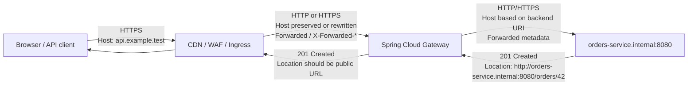

# Header Host, Forwarded hoặc Location không đúng sau proxy

**Chương:** Chẩn đoán sự cố  
**Module:** `SPRING_CLOUD_GATEWAY` — Xây dựng API Gateway bằng Spring Cloud Gateway qua route predicates, filter chain, biến đổi đường dẫn/header và khám phá dịch vụ; thực hành xác thực, giới hạn lưu lượng, circuit breaker, retry, TLS và quan sát request.

Một ứng dụng chạy trực tiếp có thể tạo redirect đúng và nhận diện đúng hostname, nhưng khi đặt sau CDN, load balancer, ingress và Spring Cloud Gateway, client lại thấy URL nội bộ, redirect sang HTTP, sai domain hoặc route theo nhầm tenant. Nguyên nhân thường nằm ở **ba loại thông tin khác nhau**:

- **`Host`**: authority của HTTP request hiện tại. Nó có thể dùng để chọn route, xác định virtual host và tạo URL.
- **`Forwarded` / `X-Forwarded-*`**: metadata mà các proxy dùng để mô tả request ban đầu (client, host, scheme, port, prefix) sau khi các hop làm thay đổi thông tin kết nối.
- **`Location`**: response header chỉ định URI mà client phải truy cập tiếp theo sau một redirect hoặc một số response khác.

Đây không phải ba tên gọi cho cùng một thứ. `Host` của request inbound có thể là `api.example.test`, nhưng HTTP client của Gateway thường đặt `Host` outbound theo URI backend như `orders.internal:8080`. `Forwarded` có thể giữ lại `host=api.example.test;proto=https`, trong khi `Location` của backend vẫn trỏ tới `http://orders.internal:8080/orders/42`. Muốn sửa đúng, cần biết **giá trị sai xuất hiện ở hop nào, được ai tạo và thành phần nào đang tiêu thụ nó**.

Bài này tập trung chẩn đoán:

1. Route `Host` predicate không match hoặc match nhầm domain.
2. Backend nhận `Host` nội bộ trong khi cần public host (hoặc ngược lại).
3. `Forwarded`/`X-Forwarded-Host`/`X-Forwarded-Proto` bị thiếu, lặp, sai thứ tự hoặc bị giả mạo.
4. Redirect `Location` lộ hostname/port/path nội bộ, sai HTTPS hoặc mất prefix.
5. URL tự sinh trong HTML/JSON/OpenAPI/OAuth2 callback không đúng sau proxy.
6. Hành vi khác nhau giữa Spring Cloud Gateway Server WebFlux và Server Web MVC, hoặc giữa các release train.

> **Phiên bản ví dụ:** YAML chính dùng **Spring Cloud Gateway Server WebFlux 5.1.0**, namespace `spring.cloud.gateway.server.webflux`. Dòng Gateway 4.x có một số prefix cũ hơn, ví dụ `spring.cloud.gateway.*`; Gateway Server Web MVC dùng `spring.cloud.gateway.server.webmvc.*` và HTTP stack/Java DSL khác. Một số trang MVC/API đang được tham chiếu trong tài liệu hiện công bố ở 5.0.3; hãy đối chiếu đúng phiên bản Boot/Cloud BOM của dự án trước khi chép cấu hình.

## 1. Sơ đồ đường đi của request và redirect

Giả sử client truy cập:

```text
https://api.example.test/api/orders/42
```

Hạ tầng có ba hop:



**Các thông tin thay đổi theo từng chặng:**

| Thuộc tính | Client gửi tới edge | Edge gửi tới Gateway | Gateway gửi tới backend |
|---|---|---|---|
| TCP peer/remote address | IP client hoặc proxy trước đó | IP của ingress/load balancer | IP của Gateway |
| Scheme kết nối thực | HTTPS | Có thể HTTP nội bộ hoặc HTTPS | Theo URI backend |
| `Host` | `api.example.test` | Có thể giữ public host hoặc đổi thành `gateway:8080` | Thường là authority của backend URI |
| `Forwarded` | Không nên tin nếu do client tự gửi | Ingress phải sanitize và tạo metadata tin cậy | Gateway có thể bổ sung metadata theo trusted-proxy policy |
| `X-Forwarded-*` | Không tin dữ liệu client tự khai | Ingress tạo giá trị canonical | Gateway có thể tạo/append theo cấu hình |
| `Location` | — | — | Backend tạo response header; Gateway có thể rewrite trước khi trả client |

### 1.1. Phân biệt ba hostname

Trong một request:

```text
Public authority:  api.example.test:443
Gateway listener:  gateway-7f9c:8080
Backend authority: orders-service.internal:8080
```

- **Public authority** là tên client mong muốn nhìn thấy.
- **Gateway listener** là địa chỉ mạng nội bộ nơi Gateway nhận request.
- **Backend authority** là địa chỉ mà HTTP client của Gateway dùng để kết nối upstream.

Ba giá trị có thể khác nhau hợp lệ. Đừng ép mọi `Host` phải bằng `api.example.test`: backend virtual host có thể cần `orders.internal`, trong khi redirect client phải dùng `api.example.test`.

### 1.2. Bốn nơi có thể tạo URL

1. **Ingress/CDN:** redirect HTTP → HTTPS, canonical domain, trailing slash, host rewrite.
2. **Gateway:** `RedirectTo`, `RewriteLocationResponseHeader`, custom filters, OAuth2 login redirects.
3. **Backend:** Spring MVC/WebFlux tự tạo absolute redirects, links, pagination URLs, form actions.
4. **Frontend/API documentation:** OpenAPI `servers`, Swagger UI, HTML/JSON links, absolute URLs được build từ config.

Nếu chỉ sửa `Location` ở Gateway, các URL absolute trong body vẫn có thể sai. Trước khi thay filter, xác định **response header hay response body** đang chứa URL không đúng.

## 2. Hiểu chính xác `Host`, `Forwarded`, `X-Forwarded-*` và `Location`

### 2.1. `Host` trong request

`Host` (hoặc pseudo-header `:authority` trong HTTP/2/HTTP/3) biểu thị authority của request target. Server dùng nó để phân biệt virtual hosts. Trong Spring Cloud Gateway, **Host Route Predicate** match header `Host` của request inbound:

```yaml
spring:
  cloud:
    gateway:
      server:
        webflux:
          routes:
            - id: public-api
              uri: lb://api-service
              predicates:
                - Host=api.example.test
                - Path=/api/**
```

Nếu ingress đổi Host thành `gateway.default.svc.cluster.local`, route trên có thể **không match**, dù client gửi `Host: api.example.test`. Ngược lại, nếu route dùng `Host=**.example.test` quá rộng, một host ngoài dự kiến có thể match. Cần xem chính xác header **Gateway nhận được**, không chỉ domain trong browser.

### 2.2. `Forwarded` chuẩn RFC 7239

Ví dụ:

```http
Forwarded: for=198.51.100.24;proto=https;host=api.example.test
```

Các tham số thường gặp:

- `for=`: client/proxy address của hop được mô tả.
- `proto=`: scheme ở phía trước proxy (ví dụ `https`).
- `host=`: authority public được nhìn thấy ở phía trước proxy.
- `by=`: proxy đã thêm/điều chỉnh phần tử này.

Một header có thể chứa nhiều phần tử, ví dụ:

```http
Forwarded: for=198.51.100.24;proto=https;host=api.example.test, for=10.10.0.12;proto=http;host=gateway.internal
```

**Không được lấy phần tử đầu tiên/cuối cùng một cách mù quáng.** Chuỗi phản ánh các proxy đã đi qua, nhưng client cũng có thể gửi một header giả trước khi đến proxy đầu tiên. Chỉ những hop mà hệ thống kiểm soát và xác minh được mới đáng tin.

### 2.3. Các header `X-Forwarded-*`

| Header | Thông tin thường mang |
|---|---|
| `X-Forwarded-For` | Địa chỉ client/proxy theo chuỗi |
| `X-Forwarded-Host` | Host/authority public ban đầu |
| `X-Forwarded-Port` | Port public |
| `X-Forwarded-Proto` | Scheme public (`http`/`https`) |
| `X-Forwarded-Prefix` | Prefix public đã bị proxy loại khỏi path |
| `X-Forwarded-Ssl` | Một số proxy cũ dùng để báo kết nối TLS |

`Forwarded` là chuẩn hóa trong RFC 7239; `X-Forwarded-*` là họ header de facto. Nhiều proxy hỗ trợ `X-Forwarded-*` rộng hơn, nhưng ứng dụng phải biết **đang tiêu thụ loại nào** và proxy nào tạo nó. Không cấu hình Spring đọc đồng thời các nguồn mâu thuẫn mà không có policy.

### 2.4. `Location` trong response

`Location` có thể chứa:

| Dạng | Ví dụ | Cách browser hiểu |
|---|---|---|
| Absolute URI | `https://api.example.test/orders/42` | Đi tới scheme + host + path chỉ định |
| Root-relative | `/orders/42` | Giữ scheme/host hiện tại |
| Path-relative | `orders/42` | Resolve tương đối URL hiện tại |
| Network-path reference | `//api.example.test/orders/42` | Giữ scheme hiện tại, đổi host |

Không phải mọi `Location` đều có hostname để rewrite. Một filter thay host có thể không tác động relative path; hãy test đúng dạng response backend đang trả.

**HTTP status cũng quan trọng:** `201 Created` có thể mang `Location` của resource mới; `301/302/303/307/308` dùng `Location` để redirect. Không sửa mọi `Location` thành URL trang chủ chỉ để bỏ lộ hostname — có thể làm sai contract REST hoặc redirect flow.

## 3. Bắt đầu chẩn đoán: xác định header sai ở hop nào

### 3.1. Bảng triệu chứng nhanh

| Triệu chứng | Kiểm tra đầu tiên | Nguyên nhân thường gặp |
|---|---|---|
| Host predicate không match | `Host` Gateway nhận ở ingress | Ingress thay Host bằng internal service name hoặc port khác |
| Tenant/domain bị chọn sai route | Host predicate + route order + wildcard | Wildcard quá rộng, client Host không được allowlist |
| Backend thấy Host nội bộ | Recorded request phía backend | HTTP client dùng authority của route URI; chưa bật PreserveHostHeader |
| Backend thấy Host public nhưng cần backend virtual host | Recorded request + backend config | Host inbound được preserve trong khi upstream cần Host riêng |
| `Forwarded` bị thiếu | Gateway `trusted-proxies`, remote peer, ingress output | Chưa trust proxy, filter không active hoặc ingress không tạo header |
| `X-Forwarded-Host` sai/lặp | Header tại edge/Gateway/backend | Ingress không reset, Gateway append, nhiều proxy cùng tạo header |
| Backend nghĩ request là HTTP | `Forwarded: proto` / `X-Forwarded-Proto` | TLS terminate tại edge nhưng scheme metadata không được chuyển đúng |
| Redirect lộ `*.internal` | Response `Location` từ backend và từ Gateway | Backend tự dựng URL theo internal Host/scheme |
| Redirect đổi sang HTTP | `Location` protocol + app forwarded handling | Backend không nhận proto HTTPS đáng tin |
| Redirect sai domain | `Location` host, Host inbound, hostValue | Rewrite dùng Host không được allowlist hoặc backend trả host nội bộ |
| Redirect mất `/api` prefix | `Location` path và `X-Forwarded-Prefix` | Gateway strip path nhưng backend không biết public prefix |
| Redirect có `/v2` thừa/thiếu | Version trong request path và response Location | Chọn sai `RewriteLocationResponseHeader` mode |
| OpenAPI/Swagger URL nội bộ | JSON body `servers`/HTML links | Backend không dùng forwarded metadata hoặc OpenAPI server URL hardcode |
| OAuth2 callback sai scheme/host | Redirect URI ở IdP và app | External base URL/proxy trust/callback registration lệch |
| Chỉ lỗi khi đi qua CDN | So sánh edge direct và CDN request | CDN thêm/ghi đè Host/Forwarded hoặc redirect riêng |

### 3.2. Ghi lại request tại ba điểm

Trong môi trường test, hãy lấy:

1. **Client → edge:** URL, scheme, Host và response Location client thực nhận.
2. **Edge → Gateway:** Host và toàn bộ Forwarded/X-Forwarded headers mà Gateway thực sự nhận, cùng remote socket address.
3. **Gateway → backend:** Host outbound, Forwarded/X-Forwarded headers, path và backend response Location.

Không ghi toàn bộ headers có cookie, Authorization, API key hoặc PII vào log production. Dùng một endpoint diagnostics chỉ trong môi trường lab, hoặc mock backend ghi **các trường đã chọn** và loại bỏ credentials.

Một bảng mẫu:

| Điểm đo | Host | Proto | Forwarded host | X-Forwarded-Host | Location |
|---|---|---|---|---|---|
| Client | `api.example.test` | https | — | — | — |
| Gateway inbound | `api.example.test` | http nội bộ | `api.example.test` | `api.example.test` | — |
| Backend inbound | `orders.internal` | http | `api.example.test` | `api.example.test` | `http://orders.internal:8080/orders/42` |
| Client response | `api.example.test` | https | — | — | `https://api.example.test/api/orders/42` |

Nếu Gateway inbound đã sai Host, đừng sửa response Location trước. Nếu Gateway inbound đúng nhưng backend thiếu forwarded metadata, kiểm tra `trusted-proxies` và `HttpHeadersFilters`. Nếu backend response đã đúng mà client thấy sai, kiểm tra filter response, ingress response rewriting và CDN.

### 3.3. Một request test có chủ đích

```bash
curl -i \
  -H "Host: api.example.test" \
  -H "X-Debug-Request: host-forwarded-lab" \
  https://gateway-test.example.test/api/orders/42
```

Ví dụ này dùng DNS/`--resolve`/TLS của môi trường test theo cấu hình thật nếu cần; chỉ đặt `Host` bằng `-H` **không đổi TLS SNI hoặc DNS target**. Khi test virtual host qua TLS, phải bảo đảm URL hostname, certificate/SNI và Host đều phù hợp. Không dùng Host tùy ý trên production để thử route nhạy cảm.

## 4. Lỗi `Host`: route predicate và outbound Host là hai việc riêng

### 4.1. Host Route Predicate đọc Host inbound

Ví dụ route:

```yaml
spring:
  cloud:
    gateway:
      server:
        webflux:
          routes:
            - id: tenant-api
              uri: lb://tenant-service
              predicates:
                - Host={tenant}.api.example.test
                - Path=/v1/**
```

Với request `Host: north.api.example.test`, Gateway có thể match và trích URI variable `tenant=north` để dùng trong filter. Nếu ingress đổi Host thành `gateway.namespace.svc.cluster.local`, predicate không còn thấy hostname public. **`Forwarded: host=...` không tự biến thành Host header cho Host predicate**: predicate match Host của request inbound theo docs.

Kiểm tra:

- Ingress có cấu hình giữ external Host (ví dụ Nginx `proxy_set_header Host $host;`) hay cố ý rewrite?
- CDN có gửi port trong Host không?
- Có nhiều `Host` headers/invalid authority bị từ chối ở edge không?
- Có trailing dot hoặc hostname case khác không?
- Route pattern có wildcard quá rộng hay match cả domain quản trị?
- Route order và predicates khác (Path/Method/Header) có cùng match không?

Gateway config property `spring.cloud.gateway.server.webflux.predicate.host.include-port` ảnh hưởng việc tính port khi match Host; **giá trị mặc định được ghi trong config reference là true** ở bản tham chiếu. Khi host có `:443` hoặc port test khác, hãy xác minh đúng behavior của version thay vì bỏ port theo suy đoán.

**Không dùng Host predicate như authentication.** Client có thể tự gửi Host theo request authority hợp lệ; một host match chỉ chọn route. Phải kiểm tra JWT/API key/mTLS/authorization riêng.

### 4.2. Host outbound mặc định thường theo backend URI

Giả sử route:

```yaml
routes:
  - id: orders
    uri: http://orders.internal:8080
    predicates:
      - Path=/api/orders/**
```

Request inbound có `Host: api.example.test`. Gateway HTTP client cần kết nối tới `orders.internal:8080`; outbound Host thường theo **authority của URI backend**, không tự giữ public Host. Đây là behavior hợp lý với nhiều microservices.

Nếu backend thực hiện virtual hosting theo public host, dùng filter `PreserveHostHeader`:

```yaml
filters:
  - PreserveHostHeader
```

Filter này đặt một request attribute để routing filter gửi **Host ban đầu** thay vì Host do HTTP client xác định. Dùng per-route và chỉ khi backend thật sự cần public host.

Nếu backend cần một Host **cố định khác**:

```yaml
filters:
  - name: SetRequestHostHeader
    args:
      host: orders.internal
```

`SetRequestHostHeader` thay Host bằng giá trị đã cấu hình. Đừng đặt cả `PreserveHostHeader` và `SetRequestHostHeader` trên cùng route rồi trông chờ kết quả ngẫu nhiên theo thứ tự; chọn một chính sách rõ ràng.

### 4.3. Host header không đổi DNS target hoặc TLS SNI theo cách bạn có thể giả định

Ba giá trị cần phân biệt:

| Giá trị | Điều khiển |
|---|---|
| Route URI `https://orders.internal:8443` | HTTP client resolve/connect tới backend authority và thường dùng hostname URI cho TLS peer/SNI verification |
| Outbound `Host: api.example.test` | HTTP virtual host/authority mà ứng dụng backend nhìn thấy |
| `Forwarded: host=api.example.test` | Metadata nói với backend public host ở hop trước |

`PreserveHostHeader` hoặc `SetRequestHostHeader` chủ yếu thay **HTTP Host**. Chúng không phải cách đổi DNS record, route URI hay certificate hostname/SNI. Nếu backend TLS certificate chỉ hợp lệ cho `orders.internal`, đổi HTTP Host sang `api.example.test` không tự sửa certificate verification. Kiểm tra TLS URI/hostname/certificate riêng.

### 4.4. Khi nào nên giữ, khi nào nên đặt Host?

| Backend | Chính sách phù hợp |
|---|---|
| Microservice đơn host, không dùng virtual hosting | Để Host theo backend URI |
| Legacy server chọn tenant theo public Host | `PreserveHostHeader` sau khi Host inbound được allowlist |
| Backend cần host canonical cố định | `SetRequestHostHeader` với host cấu hình tĩnh |
| Gateway route đến nhiều tenant bằng `lb://` | Giữ Host chỉ khi backend contract yêu cầu; không cho client chọn host nội bộ |
| Backend dựng redirects theo public URL | Ưu tiên trusted Forwarded metadata và external base URL; không chỉ dựa vào Host |

### 4.5. Test Host predicate và outbound Host

Mock backend nên trả lại **chỉ các trường an toàn**:

```json
{
  "receivedHost": "orders.internal",
  "forwardedHost": "api.example.test",
  "forwardedProto": "https",
  "path": "/orders/42"
}
```

Test tối thiểu:

1. `Host: api.example.test` match route dự kiến.
2. `Host: attacker.example` không match route public.
3. Ingress đã thay Host thành internal → test phát hiện Host predicate không match; sửa ingress hoặc route design.
4. Route không bật PreserveHostHeader → backend nhận Host theo URI.
5. Route bật PreserveHostHeader → backend nhận Host inbound đã được allowlist.
6. Route dùng SetRequestHostHeader → backend nhận host cố định.
7. TLS hostname validation vẫn đúng khi thay HTTP Host.

## 5. Lỗi `Forwarded`/`X-Forwarded-*`: tin nhầm proxy hoặc append sai chuỗi

### 5.1. Ranh giới tin cậy bắt đầu ở proxy đầu tiên

Một client độc hại có thể gửi:

```http
GET /api/orders HTTP/1.1
Host: api.example.test
Forwarded: for=127.0.0.1;proto=https;host=admin.internal
X-Forwarded-For: 127.0.0.1
X-Forwarded-Host: admin.internal
X-Forwarded-Proto: https
```

Nếu ingress giữ nguyên các headers này và chỉ append giá trị của nó, downstream có thể hiểu sai IP/host/scheme. Theo RFC 7239, `Forwarded` không thể mặc định tin là chính xác vì mỗi node trên đường đi, kể cả client, có thể sửa nó.

**Tại edge của trust boundary:**

1. Xóa cả `Forwarded` và toàn bộ `X-Forwarded-*` đến từ client bên ngoài (ít nhất những header mà hệ thống sử dụng).
2. Tạo lại metadata từ connection thực tế và cấu hình listener/host đã được kiểm tra.
3. Chỉ cho Gateway nhận kết nối từ ingress/load balancer được phê duyệt (network policy/firewall).
4. Gateway chỉ đánh dấu proxy address thực sự tin cậy trong `trusted-proxies`.
5. Downstream chỉ đọc forwarded headers theo đúng số proxy/hop tin cậy, không lấy tùy ý phần tử đầu tiên.

Nếu có CDN → WAF → ingress → Gateway, cần thiết kế chuỗi tin cậy theo từng hop. Không thể chỉ allowlist CDN nhưng quên WAF/ingress, hoặc để một service nội bộ bất kỳ tự gửi header rồi được tin.

### 5.2. Bật Forwarded/XForwarded Headers Filter trên Gateway WebFlux

Trong Spring Cloud Gateway Server WebFlux 5.x:

```yaml
spring:
  cloud:
    gateway:
      server:
        webflux:
          # Java regular expression: chỉ các ingress IP thuộc dải ví dụ này.
          trusted-proxies: "^10\\.20\\.0\\.[0-9]{1,3}$"
```

`trusted-proxies` là **Java regular expression**, không phải CIDR notation. Theo tài liệu Gateway, regex mô tả proxy addresses được tin cậy khi xuất hiện trong Forwarded/X-Forwarded processing; đây **không phải firewall rule** và không thay thế network allowlist cho TCP peer. Regex ví dụ dải private `10.20.0.x` chỉ minh họa cách escape dấu chấm; hãy đối chiếu đúng địa chỉ proxy mà implementation/version đang kiểm tra. Đặc biệt, `server.forward-headers-strategy` hoặc `ForwardedHeaderTransformer` có thể biến đổi remote address hiệu lực trước khi Gateway filter chạy; **không mặc định giá trị `request.getRemoteAddress()` luôn là raw socket peer**. Ghi lại cả raw peer và effective remote address trong môi trường test, rồi kiểm tra behavior của release đang dùng. **Không đặt `.*`** để tin mọi proxy.

Khi property này được thiết lập, Gateway có thể kích hoạt:

- `Forwarded Headers Filter`: tạo/append header `Forwarded` gồm Host, scheme, port của request hiện tại và metadata đã có.
- `XForwarded Headers Filter`: tạo các `X-Forwarded-*` dựa trên Host, scheme, port, path của request.

Các X-Forwarded components có các cờ bật/tắt riêng, mặc định true trong tài liệu 5.1.0:

```yaml
spring:
  cloud:
    gateway:
      server:
        webflux:
          x-forwarded:
            for-enabled: true
            host-enabled: true
            port-enabled: true
            proto-enabled: true
            prefix-enabled: true
            for-append: true
            host-append: true
            port-append: true
            proto-append: true
            prefix-append: true
```

**Không copy tất cả `true` một cách máy móc.** Nếu kiến trúc chỉ có một ingress edge đã sanitize và Gateway là proxy cuối trước backend, append có thể hữu ích cho chain. Nếu downstream chỉ hiểu một canonical value, hoặc đã có nhiều tầng tạo header, hãy quyết định append/replace rõ ràng. Đừng để các giá trị client tự khai được nối vào chain.

### 5.3. Đọc đúng `trusted-proxies`

Các lỗi cấu hình phổ biến:

| Cấu hình | Vấn đề |
|---|---|
| `trusted-proxies: ".*"` | Tin tất cả proxy/peer theo regex; mất ranh giới trust |
| `trusted-proxies: "10.20.0.0/16"` | Sai loại dữ liệu: property cần Java regex, không phải CIDR |
| `trusted-proxies: "10.20.*"` | Regex `.` có nghĩa ký tự bất kỳ, không phải dấu chấm literal; thiếu anchor |
| Chỉ allowlist IP public của CDN | Proxy address mà filter kiểm tra có thể là hop khác (ingress/WAF) hoặc đã bị forwarded-header processing biến đổi |
| Không có property | Forwarded/XForwarded filters không được kích hoạt theo tài liệu |
| Allowlist một IP pod động | Pod/replica đổi IP khiến header filter đột ngột không hoạt động |

Ghi lại cả **raw TCP peer** và **effective remote address** mà Gateway/filter nhìn thấy sau server forwarded-header processing; đối chiếu với các proxy addresses trong forwarded chain theo exact release. Dùng subnet/identity ổn định, network segmentation và mTLS để hạn chế ai được kết nối trực tiếp tới Gateway. `trusted-proxies` không thay firewall/network policy.

### 5.4. Vì sao header bị lặp?

Giả sử ingress gửi:

```http
X-Forwarded-For: 198.51.100.24
X-Forwarded-Host: api.example.test
X-Forwarded-Proto: https
```

Gateway append:

```http
X-Forwarded-For: 198.51.100.24, 10.20.0.15
X-Forwarded-Host: api.example.test, gateway.internal
X-Forwarded-Proto: https, http
```

Việc có nhiều giá trị **không nhất thiết là lỗi**: đó có thể là chuỗi proxy. Lỗi xảy ra khi downstream:

- Chọn nhầm giá trị đầu/cuối;
- Không biết bao nhiêu hop đáng tin;
- Dùng `X-Forwarded-Proto` đầu tiên trong khi proxy cuối đã thêm `http`;
- Dùng `X-Forwarded-Host` do client giả mạo ở đầu chuỗi;
- Kết hợp `Forwarded` với `X-Forwarded-*` nhưng mỗi loại mô tả một chuỗi khác nhau.

Hãy chọn **một chuẩn forwarded metadata chính** cho mỗi trust boundary và thống nhất cách parse ở downstream. Ở edge, reset client-supplied values; ở các hop nội bộ, append hoặc replace theo topology và policy.

### 5.5. Chẩn đoán scheme HTTP khi TLS terminate ở ingress

Luồng:

```text
Browser --HTTPS--> Ingress --HTTP--> Gateway --HTTP--> Backend
       public proto=https
```

Nếu Gateway chỉ nhìn socket nội bộ, scheme thực của request đến nó có thể là `http`. Để backend dựng URL public, Gateway phải nhận **proto=https** từ proxy tin cậy và gửi metadata đúng downstream. Kiểm tra:

1. Ingress có set `X-Forwarded-Proto: https` hoặc `Forwarded: proto=https`?
2. Ingress có xóa giá trị do client gửi trước khi set không?
3. Proxy address mà Gateway dùng trong trusted-proxy check có match `trusted-proxies` không? So sánh raw TCP peer với effective remote address sau Boot forwarded-header processing.
4. Gateway outbound request có `Forwarded`/`X-Forwarded-Proto` đúng không?
5. Backend có parse forwarded metadata không, hay vẫn dùng request scheme nội bộ?
6. Có một filter/proxy phía sau overwrite scheme về HTTP không?

**Không sửa bằng cách buộc mọi `Location` thành HTTPS nếu có các route nội bộ HTTP thực sự.** Cấu hình scheme public tại edge và external base URL theo app; dùng rewrite có kiểm soát cho những backend chưa thể hiểu forwarded metadata.

### 5.6. Spring Boot forwarded-header strategy khác Gateway HttpHeadersFilters

Có hai nơi dễ bị cấu hình chồng lấn:

| Cơ chế | Tác dụng |
|---|---|
| Gateway `HttpHeadersFilters` | Tạo/điều chỉnh metadata **trên outbound request gửi tới backend** |
| Spring Boot server forwarded-header strategy | Cho embedded server/framework hiểu scheme/host/port ban đầu khi xử lý request và dựng URL |
| Spring Framework `ForwardedHeaderFilter` (Servlet) | Wrap Servlet request để áp dụng forwarded metadata; có thể chạy ở `removeOnly` |
| Spring Framework `ForwardedHeaderTransformer` (Reactive) | Biến đổi reactive server request theo forwarded headers |

Với Boot, các bản có property `server.forward-headers-strategy` thường hỗ trợ `NONE`, `NATIVE` và `FRAMEWORK` (tên/property có thể thay đổi theo Boot release). `FRAMEWORK` dùng cơ chế Spring Framework; `NATIVE` dựa vào container/server. Với Gateway WebFlux, reactive tương ứng là `ForwardedHeaderTransformer`; với MVC/Servlet là `ForwardedHeaderFilter`.

**Không bật nhiều cơ chế cùng lúc mà chưa biết chúng đang tiêu thụ cùng một header hay không.** Có thể dẫn tới xử lý forwarded metadata hai lần, prefix/port sai hoặc một tầng đã remove header trước tầng khác. Khi Gateway vừa nhận request vừa tạo outbound headers, kiểm thử riêng:

1. Request URI/Host/scheme mà Gateway WebFlux handler nhìn thấy sau server processing.
2. Outbound `Forwarded`/`X-Forwarded-*` do Gateway HttpHeadersFilters tạo.
3. URL backend tự sinh và response `Location`.

Nếu chỉ cần Gateway **tạo metadata gửi backend**, tập trung vào `trusted-proxies` và Gateway HttpHeadersFilters. Nếu cần Gateway hoặc backend **tự dựng public absolute URLs**, chọn forwarded-header strategy phù hợp cho server/app và trust boundary. Đừng dùng `ForwardedHeaderFilter` `removeOnly` ở một tầng rồi kỳ vọng tầng sau còn đọc được headers đã bị remove.

### 5.7. Xác định ai đang ghi đè forwarded headers

Kiểm tra lần lượt:

| Hop | Câu hỏi |
|---|---|
| CDN | Có preserve Host? Có thêm X-Forwarded-For/Proto/Host? Có strip client-supplied values? |
| WAF/Ingress | Có append hay replace? Có đổi scheme/port? Có cấu hình external URL không? |
| Gateway inbound | Raw TCP peer và effective remote address là gì? Headers có giá trị trùng/đầu chuỗi đáng ngờ? |
| Gateway filters | `trusted-proxies` có match? `x-forwarded.*-enabled/append` có đúng policy? |
| Backend | Dùng RFC 7239 hay X-Forwarded? Chọn hop nào? Có Boot forwarded strategy khác không? |
| Egress proxy | Có xóa hoặc rewrite Forwarded/X-Forwarded trước khi trả client? |

Nếu Gateway và backend đều tạo forwarded metadata, không nên để cả hai **cùng thêm một hop không có chủ đích**. Vẽ lại topology, quyết định tầng nào canonicalize, tầng nào append, tầng nào consume/remove.

### 5.8. Kiểm tra CVE-2025-41235 trước khi điều tra forwarded headers

Spring đã công bố **CVE-2025-41235 — Spring Cloud Gateway Server Forwards Headers from Untrusted Proxies**, mức độ HIGH. Các dòng bị ảnh hưởng được advisory liệt kê:

| Dòng | Phiên bản bị ảnh hưởng | Phiên bản đã sửa |
|---|---|---|
| 4.2.x | 4.2.0–4.2.2 | 4.2.3 |
| 4.1.x | 4.1.0–4.1.7 | 4.1.8 |
| 4.0.x | 4.0.0–4.0.11 | 4.0.12 (Enterprise Support) |
| 3.1.x | 3.1.9 và cũ hơn | 3.1.10 (Enterprise Support) |

Advisory nói các forwarded-header functions được **tắt mặc định** trong các fixed versions. Nếu cần dùng chúng sau nâng cấp, khai báo `trusted-proxies` bằng Java regex chỉ cho proxy được tin cậy. Prefix ở dòng Gateway 4.x theo advisory là:

```yaml
# Gateway Server 4.x
spring:
  cloud:
    gateway:
      trusted-proxies: "^10\\.20\\.0\\.[0-9]{1,3}$"

# Gateway Server MVC 4.x
spring:
  cloud:
    gateway:
      mvc:
        trusted-proxies: "^10\\.20\\.0\\.[0-9]{1,3}$"
```

Ở Gateway 5.x, dùng namespace flavor hiện hành như `spring.cloud.gateway.server.webflux.trusted-proxies` hoặc `spring.cloud.gateway.server.webmvc.trusted-proxies` theo config reference. **Không copy prefix 4.x vào 5.x**.

Nếu chưa thể nâng cấp phiên bản bị ảnh hưởng, advisory nêu biện pháp giảm thiểu bằng cách tắt các forwarded filters tương ứng theo đúng starter/flavor/version; tuy nhiên, hãy ưu tiên nâng cấp bản đã sửa và chỉ giữ forwarded metadata nếu có trust policy rõ ràng. Không tắt filter rồi giả định backend vẫn biết public scheme/host — kiểm thử lại redirects, OAuth2 callbacks và absolute URLs.

Một lỗi Host/Forwarded sau proxy trên phiên bản bị ảnh hưởng có thể là **security issue**, không chỉ là cấu hình sai. Xác minh dependency tree/runtime artifact và bản patch trước khi bật lại forwarded header processing.

## 6. Sửa `Location` lộ backend hostname hoặc sai public host

### 6.1. Tái hiện lỗi phổ biến

Backend nhận request và trả:

```http
HTTP/1.1 201 Created
Location: http://orders-service.default.svc.cluster.local:8080/orders/42
Content-Type: application/json
```

Client bên ngoài không truy cập được Kubernetes service DNS. URL public cần là:

```http
HTTP/1.1 201 Created
Location: https://api.example.test/api/orders/42
```

Trước khi rewrite, kiểm tra backend **tại sao tạo Location nội bộ**:

- Backend dựng URL từ request scheme/Host của socket nội bộ?
- Backend hardcode service hostname/base URL?
- Ingress strip `/api` prefix nhưng backend không biết public prefix?
- Gateway đổi path bằng `StripPrefix`/`RewritePath` mà backend vẫn tạo location theo path nội bộ?

Sửa nguồn tạo URL (trusted forwarded metadata hoặc external base URL) thường bền vững hơn. Rewrite ở Gateway có thể là giải pháp tương thích cho legacy service, nhưng phải có test contract.

### 6.2. `RewriteLocationResponseHeader` của WebFlux

Spring Cloud Gateway Server WebFlux có filter:

```yaml
spring:
  cloud:
    gateway:
      server:
        webflux:
          routes:
            - id: orders-public
              uri: lb://orders-service
              predicates:
                - Host=api.example.test
                - Path=/api/orders/**
              filters:
                - StripPrefix=1
                - RewriteLocationResponseHeader=AS_IN_REQUEST, Location, api.example.test, https?
```

Filter `RewriteLocationResponseHeader` sửa giá trị response header `Location`, thường để bỏ chi tiết backend-specific. Các tham số:

1. `Mode`: cách strip version khỏi path.
2. `locationHeaderName`: header cần rewrite (thường `Location`).
3. `hostValue`: host:port mới; nếu bỏ trống, filter dùng Host của request.
4. `protocols`: regex protocol; default `https?|ftps?`, không match thì filter không làm gì.

Các mode:

| Mode | Ý nghĩa |
|---|---|
| `NEVER_STRIP` | Không strip version dù request path không có version |
| `AS_IN_REQUEST` | Chỉ strip version khi request path ban đầu không có version (default) |
| `ALWAYS_STRIP` | Luôn strip version khỏi Location |

Trong ví dụ, `api.example.test` là host public **cố định** cho route. Nếu có nhiều public domains, tạo route theo host đã allowlist hoặc thiết kế external-host mapping riêng; không cho một Host tùy ý từ client quyết định redirect domain. Nếu hostValue bỏ trống, filter dùng Host request header — an toàn chỉ khi inbound Host đã được kiểm soát.

### 6.3. Vì sao filter rewrite không sửa hết mọi URL?

`RewriteLocationResponseHeader` có phạm vi là **một response header**. Nó không tự sửa:

- Link absolute trong JSON body hoặc HTML;
- `Content-Location`, `Link`, `Refresh` hoặc header tự tạo khác;
- `Set-Cookie` Domain/Path;
- OAuth2 `redirect_uri` đã đăng ký ở IdP;
- URL trong email/message hoặc dữ liệu đã lưu trong database;
- Path prefix public bị strip (ví dụ `/api`) trong mọi trường hợp.

Nếu body JSON trả `{"self":"http://orders.internal/orders/42"}`, Location filter không thay đổi body. Sửa backend external URL generation hoặc một response transformation có schema rõ ràng; tránh regex thay chuỗi hostname trên mọi response body.

### 6.4. Host public động và nguy cơ Host-header injection

Khi `hostValue` để trống, filter dùng `Host` request. Nếu Gateway nhận:

```http
Host: attacker.example
```

và route wildcard vẫn match, response có thể bị rewrite thành:

```http
Location: https://attacker.example/orders/42
```

Đây là một dạng **host-header poisoning/open redirect** nếu ứng dụng hoặc filter phản chiếu host không tin cậy. Biện pháp:

- Allowlist public hosts ở ingress và Gateway.
- Host predicate cụ thể cho từng public domain.
- `hostValue` cố định theo route nếu chỉ có một canonical domain.
- Với multi-tenant, map tenant/domain qua cấu hình đáng tin; không phản chiếu Host bất kỳ.
- Test `Host: attacker.example`, `Host: api.example.test:443`, hostname có trailing dot và case variants.
- Không tạo absolute redirect dựa trên `X-Forwarded-Host` trước khi proxy chain được xác thực.

### 6.5. Protocol regex không phải công tắc ép HTTPS

Tham số `protocols` của filter là **regex để quyết định protocol nào được xử lý**. Nó không tự biến một `Location: http://...` thành `https://...` chỉ vì regex có chữ `https`. `hostValue` thay phần host:port; filter không thay toàn bộ public scheme policy.

Nếu backend trả `http://orders.internal/...` trong khi public endpoint là HTTPS:

1. Ưu tiên backend nhận `proto=https` đáng tin và tự tạo `https://api.example.test/...`.
2. Kiểm tra Gateway inbound scheme sau TLS termination và forwarded metadata.
3. Nếu cần rewrite legacy Location, test chính xác version/filter behavior và đảm bảo scheme public được xác định từ cấu hình đáng tin, không từ request header tự khai.
4. Không bật regex rộng rồi nghĩ rằng mọi scheme đã được sửa.

### 6.6. `RedirectTo` và query parameters

Gateway `RedirectTo` có thể tạo redirect cố định:

```yaml
filters:
  - RedirectTo=302, https://api.example.test/docs
```

Tham số `includeRequestParams` mặc định false. Nếu bật true, query parameters của request được nối vào Location:

```yaml
filters:
  - RedirectTo=302, https://api.example.test/docs, true
```

**Cẩn thận:** request query có thể chứa OAuth2 authorization code, reset token, email, search terms hoặc PII. Không bật `includeRequestParams=true` trên route chung nếu không có allowlist query parameters. `RedirectTo` dùng URL cấu hình; nó không phải công cụ rewrite response Location từ backend.

## 7. Prefix path: redirect đúng host nhưng vẫn sai đường dẫn

### 7.1. Public prefix bị strip

Ví dụ:

```text
Public request:   https://api.example.test/api/orders/42
Gateway strips:   /api
Backend receives: http://orders.internal/orders/42
Backend returns:  Location: /orders/43
Client follows:   https://api.example.test/orders/43
Expected:         https://api.example.test/api/orders/43
```

Host/scheme có thể đúng nhưng path prefix đã mất. `RewriteLocationResponseHeader` tập trung vào host và version strip; đừng kỳ vọng nó tự phục hồi prefix public `/api` cho mọi dạng Location.

### 7.2. Chuyển prefix cho backend

Gateway WebFlux có X-Forwarded Prefix component. Khi bật `trusted-proxies` và `x-forwarded.prefix-enabled`, filter có thể tạo `X-Forwarded-Prefix` từ path/prefix của request theo cấu hình. Backend cần thực sự hỗ trợ/consume prefix này để tạo links. Ví dụ:

```http
X-Forwarded-Prefix: /api
X-Forwarded-Proto: https
X-Forwarded-Host: api.example.test
```

Không gửi prefix nếu Gateway không strip prefix, nếu không backend có thể thêm `/api` hai lần. Xác minh path inbound, path sau filter, forwarded prefix outbound và backend path generation cùng lúc.

### 7.3. Boot/Spring Framework forwarded-prefix support

Spring Boot/Spring Framework có forwarded header support để ứng dụng biết URL gốc và tạo self-reference links. `X-Forwarded-Prefix` không được xử lý giống nhau ở mọi version/stack; một số cấu hình yêu cầu bật prefix support riêng. Với reactive stack, có thể dùng `ForwardedHeaderTransformer`; với Servlet stack, `ForwardedHeaderFilter`. Chọn một nơi consume prefix và test không double-prefix.

### 7.4. Test path prefix

| Request public | Gateway backend path | Forwarded prefix | Backend Location mong muốn |
|---|---|---|---|
| `/api/orders/42` | `/orders/42` | `/api` | `/api/orders/43` |
| `/orders/42` | `/orders/42` | Không có | `/orders/43` |
| `/gateway/v2/orders/42` | `/v2/orders/42` | `/gateway` | `/gateway/v2/orders/43` |

Nếu backend đã được cấu hình `context-path=/api` nhưng Gateway cũng gửi prefix `/api`, URL có thể thành `/api/api/...`. Đừng vừa cấu hình application base path, vừa dùng forwarded prefix mà không xác định ai sở hữu path prefix.

## 8. Kiểm thử Host, Forwarded và Location qua HTTP thật

Chẩn đoán chỉ bằng log cấu hình thường bỏ sót hành vi của HTTP client. Hãy dùng Gateway chạy thật trên port test và một mock backend (WireMock/MockWebServer) để quan sát **request đã được Gateway gửi đi**.

### 8.1. Tạo route lab

Ví dụ cấu hình WebFlux 5.x:

```yaml
spring:
  cloud:
    gateway:
      server:
        webflux:
          trusted-proxies: "^127\\.0\\.0\\.1$"
          routes:
            - id: host-forwarded-lab
              uri: ${test.backend.base-url}
              predicates:
                - Host=api.example.test
                - Path=/api/orders/**
                - Method=GET
              filters:
                - StripPrefix=1
                - PreserveHostHeader
                - RewriteLocationResponseHeader=AS_IN_REQUEST, Location, api.example.test, https?
```

`test.backend.base-url` là placeholder được test cung cấp từ mock server random port; không đưa literal này vào production config. Regex `127.0.0.1` chỉ dành cho test profile chạy trực tiếp qua loopback **khi effective remote address mà Gateway dùng trong trusted-proxy check thực sự là loopback**. Nếu `server.forward-headers-strategy`/`ForwardedHeaderTransformer` đã thay đổi remote address hiệu lực, giá trị kiểm tra có thể khác raw socket peer; hãy đo trên đúng version. Tốt hơn, với bài forwarded-chain, chạy một test ingress/proxy riêng và khai báo proxy address thực sự được filter đánh giá. Production phải hạn chế TCP peer bằng network policy/firewall riêng. `PreserveHostHeader` trong route này là **chủ ý của lab** để backend nhận public Host; nếu backend cần host riêng, thay bằng `SetRequestHostHeader` hoặc bỏ filter.

### 8.2. Backend mock trả response Location

WireMock stub minh họa:

```java
backend.stubFor(get(urlEqualTo("/orders/42"))
    .willReturn(aResponse()
        .withStatus(201)
        .withHeader("Location",
            "https://orders.internal:8443/orders/43")
        .withHeader("Content-Type", "application/json")
        .withBody("{\"id\":43}")));
```

Với route có `RewriteLocationResponseHeader` và `hostValue=api.example.test`, response header dự kiến sẽ dùng host public thay cho `orders.internal:8443`, còn scheme HTTPS vẫn là scheme có trong Location backend. **Không dùng backend Location HTTP nếu test mong HTTPS**, vì filter này thay host:port và xử lý version theo mode; nó không phải chính sách ép scheme.

### 8.3. Gọi Gateway với Host public

```java
client().get()
    .uri("/api/orders/42")
    .header("Host", "api.example.test")
    .exchange()
    .expectStatus().isCreated()
    .expectHeader().valueEquals(
        "Location", "https://api.example.test/orders/43");
```

Đây là **mảnh test method** dùng `WebTestClient.bindToServer()` tới Gateway port random. Vì route dùng `StripPrefix=1`, backend phải nhận `/orders/42`. Nếu route test có `Host` predicate mà test client gửi Host mặc định `localhost`, route không match; do đó header Host phải được đặt rõ.

### 8.4. Verify request phía backend

```java
backend.verify(1, getRequestedFor(urlEqualTo("/orders/42"))
    .withHeader("Host", equalTo("api.example.test")));
```

Nếu **không** dùng `PreserveHostHeader`, hãy đổi expected Host theo backend authority của route URI, không hardcode `api.example.test`. Nếu dùng `SetRequestHostHeader`, verify host cố định đã cấu hình. Không giả định ba trường Host inbound, Host outbound và Forwarded host giống nhau.

### 8.5. Kiểm tra Forwarded chain

Trong lab, mock backend có thể kiểm tra:

```java
backend.verify(1, getRequestedFor(urlEqualTo("/orders/42"))
    .withHeader("X-Forwarded-Host", containing("api.example.test"))
    .withHeader("X-Forwarded-Proto", containing("https")));
```

Đây là **assertion định hướng**: actual values phụ thuộc proxy address mà implementation/version dùng trong trusted-proxy check, `trusted-proxies`, XForwarded enable/append và liệu ingress simulation có chạy trước Gateway hay không. Nếu Boot forwarded-header handling đã biến đổi `request.getRemoteAddress()`, effective address có thể khác raw TCP peer. Khi test trực tiếp loopback, mô phỏng một proxy hop đã được trust hoặc dùng fixture đúng với stack; không giả định `Host` header tự tạo ra `X-Forwarded-Host`.

### 8.6. Test negative cases

| Test | Expected |
|---|---|
| `Host: api.example.test` | Route public match |
| `Host: attacker.example` | Không match route; không gọi backend |
| Client tự gửi `X-Forwarded-Host: admin.internal` | Edge test proxy phải strip và tạo lại giá trị canonical |
| Proxy address được dùng trong trusted-proxy check không match regex | Không được xử lý forwarded chain như đến từ proxy tin cậy theo policy |
| Backend Location là host nội bộ | Response được rewrite theo public host allowlist |
| Backend Location là relative path | Không kỳ vọng host rewrite; xác minh browser resolution |
| Backend Location có protocol ngoài regex | Filter không rewrite theo docs |
| Backend Location có prefix version | Test `NEVER_STRIP`/`AS_IN_REQUEST`/`ALWAYS_STRIP` đúng contract |
| Location có query string | Query không bị mất/nhân đôi và không mang secret |
| Host có port/case/trailing dot | Match theo policy public host đã định |

**Đếm downstream calls:** khi Host không match hoặc request bị từ chối ở edge, backend phải nhận 0 calls. Chỉ assert 404 phía client là chưa đủ vì backend cũng có thể trả 404 sau khi Gateway đã route nhầm.

## 9. Các URL khác cũng có thể sai sau proxy

### 9.1. OpenAPI `servers` và Swagger UI

OpenAPI document có thể chứa:

```yaml
servers:
  - url: http://orders-service.default.svc.cluster.local:8080
```

Browser tải Swagger UI qua public Gateway nhưng API `servers` lại trỏ tới Kubernetes service DNS. Cách xử lý:

- Cấu hình OpenAPI server URL bằng public base URL phù hợp môi trường; hoặc
- Đảm bảo backend/framework sinh URL dựa trên forwarded metadata đáng tin nếu thư viện hỗ trợ;
- Với nhiều public host, dùng allowlisted external URL mapping theo môi trường/tenant;
- Không tự thay mọi chuỗi `http://` trong JSON body vì có thể phá external callback/links khác.

Kiểm tra cả HTML, JSON OpenAPI, Swagger UI configuration và browser network tab. `Location` đúng không có nghĩa OpenAPI `servers` cũng đúng.

### 9.2. OAuth2/OIDC redirect URI

OAuth2 login thường có redirect tới IdP và callback về Gateway. Khi Gateway chạy sau TLS-terminating ingress:

- Gateway có thể nghĩ scheme là HTTP nội bộ và tạo redirect URI `http://gateway.internal/login/oauth2/code/...`.
- IdP chỉ đăng ký `https://api.example.test/login/oauth2/code/...`, nên trả redirect URI mismatch.
- Host/port public bị sai nếu forwarded metadata không được trust hoặc callback base URL hardcode.

Kiểm tra:

1. Callback URI đăng ký ở IdP.
2. Redirect URI mà Gateway thực sự gửi đến IdP (chỉ log sanitized URL, không authorization code/state).
3. Host/proto/port mà Spring Security/OAuth2 Client nhìn thấy.
4. Ingress strip prefix hoặc rewrite path có làm callback URI khác không?
5. Cookie/session SameSite và CSRF có cho phép callback flow không?

Không giải quyết redirect mismatch bằng cách cho IdP wildcard `http://*` hoặc cho phép mọi redirect host. Redirect URI phải được allowlist và khớp public URL chính xác.

### 9.3. `Set-Cookie` Domain/Path cũng có thể sai

Backend trả:

```http
Set-Cookie: SESSION=opaque; Domain=orders.internal; Path=/orders; Secure; HttpOnly
```

Browser truy cập public domain `api.example.test` có thể bỏ cookie vì Domain không phù hợp. `RewriteLocationResponseHeader` **không** sửa `Set-Cookie`. Cần:

- Cấu hình backend cookie domain/path phù hợp với public origin, nếu backend thực sự sở hữu cookie;
- Dùng BFF/session cookie tại Gateway thay vì để mọi backend đặt cookie;
- Dùng response cookie rewriting có chủ đích nếu release có filter hỗ trợ và contract rõ;
- Không mở rộng Domain thành `.example.test` chỉ để “cookie chạy được” khi chưa đánh giá subdomain trust.

Với path prefix bị strip, cookie Path cũng cần kiểm tra. Một cookie `Path=/orders` sẽ không tự gửi cho URL `/api/orders` nếu browser path không match; cân nhắc public path contract.

### 9.4. `Content-Location`, `Link`, `Refresh` và HTML/JSON

Backend có thể phát:

```http
Link: <http://orders.internal:8080/orders?page=2>; rel="next"
Content-Location: http://orders.internal:8080/orders/42
Refresh: 0; url=http://orders.internal:8080/login
```

Gateway không tự rewrite các headers này chỉ vì `Location` đã được xử lý. Xác định header nào là một phần API contract, sau đó cấu hình backend external URL hoặc custom response mapping **chỉ cho header/format được cho phép**. Đặc biệt `Refresh` có thể tạo redirect phía browser nhưng ít được kiểm thử.

### 9.5. Không sửa URL bằng replace toàn bộ response body

Một custom filter thay `orders.internal` thành `api.example.test` trong mọi response text có thể:

- Thay dữ liệu nghiệp vụ mà client cần giữ nguyên;
- Phá chữ ký/HMAC hoặc content length;
- Làm sai JSON escaping/Unicode/compression;
- Thay hostname trong nội dung người dùng nhập;
- Thêm redirect/link không được allowlist.

Nếu buộc phải sửa body, chỉ xử lý content type/schema cụ thể, giới hạn kích thước, parse/serialize đúng định dạng, xử lý compression/streaming và viết tests cho mọi fields được phép đổi. Ưu tiên external base URL configuration ở backend.

## 10. Gateway Server Web MVC: cùng mục tiêu, khác cấu hình

Gateway Server Web MVC dùng Servlet/WebMvc.fn và HTTP client khác WebFlux. Các nguyên tắc Host/Forwarded/Location vẫn giống nhau, nhưng property namespace và Java DSL/filter APIs phải theo đúng flavor.

### 10.1. Namespace `trusted-proxies`

Với Server Web MVC 5.x:

```yaml
spring:
  cloud:
    gateway:
      server:
        webmvc:
          trusted-proxies: "^10\\.20\\.0\\.[0-9]{1,3}$"
```

Các HttpHeadersFilters của MVC cũng có Forwarded và XForwarded filters, cùng các cờ tạo/append header. Đối chiếu đúng property namespace:

| Flavor | Prefix |
|---|---|
| Server WebFlux 5.x | `spring.cloud.gateway.server.webflux.*` |
| Server Web MVC 5.x | `spring.cloud.gateway.server.webmvc.*` |
| Một số dòng Gateway 4.x | Prefix cũ theo reference 4.x; không tự thêm `server.*` |

Không đặt `spring.cloud.gateway.server.webflux.trusted-proxies` trong ứng dụng MVC rồi kết luận filter không hoạt động. Tương tự, đừng copy XForwarded properties giữa hai flavor mà không xem config reference.

### 10.2. Preserve/Set Host trong MVC

MVC có filter `PreserveHostHeader` và `SetRequestHostHeader` tương ứng. Java DSL WebMvc.fn minh họa:

```java
import static org.springframework.cloud.gateway.server.mvc.filter.BeforeFilterFunctions.preserveHostHeader;
import static org.springframework.cloud.gateway.server.mvc.filter.BeforeFilterFunctions.uri;
import static org.springframework.cloud.gateway.server.mvc.handler.GatewayRouterFunctions.route;
import static org.springframework.cloud.gateway.server.mvc.handler.HandlerFunctions.http;

@Bean
RouterFunction<ServerResponse> preserveHostRoute() {
    return route("preserve-host")
        .GET("/**", http())
        .before(uri("https://orders.internal"))
        .before(preserveHostHeader())
        .build();
}
```

Đây là mảnh Java DSL cho MVC; cần imports đầy đủ và dependency Gateway Server Web MVC. Nếu cần host cố định, dùng `BeforeFilterFunctions.setRequestHostHeader("orders.internal")` theo tài liệu MVC; filter này thay Host header bằng giá trị chỉ định. Không dùng Java API WebFlux `GatewayFilterFactory` trong MVC.

### 10.3. Rewrite Location trong MVC

Gateway Server Web MVC cũng có filter `RewriteLocationResponseHeader`, với mode, header name, host value và protocol regex tương tự:

```yaml
spring:
  cloud:
    gateway:
      server:
        webmvc:
          routes:
            - id: mvc-orders
              uri: http://orders.internal:8080
              predicates:
                - Path=/api/orders/**
              filters:
                - RewriteLocationResponseHeader=AS_IN_REQUEST, Location, api.example.test, https?
```

MVC Java DSL dùng `RewriteLocationResponseHeaderFilterFunctions.rewriteLocationResponseHeader(...)` và `.after(...)` theo API của version; không copy static imports WebFlux. Ví dụ tài liệu MVC dùng `config.setLocationHeaderName("Location")` và `config.setStripVersion(StripVersion.AS_IN_REQUEST)`. Kiểm tra docs của exact patch release để biết các builder options.

### 10.4. Boot forwarded strategy và Servlet filters

Trong Servlet stack, `ForwardedHeaderFilter` là Servlet Filter; nó wrap request để ứng dụng nhìn scheme/host/port đã được khôi phục và có thể remove forwarded headers khỏi request sau khi sử dụng. Filter cần được đặt đúng thứ tự so với các filters đọc request URL. Nếu dùng `server.forward-headers-strategy=FRAMEWORK`, Spring Boot có thể tự cấu hình framework support; không đăng ký thêm filter thủ công mà không kiểm tra duplicate processing.

Trong reactive stack, thành phần tương ứng là `ForwardedHeaderTransformer`, không phải Servlet Filter. Gateway WebFlux HttpHeadersFilters vẫn là bước tạo outbound forwarded metadata riêng.

## 11. Ví dụ cấu hình edge proxy và các bẫy phổ biến

### 11.1. Nginx ở trust boundary đầu tiên

Một ví dụ khái niệm khi **Nginx là proxy đầu tiên nhìn thấy client thật**:

```nginx
location / {
    proxy_pass http://gateway_upstream;

    # Giữ public authority để Host predicate có thể match.
    proxy_set_header Host $host;

    # Ghi đè forwarded metadata do client có thể tự gửi.
    proxy_set_header Forwarded "";
    proxy_set_header X-Forwarded-For $remote_addr;
    proxy_set_header X-Forwarded-Host $host;
    proxy_set_header X-Forwarded-Proto $scheme;
    proxy_set_header X-Forwarded-Port $server_port;
}
```

Đây là ví dụ **chỉ khi Nginx là edge trực tiếp** và `$remote_addr` là địa chỉ client cần ghi nhận. Nếu trước Nginx có CDN/load balancer, phải cấu hình trust/real-IP cho đúng upstream trước khi dùng `$remote_addr`; không dùng `$proxy_add_x_forwarded_for` một cách mù quáng vì nó có thể giữ giá trị X-Forwarded-For do client tự gửi. Cũng cần cấu hình ingress/network chỉ cho Gateway nhận traffic từ Nginx.

**Phân biệt hai lớp trust:** network policy/firewall giới hạn TCP peer nào được kết nối tới Gateway; `trusted-proxies` điều khiển cách Gateway xử lý forwarded metadata theo proxy address mà implementation/version dùng trong trusted-proxy check. Đừng mặc định hai lớp này kiểm tra cùng một giá trị. Boot forwarded-header strategy/`ForwardedHeaderTransformer` có thể biến đổi remote address hiệu lực; kiểm tra raw peer và effective address trong test triển khai.

Nếu Nginx strip prefix `/api`, cần thống nhất có gửi `X-Forwarded-Prefix: /api` hay backend được cấu hình external base path riêng. Không vừa giữ path `/api`, vừa báo prefix `/api` nếu backend sẽ prepend prefix thêm lần nữa.

### 11.2. Một proxy không nhất thiết biết public scheme

Nếu CDN terminate TLS và gọi Nginx qua HTTP, Nginx `$scheme` có thể là `http` mặc dù client dùng HTTPS. Trong topology này, Nginx chỉ được dùng scheme từ CDN khi:

- CDN là upstream tin cậy và kết nối giữa CDN → Nginx được bảo vệ;
- CDN xóa giá trị do client gửi và đặt canonical scheme header;
- Nginx kiểm tra nguồn gửi header theo network/identity policy.

Không đặt `X-Forwarded-Proto $scheme` ở một hop phía sau TLS termination rồi giả định nó luôn là public scheme.

### 11.3. Các lỗi cấu hình edge thường gặp

| Cấu hình/lỗi | Hệ quả |
|---|---|
| Ingress gửi `Host $proxy_host` thay vì public `$host` | Host predicate không match, backend thấy Host nội bộ |
| `Forwarded` client không bị xóa | Attacker có thể giả public host/proto/client IP |
| `X-Forwarded-For` append raw client header | IP spoofing nếu downstream chọn nhầm phần tử |
| Gateway `trusted-proxies` quá rộng | Proxy không tin cậy được xem là trusted |
| Backend đọc first value | Backend dùng dữ liệu cũ/giả |
| Backend không dùng forwarded scheme | Redirect tuyệt đối thành HTTP |
| `Location` filter dùng request Host không allowlist | Host-header poisoning/open redirect |
| HostValue đặt nhầm backend host | Client bị redirect về internal host |
| Prefix bị strip nhưng không thông báo backend | Redirect/API links mất public prefix |
| Rewrite body bằng regex | JSON/signature/content length bị hỏng |

### 11.4. Không để forwarded headers quyết định quyền truy cập

Không dùng `X-Forwarded-For`/`Forwarded` một mình làm bằng chứng authentication, tenant membership hoặc quyền admin. Remote IP có thể hỗ trợ rate limiting/abuse detection sau khi xác định trust chain; nó không thay JWT, mTLS, API key verification hay authorization.

Tương tự, `X-Forwarded-Host` không phải tenant identity đã xác minh. Nếu multi-tenant route dựa trên host, validate domain ownership/tenant mapping ở control plane và kiểm tra authorization sau khi route match.

## 12. Bảng xử lý lỗi theo tầng

| Hiện tượng | Nguyên nhân có khả năng | Cách xử lý |
|---|---|---|
| Route Host không match sau ingress | Ingress thay public Host bằng upstream host | Preserve/normalize Host tại ingress hoặc thay route design; verify Host Gateway nhận |
| Host predicate match sai tenant | Wildcard quá rộng hoặc host chưa allowlist | Host-specific routes, canonical hostname mapping và authorization theo tenant |
| Backend nhận Host public ngoài ý muốn | `PreserveHostHeader` được bật toàn cục hoặc route dùng nhầm | Chỉ bật per-route; bỏ filter hoặc đặt `SetRequestHostHeader` cho backend |
| Backend cần public Host nhưng nhận internal | HTTP client dùng host của route URI | Bật `PreserveHostHeader` sau khi validate inbound Host |
| Backend virtual host không chọn được app | Host header và backend URI/virtual host lệch | Verify `Host` outbound; nếu cần đặt Host cố định, giữ TLS URI/SNI riêng |
| Forwarded filter không tạo header | Proxy address được dùng trong trusted-proxy check không match regex hoặc forwarded filter không active | Đo raw peer và effective remote address; xác minh đúng version/property và không dùng `.*` |
| Forwarded có Host nội bộ | Gateway đang dùng Host inbound internal hoặc append giá trị sai | Sửa ingress Host; xem XForwarded config và public host mapping |
| Forwarded/XFF có nhiều phần tử | Nhiều proxy append | Thống nhất hop trust và parser; không xóa chuỗi hợp lệ tùy tiện |
| XFF client spoof vượt rate limit | Edge không reset header hoặc resolver trust-all | Reset header tại edge, dùng trusted proxy resolver/index đúng |
| Backend nghĩ proto là HTTP | TLS terminate tại edge, proto metadata thiếu/sai | Edge set proto từ TLS listener; Gateway trust đúng peer; backend consume đúng |
| Backend tạo `http://` Location | Backend nhìn request scheme nội bộ hoặc hardcode base URL | Cấu hình external URL/trusted forwarded support; test response |
| Location có internal hostname | Backend trả URI tuyệt đối theo service DNS | External base URL hoặc `RewriteLocationResponseHeader` với hostValue allowlisted |
| Location có host do attacker chọn | hostValue bỏ trống dùng request Host không tin cậy | Host allowlist/static hostValue; negative test attacker Host |
| Location vẫn HTTP sau rewrite | Filter thay host, không phải chính sách ép scheme | Backend nhận proto đúng; chỉ rewrite scheme bằng logic rõ ràng được test |
| Location mất `/api` | Gateway strip prefix, backend không biết public prefix | Forward `X-Forwarded-Prefix` đúng hoặc cấu hình base path; tránh double-prefix |
| Location có `/v2` thừa | Version strip mode không phù hợp | Kiểm tra request có version không; chọn AS_IN_REQUEST/NEVER_STRIP/ALWAYS_STRIP |
| Location relative path sai | Browser resolve theo public URL hiện tại | Xác minh path semantics; không dùng host rewrite cho relative path |
| OAuth2 redirect URI mismatch | Scheme/host/port Gateway nhìn thấy sai | Trusted forwarded headers, IdP callback allowlist và external URL |
| Swagger `servers` nội bộ | OpenAPI config hardcode hoặc không dùng forwarded base URL | Cấu hình server URL public theo environment hoặc backend URL customizer |
| Cookie không được browser gửi | Set-Cookie Domain/Path/Secure/SameSite sai | Sửa cookie attributes; Location filter không xử lý Set-Cookie |
| Chỉ CDN path bị sai | CDN rewrite Host/path/proto riêng | So edge headers và CDN logs; chuẩn hóa ở trust boundary đầu tiên |
| WebFlux đúng, MVC sai | Property prefix/Servlet filter/HTTP client khác | Dùng server.webmvc config và MVC integration test |
| Boot nâng cấp làm URL thay đổi | Forwarded strategy/property semantics đổi | Kiểm tra release notes, server.forward-headers-strategy và filter registration |
| Duplicate forwarded processing | Boot Framework strategy + filter thủ công + Gateway headers filter | Xác định consumer ở mỗi tầng; bỏ xử lý trùng và test URL |
| Redirect loop HTTP↔HTTPS | Backend/ingress disagree về proto | Xác minh X-Forwarded-Proto, TLS termination và app redirect policy |
| Redirect sang port nội bộ | Backend tạo absolute URI từ internal listener | Public base URL/hostValue/port mapping; không chỉ sửa hostname |

### 12.1. Chẩn đoán redirect loop

Ví dụ:

1. Browser HTTPS tới ingress.
2. Ingress gọi Gateway qua HTTP.
3. Backend không nhận proto HTTPS nên redirect sang HTTPS.
4. Ingress lại gọi Gateway HTTP và backend tiếp tục redirect.

Hoặc ngược lại, ingress redirect HTTPS → HTTP do forwarded scheme sai. Kiểm tra từng response status/Location và dừng sau 5–10 redirects trong lab để tránh loop. `curl -L` có thể follow redirect; khi chẩn đoán, chạy trước **không** có `-L` để thấy Location từng bước.

### 12.2. Phân biệt lỗi Gateway và lỗi backend

| Quan sát | Kết luận có thể |
|---|---|
| Gateway không log route ID, backend 0 calls | Host/path/method predicate chưa match hoặc request bị reject trước routing |
| Gateway route match, backend 1 call với Host/path sai | Outbound Host/path filters hoặc HTTP client behavior |
| Backend trả Location nội bộ, Gateway outbound logs ghi nhận đúng | Backend external URL generation chưa đúng |
| Backend Location public đúng, client Location sai | Gateway response filter/ingress/CDN đang rewrite |
| Client Location đúng nhưng browser không gửi cookie | Cookie attributes/origin/path, không phải Location rewrite |
| Gateway và backend đều đúng, CDN client sai | CDN/edge response manipulation hoặc cache |

## 13. Công cụ kiểm tra trong môi trường lab

### 13.1. `curl --resolve`: giữ hostname, Host và TLS SNI nhất quán

Khi test một Gateway local với certificate cho `api.example.test`:

```bash
curl -i --resolve api.example.test:443:127.0.0.1 \
  https://api.example.test/api/orders/42
```

`--resolve` ánh xạ hostname/port tới IP test nhưng URL vẫn dùng hostname `api.example.test`; điều này giúp HTTP Host và TLS SNI cùng dùng tên public. Chỉ dùng IP/port lab phù hợp, không tắt certificate verification.

### 13.2. Xem response Location mà không tự follow

```bash
curl -sS -D - -o /dev/null \
  https://api.example.test/api/orders/42
```

Đọc status, `Location`, `Set-Cookie`, `Cache-Control` và các headers public cần thiết. Tránh copy nguyên cookies/token vào issue hoặc chat.

### 13.3. Xem redirect chain khi đã xác định an toàn

```bash
curl -sS -L --max-redirs 5 -D - -o /dev/null \
  https://api.example.test/api/orders/42
```

Dùng `--max-redirs` giới hạn vòng lặp; không tự động gửi Authorization header qua các origins khác. Khi điều tra auth redirect, dùng credentials giả và xem từng hop một.

### 13.4. Xem TLS SNI/certificate

```bash
openssl s_client \
  -connect api.example.test:443 \
  -servername api.example.test \
  -showcerts
```

Lệnh này giúp xem certificate mà TLS endpoint trả cho SNI đã chọn. Nó không xác minh Gateway outbound TLS tới backend; với chặng đó, kiểm tra route URI, certificate trust và logs HTTP client của Gateway.

### 13.5. Log chẩn đoán an toàn

Trong lab, backend có thể log:

```text
routeId=orders-public
requestId=req-0f8a...
requestHost=api.example.test
forwardedHost=api.example.test
forwardedProto=https
forwardedPrefix=/api
backendPath=/orders/42
responseLocation=https://api.example.test/api/orders/43
```

Không log raw `Cookie`, `Authorization`, API key, session ID hoặc query string chứa secrets. Trong production, cân nhắc log route ID, trace ID, status và một số metadata đã sanitize; hạn chế ghi toàn bộ Forwarded chain vì có thể lộ cấu trúc mạng.

## 14. Ma trận integration test cho Host, Forwarded và Location

Một route public sau reverse proxy nên có cả **positive tests** và **negative tests**. Không chỉ test một request với host đúng.

| ID | Trường hợp | Phía client | Phía Gateway/backend |
|---|---|---|---|
| H01 | Public Host đúng | 2xx theo stub | Host predicate match đúng route |
| H02 | Host ngoài allowlist | 404/421/403 theo contract | Backend 0 calls |
| H03 | Host có port mặc định | Match theo host include-port policy | Không tạo route khác ngoài ý muốn |
| H04 | Host có port khác | Match/fail theo contract rõ | Không vô tình bỏ qua port |
| H05 | Host bị ingress rewrite | Request đi qua proxy | Gateway nhận đúng host dự kiến |
| H06 | PreserveHostHeader tắt | Response thành công | Backend Host theo URI backend |
| H07 | PreserveHostHeader bật | Response thành công | Backend Host inbound đã allowlist |
| H08 | SetRequestHostHeader | Response thành công | Backend nhận host cố định |
| F01 | Forwarded từ trusted ingress | Request public bình thường | Backend nhận proto/host đúng |
| F02 | Client tự gửi Forwarded giả | Request không nâng quyền | Edge reset, backend không nhận giá trị giả |
| F03 | Client tự gửi X-Forwarded-Host giả | Không route nhầm tenant | Gateway/backend chỉ nhận canonical value |
| F04 | X-Forwarded-For nhiều hop | Client IP policy đúng | Resolver chọn đúng trusted hop |
| F05 | Proxy address trong trusted-proxy check không match regex | Không dùng forwarded để bypass policy | Gateway không coi forwarded metadata đó là từ proxy tin cậy |
| F06 | Append nhiều proxy | Không đổi auth decision | Backend parse chain theo policy |
| F07 | HTTPS terminate ở edge | URL client vẫn HTTPS | Backend nhận proto=https đáng tin |
| L01 | Backend Location absolute internal | Client thấy public host | Host/port rewrite đúng |
| L02 | Backend Location relative path | Client resolve đúng path | Không cố rewrite host không tồn tại |
| L03 | Location có version `/v2` | Version đúng contract | Mode strip đúng |
| L04 | Location có prefix `/api` | Client đi đúng public path | Prefix không mất/nhân đôi |
| L05 | Location có query | Query giữ nguyên, không leak secret | Không duplicate/drop params |
| L06 | Location protocol ngoài regex | Theo contract đã định | Filter không rewrite nếu không match |
| L07 | Host attacker + hostValue trống | Không open redirect | Host allowlist/route policy chặn |
| L08 | Redirect loop | Client không lặp vô hạn | Mỗi hop có status/Location chẩn đoán |
| L09 | Set-Cookie backend | Cookie đúng origin/path | Response cookie policy riêng |
| L10 | OpenAPI servers | Swagger gọi public URL | Body JSON không còn hostname nội bộ |
| L11 | OAuth2 callback | IdP redirect đúng URI | Host/proto/port/prefix chính xác |
| V01 | Gateway WebFlux | Route/header behavior đúng | Namespace `server.webflux` |
| V02 | Gateway Web MVC | Cùng contract | Namespace `server.webmvc`, Servlet APIs |

### 14.1. Assertions bắt buộc

- **Client response:** status, `Location`, `Set-Cookie`, `Cache-Control`, content type.
- **Gateway inbound:** Host, scheme, remote socket peer, forwarded metadata đã sanitize.
- **Gateway outbound:** Host, Forwarded/X-Forwarded, path/prefix.
- **Backend:** exact method/path/Host/headers, số lần gọi.
- **Security:** request với Host/Forwarded giả không được dùng để bỏ qua auth, rate limit hoặc tenant authorization.
- **Browser flow:** redirect chain, cookie Domain/Path/SameSite/Secure và OAuth2 callback.

### 14.2. Chạy test trên HTTP và HTTPS

Nếu chỉ chạy Gateway test trên HTTP loopback, bạn kiểm tra được Host/route/Location nhưng **không** kiểm tra đầy đủ TLS SNI/certificate. Hãy tách:

1. HTTP integration tests để test filter/path/header logic.
2. HTTPS test với certificate test có SAN đúng hostname và client dùng hostname public.
3. Test qua ingress/staging để xác minh proxy chain thực tế.

Không dùng `curl -k` để kết luận TLS hoạt động. `-k` bỏ qua certificate verification và có thể che lỗi hostname/SAN/trust chain.

## 15. Quy trình xử lý sự cố 10 bước

1. **Ghi URL client thực gọi:** scheme, host, port, path và status.
2. **Đọc response Location đầu tiên:** không follow redirect ngay; ghi từng hop và so host/scheme/path.
3. **Xác minh edge:** Host và forwarded headers mà ingress gửi tới Gateway; xác nhận client-supplied values đã được reset.
4. **Xác minh Gateway inbound:** remote socket peer, Host, scheme và forwarded chain; không log secrets.
5. **Kiểm tra route match:** Host/Path/Method predicates, route order, `include-port`, path base.
6. **Kiểm tra outbound request:** PreserveHostHeader/SetRequestHostHeader, trusted-proxies, XForwarded append/enable flags, StripPrefix/RewritePath.
7. **Kiểm tra backend:** Host/proto/prefix mà app nhìn thấy; absolute URL được tạo từ config hay forwarded metadata?
8. **Kiểm tra response:** backend Location ban đầu, Gateway rewrite, ingress/CDN response rewrite và cookie/body links.
9. **So sánh direct vs proxied:** gọi backend test trực tiếp, gọi qua Gateway và gọi qua ingress để cô lập hop gây sai.
10. **Thêm regression test:** giữ test Host spoof, forwarded spoof, redirect public host/prefix và no-backend-call khi route không match.

### 15.1. Mẫu ghi nhận sự cố

```text
Incident: Redirect exposes internal service host

Public URL:
  https://api.example.test/api/orders/42

Expected:
  https://api.example.test/api/orders/43

Observed:
  http://orders-service.default.svc.cluster.local:8080/orders/43

Last correct hop:
  Gateway -> orders-service request path and trusted proto/host

First incorrect hop:
  Backend response Location

Root cause:
  Backend constructs absolute URI from internal request authority

Fix:
  Configure external base URL / trusted forwarded handling
  and keep Gateway response rewrite as compatibility guard

Regression:
  WireMock Location test + ingress HTTPS smoke test
```

Đây là mẫu dùng dữ liệu giả. Khi điền incident thật, không lưu Authorization, cookies, session IDs, full query parameters hoặc raw forwarded chain có IP nội bộ nếu tài liệu không được phân quyền.

## 16. Bài tập thực hành

Thực hiện trên project Gateway lab và proxy/backend giả. Không gửi Host spoof hoặc forwarded spoof tới production; không bật trust-all proxy chỉ để bài test chạy.

### Bài 1 — Vẽ topology

Vẽ chuỗi Client → CDN → Ingress → Gateway → Backend. Với mỗi hop, ghi socket peer, scheme, Host, Forwarded và X-Forwarded headers. **Đạt** khi phân biệt được public authority, Gateway listener và backend authority.

### Bài 2 — Host predicate không match

Tạo route `Host=api.example.test`. Gửi request trực tiếp tới Gateway với Host đúng rồi sai. Sau đó mô phỏng ingress rewrite Host thành tên service nội bộ. **Đạt** khi chỉ ra vì sao route không match và sửa ingress/route design.

### Bài 3 — Host có port

Test Host với `api.example.test`, `api.example.test:443` và port test khác. Đối chiếu `spring.cloud.gateway.server.webflux.predicate.host.include-port` theo version. **Đạt** khi ghi được behavior thật thay vì bỏ port tùy ý.

### Bài 4 — PreserveHostHeader

Dùng WireMock backend ghi Host. Chạy route không có PreserveHostHeader rồi bật filter. **Đạt** khi thấy Host outbound thay đổi theo expected và giải thích tại sao backend URI vẫn là địa chỉ connect.

### Bài 5 — SetRequestHostHeader

Đặt backend Host cố định `orders.internal`. Client gửi public Host `api.example.test`. **Đạt** khi backend nhận Host đã cấu hình, còn route URI/TLS hostname vẫn đúng.

### Bài 6 — Forwarded giả mạo

Gửi `Forwarded: for=127.0.0.1;proto=https;host=admin.internal` và các X-Forwarded giả. Dựng edge proxy test strip các header client gửi và tạo metadata mới. **Đạt** khi backend không thấy giá trị spoofed.

### Bài 7 — trusted-proxies regex

Cho Gateway nhận request từ loopback qua một test setup có kiểm soát. Khai báo regex cho proxy address mà exact Gateway version dùng trong trusted-proxy check; ghi lại raw TCP peer và effective remote address. Thử một proxy address không match hoặc bỏ property. **Đạt** khi giải thích filter activation, sự khác biệt giữa network allowlist và trusted-proxy metadata, và vì sao `.*` không an toàn.

### Bài 8 — Chuỗi nhiều proxy

Giả lập CDN → ingress → Gateway. Cho hai proxy append Forwarded/X-Forwarded. **Đạt** khi xác định được hop nào đáng tin và backend không chọn phần tử do client tự khai.

### Bài 9 — X-Forwarded-Proto sau TLS termination

Ingress nhận HTTPS và gọi Gateway HTTP. Thử khi không có proto metadata và khi ingress tạo `X-Forwarded-Proto: https` sau khi strip header client. **Đạt** khi backend tạo public redirect HTTPS đúng.

### Bài 10 — Location absolute nội bộ

WireMock trả `Location: https://orders.internal:8443/orders/43`. Áp dụng `RewriteLocationResponseHeader` với hostValue cố định. **Đạt** khi client thấy public host và path theo contract.

### Bài 11 — Host header injection qua Location

Để hostValue trống và gửi Host `attacker.example` trong một route wildcard của lab. Quan sát Location. Sau đó thêm host allowlist hoặc hostValue cố định. **Đạt** khi không còn open redirect.

### Bài 12 — Location protocol sai

Backend trả Location `http://orders.internal/...` trong khi public route HTTPS. Xác minh filter rewrite host có tự đổi scheme không. **Đạt** khi giải thích vì sao phải sửa backend forwarded handling hoặc scheme policy.

### Bài 13 — Location version modes

Thử request path có/không có version và response Location có `/v2`. So `NEVER_STRIP`, `AS_IN_REQUEST`, `ALWAYS_STRIP`. **Đạt** khi chọn đúng mode theo API contract.

### Bài 14 — Prefix path bị mất

Public route `/api/orders/**`, Gateway StripPrefix. Backend trả relative Location `/orders/43`. **Đạt** khi xác định public prefix bị mất và sửa bằng base path/forwarded prefix theo đúng một cơ chế.

### Bài 15 — OpenAPI servers URL

Tải OpenAPI JSON qua Gateway. Tìm `servers` có trỏ về internal host không. **Đạt** khi cấu hình public base URL hoặc forwarded-aware server URL và test browser/Swagger UI.

### Bài 16 — OAuth2 callback URL

Trong IdP test, đăng ký callback URL public. Thử Gateway sau TLS-terminating proxy với proto/host sai rồi sửa trust chain. **Đạt** khi callback scheme/host/path khớp, không mở wildcard redirect URI.

### Bài 17 — Cookie Domain/Path

Backend mock trả Set-Cookie Domain nội bộ và Path backend. Kiểm tra browser không gửi cookie theo public origin. **Đạt** khi sửa cookie policy phù hợp, không nhầm Location filter xử lý Set-Cookie.

### Bài 18 — Boot forwarded strategy

So sánh `NONE`, `NATIVE`, `FRAMEWORK` trong đúng stack/Boot version. Kiểm tra có duplicate ForwardedHeaderFilter/Transformer không. **Đạt** khi giải thích server request processing khác Gateway outbound HttpHeadersFilters.

### Bài 19 — Gateway WebFlux và Web MVC

Dựng hai app lab, cùng test Host/Forwarded/Location. **Đạt** khi dùng đúng `server.webflux` và `server.webmvc` namespaces, đúng filter APIs và security stack.

### Bài 20 — Integration regression suite

Viết tests H01–H08, F01–F07, L01–L11. **Đạt** khi có client assertions, backend request journal, downstream call count, no-spoof cases và sanitized logs.

### Bảng tự đánh giá

| Năng lực | Điều kiện đạt |
|---|---|
| HTTP Host | Phân biệt inbound Host, outbound Host và backend URI |
| Host predicate | Biết match request Host và không coi đó là authentication |
| Preserve/Set Host | Chọn filter đúng theo backend contract |
| Forwarded chain | Chỉ tin proxy đã allowlist; edge reset client values |
| trusted-proxies | Dùng Java regex đúng proxy address mà filter kiểm tra; tách khỏi network allowlist |
| X-Forwarded append | Hiểu multi-hop và thứ tự parsing |
| Location rewrite | Biết hostValue, protocol regex và version strip modes |
| Path prefix | Không làm mất/nhân đôi public prefix |
| OAuth2/OpenAPI | Public base URL và callback URI đúng |
| MVC/WebFlux | Đúng property prefix và filter API |
| Testing | Có positive/negative tests qua HTTP thật |
| Operations | Có runbook, sanitized logs và regression tests |

## 17. Câu hỏi ôn tập và đáp án định hướng

**1. `Host` trong HTTP request dùng để làm gì?**  
Nó biểu thị authority của request target và giúp origin server phân biệt virtual hosts. Trong HTTP/2/HTTP/3, thông tin authority có thể nằm ở pseudo-header `:authority`.

**2. Host predicate của Gateway đọc giá trị nào?**  
Header Host của request inbound theo route predicate. Nó không tự dùng `Forwarded: host=...` thay cho Host.

**3. Vì sao Host predicate có thể fail sau ingress?**  
Ingress có thể thay Host public bằng tên upstream nội bộ hoặc port khác. Cần kiểm tra header Gateway thực nhận.

**4. Host outbound mặc định có nhất thiết bằng Host inbound không?**  
Không. HTTP client thường dùng authority của backend URI; muốn gửi original Host thì dùng `PreserveHostHeader` khi backend cần.

**5. PreserveHostHeader có đổi DNS target không?**  
Không. Nó yêu cầu routing filter gửi original Host thay cho Host do HTTP client xác định. Route URI vẫn xác định upstream destination.

**6. SetRequestHostHeader khác PreserveHostHeader thế nào?**  
Preserve giữ Host inbound; SetRequestHostHeader thay Host bằng một giá trị cấu hình.

**7. Đổi HTTP Host có tự đổi TLS SNI không?**  
Không được giả định như vậy. TLS peer/hostname thường dựa trên route URI/backend authority; phải kiểm tra certificate và SNI riêng.

**8. `Forwarded` khác `X-Forwarded-*` thế nào?**  
Forwarded là chuẩn RFC 7239 với các tham số `for`, `proto`, `host`, `by`; X-Forwarded là họ header de facto tách riêng từng thuộc tính.

**9. Có thể tin Forwarded do client gửi không?**  
Không. Client có thể tự gửi hoặc sửa headers. Proxy ở edge phải xóa giá trị không tin cậy và tạo lại metadata.

**10. `trusted-proxies` của Gateway nhận kiểu dữ liệu gì?**  
Java regular expression, không phải CIDR. Regex phải khớp proxy address mà implementation/version dùng trong trusted-proxy check; kiểm tra cả raw TCP peer và effective remote address sau forwarded-header processing.

**11. Vì sao không dùng `trusted-proxies: .*`?**  
Nó mở rộng trust cho mọi proxy address theo regex và phá ranh giới forwarded metadata tin cậy. Network firewall/allowlist TCP peer vẫn là một lớp riêng.

**12. Vì sao X-Forwarded headers bị lặp?**  
Nhiều proxy append các giá trị theo từng hop. Đây có thể hợp lệ, nhưng downstream phải parse theo số hop tin cậy.

**13. Tại sao `X-Forwarded-For` first value có thể bị giả?**  
Client có thể đặt giá trị đầu tiên trước proxy đầu tiên. Không dùng resolver trust-all; cấu hình trusted proxy hops.

**14. Gateway có tự tạo Forwarded headers khi không cấu hình trusted-proxies không?**  
Theo tài liệu Gateway WebFlux tham chiếu, Forwarded/XForwarded filters được kích hoạt qua trusted-proxies. Kiểm tra đúng release và config properties.

**15. `Forwarded` filter làm gì?**  
Tạo header Forwarded gửi downstream với Host, scheme và port của request hiện tại, kết hợp metadata đã có theo trust policy.

**16. XForwarded Headers Filter lấy dữ liệu nào?**  
Host, scheme, port và path của request hiện tại để tạo các X-Forwarded-* tương ứng.

**17. Tại sao backend vẫn nghĩ scheme là HTTP khi browser dùng HTTPS?**  
TLS có thể terminate ở ingress, Gateway nhận HTTP nội bộ; nếu proto HTTPS không được chuyển qua trusted forwarded metadata, backend chỉ thấy HTTP.

**18. Boot `server.forward-headers-strategy` có giống Gateway HttpHeadersFilters không?**  
Không. Boot/framework strategy giúp server hiểu forwarded metadata của request inbound; Gateway HttpHeadersFilters tạo metadata trên outbound request tới backend.

**19. `ForwardedHeaderFilter` và `ForwardedHeaderTransformer` khác stack nào?**  
ForwardedHeaderFilter dành cho Servlet; ForwardedHeaderTransformer dành cho reactive stack.

**20. Vì sao không đăng ký ForwardedHeaderFilter thủ công nếu Boot đã cấu hình FRAMEWORK?**  
Có thể xử lý forwarded headers hai lần hoặc remove/transform dữ liệu trước khi tầng khác cần đọc. Kiểm tra bean registration và thứ tự filter.

**21. `RewriteLocationResponseHeader` làm gì?**  
Thay đổi response header Location, thường để loại backend-specific host/version details.

**22. hostValue trong RewriteLocationResponseHeader có tác dụng gì?**  
Thay phần host:port của Location. Nếu bỏ trống, filter dùng Host request; vì vậy Host phải được allowlist.

**23. protocols regex có tự ép HTTP thành HTTPS không?**  
Không. Nó xác định protocol nào filter xử lý; filter thay host:port và version theo mode, không phải chính sách ép scheme.

**24. AS_IN_REQUEST có ý nghĩa gì?**  
Strip version khỏi Location chỉ khi request path ban đầu không chứa version. ALWAYS_STRIP luôn strip; NEVER_STRIP không strip.

**25. RewriteLocationResponseHeader có tự thêm prefix `/api` đã StripPrefix không?**  
Không nên giả định. Cần backend biết forwarded prefix/base path hoặc một mapping response path riêng được kiểm thử.

**26. Location relative `/orders/43` có hostname để rewrite không?**  
Không. Browser resolve nó theo public scheme/host hiện tại; kiểm tra path/prefix thay vì hostValue.

**27. Tại sao Location có thể trở thành open redirect?**  
Nếu hostValue bỏ trống và request Host không được allowlist, filter có thể dùng host do attacker cung cấp để tạo Location phản chiếu.

**28. Tại sao Set-Cookie không đổi khi Location đã rewrite?**  
RewriteLocationResponseHeader chỉ xử lý header Location. Cookie Domain/Path cần policy/filter khác hoặc sửa backend.

**29. Vì sao OpenAPI servers URL vẫn có thể là internal host?**  
Đó là URL trong response body JSON, không phải Location header. Cấu hình OpenAPI external server URL hoặc backend URL generation.

**30. Vì sao OAuth2 redirect URI mismatch sau proxy?**  
Gateway nhìn sai scheme/host/port/prefix hoặc IdP callback registration không khớp public URL. Cần trusted forwarded metadata và allowlisted callback URI.

**31. Có nên dùng Host predicate làm tenant authorization?**  
Không. Host chỉ chọn route. Tenant/domain mapping và user authorization cần xác minh độc lập.

**32. Tại sao phải test Host với port?**  
Host predicate có property include-port; Host có port mặc định/khác có thể ảnh hưởng matching tùy version/config.

**33. Vì sao `curl -H 'Host: ...'` không test TLS SNI?**  
Nó chỉ đổi HTTP Host, không đổi hostname trong URL mà TLS client dùng cho SNI/DNS. Dùng `--resolve` khi cần giữ hostname nhưng trỏ IP test.

**34. Vì sao backend 0 calls là assertion quan trọng?**  
Nó chứng minh route không match/chặn trước khi proxy. Client 404 một mình không phân biệt Gateway 404 với backend 404.

**35. Làm sao phân biệt lỗi Gateway với lỗi CDN?**  
So response/headers tại Gateway và qua CDN; nếu Gateway/backend đúng mà client qua CDN sai, kiểm tra CDN response rewriting/cache.

**36. Gateway Server Web MVC có dùng namespace WebFlux không?**  
Không. MVC dùng `spring.cloud.gateway.server.webmvc.*` ở dòng 5.x và Servlet/WebMvc.fn APIs.

**37. Khi nào dùng PreserveHostHeader?**  
Khi backend cần original public Host để chọn virtual host hoặc tạo URL, sau khi Host inbound đã được allowlist.

**38. Khi nào dùng SetRequestHostHeader?**  
Khi backend cần một Host cố định khác với Host inbound/URI, và giá trị đó thuộc cấu hình tin cậy.

**39. Có nên dùng regex replace toàn bộ body để sửa hostname?**  
Không theo mặc định. Nó có thể phá JSON/signature/encoding hoặc thay dữ liệu người dùng; ưu tiên external base URL và schema-specific transformation.

**40. Quy trình chẩn đoán hiệu quả nhất?**  
Đo Host/Forwarded/Location tại client, edge, Gateway và backend; xác định hop đầu tiên sai; sửa đúng owner; thêm integration regression test.

## 18. Checklist trước khi triển khai sau proxy

### 18.1. Host và route selection

- [ ] Ingress/CDN giữ hoặc chuẩn hóa Host public theo contract.
- [ ] Host predicate match hostname đã allowlist, không dùng wildcard quá rộng.
- [ ] Đã kiểm tra Host có port và property include-port theo release.
- [ ] Không dùng Host predicate như authentication/tenant authorization.
- [ ] Outbound Host policy rõ: backend URI default, PreserveHostHeader hay SetRequestHostHeader.
- [ ] Không dùng PreserveHostHeader nếu backend không cần public Host.
- [ ] Không dùng SetRequestHostHeader để che sai route URI/TLS hostname.
- [ ] Route order, Path/Method predicates và wildcard không shadow route bảo vệ.

### 18.2. Forwarded trust chain

- [ ] Edge xóa Forwarded và X-Forwarded headers do client gửi.
- [ ] Edge tạo lại metadata từ connection/listener đã được xác minh.
- [ ] Gateway chỉ nhận traffic từ ingress/proxy đã phê duyệt.
- [ ] `trusted-proxies` là Java regex hẹp khớp proxy address mà Gateway implementation thực sự kiểm tra; raw TCP peer được hạn chế riêng bằng network policy; không dùng `.*`.
- [ ] Các X-Forwarded components enabled/append phù hợp số proxy/hop.
- [ ] Downstream biết dùng RFC 7239 hay X-Forwarded, không parse cả hai mâu thuẫn.
- [ ] Client IP/rate limit không dựa vào first value spoofable.
- [ ] Backend không dùng forwarded host/proto làm quyền truy cập.
- [ ] Không có xử lý forwarded headers trùng lặp giữa Boot, Spring Framework và Gateway.

### 18.3. Location, path và URL generation

- [ ] Backend dựng public URLs từ trusted forwarded metadata hoặc external base URL.
- [ ] Response Location không lộ service DNS/port nội bộ.
- [ ] `RewriteLocationResponseHeader` dùng hostValue/Host đã allowlist.
- [ ] Protocol regex và version strip mode đã được test với request có/không có version.
- [ ] Không kỳ vọng host rewrite tự đổi scheme hoặc phục hồi mọi path prefix.
- [ ] Prefix public chỉ được xử lý ở một nơi, tránh mất/nhân đôi.
- [ ] RedirectTo không vô tình nối query params có tokens/PII.
- [ ] OpenAPI `servers`, Swagger UI, OAuth2 callback và absolute links dùng public URL.
- [ ] `Set-Cookie` Domain/Path/Secure/SameSite phù hợp public origin.
- [ ] `Content-Location`/`Link`/`Refresh` được đánh giá nếu backend phát chúng.

### 18.4. Test và vận hành

- [ ] Có test Host đúng/sai và port/case/trailing dot.
- [ ] Có test spoofed Forwarded/X-Forwarded tại edge.
- [ ] Có test Host outbound với/không PreserveHostHeader.
- [ ] Có test SetRequestHostHeader khi backend cần virtual host cố định.
- [ ] Có test Location absolute, relative, query, version, prefix và external host.
- [ ] Có test HTTP/HTTPS qua ingress thật hoặc test proxy tương đương.
- [ ] Có test WebFlux và Web MVC riêng nếu triển khai cả hai.
- [ ] Mock backend verify request headers/path/call count; không chỉ assert client status.
- [ ] Logs/traces không lưu cookies, Authorization, secrets hoặc full forwarded chain không cần thiết.
- [ ] Có runbook redirect loop/Host mismatch/proto mismatch và owner cho từng proxy hop.
- [ ] Có regression tests sau mỗi lần đổi ingress, CDN, Gateway hoặc Boot version.

## 19. Tổng kết

Khi `Host`, `Forwarded` hoặc `Location` sai sau proxy, cách sửa đúng bắt đầu bằng việc **xác định giá trị sai ở hop nào**. `Host` inbound dùng để chọn virtual host/route; Host outbound thường được HTTP client xác định từ backend URI, trừ khi route chủ động preserve hoặc set một Host khác. `Forwarded` và `X-Forwarded-*` mô tả request trước các proxy nhưng chỉ đáng tin khi edge reset client-supplied values và mỗi proxy hop được allowlist. `trusted-proxies` là regex phục vụ forwarded-header trust theo implementation/version; nó không thay thế network policy cho raw TCP peer, và effective remote address có thể bị server forwarded-header processing biến đổi. `Location` là response URI cho client; rewrite host không tự sửa scheme, path prefix, cookie, OpenAPI body hoặc OAuth2 callback.

Những điểm cần nhớ:

1. **Đừng trộn Host, Forwarded và Location.** Chúng xuất hiện ở những giai đoạn khác nhau và được thành phần khác nhau tiêu thụ.
2. **Bắt đầu ở trust boundary.** Edge proxy phải loại metadata do client tự khai; Gateway `trusted-proxies` chỉ nên bao gồm proxy thật sự được phép.
3. **Host predicate không phải authorization.** Host chỉ chọn route; vẫn cần authn/authz, domain ownership và tenant checks.
4. **PreserveHostHeader và SetRequestHostHeader là hai chính sách khác nhau.** Chọn một theo backend contract; không nhầm HTTP Host với DNS/SNI.
5. **RewriteLocationResponseHeader chỉ xử lý Location.** Dùng hostValue/Host allowlisted, chọn mode đúng và không kỳ vọng filter tự đổi scheme hoặc phục hồi prefix.
6. **URL public phải được tạo đúng ở backend.** Forwarded metadata, external base URL, OpenAPI servers, OAuth2 callback và cookie attributes đều cần được kiểm tra.
7. **Đo ở nhiều hop và test negative cases.** Client response, Gateway inbound, backend outbound và số downstream calls mới giúp phân biệt lỗi route, proxy trust, backend URL generation và CDN.

Một cấu hình proxy đúng không chỉ giúp redirect đẹp hơn; nó còn ngăn host-header poisoning, spoofed client IP, open redirect, tenant routing nhầm và lộ cấu trúc nội bộ. Sau khi sửa, hãy giữ regression tests cho Host, forwarded chain và Location để thay đổi ingress/Gateway không làm lỗi quay lại.

## Tài liệu tham khảo chính thức

1. [Spring Cloud Gateway Server WebFlux — HttpHeadersFilters](https://docs.spring.io/spring-cloud-gateway/reference/spring-cloud-gateway-server-webflux/httpheadersfilters.html) — Forwarded/XForwarded filters, trusted-proxies và append/enabled flags.
2. [Spring Cloud Gateway Server WebFlux — Host Route Predicate](https://docs.spring.io/spring-cloud-gateway/reference/spring-cloud-gateway-server-webflux/request-predicates-factories.html) — Host predicate, URI template variables và các predicates.
3. [Spring Cloud Gateway Server WebFlux — PreserveHostHeader](https://docs.spring.io/spring-cloud-gateway/reference/spring-cloud-gateway-server-webflux/gatewayfilter-factories/preservehostheader-factory.html) — giữ original Host thay cho Host do HTTP client xác định.
4. [Spring Cloud Gateway Server WebFlux — SetRequestHostHeader](https://docs.spring.io/spring-cloud-gateway/reference/spring-cloud-gateway-server-webflux/gatewayfilter-factories/setrequesthostheader-factory.html) — đặt Host outbound theo giá trị cấu hình.
5. [Spring Cloud Gateway Server WebFlux — RewriteLocationResponseHeader](https://docs.spring.io/spring-cloud-gateway/reference/spring-cloud-gateway-server-webflux/gatewayfilter-factories/rewritelocationresponseheader-factory.html) — hostValue, protocol regex và version strip modes.
6. [Spring Cloud Gateway Server WebFlux — RedirectTo](https://docs.spring.io/spring-cloud-gateway/reference/spring-cloud-gateway-server-webflux/gatewayfilter-factories/redirectto-factory.html) — tạo Location và includeRequestParams.
7. [Spring Cloud Gateway Server Web MVC — HttpHeadersFilters](https://docs.spring.io/spring-cloud-gateway/reference/spring-cloud-gateway-server-webmvc/httpheadersfilters.html) — Forwarded/XForwarded, trusted-proxies và MVC namespace.
8. [Spring Cloud Gateway Server Web MVC — PreserveHostHeader](https://docs.spring.io/spring-cloud-gateway/reference/spring-cloud-gateway-server-webmvc/filters/preservehostheader.html) — PreserveHostHeader trong WebMvc.fn.
9. [Spring Cloud Gateway Server Web MVC — RewriteLocationResponseHeader](https://docs.spring.io/spring-cloud-gateway/reference/spring-cloud-gateway-server-webmvc/filters/rewritelocationresponseheader.html) — filter response Location cho MVC.
10. [Spring Cloud Gateway — Configuration Properties](https://docs.spring.io/spring-cloud-gateway/reference/configprops.html) — exact property names/defaults theo release train.
11. [Spring Boot — Embedded Web Servers / Forwarded Headers](https://docs.spring.io/spring-boot/how-to/webserver.html) — forwarded-header strategy và framework support.
12. [Spring Framework — Forwarded Headers](https://docs.spring.io/spring/reference/web/webmvc/filters.html) — ForwardedHeaderFilter và security considerations; reactive equivalent.
13. [RFC 7239 — Forwarded HTTP Extension](https://www.rfc-editor.org/rfc/rfc7239.html) — syntax và security considerations của Forwarded chain.
14. [RFC 9110 — HTTP Semantics](https://www.rfc-editor.org/rfc/rfc9110.html) — Host/authority, Location và URI semantics.
15. [OWASP — Host Header Injection](https://owasp.org/www-community/attacks/Host_header_injection) — rủi ro Host phản chiếu trong absolute URLs/redirects.
16. [Spring Security Advisory — CVE-2025-41235](https://spring.io/security/cve-2025-41235/) — Spring Cloud Gateway Server forwards headers from untrusted proxies; affected/fixed versions và trusted-proxies mitigation.

> **Ghi chú phiên bản:** Ví dụ YAML WebFlux chính dựa trên tài liệu Gateway 5.1.0; các release 5.0.x/4.3.x/4.2.x có thể khác namespace hoặc default. Gateway Server Web MVC có filter APIs/namespace riêng. Đối chiếu đúng Spring Boot, Spring Cloud Gateway và Spring Framework BOM trước khi áp dụng. Bài này là tài liệu STEP 4, chưa thay thế QA học thuật STEP 6 hoặc kiểm thử ingress/CDN/security trên hệ thống thật.


