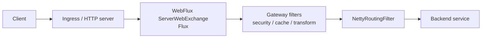

# Request body rỗng, bị đọc hai lần hoặc vượt giới hạn bộ đệm

## Mục tiêu bài học

Trong chương **Chẩn đoán sự cố** của module **SPRING_CLOUD_GATEWAY**, bài học này hướng dẫn xử lý ba nhóm lỗi rất hay gặp khi một API Gateway cần kiểm tra, biến đổi hoặc chuyển tiếp request body:

1. **Body rỗng:** client gửi dữ liệu nhưng backend nhận body rỗng, hoặc code đọc ra `null`/`Mono.empty()`.
2. **Body bị đọc hai lần:** một filter, predicate hoặc logger đã tiêu thụ body trước khi routing filter gửi request tới backend.
3. **Body vượt giới hạn bộ đệm:** xuất hiện `DataBufferLimitException`, HTTP 413, lỗi upload multipart, memory pressure hoặc Netty direct-buffer leak.

Spring Cloud Gateway Server WebFlux dựa trên **Spring WebFlux, Reactor và Reactor Netty**. Request body đi qua dưới dạng một luồng `Flux<DataBuffer>`, có thể chứa nhiều buffer thay vì một chuỗi hoàn chỉnh. Việc đọc body, cache body, replay body và giới hạn kích thước là những thao tác khác nhau. Một filter tưởng như chỉ cần gọi `bodyToMono(String.class)` có thể vô tình biến một luồng upload lớn thành một khối dữ liệu phải giữ trong bộ nhớ.

Sau bài học, bạn có thể:

- Hiểu vì sao request body trong WebFlux thường chỉ được tiêu thụ một lần.
- Phân biệt request thật sự không có body với body đã bị filter khác đọc trước.
- Chẩn đoán `Mono.empty()`, `null`, `Content-Length: 0`, body rỗng và `Content-Type` không khớp.
- Chọn đúng giữa `CacheRequestBody`, `ReadBody` predicate và `ModifyRequestBody`.
- Đặt filter order để filter đọc cached body chạy sau filter đã cache.
- Hiểu `Retry` cache body như thế nào và vì sao retry request có body làm Gateway tốn bộ nhớ.
- Quản lý `DataBuffer` pooled/direct memory, reference count, `retain`, `release` và `doOnDiscard`.
- Phân biệt `RequestSize`, giới hạn codec `maxInMemorySize`, giới hạn multipart và giới hạn ở Ingress/HTTP server.
- Nhận diện một điểm dễ bỏ sót: `RequestSize` có giới hạn theo `Content-Length` nhưng không nên mặc định coi nó là bộ đếm bytes thực cho mọi request streaming/không có Content-Length.
- Giữ streaming và backpressure cho upload/download lớn, tránh aggregate toàn body nếu không cần.
- Kiểm thử body qua Gateway bằng WebTestClient và backend stub, bao gồm empty body, đọc một lần, cache/replay, retry, multipart và request vượt giới hạn.

> **Phạm vi:** các ví dụ sử dụng **Spring Cloud Gateway Server WebFlux** và Reactor Netty. Gateway Server Web MVC dùng Servlet/InputStream và có các API cache/replay khác. Không lấy ví dụ `ByteArrayInputStream` hoặc `HttpServletRequestWrapper` của MVC để sửa lỗi `Flux<DataBuffer>` trong WebFlux. Các ví dụ YAML dùng namespace hiện hành `spring.cloud.gateway.server.webflux.*`; dự án ở release train cũ có thể dùng `spring.cloud.gateway.*`. Kiểm tra đúng Spring Boot/Spring Cloud BOM trước khi áp dụng.

## 1. Nhận diện triệu chứng trước khi sửa

Một request có thể đi qua:



Nếu một thành phần tiêu thụ body ở bước `F`, các bước sau cần dùng **cached/replayed body** hoặc một request đã được decorate để phát lại dữ liệu. Chuyển tiếp trực tiếp body stream đã bị tiêu thụ thường khiến backend nhận zero bytes hoặc một publisher không còn dữ liệu.

### 1.1. Triệu chứng và hướng điều tra

| Triệu chứng | Nguyên nhân thường gặp | Kiểm tra đầu tiên |
| --- | --- | --- |
| Client gửi JSON nhưng backend nhận body rỗng | Filter đã subscribe/consume body trước routing | Tìm mọi `getBody()`, `bodyToMono()`, `subscribe()` |
| Backend chỉ nhận body khi bỏ custom filter | Filter không replay body hoặc decorator sai | Tắt từng filter, so outbound body |
| `IllegalStateException` về receive subscriber | Nhiều thành phần subscribe cùng inbound Netty receive stream | Kiểm tra manual `subscribe()` và nhiều lần đọc |
| `DataBufferLimitException` | Codec hoặc `DataBufferUtils.join` aggregate vượt ngưỡng | Xem stack trace, codec nào đang aggregate |
| `413 Payload Too Large` | Ingress/server/Gateway size policy | Xác định hop nào phát 413 |
| Upload lớn lỗi ở Gateway nhưng backend trực tiếp chạy được | Gateway cache body, filter size limit, codec aggregation hoặc timeout | So sánh request size, protocol và filter chain |
| Sau vài phút traffic, direct memory tăng liên tục | `DataBuffer`/Netty `ByteBuf` không được release đúng | Leak detection, heap/direct memory và cancellation |
| Retry lần đầu có body, lần sau body rỗng | Body chưa được cache/replay đúng hoặc filter order sai | Kiểm tra Retry và body caching |
| Log filter thấy JSON nhưng backend không nhận JSON | Logger đã đọc hoặc làm thay đổi read position của buffer | Bỏ việc đọc buffer trực tiếp; dùng cache |
| Request không có body nhưng callback nhận `null` | Hành vi bình thường của `ModifyRequestBody` | Xử lý nhánh null rõ ràng |
| HTTP/2/streaming request vượt kích thước vẫn đến backend | Chỉ kiểm tra `Content-Length` hoặc thiếu streamed byte-count guard | Test không có Content-Length và chunked |

### 1.2. Quy trình chẩn đoán nhanh

```text
Backend nhận body rỗng?
  ├─ Không có body ở client → kiểm tra client method/body/serialization
  └─ Client có body
       ├─ Gateway không thấy body → kiểm tra ingress, request decoding, body publisher
       ├─ Gateway filter đầu tiên thấy body
       │    └─ Filter sau đó/backend không thấy → kiểm tra consume/replay/order
       └─ Gateway không aggregate được
            └─ DataBufferLimitException → xác định codec/cache/aggregation limit

Request bị 413?
  └─ Xác định Ingress, HTTP server hay Gateway filter nào trả status

Direct memory tăng?
  └─ Kiểm tra retain/release/discard/cancel và cache body lifetime
```

Không bắt đầu bằng việc tăng `max-in-memory-size` hoặc đổi `RequestSize` lên hàng trăm MB. Trước tiên phải xác định **body được đọc ở đâu, có bị aggregate không, và giới hạn nào thực sự phát sinh lỗi**.

## 2. Request body trong WebFlux là một luồng, không phải một String có sẵn

Trong Spring Cloud Gateway Server WebFlux, `ServerHttpRequest.getBody()` trả về `Flux<DataBuffer>`. Mỗi `DataBuffer` đại diện cho một đoạn bytes được nhận từ HTTP connection. Một JSON nhỏ có thể đến trong một buffer hoặc nhiều buffer; một file upload có thể được phát thành nhiều buffer theo thời gian.

```java
Flux<DataBuffer> body = exchange.getRequest().getBody();
```

Không được suy ra:

```text
Flux<DataBuffer> == byte[] hoàn chỉnh
Flux<DataBuffer> == String JSON
Một lần onNext == một HTTP request
Một buffer == một file chunk có kích thước cố định
```

### 2.1. Tại sao body thường chỉ đọc được một lần?

Body được tạo từ luồng dữ liệu của HTTP connection. Khi một thành phần đọc hết publisher, dữ liệu inbound đã được tiêu thụ. Thành phần khác không thể mặc định yêu cầu Netty phát lại những bytes cũ như một `List` trong RAM.

Ví dụ:

```java
Flux<DataBuffer> firstRead = exchange.getRequest().getBody();
```

Một filter subscribe vào `firstRead`, sau đó `NettyRoutingFilter` cố chuyển tiếp cùng inbound request body. Kết quả phụ thuộc publisher/decorator và thứ tự tiêu thụ, nhưng **không thể giả định body gốc tự phát lại**.

Spring Cloud Gateway tài liệu hóa rõ rằng trong những trường hợp cần đọc request body, body phải được cache trước khi gửi downstream; filter `CacheRequestBody` được cung cấp cho mục đích này. [Tài liệu `CacheRequestBody`](https://docs.spring.io/spring-cloud-gateway/reference/spring-cloud-gateway-server-webflux/gatewayfilter-factories/cacherequestbody-factory.html).

### 2.2. Phân biệt body publisher và subscription

Trong Reactor:

- **Publisher** mô tả cách phát dữ liệu.
- **Subscription** bắt đầu việc tiêu thụ dữ liệu.
- `map`, `flatMap`, `filter`, `reduce` tạo pipeline; chúng không tự đọc cho tới khi có subscription.
- `subscribe()` tạo một consumer độc lập; dùng trực tiếp trong Gateway filter thường là dấu hiệu nguy hiểm.
- `block()` chờ đồng bộ, có thể chặn Netty event loop và phá mô hình non-blocking.

Không viết:

```java
exchange.getRequest().getBody().subscribe(buffer -> {
    // Đọc body ở một subscription riêng.
});

return chain.filter(exchange);
```

`chain.filter(exchange)` có thể khiến routing filter cần tiêu thụ body lần nữa. Subscription tự phát bên trên không tạo bản sao có thể replay.

### 2.3. Không đọc body để log bằng cách thay đổi buffer

Một `DataBuffer` có read position. Nếu custom filter đọc bytes làm read position tiến lên rồi chuyển chính buffer ấy downstream, backend có thể chỉ thấy phần còn lại hoặc body rỗng.

Để debug, ưu tiên:

- Chỉ log content type, content length nếu có, route ID, request ID và body byte count.
- Nếu cần nội dung, dùng `CacheRequestBody` với giới hạn nhỏ và chỉ trong route/test được phép.
- Không ghi Authorization, cookie, access token, dữ liệu cá nhân hoặc payload nhạy cảm.
- Không giữ `DataBuffer` lâu hơn vòng đời cần thiết.

### 2.4. Body có thể đến theo nhiều buffer và nhiều thời điểm

Ví dụ một request body 12 KB:

```text
Flux<DataBuffer>
  ├── buffer #1: 4 KB
  ├── buffer #2: 4 KB
  └── buffer #3: 4 KB
```

Không được coi `buffer #1` là toàn bộ JSON hoặc cố parse mỗi buffer riêng lẻ nếu JSON có thể cắt giữa một token/string. Nếu cần decode một object hoàn chỉnh, hãy dùng message codecs hoặc bounded aggregation; nếu chỉ proxy upload/download, giữ streaming.

## 3. Body rỗng: khi nào là bình thường, khi nào là lỗi?

Một request không có body có thể được biểu diễn bằng:

- Request không gửi body bytes.
- HTTP/1.1 `Content-Length: 0`.
- Một publisher hoàn tất mà không phát `DataBuffer`.
- HTTP/2 request không có DATA frames.
- Một endpoint/method chỉ dùng headers/path/query.

**`Content-Type: application/json` không chứng minh có JSON body.** Tương tự, POST không bắt buộc phải có body.

### 3.1. Các trường hợp cần phân biệt

| Tình huống | Cách hiểu |
| --- | --- |
| `Content-Length: 0` | Client khai báo body có độ dài zero |
| Không có CL và body publisher hoàn tất ngay | Có thể là request hợp lệ không body |
| `Content-Type: application/json` nhưng không có bytes | Metadata có content type nhưng body rỗng |
| Body JSON có literal `null` | Có bytes chứa JSON token `null`, không giống không có bytes |
| Body là `{}` | Có bytes JSON object rỗng |
| Body là `""` | Có bytes JSON string rỗng |
| Filter đọc hết body trước routing | Backend không tự có bản sao của body gốc |

### 3.2. `Mono.empty()` khác `Mono.just("")`

```java
Mono<String> absent = Mono.empty();
Mono<String> emptyText = Mono.just("");
```

- `Mono.empty()` không phát ra một giá trị.
- `Mono.just("")` phát ra một String có độ dài zero.
- `Mono.just("{}")` phát ra JSON object representation.

Khi code dùng `defaultIfEmpty("")`, nó chủ động gộp “không có body” và “body text rỗng” thành cùng một giá trị. Chỉ làm vậy nếu API contract cho phép.

### 3.3. `ModifyRequestBody` truyền `null` khi request không có body

Tài liệu Spring Cloud Gateway nêu callback của `ModifyRequestBody` nhận `null` khi request không có body. Callback có thể trả `Mono.empty()` để biểu thị request tiếp tục không có body. Đừng gọi `s.toUpperCase()` hoặc deserialize DTO mà không kiểm tra null. [Tài liệu `ModifyRequestBody`](https://docs.spring.io/spring-cloud-gateway/reference/spring-cloud-gateway-server-webflux/gatewayfilter-factories/modifyrequestbody-factory.html).

Ví dụ xử lý:

```java
.modifyRequestBody(
    String.class,
    String.class,
    MediaType.TEXT_PLAIN_VALUE,
    (exchange, body) -> {
        if (body == null) {
            return Mono.empty(); // Giữ request không có body
        }
        return Mono.just(body.trim());
    }
)
```

Đây là đoạn Java DSL minh họa cho route; cần import `Mono`, `MediaType` và cấu hình route URI/predicate thực tế. Nếu ứng dụng cần biến request không body thành một body mặc định, hãy làm rõ điều đó trong contract và trả `Mono.just("...")` hoặc một DTO phù hợp.

### 3.4. Kiểm tra client trước khi sửa Gateway

Với request JSON, kiểm tra:

- Client có thật sự gửi body bytes hay chỉ set `Content-Type`?
- `bodyValue`, `body`, `BodyInserters` hoặc serializer được gọi chưa?
- Method có cho phép body theo contract và proxy path không?
- `Content-Length`/Transfer-Encoding được HTTP client sinh đúng?
- Body có bị một client-side filter/interceptor consume?
- Có `Content-Encoding` như gzip mà backend/test stub chưa decode?

Không thêm một body mặc định ở Gateway chỉ để che việc client không gửi payload.

## 4. Vì sao body bị đọc hai lần?

Các lỗi thường xuất phát từ một filter đọc body để kiểm tra/log/route, rồi filter khác hoặc routing filter lại cần body ban đầu.

### 4.1. Những pattern dễ gây lỗi

```java
// Không an toàn: tự tạo subscription đọc body.
exchange.getRequest().getBody().subscribe(this::inspect);

// Không an toàn: chặn event loop để chờ body.
String value = exchange.getRequest().getBody()
    .map(this::decode)
    .reduce("", String::concat)
    .block();
```

Hoặc:

```java
Mono<String> first = exchange.getRequest().getBody()
    .map(this::decode)
    .reduce("", String::concat);

return first.flatMap(body -> {
    // Sau đó code khác lại gọi bodyToMono/getBody lần nữa.
    return chain.filter(exchange);
});
```

Những ví dụ trên không tạo một replayable body. Chúng tiêu thụ inbound stream, hoặc chặn event loop.

### 4.2. Một số dấu hiệu trong log

- `Only one connection receive subscriber allowed` hoặc lỗi tương tự từ Reactor Netty.
- `IllegalStateException` khi nhiều subscriber cố đọc một inbound receive stream.
- Backend nhận body length bằng 0 sau một filter mới.
- Request thành công khi tắt logger/custom validation filter.
- Body đọc được trong `GlobalFilter` đầu tiên nhưng không đọc được ở filter sau.

Tên exception cụ thể phụ thuộc phiên bản Reactor Netty và cách subscribe; đừng bắt cứng một exception class duy nhất để kết luận mọi trường hợp.

### 4.3. `ReadBody` predicate chạy trước route filters

`ReadBody` route predicate đọc body để quyết định route có match hay không và cache body trong memory sau lần đọc đầu. Nó chỉ cấu hình bằng Java DSL vì cần một Java `Predicate<T>`; không thể biểu diễn lambda đó bằng YAML. [Tài liệu route predicates](https://docs.spring.io/spring-cloud-gateway/reference/spring-cloud-gateway-server-webflux/request-predicates-factories.html).

Ví dụ:

```java
@Bean
RouteLocator routes(RouteLocatorBuilder builder) {
    return builder.routes()
        .route("body-based-route", route -> route
            .readBody(String.class, body -> body.contains("\"priority\""))
            .uri("lb://priority-service")
        )
        .build();
}
```

**Lưu ý:** đây là route decision dựa trên body, không phải một filter chạy sau khi route đã được chọn. Body được cache để có thể tiếp tục xử lý. Chỉ dùng với payload nhỏ, bounded và khi thực sự cần chọn route theo nội dung. Không dùng để phân loại file upload hoặc stream lớn.

### 4.4. `CacheRequestBody` là route filter, chạy sau khi route match

`CacheRequestBody` không thể cung cấp cached body cho một predicate đã chạy trước nó. Nếu cần chọn route dựa trên body, xem `ReadBody` predicate; nếu cần một filter sau khi route đã match đọc body và vẫn forward được request, xem `CacheRequestBody`.

Đây là khác biệt về **vòng đời và thứ tự**, không chỉ khác tên filter.

## 5. Cách dùng `CacheRequestBody` đúng

Spring Cloud Gateway cung cấp `CacheRequestBody` để đọc request body một lần, chuyển nó sang kiểu dữ liệu được chỉ định và đặt giá trị đã cache vào exchange attributes. Key chuẩn là:

```java
ServerWebExchangeUtils.CACHED_REQUEST_BODY_ATTR
```

### 5.1. Cấu hình YAML

```yaml
spring:
  cloud:
    gateway:
      server:
        webflux:
          routes:
            - id: orders-inspect-body
              uri: lb://order-service
              predicates:
                - Path=/api/orders/**
              filters:
                - name: CacheRequestBody
                  args:
                    bodyClass: java.lang.String
                - StripPrefix=1
```

Trong ví dụ này, `CacheRequestBody` cache body dưới dạng `String`. Filter/logic chạy sau có thể đọc giá trị trong `exchange.getAttributes()` và Gateway có cơ chế sử dụng cached body để tiếp tục gửi request downstream.

`bodyClass` phải tương thích với content type/codec và kích thước request. Ví dụ JSON phức tạp có thể dùng DTO, nhưng việc deserialize sẽ tạo thêm object graph và memory overhead. Chọn `String` không có nghĩa file binary lớn nên được chuyển thành một String.

### 5.2. Java DSL

```java
@Bean
RouteLocator routes(RouteLocatorBuilder builder) {
    return builder.routes()
        .route("orders-inspect-body", route -> route
            .path("/api/orders/**")
            .filters(filters -> filters
                .cacheRequestBody(String.class)
                .stripPrefix(1)
            )
            .uri("lb://order-service")
        )
        .build();
}
```

### 5.3. Đọc cached attribute trong filter

Ví dụ một filter đã được sắp xếp **sau** filter cache:

```java
import org.springframework.cloud.gateway.filter.GatewayFilter;
import org.springframework.cloud.gateway.support.ServerWebExchangeUtils;
import org.springframework.web.server.ServerWebExchange;
import reactor.core.publisher.Mono;

final class InspectCachedBodyFilter implements GatewayFilter {

    @Override
    public Mono<Void> filter(
            ServerWebExchange exchange,
            org.springframework.cloud.gateway.filter.GatewayFilterChain chain) {

        String body = exchange.getAttribute(
            ServerWebExchangeUtils.CACHED_REQUEST_BODY_ATTR
        );

        if (body != null) {
            // Chỉ xử lý metadata an toàn; không log raw payload.
            exchange.getAttributes().put("bodyPresent", Boolean.TRUE);
        }

        return chain.filter(exchange);
    }
}
```

Đây là minh họa cho `CacheRequestBody(String.class)`, nên code giả định cached attribute là `String`. Đừng cast mù quáng ở mọi route: `Retry` filter có thể cache body dưới dạng `DataBuffer`, còn filter cache body khác có thể lưu kiểu dữ liệu theo `bodyClass`. Kiểm tra producer/consumer và filter order thực tế trước khi đọc attribute.

### 5.4. Kiểm soát thứ tự

Một filter đọc attribute trước `CacheRequestBody` sẽ thấy `null`:

```text
Filter A: đọc CACHED_REQUEST_BODY_ATTR → null
CacheRequestBody: đọc + cache body
Filter B: đọc CACHED_REQUEST_BODY_ATTR → có dữ liệu
NettyRoutingFilter: chuyển tiếp request
```

Hãy dùng filter order/route filter ordering phù hợp và integration test. Nếu custom `GlobalFilter` cần attribute, không giả định nó luôn chạy sau route-specific `GatewayFilter`; xác minh `Ordered` và effective combined filter chain của version đang dùng.

### 5.5. CacheRequestBody chỉ dành cho HTTP/HTTPS

Tài liệu Gateway nêu `CacheRequestBody` chỉ hoạt động với HTTP, bao gồm HTTPS. Không coi đây là cách cache payload cho WebSocket frames hoặc một stream giao thức khác.

### 5.6. Chỉ cache khi thực sự cần

Cache body phù hợp khi:

- Một filter cần inspect một trường JSON nhỏ trước khi forward.
- Gateway cần xác minh HMAC trên payload nhỏ và vẫn chuyển tiếp body.
- Một route cần một giá trị body đã deserialize cho logic ứng dụng có kiểm soát.

Không cache toàn bộ body nếu:

- Gateway chỉ proxy file upload/download.
- Payload có thể hàng trăm MB.
- Body là streaming media hoặc multipart file lớn.
- Backend có thể thực hiện validation mà không cần Gateway đọc body.

## 6. `ModifyRequestBody`: biến đổi body mà không tự đọc stream thủ công

`ModifyRequestBody` là lựa chọn khi Gateway **thực sự cần biến đổi representation** trước khi gửi downstream. Tài liệu Server WebFlux cho biết filter này cấu hình bằng Java DSL.

Ví dụ:

```java
record OrderInput(String productCode) {}
record OrderCommand(String sku) {}

@Bean
RouteLocator routes(RouteLocatorBuilder builder) {
    return builder.routes()
        .route("rewrite-order-command", route -> route
            .path("/api/orders")
            .filters(filters -> filters
                .modifyRequestBody(
                    OrderInput.class,
                    OrderCommand.class,
                    MediaType.APPLICATION_JSON_VALUE,
                    (exchange, input) -> {
                        if (input == null) {
                            return Mono.empty();
                        }
                        return Mono.just(
                            new OrderCommand(input.productCode())
                        );
                    }
                )
            )
            .uri("lb://order-command-service")
        )
        .build();
}
```

Đây là ví dụ rút gọn; cần import `Mono`, `MediaType`, `RouteLocator`, `RouteLocatorBuilder` và đảm bảo DTO phù hợp với Jackson/codec đang dùng. Filter sẽ deserialize body theo `OrderInput`, callback tạo representation `OrderCommand`, rồi Gateway serialize lại cho downstream.

### 6.1. Body không có dữ liệu

Callback nhận `null` nếu request không có body. Trong trường hợp muốn giữ request không body:

```java
if (input == null) {
    return Mono.empty();
}
```

Nếu callback luôn làm:

```java
return Mono.just(input.productCode());
```

thì request không body có thể phát sinh NullPointerException. Đừng xử lý `null` bằng cách tạo object rỗng nếu API contract không yêu cầu.

### 6.2. Sau khi đổi body, các metadata có thể cần thay đổi

Nếu body thay đổi, hãy kiểm tra:

- `Content-Type` có mô tả đúng representation mới?
- `Content-Length` được HTTP client tính lại theo bytes mới?
- `Content-Encoding` còn đúng không?
- Digest, signature hoặc ETag có phụ thuộc body cũ?
- Downstream có yêu cầu charset cụ thể?
- Có response/trace logging đang ghi representation nhạy cảm?

Không tự copy incoming `Content-Length` sau khi body được deserialize/serialize lại.

### 6.3. Phân biệt ba công cụ

| Công cụ | Thời điểm | Mục đích | Chi phí chính |
| --- | --- | --- | --- |
| `ReadBody` predicate | Trước khi route được chọn | Match route dựa trên body | Đọc và cache body trong memory |
| `CacheRequestBody` filter | Sau khi route match | Đọc body trong filter và tiếp tục forward | Cache/deserialize body |
| `ModifyRequestBody` filter | Trong filter chain | Thay representation gửi downstream | Decode, transform và encode body |

Không dùng `ModifyRequestBody` chỉ để log body. Không dùng `CacheRequestBody` thay `RequestSize` hoặc một giới hạn streaming byte count.

## 7. Retry filter và body caching

Retry filter có thể chạy lại một upstream attempt khi nhận status/exception phù hợp. Nhưng một request body là stream: để phát lại request ở attempt tiếp theo, Gateway phải cache body.

Tài liệu `Retry` của Spring Cloud Gateway nêu rõ:

- Retry áp dụng cho các methods/statuses/exceptions đã cấu hình.
- Các filters nằm **sau Retry** có thể được chạy lại.
- Khi Retry được dùng với HTTP method có body, body sẽ được cache.
- Cached body nằm trong `ServerWebExchangeUtils.CACHED_REQUEST_BODY_ATTR` dưới dạng `DataBuffer`.
- Việc cache body có thể khiến Gateway **bị giới hạn bởi bộ nhớ**.

Nguồn: [Retry GatewayFilter Factory](https://docs.spring.io/spring-cloud-gateway/reference/spring-cloud-gateway-server-webflux/gatewayfilter-factories/retry-factory.html).

### 7.1. Ví dụ cấu hình

```yaml
spring:
  cloud:
    gateway:
      server:
        webflux:
          routes:
            - id: orders-read-retry
              uri: lb://order-service
              predicates:
                - Path=/api/orders/**
                - Method=GET
              filters:
                - name: Retry
                  args:
                    retries: 2
                    statuses:
                      - BAD_GATEWAY
                      - SERVICE_UNAVAILABLE
                    methods:
                      - GET
                    backoff:
                      firstBackoff: 20ms
                      maxBackoff: 100ms
                      factor: 2
```

Ví dụ chỉ retry GET. Nếu cấu hình Retry cho POST có body, hãy xem xét việc cache body, idempotency key và khả năng backend đã thực hiện side effect ở attempt đầu. **Body replay không có nghĩa business operation an toàn để chạy lại.**

### 7.2. Retry filter order

Giả sử filter chain:

```text
Filter A
  → Retry
      → Filter B
      → NettyRoutingFilter
```

Retry có thể chạy lại những filter nằm sau nó. Vì vậy:

- Filter B phải an toàn khi được gọi nhiều lần.
- Không tạo duplicate business side effects trong custom filters.
- Không tạo thêm audit events giả nếu mỗi attempt được hiểu là một operation mới.
- Theo dõi attempt number riêng với inbound request ID.
- Không giả định filter đứng trước Retry cũng chạy lại.

### 7.3. Tránh retry upload body lớn

Nếu upload 50 MB và Gateway cache toàn bộ để retry, mỗi request đang chờ có thể giữ một lượng memory lớn. Với 20 uploads đồng thời, chỉ riêng payload cache có thể lên tới khoảng 1 GB trước khi tính buffer copies, object overhead, decoded representations và direct memory.

Đối với upload:

- Ưu tiên không retry body lớn ở Gateway.
- Dùng resumable/chunked upload protocol nếu sản phẩm cần retry.
- Dùng upload session/object storage để client tiếp tục từ offset.
- Dùng idempotency token hoặc upload ID.
- Giới hạn concurrent uploads và body bytes.
- Để backend/object store quản lý phần upload có durability.

### 7.4. POST timeout không chứng minh backend chưa xử lý

Nếu backend đã ghi dữ liệu nhưng response bị mất, Gateway có thể không biết attempt đầu đã commit hay chưa. Retry POST có thể tạo bản ghi trùng hoặc thanh toán hai lần.

Trước khi retry một request có body, cần:

- Idempotency key được backend enforce.
- Deduplication có tính nguyên tử.
- Truy vấn trạng thái operation khi kết quả không rõ.
- Chính sách retry chỉ cho transient failures có thể khôi phục.
- Giới hạn số attempts và total retry budget.

## 8. `DataBuffer` lifecycle: tránh leak và double release

`DataBuffer` là abstraction byte buffer của Spring. Với Reactor Netty, implementation thường dựa trên Netty `ByteBuf` và có thể dùng **pooled direct memory**.

### 8.1. Reference counting

`PooledDataBuffer` sử dụng reference count:

```text
allocate → refCount = 1
retain   → refCount tăng
release  → refCount giảm
refCount = 0 → buffer được trả về pool
```

Không release buffer đúng cách có thể gây direct-memory leak. Release quá nhiều lần có thể dẫn tới `IllegalReferenceCountException` hoặc lỗi đọc buffer đã được giải phóng.

Spring Framework khuyến nghị dùng `DataBufferUtils.release(...)` và `DataBufferUtils.retain(...)` để áp dụng semantics phù hợp cho `DataBuffer` pooled. [Data Buffers and Codecs](https://docs.spring.io/spring-framework/reference/core/databuffer-codec.html).

### 8.2. Khi nào phải release?

Một số nguyên tắc:

- Nếu code tiêu thụ buffer và không chuyển nó cho consumer khác, phải release đúng lúc.
- Nếu code giữ buffer để dùng sau, phải quản lý retain/release và cancellation.
- Nếu một Reactor operator bỏ các buffers do `filter`, `skip`, `prefetch`, `flatMap` hoặc lỗi/cancel, cần đảm bảo discarded buffers được release.
- Spring docs đề xuất `doOnDiscard(DataBuffer.class, DataBufferUtils::release)` cho những composition có thể discard pooled buffers.
- Nếu dùng `DataBufferUtils.join`, buffer đầu vào được quản lý trong buffer kết quả; đọc xong phải release buffer kết quả theo lifecycle của nó.

### 8.3. Ví dụ đọc một buffer trong code sở hữu buffer

```java
DataBuffer buffer = ...; // Ví dụ: buffer do code tự cấp phát/nhận quyền sở hữu
try {
    byte[] bytes = new byte[buffer.readableByteCount()];
    buffer.read(bytes);
    // Xử lý bytes trong phạm vi cần thiết.
}
finally {
    DataBufferUtils.release(buffer);
}
```

Đây chỉ là mẫu quản lý một buffer mà code hiện tại sở hữu. **Không copy đoạn release này vào mọi `map` của Gateway**: nếu buffer đang được chuyển tiếp cho downstream, ownership/lifecycle có thể thuộc thành phần khác. Xác định ai sở hữu buffer trước khi release.

### 8.4. `DataBufferUtils.join` để aggregate có giới hạn

Nếu thật sự cần một body hoàn chỉnh để parse, Spring cung cấp:

```java
DataBufferUtils.join(publisher, maxByteCount)
```

Overload có `maxByteCount` giới hạn tổng bytes được buffer và phát `DataBufferLimitException` nếu vượt ngưỡng. API này an toàn hơn việc tự nối `String`/`byte[]` từ nhiều buffers không có giới hạn.

Tuy nhiên, `join` vẫn là **aggregation**: nó phải giữ dữ liệu cho tới khi stream hoàn tất. Không dùng nó để xử lý upload lớn nếu chỉ cần chuyển tiếp. Khi `join` tiêu thụ body gốc, nếu downstream vẫn cần body, bạn phải tạo một representation mới/replayable và quản lý buffer lifecycle đúng.

### 8.5. `doOnDiscard` và cancellation

Một pipeline có thể bị cancel khi:

- Client disconnect.
- Gateway timeout.
- Retry/CircuitBreaker chuyển sang fallback.
- Request vượt giới hạn.
- Upstream connection bị reset.

Buffers đã được operator prefetch nhưng chưa được downstream tiêu thụ có thể bị discard. Nếu custom filter giữ pooled buffers qua các operators, phải kiểm tra cleanup ở **success, error và cancel paths**.

Không chỉ kiểm tra happy path; buffer leak thường lộ ra sau nhiều requests hoặc khi tải tăng và client ngắt giữa chừng.

## 9. Phân biệt các giới hạn kích thước

Một lỗi thiết kế thường gặp là tăng một property rồi nghĩ mọi giới hạn body đã được tăng theo. Thực tế có nhiều tầng khác nhau.

| Giới hạn | Bảo vệ điều gì? | Không có nghĩa là |
| --- | --- | --- |
| Ingress/proxy max body bytes | Tổng bytes request qua edge | Codec của Gateway có thể aggregate body lớn |
| HTTP server/protocol limits | Header, connection, protocol parsing và một số transport constraints | Có global business body-size policy |
| Gateway `RequestSize` | Kiểm tra request size theo implementation/filter | Luôn đếm mọi bytes của streamed/chunked body |
| WebFlux codec `maxInMemorySize` | Số bytes được aggregate trong một số codec operations | Giới hạn tổng body cho mọi streaming routes |
| Multipart `max-in-memory-size` | Ngưỡng lưu từng multipart part trong RAM trước khi ghi file | Tổng request multipart tối đa |
| Multipart max-parts/disk usage | Số parts và disk storage theo config | Giới hạn toàn bộ traffic upload |
| Application validation | Giới hạn nghiệp vụ như số items/field length | Bảo vệ trước khi HTTP body đã vào hệ thống |

### 9.1. Gateway `RequestSize`

Ví dụ:

```yaml
spring:
  cloud:
    gateway:
      server:
        webflux:
          routes:
            - id: document-upload
              uri: lb://document-service
              predicates:
                - Path=/api/documents/**
                - Method=POST
              filters:
                - name: RequestSize
                  args:
                    maxSize: 10MB
```

Tài liệu Gateway mô tả `maxSize` là `DataSize` và filter trả `413 Payload Too Large` cùng header `errorMessage` khi request bị từ chối. Tài liệu hiện hành cũng nêu default là 5 MB nếu không truyền filter argument. [Tài liệu `RequestSize`](https://docs.spring.io/spring-cloud-gateway/reference/spring-cloud-gateway-server-webflux/gatewayfilter-factories/requestsize-factory.html).

**Điểm cần kiểm tra trước khi dùng làm security control:** issue/PR chính thức [#3843](https://github.com/spring-cloud/spring-cloud-gateway/issues/3843) / [#3844](https://github.com/spring-cloud/spring-cloud-gateway/pull/3844) ghi nhận `RequestSize` chỉ kiểm tra `Content-Length` nếu header có mặt, không đếm độ dài body thực đã stream. Điều này quan trọng với HTTP/2 hoặc request HTTP/1.1 chunked không có `Content-Length`. Trang PR được tra cứu ghi trạng thái **Open / branch not deployed**; hãy kiểm tra source/version bạn đang chạy và test trước khi dựa vào filter như một byte-count guard.

Vì vậy:

- `RequestSize` có thể nhanh chóng từ chối request khai báo `Content-Length` lớn.
- Không mặc định filter bảo vệ được mọi request không có `Content-Length`.
- Test riêng request chunked và HTTP/2 streaming.
- Đặt body-size limit thực tại Ingress/proxy hoặc một streaming byte-count guard đã được kiểm chứng.
- Nếu phải buffer toàn body để quyết định 413 trước khi gửi backend, phải giới hạn đồng thời và tính memory/disk budget.

### 9.2. Codec `maxInMemorySize`

Spring WebFlux codecs có giới hạn cho dữ liệu **được aggregate trong memory**. Nhiều codecs có default khoảng **256 KB**; khi vượt ngưỡng có thể gặp:

```text
org.springframework.core.io.buffer.DataBufferLimitException:
Exceeded limit on max bytes to buffer
```

Giới hạn này áp dụng cho các thao tác cần buffer body, ví dụ decode một JSON/String thành object, `bodyToMono(...)`, `ReadBody`, `CacheRequestBody` hoặc custom `DataBufferUtils.join`. Nó không có nghĩa mọi request proxy body lớn đều bị chặn ở 256 KB; một route streaming có thể chuyển từng buffer mà không aggregate toàn body.

Có thể tùy chỉnh default codecs bằng `WebFluxConfigurer`:

```java
@Configuration
class GatewayCodecConfiguration implements WebFluxConfigurer {

    @Override
    public void configureHttpMessageCodecs(
            ServerCodecConfigurer configurer) {
        configurer.defaultCodecs()
            .maxInMemorySize(512 * 1024);
    }
}
```

Đây là ví dụ tăng ngưỡng aggregation lên 512 KiB. Trong Spring Boot, property cấu hình codec có tên và phạm vi phụ thuộc Boot generation; ví dụ Boot mới có `spring.http.codecs.max-in-memory-size`. Dùng Java config khi muốn thể hiện rõ `ServerCodecConfigurer` và kiểm tra bean thực tế của ứng dụng.

**Không đặt `-1` hoặc giá trị rất lớn để chữa mọi lỗi.** Khi nhiều request đồng thời cùng aggregate, memory tăng theo tổng số body đang được giữ.

### 9.3. Multipart limits

Spring Boot WebFlux có các thuộc tính multipart như:

```yaml
spring:
  webflux:
    multipart:
      max-in-memory-size: 256KB
      max-parts: 50
      max-headers-size: 10KB
      max-disk-usage-per-part: 20MB
```

Các giá trị trên chỉ là ví dụ policy cho lab. `max-in-memory-size` là ngưỡng bộ nhớ **cho từng part** trước khi file data được ghi ra disk theo multipart handling; nó không phải tổng request body max. `max-parts`, headers và disk usage là các giới hạn khác. Cấu hình cụ thể phụ thuộc Spring Boot version và cách endpoint tiêu thụ multipart.

Nếu dùng `PartEvent` streaming, dữ liệu có thể được xử lý trực tiếp theo events và một số tùy chọn lưu part vào memory/disk không còn áp dụng như cơ chế aggregate thông thường. Xem tài liệu multipart/streaming của đúng version.

### 9.4. Header limit không phải body limit

`server.max-http-request-header-size` hoặc giới hạn header ở Ingress chỉ kiểm soát phần headers/request line theo implementation. Nó không giới hạn tổng bytes của request body.

Không sửa header-size property khi lỗi thực tế là `DataBufferLimitException` do JSON body aggregation.

## 10. Vì sao tăng bộ đệm có thể làm Gateway hết bộ nhớ?

Giả sử:

```text
Cached body mỗi request:  10 MB
Requests đồng thời:       100
```

Chỉ riêng payload cache:

\[
10\ \text{MB} \times 100 = 1.000\ \text{MB} \approx 1\ \text{GB}
\]

Chưa tính:

- Buffer gốc và cached copy.
- Byte array/String/DTO được deserialize.
- JSON object graph và temporary allocations.
- Netty pooled direct memory.
- Retry giữ body qua nhiều attempts.
- Response buffers và các requests khác đang chạy.

Một body được cache có thể được biểu diễn ở nhiều dạng cùng lúc. Vì vậy `maxInMemorySize=10MB` không đồng nghĩa một Gateway pod an toàn khi có 100 uploads đồng thời.

### 10.1. Backpressure không bảo vệ được khi đã aggregate

Streaming với backpressure:

```text
Nhận buffer → xử lý → phát tiếp → buffer được giải phóng
```

Aggregation/cache:

```text
Nhận nhiều buffers → giữ lại toàn bộ → tạo object/body cache → xử lý
```

Khi cần giữ toàn body để replay hoặc parse một object hoàn chỉnh, backpressure không làm payload biến mất. Phải giới hạn:

- Kích thước tối đa mỗi request.
- Số requests có thể aggregate/cache đồng thời.
- Số retry có thể giữ body.
- Thời gian giữ cache và cleanup.
- Kích thước direct memory và heap.
- Upload concurrency/rate theo tenant/client.

### 10.2. Một policy thực tế

| Loại endpoint | Cách xử lý body |
| --- | --- |
| JSON nhỏ, inspect một trường | `CacheRequestBody` với max size nhỏ |
| JSON cần đổi schema | `ModifyRequestBody` và codec limit |
| File upload lớn | Streaming, ingress byte limit, không cache/retry toàn body |
| Multipart nhiều parts | Multipart limits + disk/streaming policy |
| Webhook ký HMAC | Bounded body read, verify đúng raw bytes/representation |
| Body-based route selection | `ReadBody` chỉ cho payload nhỏ và bounded |
| Retry request có body | Chỉ khi idempotency + body caching + memory budget rõ |

## 11. Giữ streaming cho upload/download lớn

Nếu Gateway chỉ cần proxy file tới backend, đừng deserialize toàn bộ body thành `byte[]` hoặc `String`. Hãy để HTTP client nhận `Flux<DataBuffer>` và chuyển tiếp theo demand.

### 11.1. Tránh những thao tác biến streaming thành buffering

Những thao tác sau thường cần aggregate:

```java
bodyToMono(String.class)
bodyToMono(byte[].class)
DataBufferUtils.join(body)
collectList()
CacheRequestBody(String.class)
ReadBody(String.class, ...)
Retry với request body
```

Không phải mọi thao tác luôn giữ body vô hạn; một số có limit. Nhưng chúng cần đọc/cached body thay vì proxy từng buffer. Dùng chúng có chủ đích.

### 11.2. Khi cần xác minh nội dung nhưng vẫn upload

Nếu cần HMAC/signature trên toàn body, bạn có thể cần đọc hết bytes để tính digest. Có ba lựa chọn kiến trúc:

1. **Bounded aggregation:** chỉ cho phép payload nhỏ, đọc tối đa giới hạn, verify rồi replay.
2. **Streaming digest:** cập nhật hash theo từng buffer và chuyển tiếp, nhưng quyết định xác thực cuối có thể chỉ biết sau khi body đã gửi một phần; backend phải có cơ chế không commit trước khi verification thành công.
3. **Signed metadata/chunk signatures:** thiết kế protocol để xác minh theo từng chunk hoặc một metadata signature đáng tin.

Không đọc hết body để tính HMAC rồi vô tình làm backend nhận body rỗng. Cũng không gửi payload tới backend và chỉ sau đó mới phát hiện chữ ký sai nếu backend có thể thực hiện side effect trước khi xác minh.

### 11.3. Multipart và file uploads

Với upload lớn:

- Đặt ingress max body size thật.
- Đặt per-file/per-part size và max part count.
- Dùng disk-backed multipart hoặc streaming API theo nhu cầu.
- Giới hạn temp directory disk usage và quyền truy cập.
- Có cleanup cho file tạm khi client disconnect/error.
- Không log file content.
- Không giữ `DataBuffer` sau khi downstream đã xử lý xong.
- Thiết kế resume/retry ở cấp upload protocol thay vì retry toàn request body trong Gateway.

## 12. Nếu phải tự viết filter đọc hoặc giới hạn body

Ưu tiên built-in filters và codec APIs. Chỉ tự viết `GlobalFilter`/`GatewayFilter` khi có yêu cầu mà các filter chuẩn không đáp ứng.

### 12.1. Quy tắc khi viết custom filter

1. Không gọi `subscribe()` hoặc `block()` trên inbound body trong filter.
2. Không subscribe body hai lần để vừa inspect vừa proxy.
3. Nếu cần replay, phải cache có giới hạn và decorate request để phát lại cached bytes.
4. Nếu chỉ cần đếm bytes, dùng streaming counter có backpressure; không aggregate toàn body chỉ để tính length.
5. Xác định rõ buffer ownership và cleanup ở success/error/cancel.
6. Khi đổi body, cập nhật representation headers và để outbound HTTP client encode framing.
7. Xác định filter order so với `CacheRequestBody`, `Retry` và `NettyRoutingFilter`.
8. Không retry request vượt size limit hoặc body đã bị consume một phần.
9. Nếu size limit bị vượt sau khi một phần body đã gửi downstream, xử lý cancellation/connection abort và đảm bảo backend không commit partial input.
10. Viết integration tests với body không có `Content-Length`, chunked và HTTP/2.

### 12.2. Streaming byte counter và giới hạn response

Một custom `ServerHttpRequestDecorator` có thể wrap `getBody()` để cộng `DataBuffer.readableByteCount()` khi buffers đi qua. Tuy nhiên, đây không chỉ là một phép `AtomicLong`:

- Phải đảm bảo một request chỉ có một counting subscription.
- Phải xử lý overflow và `long` arithmetic an toàn.
- Phải release buffer bị drop khi vượt ngưỡng/cancel.
- Phải ngăn downstream tiếp tục nhận body sau khi limit bị vượt.
- Nếu downstream đã nhận một phần body, không thể giả định có thể trả một response 413 sạch như khi từ chối trước khi routing.
- Backend có thể đã xử lý streaming chunks; cần protocol/endpoint không commit side effects cho đến khi body hoàn tất và được chấp nhận.
- Response có thể đã commit, lúc đó Gateway không thể đổi status/body một cách bình thường.

Nếu yêu cầu là **từ chối chắc chắn trước khi backend nhận bất kỳ byte body nào**, phải buffer toàn bộ body tới một ngưỡng giới hạn rồi mới forward, hoặc enforce size limit ở Ingress trước Gateway. Cách buffer này tiêu thụ memory/disk và cần bounded concurrency.

### 12.3. `DataBufferUtils.join` không tự tạo replay

Ví dụ:

```java
Mono<DataBuffer> joined =
    DataBufferUtils.join(exchange.getRequest().getBody(), 1024 * 1024);
```

Lệnh này tiêu thụ inbound stream và giới hạn aggregation ở 1 MiB. Nó **không tự gắn body trở lại request** để routing filter đọc lần nữa. Nếu downstream cần body:

1. Chuyển joined buffer thành representation cần thiết trong giới hạn.
2. Release joined buffer đúng lifecycle.
3. Tạo một publisher mới từ cached bytes.
4. Dùng `ServerHttpRequestDecorator` để cung cấp publisher mới.
5. Cập nhật headers/Content-Length nếu cần theo outbound encoding.
6. Kiểm thử body backend nhận chính xác một lần.

Đây là lý do `CacheRequestBody` thường an toàn hơn một custom join/decorator tự viết.

### 12.4. Tránh dùng `DataBuffer` sau khi release

Một lỗi phổ biến:

```java
DataBufferUtils.release(buffer);
return Mono.just(buffer); // Sai: buffer đã được release
```

Hoặc:

```java
DataBufferUtils.retain(buffer);
// Không release lại sau khi consumer cuối cùng hoàn tất.
```

Cả hai đều sai ownership. `retain` chỉ tăng reference count; nó không thay việc giải phóng sau khi sử dụng xong.

## 13. Kiểm thử body bằng WebTestClient và backend stub

Một test chỉ kiểm tra Gateway trả 200 chưa đủ. Cần kiểm tra **backend thực sự nhận body nào**, bao nhiêu bytes và số lần request được gọi.

### 13.1. Topology test

```text
WebTestClient
  ↓
Gateway WebFlux (test profile)
  ↓
Backend stub (MockWebServer/WireMock)
```

Backend stub nên ghi:

```text
method
path
Content-Type
Content-Length (nếu có)
body byte count
synthetic request ID
number of calls
```

Không log Authorization, Cookie, JWT, API key hoặc payload chứa dữ liệu cá nhân.

### 13.2. Test forward JSON body

Scaffold:

```java
@SpringBootTest(
    webEnvironment = SpringBootTest.WebEnvironment.RANDOM_PORT
)
class GatewayRequestBodyIntegrationTest {

    @LocalServerPort
    int port;

    private WebTestClient client() {
        return WebTestClient.bindToServer()
            .baseUrl("http://localhost:" + port)
            .responseTimeout(Duration.ofSeconds(3))
            .build();
    }

    @Test
    void forwardsJsonBodyToBackend() {
        client().post()
            .uri("/api/orders")
            .contentType(MediaType.APPLICATION_JSON)
            .bodyValue("""
                {"orderId":"test-42","quantity":2}
                """)
            .exchange()
            .expectStatus().is2xxSuccessful();

        // Assert backend stub received exactly one call,
        // with the expected path and body bytes.
    }
}
```

Đây là scaffold cần route `/api/orders` trỏ tới stub, `@LocalServerPort`, các imports, backend stub lifecycle và security test fixture. `WebTestClient` timeout ở đây là timeout của test client, không phải Gateway body-size limit.

### 13.3. Test body rỗng

Gửi cùng route nhưng không gọi `.bodyValue(...)`:

```java
client().post()
    .uri("/api/orders")
    .contentType(MediaType.APPLICATION_JSON)
    .exchange();
```

Kỳ vọng phải dựa trên API contract:

- Nếu endpoint cho phép body rỗng, backend nhận zero bytes và trả response phù hợp.
- Nếu body bắt buộc, Gateway/backend trả 400/422 theo contract.
- Không có NullPointerException trong `ModifyRequestBody`.
- Không tự tạo `{}` hoặc empty string nếu contract không yêu cầu.

### 13.4. Test body bị đọc hai lần

Tạo một route test có `CacheRequestBody(String.class)` và filter kiểm tra cached attribute. Assert:

1. Filter sau cache đọc được body.
2. Backend vẫn nhận đúng body gốc.
3. Backend nhận đúng một call khi không bật Retry.
4. Không có `Only one connection receive subscriber allowed`.
5. Direct memory không tăng liên tục sau nhiều requests.

Sau đó chạy cùng test khi tạm bỏ `CacheRequestBody` để chứng minh custom filter không thể đọc body rồi mong routing filter tự replay. Test này phải chạy trong môi trường test, không tạo filter cố tình consume body trong production.

### 13.5. Test giới hạn tại biên

Nếu policy giới hạn 1 MiB, test:

| Case | Payload | Kỳ vọng |
| --- | ---: | --- |
| Dưới limit | 1 MiB - 1 byte | Chấp nhận |
| Đúng limit | 1 MiB | Theo policy boundary |
| Vượt limit | 1 MiB + 1 byte | Từ chối |
| Không có body | 0 byte | Theo endpoint contract |
| CL lớn hơn limit | Header khai báo quá lớn | Có thể reject sớm |
| Không có CL/chunked | Stream thực tế vượt limit | Actual byte guard/Ingress phải reject |
| HTTP/2 DATA frames | Không dựa vào CL | Actual byte guard phải hoạt động |

Đối với case không có `Content-Length`, dùng HTTP client/protocol fixture có thể gửi streaming body mà không đặt CL. `WebTestClient.bodyValue` có thể khiến client tự tính Content-Length; không dùng riêng nó để chứng minh chunked/H2 limit.

### 13.6. Test `DataBufferLimitException`

Tạo một route test buộc codec aggregate body, ví dụ `CacheRequestBody(String.class)` hoặc một custom bounded `join`. Gửi payload:

- Dưới codec max-in-memory.
- Vừa đúng giới hạn.
- Vượt giới hạn một byte.
- Body lớn nhưng chỉ được stream qua route không aggregate.

Kỳ vọng:

- Aggregate route phát lỗi giới hạn khi vượt ngưỡng.
- Streaming route không tự aggregate toàn body.
- Error mapping không làm lộ stack trace/exception details ra public.
- Không có memory leak sau khi request bị reject.

### 13.7. Test multipart

Kiểm tra:

- File nhỏ hơn memory threshold.
- File lớn hơn threshold được xử lý theo disk/streaming policy.
- Nhiều parts vượt `max-parts`.
- Part headers quá lớn.
- Disk usage vượt ngưỡng.
- Client disconnect giữa upload.
- Temp files được cleanup.

Không chỉ kiểm tra file size; một request có thể có nhiều parts và metadata headers.

## 14. Ma trận chẩn đoán theo exception/status

| Dấu hiệu | Ý nghĩa có thể có | Cách xác minh |
| --- | --- | --- |
| `DataBufferLimitException` | Một codec/aggregation operation vượt max bytes | Stack trace cho biết decoder/reader/filter nào aggregate |
| `Only one connection receive subscriber allowed` | Nhiều subscriber trên một inbound receive stream | Tìm manual `subscribe()`/multiple body readers |
| `IllegalStateException` khi đọc body | Publisher đã consume hoặc request lifecycle không hợp lệ | Kiểm tra filter order và request decorator |
| `IllegalReferenceCountException` | Dùng buffer đã release hoặc release thừa | Rà ownership, retain/release |
| `OutOfDirectMemoryError` | Pooled/direct buffers tăng quá mức hoặc leak | Netty leak detection, active requests, cache size |
| HTTP 413 | Một layer áp body-size limit | Xác định response từ Ingress, Gateway hay backend |
| HTTP 400/415 | JSON/body format/content type không hợp lệ | So content type, codec và payload |
| HTTP 500 | Exception từ body decoding/filter chưa map đúng | Trace exception class, không chỉ xem status |
| HTTP 502 | Backend nhận partial body/connection reset hoặc upstream lỗi | Backend access log và Netty client error |
| Backend nhận body rỗng | Body chưa gửi hoặc đã consume | So client bytes, Gateway filter order và backend body count |
| Backend nhận body lặp | Retry hoặc custom replay sai | Đếm outbound attempts và idempotency |

**Không suy nguồn lỗi chỉ từ status code.** Ingress, Gateway, backend và exception handler có thể dùng cùng một status cho các tình huống khác nhau.

## 15. Troubleshooting theo tình huống

### 15.1. Backend nhận body rỗng sau khi thêm logging filter

**Nguyên nhân thường gặp:** logger subscribe vào `getBody()` hoặc gọi `bodyToMono()` rồi routing filter đọc lần nữa.

**Xử lý:**

1. Tắt filter logging để xác nhận.
2. Xóa manual `subscribe()`/`block()`.
3. Nếu cần inspect payload nhỏ, đặt `CacheRequestBody` trước filter đọc.
4. Đọc attribute đúng kiểu dữ liệu và đúng filter order.
5. Test backend nhận nguyên body.

### 15.2. `CacheRequestBody` có chạy nhưng custom GlobalFilter vẫn thấy null

**Nguyên nhân:** GlobalFilter chạy trước route-specific filter hoặc route chưa match; `CACHED_REQUEST_BODY_ATTR` chưa được đặt tại thời điểm đọc.

**Xử lý:** kiểm tra effective filter ordering, đặt consumer sau cache hoặc dùng route-specific filter. Nếu muốn quyết định route dựa trên body, `CacheRequestBody` quá muộn; xem `ReadBody` predicate.

### 15.3. `ReadBody` predicate match nhưng backend nhận body rỗng

**Nguyên nhân:** custom logic khác đã consume publisher hoặc body cache/replay bị thay đổi bởi filter khác.

**Xử lý:** bỏ manual subscriptions; kiểm tra built-in predicate và các body-mutating filters; thêm integration test backend echo. `ReadBody` predicate có cache body theo tài liệu, nhưng custom filter vẫn có thể phá lifecycle nếu tự thay request.

### 15.4. `DataBufferLimitException` khi gửi JSON 400 KB

**Nguyên nhân:** codec operation đang aggregate body và default codec limit thường khoảng 256 KB.

**Xử lý:**

- Xác định chính xác filter/codec đang aggregate.
- Nếu API contract cho phép payload lớn hơn, tăng codec max có kiểm soát.
- Đồng thời đặt request-size/concurrency limits thực.
- Nếu không cần object hoàn chỉnh, giữ streaming.

Không nâng global codec limit chỉ vì một route upload cần 20 MB.

### 15.5. `RequestSize` trả 413 khi có Content-Length nhưng bỏ lọt chunked

**Nguyên nhân có thể:** filter kiểm tra Content-Length mà không đếm streamed body bytes. Đây là giới hạn được nêu trong issue/PR #3843/#3844 của Spring Cloud Gateway.

**Xử lý:**

- Kiểm tra source/behavior của đúng Gateway release.
- Kiểm thử request không có Content-Length, chunked và HTTP/2.
- Đặt actual body-size limit tại ingress hoặc custom streaming guard đã được kiểm thử.
- Nếu cần reject trước khi upstream nhận bất kỳ bytes nào, buffer bounded trước routing hoặc enforce tại edge.

### 15.6. Upload lớn làm Gateway hết direct memory

**Nguyên nhân:** Retry/CacheRequestBody/ReadBody/ModifyRequestBody hoặc custom join giữ body trong memory; nhiều uploads đồng thời nhân mức sử dụng.

**Xử lý:** bỏ cache/retry không cần thiết, giới hạn concurrency, dùng streaming/disk-backed multipart, kiểm tra pooled buffer lifecycle và đo direct memory. Đừng chỉ tăng `-XX:MaxDirectMemorySize`.

### 15.7. Backend nhận body hai lần khi Retry bật

**Nguyên nhân:** Retry thực hiện nhiều upstream attempts; đây là behavior có chủ đích khi lỗi thuộc policy. Nếu operation không idempotent, backend có thể tạo side effect lặp.

**Xử lý:** kiểm tra attempt count, status/exception trigger, filter order và idempotency key. Không nhầm nhiều attempts hợp lệ với một inbound body bị subscribe hai lần ngoài ý muốn.

### 15.8. `ModifyRequestBody` phát NullPointerException

**Nguyên nhân:** callback giả định body không null.

**Xử lý:** xử lý `null` rõ ràng và trả `Mono.empty()` khi muốn giữ request không body. Viết test cả có body và không body.

### 15.9. Body đọc được ở filter đầu nhưng filter sau không có

**Nguyên nhân:** filter đầu tiêu thụ publisher mà không cache/replay; hoặc filter sau chạy trước `CacheRequestBody`.

**Xử lý:** xác minh order, cache body đúng cách, không tự decorate nhiều lần với các publishers khác nhau.

### 15.10. `IllegalReferenceCountException` xuất hiện khi tải cao

**Nguyên nhân:** release buffer quá sớm, release hai lần, retain mà không release hoặc operator discard không cleanup.

**Xử lý:** rà ownership; sử dụng `DataBufferUtils`; bổ sung `doOnDiscard` nơi phù hợp; bật Netty leak detection trong test/staging; kiểm thử error/cancel paths.

### 15.11. Gateway trả 500 thay vì 413 khi body quá lớn

**Nguyên nhân:** `DataBufferLimitException` hoặc custom `RequestSizeLimitException` không được map sang response status phù hợp; hoặc exception xảy ra sau khi response commit.

**Xử lý:** xác định layer phát exception, cấu hình error mapping có chủ đích, test response chưa commit và xử lý trường hợp stream đã bắt đầu. Không bắt mọi exception thành 413 vì có thể che lỗi hệ thống khác.

### 15.12. Body backend nhận bị cắt sau timeout/client disconnect

**Nguyên nhân:** upstream connection bị cancel khi body đang stream, hoặc custom filter đã forward một phần body trước khi phát hiện lỗi.

**Xử lý:** backend phải xử lý incomplete body/cancellation an toàn, không commit transaction trước khi nhận và validate hết payload. Dùng upload session/resume cho file lớn.

### 15.13. Body JSON bị sai sau khi Gateway rewrite

**Nguyên nhân:** content type/charset sai, serializer khác contract, Content-Length cũ, body đã bị nén/giải nén không nhất quán.

**Xử lý:** assert exact backend bytes, `Content-Type`, `Content-Encoding` và charset. Dùng `ModifyRequestBody`/codec đúng thay vì thao tác chuỗi trên raw buffers.

## 16. Observability và logging an toàn

### 16.1. Metrics hữu ích

Theo dõi:

- Request body bytes theo route (histogram/buckets, không dùng raw request ID làm label).
- Số request bị từ chối bởi size policy và nguồn phát 413.
- Số `DataBufferLimitException`.
- Số lỗi decode/serialization.
- Active uploads, concurrent body caches và request duration.
- Heap usage, direct memory, Netty pooled allocator metrics nếu expose.
- Buffer leak warnings trong test/staging.
- Retry attempts trên route có body.
- Client disconnect/cancellation và upstream aborted requests.
- Multipart temp disk usage, part count và cleanup failures.

Tên metric phụ thuộc Spring Boot, Micrometer, Reactor Netty và custom instrumentation; kiểm tra `/actuator/metrics`/Prometheus exporter thay vì giả định mọi metric đã tự có.

### 16.2. Log metadata, không log raw payload

Ví dụ event an toàn:

```json
{
  "routeId": "document-upload",
  "requestId": "synthetic-req-42",
  "contentType": "application/octet-stream",
  "declaredContentLength": 1048576,
  "observedBodyBytes": 1048576,
  "bodyCached": false,
  "retryAttempt": 1,
  "outcome": "forwarded"
}
```

Các fields này cần được ứng dụng/custom metrics bổ sung; không phải mọi field là mặc định của Gateway.

Tránh log:

- `Authorization`, Cookie, JWT, API keys.
- Raw multipart content hoặc file data.
- PII, payment details, secrets.
- Full JSON body trong production.

Nếu cần debug payload, dùng dữ liệu giả trong môi trường cô lập, retention ngắn và quyền truy cập giới hạn.

### 16.3. Phân biệt declared bytes và observed bytes

Hai giá trị có ý nghĩa khác nhau:

```text
declaredContentLength = header Content-Length nếu có
observedBodyBytes     = số bytes thực sự đi qua counting stream
```

Nếu chỉ có declared length, không được ghi metric là “actual request size”. Với chunked/H2 streaming, actual byte count cần được đo trên body publisher hoặc tại ingress/server có hỗ trợ.

## 17. Checklist trước khi release filter có đọc body

| Kiểm tra | Câu hỏi |
| --- | --- |
| Body lifecycle | Filter có subscribe body nhiều lần hoặc `block()` không? |
| Replay | Nếu filter đọc body, downstream có nhận lại body không? |
| Filter order | Consumer chạy sau CacheRequestBody/đúng route phase? |
| Body class | Codec có hỗ trợ content type và DTO? |
| Empty body | Callback xử lý null/Mono.empty đúng contract? |
| Size | Có max body bytes thực cho CL, chunked và HTTP/2? |
| Codec | Aggregation limit phù hợp, không tăng global vô hạn? |
| Memory | Concurrent cached bodies nằm trong heap/direct memory budget? |
| Retry | Body có bị cache để retry? Operation có idempotent? |
| DataBuffer | Mọi retain/release/ownership/cancel paths đúng? |
| Streaming | Upload lớn có giữ streaming/backpressure? |
| Multipart | Part count, per-part memory/disk và cleanup được giới hạn? |
| Content headers | Content-Type/Encoding/Length đúng sau rewrite? |
| Security | Payload không bị log hoặc cache quá lâu? |
| Tests | Backend stub xác minh bytes và request count? |
| Protocols | Test HTTP/1.1 known CL, chunked no CL và HTTP/2? |
| Operations | Có metrics 413, DataBufferLimitException, direct memory và retry? |

## 18. Bài tập có đáp án

### Bài 1 — Vì sao backend nhận body rỗng?

Một GlobalFilter gọi `exchange.getRequest().getBody().subscribe(...)` để log JSON, sau đó gọi `chain.filter(exchange)`.

**Đáp án:** filter đã tiêu thụ inbound body bằng một subscription riêng. Dùng `CacheRequestBody` trước filter đọc, hoặc bỏ việc đọc payload nếu chỉ cần metadata.

### Bài 2 — `Content-Type` là JSON nhưng body null

**Đáp án:** Content-Type chỉ mô tả representation dự kiến. Client có thể gửi request không có body; `ModifyRequestBody` callback nhận `null`. Kiểm tra actual bytes và xử lý null theo contract.

### Bài 3 — BodyToMono gọi hai lần

**Đáp án:** `bodyToMono` tiêu thụ body. Hai lần gọi không tạo hai bản sao. Dùng một pipeline duy nhất hoặc cache body rồi dùng cached value.

### Bài 4 — ReadBody và CacheRequestBody khác nhau thế nào?

**Đáp án:** `ReadBody` là route predicate chạy trước khi route được chọn và dùng body để match; `CacheRequestBody` là route filter chạy sau khi route đã match để filter đọc body mà vẫn forward.

### Bài 5 — `DataBufferLimitException` ở 300 KB

**Đáp án:** có khả năng codec đang aggregate và default in-memory limit khoảng 256 KB. Tìm operation gây aggregation, rồi quyết định tăng codec limit có giới hạn hoặc giữ streaming.

### Bài 6 — RequestSize đặt 5 MB nhưng chunked body 8 MB vẫn đến backend

**Đáp án:** filter có thể chỉ kiểm tra Content-Length nếu header có mặt. Issue/PR #3843/#3844 của Gateway ghi nhận giới hạn này. Cần kiểm tra release và dùng actual byte-count enforcement tại ingress/stream guard.

### Bài 7 — Retry POST tạo hai đơn hàng

**Đáp án:** body được replay nhưng backend đã commit attempt đầu. Cần idempotency key và deduplication ở backend; không bật retry mù quáng cho write operations.

### Bài 8 — Direct memory tăng sau khi thêm `retain`

**Đáp án:** retain tăng reference count. Nếu không release sau khi consumer cuối cùng hoàn tất, pooled buffer không được trả về pool.

### Bài 9 — Upload 100 MB nhưng codec max-in-memory 256 KB

**Đáp án:** nếu route stream trực tiếp và không aggregate, codec aggregation limit không nhất thiết chặn body. Nếu filter decode/cache body thành object, nó có thể lỗi ở ngưỡng codec. Cần phân biệt streaming với aggregation.

### Bài 10 — Multipart mỗi file 10 MB, memory threshold 256 KB

**Đáp án:** threshold này là ngưỡng memory theo part; phần lớn dữ liệu part có thể được lưu disk theo multipart configuration. Vẫn cần giới hạn total request bytes, part count và disk usage.

### Bài 11 — Vì sao không `collectList()`?

**Đáp án:** `collectList()` giữ mọi buffer cho tới khi stream hoàn tất, làm mất lợi ích streaming/backpressure và tăng memory theo body size. Chỉ aggregate khi payload nhỏ, bounded và cần thiết.

### Bài 12 — Gateway trả 500 khi quá giới hạn

**Đáp án:** xác định exception và layer phát sinh. `DataBufferLimitException` không tự đồng nghĩa với 413 trong mọi cấu hình. Cần error mapping phù hợp và kiểm tra response đã commit chưa.

### Bài 13 — CacheRequestBody attribute là String hay DataBuffer?

**Đáp án:** phụ thuộc cơ chế cache. `CacheRequestBody` chuyển body theo `bodyClass` và đặt object tương ứng; tài liệu Retry mô tả cached body là `DataBuffer`. Không cast attribute mà không biết producer/filter order.

### Bài 14 — Client disconnect giữa upload

**Đáp án:** body publisher bị cancel. Tất cả custom buffers/file temp resources phải cleanup; backend phải không commit dữ liệu chưa nhận đủ.

## 19. Quy trình xử lý một incident body rỗng hoặc quá giới hạn

1. Ghi lại route ID, method, content type, declared Content-Length nếu có, protocol version và status.
2. Xác định layer phát lỗi: Ingress, Reactor Netty, Gateway filter, codec, backend hay exception handler.
3. Tạm tắt custom body readers/loggers trong test để cô lập.
4. Kiểm tra `getBody()`, `bodyToMono()`, `subscribe()`, `block()`, `join()`, `CacheRequestBody`, `ReadBody`, `ModifyRequestBody` và `Retry`.
5. Xác minh filter order và request decorator thực tế.
6. Dùng backend stub để đo bytes/call count; không log raw payload production.
7. Test body rỗng, body nhỏ, body đúng ngưỡng, body vượt ngưỡng và body không có Content-Length.
8. Test multipart và HTTP/2 nếu endpoint hỗ trợ.
9. Kiểm tra DataBuffer ownership/cleanup khi success, error, retry và cancellation.
10. Điều chỉnh memory/size/concurrency policy, deploy canary và theo dõi direct memory cùng 413/5xx.

## 20. Tài liệu tham khảo chính thức

- [Spring Cloud Gateway Server WebFlux — `CacheRequestBody` GatewayFilter Factory](https://docs.spring.io/spring-cloud-gateway/reference/spring-cloud-gateway-server-webflux/gatewayfilter-factories/cacherequestbody-factory.html): request body chỉ đọc một lần, cache vào exchange attribute và `bodyClass`.
- [Spring Cloud Gateway Server WebFlux — `ModifyRequestBody` GatewayFilter Factory](https://docs.spring.io/spring-cloud-gateway/reference/spring-cloud-gateway-server-webflux/gatewayfilter-factories/modifyrequestbody-factory.html): Java DSL, decode/transform/encode và hành vi body null.
- [Spring Cloud Gateway Server WebFlux — `Retry` GatewayFilter Factory](https://docs.spring.io/spring-cloud-gateway/reference/spring-cloud-gateway-server-webflux/gatewayfilter-factories/retry-factory.html): retry scope/order, body caching và memory warning.
- [Spring Cloud Gateway Server WebFlux — `RequestSize` GatewayFilter Factory](https://docs.spring.io/spring-cloud-gateway/reference/spring-cloud-gateway-server-webflux/gatewayfilter-factories/requestsize-factory.html): maxSize, DataSize và 413 behavior.
- [Spring Cloud Gateway Server WebFlux — Route Predicate Factories](https://docs.spring.io/spring-cloud-gateway/reference/spring-cloud-gateway-server-webflux/request-predicates-factories.html): `ReadBody` predicate và body caching.
- [Spring Framework — Data Buffers and Codecs](https://docs.spring.io/spring-framework/reference/core/databuffer-codec.html): `DataBuffer`, pooled buffers, `DataBufferUtils`, release/retain và `doOnDiscard`.
- [Spring Framework — WebFlux Configuration](https://docs.spring.io/spring-framework/reference/web/webflux/config.html): cấu hình `ServerCodecConfigurer` và `maxInMemorySize`.
- [Spring Boot — Reactive Web Applications](https://docs.spring.io/spring-boot/reference/web/reactive.html): WebFlux auto-configuration và HTTP codecs.
- [Spring Boot — Application Properties](https://docs.spring.io/spring-boot/appendix/application-properties/index.html): codec và multipart limits theo Boot version.
- [Reactor Netty — HTTP Server Reference](https://projectreactor.io/docs/netty/release/reference/http-server.html): nhận body, multipart decoder, `maxInMemorySize`, `maxSize` và streaming.
- [Spring Cloud Gateway issue #3843](https://github.com/spring-cloud/spring-cloud-gateway/issues/3843) và [PR #3844](https://github.com/spring-cloud/spring-cloud-gateway/pull/3844): giới hạn `RequestSize` khi không có `Content-Length`; kiểm tra trạng thái và release branch hiện hành trước khi áp dụng.

## Tổng kết

Trong **Spring Cloud Gateway Server WebFlux**, request body là một luồng `Flux<DataBuffer>` thường chỉ được tiêu thụ một lần. Một filter đọc body để log hoặc kiểm tra rồi không cache/replay có thể làm backend nhận body rỗng. Hãy phân biệt `ReadBody` predicate (đọc để chọn route), `CacheRequestBody` (cache để filter sau dùng và vẫn forward) và `ModifyRequestBody` (decode/transform/encode representation). `Retry` với request có body cũng cache body để replay, nên cần tính memory và idempotency.

`DataBuffer` có thể là pooled/direct memory; quản lý đúng ownership, `retain`, `release`, `doOnDiscard`, lỗi và cancellation. Phân biệt rõ **body-size limit thực**, **codec `maxInMemorySize`**, **multipart per-part threshold** và **Gateway `RequestSize`**. Đặc biệt, không mặc định `RequestSize` đếm bytes thực của request streaming không có `Content-Length`; kiểm thử HTTP/1.1 chunked và HTTP/2 ở đúng release. Với upload lớn, giữ streaming/backpressure, enforce giới hạn ở edge và tránh cache toàn body. Kết hợp backend stub tests, request byte-count metrics, direct-memory monitoring và log metadata an toàn sẽ giúp chẩn đoán chính xác mà không làm lộ payload.
