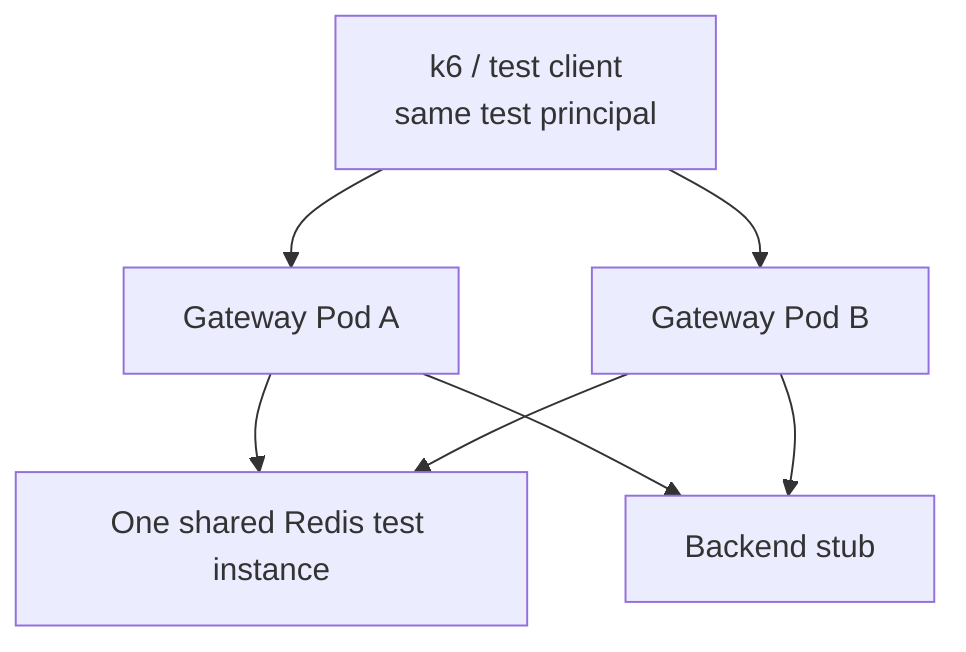

# Hạn mức không đồng nhất giữa nhiều bản sao hoặc Redis không khả dụng

Một API Gateway chạy ba replicas phía sau Kubernetes Service. Nhóm vận hành cấu hình giới hạn **10 requests/giây cho mỗi API key**, nhưng khách hàng phản ánh lúc nhận `429 Too Many Requests` chỉ sau vài request, lúc lại gửi được hàng chục request vượt ngưỡng. Khi tăng số Gateway replicas từ ba lên sáu, tổng traffic vào backend gần như tăng gấp đôi. Trong một lần Redis restart, API vẫn trả `200` dù quota đã bị vượt; ở lần khác, request trả `500` hoặc chờ rất lâu.

Đây là nhóm sự cố **distributed rate limiting**: giới hạn lưu lượng phải có cùng ý nghĩa khi requests đi qua nhiều tiến trình, nhiều route và một kho trạng thái dùng chung. Với **Spring Cloud Gateway Server WebFlux**, `RequestRateLimiter` có thể sử dụng `RedisRateLimiter` theo thuật toán **token bucket**. Tuy nhiên, kết quả còn phụ thuộc vào `KeyResolver`, cách tạo Redis keys, cấu hình từng route, phiên bản Gateway, trạng thái Redis và chính sách khi store gặp lỗi.

Bài học thuộc chương **Chẩn đoán sự cố** của module **SPRING_CLOUD_GATEWAY**. Mục tiêu là tìm ra vì sao quota khác nhau giữa các replicas hoặc mất tác dụng khi Redis không sẵn sàng, rồi thiết kế kiểm thử và runbook để bảo vệ backend. Nội dung tập trung vào Spring Cloud Gateway WebFlux; **Gateway Server Web MVC có cơ chế rate limiter riêng theo phiên bản**, không nên sao chép cấu hình/implementation WebFlux sang Servlet stack.

**Sau bài học, bạn có thể:**

1. Phân biệt giới hạn cục bộ trên mỗi Gateway instance với giới hạn dùng chung trên Redis.
2. Giải thích token bucket, `replenishRate`, `burstCapacity`, `requestedTokens` và vì sao 429 có thể khác nhau.
3. Kiểm tra `KeyResolver`, identity, route scope, Redis endpoint, clock skew và cấu hình giữa replicas.
4. Phân biệt **quota đã cạn**, **key không tìm được**, **Redis lỗi** và **Redis failover** qua status, logs và metrics.
5. Đánh giá fail-open/fail-closed, ảnh hưởng đến availability và khả năng bảo vệ downstream.
6. Kiểm thử nhiều Gateway replicas cùng Redis, mô phỏng Redis outage/failover và xác minh quota tổng.
7. Viết runbook khắc phục, theo dõi và khôi phục rate limiter mà không tạo thêm traffic spike.

> **Lưu ý phiên bản:** Ví dụ chính dùng cấu hình Spring Cloud Gateway Server WebFlux với namespace `spring.cloud.gateway.server.webflux.*` của các phiên bản mới. Gateway 4.x cũ thường dùng `spring.cloud.gateway.*`. Tên property, cấu trúc route, key namespace và một số chi tiết lỗi Redis có thể thay đổi theo release train. Hãy dùng Spring Cloud BOM tương thích Spring Boot, đọc config metadata và kiểm thử đúng artifact đang triển khai. Các host, quota và số replicas trong bài là dữ liệu lab, không phải giá trị production được khuyến nghị.

## 1. Nhận diện triệu chứng trước khi sửa cấu hình

Đừng gộp mọi phản ánh “rate limit không ổn định” thành một lỗi Redis. Trước tiên hãy xác định **request bị từ chối ở đâu và vì lý do gì**.

| Triệu chứng | Nguyên nhân có thể | Bằng chứng cần tìm |
| --- | --- | --- |
| Pod A trả 429, Pod B vẫn trả 200 cho cùng principal | Limiter local, hai pod trỏ tới Redis khác nhau, key khác nhau hoặc config drift | Pod/route ID, Redis endpoint, resolved key đã mask, route revision. |
| Tăng replicas thì tổng quota tăng gần tuyến tính | Mỗi pod có token bucket trong memory | So sánh allowed count khi một và nhiều pods. |
| Một user gọi API A làm cạn quota API B | Hai routes dùng chung key/bucket hoặc scope không như thiết kế | Redis key thực tế và route ID. |
| Một user vượt quota nhưng user khác bị 429 | KeyResolver lấy nhầm IP/tenant, key collision hoặc mọi caller dùng chung key | Principal/tenant đã mask, trusted client IP, key dimension. |
| Request anonymous nhận 403 ngay | KeyResolver trả empty; mặc định empty key bị từ chối | Log KeyResolver, cấu hình `deny-empty-key`. |
| Redis mất kết nối nhưng request vẫn qua | Limiter đang fail-open hoặc có fallback khác | Log Redis script error, `X-RateLimit-Remaining`, status và source code đúng version. |
| Redis mất kết nối thì API trả lỗi/timeout | Fail-closed, exception không được xử lý hoặc timeout quá dài | Stack trace, Redis latency, error mapping và policy. |
| Sau Redis failover quota đột nhiên rộng hơn | Token bucket keys bị mất hoặc replica chưa có các writes mới nhất | Redis replication/failover timeline, key TTL và allowed spike. |
| 429 tăng sau deploy nhưng Redis vẫn khỏe | Rate/burst config khác nhau giữa replicas hoặc route IDs đổi | Config hash, route table và deployment revision. |
| Quota theo IP khiến cả văn phòng cùng bị chặn | Gateway chỉ thấy IP của shared ingress/proxy | `remoteAddress`, forwarded headers và trusted proxy config. |

### 1.1. Phân biệt các HTTP status

| HTTP status | Ý nghĩa trong bài toán này | Không nên suy luận |
| --- | --- | --- |
| **429 Too Many Requests** | Rate limiter xác định request vượt hạn mức theo policy đang chạy. | Không chứng minh Redis đang khỏe; custom limiter có thể dùng local state. |
| **403 Forbidden** | Có thể là empty key bị deny theo mặc định hoặc security policy từ chối. | Không mặc định đây là quota đã cạn. |
| **401 Unauthorized** | Authentication/token không hợp lệ hoặc custom empty-key status được cấu hình thành 401. | Không phải mặc định của Redis quota. |
| **500/502/503/504** | Có thể là Redis/custom limiter, upstream hoặc timeout ở một hop. | Không mặc định Redis outage luôn trả 503. |
| **200/2xx khi Redis down** | Có thể là fail-open, fallback local hoặc request không đi qua limiter. | Không chứng minh quota đang được thực thi. |

Spring Cloud Gateway `RequestRateLimiter` trả **429 theo mặc định khi `RateLimiter` trả kết quả deny**. Việc `KeyResolver` không tìm được key là một nhánh riêng; mặc định requests bị deny với **403**. Redis không khả dụng là một nhánh lỗi khác nữa và phải xác minh behavior của đúng implementation/version.

### 1.2. Bốn câu hỏi đầu tiên khi nhận incident

1. **Request đã đi qua route/filter nào?** Ghi `routeId`, method, path template và Gateway instance.
2. **KeyResolver tạo dimension gì?** Principal, tenant, API key, IP hay một key rỗng?
3. **Các replicas có cùng Redis và cùng route/config không?** Xác minh endpoint, logical DB/cluster, namespace và revision.
4. **Redis có thực thi quyết định hay limiter đang fail-open/fallback?** Đối chiếu status, logs, metrics và test đúng version.

Đừng yêu cầu khách hàng gửi raw API key/JWT để debug. Hãy dùng test identity, masked key fingerprint và correlation ID.

## 2. Token bucket: giới hạn thực sự đang đo điều gì?

`RedisRateLimiter` của Spring Cloud Gateway WebFlux dùng **Token Bucket Algorithm**. Mỗi bucket có:

- **`replenishRate`**: số token được bổ sung mỗi giây.
- **`burstCapacity`**: sức chứa tối đa của bucket.
- **`requestedTokens`**: số token mỗi request tiêu thụ; mặc định là `1`.

Khi request tới:

1. Rate limiter lấy trạng thái bucket (số token còn lại và mốc thời gian).
2. Tính số token được bổ sung theo thời gian đã trôi qua, không vượt `burstCapacity`.
3. Nếu đủ `requestedTokens`, trừ token và cho request đi tiếp.
4. Nếu không đủ, từ chối request; `RequestRateLimiter` thường trả 429.

### 2.1. Ví dụ 10 requests/giây, burst 20

```yaml
redis-rate-limiter.replenishRate: 10
redis-rate-limiter.burstCapacity: 20
redis-rate-limiter.requestedTokens: 1
```

Nếu bucket đang đầy, một client có thể gửi burst tối đa 20 requests. Sau burst đó, bucket được bổ sung khoảng 10 tokens mỗi giây. Vì vậy không nên kiểm thử bằng giả định “cứ đúng request thứ 11 trong giây đầu phải nhận 429” nếu bucket bắt đầu với 20 tokens.

### 2.2. Một request có thể tiêu thụ nhiều tokens

Nếu muốn mô hình hóa một operation tốn tài nguyên hơn, `requestedTokens` có thể lớn hơn 1. Ví dụ tài liệu Gateway mô tả cấu hình:

```yaml
redis-rate-limiter.replenishRate: 1
redis-rate-limiter.burstCapacity: 60
redis-rate-limiter.requestedTokens: 60
```

Với mỗi request tiêu thụ 60 tokens, bucket bổ sung 1 token/giây, tương đương trung bình một request mỗi phút khi bucket đầy và không có requests khác. Cấu hình thực tế phải xét chi phí và burst của operation.

### 2.3. Không nhầm token bucket với fixed window

| Thuộc tính | Token bucket | Fixed window counter |
| --- | --- | --- |
| Trạng thái | Tokens còn lại và thời điểm cập nhật | Counter theo một cửa sổ thời gian |
| Burst | Có thể cho phép đến sức chứa bucket | Có thể dồn burst ở ranh giới hai cửa sổ |
| Refill | Theo thời gian trôi qua | Reset/tăng theo window |
| Cách hiểu quota | Trung bình theo tốc độ refill, có burst | Số requests trong mỗi cửa sổ |

Không dùng công thức fixed-window để giải thích một Redis token bucket. Với SCG, `burstCapacity` và `requestedTokens` ảnh hưởng trực tiếp đến cách request được cho phép.

## 3. Vì sao giới hạn cục bộ không đồng nhất giữa nhiều replicas?

Giả sử có ba Gateway pods sau load balancer:

```text
                     Load Balancer
                    /      |      \
                   v       v       v
             Gateway A  Gateway B  Gateway C
                 |          |          |
              Local A    Local B    Local C
              bucket     bucket     bucket
```

Nếu mỗi process tự giữ một token bucket trong memory, **A, B và C không biết token của nhau**. Cùng một API key có thể nhận một bucket mới khi request được load balancer gửi sang pod khác.

### 3.1. Hạn mức có thể nhân theo số replicas

Giả sử mỗi pod có:

- `replenishRate = 10` requests/giây.
- `burstCapacity = 20`.
- Số replicas `N = 3`.

Nếu mỗi pod có bucket độc lập và traffic được phân bố tương đối đều:

\[
\text{Tổng refill lý thuyết} \approx N \times 10 = 30 \text{ requests/s}
\]

\[
\text{Tổng burst lý thuyết} \approx N \times 20 = 60 \text{ requests}
\]

Đây là **xấp xỉ trong trường hợp mỗi pod thực sự giữ một bucket riêng**. Load balancer có thể không cân bằng hoàn hảo; sticky sessions có thể khiến một client thường xuyên vào một pod; nhưng client vẫn có thể vượt quota toàn hệ thống bằng cách đi qua nhiều replicas.

Khi tăng từ 3 lên 6 pods, quota cục bộ có thể tăng gần gấp đôi. Đây là lý do không nên triển khai `Guava RateLimiter`, `Bucket4j` local cache hoặc `ConcurrentHashMap` per process rồi gọi đó là **global per-user quota**.

### 3.2. Phân biệt local limiter và distributed limiter

| Cách triển khai | Nơi giữ trạng thái | Khi scale Gateway |
| --- | --- | --- |
| `ConcurrentHashMap`/local token bucket | Heap của từng pod | Mỗi pod có quota riêng; tổng quota có thể nhân theo replicas. |
| Bucket4j với Caffeine local cache | Local cache từng process | Cũng là quota cục bộ, trừ khi dùng persistence/distributed proxy thực sự. |
| `RedisRateLimiter` với một Redis dùng chung | Redis shared state | Các replicas truy cập cùng bucket/key; quyết định có thể nhất quán hơn trên toàn cụm. |
| Custom limiter dùng distributed store | Store dùng chung | Phụ thuộc atomicity, key design và consistency của store. |
| Limiter tại ingress/API management | Control plane/store của ingress | Cần kiểm tra scope và semantics riêng của nền tảng. |

**Có Redis dependency trong project chưa đủ để chứng minh rate limiter là distributed.** Phải xác nhận `RequestRateLimiter` thực sự dùng `RedisRateLimiter` hoặc một backend phân tán, và tất cả Gateway pods trỏ tới cùng store.

### 3.3. Bucket4j cũng có thể là local hoặc distributed

Các phiên bản Spring Cloud Gateway WebFlux mới còn hỗ trợ một implementation `RateLimiter` dựa trên **Bucket4j**. Nó cần Bucket4j core và một persistence option. Ví dụ tài liệu có thể cấu hình `AsyncProxyManager` với **Caffeine local cache** để test; nếu mỗi Gateway pod có Caffeine cache riêng, bucket vẫn là **local per pod** và quota có thể nhân theo replicas.

Muốn Bucket4j phân tán, phải cấu hình một `AsyncProxyManager` dùng backend persistence/shared store thích hợp (ví dụ Redis integration được hỗ trợ) và kiểm thử concurrency/failover. Chỉ đổi từ `RedisRateLimiter` sang Bucket4j **không tự làm quota trở thành global**.

Gateway Server Web MVC có **RateLimiter Filter** riêng dựa trên Bucket4j Java DSL. Nó dùng `Function<ServerRequest, String>` làm key resolver; cấu hình và runtime khác WebFlux. Đối chiếu tài liệu Web MVC trước khi áp dụng.

## 4. RedisRateLimiter giải quyết vấn đề nhiều replicas như thế nào?

`RedisRateLimiter` của Spring Cloud Gateway WebFlux sử dụng **Reactive Redis** và một Lua script để thực hiện thao tác kiểm tra/cập nhật bucket trên Redis. Script chạy atomically tại Redis, tránh trường hợp nhiều requests đồng thời cùng đọc một số tokens rồi tất cả đều tự cho rằng còn quota.

```text
Gateway A ----\
Gateway B -----+----> Shared Redis primary / cluster
Gateway C ----/          |
                          +-- token state
                          +-- timestamp state
                          +-- atomic Lua decision
```

Điều kiện để các replicas chia sẻ đúng quota:

1. Tất cả dùng **cùng một Redis deployment/cluster** và cùng logical namespace/DB theo thiết kế.
2. Các pods dùng cùng `KeyResolver` semantics, cùng route policy và cùng version/config tương thích.
3. Redis client gửi các lệnh ghi rate-limit tới primary/shard có quyền ghi, không đọc trạng thái từ một replica có thể stale.
4. Redis keys được tạo nhất quán; với Redis Cluster, các keys mà cùng một Lua script thao tác phải nằm cùng hash slot.
5. Không có custom fallback âm thầm chuyển sang local buckets ở một số pods.

### 4.1. Hai trạng thái Redis của token bucket

Redis implementation dùng các key cho trạng thái token và timestamp. Một số phiên bản có key pattern tương tự:

```text
request_rate_limiter.{bucket-key}.tokens
request_rate_limiter.{bucket-key}.timestamp
```

Phần nằm trong `{...}` là **Redis hash tag**. Redis Cluster dùng hash tag để hai keys có cùng nội dung trong cặp ngoặc được đưa về cùng slot, nhờ đó Lua script có thể thao tác trên chúng trong cùng một node.

**Key pattern cụ thể có thể thay đổi theo Gateway version/custom RateLimiter.** Một số implementation cũ tạo keys chủ yếu từ `KeyResolver` result; các phiên bản/implementation mới có thể đưa thêm `routeId` hoặc scope vào bucket key. Đừng suy luận chỉ từ tên route hoặc từ một bài viết cũ: hãy kiểm tra source của artifact đang dùng và quan sát keys trong Redis test environment.

### 4.2. Cấu hình Redis shared cho Gateway WebFlux

Dependency cần thiết cho Redis limiter:

```xml
<dependency>
    <groupId>org.springframework.boot</groupId>
    <artifactId>spring-boot-starter-data-redis-reactive</artifactId>
</dependency>
```

Ví dụ `application.yml` cho Spring Boot 3.x và Gateway Server WebFlux namespace mới:

```yaml
spring:
  application:
    name: edge-gateway
  data:
    redis:
      host: redis-ratelimit.internal
      port: 6379
      timeout: 500ms
      connect-timeout: 500ms
  cloud:
    gateway:
      server:
        webflux:
          routes:
            - id: customer-api
              uri: lb://customer-service
              predicates:
                - Path=/api/customer/**
              filters:
                - name: RequestRateLimiter
                  args:
                    key-resolver: "#{@principalKeyResolver}"
                    redis-rate-limiter.replenishRate: 10
                    redis-rate-limiter.burstCapacity: 20
                    redis-rate-limiter.requestedTokens: 1

server:
  port: 8080
```

Đây là cấu hình minh họa cho **một route**. Trước khi dùng:

- Đảm bảo Redis hostname resolve được từ tất cả Gateway pods.
- Cấu hình TLS/ACL/credentials theo môi trường; không để password trong Git.
- Kiểm tra namespace property theo đúng Gateway release. Gateway 4.x cũ thường dùng `spring.cloud.gateway.routes`; dòng mới có `spring.cloud.gateway.server.webflux.routes`.
- Không bật route management/Actuator write endpoints public chỉ để quan sát limiter.
- Nếu Redis là cluster/Sentinel/managed service, cấu hình topology và client connection factory tương ứng thay vì giả định một host đơn.

### 4.3. Cấu hình route limiter phải dùng dạng expanded

`RequestRateLimiter` không dùng shortcut notation kiểu:

```properties
spring.cloud.gateway.routes[0].filters[0]=RequestRateLimiter=10, 20
```

Hãy dùng `name: RequestRateLimiter` và `args:` như ví dụ YAML. Nếu filter factory không được nạp do thiếu dependency/starter hoặc nhầm Gateway variant, app có thể không khởi tạo route; đó là **cấu hình filter**, chưa phải Redis outage.
## 5. KeyResolver: cùng một người dùng phải tạo cùng một key

Redis có thể dùng chung hoàn hảo nhưng quota vẫn lệch nếu **Gateway A và Gateway B tạo key khác nhau** cho cùng caller. `KeyResolver` quyết định dimension mà rate limiter kiểm soát.

Một key có thể đại diện cho:

- **Principal/user:** hạn mức theo tài khoản đã xác thực.
- **Tenant/organization:** một quota chung cho toàn bộ users thuộc tenant.
- **API key/client ID:** quota theo ứng dụng tích hợp.
- **IP address:** quota cho traffic anonymous, với điều kiện xác định đúng client IP qua trusted proxies.
- **Route + principal:** bucket riêng theo từng API route và user, nếu policy cần.

### 5.1. Key theo principal đã xác thực

Ví dụ `KeyResolver` đơn giản cho protected API:

```java
package com.example.gateway.ratelimit;

import org.springframework.cloud.gateway.filter.ratelimit.KeyResolver;
import org.springframework.context.annotation.Bean;
import org.springframework.context.annotation.Configuration;
import org.springframework.util.StringUtils;

@Configuration
public class RateLimitKeyConfiguration {

    @Bean
    KeyResolver principalKeyResolver() {
        return exchange -> exchange.getPrincipal()
            .flatMap(principal ->
                reactor.core.publisher.Mono.justOrEmpty(principal.getName()))
            .filter(StringUtils::hasText);
    }
}
```

Ý nghĩa:

- Gateway WebFlux có `PrincipalNameKeyResolver` làm default implementation; nó lấy `Principal` từ `ServerWebExchange` và dùng `Principal.getName()`.
- Sau khi Spring Security xác thực request, `Principal.getName()` trở thành key.
- Nếu chưa có principal, `Mono` rỗng và Gateway áp dụng **empty-key policy**.
- Cùng principal ở mọi replicas phải có cùng cách biểu diễn/case/issuer semantics.

**Không trả về một chuỗi chung như `anonymous` cho mọi request** trừ khi bạn thật sự muốn mọi anonymous callers chia sẻ một bucket toàn cục. Cũng không lấy `?user=alice` hoặc `X-User-Id` do client tự gửi làm bằng chứng identity.

### 5.2. Key theo tenant trong JWT

Nếu một tenant có quota chung cho tất cả thành viên, key có thể lấy từ claim đã được xác minh:

```java
import org.springframework.security.oauth2.server.resource.authentication.JwtAuthenticationToken;
import org.springframework.util.StringUtils;

@Bean
KeyResolver tenantKeyResolver() {
    return exchange -> exchange.getPrincipal()
        .ofType(JwtAuthenticationToken.class)
        .map(authentication ->
            authentication.getToken().getClaimAsString("tenant_id"))
        .filter(StringUtils::hasText);
}
```

**Chỉ dùng claim đã được JWT decoder xác minh** (signature, issuer, expiry và audience theo policy). Nếu token không có `tenant_id`, không tự rơi về một tenant mặc định chung. Nếu cần hỗ trợ nhiều issuer, phải namespace tenant key theo issuer/realm để `tenant_id=42` ở hai hệ thống không vô tình dùng chung quota.

### 5.3. Key theo IP và trusted proxy

Một resolver dùng địa chỉ peer TCP có thể lấy từ `exchange.getRequest().getRemoteAddress()`. Nhưng nếu Gateway chỉ nhận traffic từ ingress, địa chỉ peer có thể luôn là **IP của ingress**, khiến tất cả users chia sẻ một bucket.

Trước khi dùng IP:

1. Xác định ingress/load balancer nào được tin cậy.
2. Cấu hình Gateway chỉ chấp nhận forwarded headers từ **trusted proxies**.
3. Đảm bảo ingress loại giá trị `X-Forwarded-For`/`Forwarded` do client tự gửi rồi ghi lại giá trị đúng.
4. Test nhiều client qua cùng ingress và một client gửi header giả.
5. Không cho client thay đổi key bằng query/header tùy ý.

**Không tin raw `X-Forwarded-For` từ Internet.** Nếu kẻ gọi tự chọn IP trong key, họ có thể tạo vô số buckets và né hạn mức.

### 5.4. Empty key khác Redis outage

Tài liệu `RequestRateLimiter` mô tả mặc định: nếu `KeyResolver` không tìm thấy key, request bị deny. Hai property thường gặp:

- `deny-empty-key`: có cho phép request khi không resolve được key không.
- `empty-key-status-code`: status khi empty key bị deny.

Trong các phiên bản cũ, prefix thường được ghi là `spring.cloud.gateway.filter.request-rate-limiter.*`; các phiên bản Gateway Server WebFlux mới có thể bind dưới `spring.cloud.gateway.server.webflux.filter.request-rate-limiter.*`. Hãy xác minh config metadata của release cụ thể.

**Không tắt deny-empty-key chỉ để hết 403** nếu request cần principal/tenant key. Khi không có key mà cho đi qua, request đó có thể không chịu quota như dự kiến. Và property này **không quyết định fail-open/fail-closed khi Redis mất kết nối**.

### 5.5. Không đưa PII thô vào Redis key nếu không cần

Nếu `Principal.getName()` là email, username hoặc mã khách hàng, Redis keys có thể chứa dữ liệu nhận dạng. Cân nhắc tạo key ổn định, có namespace và pseudonym hóa:

```text
raw identity = verified issuer + ":" + verified subject
bucket key   = "user:" + HMAC-SHA256(secret, raw identity)
```

Ví dụ trên là **nguyên tắc thiết kế**, không phải một KeyResolver hoàn chỉnh. Secret/HMAC key phải dùng chung an toàn giữa replicas và có kế hoạch rotation; không dùng random salt riêng cho mỗi pod vì nó sẽ tạo buckets khác nhau.

## 6. Cùng Redis nhưng quota vẫn khác: kiểm tra scope và cấu hình

Ngay cả khi mọi replicas trỏ tới cùng Redis, các trường hợp sau vẫn có thể tạo cảm giác “hạn mức không đồng nhất”.

### 6.1. Cấu hình route khác nhau giữa replicas

| Replica | replenishRate | burstCapacity | Hành vi |
| --- | ---: | ---: | --- |
| Gateway A | 10 | 20 | Bucket refill 10 tokens/s, burst 20. |
| Gateway B | 20 | 40 | Bucket được phép nhanh/gấp đôi. |
| Gateway C | 10 | 20 | Cùng policy với A. |

Nếu A/B/C dùng chung key, nhưng mỗi pod truyền tham số refill/burst khác nhau vào Lua script, trạng thái bucket có thể được tính theo **tham số của request vừa chạm Redis**. Kết quả sẽ phụ thuộc request vào pod nào và thời điểm nào. Đừng cho rằng Redis shared tự làm cho policy config trở nên đồng nhất.

Kiểm tra:

- ConfigMap/Secret/Helm values và environment overrides của từng pod.
- Spring Cloud BOM, Gateway artifact version và image digest.
- Route definitions có cùng `routeId`, filter args và `KeyResolver` không.
- Dynamic route repository/config refresh đã hội tụ chưa.
- Canary/rolling deployment có để hai versions với rate config khác nhau cùng phục vụ traffic không.

**Một Redis key chỉ lưu trạng thái bucket; nó không tự lưu và áp đặt một policy thống nhất cho mọi replicas.**

### 6.2. Route ID có thể là một phần của bucket scope

Rate limiter có thể cần quota:

- **Toàn user:** một budget dùng chung trên nhiều routes.
- **Theo user + route:** mỗi API có budget riêng.
- **Theo tenant + route group:** một số APIs chia sẻ budget nhưng nhóm khác độc lập.

Đừng giả định các routes cùng principal sẽ dùng chung bucket, hoặc route IDs luôn được đưa vào Redis key. Cách ghép key phụ thuộc Gateway version/implementation và custom `RateLimiter`.

**Kiểm tra trực tiếp trong test environment:**

1. Gửi request cùng principal tới hai route có cùng filter.
2. Quan sát Redis keys được tạo (đã che identity).
3. Làm cạn bucket của route A.
4. Gọi route B và xác định có dùng chung bucket hay không.
5. Lặp lại trên đúng Gateway version đang triển khai.

Nếu muốn **quota toàn user xuyên nhiều routes**, dùng key/limiter có semantics toàn user. Nếu muốn **quota riêng từng route**, bucket key phải có route dimension. Có thể cần custom `RateLimiter` khi built-in behavior không khớp policy; đừng cố sửa bằng cách đổi `KeyResolver` mà chưa hiểu route scope hiện tại.

### 6.3. Hai route có cùng user nhưng rate khác nhau

Giả sử:

| Route | Policy mong muốn |
| --- | --- |
| `/api/search/**` | 10 requests/s, burst 20 |
| `/api/export/**` | 1 request/s, burst 2 |

Nếu cả hai routes vô tình dùng cùng bucket key nhưng truyền cấu hình khác nhau, requests ở route search có thể refill/burst theo policy khác với route export. Hãy kiểm tra bucket namespace thực tế, hoặc thiết kế hai quota keys rõ ràng.

**Đừng dùng hai filter rate limiter trên cùng route với cùng key rồi nghĩ rằng đó là hai quota độc lập.** Tùy implementation, config map hoặc key state có thể bị ghi đè/chia sẻ; cần kiểm thử hoặc dùng limiter custom hỗ trợ nhiều bandwidths.

### 6.4. Clock skew giữa Gateway pods

Token bucket cần tính thời gian refill. Một số implementation gửi timestamp hiện tại từ JVM vào Lua script. Nếu đồng hồ Gateway A nhanh hơn Gateway B:

- A có thể tính refill đã xảy ra nhiều hơn thực tế.
- B có thể gửi timestamp nhỏ hơn timestamp vừa được ghi bởi A.
- Kết quả có thể là refill bất thường hoặc bucket cập nhật không như dự kiến, tùy script/version.

Đảm bảo các nodes dùng NTP/chrony và theo dõi clock offset. **Không sửa clock thủ công trên production** để “đồng bộ” trong khi chưa hiểu ảnh hưởng; kiểm tra offset bằng công cụ vận hành chuẩn và dùng cùng time source.

### 6.5. Redis endpoint/namespace không giống nhau

Các replicas có thể đang trỏ tới:

- Hai Redis deployments khác nhau do env/profile sai.
- Hai logical database index khác nhau.
- Redis cluster khác nhau giữa vùng/cụm.
- Một pod đọc từ replica hoặc proxy endpoint khác.
- Một pod dùng credentials/ACL chỉ truy cập một key prefix/database khác.
- Một nhóm pods có config cache cũ sau secret/endpoint rotation.

So sánh **địa chỉ/cluster identity, database index, key prefix, TLS/ACL identity và topology**, không log password hoặc full connection URI chứa secret.

## 7. Redis không khả dụng: fail-open hay fail-closed?

Đây là câu hỏi quan trọng nhất khi Redis là thành phần nằm trên **đường xử lý mỗi request**.

### 7.1. Hai chính sách khác nhau

| Chính sách | Khi Redis không trả được quyết định | Ưu điểm | Rủi ro |
| --- | --- | --- | --- |
| **Fail-open** | Cho request đi tiếp hoặc dùng fallback cho phép | API vẫn có thể hoạt động khi Redis outage | Quota bị vô hiệu hóa; backend có thể bị flood/abuse. |
| **Fail-closed** | Không cho request đi tiếp nếu không xác minh được quota | Bảo vệ downstream và quota nghiêm hơn | Redis outage có thể làm API từ chối cả khách hàng hợp lệ. |

Không có chính sách đúng cho mọi route:

- Catalog GET có thể ưu tiên availability, nếu backend còn đủ capacity và có lớp bảo vệ khác.
- API tạo đơn, thanh toán, OTP hoặc tốn chi phí bên thứ ba có thể cần fail-closed/coarse fallback nghiêm ngặt.
- Một global rate limit chống DDoS có thể cần enforcement ở ingress/WAF để không phụ thuộc một Redis của ứng dụng.

### 7.2. RedisRateLimiter có thể fail-open khi Redis script lỗi

**Không giả định `RedisRateLimiter` luôn fail-closed khi Redis unavailable.** Một số implementation của Spring Cloud Gateway có xử lý lỗi Lua/Redis bằng cách trả `allowed=true` với số token còn lại không xác định (ví dụ `-1`). Mục đích là không tạo hard dependency vào Redis để cho phép traffic. Đây là behavior **phụ thuộc phiên bản/source code**, không phải một cam kết giống nhau cho mọi release hoặc custom limiter.

Tài liệu Gateway nêu 429 khi limiter quyết định từ chối request, nhưng không nên dùng mô tả đó để suy ra cách mọi lỗi kết nối Redis được xử lý. Vì vậy:

1. Xem source của `RedisRateLimiter` đúng artifact/version trong dependency tree.
2. Tạo test integration làm Redis timeout/refused.
3. Ghi status, response headers, logs và backend hit count.
4. Xác định rõ policy thực tế là fail-open, fail-closed hay exception-to-5xx.
5. Đưa kết quả thành regression test khi nâng Spring Cloud Gateway.

**Nếu Redis lỗi mà request vẫn trả 200, điều đó có thể là fail-open có chủ ý, không phải bằng chứng quota vẫn hoạt động.** Phải có alert và một lớp bảo vệ bổ sung nếu backend không chịu được traffic không giới hạn.

### 7.3. Empty-key policy không phải Redis outage policy

Hai nhánh phải tách biệt:

| Nhánh | Ví dụ | Cách xử lý |
| --- | --- | --- |
| KeyResolver trả empty | Request chưa authenticated, thiếu API key hoặc claim tenant không có | Mặc định deny empty key; kiểm tra identity/KeyResolver. |
| Redis không kết nối được | DNS/ACL/TLS/timeout/primary down | Fail-open/fail-closed theo implementation và policy đã phê duyệt. |

`deny-empty-key=true` **không tự biến Redis outage thành fail-closed**. Ngược lại, `deny-empty-key=false` có thể cho request thiếu key đi qua limiter mà không được giới hạn như mong đợi.

### 7.4. Vì sao 429 không phải status phù hợp cho mọi lỗi Redis?

429 có nghĩa client vượt quota. Nếu Redis đang down và hệ thống **không thể xác định** quota, trả 429 có thể khiến client hiểu sai và retry theo một lịch không phù hợp.

Trong một thiết kế custom fail-closed, có thể chọn:

- **503 Service Unavailable** nếu quota service/store không sẵn sàng và request bị từ chối tạm thời.
- **429 Too Many Requests** khi bucket thực sự cạn.
- `Retry-After` chỉ khi hệ thống có thể đưa ra thời điểm thử lại có ý nghĩa.

`RequestRateLimiter` mặc định trả 429 khi `RateLimiter` trả deny. Muốn phân biệt “quota exhausted” với “store unavailable”, thường cần custom `RateLimiter`/filter hoặc error handling có phân loại rõ. **Đừng đổi tất cả lỗi Redis thành 429 mà không phân biệt nguyên nhân.**

### 7.5. Pseudocode cho custom fail-closed

Đoạn sau mô tả **ý tưởng**, không phải implementation biên dịch ngay:

```java
return delegate.isAllowed(routeId, key)
    .onErrorResume(redisError -> {
        redisLimiterErrors.increment();
        if (policy == FAIL_CLOSED) {
            return Mono.just(denyWithServiceUnavailable());
        }
        return Mono.just(allowWithUnknownRemaining());
    });
```

Một implementation thật cần:

- Phân biệt lỗi Redis với lỗi lập trình/cấu hình/validation.
- Không bắt mọi `Throwable` rồi cho qua.
- Có timeout hữu hạn cho Redis request.
- Đếm/log lỗi và trạng thái fallback.
- Không đưa raw key/token vào logs.
- Có test cho Redis timeout, connection refused, ACL denied và recovery.
- Đảm bảo fallback không tự tạo bucket local riêng ở từng pod nếu policy cần quota toàn cụm.
## 8. Redis HA/failover không đồng nghĩa strong consistency

Redis shared state giải quyết việc nhiều Gateway replicas cùng nhìn một bucket trong điều kiện bình thường. Nhưng Redis replication/failover vẫn có các giới hạn cần tính tới.

### 8.1. Redis replication mặc định là asynchronous

Trong cấu hình replication phổ biến, primary xác nhận write trước khi replica chắc chắn nhận được write đó. Nếu primary hỏng ngay sau khi trả lời, một số updates mới nhất có thể chưa được replica tiếp nhận. Sau failover:

- Token count có thể quay về trạng thái cũ.
- Timestamp bucket có thể thiếu một update.
- Một bucket vừa bị cạn có thể xuất hiện nhiều tokens hơn mong đợi.
- Request burst có thể được cho phép vượt dự kiến trong một khoảng ngắn.

**Rate limiter Redis là cơ chế điều tiết traffic phân tán, không phải ledger strongly consistent cho tiền/quota tính phí.** Nếu cần hard quota tài chính hoặc hạn mức pháp lý không được vượt, hãy dùng một hệ thống có transaction/consistency phù hợp ở lớp nghiệp vụ.

Redis có lệnh `WAIT` để chờ một số replicas xác nhận các writes trước đó, nhưng tài liệu Redis nhấn mạnh `WAIT` **không biến Redis thành hệ thống strongly consistent**. Không mặc định Spring Cloud Gateway RedisRateLimiter tự gọi `WAIT`; cần xem implementation/client thực tế.

### 8.2. Redis Cluster và hash slot

Token bucket thường cần thao tác trên nhiều keys (token state và timestamp state) trong cùng Lua script. Với Redis Cluster, các keys của một script phải cùng slot. Redis hash tag trong key pattern giúp đạt điều đó:

```text
request_rate_limiter.{customer-42}.tokens
request_rate_limiter.{customer-42}.timestamp
```

Hai keys có cùng chuỗi hash tag `customer-42`, do đó được đặt cùng slot. Nếu custom RateLimiter tự tạo keys nhưng không dùng cùng hash tag, script có thể gặp lỗi CROSSSLOT trong Redis Cluster.

Kiểm tra trong test cluster:

```bash
redis-cli -c CLUSTER KEYSLOT 'request_rate_limiter.{customer-42}.tokens'
redis-cli -c CLUSTER KEYSLOT 'request_rate_limiter.{customer-42}.timestamp'
```

Hai kết quả phải giống nhau nếu cùng script cần truy cập cả hai keys. **Key pattern thực tế phải lấy từ đúng version/custom limiter**, không dùng nguyên chuỗi ví dụ này nếu implementation tạo tên khác.

### 8.3. Eviction có thể làm bucket trở lại trạng thái đầy

Nếu Redis dùng chung với cache/session và bị áp lực memory, key token bucket có thể bị evict trước thời hạn. Khi key mất, lần tiếp theo limiter có thể tạo bucket mới với trạng thái khởi tạo, thường cho phép burst theo cấu hình.

Điều cần xem:

- `maxmemory` và `maxmemory-policy`.
- `evicted_keys`, `expired_keys`, memory fragmentation và used memory.
- Số lượng identities/keys mới mỗi phút.
- TTL của token/timestamp keys theo đúng implementation.
- Redis có bị dùng chung với cache có cardinality lớn hay không.

**Không đổi Redis sang `noeviction` một cách máy móc.** Khi hết memory, write script có thể lỗi; nếu limiter fail-open thì request lại được phép. Ưu tiên cấp memory headroom, tách workload rate-limit khỏi cache/session nếu cần, giám sát eviction và kiểm thử behavior khi write bị từ chối.

### 8.4. Một key cho mỗi caller có thể tạo cardinality rất lớn

Nếu KeyResolver dùng query parameter hoặc header tùy ý, attacker có thể tạo vô số keys:

```text
?user=a1
?user=a2
?user=a3
...
```

Mỗi key có thể tạo trạng thái tokens/timestamp và tiêu thụ memory. Hãy dùng identity đã xác thực, giới hạn độ dài/charset, namespace rõ và không cho client tạo bucket ID tùy ý. Với anonymous traffic, dùng coarse IP/device identity ở trusted edge và có quota chung bổ sung.

### 8.5. Redis multi-region không tự có một quota toàn cầu tuyệt đối

Nếu mỗi region có Redis riêng hoặc dùng replication bất đồng bộ:

| Thiết kế | Hệ quả |
| --- | --- |
| Một Redis primary trung tâm | Một bucket chung, nhưng mọi regions chịu latency/network dependency tới trung tâm. |
| Mỗi region một Redis riêng | Quota theo region; tổng global có thể là tổng các budgets. |
| Active-Active/CRDT theo sản phẩm | Semantics phụ thuộc implementation; có thể hội tụ toàn cục nhưng không mặc định là strict hard cap cho mọi request đồng thời. |
| Chia budget trước cho từng region | Tổng quota có thể được giới hạn theo allocation, nhưng cần xử lý khi traffic lệch vùng. |

Nếu cần giới hạn toàn cầu với semantics chặt, hãy chọn một control plane/store có consistency phù hợp hoặc phân bổ quota trước cho từng region. **Không giả định Redis replicas ở nhiều vùng sẽ lập tức nhìn cùng một token count.**

## 9. Quan sát Redis và Gateway để tìm nguyên nhân

### 9.1. Metrics cần có

| Nhóm | Metric/log cần theo dõi | Câu hỏi trả lời |
| --- | --- | --- |
| Gateway requests | Rate theo `routeId`, method, status; 429/403/5xx | Route nào bị ảnh hưởng? |
| Rate limiter decisions | Allowed/denied counts, empty-key count, fallback count | Quota cạn hay key không có? |
| Redis client | Command latency, connection failures, timeout, pending acquires | Redis chậm hay không truy cập được? |
| Redis server | `used_memory`, `evicted_keys`, rejected connections, ops/s | Store có áp lực hoặc evict keys? |
| Redis HA | Replication offset/lag, primary changes, failover events | Có mất cập nhật khi failover? |
| Gateway replicas | Image/config hash, route revision, instance ID | Các pods có cùng policy? |
| Identity | KeyResolver empty/error count, issuer/tenant mapping version | Key có ổn định giữa pods? |
| Downstream | RPS, concurrency, 5xx, saturation | Fail-open có làm backend quá tải? |

### 9.2. Dùng rate-limit headers đúng cách

RedisRateLimiter thường có thể trả các headers dạng:

```http
X-RateLimit-Remaining: 4
X-RateLimit-Replenish-Rate: 10
X-RateLimit-Burst-Capacity: 20
```

Tên headers có thể được cấu hình. Trong fail-open, `Remaining` có thể là giá trị sentinel như `-1` tùy implementation. Vì vậy:

- Không coi `Remaining=-1` là “còn vô hạn quota” nếu chưa xác minh ý nghĩa theo version.
- Không dùng headers do client gửi để ra quyết định quota.
- Cân nhắc có nên expose rate/burst config cho public client không.
- Ghi headers và status trong test; không log Authorization/Cookie/API key.

### 9.3. Gateway metrics không thay Redis error metrics

`spring.cloud.gateway.requests` có thể giúp quan sát request theo route/status/latency khi Actuator/Micrometer được cấu hình. Nhưng nếu Redis lỗi và limiter **fail-open**, Gateway vẫn có thể ghi 2xx như bình thường. Một dashboard chỉ nhìn 2xx/5xx sẽ bỏ sót việc quota bị vô hiệu.

Hãy thêm counter/alert riêng cho:

- Redis rate-limit script errors.
- Redis connection/timeout failures.
- Fallback mode active.
- Empty KeyResolver result.
- Allowed requests trong lúc limiter store không healthy.
- Redis eviction/failover events.

Nếu dùng custom limiter, metric names có thể là `gateway.ratelimiter.redis.errors`, `gateway.ratelimiter.fallback.allowed` và `gateway.ratelimiter.empty_key`; đây là **tên đề xuất**, không phải metrics built-in mặc định.

### 9.4. Cardinality và privacy

Không gắn raw user ID, tenant ID, API key, IP, full URI hoặc Redis bucket key làm Prometheus labels. Dùng:

- `routeId`, status, method, environment, limiterMode.
- Logs/traces có correlation ID và key fingerprint đã mask.
- Dashboard drill-down có RBAC, retention và audit.

## 10. Runbook: chẩn đoán hạn mức không đồng nhất

Thực hiện theo thứ tự; không reset toàn bộ Redis keys ngay khi thấy 429 bất thường.

### Bước 1 — Phân loại status và scope

1. Lấy một request ID từ khách hàng/test.
2. Xác định status 429/403/5xx/2xx.
3. Ghi route ID, method, Gateway pod, image version và timestamp.
4. Xác định caller là principal, tenant, API key hay anonymous.
5. Kiểm tra request có đi qua đúng route/filter không.

### Bước 2 — So sánh các Gateway replicas

Kiểm tra deployment:

```bash
kubectl -n gateway get pods -l app=edge-gateway -o wide
kubectl -n gateway get deployment edge-gateway -o yaml
```

Đối chiếu giữa các pods:

- Image digest và Spring Boot/Cloud/Gateway versions.
- ConfigMap/Secret revision và environment variables.
- Route IDs, filter args, KeyResolver bean và security config.
- Redis host/cluster endpoint, DB index và credentials identity (không in secret).
- Clock offset/NTP status.

### Bước 3 — Xác minh Redis primary/cluster

Trong môi trường có quyền vận hành Redis:

```bash
redis-cli -h redis-ratelimit.internal -p 6379 PING
redis-cli -h redis-ratelimit.internal -p 6379 INFO replication
redis-cli -h redis-ratelimit.internal -p 6379 INFO memory
```

Nếu dùng Redis Cluster:

```bash
redis-cli -c -h redis-ratelimit.internal -p 6379 CLUSTER INFO
redis-cli -c -h redis-ratelimit.internal -p 6379 CLUSTER NODES
```

Lệnh là ví dụ cho lab; xác thực bằng ACL/TLS theo môi trường. Không ghi credentials vào shell history hoặc log.

### Bước 4 — Kiểm tra keys một cách an toàn

Để tìm keys trong lab hoặc môi trường đã được phép:

```bash
redis-cli --scan --pattern 'request_rate_limiter.*' | head -n 50
```

Trên production, dùng `SCAN` có giới hạn và theo dõi tải; **không chạy `KEYS *`** trên Redis đang phục vụ traffic. Khi đã có key đã mask:

```bash
redis-cli -c TYPE 'request_rate_limiter.{masked-key}.tokens'
redis-cli -c TTL 'request_rate_limiter.{masked-key}.tokens'
redis-cli -c CLUSTER KEYSLOT 'request_rate_limiter.{masked-key}.tokens'
redis-cli -c CLUSTER KEYSLOT 'request_rate_limiter.{masked-key}.timestamp'
```

Không tự `GET`/`HGETALL` mọi key khi chưa biết type và cấu trúc của đúng version. Không xóa token/timestamp keys để “reset quota” trên production; thao tác đó có thể tạo burst mới cho tất cả caller.

### Bước 5 — Xác minh KeyResolver

Trong test environment:

1. Gửi cùng một principal tới Pod A và Pod B.
2. Log key fingerprint (không log raw identity).
3. Xác nhận hai pods tạo cùng key.
4. Gửi request không có token/claim và xác nhận empty-key behavior.
5. Thử client giả `X-Forwarded-For`, `X-User-Id`, `X-Tenant-Id` để xác nhận chúng không điều khiển key trái phép.

### Bước 6 — Phân biệt local state và Redis shared state

Tạm thời gọi trực tiếp hai Gateway pods trong cluster test (hoặc dùng internal test ingress có thể chọn pod):

- Dùng cùng API key/principal.
- Dùng cùng route ID và cùng policy.
- Gửi traffic luân phiên qua A và B.
- Quan sát tổng allowed/429 và Redis keys.

Nếu từng pod có quota độc lập và tổng quota tăng theo số pods, có thể limiter đang giữ local state hoặc các pods không dùng cùng key/store.

### Bước 7 — Kiểm tra Redis outage policy

Trong staging riêng:

1. Chạy baseline khi Redis healthy.
2. Chặn kết nối Gateway → Redis hoặc làm Redis test endpoint unavailable.
3. Gửi cùng workload đã biết.
4. Ghi status, latency, logs, rate-limit headers và backend hit count.
5. Xác nhận fail-open/fail-closed theo policy đã phê duyệt.
6. Khôi phục Redis, kiểm tra reconnect và bucket state.

**Không dừng Redis production để kiểm tra.** Dùng Redis test riêng, firewall/network fault injection có giới hạn và người chịu trách nhiệm quan sát.

### Bước 8 — Khôi phục

- Nếu config drift: đưa các replicas về cùng route/policy revision, rollout có kiểm soát.
- Nếu Redis endpoint sai: sửa config/secret source of truth và xác minh tất cả pods đã nạp.
- Nếu Redis failover: xác minh primary/replication/keys trước khi nâng lại traffic.
- Nếu fail-open đang active: áp lớp coarse rate limit/WAF hoặc giới hạn downstream theo incident plan.
- Nếu fail-closed làm API từ chối toàn bộ: thông báo rõ sự cố dependency, không âm thầm bypass quota nếu chưa được phê duyệt.
- Theo dõi 429/5xx/backend RPS sau recovery; không xóa hàng loạt keys để làm số liệu đẹp.

## 11. Kiểm thử hai Gateway replicas dùng chung Redis

Mục tiêu là chứng minh **quota là tổng của cả cụm**, không phải quota riêng từng pod.

### 11.1. Lab topology



Chuẩn bị:

- Hai Gateway instances có cùng image/config, cùng `routeId` và cùng `KeyResolver`.
- Một Redis test instance/cluster dùng chung.
- Một backend stub ghi lại số requests đã được forward.
- Một test principal/API key duy nhất.
- Rate nhỏ để dễ quan sát, ví dụ refill 1 token/s, burst 10, requestedTokens 1.

### 11.2. Thử local limiter để thấy lỗi nhân quota

Trước tiên, dùng một limiter local có bucket riêng ở mỗi process:

| Pod | Bucket ban đầu | Allowed trong burst |
| --- | ---: | ---: |
| A | 10 tokens | 10 |
| B | 10 tokens | 10 |
| **Tổng** | **20 tokens** | **Có thể cho phép 20 requests** |

Đây là expected behavior của **hai buckets local**, nhưng không phải quota toàn cụm mong muốn là 10.

### 11.3. Thử RedisRateLimiter shared

Với cùng Redis key và cùng policy:

1. Gửi 6 requests qua Pod A.
2. Gửi thêm 6 requests qua Pod B ngay sau đó.
3. Kiểm tra backend stub chỉ nhận số requests trong tổng bucket cho phép (có tính refill theo thời gian).
4. Đổi thứ tự A/B và lặp lại.
5. Scale thêm một Gateway replica C và lặp lại.

Với burst 10 và refill 1 token/s, số requests được phép trong một khoảng ngắn **xấp xỉ burst ban đầu cộng số tokens được refill trong khoảng đó**. Không hardcode chính xác request thứ 11 nếu thời gian chạy/latency/test scheduling khác nhau.

### 11.4. Kiểm tra route scope

Nếu cùng principal gọi hai routes:

1. Gửi requests tới route A đến khi nhận 429.
2. Gọi route B.
3. Xem route B còn quota riêng hay chia sẻ bucket.
4. Đối chiếu Redis key pattern và source code đúng Gateway version.

Kết quả phải khớp **quota contract** của hệ thống: per-user global, per-user-per-route hoặc per-tenant. Không có một scope mặc định đúng cho mọi API.
## 8. Redis HA/failover không đồng nghĩa strong consistency

Redis shared state giải quyết việc nhiều Gateway replicas cùng nhìn một bucket trong điều kiện bình thường. Nhưng Redis replication/failover vẫn có các giới hạn cần tính tới.

### 8.1. Redis replication mặc định là asynchronous

Trong cấu hình replication phổ biến, primary xác nhận write trước khi replica chắc chắn nhận được write đó. Nếu primary hỏng ngay sau khi trả lời, một số updates mới nhất có thể chưa được replica tiếp nhận. Sau failover:

- Token count có thể quay về trạng thái cũ.
- Timestamp bucket có thể thiếu một update.
- Một bucket vừa bị cạn có thể xuất hiện nhiều tokens hơn mong đợi.
- Request burst có thể được cho phép vượt dự kiến trong một khoảng ngắn.

**Rate limiter Redis là cơ chế điều tiết traffic phân tán, không phải ledger strongly consistent cho tiền/quota tính phí.** Nếu cần hard quota tài chính hoặc hạn mức pháp lý không được vượt, hãy dùng một hệ thống có transaction/consistency phù hợp ở lớp nghiệp vụ.

Redis có lệnh `WAIT` để chờ một số replicas xác nhận các writes trước đó, nhưng tài liệu Redis nhấn mạnh `WAIT` **không biến Redis thành hệ thống strongly consistent**. Không mặc định Spring Cloud Gateway RedisRateLimiter tự gọi `WAIT`; cần xem implementation/client thực tế.

### 8.2. Redis Cluster và hash slot

Token bucket thường cần thao tác trên nhiều keys (token state và timestamp state) trong cùng Lua script. Với Redis Cluster, các keys của một script phải cùng slot. Redis hash tag trong key pattern giúp đạt điều đó:

```text
request_rate_limiter.{customer-42}.tokens
request_rate_limiter.{customer-42}.timestamp
```

Hai keys có cùng chuỗi hash tag `customer-42`, do đó được đặt cùng slot. Nếu custom RateLimiter tự tạo keys nhưng không dùng cùng hash tag, script có thể gặp lỗi CROSSSLOT trong Redis Cluster.

Kiểm tra trong test cluster:

```bash
redis-cli -c CLUSTER KEYSLOT 'request_rate_limiter.{customer-42}.tokens'
redis-cli -c CLUSTER KEYSLOT 'request_rate_limiter.{customer-42}.timestamp'
```

Hai kết quả phải giống nhau nếu cùng script cần truy cập cả hai keys. **Key pattern thực tế phải lấy từ đúng version/custom limiter**, không dùng nguyên chuỗi ví dụ này nếu implementation tạo tên khác.

### 8.3. Eviction có thể làm bucket trở lại trạng thái đầy

Nếu Redis dùng chung với cache/session và bị áp lực memory, key token bucket có thể bị evict trước thời hạn. Khi key mất, lần tiếp theo limiter có thể tạo bucket mới với trạng thái khởi tạo, thường cho phép burst theo cấu hình.

Điều cần xem:

- `maxmemory` và `maxmemory-policy`.
- `evicted_keys`, `expired_keys`, memory fragmentation và used memory.
- Số lượng identities/keys mới mỗi phút.
- TTL của token/timestamp keys theo đúng implementation.
- Redis có bị dùng chung với cache có cardinality lớn hay không.

**Không đổi Redis sang `noeviction` một cách máy móc.** Khi hết memory, write script có thể lỗi; nếu limiter fail-open thì request lại được phép. Ưu tiên cấp memory headroom, tách workload rate-limit khỏi cache/session nếu cần, giám sát eviction và kiểm thử behavior khi write bị từ chối.

### 8.4. Một key cho mỗi caller có thể tạo cardinality rất lớn

Nếu KeyResolver dùng query parameter hoặc header tùy ý, attacker có thể tạo vô số keys:

```text
?user=a1
?user=a2
?user=a3
...
```

Mỗi key có thể tạo trạng thái tokens/timestamp và tiêu thụ memory. Hãy dùng identity đã xác thực, giới hạn độ dài/charset, namespace rõ và không cho client tạo bucket ID tùy ý. Với anonymous traffic, dùng coarse IP/device identity ở trusted edge và có quota chung bổ sung.

### 8.5. Redis multi-region không tự có một quota toàn cầu tuyệt đối

Nếu mỗi region có Redis riêng hoặc dùng replication bất đồng bộ:

| Thiết kế | Hệ quả |
| --- | --- |
| Một Redis primary trung tâm | Một bucket chung, nhưng mọi regions chịu latency/network dependency tới trung tâm. |
| Mỗi region một Redis riêng | Quota theo region; tổng global có thể là tổng các budgets. |
| Active-Active/asynchronous replication | Có thể có divergence trong lúc partition/failover; không coi là strict global counter. |
| Chia budget trước cho từng region | Tổng quota có thể được giới hạn theo allocation, nhưng cần xử lý khi traffic lệch vùng. |

Nếu cần giới hạn toàn cầu với semantics chặt, hãy chọn một control plane/store có consistency phù hợp hoặc phân bổ quota trước cho từng region. **Không giả định Redis replicas ở nhiều vùng sẽ lập tức nhìn cùng một token count.**

## 9. Quan sát Redis và Gateway để tìm nguyên nhân

### 9.1. Metrics cần có

| Nhóm | Metric/log cần theo dõi | Câu hỏi trả lời |
| --- | --- | --- |
| Gateway requests | Rate theo `routeId`, method, status; 429/403/5xx | Route nào bị ảnh hưởng? |
| Rate limiter decisions | Allowed/denied counts, empty-key count, fallback count | Quota cạn hay key không có? |
| Redis client | Command latency, connection failures, timeout, pending acquires | Redis chậm hay không truy cập được? |
| Redis server | `used_memory`, `evicted_keys`, rejected connections, ops/s | Store có áp lực hoặc evict keys? |
| Redis HA | Replication offset/lag, primary changes, failover events | Có mất cập nhật khi failover? |
| Gateway replicas | Image/config hash, route revision, instance ID | Các pods có cùng policy? |
| Identity | KeyResolver empty/error count, issuer/tenant mapping version | Key có ổn định giữa pods? |
| Downstream | RPS, concurrency, 5xx, saturation | Fail-open có làm backend quá tải? |

### 9.2. Dùng rate-limit headers đúng cách

RedisRateLimiter thường có thể trả các headers dạng:

```http
X-RateLimit-Remaining: 4
X-RateLimit-Replenish-Rate: 10
X-RateLimit-Burst-Capacity: 20
```

Tên headers có thể được cấu hình. Trong fail-open, `Remaining` có thể là giá trị sentinel như `-1` tùy implementation. Vì vậy:

- Không coi `Remaining=-1` là “còn vô hạn quota” nếu chưa xác minh ý nghĩa theo version.
- Không dùng headers do client gửi để ra quyết định quota.
- Cân nhắc có nên expose rate/burst config cho public client không.
- Ghi headers và status trong test; không log Authorization/Cookie/API key.

### 9.3. Gateway metrics không thay Redis error metrics

`spring.cloud.gateway.requests` có thể giúp quan sát request theo route/status/latency khi Actuator/Micrometer được cấu hình. Nhưng nếu Redis lỗi và limiter **fail-open**, Gateway vẫn có thể ghi 2xx như bình thường. Một dashboard chỉ nhìn 2xx/5xx sẽ bỏ sót việc quota bị vô hiệu.

Hãy thêm counter/alert riêng cho:

- Redis rate-limit script errors.
- Redis connection/timeout failures.
- Fallback mode active.
- Empty KeyResolver result.
- Allowed requests trong lúc limiter store không healthy.
- Redis eviction/failover events.

Nếu dùng custom limiter, metric names có thể là `gateway.ratelimiter.redis.errors`, `gateway.ratelimiter.fallback.allowed` và `gateway.ratelimiter.empty_key`; đây là **tên đề xuất**, không phải metrics built-in mặc định.

### 9.4. Cardinality và privacy

Không gắn raw user ID, tenant ID, API key, IP, full URI hoặc Redis bucket key làm Prometheus labels. Dùng:

- `routeId`, status, method, environment, limiterMode.
- Logs/traces có correlation ID và key fingerprint đã mask.
- Dashboard drill-down có RBAC, retention và audit.

## 10. Runbook: chẩn đoán hạn mức không đồng nhất

Thực hiện theo thứ tự; không reset toàn bộ Redis keys ngay khi thấy 429 bất thường.

### Bước 1 — Phân loại status và scope

1. Lấy một request ID từ khách hàng/test.
2. Xác định status 429/403/5xx/2xx.
3. Ghi route ID, method, Gateway pod, image version và timestamp.
4. Xác định caller là principal, tenant, API key hay anonymous.
5. Kiểm tra request có đi qua đúng route/filter không.

### Bước 2 — So sánh các Gateway replicas

Kiểm tra deployment:

```bash
kubectl -n gateway get pods -l app=edge-gateway -o wide
kubectl -n gateway get deployment edge-gateway -o yaml
```

Đối chiếu giữa các pods:

- Image digest và Spring Boot/Cloud/Gateway versions.
- ConfigMap/Secret revision và environment variables.
- Route IDs, filter args, KeyResolver bean và security config.
- Redis host/cluster endpoint, DB index và credentials identity (không in secret).
- Clock offset/NTP status.

### Bước 3 — Xác minh Redis primary/cluster

Trong môi trường có quyền vận hành Redis:

```bash
redis-cli -h redis-ratelimit.internal -p 6379 PING
redis-cli -h redis-ratelimit.internal -p 6379 INFO replication
redis-cli -h redis-ratelimit.internal -p 6379 INFO memory
```

Nếu dùng Redis Cluster:

```bash
redis-cli -c -h redis-ratelimit.internal -p 6379 CLUSTER INFO
redis-cli -c -h redis-ratelimit.internal -p 6379 CLUSTER NODES
```

Lệnh là ví dụ cho lab; xác thực bằng ACL/TLS theo môi trường. Không ghi credentials vào shell history hoặc log.

### Bước 4 — Kiểm tra keys một cách an toàn

Để tìm keys trong lab hoặc môi trường đã được phép:

```bash
redis-cli --scan --pattern 'request_rate_limiter.*' | head -n 50
```

Trên production, dùng `SCAN` có giới hạn và theo dõi tải; **không chạy `KEYS *`** trên Redis đang phục vụ traffic. Khi đã có key đã mask:

```bash
redis-cli -c TYPE 'request_rate_limiter.{masked-key}.tokens'
redis-cli -c TTL 'request_rate_limiter.{masked-key}.tokens'
redis-cli -c CLUSTER KEYSLOT 'request_rate_limiter.{masked-key}.tokens'
redis-cli -c CLUSTER KEYSLOT 'request_rate_limiter.{masked-key}.timestamp'
```

Không tự `GET`/`HGETALL` mọi key khi chưa biết type và cấu trúc của đúng version. Không xóa token/timestamp keys để “reset quota” trên production; thao tác đó có thể tạo burst mới cho tất cả caller.

### Bước 5 — Xác minh KeyResolver

Trong test environment:

1. Gửi cùng một principal tới Pod A và Pod B.
2. Log key fingerprint (không log raw identity).
3. Xác nhận hai pods tạo cùng key.
4. Gửi request không có token/claim và xác nhận empty-key behavior.
5. Thử client giả `X-Forwarded-For`, `X-User-Id`, `X-Tenant-Id` để xác nhận chúng không điều khiển key trái phép.

### Bước 6 — Phân biệt local state và Redis shared state

Tạm thời gọi trực tiếp hai Gateway pods trong cluster test (hoặc dùng internal test ingress có thể chọn pod):

- Dùng cùng API key/principal.
- Dùng cùng route ID và cùng policy.
- Gửi traffic luân phiên qua A và B.
- Quan sát tổng allowed/429 và Redis keys.

Nếu từng pod có quota độc lập và tổng quota tăng theo số pods, có thể limiter đang giữ local state hoặc các pods không dùng cùng key/store.

### Bước 7 — Kiểm tra Redis outage policy

Trong staging riêng:

1. Chạy baseline khi Redis healthy.
2. Chặn kết nối Gateway → Redis hoặc làm Redis test endpoint unavailable.
3. Gửi cùng workload đã biết.
4. Ghi status, latency, logs, rate-limit headers và backend hit count.
5. Xác nhận fail-open/fail-closed theo policy đã phê duyệt.
6. Khôi phục Redis, kiểm tra reconnect và bucket state.

**Không dừng Redis production để kiểm tra.** Dùng Redis test riêng, firewall/network fault injection có giới hạn và người chịu trách nhiệm quan sát.

### Bước 8 — Khôi phục

- Nếu config drift: đưa các replicas về cùng route/policy revision, rollout có kiểm soát.
- Nếu Redis endpoint sai: sửa config/secret source of truth và xác minh tất cả pods đã nạp.
- Nếu Redis failover: xác minh primary/replication/keys trước khi nâng lại traffic.
- Nếu fail-open đang active: áp lớp coarse rate limit/WAF hoặc giới hạn downstream theo incident plan.
- Nếu fail-closed làm API từ chối toàn bộ: thông báo rõ sự cố dependency, không âm thầm bypass quota nếu chưa được phê duyệt.
- Theo dõi 429/5xx/backend RPS sau recovery; không xóa hàng loạt keys để làm số liệu đẹp.

## 11. Kiểm thử hai Gateway replicas dùng chung Redis

Mục tiêu là chứng minh **quota là tổng của cả cụm**, không phải quota riêng từng pod.

### 11.1. Lab topology


Chuẩn bị:

- Hai Gateway instances có cùng image/config, cùng `routeId` và cùng `KeyResolver`.
- Một Redis test instance/cluster dùng chung.
- Một backend stub ghi lại số requests đã được forward.
- Một test principal/API key duy nhất.
- Rate nhỏ để dễ quan sát, ví dụ refill 1 token/s, burst 10, requestedTokens 1.

### 11.2. Thử local limiter để thấy lỗi nhân quota

Trước tiên, dùng một limiter local có bucket riêng ở mỗi process:

| Pod | Bucket ban đầu | Allowed trong burst |
| --- | ---: | ---: |
| A | 10 tokens | 10 |
| B | 10 tokens | 10 |
| **Tổng** | **20 tokens** | **Có thể cho phép 20 requests** |

Đây là expected behavior của **hai buckets local**, nhưng không phải quota toàn cụm mong muốn là 10.

### 11.3. Thử RedisRateLimiter shared

Với cùng Redis key và cùng policy:

1. Gửi 6 requests qua Pod A.
2. Gửi thêm 6 requests qua Pod B ngay sau đó.
3. Kiểm tra backend stub chỉ nhận số requests trong tổng bucket cho phép (có tính refill theo thời gian).
4. Đổi thứ tự A/B và lặp lại.
5. Scale thêm một Gateway replica C và lặp lại.

Với burst 10 và refill 1 token/s, số requests được phép trong một khoảng ngắn **xấp xỉ burst ban đầu cộng số tokens được refill trong khoảng đó**. Không hardcode chính xác request thứ 11 nếu thời gian chạy/latency/test scheduling khác nhau.

### 11.4. Kiểm tra route scope

Nếu cùng principal gọi hai routes:

1. Gửi requests tới route A đến khi nhận 429.
2. Gọi route B.
3. Xem route B còn quota riêng hay chia sẻ bucket.
4. Đối chiếu Redis key pattern và source code đúng Gateway version.

Kết quả phải khớp **quota contract** của hệ thống: per-user global, per-user-per-route hoặc per-tenant. Không có một scope mặc định đúng cho mọi API.
## 12. Kiểm thử Redis outage và recovery bằng k6

Kiểm thử cần dùng **một principal/API key cố định** và có thể gửi qua nhiều Gateway replicas. Kịch bản dưới đây dùng hai URLs để gọi trực tiếp hai pods trong **test cluster**. Cả hai pods phải có cùng route/config và cùng Redis test store.

### 12.1. Script k6

```javascript
import http from 'k6/http';
import { check } from 'k6';
import { Counter, Rate } from 'k6/metrics';

const GATEWAY_A = __ENV.GATEWAY_A;
const GATEWAY_B = __ENV.GATEWAY_B;
const TOKEN = __ENV.TEST_BEARER_TOKEN;

const expectedStatus = new Rate('rate_limit_expected_status');
const limitedCount = new Counter('rate_limit_429_total');
const unexpectedCount = new Counter('rate_limit_unexpected_total');

export const options = {
  scenarios: {
    shared_bucket: {
      executor: 'constant-arrival-rate',
      rate: 20,
      timeUnit: '1s',
      duration: '30s',
      preAllocatedVUs: 30,
      maxVUs: 60,
    },
  },
  thresholds: {
    rate_limit_expected_status: ['rate==1'],
    rate_limit_unexpected_total: ['count==0'],
    dropped_iterations: ['count<1'],
  },
};

export default function () {
  if (!GATEWAY_A || !GATEWAY_B || !TOKEN) {
    throw new Error('Missing test Gateway URLs or bearer token');
  }

  // Cùng identity nhưng luân phiên gọi hai Gateway replicas.
  const baseUrl = (__VU % 2 === 0) ? GATEWAY_A : GATEWAY_B;
  const response = http.get(baseUrl + '/api/limited/resource', {
    headers: {
      Authorization: 'Bearer ' + TOKEN,
    },
    timeout: '5s',
    tags: { operation: 'shared-rate-limit-test' },
  });

  const expected = response.status === 200 || response.status === 429;
  expectedStatus.add(expected);

  if (response.status === 429) {
    limitedCount.add(1);
  }
  if (!expected) {
    unexpectedCount.add(1);
  }

  check(response, {
    'response is allowed or rate-limited': (r) =>
      r.status === 200 || r.status === 429,
  });
}
```

Chạy trong lab/staging:

```bash
k6 run \
  --env GATEWAY_A=http://gateway-a.test.internal:8080 \
  --env GATEWAY_B=http://gateway-b.test.internal:8080 \
  --env TEST_BEARER_TOKEN=<TEST_TOKEN_FROM_SECRET_STORE> \
  shared-rate-limit.js
```

**Không đưa token thật vào command history, Git hoặc CI logs.** Trong pipeline thực tế, inject token từ secret store của test runner.

### 12.2. Đọc kết quả

- Nếu hai pods dùng một bucket Redis chung, tổng allowed requests phải phù hợp **một bucket**, không phải hai bucket độc lập.
- Nếu tổng allowed gần gấp đôi khi gọi qua hai pods, kiểm tra local limiter, Redis endpoint, key namespace và route config.
- 429 là phản hồi dự kiến khi quota cạn; custom Rate metric giúp không nhầm 429 có chủ đích với lỗi test.
- `dropped_iterations` phải bằng 0 hoặc nằm trong ngưỡng đã phê duyệt; nếu load generator không tạo đủ traffic, kết quả không chứng minh quota.
- Nếu Gateway trả 401/403, kiểm tra token/KeyResolver/empty-key policy trước khi kết luận Redis.

### 12.3. Ước lượng upper bound cho token bucket

Với bucket có burst ban đầu `B`, refill `R` tokens/giây, thời gian chạy `T` giây và mỗi request tiêu thụ một token, số requests được cho phép trong một khoảng đo có thể xấp xỉ:

\[
\text{Allowed} \le B + R \times T
\]

Ví dụ `B=10`, `R=1`, `T=30s` cho khoảng 40 requests tối đa theo mô hình đơn giản. Thực tế cần xét bucket bắt đầu đã đầy hay không, thời điểm request đầu/cuối, clock granularity, request cost, retries và script scheduling. Dùng công thức làm **sanity bound**, không làm assertion chính xác tuyệt đối.

### 12.4. Test Redis outage trong staging

Chạy cùng một test workload ở ba trạng thái:

| Trạng thái | Mục đích | Bằng chứng |
| --- | --- | --- |
| Redis healthy | Baseline quota | 200 trước khi cạn, 429 khi bucket cạn, Redis keys/metrics cập nhật. |
| Redis timeout/unreachable | Xác định fail-open/closed thực tế | Status, backend hit count, Redis error logs, fallback metric. |
| Redis recovered | Kiểm tra phục hồi | Connection pool reconnect, latency ổn định, quota behavior trở lại. |

**Không hardcode expected 429 cho Redis outage trước khi kiểm tra policy.** Nếu version hiện tại fail-open, requests có thể vẫn tới backend. Nếu custom limiter fail-closed, requests có thể bị từ chối. Cả hai behavior đều phải được ghi trong incident policy.

## 13. Redis failure injection và test failover

Một bài kiểm thử tốt phải mô phỏng các lỗi khác nhau; “tắt Redis” chỉ bao phủ một phần.

### 13.1. Các failure modes

| Kịch bản | Cách mô phỏng an toàn | Cần xác minh |
| --- | --- | --- |
| Redis process dừng | Dừng Redis test container | Timeout, fail-open/closed và alert. |
| Network packet drop | Network fault injection giữa Gateway và Redis test | Timeout bounded, không block event loop. |
| DNS sai | Dùng hostname test không resolve được | Connection error được phân loại, không tạo retry storm. |
| ACL denied | Redis test user thiếu quyền script/write | Log ACL error và policy fail-open/closed. |
| TLS cert sai/hết hạn | Redis test endpoint có certificate không hợp lệ | Gateway từ chối TLS, không trust-all. |
| Redis primary failover | Promote replica trong test cluster | Mất state có thể có, allowed spike và reconnect. |
| Redis Cluster resharding | Reshard test slots | MOVED/ASK redirections và script slot behavior. |
| Memory pressure/eviction | Redis test với memory cap | Bucket keys có bị evict, limiter behavior ra sao. |
| Slow Redis | Inject latency giới hạn | Gateway latency/pending pool và timeout. |
| Replica stale | Đọc thử từ replica trong test để so sánh | Xác nhận rate limiter không đọc stale state. |

Không chạy `FLUSHALL`, dừng primary hoặc thay ACL trên Redis dùng chung/production để thử. Dùng Redis test độc lập và dữ liệu không có giá trị thật.

### 13.2. Redis failover có thể làm quota rộng hơn

Giả sử bucket có 0 token ở primary, nhưng replica chưa nhận được update cuối. Primary hỏng và replica được promote với trạng thái cũ còn 8 tokens. Gateway tiếp tục dùng Redis cluster mới và một số requests có thể được phép ngoài kỳ vọng.

Đây là hệ quả có thể xảy ra với replication asynchronous. **Không coi việc dùng Redis Sentinel/Cluster là cam kết không bao giờ mất token updates.** Test failover để định lượng khoảng divergence chấp nhận được.

### 13.3. Không dùng local fallback vô hạn khi Redis down

Một fallback local per pod có thể giữ traffic hoạt động, nhưng cần hiểu:

- Mỗi pod có một bucket riêng.
- Scale up/down thay đổi tổng quota.
- Pod restart làm mất state.
- Load balancer phân bố không đều có thể làm một pod trả 429 sớm.
- HPA/autoscaling làm budget biến động.

Nếu cần emergency fallback, hãy xác định **budget per instance**, maximum replicas, scale behavior và thời hạn fallback. Ví dụ, nếu global budget là 100 RPS và tối đa 5 pods, có thể cấp trần local tạm thời khoảng 20 RPS/pod; nhưng khi số pods thay đổi, phải điều chỉnh hoặc chấp nhận tổng budget thay đổi. Đây chỉ là coarse protection, không phải global exact quota.

## 14. Chẩn đoán theo triệu chứng

### 14.1. Pod A trả 429, Pod B trả 200 cho cùng principal

Kiểm tra lần lượt:

1. A/B có thực sự dùng cùng Redis primary/cluster và logical DB không?
2. KeyResolver fingerprint có giống nhau không?
3. Route ID và key namespace có giống nhau không?
4. Một pod có dùng local Bucket4j/Caffeine/custom limiter không?
5. A/B có cùng replenish/burst/requestedTokens config không?
6. Clock offset có vượt mức cho phép không?
7. Có một pod đang ở version khác trong rolling deployment không?

Nếu Redis state/key giống nhau nhưng decisions vẫn khác, bật diagnostic logs ở test environment và xem request nào đang truyền rate parameters nào vào script. Không log raw identity/token.

### 14.2. Tổng quota gần bằng số replicas nhân với cấu hình

Đây là dấu hiệu mạnh của **per-instance local state** hoặc nhiều Redis stores riêng. Kiểm tra:

- Limiter class thực sự được inject vào RequestRateLimiter.
- Cấu hình Caffeine/Guava/Bucket4j có phải local cache không.
- Từng pod có Redis hostname khác nhau không.
- Có fallback local được kích hoạt sau Redis error không.
- Route/key scope có vô tình tạo bucket mới cho từng pod/version không.

### 14.3. Quota một route ảnh hưởng route khác

Có thể hai routes chia sẻ key bucket. Kiểm tra:

- KeyResolver có trả cùng principal/tenant cho cả hai không?
- Redis key có bao gồm routeId không trong đúng version?
- Có custom RateLimiter dùng một namespace chung không?
- Product contract muốn quota global hay per-route?

Nếu muốn quota per-route, thiết kế route dimension. Nếu muốn quota global, dùng shared namespace có chủ đích. **Không đổi route ID tùy tiện trong production**, vì key namespace có thể đổi và bucket mới bắt đầu với trạng thái khác.

### 14.4. Anonymous nhận 403 nhưng authenticated user nhận 429

Điều này có thể đúng:

- Anonymous request không resolve được key nên bị empty-key policy từ chối.
- Authenticated user có principal key, được đánh giá token bucket; khi cạn mới nhận 429.

Kiểm tra security chain, JWT principal mapping và default empty-key behavior. Không tắt deny-empty-key để làm 403 biến mất nếu không có một key an toàn khác.

### 14.5. Redis down nhưng 2xx tăng đột biến

Kiểm tra:

1. Redis connection/command error logs đúng thời điểm.
2. Source code RedisRateLimiter của đúng version có nhánh allow-on-error không.
3. X-RateLimit-Remaining có sentinel value hay không.
4. Backend RPS có tăng đúng khi Redis unavailable không.
5. Có local fallback hoặc ingress limiter khác đang chạy không.

Nếu đúng là fail-open, cần alert và emergency traffic control; không kết luận limiter “đang hoạt động bình thường” chỉ vì HTTP status vẫn 200.

### 14.6. Redis down và toàn bộ API trả 500

Có thể exception đi ra khỏi limiter, Redis ACL/TLS/config sai hoặc custom error handler không phân loại. Kiểm tra stack trace và timeout. Nếu policy là fail-closed, chọn status contract rõ ràng (thường 503 cho dependency unavailable) thay vì làm mọi lỗi thành 500 không giải thích được.

### 14.7. Redis healthy nhưng vẫn có 429 bất thường

Kiểm tra:

- KeyResolver đang dùng IP của ingress thay vì client IP.
- Nhiều users có cùng principal name do issuer/realm không được namespace.
- Tenant claim bị thiếu hoặc mapping sai.
- Client retries làm tăng request attempts.
- requestedTokens lớn hơn 1.
- burstCapacity nhỏ hơn dự kiến hoặc config bị override.
- Một route dùng cùng key với route khác và bucket đã bị tiêu thụ.
- Clock skew làm token refill sai.

### 14.8. 429 xuất hiện sau khi deploy

Kiểm tra config drift:

- Image digest/Boot/Cloud/Gateway version.
- ConfigMap revision/Secret version.
- Route ID đổi.
- replenishRate, burstCapacity, requestedTokens đổi.
- KeyResolver bean/claim converter đổi.
- Redis key format đổi sau nâng cấp.

Trong rolling deployment, nếu hai versions cùng phục vụ traffic và thay key namespace, một số requests có thể dùng bucket cũ, một số dùng bucket mới. Đưa tất cả replicas về một policy/version nhất quán và quan sát bucket state trước khi tăng traffic.

### 14.9. Redis memory tăng dù traffic không đổi

Nguyên nhân có thể:

- KeyResolver tạo key mới cho mỗi request.
- Identity/header chứa giá trị biến thiên hoặc attacker-controlled.
- Keys không có TTL/cleanup đúng do custom script.
- Redis được dùng chung với cache/session và cardinality tăng ở workload khác.

Đếm keys theo prefix trong môi trường test, xem TTL/eviction, xác minh resolver có stable identity. Không dùng lệnh KEYS toàn bộ database trên production.

### 14.10. Sau failover, quota chỉ ổn định lại sau một khoảng thời gian

Có thể replica được promote với bucket state cũ, keys bị mất, Gateway client reconnect, DNS/cluster topology chưa hội tụ hoặc clock timestamp khác nhau. So sánh Redis failover event, replication offsets, bucket keys và rate-limit headers. Không xóa toàn bộ keys để “đồng bộ”; việc đó có thể làm mọi buckets được khởi tạo lại và tạo burst.

### 14.11. Redis latency tăng kéo p99 Gateway tăng

Rate limiter nằm trên request path, nên mỗi request cần Redis decision có thể chịu thêm network/store latency. Kiểm tra:

- Redis command p95/p99, connection pool pending và timeouts.
- Redis CPU/ops/s, hot keys và network throughput.
- Gateway event loop/CPU và retry behavior của Redis client.
- Key distribution có dồn mọi traffic vào một hot key không.
- Các pods có cùng region/AZ với Redis hay phải đi cross-region.

Không tăng timeout vô hạn để giảm 5xx; request có thể bị giữ lâu và làm tăng concurrency. Đặt deadline phù hợp, capacity và policy outage rõ.

### 14.12. 429 tăng nhưng backend không nhận nhiều request hơn

Có thể đây là rate limiter hoạt động đúng; hoặc quota bị chia sẻ ngoài ý định giữa routes/users do KeyResolver collision. So sánh key fingerprint và route scope, không chỉ tổng 429. Nếu users hợp lệ bị ảnh hưởng, kiểm tra bucket ownership và config contract trước khi tăng quota.

## 15. Ma trận kiểm thử hồi quy

Các test sau nên được chia giữa unit/integration, staging fault injection và release gate. Mỗi test cần fixture, actual result, backend hit count và logs/metrics liên quan.

### 15.1. KeyResolver và identity

| ID | Tình huống | Kỳ vọng |
| --- | --- | --- |
| K01 | Cùng principal qua Gateway A và B | Cùng key fingerprint. |
| K02 | Hai principal khác nhau | Hai buckets độc lập nếu policy per-user. |
| K03 | Hai users cùng tenant | Chia bucket nếu policy per-tenant. |
| K04 | JWT thiếu tenant claim | Empty-key policy; không rơi về tenant mặc định. |
| K05 | JWT issuer khác nhau, subject trùng | Key namespace không collision nếu issuer là dimension. |
| K06 | Anonymous request không có key | 403/default empty-key status theo policy. |
| K07 | Client tự gửi X-User-Id/X-Tenant-Id | Không điều khiển key/identity. |
| K08 | Client spoof X-Forwarded-For | Không né IP quota. |
| K09 | Key quá dài/charset lạ | Normalize/reject theo policy, không tạo key injection. |
| K10 | HMAC key rotation | Mapping ổn định hoặc có migration plan, không reset toàn bộ buckets ngoài ý định. |

### 15.2. Nhiều replicas và route scope

| ID | Tình huống | Kỳ vọng |
| --- | --- | --- |
| R01 | Một Gateway pod với local limiter | Baseline quota cục bộ được đo. |
| R02 | Hai pods với local limiter | Phát hiện tổng quota có thể tăng theo replicas. |
| R03 | Hai pods cùng RedisRateLimiter/Redis | Tổng quota phù hợp một bucket. |
| R04 | Scale từ 2 lên 5 Gateway replicas | Global bucket không nhân theo số pods. |
| R05 | Hai route cùng principal | Chia sẻ/độc lập đúng quota contract. |
| R06 | Đổi route ID | Xác định key namespace có đổi và xử lý bucket migration. |
| R07 | Một pod dùng config rate khác | CI/config drift test phát hiện trước rollout. |
| R08 | Rolling deploy hai Gateway versions | Không để key format/config khác nhau ngoài kế hoạch. |
| R09 | Gateway pods khác AZ/region | Latency/store topology vẫn trong SLO. |
| R10 | Direct pod A/B load test | Backend hits và Redis keys chứng minh shared state. |

### 15.3. Redis availability/HA

| ID | Tình huống | Kỳ vọng |
| --- | --- | --- |
| D01 | Redis healthy | Bucket refill/deny đúng. |
| D02 | Redis connection refused | Fail-open/closed đúng policy, alert. |
| D03 | Redis timeout | Không treo request vô hạn. |
| D04 | Redis ACL denied | Lỗi được phân loại, không âm thầm bypass. |
| D05 | Redis TLS cert invalid | Kết nối bị từ chối an toàn. |
| D06 | Primary failover | Allowed spike/divergence trong ngưỡng chấp nhận được. |
| D07 | Redis Cluster CROSSSLOT | Test phát hiện hash tags sai. |
| D08 | Redis resharding | Script/keys hoạt động đúng hoặc có alert. |
| D09 | Redis memory pressure/eviction | Bucket reset/eviction được phát hiện. |
| D10 | Redis replica stale | Rate limiter không dùng read path stale. |
| D11 | Redis reconnect sau outage | Quota behavior trở lại, không tạo request storm. |
| D12 | Redis latency cao | Gateway p95/p99 và timeout policy đúng. |

### 15.4. Security, observability và vận hành

| ID | Tình huống | Kỳ vọng |
| --- | --- | --- |
| O01 | Missing key | Empty-key status đúng; phân biệt với 429. |
| O02 | Quota exhausted | 429 và response contract đúng. |
| O03 | Redis fail-open | Counter/alert fallback active tăng. |
| O04 | Redis fail-closed | Request bị từ chối theo status contract đã phê duyệt. |
| O05 | Raw API key trong logs | Không được xuất hiện. |
| O06 | Prometheus labels | Không có user/tenant/IP/raw bucket key cardinality cao. |
| O07 | Route metrics | Có thể tách 429 theo routeId. |
| O08 | Redis failover alert | Alert có timeline và primary change. |
| O09 | Config rollout | Tất cả Gateway replicas cùng policy revision. |
| O10 | Redis outage recovery | Không cần xóa bucket keys thủ công. |

**Một test security-critical fail vẫn là FAIL**, ngay cả khi load generator hoặc backend stub gặp lỗi. Nếu test không đạt target RPS hoặc Redis test cluster không ổn định, ghi INCONCLUSIVE cho hiệu năng nhưng không bỏ qua bằng chứng về bypass/over-admit.
## 16. Các tình huống sự cố có hướng xử lý

### Tình huống A — Scale Gateway từ 3 lên 6 replicas, quota tăng gần gấp đôi

**Nguyên nhân có thể:** Limiter đang giữ token bucket local trong mỗi process, hoặc Redis endpoint khác nhau giữa các nhóm pods.

**Cách xử lý:** Xác nhận implementation thực tế, Redis cluster identity và key fingerprint trên các pods. Chạy lại test luân phiên qua từng pod. Nếu cần global quota, dùng shared state/central limiter thay local cache.

### Tình huống B — Pod A trả 429 nhưng Pod B trả 200 cho cùng principal

**Nguyên nhân có thể:** Config drift, key resolver không đồng nhất, route revision khác nhau, clock skew hoặc local fallback.

**Cách xử lý:** So image/config hash, principal fingerprint, routeId, Redis endpoint và bucket key. Kiểm tra requests có thực sự dùng cùng scope hay không trước khi xóa keys.

### Tình huống C — Redis down nhưng traffic vẫn đi vào backend

**Nguyên nhân có thể:** RedisRateLimiter version hiện tại fail-open khi Lua execution error; custom fallback có thể cũng cho phép.

**Cách xử lý:** Xác minh source code/version, đo Redis error và backend hit count. Nếu policy cần bảo vệ downstream khi Redis outage, triển khai fail-closed/coarse emergency limiter theo quyết định vận hành và test trước.

### Tình huống D — Redis down làm tất cả requests bị 403

**Nguyên nhân có thể:** KeyResolver trả empty hoặc empty-key status được cấu hình là 403; đây không nhất thiết là Redis outage.

**Cách xử lý:** Log kết quả resolver (masked), kiểm tra principal/security order và tách empty-key counter khỏi Redis command errors.

### Tình huống E — Redis healthy, tất cả nhân viên văn phòng bị 429 cùng lúc

**Nguyên nhân có thể:** KeyResolver theo IP nhưng Gateway chỉ nhìn thấy IP của ingress/NAT dùng chung.

**Cách xử lý:** Kiểm tra remote peer và trusted forwarded headers. Dùng principal/API key nếu cần per-user quota; nếu dùng client IP, chỉ tin proxy được cấu hình và loại header do client tự gửi.

### Tình huống F — API A dùng hết quota làm API B cũng bị 429

**Nguyên nhân có thể:** Bucket key chỉ chứa user identity, không có route dimension; hoặc product policy muốn global quota nhưng nhóm nghĩ là per-route.

**Cách xử lý:** Định nghĩa quota contract, xem key pattern của đúng version và test hai routes cùng principal. Thêm route dimension trong custom key/limiter nếu cần bucket riêng.

### Tình huống G — Một route không bao giờ nhận 429 dù gửi liên tục

**Nguyên nhân có thể:** Filter chưa được áp dụng, route khác match trước, empty key được cho phép, rate config quá cao hoặc Redis error fail-open.

**Cách xử lý:** Xem effective route/filter, routeId metrics, backend hits, resolver result và Redis error logs. Test request bằng cùng identity với một bucket nhỏ trong staging.

### Tình huống H — Redis Cluster trả CROSSSLOT

**Nguyên nhân có thể:** Hai keys mà Lua script cần truy cập không có cùng hash tag/slot hoặc custom limiter tạo key không đúng.

**Cách xử lý:** Dùng CLUSTER KEYSLOT trên hai keys test, kiểm tra brace hash tag và custom key builder. Không bỏ Redis Cluster hoặc tắt script atomicity chỉ để hết lỗi.

### Tình huống I — Sau failover, một user được thêm burst ngoài dự kiến

**Nguyên nhân có thể:** Replica được promote với token/timestamp state chưa nhận write mới nhất, key bị mất/evict hoặc Gateway reconnect tới cluster khác.

**Cách xử lý:** Đối chiếu failover timeline, replication lag, keys/TTL và allowed spike. Ghi rõ mức divergence chấp nhận được; nếu cần hard quota, dùng store/transaction phù hợp hơn.

### Tình huống J — Redis memory tăng theo số users mới

**Nguyên nhân có thể:** KeyResolver lấy giá trị do client kiểm soát, tạo key cardinality không giới hạn.

**Cách xử lý:** Chuyển sang identity đã xác thực, giới hạn key length/charset, pseudonymize và theo dõi TTL/eviction. Không dùng lệnh KEYS toàn bộ database trên production.

### Tình huống K — 429 xuất hiện ngay sau khi đổi JWT issuer

**Nguyên nhân có thể:** Principal name đổi từ username sang subject, hoặc tenant claim mapping khác nhau. Bucket key mới được tạo, trong khi key cũ còn state.

**Cách xử lý:** So identity semantics, namespace theo issuer và có kế hoạch chuyển key nếu cần. Không coi key change là Redis data loss.

### Tình huống L — Redis latency tăng kéo p99 Gateway tăng

**Nguyên nhân có thể:** Redis hot key, CPU saturation, network cross-AZ, connection pool pending hoặc command timeout.

**Cách xử lý:** Đối chiếu Redis command latency, pool metrics, key distribution và route RPS. Tách workloads, tối ưu topology hoặc giảm scope contention; không tăng timeout vô hạn.

### Tình huống M — K6 báo quota vượt nhưng backend chỉ nhận một phần request

**Nguyên nhân có thể:** k6 đo client requests, nhưng Gateway limiter từ chối một số request trước khi forward; hoặc k6 load generator chưa đạt arrival rate.

**Cách xử lý:** Đối chiếu client RPS, route decisions, backend hit count và dropped iterations. Phân biệt số requests gửi, số được phép và số tới backend.

### Tình huống N — Một pod dùng Bucket4j Caffeine, pod còn lại RedisRateLimiter

**Nguyên nhân có thể:** Hai implementation có storage/scope semantics khác nhau trong cùng rollout.

**Cách xử lý:** Đồng nhất implementation và policy trước khi đưa cả hai vào cùng pool. Nếu migration limiter cần diễn ra, rollout theo giai đoạn có metric và rollback.

### Tình huống O — Redis hồi phục nhưng quota vẫn có hành vi bất thường

**Nguyên nhân có thể:** Client pool chưa reconnect ổn định, primary endpoint đổi, bucket state được khởi tạo lại hoặc các pods vẫn dùng config khác nhau.

**Cách xử lý:** Kiểm tra cluster topology/connection health, route/config revision và key scope. Không FLUSHALL keys hoặc restart tất cả Gateway pods nếu chưa biết hậu quả.

## 17. Câu hỏi tình huống có đáp án

### Câu 1 — Ba pods, mỗi pod có local limiter 10 RPS. Tổng quota gần đúng là bao nhiêu?

**Đáp án:** Trong trường hợp mỗi pod có bucket độc lập và traffic có thể đi qua cả ba, tổng refill lý thuyết có thể gần 30 RPS, burst tổng gần ba lần bucket capacity. Đây không phải global quota 10 RPS.

### Câu 2 — Redis dùng chung nhưng hai pods trả quyết định khác nhau. Có phải Redis bị lỗi?

**Đáp án:** Chưa chắc. Kiểm tra key resolver, route/key scope, rate parameters, Redis endpoint, version drift và clock skew. Shared store không bù được policy khác nhau.

### Câu 3 — Anonymous request nhận 403, authenticated request nhận 429. Điều đó có bất thường?

**Đáp án:** Không nhất thiết. 403 có thể do KeyResolver trả empty và empty-key default deny; 429 có thể do bucket của principal đã cạn. Hai nhánh cần metric/log riêng.

### Câu 4 — Redis outage mà API vẫn 200. Có thể quota vẫn đang chạy?

**Đáp án:** Có thể đang fail-open hoặc dùng fallback khác. Phải xác minh source/version và backend hit count; 2xx không chứng minh Redis quota được thực thi.

### Câu 5 — Redis Cluster báo CROSSSLOT. Có nên đổi sang standalone?

**Đáp án:** Không vội. Kiểm tra hai bucket keys có cùng hash tag/hash slot hay không. Custom limiter cần tạo keys theo quy tắc Redis Cluster và dùng đúng key arguments cho Lua.

### Câu 6 — Mỗi route muốn có một quota riêng theo user. Cần làm gì?

**Đáp án:** Xác minh key namespace của version hiện tại có routeId hay không. Nếu không, đưa route dimension vào key/limiter custom; sau đó test hai routes cùng principal.

### Câu 7 — Cần một quota 100 RPS chung cho tất cả routes của một tenant. Có thể chỉ dùng hai RequestRateLimiter filters?

**Đáp án:** Không mặc định. Cần một shared bucket key/scope theo tenant across routes; nếu built-in limiter tạo key per route, dùng custom/global limiter hoặc central quota service phù hợp.

### Câu 8 — Redis replication dùng WAIT, vậy đã có strong consistency?

**Đáp án:** Không. WAIT chờ số replicas acknowledge writes trên connection đó và cải thiện khả năng sống sót khi failover, nhưng Redis docs nói nó không biến Redis thành strongly consistent store.

### Câu 9 — Nên bật deny-empty-key=false để không chặn anonymous traffic?

**Đáp án:** Chỉ khi route có một lớp bảo vệ khác và việc bỏ limiter cho key rỗng được phê duyệt. Nếu không, anonymous callers có thể đi qua không bị quota.

### Câu 10 — Có thể dùng X-Forwarded-For làm key không?

**Đáp án:** Có thể nếu chỉ tin forwarded headers từ proxies đã xác thực, ingress xóa giá trị do client gửi và Gateway cấu hình trusted proxies. Không tin header raw từ Internet.

### Câu 11 — Bucket4j dùng Caffeine đã là distributed limiter chưa?

**Đáp án:** Không. Caffeine local cache là state trong process. Phải dùng một distributed persistence/proxy backend thật và kiểm thử trên nhiều pods.

### Câu 12 — Quota được dùng cho thanh toán/định mức tính tiền. Redis token bucket có đủ không?

**Đáp án:** Thường không nên dùng làm nguồn sự thật tài chính duy nhất. Dùng transaction/ledger/unique constraints ở lớp nghiệp vụ; Gateway limiter là lớp bảo vệ traffic.

## 18. Checklist vận hành trước khi phát hành

1. **Đúng Gateway variant:** Server WebFlux hay Server Web MVC; dùng đúng RateLimiter implementation.
2. **Đúng BOM/version:** Spring Boot và Spring Cloud/Gateway tương thích; property namespace đã xác minh.
3. **Một source of truth cho policy:** Route IDs, replenishRate, burstCapacity, requestedTokens và KeyResolver đồng nhất giữa replicas.
4. **Shared store thật sự:** Mọi Gateway pods dùng cùng Redis primary/cluster, namespace và logical DB theo thiết kế.
5. **KeyResolver đáng tin:** Principal/tenant/API key đã xác thực; không dùng query/header do client tự gán.
6. **Empty-key policy rõ:** 403/401/default behavior được test; không vô tình bypass quota.
7. **Scope quota rõ:** Per-user global, per-user-per-route, per-tenant hoặc per-IP được định nghĩa bằng test.
8. **Không dùng local cache như global quota:** Nếu có local fallback, budget per instance và giới hạn autoscaling đã định.
9. **Redis Cluster keys đúng slot:** Hash tags/keys cùng slot cho Lua script.
10. **Redis HA được hiểu đúng:** Replication/failover/eviction và khả năng mất token state đã được test.
11. **Fail-open/fail-closed được quyết định:** Có status contract, fallback mode metric và alert.
12. **Redis timeout bounded:** Không giữ request vô hạn; pool/latency có SLO.
13. **Memory/cardinality có giới hạn:** Identity ổn định, key TTL/eviction được quan sát.
14. **Không lộ dữ liệu:** Raw API key/JWT/PII không xuất hiện trong Redis diagnostics/logs/metrics labels.
15. **429 và empty-key status tách biệt:** Dashboard phân biệt quota exhausted với missing identity.
16. **Backend có protection bổ sung:** WAF/ingress/concurrency limits/circuit breaker cho Redis outage.
17. **Kiểm thử multi-replica:** Cùng principal gọi qua A/B/C, tổng allowed phù hợp một bucket.
18. **Kiểm thử outage/failover:** Redis timeout, ACL/TLS, primary failover, resharding, recovery.
19. **Kiểm thử config drift:** Rolling deployment không để pods chạy rate policy/key namespace khác nhau ngoài kế hoạch.
20. **Có runbook và owner:** Ai quyết định fail-open/closed, ai theo dõi Redis, ai có quyền thay quota.
21. **Có rollback an toàn:** Rollback Gateway config/version không làm mở quota vô hạn hoặc tạo bucket mới ngoài ý định.
22. **Không dùng Redis limiter làm financial ledger:** Quota nghiệp vụ nghiêm ngặt có transaction/consistency riêng.

## 19. Ghi nhớ

1. **Local limiter nhân theo replicas**; ba buckets local không phải một bucket toàn cụm.
2. **Redis shared + Lua atomic** giúp nhiều Gateway replicas dùng chung token state trong điều kiện bình thường.
3. **KeyResolver quyết định ai chia sẻ quota**; key khác nhau nghĩa là buckets khác nhau.
4. **Route scope/version có thể thay đổi Redis key pattern**; hãy kiểm tra source và test đúng artifact.
5. **429, 403 và Redis error là ba nhánh khác nhau**; empty-key policy không quyết định outage behavior.
6. **RedisRateLimiter có thể fail-open trong một số implementations**; không giả định fail-closed khi Redis down.
7. **Redis replication/failover có thể làm mất một số updates gần nhất**; Redis không tự trở thành strongly consistent ledger.
8. **Eviction và key cardinality** có thể làm buckets reset hoặc Redis hết memory.
9. **Bucket4j/Caffeine local cache vẫn local**; distributed semantics phụ thuộc persistence backend.
10. **Global hard quota/tài chính cần nguồn sự thật ở business layer**, không chỉ API Gateway.

**Kết luận thực hành:** Khi quota khác nhau giữa nhiều Gateway replicas hoặc mất tác dụng lúc Redis không khả dụng, hãy kiểm tra theo thứ tự **status → route/filter → KeyResolver/key scope → Redis endpoint/state → version/config drift → fail-open/fail-closed**. Một limiter chỉ thực sự dùng chung khi mọi replicas cùng tính một identity/key, cùng policy và cùng kho trạng thái có semantics đã kiểm chứng. Redis giúp phối hợp token bucket qua nhiều pods, nhưng HA, failover, eviction và lỗi kết nối vẫn cần được thiết kế/quan sát. Đừng để một fallback không có alert biến giới hạn lưu lượng thành một lời hứa không còn được thực thi.

### Tài liệu tham khảo chính thức

- [Spring Cloud Gateway 5.0.5 — RequestRateLimiter GatewayFilter Factory](https://docs.spring.io/spring-cloud-gateway/reference/5.0/spring-cloud-gateway-server-webflux/gatewayfilter-factories/requestratelimiter-factory.html): KeyResolver mặc định, empty-key behavior, Redis token bucket, Bucket4j limiter và custom RateLimiter.
- [Spring Cloud Gateway — RequestRateLimiter GatewayFilter Factory](https://docs.spring.io/spring-cloud-gateway/reference/spring-cloud-gateway-server-webflux/gatewayfilter-factories/requestratelimiter-factory.html): cấu hình RequestRateLimiter, RedisRateLimiter, refill/burst/requested tokens và response status.
- [Spring Cloud Gateway — Configuration Properties](https://docs.spring.io/spring-cloud-gateway/reference/5.0/configprops.html): prefix cấu hình WebFlux mới, Redis rate-limiter headers và các property theo phiên bản.
- [Spring Cloud Gateway — RedisRateLimiter source](https://github.com/spring-cloud/spring-cloud-gateway/blob/main/spring-cloud-gateway-server/src/main/java/org/springframework/cloud/gateway/filter/ratelimit/RedisRateLimiter.java): kiểm tra implementation thực tế, key generation và xử lý lỗi Redis theo branch/release.
- [Spring Cloud Gateway — RequestRateLimiter source](https://github.com/spring-cloud/spring-cloud-gateway/blob/main/spring-cloud-gateway-server/src/main/java/org/springframework/cloud/gateway/filter/factory/RequestRateLimiterGatewayFilterFactory.java): empty-key policy, status code và cách gọi RateLimiter.
- [Spring Cloud Gateway 5.0.4 — Server Web MVC RateLimiter Filter](https://docs.spring.io/spring-cloud-gateway/reference/spring-cloud-gateway-server-webmvc/filters/ratelimiter.html): Bucket4j, AsyncProxyManager, key resolver và khác biệt Servlet stack.
- [Redis — Scripting with Lua](https://redis.io/docs/latest/interact/programmability/eval-intro/): atomic execution, multi-key script và script cache.
- [Redis — Cluster Specification](https://redis.io/docs/latest/operate/oss_and_stack/reference/cluster-spec/): hash slots và hash tags để các keys cùng script nằm cùng slot.
- [Redis — Replication](https://redis.io/docs/latest/operate/oss_and_stack/management/replication/): asynchronous replication, replica acknowledgement và giới hạn data safety.
- [Redis — WAIT](https://redis.io/docs/latest/commands/wait/): chờ replica acknowledgements và lý do WAIT không cung cấp strong consistency.
- [Redis — Token Bucket Rate Limiter](https://redis.io/docs/latest/develop/use-cases/rate-limiter/redis-py/): shared state, token bucket và Lua atomic operations.
- [Redis — Rate Limiter Use Case](https://redis.io/docs/latest/develop/use-cases/rate-limiter/): scope theo user/IP/API key/tenant và Redis làm shared store.
- [Spring Security — Reactive OAuth2 Resource Server JWT](https://docs.spring.io/spring-security/reference/reactive/oauth2/resource-server/jwt.html): xác thực JWT, issuer và claim mapping cho KeyResolver.
- [Grafana k6 — Constant Arrival Rate](https://grafana.com/docs/k6/latest/using-k6/scenarios/executors/constant-arrival-rate/): open-model workload, VUs và dropped iterations.
- [Grafana k6 — Thresholds](https://grafana.com/docs/k6/latest/using-k6/thresholds/): định nghĩa pass/fail cho custom rate, errors và latency.
