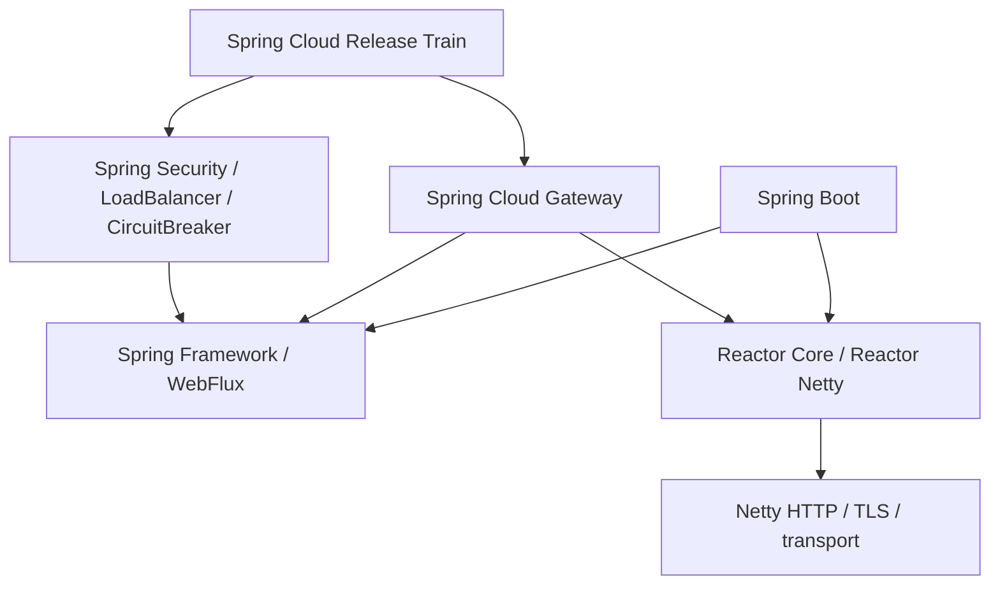

# Kiểm tra tương thích bộ lọc, predicate và HttpClient tùy biến

## Mục tiêu bài học

Trong chương **Nâng cấp** của module **SPRING_CLOUD_GATEWAY**, bài học này hướng dẫn kiểm tra và nâng cấp các thành phần mở rộng của Spring Cloud Gateway mà ứng dụng thường phụ thuộc nhiều nhất: **GatewayFilter/GatewayFilterFactory, GlobalFilter, RoutePredicateFactory và Reactor Netty HttpClient tùy biến**.

Một bản nâng cấp Spring Boot/Spring Cloud có thể biên dịch thành công nhưng vẫn làm thay đổi hành vi định tuyến, thứ tự filter, binding của route arguments, cách xử lý retry, TLS, connection pool hoặc timeout. Những lỗi này thường chỉ xuất hiện khi request thật đi qua Gateway, khi có tải đồng thời hoặc khi downstream gặp lỗi.

Spring Cloud Gateway cung cấp API Gateway qua route predicates, filter chain, path/header rewriting, service discovery, authentication, rate limiting, circuit breaker, retry, TLS và observability. Để vận hành an toàn, custom extensions cần tương thích với **đúng release train, đúng server flavor và đúng HTTP runtime**.

Sau bài học, bạn có thể:

- Xác định cặp phiên bản Spring Boot/Spring Cloud/Spring Cloud Gateway tương thích theo release train.
- Phân biệt Server WebFlux, Server Web MVC và Proxy Exchange trước khi nâng cấp.
- Chọn đúng starter và namespace cấu hình của phiên bản mới.
- Rà soát `GatewayFilterFactory`, `GatewayFilter`, `GlobalFilter` và `Ordered`.
- Rà soát custom `RoutePredicateFactory`, cấu hình shortcut/expanded arguments và route matching.
- Phát hiện những tên custom filter không tuân thủ quy ước `GatewayFilterFactory`.
- Kiểm tra `HttpClientCustomizer`, Reactor Netty APIs, pool, timeout, TLS và proxy settings.
- Phân biệt timeout toàn cục với per-route metadata; xác minh đơn vị millisecond và `Duration`.
- Nhận diện thay đổi đáng chú ý của Spring Cloud Gateway 5.1, bao gồm việc chuyển Retry nội bộ từ Reactor Addons sang Reactor Core.
- Thiết kế test matrix cho route matching, filter order, response/body lifecycle, connection pool và TLS.
- Triển khai nâng cấp theo từng bước, có canary, rollback và bằng chứng tương thích.

> **Mốc tài liệu trong bài:** trạng thái được đối chiếu ngày **24/11/2026**. Spring Cloud Gateway 5.1.0 là bản stable mới nhất được tài liệu chính thức liệt kê; Spring Cloud 2026.0.0 (Paddington) đã GA ngày 20/11/2026 và dùng Spring Boot 4.2.0 cùng Spring Cloud Gateway 5.1.0. Các ví dụ 5.1 bên dưới dùng namespace WebFlux hiện hành `spring.cloud.gateway.server.webflux.*`. Dự án ở release train cũ có thể dùng namespace và starter khác. Hãy xác minh với BOM và configuration metadata của artifact thực tế.

## 1. Nâng cấp Gateway là nâng cấp cả một hệ sinh thái

Không nên xem Spring Cloud Gateway là một JAR độc lập. Runtime WebFlux có các thành phần liên kết:



Một custom filter có thể biên dịch nhưng không chạy nếu:

- `ServerWebExchange`, `HttpHeaders`, `DataBuffer` hoặc reactive APIs đã thay đổi.
- Bean không còn được auto-configure vì starter hoặc property prefix khác.
- Một custom factory không được Gateway phát hiện vì tên class/bean không đúng.
- Filter order thay đổi hoặc một global filter được bật/tắt khác.
- `HttpClientCustomizer` không còn nhận đúng Reactor Netty API mà customizer đang gọi.
- Dependency override kéo hai phiên bản Reactor/Netty không tương thích vào runtime.

**Nâng cấp đúng phải xác minh ba lớp:** compile-time API, Spring application context/route binding và runtime behavior qua HTTP.

## 2. Chọn đúng release train trước khi sửa code

Spring Cloud dùng **release train** để quản lý một nhóm dự án. Không chọn độc lập một phiên bản Gateway rồi ghép với bất kỳ Spring Boot nào.

### 2.1. Bản đồ phiên bản tham khảo

| Spring Cloud release train | Spring Boot tương ứng | Spring Cloud Gateway |
| --- | --- | --- |
| `2024.0.x` (Moorgate) | `3.4.x` | `4.2.x` |
| `2025.0.x` (Northfields) | `3.5.x` | `4.3.x` |
| `2025.1.x` (Oakwood) | `4.0.x` / `4.1.x` | `5.0.x` |
| `2026.0.x` (Paddington) | `4.2.x` | `5.1.x` |

Bảng này là **định hướng tương thích theo release train**, không phải danh sách đầy đủ mọi patch release hoặc cam kết support vĩnh viễn. Tại thời điểm viết bài, `2026.0.0` đã GA, dựa trên Spring Boot `4.2.0` và chứa Spring Cloud Gateway `5.1.0`. Trang Supported Versions cũng nêu rõ release train là tập hợp các dự án và support lifecycle gắn với support lifecycle của các dự án thành phần.

Nguồn:

- [Spring Cloud 2026.0.0 release announcement](https://spring.io/blog/2026/11/20/spring-cloud-2026-0-0-has-been-released/).
- [Spring Cloud Supported Versions](https://github.com/spring-cloud/spring-cloud-release/wiki/Supported-Versions).
- [Spring Cloud Gateway version selector](https://docs.spring.io/spring-cloud-gateway/reference/).

### 2.2. Quy tắc chọn phiên bản

1. Xác định Spring Boot version đang chạy.
2. Chọn release train hỗ trợ Boot version đó.
3. Dùng Spring Cloud BOM của release train.
4. Để BOM quản lý Spring Cloud Gateway, Spring Cloud Commons, LoadBalancer, CircuitBreaker và các dependency Spring Cloud khác.
5. Chỉ override dependency nếu có lý do rõ ràng và đã kiểm thử tương thích.
6. Xem support policy và security advisories trước khi chọn đích nâng cấp.

Không nâng riêng `spring-cloud-gateway-server` lên một bản mới trong khi giữ một Spring Cloud BOM cũ mà không có ma trận tương thích chính thức.

### 2.3. Ví dụ BOM cho Spring Cloud 2026.0.0

```xml
<properties>
    <spring-boot.version>4.2.0</spring-boot.version>
    <spring-cloud.version>2026.0.0</spring-cloud.version>
</properties>

<dependencyManagement>
    <dependencies>
        <dependency>
            <groupId>org.springframework.cloud</groupId>
            <artifactId>spring-cloud-dependencies</artifactId>
            <version>${spring-cloud.version}</version>
            <type>pom</type>
            <scope>import</scope>
        </dependency>
    </dependencies>
</dependencyManagement>

<dependencies>
    <dependency>
        <groupId>org.springframework.cloud</groupId>
        <artifactId>spring-cloud-starter-gateway-server-webflux</artifactId>
    </dependency>
</dependencies>
```

Đoạn này minh họa cách import Spring Cloud BOM và starter WebFlux. Nếu Spring Boot plugin/parent đã quản lý `spring-boot.version`, không khai báo version thứ hai không cần thiết. Dùng đúng Spring Boot plugin/parent và BOM theo hướng dẫn dự án.

### 2.4. Ví dụ Gradle

```groovy
plugins {
    id 'java'
    id 'org.springframework.boot' version '4.2.0'
    id 'io.spring.dependency-management' version '1.1.7'
}

ext {
    set('springCloudVersion', '2026.0.0')
}

dependencies {
    implementation 'org.springframework.cloud:spring-cloud-starter-gateway-server-webflux'
}

dependencyManagement {
    imports {
        mavenBom "org.springframework.cloud:spring-cloud-dependencies:${springCloudVersion}"
    }
}
```

Đây là ví dụ theo release announcement 2026.0.0; kiểm tra plugin versions và cấu hình Gradle của dự án trước khi thay.

### 2.5. Không trộn Server WebFlux, Server Web MVC và Proxy Exchange

Spring Cloud Gateway có các flavor khác nhau:

| Flavor | Starter 5.1 | Runtime | Đặc điểm |
| --- | --- | --- | --- |
| Server WebFlux | `spring-cloud-starter-gateway-server-webflux` | Spring WebFlux + Reactor Netty | Reactive server, filter chain WebFlux |
| Server Web MVC | `spring-cloud-starter-gateway-server-webmvc` | Spring WebMvc.fn / Servlet runtime | Dùng Tomcat/Jetty được |
| Proxy Exchange WebFlux | Starter/auto-config Proxy Exchange tương ứng | WebFlux handler | Handler method dùng `ProxyExchange` |
| Proxy Exchange Web MVC | Starter/auto-config Proxy Exchange tương ứng | Web MVC handler | Handler method dùng `ProxyExchange` |

Không thể lấy một `GatewayFilter` WebFlux, `HttpClientCustomizer` hoặc Reactor Netty customizer rồi mặc định dùng được trong Server Web MVC. Tương tự, một `ProxyExchange` handler không phải `RouteLocator` hay Gateway Server filter.

Gateway Server WebFlux cần Netty runtime do Spring Boot cung cấp và **không chạy trong Servlet container truyền thống hoặc đóng gói WAR** theo tài liệu starter.

Nguồn: [How to Include Spring Cloud Gateway Server WebFlux](https://docs.spring.io/spring-cloud-gateway/reference/spring-cloud-gateway-server-webflux/starter.html).

## 3. Starter và configuration namespace khi nâng từ 4.x lên 5.x

Một thay đổi dễ bị bỏ sót khi chuyển sang các dòng Gateway mới là **starter được tách theo server flavor** và namespace cấu hình WebFlux có thêm `server.webflux`.

### 3.1. Starter

| Thế hệ cấu hình thường gặp | Starter WebFlux |
| --- | --- |
| Gateway 4.x | `spring-cloud-starter-gateway` |
| Gateway 5.1 | `spring-cloud-starter-gateway-server-webflux` |

Server Web MVC dùng starter riêng `spring-cloud-starter-gateway-server-webmvc`. Không để cả hai server starters cùng hiện diện nếu ứng dụng chỉ định chạy một flavor, trừ khi đã có kiến trúc và auto-configuration rõ ràng.

### 3.2. Property prefix

| Mục đích | Prefix cũ thường gặp | Prefix Server WebFlux 5.1 |
| --- | --- | --- |
| Route definitions | `spring.cloud.gateway.routes` | `spring.cloud.gateway.server.webflux.routes` |
| Default filters | `spring.cloud.gateway.default-filters` | `spring.cloud.gateway.server.webflux.default-filters` |
| HTTP client | `spring.cloud.gateway.httpclient.*` | `spring.cloud.gateway.server.webflux.httpclient.*` |
| Discovery locator | `spring.cloud.gateway.discovery.locator.*` | `spring.cloud.gateway.server.webflux.discovery.locator.*` |
| Predicates | `spring.cloud.gateway.predicate.*` | `spring.cloud.gateway.server.webflux.predicate.*` |
| Filter enablement | `spring.cloud.gateway.filter.*` | `spring.cloud.gateway.server.webflux.filter.*` |
| Global filters | `spring.cloud.gateway.global-filter.*` | `spring.cloud.gateway.server.webflux.global-filter.*` |
| X-Forwarded | `spring.cloud.gateway.x-forwarded.*` | `spring.cloud.gateway.server.webflux.x-forwarded.*` |

Đây là mapping cho các nhóm thuộc WebFlux, không phải quy tắc thay chuỗi toàn cục trong mọi cấu hình Spring Cloud. Một số properties dùng chung ở root hoặc thuộc Spring Boot/Spring Framework có prefix khác.

### 3.3. Ví dụ route prefix

Trước:

```yaml
spring:
  cloud:
    gateway:
      routes:
        - id: catalog
          uri: lb://catalog-service
          predicates:
            - Path=/api/catalog/**
```

Sau khi chuyển sang Server WebFlux 5.1:

```yaml
spring:
  cloud:
    gateway:
      server:
        webflux:
          routes:
            - id: catalog
              uri: lb://catalog-service
              predicates:
                - Path=/api/catalog/**
```

Nếu vẫn để prefix cũ, không giả định ứng dụng sẽ báo lỗi rõ ràng. Có thể route không được bind như mong muốn, cấu hình cũ bị bỏ qua hoặc một nguồn route khác tiếp tục cung cấp route. Xác minh effective configuration và route list sau startup.

### 3.4. Cảnh báo về tài liệu property prefix

Tại thời điểm tra cứu, trang timeout configuration 5.1 vẫn có ví dụ minh họa dùng prefix cũ `spring.cloud.gateway.httpclient.*`, trong khi bảng **Configuration Properties 5.1** liệt kê các property hiện hành dưới `spring.cloud.gateway.server.webflux.httpclient.*`.

Khi gặp tài liệu không nhất quán:

1. Ưu tiên configuration metadata/configprops của đúng artifact version đang chạy.
2. Kiểm tra property binding trong ApplicationContext.
3. Dùng `/actuator/configprops` nếu endpoint đã được bảo vệ và expose an toàn.
4. Viết test xác nhận giá trị có hiệu lực, không chỉ kiểm tra YAML parse được.

Không copy property prefix từ một trang tài liệu cũ hoặc một blog chưa ghi rõ Gateway version.

## 4. Kiểm kê trước khi thay đổi code

Trước khi nâng cấp, lập inventory cho tất cả extension points:

| Nhóm | Những gì cần liệt kê |
| --- | --- |
| Custom route predicates | Class, bean name, config fields, regex/path logic |
| Custom GatewayFilter factories | Class name, Config type, shortcut order, args |
| Custom GatewayFilter instances | Filter order, body/header/response behavior |
| GlobalFilter | `Ordered`, pre/post logic, exchange attributes |
| HttpHeadersFilter | Header allowlist/denylist, order, forwarded headers |
| HttpClientCustomizer | TCP options, TLS, proxy, timeout, handlers |
| Route configuration | YAML, Java DSL, discovery, dynamic repositories |
| Retry | `Retry` imports, custom retry functions, body replay |
| Dependencies | Gateway, Reactor Core, Reactor Netty, Netty, LoadBalancer |
| Tests | Route matching, filter order, TLS, pooling, body streaming |

### 4.1. Ghi lại resolved dependency tree

Maven:

```bash
./mvnw dependency:tree \
  -Dincludes=org.springframework.cloud,io.projectreactor,io.netty
```

Gradle:

```bash
./gradlew dependencies --configuration runtimeClasspath
```

Đối chiếu:

- Có nhiều phiên bản `reactor-core`, `reactor-netty-http` hoặc `netty-codec-http` không?
- Có dependency override ở `dependencyManagement`, `resolutionStrategy` hoặc version catalog không?
- Có `reactor-extra`/Reactor Addons được giữ lại chỉ để hỗ trợ code Retry cũ không?
- Có đồng thời WebFlux và Web MVC Gateway starters không?
- Runtime image có dependency khác với test classpath không?

Lưu output dependency tree làm baseline để so sánh trước/sau.

### 4.2. Ghi lại route inventory runtime

Trong môi trường test/staging, thu:

- Route ID.
- URI.
- Predicate definitions.
- Filter names và args.
- Order.
- Metadata.
- Discovery-generated routes.

Đối chiếu danh sách trước và sau upgrade. Route count giống nhau chưa đủ: route ID có thể vẫn còn nhưng predicate/filter args hoặc upstream URI đã khác.

### 4.3. Chụp baseline HTTP behavior

Với mỗi route quan trọng, lưu kết quả:

```text
method + host + path + query
→ selected route ID
→ outbound URI/path
→ outbound headers (đã redact)
→ response status/headers
→ latency
→ retry attempts
→ connection/pool outcome
```

Không lưu access token, cookie, API key, body nhạy cảm hoặc certificate private key vào baseline.

## 5. Tương thích custom GatewayFilterFactory

`GatewayFilterFactory` tạo filter theo route config. Đây là extension point quan trọng khi ứng dụng có custom filter dùng trong YAML.

### 5.1. API extension chính

Tài liệu Developer Guide 5.1 mô tả:

- Implement `GatewayFilterFactory` như một bean, thường extend `AbstractGatewayFilterFactory`.
- `Config` class chứa các tham số cấu hình.
- `apply(Config)` tạo `GatewayFilter`.
- Custom filter class name nên kết thúc bằng `GatewayFilterFactory`.

Ví dụ khung:

```java
@Component
public class AddTenantHeaderGatewayFilterFactory
        extends AbstractGatewayFilterFactory<AddTenantHeaderGatewayFilterFactory.Config> {

    public AddTenantHeaderGatewayFilterFactory() {
        super(Config.class);
    }

    @Override
    public GatewayFilter apply(Config config) {
        return (exchange, chain) -> {
            ServerHttpRequest request = exchange.getRequest()
                .mutate()
                .header(config.getHeaderName(), config.getHeaderValue())
                .build();

            return chain.filter(
                exchange.mutate().request(request).build()
            );
        };
    }

    public static class Config {
        private String headerName;
        private String headerValue;

        public String getHeaderName() {
            return headerName;
        }

        public void setHeaderName(String headerName) {
            this.headerName = headerName;
        }

        public String getHeaderValue() {
            return headerValue;
        }

        public void setHeaderValue(String headerValue) {
            this.headerValue = headerValue;
        }
    }
}
```

Đây là ví dụ minh họa cấu trúc API WebFlux; trong thực tế phải validate header name/value, không cho client ghi đè identity header và chỉ dùng nguồn tenant đã xác minh.

### 5.2. Tên filter trong YAML

Với class:

```java
AddTenantHeaderGatewayFilterFactory
```

filter có thể được tham chiếu bằng tên ngắn:

```yaml
filters:
  - AddTenantHeader=X-Tenant,tenant-42
```

Để tránh nhập nhằng shortcut args, dạng expanded rõ ràng hơn:

```yaml
filters:
  - name: AddTenantHeader
    args:
      headerName: X-Tenant
      headerValue: tenant-42
```

Tài liệu Gateway cảnh báo việc dùng class name không có suffix `GatewayFilterFactory` là convention **không được hỗ trợ** và có thể bị loại bỏ. Nếu code cũ có:

```java
class LegacyAuditFilter extends AbstractGatewayFilterFactory<...>
```

hãy chuyển thành:

```java
class LegacyAuditGatewayFilterFactory extends AbstractGatewayFilterFactory<...>
```

Sau đó kiểm tra lại tên filter trong YAML, tests và mọi config được tải động.

### 5.3. Shortcut field order

Nếu filter dùng shortcut notation:

```yaml
filters:
  - AddTenantHeader=X-Tenant,tenant-42
```

thì factory phải có thứ tự field tương ứng. Nếu class đổi tên field hoặc `shortcutFieldOrder`, shortcut có thể bind sai giá trị mà không làm thay đổi số lượng arguments.

Khi nâng cấp:

- So sánh `shortcutFieldOrder()` với config hiện tại.
- Thêm tests cho shortcut notation.
- Thêm tests cho expanded `name`/`args`.
- Ưu tiên expanded notation cho filter có nhiều args hoặc config dễ nhầm.
- Không đổi thứ tự args mà không migration YAML/remote config.

### 5.4. Config binding và validation

Không coi việc `Config` object được tạo thành công là mọi giá trị đều hợp lệ. Kiểm tra:

- Field bắt buộc có giá trị.
- Default values không thay đổi ngoài ý muốn.
- Enum/string conversion.
- `Duration`, `DataSize`, URI và regex parsing.
- Null/empty values.
- Tên args đúng chính tả.
- Bean validation nếu đã tích hợp.

Nếu custom filter dùng constructor hoặc setter binding đặc thù, kiểm tra nó với Spring Boot/Spring Framework version mới. Đừng dựa vào một `Config` class không có getter/setter hoặc constructor binding chưa được hỗ trợ bởi factory đang dùng.

### 5.5. Pre-filter và post-filter

Pre-filter thao tác trước `chain.filter(...)`:

```java
return (exchange, chain) -> {
    // Thay đổi request trước khi proxy.
    return chain.filter(exchange);
};
```

Post-filter chạy sau khi downstream hoàn tất:

```java
return (exchange, chain) ->
    chain.filter(exchange)
        .then(Mono.fromRunnable(() -> {
            // Kiểm tra response state sau downstream.
        }));
```

Sau upgrade, test:

- Response đã committed chưa trước khi sửa headers/status?
- Downstream error có đi qua post logic không?
- Client cancel có chạy cleanup đúng không?
- Filter có đọc body một lần hay consume mất body?
- Có ghi response header sau khi response đã committed?

Không sửa response headers/status trong post-filter nếu response đã commit; hành vi đúng cần được xác định và test theo lifecycle.

### 5.6. Filter không nên phụ thuộc internal implementation

Custom filter nên phụ thuộc interfaces/attributes được tài liệu hóa. Tránh:

- Cast exchange/request/response sang implementation class nội bộ.
- Gọi private methods của filter built-in.
- Dựa vào thứ tự ngầm của các internal global filters mà không kiểm tra.
- Dùng reflection để truy cập field của Gateway internals.
- Tự thay `NettyRoutingFilter` bằng một bản copy chỉ để thêm một header.

Nếu cần mở rộng một built-in filter, ưu tiên public extension point hoặc custom filter chạy ở order đã kiểm thử.

## 6. Tương thích GlobalFilter và filter ordering

`GlobalFilter` áp dụng theo điều kiện trên các routes; `GatewayFilter` gắn với route cụ thể. Khi route match, Gateway kết hợp global filters và route-specific filters thành một chain rồi sắp xếp theo `Ordered`.

### 6.1. Thứ tự pre/post

Filter có precedence cao hơn (order nhỏ hơn trong quy ước `Ordered`) chạy trước ở pha pre và chạy sau ở pha post. Vì vậy, chỉ nhìn thứ tự đăng ký bean không đủ để xác định chain.

Ví dụ:

```text
Pre:
  AuthContextFilter
  RouteAuditFilter
  NettyRoutingFilter

Downstream request

Post:
  RouteAuditFilter
  AuthContextFilter
```

Đây là sơ đồ minh họa, không phải thứ tự mặc định của Gateway.

### 6.2. Ví dụ GlobalFilter

```java
@Component
public class RequestIdGlobalFilter implements GlobalFilter, Ordered {

    @Override
    public int getOrder() {
        return -1;
    }

    @Override
    public Mono<Void> filter(
            ServerWebExchange exchange,
            GatewayFilterChain chain) {

        ServerHttpRequest request = exchange.getRequest()
            .mutate()
            .header("X-Gateway-Request-Id", UUID.randomUUID().toString())
            .build();

        return chain.filter(exchange.mutate().request(request).build());
    }
}
```

Ví dụ này thêm request ID mới để minh họa API. Production cần cân nhắc giữ correlation ID đã được trusted ingress xác minh, chống client spoofing, không tạo metric label cardinality cao và tránh ghi PII.

### 6.3. Khi nâng cấp GlobalFilter

- Kiểm tra import package của `GlobalFilter`, `GatewayFilterChain`, `ServerWebExchange`.
- Kiểm tra `Ordered` và thứ tự với route-specific filters.
- Kiểm tra pre/post logic.
- Kiểm tra response commit state.
- Kiểm tra cancellation/error cleanup.
- Kiểm tra route cache hoặc exchange attributes mà filter đọc.
- Không giả định GlobalFilter là public API ổn định như một application service; tài liệu lưu ý các interface/usage có thể thay đổi trong các milestone.

### 6.4. Không đặt thứ tự dựa trên một con số chưa được kiểm chứng

Ví dụ `getOrder() == -1` không tự bảo đảm filter luôn chạy trước security, CORS hoặc mọi Gateway internals. Hãy xác minh thứ tự runtime bằng:

- Unit tests cho order values.
- Integration tests quan sát request/response.
- Actuator route/filter introspection trong môi trường được bảo vệ.
- Logging có chọn lọc trong test profile.

## 7. Tương thích custom RoutePredicateFactory

Route predicate quyết định request có match một route hay không. Một predicate custom thường implement `RoutePredicateFactory` và có thể extend `AbstractRoutePredicateFactory`.

### 7.1. API cơ bản

```java
@Component
public class TenantRoutePredicateFactory
        extends AbstractRoutePredicateFactory<TenantRoutePredicateFactory.Config> {

    public TenantRoutePredicateFactory() {
        super(Config.class);
    }

    @Override
    public Predicate<ServerWebExchange> apply(Config config) {
        return exchange -> {
            String tenant = exchange.getRequest()
                .getHeaders()
                .getFirst("X-Tenant");

            return tenant != null
                && config.getAllowedTenant().equals(tenant);
        };
    }

    public static class Config {
        private String allowedTenant;

        public String getAllowedTenant() {
            return allowedTenant;
        }

        public void setAllowedTenant(String allowedTenant) {
            this.allowedTenant = allowedTenant;
        }
    }
}
```

Đây là ví dụ về API predicate. **Không dùng `X-Tenant` do public client tự gửi làm bằng chứng tenant identity.** Nếu predicate thực sự phụ thuộc tenant, giá trị phải đến từ security context/claim đã xác minh hoặc một trusted proxy layer đã sanitize.

### 7.2. Tên factory và YAML

Tên class:

```java
TenantRoutePredicateFactory
```

thường được tham chiếu:

```yaml
predicates:
  - Tenant=tenant-42
```

Hoặc expanded notation:

```yaml
predicates:
  - name: Tenant
    args:
      allowedTenant: tenant-42
```

Kiểm tra `shortcutFieldOrder()` nếu factory dùng shortcut notation. Nếu predicate có nhiều args, expanded notation thường dễ đọc và ít nhầm hơn.

### 7.3. Những thứ dễ thay đổi khi nâng cấp

- `RoutePredicateFactory`/`AbstractRoutePredicateFactory` import packages.
- Generic type của `Config`.
- Cách bind constructor/setter/record.
- `ServerWebExchange` request path/headers representation.
- Spring Framework path matching/URI APIs.
- Regex và date/time parsing.
- Null/empty behavior.
- Custom predicate order và route precedence.

Không dùng một predicate unit test để chứng minh route match thật; cần kiểm tra cả `RoutePredicateHandlerMapping`, route definitions và request HTTP.

### 7.4. Built-in predicates cần regression

Khi nâng Gateway, test lại các predicates ứng dụng đang sử dụng:

| Predicate | Các trường hợp nên test |
| --- | --- |
| `Path` | Encoded path, trailing slash, path variables, context path |
| `Host` | Wildcard, port, forwarded host và TLS termination |
| `Method` | GET/HEAD/POST/PATCH/OPTIONS |
| `Header` | Case, duplicate headers, regex, missing header |
| `Query` | Missing/empty/multiple query params, encoding |
| `RemoteAddr` | Direct connection và trusted reverse proxy |
| `XForwardedRemoteAddr` | XFF chain, untrusted client-supplied values |
| `Weight` | Distribution, route order và stable behavior |
| `After`/`Before`/`Between` | Timezone, daylight saving, clock boundaries |
| `Version` | Missing/invalid/unsupported version và strategy binding |
| `ReadBody` | Body cache, codec limits và request replay |

### 7.5. Route predicates cùng nhau dùng logic AND

Trong một route:

```yaml
predicates:
  - Host=api.example.com
  - Path=/api/orders/**
  - Method=GET
```

các predicates phải cùng match. Sau nâng cấp, kiểm tra:

- Có route nào bị overlap và match trước route mong muốn?
- `order` của route có bị thay đổi?
- Path matching có trailing slash behavior giống baseline?
- Host predicate có nhận đúng authority sau proxy?
- Một predicate custom có trả `true` khi thiếu header do `defaultIfEmpty`?

Không coi việc application startup thành công là bằng chứng tất cả predicates đang match đúng.

## 8. Kiểm tra shortcut và expanded route arguments

Gateway hỗ trợ hai cách cấu hình:

**Shortcut:**

```yaml
filters:
  - SetStatus=401
predicates:
  - Method=GET,POST
```

**Expanded:**

```yaml
filters:
  - name: SetStatus
    args:
      status: 401
predicates:
  - name: Method
    args:
      methods:
        - GET
        - POST
```

Khi nâng cấp custom factories, test cả hai hình thức. Những lỗi thường gặp:

- Shortcut argument order không còn khớp.
- Field name bị đổi nhưng remote config vẫn dùng key cũ.
- Enum values/case khác nhau.
- String-to-duration/data-size conversion đổi.
- Một args key bị bỏ qua do prefix hoặc property binding khác.
- Default value của custom config thay đổi.

Nếu remote route repository chứa các definitions được tạo từ nhiều tháng trước, hãy kiểm tra chúng bằng schema validator và test trên bản Gateway mới trước khi rollout.

## 9. `HttpClientCustomizer`: phần mở rộng cho outbound HTTP client

Trong Server WebFlux, Gateway dùng Reactor Netty `HttpClient` để proxy các request HTTP/HTTPS downstream. `HttpClientCustomizer` cho phép customize client mà Gateway sử dụng.

Tài liệu Gateway 5.1 mô tả interface:

```java
org.springframework.cloud.gateway.config.HttpClientCustomizer
```

với method:

```java
HttpClient customize(HttpClient httpClient);
```

Bean customizer được tự động áp dụng cho Gateway HTTP client theo tài liệu chính thức.

### 9.1. Ví dụ customizer

```java
import io.netty.channel.ChannelOption;
import java.time.Duration;
import org.springframework.cloud.gateway.config.HttpClientCustomizer;
import org.springframework.context.annotation.Bean;
import org.springframework.context.annotation.Configuration;
import reactor.netty.http.client.HttpClient;

@Configuration
class GatewayHttpClientConfiguration {

    @Bean
    HttpClientCustomizer gatewayHttpClientCustomizer() {
        return httpClient -> httpClient
            .option(ChannelOption.CONNECT_TIMEOUT_MILLIS, 3_000)
            .responseTimeout(Duration.ofSeconds(2));
    }
}
```

Đây là ví dụ customizer ở cấp Gateway HTTP client. Connect timeout là giới hạn thời gian kết nối TCP; response timeout là giới hạn chờ response theo Reactor Netty semantics. Nó không thay thế end-to-end deadline, pool acquire timeout hoặc timeout nghiệp vụ.

### 9.2. Customizer là global cho Gateway HttpClient

`HttpClientCustomizer` customize HTTP client dùng bởi Gateway. Vì vậy:

- Không giả định bean customizer chỉ ảnh hưởng một route.
- Không dùng customizer để áp timeout khác nhau cho từng route nếu route metadata đã đáp ứng.
- Không tạo một `HttpClient.create()` độc lập rồi thay thế client của Gateway nếu không có lý do kiến trúc.
- Không bỏ qua pool, TLS, proxy, observability và các customizers khác.
- Nếu có nhiều customizer beans, kiểm tra thứ tự và hiệu ứng kết hợp trong runtime; không dựa vào thứ tự đăng ký ngẫu nhiên.

### 9.3. Dùng properties trước, customizer khi cần API

Nhiều thiết lập đã có configuration properties:

```yaml
spring:
  cloud:
    gateway:
      server:
        webflux:
          httpclient:
            connect-timeout: 3000
            response-timeout: 2s
            pool:
              type: fixed
              max-connections: 300
              acquire-timeout: 1500
              max-idle-time: 30s
              max-life-time: 10m
              metrics: true
```

Các giá trị chỉ là ví dụ, cần capacity planning. Theo bảng configprops 5.1:

- `connect-timeout` tính bằng milliseconds.
- `response-timeout` là `Duration`.
- `pool.type` hỗ trợ `elastic`, `fixed` hoặc `disabled`.
- `max-connections` và `acquire-timeout` áp dụng cho pool type `fixed`.
- Pool metrics mặc định tắt.

Ưu tiên property được hỗ trợ khi không cần custom code. Chỉ dùng `HttpClientCustomizer` khi cần một Reactor Netty API chưa được expose thành property hoặc một behavior chuyên biệt.

### 9.4. Không nhầm HttpClientCustomizer với HttpServerCustomizer

Gateway có outbound `HttpClient` để gọi backend và inbound HTTP server để nhận request. Chúng là hai hướng khác nhau:

| Extension | Phạm vi |
| --- | --- |
| `HttpClientCustomizer` | Outbound Reactor Netty HTTP client |
| HttpServer customizer/configuration | Inbound Netty HTTP server |
| `GatewayFilter` | Request/response trong filter chain |
| `HttpHeadersFilter` | Header transformation trên outbound routing path |

Một customizer cho outbound client không cấu hình inbound listener, TLS termination của Ingress hoặc server-side decoder.

## 10. Timeout toàn cục và timeout theo route

Khi nâng cấp, timeout dễ bị đổi đơn vị hoặc property prefix. Gateway hỗ trợ connect và response timeouts ở cả mức global và per-route.

### 10.1. Global timeout

Trong 5.1 Server WebFlux, dùng namespace:

```yaml
spring:
  cloud:
    gateway:
      server:
        webflux:
          httpclient:
            connect-timeout: 1000
            response-timeout: 5s
```

Global `connect-timeout` tính bằng milliseconds; `response-timeout` dùng `java.time.Duration`.

### 10.2. Per-route timeout

```yaml
spring:
  cloud:
    gateway:
      server:
        webflux:
          routes:
            - id: catalog-fast-read
              uri: lb://catalog-service
              predicates:
                - Path=/api/catalog/**
                - Method=GET
              metadata:
                connect-timeout: 500
                response-timeout: 1500
```

Với per-route metadata, cả `connect-timeout` và `response-timeout` được khai báo bằng milliseconds. Cách này hữu ích khi một route có SLO khác route khác.

### 10.3. Đừng nhầm connect timeout với pool acquire timeout

| Timeout | Bắt đầu ở đâu? |
| --- | --- |
| Pool acquire timeout | Chờ lấy một connection từ pool |
| Connect timeout | Mở TCP connection tới upstream |
| TLS handshake timeout | Hoàn tất TLS handshake |
| Response timeout | Chờ response theo HTTP client semantics |
| Overall request deadline | Giới hạn toàn bộ hành trình request |

Một request có thể timeout khi chờ pool trước cả khi bắt đầu TCP connect. Nếu chỉ tăng connect timeout, lỗi pool exhaustion không được giải quyết.

### 10.4. Response timeout không phải total deadline

Response timeout không đồng nghĩa mọi operation phải kết thúc trong đúng khoảng thời gian ấy, nhất là streaming/SSE/WebSocket. Đối với route streaming, kiểm tra idle timeout/response timeout semantics và test long-lived connections.

## 11. Kiểm tra TLS, proxy và connection pool sau nâng cấp

### 11.1. TLS client

Gateway outbound TLS có thể dùng:

- Trust store hoặc trusted X.509 certificates.
- Key store/client certificate cho mTLS.
- SSL bundle theo Spring Boot version.
- Handshake timeout và close-notify timeouts.

Trong 5.1 configprops, các properties nằm dưới:

```text
spring.cloud.gateway.server.webflux.httpclient.ssl.*
```

Các giá trị quan trọng:

```yaml
spring:
  cloud:
    gateway:
      server:
        webflux:
          httpclient:
            ssl:
              handshake-timeout: 10s
              ssl-bundle: internal-service-client
              use-insecure-trust-manager: false
```

`use-insecure-trust-manager` không phù hợp production. Khi nâng cấp, test certificate chain, SAN/hostname verification, trust bundle refresh và mTLS client identity.

### 11.2. Connection pool

Sau khi đổi Reactor Netty version, test:

- Max connections và pending acquisition.
- Pool acquire timeout.
- Max idle/lifetime và eviction.
- FIFO/LIFO leasing nếu cấu hình.
- Connection reuse sau upstream errors.
- HTTP/2 multiplexing nếu enabled.
- Metrics của pool.
- Resource disposal khi app shutdown/cancel.

Đừng coi một request test đơn lẻ là đủ. Pool bugs thường chỉ xuất hiện khi nhiều request đồng thời, upstream chậm hoặc connection bị reset.

### 11.3. Proxy configuration

Nếu Gateway dùng outbound proxy, xác minh:

- HTTP/SOCKS type.
- Proxy host/port.
- Non-proxy hosts pattern.
- Username/password secret binding.
- TLS trust giữa Gateway và proxy.
- Proxy bypass có đúng host allowlist không.

Một regex `non-proxy-hosts-pattern` sai có thể làm traffic đi trực tiếp thay vì qua egress proxy hoặc ngược lại.

### 11.4. Không bật wiretap production chỉ để xác minh upgrade

Wiretap có thể ghi request/response headers và payload, gồm cookie, bearer token hoặc PII. Chỉ dùng trong test/staging với dữ liệu giả và retention ngắn. Production nên dùng metrics/traces đã redact.

## 12. Thay đổi đáng chú ý trong Spring Cloud 2026.0 / Gateway 5.1

Nâng từ các dòng trước lên 2026.0 cần chú ý các thay đổi và bản vá sau.

### 12.1. Retry migration: Reactor Addons sang Framework Core Retry

Spring Cloud 2026.0 release announcement nêu Gateway đã chuyển từ **Reactor Addons Retry** sang **Framework Core Retry**. Pull request #4290 ghi:

- Refactor từ `reactor.retry.Retry` sang `reactor.util.retry.Retry`.
- Bổ sung phần cache flux thay thế phần lấy từ Reactor Addons.
- Loại bỏ `RetryConfig.basedOnPreviousValue` trong quá trình migration.

Nguồn:

- [Spring Cloud 2026.0.0 release announcement](https://spring.io/blog/2026/11/20/spring-cloud-2026-0-0-has-been-released/).
- [Gateway PR #4290 — Reactor core retry caching](https://github.com/spring-cloud/spring-cloud-gateway/pull/4290).

Nếu code ứng dụng chỉ cấu hình built-in `Retry` filter bằng YAML, API cấu hình filter vẫn cần được kiểm tra theo tài liệu Gateway version mới; không tự kết luận mọi YAML Retry đã đổi. Nhưng nếu code custom import `reactor.retry.Retry` hoặc phụ thuộc Reactor Addons Retry APIs, cần rà soát compile/runtime và chuyển sang API mới theo contract phù hợp.

### 12.2. Forwarded headers từ untrusted proxies

Gateway 2026.0 có thay đổi sửa cách `ForwardedHeadersFilter` và `XForwardedHeadersFilter` xử lý request từ proxy không đáng tin: headers cũ do untrusted proxy gửi vẫn bị loại, sau đó filter tiếp tục tạo forwarded headers mới dựa trên request/remote address thực tế.

Nguồn: [Gateway PR #4271](https://github.com/spring-cloud/spring-cloud-gateway/pull/4271).

Regression tests nên kiểm tra:

- Direct client không được giả `X-Forwarded-For/Host/Proto`.
- Trusted proxy chain được diễn giải đúng.
- Untrusted proxy headers bị loại.
- Remote address/host/proto được sinh lại theo đúng topology.
- Backend không dùng forwarded headers client-controlled để cấp quyền.

### 12.3. Security fixes cần test lại behavior

Spring Cloud 2026.0 release announcement liệt kê các fix Gateway:

- `CVE-2026-59425`: `JsonToGrpc` filter leak `ManagedChannel` resources.
- `CVE-2026-59426`: global `LocalResponseCache` leak response across routes.
- `CVE-2026-59427`: `LocalResponseCache` lưu response private/no-store và có thể làm lộ authenticated content.
- `CVE-2026-59428`: WebSocket routing filter không enforce same-origin by default.

Đây là lý do upgrade phải có test resource lifecycle, cache isolation, cache-control semantics và WebSocket Origin validation. Đối chiếu advisory chính thức để biết affected/fixed versions và không chỉ dựa vào tên release train.

### 12.4. LocalResponseCache và WebSocket

Nếu ứng dụng dùng LocalResponseCache:

- Test route A không trả response cache của route B.
- Test `Cache-Control: private` và `no-store`.
- Test authenticated responses không được chia sẻ giữa users.
- Test cache key có method/host/path/query và vary semantics phù hợp.

Nếu dùng WebSocket:

- Test `Origin` allowlist và same-origin policy.
- Test authentication ở handshake.
- Test ping/pong, close frames và reconnect.
- Test downstream cancel/connection disposal.

Không bật cache/allow origin rộng chỉ để tránh regression test fail.

## 13. Phân biệt thay đổi API với thay đổi cấu hình

Một migration có thể thành công ở một lớp và lỗi ở lớp khác:

| Lớp | Ví dụ lỗi | Cách xác minh |
| --- | --- | --- |
| Dependency | `NoSuchMethodError` trong Reactor Netty | Resolved dependency tree + runtime tests |
| Starter | Gateway auto-config không chạy | Starter artifact + ApplicationContext |
| Property binding | Route/filter không được nạp | Configprops + route list |
| Custom factory | Filter name không được resolve | Bean registration + route startup test |
| Predicate | Route không match | Request matrix + selected route ID |
| Filter order | Header/body/response sai | Integration test theo order |
| HttpClient | TLS/connect/read timeout sai | Mock backend + TLS test server |
| Pool | Acquire timeout/connection leak | Concurrent load + pool metrics |
| Retry | Attempts/backoff/body replay đổi | Retry integration tests |
| Observability | Metric name/tag đổi | Actuator metrics/trace assertions |

## 14. Bộ kiểm thử tương thích bắt buộc

Không chỉ chạy `mvn test` hoặc `gradle test`. Cần có test cho từng extension point và HTTP behavior.

### 14.1. Filter factory tests

- Factory được Spring scan và tạo bean.
- Class name đúng convention.
- Shortcut args bind đúng thứ tự.
- Expanded args bind đúng field names.
- Default values giữ đúng.
- Pre-filter sửa request đúng.
- Post-filter không sửa response sau khi committed.
- Error/cancel path giải phóng resource.

### 14.2. GlobalFilter tests

- `getOrder()` có giá trị dự kiến.
- Global filter và route filter chạy đúng thứ tự.
- Filter không vô tình áp cho management/internal routes nếu không cần.
- Principal/headers lấy từ nguồn đã xác minh.
- Không consume body một lần ngoài ý muốn.
- Post-phase hoạt động khi downstream lỗi/timeout.

### 14.3. Predicate tests

- Custom factory được phát hiện.
- Config shortcut/expanded args bind đúng.
- Route matching với path/host/method/query.
- Multiple predicates cùng route có AND semantics.
- Overlapping routes chọn đúng order.
- Trailing slash, encoded path và forwarded headers có behavior ổn định.
- Custom predicate không tin header do client tự gửi làm identity.

### 14.4. HttpClient tests

| Test | Kỳ vọng |
| --- | --- |
| Connect timeout | Request thất bại trong connect budget |
| Response timeout | Request timeout theo policy |
| Pool acquire timeout | Không chờ vô hạn khi pool full |
| TLS valid certificate | Handshake thành công |
| TLS expired/wrong SAN | Handshake/verification thất bại |
| mTLS client cert | Backend xác minh đúng client |
| Proxy route | Traffic đi qua đúng proxy |
| Non-proxy hosts | Bypass chỉ cho host allowlist |
| Connection reuse | Không reuse connection hỏng |
| Client cancel | Outbound connection/response resources được dispose |
| HTTP/2/streaming | Body và connection lifecycle đúng protocol |

### 14.5. Test toàn bộ route behavior

Dùng WebTestClient cùng backend stub (MockWebServer/WireMock hoặc server test tương đương):

```text
Test client
  → Gateway 5.1 test application
  → backend stub
```

Backend stub nên ghi:

- Method.
- Path/query.
- Host.
- Safe headers.
- Body byte count.
- Request ID.
- Số lần nhận request.

Không ghi JWT, Cookie, API key hoặc raw payload nhạy cảm.

## 15. Kế hoạch nâng cấp theo từng giai đoạn

### Giai đoạn 1 — Inventory

1. Ghi Spring Boot, Spring Cloud train, Gateway, Reactor Netty và Netty versions.
2. Lưu dependency tree runtime.
3. Liệt kê mọi custom filters/predicates/HttpClientCustomizer.
4. Xuất route inventory và baseline HTTP behavior.
5. Xác định Server WebFlux hay Web MVC/Proxy Exchange.

### Giai đoạn 2 — Chọn đích và cập nhật dependency

1. Chọn release train tương thích.
2. Import BOM tương ứng.
3. Dùng starter đúng server flavor.
4. Gỡ dependency overrides không cần thiết.
5. Đồng bộ Reactor Netty/Netty theo BOM.
6. Cập nhật namespace properties.

### Giai đoạn 3 — Sửa custom extensions

1. Compile lại custom GatewayFilterFactory.
2. Chuẩn hóa tên class suffix.
3. Kiểm tra config binding và shortcut args.
4. Compile lại custom RoutePredicateFactory.
5. Kiểm tra GlobalFilter order.
6. Cập nhật Retry imports nếu code phụ thuộc Reactor Addons.
7. Chuyển HttpClientCustomizer sang API Reactor Netty tương thích.

### Giai đoạn 4 — Kiểm thử local/CI

Chạy unit tests, ApplicationContext tests, route contract tests, filter order tests, TLS/HttpClient tests và regression suite.

### Giai đoạn 5 — Staging

Deploy đúng artifact/container đã dự kiến production. Kiểm tra:

- Routes được bind.
- Effective predicates/filters đúng.
- Backend paths/headers đúng.
- TLS, mTLS và pool hoạt động.
- Retry/timeout/fallback đúng.
- Metrics/traces và error rates không bất thường.

### Giai đoạn 6 — Canary

Chỉ chuyển một phần traffic sau khi staging đạt. So sánh:

- 2xx/4xx/5xx.
- p50/p95/p99 latency.
- 502/503/504 và connection resets.
- Pool pending/acquire timeout.
- TLS handshake failures.
- Retry attempts.
- Route-level metrics.
- Cache/WebSocket security behavior.

### Giai đoạn 7 — Rollout và rollback

Giữ image, BOM, route config và secrets phiên bản cũ có thể phục hồi. Nếu rollback:

- Rollback image và dependency set tương thích.
- Rollback property prefix/config.
- Kiểm tra route repository/dynamic route revisions.
- Kiểm tra cache/connection pool behavior.
- Không rollback security patch nếu không có mitigation được phê duyệt.

## 16. Troubleshooting sau nâng cấp

### 16.1. Route không xuất hiện sau startup

**Nguyên nhân có thể:** property prefix cũ, starter sai flavor, route definition parse lỗi hoặc config source chưa được nạp.

**Xử lý:** kiểm tra `spring.cloud.gateway.server.webflux.routes`, starter WebFlux, configprops, startup logs và Actuator route list trong môi trường được bảo vệ.

### 16.2. `Unable to find GatewayFilterFactory`

**Nguyên nhân:** class không phải bean, component scan thiếu, tên class không có suffix chuẩn hoặc YAML filter name không khớp.

**Xử lý:** chuẩn hóa `SomethingGatewayFilterFactory`, kiểm tra bean và test expanded args.

### 16.3. `NoSuchMethodError` ở custom filter

**Nguyên nhân:** binary mismatch giữa Spring Framework/Gateway/Reactor hoặc dependency override.

**Xử lý:** đọc class/method trong stack trace, xem runtime dependency tree, bỏ version overrides không cần và compile/test với BOM đồng bộ.

### 16.4. Custom predicate không match

**Nguyên nhân:** factory bean không được phát hiện, config args bind sai, predicate logic phụ thuộc API path/header đã thay đổi hoặc route order che route.

**Xử lý:** test `RoutePredicateFactory` độc lập, kiểm tra expanded args và integration test selected route ID.

### 16.5. Customizer không có tác dụng

**Nguyên nhân:** bean không được scan, app đang dùng Server MVC thay vì WebFlux, customizer tạo client mới nhưng không return, hoặc properties khác ghi đè.

**Xử lý:** xác minh `HttpClientCustomizer` bean được tạo và được áp dụng, kiểm tra Gateway flavor và test outbound behavior thay vì chỉ nhìn bean tồn tại.

### 16.6. Timeout khác trước

**Nguyên nhân:** prefix sai, connect/response timeout dùng nhầm đơn vị, pool acquire timeout bị bỏ sót hoặc customizer can thiệp.

**Xử lý:** kiểm tra configprops; global connect là milliseconds, global response là Duration, per-route cả hai là milliseconds. Đo riêng pool acquisition, TCP connect và response.

### 16.7. TLS handshake thất bại

**Nguyên nhân:** trust bundle/keystore path/alias/password, SAN mismatch, certificate chain hoặc SSL bundle name sai.

**Xử lý:** test certificate thật ở staging, xem SSL bundle/configprops và không bật insecure trust manager để che lỗi.

### 16.8. Pool exhaustion

**Nguyên nhân:** max connections thấp, acquire timeout quá ngắn, upstream chậm hoặc connection không được dispose khi cancel/error.

**Xử lý:** bật pool metrics trong môi trường phù hợp, kiểm tra active/idle/pending, upstream latency và cancellation lifecycle.

### 16.9. Retry không compile

**Nguyên nhân:** custom code import `reactor.retry.Retry` hoặc dùng API Reactor Addons đã được thay thế.

**Xử lý:** đọc Gateway 2026.0 migration notes/PR #4290, chuyển sang `reactor.util.retry.Retry` theo contract mới và test backoff/attempt semantics.

### 16.10. Forwarded headers khác trước

**Nguyên nhân:** thay đổi xử lý trusted/untrusted proxies.

**Xử lý:** test cả trusted và untrusted source, kiểm tra ingress sanitize và so sánh `Forwarded`/`X-Forwarded-*` backend nhận.

### 16.11. Local cache hoặc WebSocket behavior khác

**Nguyên nhân:** security fixes ở 2026.0 thay đổi cache isolation/private response và same-origin behavior.

**Xử lý:** kiểm tra cache-control, route separation, authenticated users và WebSocket Origin policy. Không nới lỏng security để tái tạo hành vi cũ chưa an toàn.

## 17. Checklist tương thích trước production

| Nhóm | Câu hỏi |
| --- | --- |
| Release train | Spring Boot và Gateway nằm trong cặp tương thích? |
| BOM | Spring Cloud dependencies được quản lý cùng release train? |
| Flavor | WebFlux/Web MVC/Proxy Exchange có đúng kiến trúc? |
| Starter | Dùng starter tương ứng với Gateway version/flavor? |
| Properties | Prefix/units/defaults được xác minh bằng configprops? |
| Filters | Custom GatewayFilterFactory compile, bind args và đúng naming? |
| Global filters | `Ordered` và pre/post semantics đã được test? |
| Predicates | Custom RoutePredicateFactory và built-ins match đúng? |
| Route order | Overlapping routes chọn đúng route ID? |
| HttpClient | HttpClientCustomizer được áp dụng và không tạo client ngoài? |
| Pool | Acquire/max connections/idle/lifetime/metrics phù hợp? |
| Timeouts | Global/per-route units đúng và budget hợp lý? |
| TLS | Trust chain, hostname, mTLS và SSL bundles được test? |
| Retry | Reactor Retry API, body replay và idempotency đúng? |
| Discovery | Route locator filters/RewritePath không bị mất? |
| Forwarded | Trusted/untrusted proxy behavior đã test? |
| Cache | Private/no-store và cross-route cache isolation? |
| WebSocket | Origin/authentication/close/reconnect đúng? |
| Observability | Route metrics/traces không đổi ngoài ý muốn? |
| Dependencies | Không có duplicate/incompatible Reactor/Netty versions? |
| Rollback | Image, BOM, config và dynamic route revision phục hồi được? |

## 18. Bài tập có đáp án

### Bài 1 — Gateway 5.1 không nạp route

Ứng dụng chuyển từ Gateway 4.3 sang 5.1 nhưng YAML vẫn dùng `spring.cloud.gateway.routes`.

**Đáp án:** kiểm tra prefix Server WebFlux 5.1 `spring.cloud.gateway.server.webflux.routes`, starter mới và effective configuration. Không chỉ đổi dependency rồi giữ nguyên mọi prefix.

### Bài 2 — Starter cũ

Một ứng dụng 5.1 dùng `spring-cloud-starter-gateway` nhưng dự kiến chạy Server WebFlux.

**Đáp án:** đối chiếu tài liệu starter 5.1; dùng `spring-cloud-starter-gateway-server-webflux`. Nếu chọn Server Web MVC thì dùng starter MVC riêng.

### Bài 3 — Custom filter không resolve từ YAML

Class tên `AuditFilter` extend `AbstractGatewayFilterFactory`.

**Đáp án:** đổi tên theo convention `AuditGatewayFilterFactory`, xác minh component scan và YAML `Audit=...`. Tên không suffix là convention không được hỗ trợ.

### Bài 4 — Filter order thay đổi

Sau upgrade, post-filter ghi response header nhưng response đã committed.

**Đáp án:** kiểm tra combined GlobalFilter/GatewayFilter order, pre/post phase và commit lifecycle; chuyển thao tác sang đúng thời điểm trước commit hoặc bỏ sửa header không còn hợp lệ.

### Bài 5 — Predicate route match sai

Custom predicate đọc `X-Tenant` và coi giá trị là tenant identity.

**Đáp án:** không tin header client-controlled. Dùng principal/claim đã xác minh hoặc metadata từ trusted proxy, rồi test missing/forged headers.

### Bài 6 — HttpClientCustomizer chỉ áp dụng một phần

Một bean customizer đặt connect timeout và response timeout; route payment cần timeout khác route catalog.

**Đáp án:** customizer áp dụng ở client Gateway dùng chung. Dùng route metadata cho per-route timeout nếu phù hợp; không giả định customizer là per-route.

### Bài 7 — Timeout per-route sai đơn vị

Global response timeout là `5s`, per-route metadata là `response-timeout: 1500`.

**Đáp án:** global response timeout dùng Duration; per-route response timeout dùng milliseconds. `1500` tương đương 1,5 giây.

### Bài 8 — Retry code không compile

Custom extension import `reactor.retry.Retry`.

**Đáp án:** Gateway 2026.0 đã chuyển từ Reactor Addons Retry sang `reactor.util.retry.Retry`. Rà soát API cũ và test retry/backoff sau migration.

### Bài 9 — Pool acquire timeout

Gateway báo pending acquire timeout nhưng team tăng TCP connect timeout.

**Đáp án:** đó là hai giai đoạn khác nhau. Kiểm tra pool `max-connections`, `acquire-timeout`, upstream latency và connection lifecycle.

### Bài 10 — TLS tạm chạy bằng insecure trust manager

Sau upgrade, backend certificate không còn được trust; team bật `use-insecure-trust-manager`.

**Đáp án:** không dùng làm production fix. Cập nhật trust store/SSL bundle, kiểm tra certificate chain/SAN và xác minh mTLS.

### Bài 11 — LocalResponseCache trả dữ liệu user khác

Sau upgrade cache test phát hiện authenticated response bị reuse.

**Đáp án:** dừng cache route nhạy cảm, kiểm tra `private`/`no-store`, cache key và phiên bản đã vá; tham khảo CVE-2026-59426/59427 trong 2026.0 release notes.

### Bài 12 — WebSocket handshake thay đổi

Client hợp lệ nhưng origin khác bị từ chối sau upgrade.

**Đáp án:** kiểm tra same-origin enforcement và allowlist Origin theo security contract. Không tắt kiểm tra rộng chỉ để làm test pass.

## 19. Quy trình thực hành

1. Lập inventory version/BOM/dependencies và custom extensions.
2. Chọn release train và starter đúng flavor.
3. Cập nhật dependency management, không override tùy tiện.
4. Chuyển property namespace và xác minh effective binding.
5. Chuẩn hóa custom filter/predicate naming và Config binding.
6. Kiểm tra GlobalFilter order và route predicate matching.
7. Cập nhật HttpClientCustomizer/Retry APIs nếu cần.
8. Test TLS, pool, timeout và proxy.
9. Chạy backend stub integration tests và security regression.
10. Canary, quan sát metrics và giữ rollback plan.

## 20. Tài liệu tham khảo chính thức

- [Spring Cloud Gateway 5.1 — Reference](https://docs.spring.io/spring-cloud-gateway/reference/): phiên bản stable, Server WebFlux và các flavors.
- [How to Include Spring Cloud Gateway Server WebFlux](https://docs.spring.io/spring-cloud-gateway/reference/spring-cloud-gateway-server-webflux/starter.html): starter `spring-cloud-starter-gateway-server-webflux`, WebFlux/Netty runtime.
- [Configuration Properties](https://docs.spring.io/spring-cloud-gateway/reference/configprops.html): namespace `server.webflux`, HTTP client/pool/TLS/predicate/filter properties.
- [Developer Guide](https://docs.spring.io/spring-cloud-gateway/reference/spring-cloud-gateway-server-webflux/developer-guide.html): custom `RoutePredicateFactory`, `GatewayFilterFactory`, `GlobalFilter` và naming convention.
- [The HttpClientCustomizer](https://docs.spring.io/spring-cloud-gateway/reference/spring-cloud-gateway-server-webflux/http-client.html): custom outbound Reactor Netty HttpClient.
- [HTTP Timeouts Configuration](https://docs.spring.io/spring-cloud-gateway/reference/spring-cloud-gateway-server-webflux/http-timeouts-configuration.html): global và per-route connect/response timeouts.
- [Global Filters](https://docs.spring.io/spring-cloud-gateway/reference/spring-cloud-gateway-server-webflux/global-filters.html): combined filter chain và ordering.
- [Spring Cloud Supported Versions](https://github.com/spring-cloud/spring-cloud-release/wiki/Supported-Versions): release train/Boot compatibility và support policy.
- [Spring Cloud 2026.0.0 release announcement](https://spring.io/blog/2026/11/20/spring-cloud-2026-0-0-has-been-released/): Boot 4.2.0, Gateway 5.1.0, Retry migration và các security fixes.
- [Gateway PR #4290 — Reactor core retry caching](https://github.com/spring-cloud/spring-cloud-gateway/pull/4290): chuyển Retry từ Reactor Addons sang Reactor Core.
- [Gateway PR #4271 — Forwarded headers from untrusted proxies](https://github.com/spring-cloud/spring-cloud-gateway/pull/4271): xử lý forwarded headers khi remote proxy không đáng tin.
- [Spring Boot 4.0 Migration Guide](https://github.com/spring-projects/spring-boot/wiki/Spring-Boot-4.0-Migration-Guide): các thay đổi Spring Boot nền tảng khi nâng major.

## Tổng kết

Nâng cấp Spring Cloud Gateway cần kiểm tra đồng thời **release train, starter/flavor, property namespace, custom filters, route predicates và outbound HTTP client**. Với các dòng mới, Server WebFlux dùng starter riêng `spring-cloud-starter-gateway-server-webflux` và properties thuộc `spring.cloud.gateway.server.webflux.*`. Custom filter nên tuân thủ tên `GatewayFilterFactory`, custom predicate cần được test qua route matching thực tế, còn `GlobalFilter` phải có order và pre/post behavior được xác minh.

`HttpClientCustomizer` là extension cho Reactor Netty HTTP client mà Gateway sử dụng; cấu hình pool, TLS và timeout phải được kiểm tra theo đúng runtime version. Tách pool acquire, connect, response và total deadline; phân biệt timeout toàn cục với metadata per-route. Khi lên Gateway 5.1/Cloud 2026.0, rà soát Retry API migration, forwarded headers, LocalResponseCache và WebSocket same-origin fixes.

Chỉ rollout khi **dependency tree, ApplicationContext, route inventory, filter order, predicate matrix, HttpClient/TLS/pool tests và canary metrics** đều đạt. Một bản nâng cấp được xem là tương thích khi hành vi HTTP quan sát được vẫn đáp ứng contract và security policy, không chỉ khi source code biên dịch thành công.
