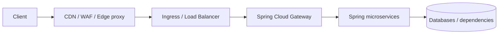
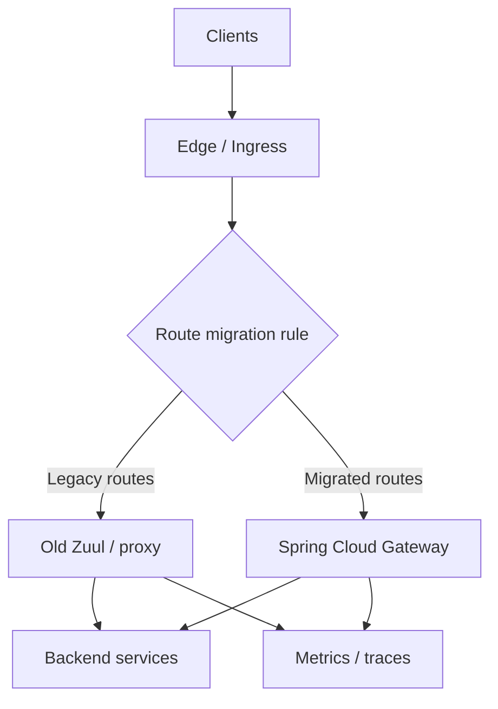

# Đánh giá chuyển từ Zuul hoặc proxy khác sang Gateway

Chuyển từ **Zuul hoặc một reverse proxy khác sang Spring Cloud Gateway** là thay đổi về đường đi của request, runtime, filter lifecycle, timeout, security và vận hành. Một route chạy được sau khi đổi YAML chưa chứng minh migration an toàn. Cần xác định **hành vi hiện tại**, lập bảng tương đương cho từng tính năng, kiểm tra khác biệt có chủ đích, rồi chuyển traffic theo từng giai đoạn với tiêu chí rollback rõ ràng.

Bài này thuộc module **SPRING_CLOUD_GATEWAY**: xây dựng API Gateway với route predicates, filter chain, rewrite path/header, service discovery, xác thực, giới hạn lưu lượng, circuit breaker, retry, TLS và observability. Trọng tâm là đánh giá migration từ **Zuul** hoặc proxy khác, gồm trường hợp thay gateway Java cũ và trường hợp thay một phần L7 routing của Nginx/Envoy/HAProxy.

Ví dụ cấu hình chủ yếu dùng **Spring Cloud Gateway Server WebFlux**. Gateway Server Web MVC là runtime riêng trong các dòng phiên bản hỗ trợ; không coi cấu hình WebFlux tự động chạy trên MVC. Property, filter, dependency và behavior phải được xác minh theo Spring Boot/Spring Cloud release train thực tế.

> **Nguyên tắc migration:** Không dịch từng property một cách máy móc. Hãy chuyển **contract và hành vi cần giữ**, sau đó thiết kế cách triển khai tương ứng trong Gateway. Những khác biệt phải được ghi rõ, kiểm thử và chấp nhận trước cutover.

## 1. Khi nào nên đánh giá migration?

Các lý do hợp lý:

- Gateway hiện tại đã hết vòng đời hỗ trợ hoặc khó nâng cấp theo nền tảng Spring/JDK.
- Cần route/filter integration trực tiếp với Spring Cloud, DiscoveryClient và LoadBalancer.
- Muốn thống nhất routing, token relay, rate limiting, circuit breaker và observability cho microservices Spring.
- Cần xử lý reactive I/O hoặc streaming với tải phù hợp.
- Muốn giảm số lớp proxy do kiến trúc hiện tại có nhiều thành phần chồng lặp.
- Cần chuẩn hóa cấu hình route và policy theo version/release process.
- Hệ thống cần gateway có thể mở rộng bằng code/config theo quy trình nội bộ.

Không nên migration chỉ vì tên framework mới hơn, benchmark đơn lẻ trên một endpoint, hoặc giả định reactive mặc định nhanh hơn cho mọi workload. Cũng không nên coi Gateway là sự thay thế mặc định cho WAF, CDN, DDoS protection hay edge load balancer.

**Migration là quyết định kiến trúc và vận hành**, không chỉ là thay dependency.

## 2. Xác định chính xác nguồn hiện tại

“Zuul” có thể chỉ nhiều hệ thống khác nhau:

| Nguồn hiện tại | Đặc điểm cần nhận diện | Rủi ro khi chuyển |
| --- | --- | --- |
| Spring Cloud Netflix Zuul 1 | Tích hợp Spring, filter types, servlet-era lifecycle | Blocking model, Ribbon/Hystrix và legacy config |
| Netflix Zuul 2 | Nền tảng Netty/async, kiến trúc và API riêng | Không phải nâng cấp drop-in từ Zuul 1 |
| Nginx | Reverse proxy, upstream, buffering, header, TLS, location matching | Khác semantics path, timeout và streaming |
| Envoy | L7 proxy, clusters, listeners, filters, xDS, telemetry | Có thể có service-mesh/control-plane behavior ngoài Gateway |
| HAProxy | L4/L7 load balancing, ACL, health checks, stickiness | Khác cách biểu diễn route/filter và connection policy |
| Apache HTTP Server | Proxy modules, rewrite, auth, TLS | Module/config semantics khác |
| Custom Spring MVC proxy | Servlet filters/interceptors/controller forwarding | Có thể phụ thuộc behavior tự viết |
| Cloud API Gateway | Managed auth, quotas, WAF, private integrations | Gateway ứng dụng không tự thay managed platform features |

**Đừng suy từ chữ “Zuul” rằng hệ thống đang chạy Zuul 1.** Kiểm tra dependency, artifact/version, runtime, filter implementation và config thực tế trong phạm vi dự án được giao.

Đặc biệt, **Netflix Zuul 2 không đồng nghĩa Spring Cloud Netflix Zuul integration tự hỗ trợ Zuul 2**. Chọn đúng implementation/version và kiểm tra support lifecycle của chúng.

## 3. Đánh giá cả kiến trúc trước khi chọn đích

Spring Cloud Gateway có thể là lớp API gateway trong ứng dụng Spring, nhưng không mặc định thay mọi chức năng của edge proxy.



Trước migration, phân loại trách nhiệm:

- **Edge:** public IP, TLS public, WAF, DDoS, geo/IP controls, CDN, bot protection.
- **Ingress/load balancer:** cluster entry, health checks, connection management.
- **API Gateway:** API routes, identity propagation, coarse-grained policy, rate limiting, resilience, API observability.
- **Service:** domain authorization, validation, business rules, data ownership.
- **Service mesh:** workload identity, mTLS, east-west policy, traffic management.
- **Platform:** DNS, service discovery, secrets, certificates, deployment và scaling.

Nếu Zuul hiện tại đồng thời làm IP filtering, TLS termination, response buffering và internal service routing, cần quyết định chức năng nào chuyển sang Gateway và chức năng nào giữ ở edge/platform. **Không bỏ một security control chỉ vì Gateway có route filter.**

## 4. Lập baseline trước khi thay đổi

Đo trạng thái hiện tại trong một cửa sổ traffic đại diện:

- Requests/s theo route, method, client class.
- p50/p95/p99 latency, tách upstream và gateway overhead nếu có.
- Status distribution 2xx/3xx/4xx/5xx.
- Connection count, active/pending requests, keep-alive reuse.
- Payload sizes và tỷ lệ upload/download lớn.
- TLS handshake rate, certificate failures.
- Retry attempts, breaker state, fallback rate.
- Rate-limit allow/deny và Redis latency nếu có.
- AuthN/AuthZ outcomes.
- Cache hit/miss, body buffering.
- WebSocket/SSE sessions và lifetime.
- Backend service selection, unhealthy instances.
- Gateway CPU/memory/GC, thread/event loop saturation.
- Logs/traces và cardinality/cost của telemetry.

**Baseline phải theo route và traffic class**, không chỉ một con số tổng. Một route GET cached có thể rất khác POST thanh toán hoặc WebSocket dài hạn.

## 5. Inventory: những gì cần khám phá ở gateway cũ

Tạo danh mục đầy đủ trước khi viết cấu hình mới:

1. Static routes và dynamic routes.
2. Path, method, host, header, query, cookie và time predicates.
3. Prefix, strip, rewrite, redirect và URI normalization.
4. Route order/precedence và fallback route.
5. Global/pre/post/error filters.
6. Header add/remove/rename, sensitive headers, forwarded headers.
7. Authentication, token relay, authorization và identity context.
8. CORS, CSRF, cookies và session behavior.
9. Service discovery, load balancing, sticky sessions.
10. Connect/read/response/idle/total timeouts.
11. Retry conditions, backoff, max attempts, idempotency.
12. Circuit breaker, bulkhead, fallback và load shedding.
13. Rate limit, quota key, Redis/global state.
14. TLS inbound/outbound, mTLS, truststores, SNI.
15. Request/response body transformations và size limits.
16. Cache, compression, streaming, WebSocket/SSE.
17. Error response format, correlation IDs.
18. Metrics, tracing, access logs và audit.
19. Actuator/admin routes và operational endpoints.
20. Deployment, scaling, health checks, graceful shutdown và rollback.

Mỗi dòng inventory nên có **owner, traffic, security class, source behavior, target behavior, test evidence và migration status**. Đừng để một route nhạy cảm bị bỏ sót vì nó được tạo động hoặc nằm trong filter code.

## 6. Tạo route catalog có thể kiểm tra

Ví dụ cấu trúc catalog (mẫu tài liệu, không phải schema chuẩn của Spring):

```yaml
routes:
  - id: orders-read
    sourcePath: /api/orders/**
    targetService: order-service
    targetPath: /orders/**
    methods: [GET]
    auth: oauth2-jwt
    requiredScopes: [orders.read]
    rateLimit: per-user
    timeoutProfile: interactive-read
    retryProfile: safe-get
    cache: disabled
    owner: commerce-team
    migrationStatus: not-started

  - id: payments-create
    sourcePath: /api/payments/**
    targetService: payment-service
    targetPath: /payments/**
    methods: [POST]
    auth: oauth2-jwt
    requiredScopes: [payments.write]
    rateLimit: per-tenant
    timeoutProfile: payment-write
    retryProfile: none-unless-idempotent
    cache: disabled
    owner: payments-team
    migrationStatus: not-started
```

Catalog cần ghi cả **hành vi cần giữ** và **ngoại lệ được phê duyệt**. Không để route nhạy cảm bị bỏ sót vì nó nằm trong custom filter hoặc remote route store.

## 7. Zuul 1 và Spring Cloud Gateway: khác biệt runtime

Một điểm khác biệt quan trọng là mô hình thực thi.

| Khía cạnh | Zuul 1 thường gặp trong Spring legacy | Gateway Server WebFlux |
| --- | --- | --- |
| Runtime | Servlet/blocking-oriented | Reactive, Reactor/Netty |
| Request abstraction | Servlet request/response | ServerWebExchange |
| Filter model | Zuul filter types/lifecycle | GlobalFilter, GatewayFilter, HttpHeadersFilter và WebFilter/Security chain |
| Async behavior | Tùy tích hợp Hystrix/servlet async | Reactive pipeline và non-blocking I/O |
| Blocking dependency | Có thể dùng blocking APIs theo servlet model | Blocking trên event loop có thể làm nghẽn process |
| HTTP client | Ribbon/Apache/OkHttp tùy cấu hình/version | Reactor Netty HTTP client phổ biến, có thể tùy biến |
| Service load balancing | Ribbon trong nhiều hệ cũ | Spring Cloud LoadBalancer |
| Request/response mutation | Filter và servlet wrappers | Immutable request/response mutation qua exchange |
| Backpressure/streaming | Phụ thuộc stack | Reactive Streams semantics |

Đây là so sánh ở mức mô hình phổ biến; một hệ Zuul cụ thể có thể đã dùng async extensions hoặc custom transport.

### Không chuyển blocking code nguyên xi vào event loop

Trong Gateway WebFlux:

- Không gọi JDBC/JPA blocking trực tiếp trong GlobalFilter.
- Không dùng Thread.sleep() để tạo delay.
- Không đọc toàn bộ body vào memory nếu không cần.
- Không gọi blocking HTTP client trên event loop.
- Không giữ lock hoặc chạy CPU-heavy encryption/serialization dài trong event loop.
- Nếu bắt buộc dùng blocking API, thiết kế scheduler isolation có giới hạn và kiểm tra backpressure; tốt hơn là dùng reactive/non-blocking client phù hợp.

**Reactive không có nghĩa mọi dependency tự trở thành non-blocking.** Một custom filter gọi synchronous database có thể làm nhiều requests trên event loop bị ảnh hưởng.

## 8. Zuul 2 và Gateway WebFlux không phải cùng một API

Zuul 2 là implementation riêng có Netty/async architecture và filter APIs khác. Migration từ Zuul 2 cần:

- Inventory các Zuul 2 filters và execution model.
- Tìm custom Netty handlers/connection lifecycle behavior.
- Kiểm tra streaming/body handling và connection reuse.
- So sánh TLS, routing, health checks và metrics.
- Viết adapter/filter mới theo Gateway APIs.
- Benchmark lại; không giả định kết quả benchmark Zuul 1 áp dụng cho Zuul 2.

Không có cam kết filter code của Zuul 1 hoặc Zuul 2 có thể compile/chạy sau khi thay dependency bằng Spring Cloud Gateway.

## 9. Gateway WebFlux và Gateway Server Web MVC là hai lựa chọn khác nhau

Server WebFlux chạy reactive stack. Server Web MVC (trong các dòng hỗ trợ) dựa trên Servlet/MVC model và có API/filter compatibility khác.

Chọn dựa trên runtime đang dùng, dependencies blocking/non-blocking, streaming/WebSocket, filter/extensions, observability/HTTP client behavior, compatibility Spring Boot/Cloud và khả năng vận hành của team.

Không thêm đồng thời starter WebFlux và MVC rồi để auto-configuration chọn runtime ngoài ý muốn. Chốt variant và test ứng dụng khởi động đúng server.

## 10. So sánh route model: Zuul và Gateway

Ví dụ Zuul 1 route cấu hình thường gặp:

```yaml
zuul:
  routes:
    orders:
      path: /api/orders/**
      serviceId: order-service
      stripPrefix: true
```

Gateway route tương ứng ở mức ý tưởng:

```yaml
spring:
  cloud:
    gateway:
      routes:
        - id: orders
          uri: lb://order-service
          predicates:
            - Path=/api/orders/**
          filters:
            - StripPrefix=1
```

Đây **không phải phép dịch 1:1**. Hãy xác minh Zuul stripPrefix semantics, Gateway segment count, global prefix/ignored patterns, serviceId vs direct URL, route order/precedence, query string, encoded path, trailing slash và fallback behavior.

Test bằng request/target URI cụ thể, không chỉ đọc YAML.

## 11. Route precedence và overlapping patterns

Hai route có thể cùng match một path:

```yaml
spring:
  cloud:
    gateway:
      routes:
        - id: admin-orders
          order: -10
          uri: lb://admin-service
          predicates:
            - Path=/api/orders/admin/**
        - id: general-orders
          order: 0
          uri: lb://order-service
          predicates:
            - Path=/api/orders/**
```

Ví dụ cố ý cho route cụ thể có precedence cao hơn. Kiểm tra semantics order trong version đang dùng và đảm bảo route rộng không nuốt route nhạy cảm.

Đối chiếu với thứ tự matching của proxy cũ: longest prefix hay first match, regex specificity, explicit priority, Host/Method predicates kết hợp ra sao, dynamic refresh có đổi thứ tự và fallback route có match quá rộng không.

## 12. Predicate parity: kiểm tra mọi chiều match

| Predicate cũ | Gateway thường dùng | Điều phải kiểm tra |
| --- | --- | --- |
| Path prefix/glob | Path | Wildcards, encoded path, trailing slash |
| HTTP method | Method | HEAD/OPTIONS và method override |
| Host | Host | Port, wildcard, forwarded host |
| Header | Header | Regex, case, duplicate headers |
| Query parameter | Query | Missing/empty/multiple values |
| Cookie | Cookie | Cookie parsing, encoding |
| Time window | Between, After, Before | Timezone, boundary, clock |
| Remote address | RemoteAddr | Trusted proxy chain, IPv4/IPv6 |
| Weight/canary | Weight | Group semantics, distribution |
| Custom predicate | Custom RoutePredicateFactory | Side effects, order, performance |

**Không dùng RemoteAddr làm identity.** Khi có Ingress/proxy phía trước, remote address trực tiếp có thể là IP của proxy. Cần trusted-proxy policy đúng và không tin forwarded headers từ client tùy ý.

## 13. Rewrite path: chứng minh URI upstream bằng test

Ví dụ:

```yaml
spring:
  cloud:
    gateway:
      routes:
        - id: catalog-v2
          uri: lb://catalog-service
          predicates:
            - Path=/public/catalog/**
          filters:
            - RewritePath=/public/catalog/(?<segment>.*), /v2/catalog/$\{segment}
```

Mục tiêu:

```text
Incoming: /public/catalog/items/42
Upstream: /v2/catalog/items/42
```

Regex replacement syntax có thể cần escape trong YAML. Ví dụ trên minh họa ý tưởng; xác minh đúng parser và Gateway version bằng integration test.

So với proxy cũ, test root path, path nhiều segments, query string, URL encoded characters, trailing slash, double slash, matrix/path parameters nếu có, case sensitivity và malformed URI.

Không giả định StripPrefix, RewritePath, Nginx rewrite, Zuul stripPrefix và Envoy prefix rewrite có semantics giống nhau.

## 14. Header behavior: một nguồn gây regression phổ biến

Lập bảng header:

| Nhóm | Ví dụ | Cần xác minh |
| --- | --- | --- |
| Auth | Authorization, Cookie | Relay/remove, audience, leakage |
| Forwarded | Forwarded, X-Forwarded-* | Trusted proxy, scheme, host, client IP |
| Identity | X-User-Id, X-Tenant-Id | Strip spoofed input, verified source |
| Correlation | X-Request-Id, trace context | Validate/propagate, duplicate behavior |
| Hop-by-hop | Connection, Keep-Alive, Transfer-Encoding | HTTP proxy semantics |
| Security response | Strict-Transport-Security, CSP | Edge/backend ownership, duplicate policy |
| CORS | Origin, Access-Control-* | Single owner, preflight behavior |
| Cookies | Set-Cookie, SameSite, Secure | Domain/path rewriting, browser behavior |

Zuul có cấu hình sensitive headers theo route/global trong một số phiên bản. Gateway có filters để add/remove/set headers và cơ chế header filters riêng. **Đừng giả định default sensitive-header behavior giống nhau.**

### Test header forwarding

Với mỗi route, capture request tại backend test stub và assert Authorization được relay đúng hoặc bị bỏ theo policy, Cookie không bị forward nếu không cần, client không thể spoof identity headers, forwarded headers đến từ trusted proxy chain, Host/port/scheme upstream đúng, correlation ID chuẩn hóa, hop-by-hop headers được xử lý đúng và response security headers không duplicate.

## 15. Authentication và TokenRelay

Nếu Zuul cũ có pre-filter xác minh JWT rồi thêm X-User-Id, chuyển sang Gateway cần phân tách:

1. **Authentication:** Gateway/backend xác minh token bằng issuer/key/audience phù hợp.
2. **Authorization:** Gateway coarse route scope và backend resource/domain authorization.
3. **Identity propagation:** Token relay hoặc assertion được ký, có provenance.
4. **Header hygiene:** Remove untrusted client identity headers.

Gateway OAuth2 TokenRelay có thể chuyển access token tới downstream khi OAuth2 client/security configuration phù hợp. Nó **không tự đổi audience**, không tự cấp scope mới và không thay backend Resource Server.

Nếu token cũ chỉ dành cho gateway, backend yêu cầu aud=orders-api, cần token exchange/on-behalf-of hoặc một token issuance design chính thức. Không sửa payload JWT hoặc bỏ audience validation chỉ để migration pass.

### Security parity matrix

| Control cũ | Target requirement | Evidence |
| --- | --- | --- |
| JWT signature | Approved key/algorithm | Invalid signature test bị từ chối |
| Issuer | Exact trusted issuer | Wrong issuer test 401 |
| Audience | Intended backend resource | Wrong audience test 401 |
| Exp/nbf | Time validation | Expired/not-yet-valid test |
| Scope/role | Least privilege | Missing scope 403 |
| Tenant/owner | Resource authorization tại service | Cross-tenant test bị deny |
| Header spoofing | Backend không tin raw headers | Token Bob + header Alice vẫn deny |
| Service identity | Workload auth riêng | Service token chỉ có operation scope |

## 16. CORS và preflight

Nếu proxy cũ xử lý CORS, cần xác định owner sau migration: Edge/Ingress, Gateway, backend hay shared library.

Tránh bật CORS ở nhiều tầng với Access-Control-Allow-Origin khác nhau. Browser có thể từ chối khi response có duplicate/conflicting headers.

Test allowed/disallowed origin, credentials, methods/headers, OPTIONS preflight, Authorization header, error responses 401/403/429/5xx, cookie attributes và route rewrite.

**CORS không phải authentication**; curl và service-to-service clients không bị browser same-origin policy bảo vệ.

## 17. Service discovery: Ribbon sang Spring Cloud LoadBalancer

Trong nhiều hệ Spring Cloud cũ, Zuul dùng Ribbon để chọn instance; các kiến trúc mới thường dùng **Spring Cloud LoadBalancer**.

Gateway route dùng service ID:

```yaml
spring:
  cloud:
    gateway:
      routes:
        - id: orders
          uri: lb://order-service
          predicates:
            - Path=/api/orders/**
          filters:
            - StripPrefix=1
```

Kiểm tra DiscoveryClient registration, service ID, host/port/scheme, health/readiness, zone preference, sticky sessions, retry instance selection, TLS metadata, cache refresh và no-instance behavior.

Không đổi Ribbon sang LoadBalancer rồi giả định mọi rule/zone/health filter được giữ. Tạo test instance list và kiểm tra distribution.

## 18. Direct URI và lb:// không tương đương

Một route cũ có thể trỏ URL trực tiếp:

```yaml
zuul:
  routes:
    legacy-report:
      path: /reports/**
      url: https://reports.internal.example.invalid
```

Gateway tương ứng về ý tưởng:

```yaml
spring:
  cloud:
    gateway:
      routes:
        - id: legacy-report
          uri: https://reports.internal.example.invalid
          predicates:
            - Path=/reports/**
```

Nếu đổi thành lb://reports-service, hệ thống đã thay cơ chế chọn destination. Kiểm tra DNS, TLS SNI/hostname, health, load balancing, connection pool và failover. **Đừng đổi direct URL sang lb:// nếu discovery chưa có service registration đáng tin.**

## 19. Retry semantics khi migration

Một proxy cũ có thể retry ở Ribbon, Hystrix, custom filter hoặc HTTP client. Hãy inventory **mọi lớp retry**, vì retry ở nhiều tầng có thể nhân số attempts.

```text
Client retry: 2 attempts
Gateway retry: 2 attempts
Service client retry: 3 attempts

Worst-case upstream attempts có thể nhân lên nhiều lần,
tùy cách các retry layers lồng nhau và lỗi xảy ra.
```

Target policy phải chỉ rõ retry owner, max attempts tổng, eligible status/exception, HTTP methods và idempotency, backoff/jitter, total deadline, retry budget và metrics cho logical request vs upstream attempts.

Gateway Retry filter có thể giới hạn method/status/exception và backoff theo version. Test thực tế; không sao chép retryable=true từ route cũ mà chưa biết điều kiện kích hoạt.

## 20. Circuit breaker: Hystrix sang Spring Cloud CircuitBreaker

Một hệ Zuul 1 có thể dùng Hystrix isolation, timeout, fallback và circuit breaker. Gateway thường tích hợp Spring Cloud CircuitBreaker với implementation phù hợp, chẳng hạn Resilience4j nếu dependency được chọn.

| Behavior cũ | Cần quyết định ở target |
| --- | --- |
| Circuit open threshold | Failure rate/slow call threshold |
| Sliding window | Count/time-based window |
| Minimum calls | Số samples trước khi quyết định |
| Open duration | Wait duration và half-open probes |
| Thread isolation | Bulkhead/thread pool hay semaphore |
| Timeout | Operation timeout và total deadline |
| Fallback | Status/body/cache/degraded contract |
| Metrics | State, calls, failures, slow calls |
| Exception ignore | Exceptions không tính vào failure |

**Thread isolation không tự tương đương reactive semaphore isolation.** Nếu trước đây Hystrix cô lập blocking calls bằng thread pool, cần thiết kế lại concurrency/bulkhead trên reactive stack.

Fallback phải giữ API contract. Không trả 200 giả thành công khi dữ liệu chưa được lấy; client cần biết degraded response là gì.

## 21. Timeout mapping từ Zuul/proxy cũ

Tìm toàn bộ timeout settings hiện tại:

- Client connect/read/total deadline.
- Edge/Ingress upstream connect/read/idle.
- Zuul host connect/socket timeout hoặc HTTP client timeout.
- Ribbon connect/read timeout.
- Hystrix command timeout.
- Backend server request/connection timeout.
- DB pool acquire/query timeout.
- External API timeout.
- Streaming idle timeout.

Gateway WebFlux có các timeout khác nhau: HTTP client connect timeout, response/read timeout, connection pool acquire timeout, per-route timeout metadata (nếu version hỗ trợ), TLS handshake behavior và outer Ingress/client deadline.

**Không ánh xạ một socket-timeout cũ thành response-timeout mới mà không kiểm semantics.** Một số setting cũ giới hạn socket inactivity; setting mới có thể áp dụng ở phase khác.

### Ví dụ HTTP client configuration

Một số dòng Gateway WebFlux hỗ trợ cấu hình dạng:

```yaml
spring:
  cloud:
    gateway:
      httpclient:
        connect-timeout: 500
        response-timeout: 2s
        pool:
          type: fixed
          max-connections: 300
          acquire-timeout: 1000
```

Đây là **mẫu cần xác minh property prefix và units theo version**. Các dòng mới có thể dùng prefix variant-specific như spring.cloud.gateway.server.webflux.httpclient. response-timeout không mặc định là total deadline của mọi body stream; pool acquire và connect là các phase riêng.

Không tăng max-connections chỉ vì thấy 504. Nếu backend/DB đang saturated, tăng concurrency có thể làm lỗi nặng hơn.

## 22. Rate limiting và quota parity

Nếu hệ cũ giới hạn theo IP/API key/user/tenant, ghi rõ key resolver source và identity trust, refill rate/burst, scope per route/user/tenant/global, shared Redis hay local state, behavior khi Redis down, response status/body/headers, missing-key policy, admin override và metrics.

Gateway RequestRateLimiter/RedisRateLimiter có thể là target, nhưng phải kiểm tra bucket semantics, Redis key format, route ID và KeyResolver. **Hai route ID khác nhau có thể tạo quota bucket khác nhau** nếu key construction gắn route ID; cần giữ hoặc chủ động thay policy.

Một local limiter trên mỗi Gateway pod có thể làm quota nhân theo replicas. Nếu yêu cầu quota toàn cụm, dùng shared state hoặc service policy có semantics tương đương.

## 23. TLS inbound và outbound

Tách hai hop:

```text
Client -- HTTPS --> Edge / Gateway -- HTTPS or mTLS --> backend
```

Inventory certificate owner/issuer/renewal, TLS termination point, minimum TLS version/cipher, SNI/host routing, truststore/CA bundle, backend SAN/hostname verification, client certificate requirements, mTLS workload identity, secret rotation/reload, redirect HTTP→HTTPS và forwarded proto.

Gateway inbound TLS không tự thay edge WAF hoặc public certificate automation. Outbound TLS phải tiếp tục xác minh backend identity. Không tắt certificate verification để migration test pass.

### TLS parity tests

- Certificate hợp lệ đúng hostname.
- Certificate hết hạn.
- SAN/hostname mismatch.
- Unknown CA/intermediate missing.
- Client cert missing/invalid khi mTLS required.
- Certificate rotation trong khi pods chạy.
- Backend service discovery trả hostname khác.
- TLS handshake latency và connection reuse.

## 24. Request/response body transformations

Một proxy cũ có thể rewrite JSON body, add/remove fields, compress/decompress, buffer request/response, enforce body size, transform multipart upload, mask sensitive fields, sign request/response hoặc support streaming.

Trong Gateway WebFlux, body là reactive stream/DataBuffer. Body transformation cần quản lý **buffer lifecycle, memory limit, cancellation và backpressure**. Không chuyển logic đọc ServletInputStream/HttpServletResponse sang DataBuffer bằng cách thay tên class.

Nếu chỉ cần thay header/path, đừng aggregate toàn body. Với body rewrite, test empty/large body, chunked transfer, malformed JSON/encoding, content-length, cancellation, DataBuffer leak và p95/CPU/direct memory.

## 25. Compression, buffering và streaming

Nginx/Envoy có thể buffer request/response theo config; Gateway/reactive stack có behavior khác. So sánh response buffering, backpressure khi client đọc chậm, chunked transfer, HTTP/2 flow control, gzip/Brotli ở đúng hop, large downloads, SSE/WebSocket, request body replay khi retry và maximum in-memory body size.

**Buffering khác streaming.** Nếu proxy cũ buffer toàn response trước khi gửi, client có thể không nhận byte đầu tiên cho đến khi backend hoàn tất. Nếu target stream ngay, TTFB và lỗi giữa stream có thể khác. Đây có thể là thay đổi API behavior cần chấp nhận có chủ đích.

## 26. WebSocket và SSE

Nếu gateway cũ route WebSocket:

- Xác minh Gateway version và transport hỗ trợ WebSocket.
- Test ws:// và wss:// scheme mapping.
- Preserve Upgrade/Connection semantics qua proxy chain.
- AuthN handshake và authorization từng channel/message.
- Idle timeout và max session lifetime.
- Sticky session nếu backend giữ state.
- Scale-in/drain/reconnect behavior.
- Connection count và per-pod distribution.

SSE cần kiểm tra flush/chunking, buffering ở Ingress, idle timeout và client reconnect. Không dùng cùng một timeout ngắn cho long-lived streams và REST requests.

## 27. Caching: response parity và isolation

Proxy cũ có thể cache ở Nginx/Envoy/CDN hoặc custom Zuul filter. Nếu chuyển cache, xác minh cache key dimensions, Authorization/cookie/tenant isolation, public/private classification, Cache-Control/Vary/ETag, TTL/stale-while-revalidate, invalidation sau write, error caching, local vs shared cache, warm-up/cold-start và hit/miss metrics.

Gateway LocalResponseCache (nếu version hỗ trợ và cấu hình phù hợp) không mặc định tương đương CDN/shared cache. Private response cache có thể gây cross-user/tenant leak. Test cùng URL với hai principals khác nhau và tắt shared caching cho dữ liệu nhạy cảm nếu chưa chứng minh được isolation.

## 28. Observability parity

| Tín hiệu cũ | Target phải có |
| --- | --- |
| Access logs | Structured request logs theo route/status/duration |
| Correlation ID | Propagate/validate request ID |
| Distributed trace | Ingress → Gateway → backend → dependency |
| Route metrics | RPS, status, latency theo route |
| Upstream metrics | Selected instance, connect/read errors |
| Retry metrics | Logical requests vs attempts |
| Breaker metrics | State, open/half-open/fallback |
| Rate limiter metrics | Allowed/denied, Redis latency/errors |
| TLS metrics | Handshake failures/cert expiry |
| Audit | Security/privileged action outcomes |
| Health checks | Liveness/readiness/startup |

Không mang toàn bộ labels cũ sang Prometheus một cách máy móc. Raw path, user ID, tenant ID, request ID và token có thể tạo cardinality hoặc lộ thông tin. Dùng route ID/operation/reason category có cardinality thấp.

Gateway có thể expose actuator endpoints để xem health/metrics/route information tùy version/config. Bảo vệ management port và routes endpoint; không public route definitions, service topology hoặc environment details cho clients.

## 29. Error handling và response contract

Gateway cũ có thể chuẩn hóa errors thành JSON:

```json
{
  "code": "UPSTREAM_UNAVAILABLE",
  "message": "Dịch vụ hiện không sẵn sàng",
  "requestId": "synthetic-request-id"
}
```

Target cần xác minh status code giữ nguyên hay được map, error schema/code có tương thích clients không, WWW-Authenticate và Retry-After có được giữ, CORS/security headers có xuất hiện trên errors, backend body có lộ stack trace/internal host, Gateway timeout/no-instance/breaker-open/rate-limit có phân biệt, fallback có trả degraded data hay chỉ lỗi, response headers có duplicate/strip không.

Không map mọi upstream failure thành 200/500 chung. Client và monitoring cần biết 401/403/404/429/502/503/504 theo contract.

## 30. Filter lifecycle: Zuul pre/route/post/error sang Gateway chain

Zuul 1 thường tổ chức filters theo loại như **pre**, **route**, **post**, **error**. Gateway dùng filter chain gồm route-specific GatewayFilter, GlobalFilter và các web filters liên quan; filter order và reactive lifecycle có semantics khác.

| Nhu cầu ở Zuul | Cách tiếp cận Gateway | Lưu ý |
| --- | --- | --- |
| Pre-auth/filter | Spring Security hoặc GlobalFilter phù hợp | AuthN nên nằm ở security chain |
| Route selection | Route predicates | Không nhét mọi logic vào filter |
| Before proxy | Ordered GatewayFilter/GlobalFilter | Xác minh order |
| After upstream response | chain.filter(exchange).then(...) hoặc reactive operators | Response có thể đã committed |
| Error filter | Reactive error handling/fallback/exception handler | Không giả định mọi exception đi cùng một path |
| Header filter | Request/response mutation, HttpHeadersFilter | Proxy headers semantics |
| Shared behavior | GlobalFilter | Áp cho nhiều routes, dễ tạo coupling |
| Route-specific behavior | GatewayFilterFactory | Tái sử dụng cấu hình theo route |

### Reactive ordering cần test

- GlobalFilter và GatewayFilter được combine/sort theo order.
- Một filter chạy trước chain.filter có thể sửa request.
- Một filter dùng then/doOnSuccess chạy sau chain theo lifecycle.
- Error/cancel path khác normal completion.
- Response có thể đã commit; không thể sửa status/body tùy ý sau commit.
- Ordered values phải được chọn rõ và test.

Không dịch “pre filter” thành GlobalFilter rồi assume thứ tự giống Zuul.

## 31. Ví dụ custom GlobalFilter sau migration

Ví dụ thêm correlation ID đã được kiểm tra định dạng:

```java
@Component
public class CorrelationIdGlobalFilter implements GlobalFilter, Ordered {

    private static final Pattern SAFE_ID =
        Pattern.compile("[A-Za-z0-9._-]{1,80}");

    @Override
    public int getOrder() {
        return Ordered.HIGHEST_PRECEDENCE + 20;
    }

    @Override
    public Mono<Void> filter(
            ServerWebExchange exchange,
            GatewayFilterChain chain) {

        String supplied = exchange.getRequest()
            .getHeaders()
            .getFirst("X-Request-Id");

        String requestId = supplied != null
                && SAFE_ID.matcher(supplied).matches()
            ? supplied
            : UUID.randomUUID().toString();

        ServerHttpRequest request = exchange.getRequest()
            .mutate()
            .headers(headers -> headers.set("X-Request-Id", requestId))
            .build();

        ServerWebExchange updated = exchange.mutate()
            .request(request)
            .build();

        return chain.filter(updated);
    }
}
```

Đây là ví dụ minh họa; cần imports, bean scanning và test order. Trong production, trace context nên theo chuẩn propagation đã chọn; request ID từ client chỉ là correlation metadata, **không phải identity hoặc security credential**. Đừng tạo high-cardinality metric tag từ ID này.

### Khi nào dùng GatewayFilterFactory?

Dùng route-specific factory nếu behavior cần cấu hình khác nhau theo route, ví dụ thêm response header hoặc policy metadata. Dùng GlobalFilter cho logic thực sự áp dụng toàn Gateway. Dùng Spring Security cho authentication/authorization, không tự viết JWT parser trong một filter chỉ để thay thế security framework.

## 32. Error filters và exception mapping

Khi migration, lập bảng mapping exception cũ sang target:

| Lỗi | Contract cần quyết định |
| --- | --- |
| No route | 404 |
| No service instance | 503 |
| Connection refused | 502/503 theo API policy |
| TLS validation failure | Fail closed; status public có thể generic 502/503 |
| Upstream response timeout | 504 |
| Pool acquire timeout | 503/504 tùy semantics/contract |
| Circuit breaker open | 503 hoặc degraded fallback |
| Rate limit | 429 |
| Authentication failure | 401 |
| Authorization failure | 403/404 theo resource disclosure policy |
| Client cancellation | Log/metric, thường không tạo response mới |

Không nhất thiết public exception class hoặc internal host. Nhưng logs nội bộ cần phân biệt PoolAcquireTimeout với ResponseTimeout, TLS failure và backend response status.

## 33. Deployment và runtime parity

Zuul cũ có thể chạy cùng một servlet application với các controller khác. Gateway WebFlux thường là reactive application/runtime riêng.

Kiểm tra JDK và Spring Boot versions, Spring Cloud release train, Gateway starter variant, Netty/Servlet dependencies, JVM heap/direct memory, CPU/memory requests/limits, thread pools/event loops, startup/readiness/liveness probes, graceful shutdown/termination grace, HPA/node capacity, secrets/ConfigMaps/certificates, NetworkPolicy/Service/Ingress và management port.

**Không dùng Spring Boot và Spring Cloud versions ngẫu nhiên.** Chọn release train được hỗ trợ cho Boot version, dùng BOM tương ứng và kiểm tra dependency convergence.

## 34. Kiểm tra dependency và version alignment

Trước build:

1. Ghi version Spring Boot, Spring Cloud release train và Gateway artifact.
2. Kiểm tra starter đúng variant WebFlux hay MVC.
3. Dùng Spring Cloud BOM thay vì pin mỗi dependency tùy ý.
4. Kiểm tra Java/JDK compatibility.
5. Kiểm tra Reactor Netty và Netty versions.
6. Kiểm tra Spring Security/OAuth2 Resource Server/Client versions.
7. Kiểm tra Spring Cloud LoadBalancer/discovery client.
8. Kiểm tra CircuitBreaker implementation và Micrometer binder.
9. Loại dependency Zuul/Ribbon/Hystrix cũ khi không còn dùng.
10. Kiểm tra transitive dependency không kéo Servlet runtime ngoài ý muốn.
11. Chạy dependency tree/SBOM/security scan trong pipeline.
12. Build và integration test bằng đúng artifact image sẽ deploy.

Không xóa dependency cũ trước khi xác nhận code/filter nào còn tham chiếu đến chúng. Nhưng cũng không giữ hai proxy runtimes trong cùng app nếu chúng gây auto-configuration conflict hoặc tăng bề mặt vận hành.

## 35. Security parity: không được hạ chuẩn khi cutover

| Control | Câu hỏi khi chuyển |
| --- | --- |
| TLS inbound | Ai terminate TLS, cert nào, renewal thế nào? |
| TLS outbound | Gateway có verify backend certificate/SNI? |
| mTLS | Workload identity và trust domain có giữ? |
| JWT | Issuer/audience/signature/exp/nbf có được xác minh? |
| OAuth2 | TokenRelay/exchange và scopes có đúng? |
| Backend AuthZ | Service tự kiểm tenant/resource ownership? |
| Header trust | Spoofed identity/forwarded headers bị loại/verify? |
| CORS | Chỉ một owner rõ ràng? |
| Rate limiting | Key/tenant quota có shared state? |
| Actuator | Management endpoints không public? |
| Secrets | Token/client secret/truststore được rotate? |
| Audit | Privileged actions và denials được ghi an toàn? |

Gateway coarse policy không thay backend authorization. Migration không được biến API trước đây có JWT validation và backend ownership thành API chỉ tin X-User-Id header.

## 36. Performance: benchmark đúng traffic mix

Không so sánh bằng một endpoint GET nhỏ rồi kết luận. Chia workload: small JSON GET, authenticated GET với JWT/JWK cache, Redis rate-limited route, POST có body, response lớn/download, body transformation, cache hit/miss, backend chậm/DB wait, WebSocket/SSE, TLS full handshake và keep-alive reuse, retry/breaker/fallback, burst và sustained load.

Đo offered/admitted/completed RPS, p50/p95/p99 TTFB và total latency, 4xx/5xx/timeout, CPU/throttling, heap/direct memory/GC, active/pending connections, event loop pending/blocked threads, backend/Redis/DB saturation, TLS handshake rate, retry amplification và resource cost per 1k requests.

Dùng cùng load generator, data set, network path, TLS mode, cache warmup, auth mix và backend capacity. Theo dõi cả Gateway overhead lẫn downstream; một target có thể nhanh hơn ở Gateway nhưng tạo nhiều connections hơn ở backend.

## 37. Kiểm tra reactive event loop

Với WebFlux, một filter blocking có thể khiến nhiều requests chậm cùng lúc.

Dấu hiệu:

- CPU có thể không cao nhưng event loop lag tăng.
- p99 tăng trên nhiều routes cùng một pod.
- Thread dump cho thấy event-loop threads chờ blocking call.
- block() hoặc synchronous client xuất hiện trong custom filter.
- DB/JDBC call chạy trực tiếp trên event loop.

Nếu code cũ từ Zuul gọi blocking service trong pre-filter, không copy trực tiếp vào Gateway GlobalFilter. Chuyển logic sang reactive client, hoặc cô lập blocking work bằng bounded scheduler phù hợp và load-test giới hạn concurrency.

## 38. Load balancing và connection reuse

So sánh distribution theo backend instance, zone/region awareness, sticky sessions, connection pool per destination, HTTP/2 vs HTTP/1.1, max idle/lifetime, DNS cache, retry instance selection, backend drain và health check semantics.

Nếu proxy cũ dùng cookie stickiness hoặc consistent hashing, lb:// route đơn giản có thể không giữ session affinity. Nếu session state nằm local backend, đây là regression có thể gây logout hoặc request vào instance thiếu state.

Ưu tiên session state external/shared và thiết kế stateless nếu có thể; nếu vẫn cần affinity, mô tả rõ cơ chế và kiểm thử scale/rollout.

## 39. Migration strategy: strangler theo route

Một cách giảm rủi ro là chuyển từng route/nhóm API:



Lợi ích: giới hạn blast radius, so sánh cùng route/traffic class, rollback route nhanh hơn rollback toàn nền tảng và phát hiện behavior mismatch trước khi chuyển toàn bộ.

Nhưng phải tránh hai gateway cùng áp policy không thống nhất hoặc tạo double rate limit/token relay. Route ownership và precedence ở edge phải rõ.

## 40. Shadow traffic: dùng đúng loại request

Shadow traffic có thể gửi bản sao request tới Gateway mới để so latency/route decision, nhưng **không gửi writes gây side effects hai lần**.

Chỉ nên shadow GET/HEAD an toàn, synthetic requests, data test, requests đã scrub PII/secrets và backend shadow/read-only environment. Nếu cần shadow POST, phải có cơ chế backend idempotency/dry-run được thiết kế riêng; không chỉ copy HTTP request.

So sánh route match, upstream URI/method, headers sau normalization, auth decision, response status/schema trên data test, latency và selected instance, logs/trace completeness. Không ghi full production response body để diff nếu chứa PII.

## 41. Canary cutover

Canary có thể bắt đầu với một phần nhỏ traffic:

1. Chọn routes ít rủi ro hoặc GET/read-only.
2. Chọn traffic slice ổn định, tránh chỉ một tenant nhạy cảm.
3. Giữ backend capacity đủ cho tổng traffic từ hai gateways.
4. Kiểm tra shared Redis quota không bị split.
5. Theo dõi status/latency theo gateway version và route.
6. Mở rộng theo các bước đã định trước.
7. Dừng rollout nếu security/correctness/SLO guardrail vi phạm.
8. Sau khi ổn định, chuyển writes/privileged routes theo kế hoạch riêng.

**Không dùng số pods hoặc phần trăm traffic làm tiêu chí duy nhất.** Sticky sessions và long-lived connections làm phân bố không tuyến tính.

## 42. Không chạy double writes trong dual-run

Nếu old và new gateway cùng forward một POST payment/refund/order creation tới backend, có thể tạo side effect hai lần. Một request client duy nhất không có nghĩa chỉ có một backend execution nếu hai proxies cùng route.

Các lựa chọn:

- Route request chỉ qua một gateway tại một thời điểm.
- Shadow tới read-only/mock backend.
- Backend idempotency key được enforce ở transaction boundary.
- Dry-run endpoint không ghi dữ liệu.
- Dual-write orchestration có design riêng và reconciliation, không phát sinh tự động từ proxy mirroring.

**Không thử canary bằng cách gửi đồng thời write requests tới hai gateways** nếu backend chưa thiết kế chống duplicate.

## 43. Cutover checklist

Trước thời điểm cutover:

- [ ] Route catalog đầy đủ và có owner.
- [ ] Mỗi route có source behavior/target behavior.
- [ ] Predicate/precedence/rewrite tests pass.
- [ ] Header/sensitive header/forwarded header tests pass.
- [ ] JWT issuer/audience/scope và backend AuthZ pass.
- [ ] CORS/preflight/cookie behavior pass.
- [ ] Discovery/LoadBalancer/health instance pass.
- [ ] TLS inbound/outbound/mTLS pass.
- [ ] Timeout/deadline chain được đo.
- [ ] Retry/breaker/fallback contract pass.
- [ ] Rate-limit shared quota pass.
- [ ] Body/streaming/WebSocket/SSE pass nếu có.
- [ ] Error response contract tương thích.
- [ ] Metrics/logs/traces/alerts sẵn sàng.
- [ ] Load/performance test đạt SLO.
- [ ] HPA/resources/probes/graceful shutdown được xác minh.
- [ ] Runbook/on-call/owner rõ.
- [ ] Rollback route/proxy config đã diễn tập.
- [ ] Không có double-write/shadow side effects.
- [ ] DNS/Ingress/edge TTL và route propagation được hiểu.
- [ ] Security review chấp nhận các behavior changes.

## 44. Rollback plan phải thực sự khả thi

Rollback không chỉ là “deploy lại Zuul”. Cần trả lời:

- Edge có thể chuyển route về proxy cũ trong bao lâu?
- Route/config cũ còn được lưu và tương thích backend không?
- Gateway có tạo state mới trong Redis/cache không?
- Có thay token audience/issuer contract khiến old proxy không gọi được backend?
- Có đổi header/path/schema không thể đảo ngược?
- Có tạo DB writes không thể replay/reconcile?
- Long-lived WebSocket sessions đang ở gateway nào?
- DNS/connection draining ảnh hưởng thời gian chuyển lại?
- Certificates/truststores của old proxy còn hạn?
- Observability vẫn đủ để xác nhận rollback thành công?

Giữ old gateway sẵn sàng trong cửa sổ rollback đã thống nhất. Không xóa dependency/config/secret/route cũ ngay sau canary đầu tiên.

## 45. Migration không nhất thiết là “big bang”

Một trình tự khả thi:

```text
Phase 0: Inventory và baseline
Phase 1: Gateway skeleton + non-production routes
Phase 2: Read-only low-risk routes
Phase 3: Authenticated reads + discovery/rate limit
Phase 4: Writes có idempotency và business validation
Phase 5: Streaming/WebSocket và special routes
Phase 6: Canary tăng dần
Phase 7: Full cutover + observation window
Phase 8: Decommission legacy proxy sau rollback window
```

Mỗi phase có entry criteria, exit criteria, owner và rollback. Có thể nhóm theo domain team/service thay vì chỉ theo URL prefix.

## 46. Mapping matrix: ví dụ đầy đủ

| Concern | Zuul/proxy cũ | Gateway target | Test bắt buộc |
| --- | --- | --- | --- |
| Route | path, serviceId | Path, lb:// | URI/backend mapping |
| Strip prefix | stripPrefix/rewrite | StripPrefix/RewritePath | Segment/query/encoded paths |
| Header | Sensitive/forward headers | Set/Add/Remove/Header filters | Capture at backend |
| Pre-filter | Zuul pre | Security/GlobalFilter | Order and reject |
| Post-filter | Zuul post | Reactive post-chain | Response committed/error |
| Discovery | Ribbon/Eureka/custom | Spring Cloud LoadBalancer | No instance/stale instance |
| Auth | Custom JWT filter | Resource Server/OAuth2 | Signed JWT, aud, scope |
| Token relay | Custom forwarding | TokenRelay/exchange | Correct downstream audience |
| Rate limit | Custom/Redis | RequestRateLimiter/Redis | Shared quota |
| Retry | Ribbon/Hystrix/custom | Retry filter/client policy | Attempts/deadline/idempotency |
| Circuit breaker | Hystrix | Spring Cloud CircuitBreaker | State/fallback |
| Timeout | Socket/Hystrix/Ribbon | Connect/response/pool/route | Fault per phase |
| TLS | Proxy/servlet config | Gateway SSL/client trust | SAN/SNI/rotation |
| CORS | Proxy/filter | Gateway/Security | Preflight/errors |
| Body | Servlet wrapper/buffer | DataBuffer/reactive | Large body/cancel/leak |
| WebSocket | Proxy upgrade | Gateway WebSocket routing | Upgrade/idle/drain |
| Cache | CDN/proxy/custom | Edge or Gateway cache | Tenant isolation |
| Metrics | Zuul metrics/custom | Micrometer/Actuator | Series/labels |
| Trace | Sleuth/custom | Micrometer Tracing/OTel | Context propagation |
| Admin | Legacy endpoints | Protected Actuator | Network/auth |
| Scale | Servlet threads/pods | Reactive resources/HPA | Load + scale-in |

Matrix này là khung review. Ghi cụ thể implementation cũ và target version vào từng ô trong dự án thực tế.

## 47. Test matrix migration theo behavior

| ID | Kịch bản | Tiêu chí |
| --- | --- | --- |
| M01 | Route path cơ bản | Đúng service và target URI |
| M02 | Overlapping routes | Precedence không đổi ngoài ý muốn |
| M03 | Method/host/header/query predicate | Match đúng |
| M04 | StripPrefix/RewritePath | Path/query đúng |
| M05 | Encoded/trailing/double slash | Contract rõ |
| M06 | Header forwarding | Không mất/nhân đôi/sai trust |
| M07 | Sensitive Authorization/Cookie | Không leak |
| M08 | JWT invalid issuer/signature/aud | Deny |
| M09 | Missing scope/wrong tenant | Backend deny |
| M10 | TokenRelay/token exchange | Audience downstream đúng |
| M11 | CORS preflight | Browser behavior tương thích |
| M12 | Service discovery no instance | Status/fallback đúng |
| M13 | Instance unhealthy | Không route sai/không retry vô hạn |
| M14 | Load balancing distribution | Đạt policy/affinity |
| M15 | TCP connect timeout | Phase/status/log đúng |
| M16 | TLS hostname mismatch | Fail closed |
| M17 | Backend response timeout | Deadline/source đúng |
| M18 | Ingress timeout | Đúng status producer |
| M19 | Pool saturation | Pending/acquire bounded |
| M20 | Retry GET 503 | Attempts/backoff bounded |
| M21 | Retry POST | Không duplicate write |
| M22 | CircuitBreaker OPEN | Fallback contract |
| M23 | Redis rate limit | Quota không nhân theo pods |
| M24 | Redis unavailable | Fail policy đúng |
| M25 | Large request body | Size/memory/backpressure |
| M26 | Large response stream | TTFB/chunking/cleanup |
| M27 | WebSocket/SSE | Upgrade/idle/reconnect |
| M28 | Cache private response | Không cross-user/tenant leak |
| M29 | Response error schema | API contract đúng |
| M30 | Request ID/trace propagation | Correlation xuyên hop |
| M31 | Actuator/admin | Không public ngoài policy |
| M32 | HPA scale-out | Pods Ready và nhận traffic |
| M33 | HPA scale-in | Graceful drain, no reset ngoài budget |
| M34 | Canary traffic split | Không lệch quota/state |
| M35 | Rollback | Route quay về old proxy |
| M36 | Load test representative | SLO/cost đạt |
| M37 | Route config refresh | Không mất route/duplicate |
| M38 | Certificate rotation | Không tạo outage |
| M39 | Backend rollout | Stale connections/drain đúng |
| M40 | Observability sampling | Error traces/logs đủ điều tra |

Không chạy mọi fault injection trên production. Các bài test TLS mismatch, no endpoint, backend reset, Redis outage và overload cần test environment có stop condition.

## 48. Tiêu chí go/no-go

**Go** khi functional route behavior tương thích hoặc deviations được chấp nhận, security tests không có regression, latency/error rate nằm trong SLO ở traffic đại diện, backend/Redis/DB không bị tải thêm ngoài budget, retry/fallback không làm thay đổi write semantics, observability đủ xác định hop gây lỗi, deployment/scale/drain/rollback đã diễn tập và owners/on-call đã sẵn sàng.

**No-go** khi có route/filter chưa inventory, token audience/security policy chưa xác minh, quota bị chia hoặc tăng theo Gateway replicas, backend nhận spoofed identity headers, TLS verification bị tắt, 5xx/p99 vượt guardrail, write duplication chưa loại trừ, streaming/WebSocket bị disconnect vượt SLO, rollback phụ thuộc config/secret đã xóa hoặc Actuator/routes bị public ngoài policy.

Một số deviation có thể được phê duyệt có thời hạn, nhưng cần owner, risk acceptance, compensating control và expiry date.

## 49. Các lỗi migration thường gặp

| Triệu chứng | Nguyên nhân phổ biến | Cách kiểm |
| --- | --- | --- |
| Route trả 404 sau cutover | Strip/rewrite hoặc precedence khác | Capture upstream path |
| Backend nhận sai Authorization | Sensitive header/TokenRelay behavior khác | Backend request capture |
| Cross-tenant data | Tin identity header hoặc thiếu backend AuthZ | Direct backend negative tests |
| 503 no instance | Service ID/discovery/load balancer config | Instance list/EndpointSlice |
| 502 sau TLS migration | Trust/SNI/cert chain | Handshake test |
| 504 chỉ khi tải | Pool/backend/DB saturation | Pending + traces |
| Quota tăng sau scale | Local limiter hoặc Redis key/route ID split | Multi-pod shared subject test |
| Retry storm | Nhiều retry layers | Attempts per logical request |
| WebSocket reset | Upgrade/idle/drain behavior khác | Long-lived connection test |
| Memory tăng | Body aggregation/DataBuffer leak | Heap/direct memory/load soak |
| p99 xấu hơn dù CPU thấp | Blocking event loop hoặc backend I/O wait | Thread dump/event loop/trace |
| CORS browser lỗi | Duplicate/conflicting headers | Preflight capture |
| Rollback không hoạt động | Token/header/path contract đã đổi | Rehearsal old proxy |

## 50. Ví dụ migration theo một route orders

### Hành vi cũ cần giữ

```text
Public path: /api/orders/**
Backend service: order-service
Backend path: /orders/**
Methods: GET, POST
JWT: issuer=approved IdP
Scopes: orders.read / orders.write
Rate limit: per authenticated user, shared across gateway replicas
Timeout: interactive API budget
Retry: GET only, bounded
TLS: HTTPS to backend
Error schema: {code, message, requestId}
```

### Gateway target mẫu

```yaml
spring:
  cloud:
    gateway:
      routes:
        - id: orders
          uri: lb://order-service
          predicates:
            - Path=/api/orders/**
          filters:
            - StripPrefix=1
            - name: RequestRateLimiter
              args:
                key-resolver: "#{@userKeyResolver}"
                redis-rate-limiter.replenishRate: 20
                redis-rate-limiter.burstCapacity: 40
```

Mẫu này minh họa route và rate limiter. Cần Security Resource Server config/authorization rules riêng, Redis connection và shared quota policy, KeyResolver lấy principal đã xác minh, timeout/retry profile phù hợp, backend resource authorization, TLS client trust, error handler/fallback và metrics/tracing.

Không coi route YAML là toàn bộ migration.

## 51. Ví dụ kiểm thử route contract

Một integration test nên xác nhận:

1. GET /api/orders/42 được route tới order-service.
2. Backend nhận GET /orders/42.
3. Query string được giữ.
4. Authorization token được relay đúng theo policy.
5. X-User-Id từ client bị loại hoặc không được tin.
6. Route ID/selected service được log/trace.
7. POST không bị retry khi thiếu idempotency.
8. Invalid JWT bị từ chối trước khi backend nhận request.
9. Valid JWT nhưng wrong owner bị backend từ chối.
10. Backend unavailable tạo status/error contract đã thống nhất.

Có thể dùng WireMock/mock backend hoặc Spring integration test. Đừng chỉ assert route definition tồn tại; hãy capture request thực tế ở upstream stub.

## 52. Migration và route ownership sau cutover

Sau khi chuyển một route:

- Ghi gateway owner (team/service).
- Ghi config source (Git, config server, dynamic route store).
- Ghi route ID/version và rollout revision.
- Có người chịu trách nhiệm quota/security/timeout.
- Có dashboard và alerts riêng.
- Có test suite regression.
- Có rollback target.
- Có expiry cho route legacy nếu chạy song song.

Khi route cũ bị xóa, kiểm tra client nào còn gọi legacy path. Dùng access logs/metrics có retention phù hợp và không tạo high-cardinality path tags.

## 53. Bài tập thực hành: đánh giá Zuul 1 → Spring Cloud Gateway

Một hệ thống có Spring Cloud Netflix Zuul 1, Eureka/Ribbon, Hystrix timeout/fallback, custom pre-filter xác minh JWT và thêm X-User-Id, Redis rate limiter, public path /api/orders/**, backend path /orders/**, Nginx Ingress terminate TLS, Orders backend có GET/POST và WebSocket notifications, tổng cộng 12 routes trong đó 3 route thanh toán.

### Nhiệm vụ A — Inventory

Lập catalog 12 routes, filter order, sensitive headers, retry/breaker, timeouts, rate-limit keys, TLS và observability. Đánh dấu 3 payment routes là high-risk.

### Nhiệm vụ B — Runtime target

Chọn Gateway Server WebFlux hay MVC. Giải thích dựa trên blocking dependencies, custom filters, streaming và team skill. Kiểm tra Boot/Cloud BOM.

### Nhiệm vụ C — Route parity

Chuyển một route read-only trước. Test predicates, precedence, StripPrefix, query/header, backend URI và error mapping.

### Nhiệm vụ D — Security

Thay header X-User-Id không đáng tin bằng verified principal/token relay hoặc downstream token exchange. Backend tự xác minh token audience và tenant/owner. Test wrong issuer/aud/scope.

### Nhiệm vụ E — Discovery/resilience

Thay Ribbon policy bằng Spring Cloud LoadBalancer tương ứng. Định nghĩa Retry chỉ cho GET phù hợp, breaker thresholds/fallback và total deadline. Đo attempts.

### Nhiệm vụ F — Canary

Chuyển một tỷ lệ GET traffic; không shadow POST payment. So p95/p99, 5xx, route match, backend distribution, Redis quota và auth decisions.

### Nhiệm vụ G — Payment routes

Chỉ cutover sau idempotency, authorization, timeout và error contract tests. Không để hai gateways cùng gửi một payment write.

### Nhiệm vụ H — Rollback

Diễn tập route switch về Zuul, xác nhận old proxy còn token/certificate/config tương thích và không có state/contract change không đảo ngược.

## 54. Câu hỏi tự kiểm tra

1. Vì sao migration gateway là thay đổi kiến trúc chứ không chỉ đổi dependency?
2. Những implementation nào có thể được gọi chung là “Zuul”?
3. Zuul 1 và Zuul 2 có phải cùng một API/runtime không?
4. Vì sao Gateway WebFlux khác Gateway Server Web MVC?
5. Vì sao không chuyển blocking JDBC call nguyên xi vào GlobalFilter?
6. Route catalog cần ghi những thông tin nào?
7. Vì sao route precedence phải được test?
8. StripPrefix có tương đương mọi Nginx/Zuul rewrite không?
9. Predicate path/method/host/header/query cần test những boundary nào?
10. Vì sao sensitive header behavior phải inventory?
11. TokenRelay có tự đổi audience không?
12. Backend AuthZ cần giữ ở đâu sau migration?
13. CORS ở nhiều tầng có thể gây lỗi gì?
14. Ribbon sang Spring Cloud LoadBalancer cần kiểm tra semantics nào?
15. Direct URI và lb:// khác nhau ra sao?
16. Vì sao route ID có thể ảnh hưởng Redis rate-limit bucket?
17. Vì sao local rate limiter có thể nhân quota theo Gateway replicas?
18. Retry nhiều tầng có thể khuếch đại requests thế nào?
19. Vì sao chỉ retry GET chưa đủ nếu GET có side effect sai thiết kế?
20. Hystrix thread isolation khác reactive bulkhead thế nào?
21. Fallback trả 200 có thể che outage ra sao?
22. Vì sao socket-timeout cũ không thể tự động map sang response-timeout?
23. Pool acquire timeout khác connect timeout thế nào?
24. Vì sao body rewrite cần quản lý DataBuffer?
25. Buffering và streaming khác nhau về TTFB/connection lifetime ra sao?
26. WebSocket migration cần kiểm tra những behavior nào?
27. Cache migration có thể gây cross-tenant leak thế nào?
28. Vì sao raw URL/user ID không nên làm Prometheus labels?
29. Zuul pre/post filters chuyển sang Gateway lifecycle thế nào?
30. Vì sao response có thể đã committed trước post-filter?
31. Spring Security nên đảm nhiệm phần nào thay custom JWT filter?
32. HPA scale-out có thể làm backend connection storm thế nào?
33. Shadow traffic vì sao nguy hiểm với POST payment?
34. Canary theo pod count có luôn tương ứng traffic percentage không?
35. Những điều kiện nào cần trước khi cutover payment routes?
36. Rollback cần giữ lại state/config/cert nào?
37. Những test nào phải chạy trước full cutover?
38. Khi nào giữ Nginx/Envoy ở edge thay vì thay bằng Gateway?
39. Vì sao performance test phải dùng traffic mix đại diện?
40. Những tiêu chí nào là go/no-go cho migration?

**Ghi nhớ:** Đánh giá chuyển từ Zuul hoặc proxy khác sang **Spring Cloud Gateway** bằng cách so sánh **hành vi thực tế trên từng route và từng lớp policy**. Inventory route/filter/header/security/discovery/TLS/timeout/retry/cache/streaming/observability; chọn đúng WebFlux hay MVC; chuyển theo nhóm nhỏ; test bằng request thực qua upstream stub và backend; canary với guardrails; giữ rollback đã diễn tập. **Migration chỉ sẵn sàng khi API contract, security, quota, resilience, latency và khả năng vận hành đều được chứng minh**, không phải khi ứng dụng mới chỉ khởi động thành công.

