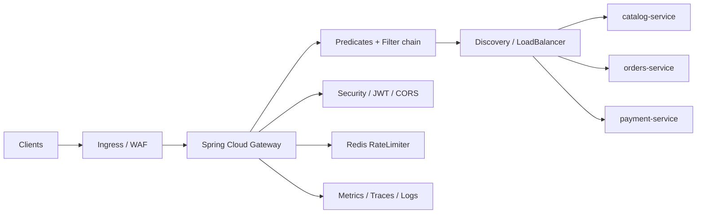
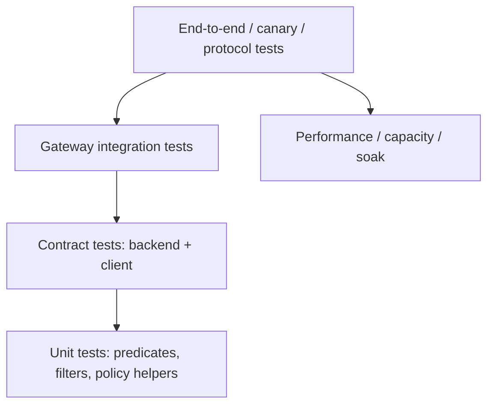
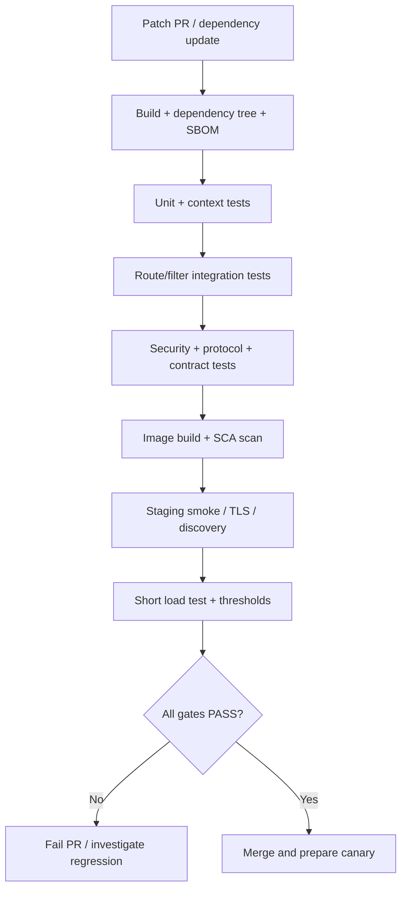

# Kiểm thử hồi quy tuyến, giao thức, bảo mật và hiệu năng

Khi nâng cấp **Spring Cloud Gateway**, một ứng dụng có thể vẫn khởi động thành công và trả HTTP 200 cho một request đơn giản nhưng đã thay đổi hành vi ở những chỗ quan trọng: route chọn backend khác, `RewritePath` tạo URI sai, filter chạy theo thứ tự khác, HTTP/2 handshake lỗi, JWT bị từ chối, WebSocket không nâng cấp được, Redis rate limiter trả quota sai hoặc connection pool bị nghẽn khi tải tăng. Vì vậy, kiểm thử sau nâng cấp phải chứng minh **hợp đồng định tuyến, giao thức, ranh giới bảo mật và mức dịch vụ** vẫn được giữ.

Bài này thuộc chương **Nâng cấp** của module **SPRING_CLOUD_GATEWAY**. Gateway là cổng vào microservices, sử dụng route predicates, filter chain, path/header transformation, service discovery/load balancing, xác thực, giới hạn lưu lượng, circuit breaker, retry, TLS và observability. Mục tiêu là xây dựng một bộ kiểm thử hồi quy có thể chạy lặp lại trước và sau mỗi lần nâng Spring Boot/Spring Cloud/Gateway/Reactor Netty/Netty, từ unit test tới integration test, protocol test, security test và load test.

Sau bài này, bạn có thể:

- Xác định **những hành vi phải giữ nguyên** trước khi đổi dependency hoặc cấu hình.
- Chọn đúng mức kiểm thử: unit, WebFlux slice, Gateway integration, contract, end-to-end và performance.
- Kiểm tra route predicates, filter order, path/header rewriting và service discovery.
- Kiểm tra HTTP/1.1, HTTP/2, TLS/mTLS, WebSocket, SSE và gRPC theo giao thức thực sự được hỗ trợ.
- Chứng minh JWT, CORS, rate limiting, cache isolation, retry và circuit breaker không bị yếu đi.
- So sánh hiệu năng trước/sau bằng cùng workload và ngưỡng SLO.
- Tự động hóa test gates trong CI, canary, rollout và rollback.

## 1. Vì sao cần kiểm thử hồi quy sau nâng cấp Gateway?

Gateway nằm giữa client và nhiều backend. Một thay đổi nhỏ trong thư viện có thể tác động đồng thời đến nhiều API:



Một bản nâng cấp có thể làm thay đổi:

| Khu vực | Hồi quy có thể gặp | Hệ quả |
| --- | --- | --- |
| Route predicates | Host/Path/Method/Header không còn match như trước. | 404, route sai hoặc API không truy cập được. |
| Filter chain | `Ordered`, pre/post phase hoặc filter list thay đổi. | Header/path sai, auth bị bỏ qua, fallback chạy nhầm. |
| Path/header | Encoding, forwarded headers, URI normalization thay đổi. | Backend nhận request khác hoặc authorization bypass. |
| Discovery/LB | Service ID, instance selection hoặc cache thay đổi. | 503/404, gửi request tới instance cũ. |
| HTTP codec | HTTP/1.1 framing, HTTP/2 headers hoặc body decoding thay đổi. | Request hợp lệ bị từ chối, parser errors, resource exhaustion. |
| TLS | Trust store, SNI, ALPN, certificate rotation. | Handshake failure hoặc kết nối sai danh tính. |
| WebSocket/SSE/gRPC | Upgrade, stream cancellation, trailers, timeout. | Kết nối bị đóng, mất message hoặc lỗi giao thức. |
| Security | JWT claims, issuer/audience, CORS/CSRF, token relay. | 401/403 tăng hoặc truy cập trái phép. |
| Rate limiting/cache | Redis quota, cache key/eligibility thay đổi. | 429 sai, backend quá tải hoặc lộ dữ liệu giữa users. |
| Performance | Connection pool, pending acquire, memory, event-loop. | p95/p99 tăng, timeout, OOM hoặc giảm throughput. |

**Khởi động thành công không chứng minh hệ thống tương thích.** Một route trả 200 cũng không chứng minh token relay, CORS, quota, path mapping hoặc TLS đang đúng. Cần kiểm tra theo các hợp đồng quan trọng của hệ thống.

## 2. Xây dựng baseline trước khi nâng cấp

Để so sánh có ý nghĩa, trước khi thay version hãy ghi lại **baseline**. Baseline là kết quả kiểm thử của phiên bản đang được chấp nhận, không phải một con số tùy ý lấy từ máy phát triển.

### 2.1. Ghi lại phiên bản và cấu hình

| Nhóm | Thông tin cần lưu |
| --- | --- |
| Runtime | JDK, Spring Boot, Spring Cloud release train, Gateway artifact, Spring Framework, Reactor Core, Reactor Netty và Netty modules. |
| Build | Commit SHA, Maven/Gradle lockfile, resolved dependency tree, build profile. |
| Image | Container image digest, base image, SBOM. |
| Routes | Route ID, URI/service ID, order, predicates, filters và config revision. |
| Security | JWT issuer/audience, scopes, CORS origins, TLS trust, mTLS policy, token relay. |
| Dependencies | Redis, discovery registry, backends, certificate/secret versions. |
| Limits | Request body/header limits, timeouts, connection pool, retry budget, rate limits. |
| Workload | Request mix, payload sizes, concurrency, arrival rate, data set và test duration. |

Không đưa token, password, private key, raw customer data hoặc connection string chứa credentials vào baseline artifact.

### 2.2. Ghi hành vi API theo route

Mỗi route quan trọng cần một hợp đồng tối thiểu:

```text
routeId: catalog-public
public method/path: GET /api/catalog/products/{id}
predicate: Path=/api/catalog/**, Method=GET
destination: lb://catalog-service
upstream path: /products/{id}
auth: anonymous read, public catalog only
rate limit: public-client quota
timeout: request budget đã thống nhất
response: status + content-type + body schema
failure policy: no instance / timeout / backend 404
telemetry: routeId, status, latency, trace
```

Đây là ví dụ hợp đồng, không phải cấu hình mặc định cho mọi API. Với route payment/admin, yêu cầu authentication, authorization, TLS và rate limits có thể nghiêm ngặt hơn. **Đừng gộp tất cả routes vào một test chỉ kiểm tra HTTP 200.**

### 2.3. Chọn tập route đại diện

Chọn ít nhất:

- Một route public GET có path rewrite.
- Một route protected yêu cầu JWT và scope.
- Một route dùng `lb://` service discovery.
- Một route có Redis `RequestRateLimiter`.
- Một route có `CircuitBreaker`/`Retry`/fallback.
- Một route cache response public nếu ứng dụng bật cache.
- WebSocket/SSE/gRPC routes nếu sản phẩm có sử dụng.
- Một route có upload/body transformation hoặc header mutation.

Nếu một feature không được bật trong deployment, ghi rõ **not applicable** và bằng chứng cấu hình/route inventory. Không bỏ qua chỉ vì test khó viết.

## 3. Test pyramid cho Spring Cloud Gateway

Một bộ test hiệu quả dùng nhiều lớp:



| Lớp test | Phạm vi | Dùng để trả lời |
| --- | --- | --- |
| **Unit** | Custom `GatewayFilter`, `GlobalFilter`, KeyResolver, helper classes. | Logic có đúng với input/output không? |
| **Context/slice** | Spring context, route definitions, filter bean wiring. | Cấu hình có bind, bean có được tạo đúng không? |
| **Gateway integration** | Gateway server thật + mock backend/Redis/registry. | Request có đi đúng route và upstream không? |
| **Contract** | Gateway ↔ backend/client contract. | Method/path/header/status/schema có tương thích không? |
| **End-to-end** | Client → Ingress → Gateway → service. | Các tầng triển khai thực tế có phối hợp đúng không? |
| **Protocol** | H1/H2/TLS/WebSocket/SSE/gRPC. | Handshake, frames, streams và deadlines có đúng không? |
| **Performance** | Load/stress/spike/soak/capacity. | Hệ thống giữ SLO và resource bounds ở tải dự kiến không? |

### Không dùng unit test thay integration test

Unit test một `RewritePath` helper có thể pass nhưng:

- Gateway không bind route config vì property prefix sai.
- Một global filter chạy trước/sau sai order.
- Ingress đã strip prefix trước khi request tới Gateway.
- LoadBalancer không tìm được instance.
- Backend context path khác môi trường test.

Vì vậy, logic quan trọng cần được kiểm tra **ít nhất một lần qua Gateway server thực**.

### Không dùng E2E cho mọi test

End-to-end test chậm và dễ flaky vì DNS, certificate, registry, backend data, deployment. Dùng unit/integration cho phần lớn nhánh; dành E2E cho các hành trình có giá trị cao và các protocol/security boundaries cần xác minh thật.

## 4. Route predicate regression tests

Route predicates quyết định request có được chuyển vào filter chain hay không. Kiểm tra từng predicate và tổ hợp predicates.

| Predicate | Positive case | Negative case |
| --- | --- | --- |
| `Path` | `/api/catalog/products/42` match. | `/api/catalogue/products/42` không match. |
| `Host` | `api.example.com` match. | Host khác hoặc Host bị rewrite không match. |
| `Method` | GET match route read. | POST/OPTIONS bị xử lý theo contract khác. |
| `Header` | `X-API-Version: v2` match. | Thiếu header hoặc giá trị sai. |
| `Query` | `?version=2` match. | Thiếu hoặc sai query value. |
| `Cookie` | Cookie đúng pattern match. | Cookie thiếu/khác pattern. |
| `RemoteAddr` | Proxy/trusted client address được nhận diện. | IP không thuộc policy. |
| `After`/`Before` | Request trong thời gian route active. | Request ngoài khoảng thời gian. |

### Kiểm tra route overlap và order

Nếu hai routes cùng có thể match một path, test phải xác minh route ID thực tế:

```yaml
spring:
  cloud:
    gateway:
      server:
        webflux:
          routes:
            - id: catalog-specific
              order: 0
              uri: http://localhost:8081
              predicates:
                - Path=/api/catalog/**
            - id: api-generic
              order: 100
              uri: http://localhost:8082
              predicates:
                - Path=/api/**
```

Một test chỉ assert status 200 chưa đủ: cả hai backend có thể cùng trả 200. Mock backend nên trả marker riêng, ví dụ `X-Test-Backend: catalog-specific`, hoặc ghi nhận request tại từng server để chứng minh đúng route.

### Negative route cases

Test những trường hợp không được route:

- Thiếu header version.
- Host không nằm trong allowlist.
- Method không được phép.
- Prefix path gần giống nhưng không thuộc route.
- Route chưa active theo time predicate.
- Path có encoded slash/dot segment theo policy.
- Request tới route admin khi không có authority.

Expected status có thể là 400, 401, 403, 404 hoặc 405 tùy tầng xử lý. **Điều kiện cốt lõi là request không được tới backend trái policy.**

## 5. Path rewriting và header transformation

Một route public thường có path khác backend. Kiểm tra **đầu vào và upstream request** thay vì chỉ status cuối.

### 5.1. Kiểm tra `StripPrefix`, `RewritePath`, `SetPath`, `PrefixPath`

| Public path | Filter | Upstream path mong đợi |
| --- | --- | --- |
| `/api/catalog/products/42` | `StripPrefix=2` | `/products/42` |
| `/api/v2/orders/123` | `StripPrefix=2` | `/orders/123` |
| `/legacy/items/7` | `RewritePath` theo contract | `/items/7` |
| `/health/catalog` | `SetPath=/internal/health` | `/internal/health` |
| `/products/42` | `PrefixPath=/v1` | `/v1/products/42` |

Test cả path có query string, trailing slash, percent encoding, context path và path đã bị Ingress rewrite. Dùng mock backend ghi exact method/path/query.

### 5.2. Header mutation

Kiểm tra:

- `AddRequestHeader`, `SetRequestHeader`, `RemoveRequestHeader`.
- `AddResponseHeader`, `SetResponseHeader`, `RemoveResponseHeader`.
- `PreserveHostHeader` nếu route yêu cầu giữ Host.
- `X-Forwarded-*`/`Forwarded` do proxy tin cậy tạo.
- Correlation/trace headers.
- `Authorization`, `Cookie`, `Set-Cookie` và token relay.

Không chỉ assert header tồn tại; cần kiểm tra **giá trị và nguồn tin cậy**. Client không được tự đặt `X-User`, `X-Tenant`, `X-Forwarded-Host` rồi được Gateway tin như identity đã xác thực.

### 5.3. Test thứ tự filter

GlobalFilter và route-specific GatewayFilter được kết hợp thành chain và sắp xếp theo `Ordered`. Test các invariants:

1. Authentication/authorization chạy trước các thao tác có thể trả dữ liệu nhạy cảm.
2. Rate limiting sử dụng principal/API key đáng tin.
3. Path rewrite xảy ra đúng thời điểm trước khi routing.
4. Cache không short-circuit trước auth nếu cache chứa dữ liệu cần bảo vệ.
5. Retry/fallback không bỏ qua security hoặc tạo side effects ngoài ý muốn.

Không giả định thứ tự YAML chính là thứ tự thực thi của mọi filter. Kiểm tra order theo Gateway version và test request thực.

## 6. Service discovery, LoadBalancer và route config

Một route `lb://catalog-service` cần test cả route match lẫn việc chọn instance.

| Tình huống | Kết quả cần xác minh |
| --- | --- |
| Có một instance healthy | Request tới đúng service instance. |
| Có nhiều instances | LoadBalancer phân phối theo policy đã cấu hình. |
| Không có instance | Status/error mapping đúng (thường 503, trừ khi policy khác). |
| Một instance unhealthy | Không gửi request mới tới instance bị loại. |
| Registry tạm unavailable | Hành vi cache/freshness theo implementation và policy. |
| Instance thay đổi trong rollout | Không gửi traffic lâu dài tới pod đã terminating. |
| Service ID viết hoa/thường | Discovery locator/path rewrite vẫn đúng. |

### Discovery-generated routes

Nếu dùng DiscoveryClient route locator, test default path prefix và default `RewritePath` loại bỏ service ID. Khi thêm custom discovery filters, xác minh danh sách custom có vô tình thay thế default filter list hay không. Test upstream path thật.

### Dynamic routes

Nếu route definitions được cập nhật động:

- Validate route candidate trước khi publish.
- Ghi revision và owner.
- Xác minh các Gateway pods cùng nhận revision được approve.
- Candidate invalid không được thay active last-known-good snapshot.
- Refresh/route mutation endpoints phải được bảo vệ và audit.
- Regression suite phải chạy trên route snapshot đã publish, không chỉ YAML trong Git.

## 7. Authentication, authorization và CORS regression

Đây là lớp **không được thỏa hiệp để làm test xanh**. Mỗi route phải có positive và negative cases.

### JWT/OAuth2

| Test | Kỳ vọng |
| --- | --- |
| Không có bearer token vào route protected | 401 hoặc status theo contract; backend protected không nhận request. |
| JWT hết hạn | Bị từ chối. |
| Chữ ký sai | Bị từ chối. |
| Issuer sai | Bị từ chối. |
| Audience sai | Bị từ chối. |
| Scope/authority thiếu | 403 hoặc error contract phù hợp. |
| Token hợp lệ và đủ quyền | Được chuyển tới backend đúng. |
| Token Relay | Chỉ gửi token tới backend/audience tin cậy. |
| JWKS tạm unavailable | Hành vi cache/timeout/error đúng policy, không bypass xác thực. |

Test bằng signing keys và identities giả lập trong môi trường test; không dùng JWT production thật trong fixture.

### CORS

Kiểm tra:

- Allowed Origin có thể preflight và gửi request theo policy.
- Disallowed Origin không được nhận `Access-Control-Allow-Origin` hợp lệ.
- `Access-Control-Allow-Credentials` không kết hợp wildcard origin trái chuẩn.
- Allowed methods/headers đúng với API.
- OPTIONS preflight được xử lý đúng dù route có Method predicate.
- Security WebFlux CORS integration không bị thay đổi sau nâng cấp.

### CSRF và cookie/session

Nếu Gateway sử dụng session/cookie hoặc browser-based authentication, test CSRF protection, SameSite/Secure/HttpOnly, logout/session expiry và cookie forwarding. Với API stateless bearer-token, ghi rõ CSRF policy và test theo threat model; không tắt CSRF một cách máy móc nếu app vẫn dùng cookie authentication.

## 8. Rate limiting, cache và resilience

### 8.1. Redis RequestRateLimiter

Test các điểm:

- KeyResolver dùng identity/API key đã xác thực.
- Hai tenants/users khác nhau không dùng chung quota nếu policy yêu cầu tách.
- Một user không thể đổi raw header để mạo danh key khác.
- Request trong quota được phép; request vượt quota nhận 429 theo contract.
- Redis outage/latency có fail-open hoặc fail-closed behavior đã phê duyệt.
- Quota reset/refill theo token bucket đúng.
- Nhiều Gateway replicas dùng chung quota theo thiết kế.
- Retry/client retries không làm quota bị tiêu thụ ngoài hợp đồng.

Test quota bằng Redis thật trong container hoặc môi trường integration; mock Redis có thể bỏ sót serialization, latency và atomic behavior.

### 8.2. LocalResponseCache

Nếu bật response cache:

- Public GET response có thể cache theo policy.
- `Cache-Control: private`/`no-store` không được lưu.
- User A không nhận response của user B.
- Route/tenant/language/version khác nhau không bị trộn cache entry.
- Query, `Vary`, ETag và TTL theo contract.
- Cache cold/warm và nhiều replicas có hành vi đúng.
- Sau nâng cấp, cache hit ratio thay đổi không được làm sai data correctness.

**Test cache isolation là security test**, không chỉ performance test. Một cache hit nhanh nhưng trả dữ liệu sai tenant là release blocker.

### 8.3. CircuitBreaker và Retry

| Kịch bản backend | Điều cần xác minh |
| --- | --- |
| 200 ổn định | Không kích hoạt fallback ngoài ý muốn. |
| 500 liên tục | Circuit mở theo threshold/window. |
| Timeout | Timeout budget và fallback status đúng. |
| Circuit OPEN | Request không tiếp tục gọi backend trong thời gian mở. |
| HALF_OPEN | Số probe requests giới hạn theo cấu hình. |
| Backend phục hồi | Circuit đóng lại và traffic phục hồi. |
| Retry trên 503/timeout | Số attempts/backoff không vượt budget. |
| POST không idempotent | Không retry nếu có thể tạo side effect trùng, trừ khi idempotency key/contract cho phép. |
| Fallback | Không lộ stack trace, secret hoặc dữ liệu stale trái policy. |

Đo **số upstream attempts cho mỗi inbound request**. Một test chỉ assert client nhận 200 có thể bỏ qua việc Gateway gửi 5 lần request tới backend.

## 9. HTTP protocol regression

Gateway không chỉ chuyển JSON. Một lần nâng Reactor Netty/Netty có thể tác động đến parser, connection reuse, HTTP/2 multiplexing và body handling.

### HTTP/1.1

Kiểm tra:

- Keep-alive và connection reuse.
- `Content-Length` và chunked transfer encoding.
- Request/response body rỗng, nhỏ và lớn trong giới hạn.
- Duplicate headers và header normalization theo policy.
- `Host`, `Connection`, `Transfer-Encoding` và hop-by-hop headers.
- Client disconnect/cancel giữa lúc upload/download.
- 400/413/431 cho malformed request hoặc body/header quá giới hạn.

Không dùng test malformed traffic để chứng minh parser chấp nhận mọi dạng input. Điều cần giữ là **request hợp lệ vẫn chạy, request không hợp lệ bị từ chối an toàn**.

### HTTP/2

Nếu ingress và Gateway có bật HTTP/2, test:

- TLS ALPN thương lượng protocol đúng.
- `:method`, `:scheme`, `:authority`, `:path` và pseudo-header ordering.
- Multiplex nhiều streams trên một connection.
- Flow control, reset/cancel stream và connection shutdown.
- Header compression/size limits theo cấu hình.
- HTTP/2 → HTTP/1.1 translation nếu downstream dùng HTTP/1.1.
- gRPC trailers/status nếu route proxy gRPC.

Test HTTP/2 end-to-end trên đúng topology. Một client hỗ trợ HTTP/2 gọi Gateway không chứng minh Gateway → backend cũng dùng HTTP/2; mỗi hop có thể dùng protocol khác.

### Body handling và streaming

Với custom filters đọc/ghi body:

- Body được đọc một lần hay được cache/replay đúng như thiết kế.
- `DataBuffer` được release đúng, không leak pooled buffers.
- Content-Type/Content-Length/Transfer-Encoding sau transform chính xác.
- Cancellation và backpressure được truyền đúng.
- Large payload bị giới hạn có chủ đích, không tạo unbounded buffering.
- Multipart boundary và từng part được giữ đúng nếu relay upload.

## 10. TLS, mTLS và certificate regression

TLS test cần bao phủ cả inbound (client → Gateway) và outbound (Gateway → backend).

| Tình huống | Kết quả cần chứng minh |
| --- | --- |
| Certificate chain hợp lệ, hostname đúng | Handshake thành công. |
| Certificate hết hạn | Client/Gateway từ chối theo trust policy. |
| CA không được tin cậy | Kết nối bị từ chối; không trust-all. |
| Hostname/SAN sai | Hostname verification fail. |
| SNI không đúng | Chọn đúng certificate/virtual host hoặc fail an toàn. |
| mTLS thiếu client certificate | Chặng bắt buộc mTLS từ chối. |
| mTLS certificate sai CA/identity | Bị từ chối. |
| Certificate rotation | Gateway nhận certificate/trust bundle mới theo quy trình. |
| TLS protocol/cipher bị cấm | Không thương lượng xuống cấu hình yếu hơn. |

### Tách test inbound và outbound

Một Gateway có thể terminate TLS ở Ingress rồi gọi backend bằng HTTP nội bộ, hoặc dùng TLS/mTLS ở cả hai chặng. Viết test theo sơ đồ triển khai thật:

```text
Client --HTTPS--> Ingress --HTTP/HTTPS--> Gateway
                                  |
                                  +--HTTPS/mTLS--> Backend
```

Không mặc định tất cả các hop đều HTTPS hoặc đều dùng cùng certificate. Kiểm tra hostname, SNI, CA bundle, trust store, client certificate và rotation độc lập.

### Test certificate rotation

1. Dùng CA/test certificate riêng cho integration environment.
2. Bắt đầu với certificate A hợp lệ.
3. Cập nhật secret/trust bundle theo đúng mechanism triển khai.
4. Xác minh Gateway/connection pool dùng certificate mới theo thời gian dự kiến.
5. Thu hồi certificate A hoặc mô phỏng backend chuyển CA.
6. Xác minh không còn kết nối mới dựa trên trust đã hết hiệu lực.

Kết nối pooled hiện hữu có thể tiếp tục dùng TLS session đã thiết lập; cần test cả connection reuse và reconnect. Không dùng private keys production trong test suite.

## 11. WebSocket, SSE và gRPC regression

Chỉ chạy các test protocol mà ứng dụng thực sự hỗ trợ; nhưng khi có route tương ứng, cần test handshake và vòng đời kết nối.

### WebSocket

- Handshake HTTP upgrade thành công với client được phép.
- Origin được allowlist; Origin ngoài policy bị từ chối.
- Cookie/JWT authentication vẫn áp dụng theo threat model.
- Subprotocol được thương lượng đúng.
- Ping/pong, close frame và reconnect.
- Long-lived connection khi Gateway rollout/drain.
- Client disconnect và backend disconnect được xử lý, không giữ socket vô hạn.

Origin check không thay authentication. Client non-browser có thể tự đặt Origin; vẫn cần kiểm tra identity/quyền.

### Server-Sent Events (SSE)

- `Content-Type: text/event-stream`.
- Event đầu tiên và event tiếp theo được chuyển tiếp đúng.
- Không buffer toàn bộ stream khiến client không nhận event kịp.
- Heartbeat/idle timeout và reconnect semantics.
- Client cancel thì upstream subscription/connection được giải phóng.
- Gateway rollout không làm mất stream ngoài chính sách reconnect.

Có thể dùng `WebTestClient` để kiểm tra status/headers và `StepVerifier` để kiểm tra các event nhận được, sau đó cancel stream đúng cách.

### gRPC

- HTTP/2 và ALPN được thiết lập đúng.
- `content-type: application/grpc` và method path được giữ.
- Deadline, cancellation và metadata/trailers.
- `grpc-status` được giữ đúng; không chỉ nhìn HTTP status 200.
- Unary và streaming được test riêng.
- mTLS, authority/SNI và certificate identity.
- Connection/channel reuse, shutdown và resource limits.

Nếu Gateway dùng `JsonToGrpc`, kiểm thử JSON-to-protobuf mapping riêng với native gRPC proxy. Không dùng một test unary đại diện cho mọi loại streaming.

## 12. Thiết kế test integration với WebTestClient và mock backend

Với Gateway WebFlux, `WebTestClient` có thể kiểm thử ứng dụng WebFlux ở mock environment hoặc gửi request tới server thật. Để kiểm tra Netty routing, connection và URI upstream, hãy có ít nhất một integration test chạy **embedded server trên random port** và một mock backend HTTP có thể ghi nhận request.

### 12.1. Chọn cách bind phù hợp

| Cách dùng WebTestClient | Phù hợp với | Hạn chế |
| --- | --- | --- |
| `bindToController` | Test controller độc lập. | Không đại diện toàn bộ Gateway route/filter runtime. |
| `bindToApplicationContext` | Test WebFlux application context/handler chain. | Không tự tạo network hop tới backend như production. |
| `bindToServer` | Gọi server đang chạy, kể cả Gateway integration test. | Cần khởi động app và quản lý backend dependencies. |

### 12.2. Ví dụ integration test kiểm tra StripPrefix

Ví dụ sau minh họa pattern với JUnit 5, Spring Boot random port, WebTestClient và OkHttp MockWebServer. Hãy chọn dependency test versions tương thích với Spring Boot/Java của project.

```java
package com.example.gateway;

import java.io.IOException;
import java.util.concurrent.TimeUnit;

import okhttp3.mockwebserver.MockResponse;
import okhttp3.mockwebserver.MockWebServer;
import okhttp3.mockwebserver.RecordedRequest;
import org.junit.jupiter.api.AfterAll;
import org.junit.jupiter.api.Test;
import org.springframework.boot.test.context.SpringBootTest;
import org.springframework.boot.test.web.server.LocalServerPort;
import org.springframework.test.context.DynamicPropertyRegistry;
import org.springframework.test.context.DynamicPropertySource;
import org.springframework.test.web.reactive.server.WebTestClient;

import static org.assertj.core.api.Assertions.assertThat;

@SpringBootTest(webEnvironment = SpringBootTest.WebEnvironment.RANDOM_PORT)
class GatewayRouteRegressionTest {

    private static final MockWebServer BACKEND = startBackend();

    @LocalServerPort
    int gatewayPort;

    private static MockWebServer startBackend() {
        MockWebServer server = new MockWebServer();
        try {
            server.start();
            return server;
        }
        catch (IOException ex) {
            throw new ExceptionInInitializerError(ex);
        }
    }

    @DynamicPropertySource
    static void gatewayRouteProperties(DynamicPropertyRegistry registry) {
        registry.add(
            "spring.cloud.gateway.server.webflux.routes[0].id",
            () -> "catalog-test");
        registry.add(
            "spring.cloud.gateway.server.webflux.routes[0].uri",
            () -> BACKEND.url("/").toString());
        registry.add(
            "spring.cloud.gateway.server.webflux.routes[0].predicates[0]",
            () -> "Path=/api/catalog/**");
        registry.add(
            "spring.cloud.gateway.server.webflux.routes[0].filters[0]",
            () -> "StripPrefix=2");
    }

    @AfterAll
    static void stopBackend() throws IOException {
        BACKEND.shutdown();
    }

    @Test
    void stripsPublicPrefixBeforeProxying() throws Exception {
        BACKEND.enqueue(new MockResponse()
            .setResponseCode(200)
            .setHeader("Content-Type", "application/json")
            .setBody("{\"id\":42}"));

        WebTestClient client = WebTestClient.bindToServer()
            .baseUrl("http://localhost:" + gatewayPort)
            .build();

        client.get()
            .uri("/api/catalog/products/42")
            .exchange()
            .expectStatus().isOk()
            .expectBody()
            .json("{\"id\":42}");

        RecordedRequest upstream =
            BACKEND.takeRequest(2, TimeUnit.SECONDS);

        assertThat(upstream).isNotNull();
        assertThat(upstream.getMethod()).isEqualTo("GET");
        assertThat(upstream.getPath()).isEqualTo("/products/42");
    }
}
```

**Đây là mẫu minh họa**, cần kiểm tra property prefix route đúng với Gateway release train đang dùng. Ở các dòng Gateway cũ, prefix có thể là `spring.cloud.gateway.routes[...]`. Trong test thực tế, cấu hình route nên nằm trong test profile hoặc test configuration được review; tránh để test route override cấu hình production.

Điểm quan trọng của test là không chỉ assert client nhận 200 mà còn đọc `RecordedRequest` của backend để chứng minh Gateway đã gửi đúng method và path.

### 12.3. Kiểm tra negative case

Thêm test gửi:

- Path không thuộc `/api/catalog/**`.
- Method POST vào route chỉ dành cho GET (nếu có Method predicate).
- Host/header sai.
- Backend trả 404/503 để kiểm tra status mapping.

Với negative case, ngoài status của client, hãy xác minh backend **không nhận request** nếu route không được phép.

## 13. Dùng Testcontainers cho dependency thật

Mock backend phù hợp để kiểm tra route và filter. Một số behavior cần service thật hoặc implementation gần production:

| Dependency | Khi nào nên dùng container |
| --- | --- |
| Redis | Rate limiter, TTL, atomic quota, timeout và outage behavior. |
| Consul/Eureka-compatible registry | Service registration, instance health, service ID và refresh. |
| PostgreSQL/MySQL | Chỉ khi backend integration cần database thực. |
| Mock gRPC service | HTTP/2, trailers, TLS/mTLS và unary/streaming. |
| Local CA/test TLS server | Trust, hostname, SNI, cert rotation. |

Testcontainers quản lý container services cho JUnit và có thể kết hợp Spring Boot test context. Pin image tag/digest trong CI và dùng data fixtures deterministic; không dùng `latest` làm dependency test ổn định.

### Redis integration test

Một test quota với Redis thật nên xác minh:

1. Request đầu tiên trong quota được cho phép.
2. Các request tiếp theo tiêu thụ quota theo token bucket.
3. Khi vượt quota, Gateway trả 429 và không gọi backend.
4. Hai keys độc lập có quota độc lập.
5. Redis restart/timeout tạo đúng fail-open/fail-closed behavior.
6. Quota dùng chung giữa nhiều Gateway instances theo thiết kế.

Không chỉ kiểm tra bean Redis đã start; hãy kiểm tra **request thực đi qua Gateway** và Redis state.

## 14. Contract tests giữa Gateway và backend

Contract test ghi lại những giả định mà Gateway phụ thuộc:

- Method/path backend nhận.
- Request headers cần thiết.
- Response status, headers và body schema.
- Error mapping (404/409/422/429/5xx).
- Timeout/deadline và idempotency behavior.
- `Content-Type`, compression, pagination, ETag.
- API version và backward compatibility.

Khi backend thay API path từ `/v1/products` sang `/v2/products`, contract test cần fail trước khi Gateway config mới được deploy. Khi Gateway đổi `StripPrefix` hoặc `RewritePath`, test cần chứng minh backend vẫn nhận đúng contract.

Có thể dùng Spring Cloud Contract hoặc công cụ contract testing khác nếu tổ chức đã áp dụng. **Contract test không thay protocol/security test**: một response JSON đúng schema vẫn có thể được gửi tới tenant sai hoặc qua TLS không được xác minh.

## 15. Performance regression: thiết lập phép so sánh công bằng

Hiệu năng trước và sau nâng cấp chỉ có thể so sánh khi môi trường và workload tương đương. Không lấy một lần benchmark trên laptop làm baseline cho production cluster.

### Kiểm soát các biến

- Cùng số Gateway replicas, CPU/memory requests/limits và node class.
- Cùng backend versions, dữ liệu, Redis, discovery và TLS topology.
- Cùng request mix, payload sizes, concurrency, arrival rate và cache state.
- Cùng load generator placement/network path.
- Cùng thời gian warm-up, test duration và measurement window.
- Không chạy các benchmark khác đồng thời trên cùng backend.
- Lưu image digest, config revision và test script commit.

### Đo cả Gateway lẫn backend

| Nhóm | Metrics |
| --- | --- |
| Client/load generator | RPS/arrival rate, concurrency, p50/p90/p95/p99/max, error rate, timeouts. |
| Gateway | Route count, status distribution, request latency, CPU, heap, direct memory, GC, event-loop saturation. |
| Reactor Netty client | Connect time, response time, TLS handshake time, active/idle/pending connections, pending acquire time. |
| Backend | CPU, queue, latency, DB pool, errors, request attempts. |
| Redis | Latency, commands/sec, timeouts, connection count, quota decisions. |
| Kubernetes | CPU throttling, memory limit, restarts, pod readiness, network throughput. |

Một test Gateway chỉ đo client response time không cho biết bottleneck nằm ở Gateway, connection pool, Redis hay backend.

### Percentile quan trọng hơn average

Average có thể đẹp dù một nhóm requests bị timeout rất lâu. Theo dõi p50, p90, p95, p99 và max. Đối chiếu các percentile với SLO/API class đã thống nhất, không lấy một ngưỡng chung cho mọi route.

## 16. Các loại performance test

| Loại test | Mục đích | Ví dụ |
| --- | --- | --- |
| **Smoke** | Xác nhận test rig và endpoint hoạt động ở tải rất thấp. | 1–5 RPS trong 1 phút. |
| **Baseline** | Ghi latency/resource ở tải danh định. | 50 RPS trong 10 phút. |
| **Load** | Kiểm tra mức tải dự kiến. | Ramp lên 300 RPS và giữ 20 phút. |
| **Stress** | Tìm giới hạn và failure mode. | Tăng tải từng bậc đến khi SLO không đạt. |
| **Spike** | Quan sát phản ứng khi traffic tăng đột ngột. | 50 → 500 RPS trong thời gian ngắn. |
| **Soak** | Phát hiện leak/queue tăng theo thời gian. | Tải ổn định trong vài giờ. |
| **Capacity** | Tìm throughput/replica và headroom. | Tăng RPS và replicas, xác định điểm bão hòa. |
| **Recovery** | Kiểm tra hệ thống hồi phục sau quá tải/failure. | Giảm tải, khôi phục Redis/backend và đo thời gian ổn định. |

Các con số trên là ví dụ minh họa. Hãy chọn mức tải từ traffic thật đã được tổng hợp, forecast và SLO; không chạy stress/spike vào production nếu chưa có change approval và blast-radius controls.

### Open workload và closed workload

- **Open workload:** test tạo request theo arrival rate mục tiêu; phù hợp mô hình API nhận traffic liên tục.
- **Closed workload:** số virtual users/concurrent sessions cố định, mỗi user gửi request tiếp theo sau khi request trước hoàn tất; phù hợp một số mô hình session.

Nếu dùng closed workload, khi Gateway chậm thì số requests được tạo ra có thể tự giảm, làm che saturation. Chọn model phản ánh traffic thật và ghi rõ cách sinh tải.

## 17. Load test bằng k6: thresholds là tiêu chí pass/fail

Ví dụ sau dùng k6 để gửi tải ổn định tới một route public/protected đã được tạo trong staging. Token được lấy từ biến môi trường CI; **không hardcode hoặc commit credentials**.

```javascript
import http from 'k6/http';
import { check, sleep } from 'k6';

export const options = {
  scenarios: {
    gateway_steady: {
      executor: 'constant-arrival-rate',
      rate: 100,
      timeUnit: '1s',
      duration: '5m',
      preAllocatedVUs: 50,
      maxVUs: 200,
    },
  },
  thresholds: {
    http_req_failed: ['rate<0.01'],
    http_req_duration: ['p(95)<400', 'p(99)<800'],
    checks: ['rate>0.99'],
  },
};

export default function () {
  const response = http.get(
    __ENV.BASE_URL + '/api/catalog/products/42',
    {
      headers: {
        Authorization: 'Bearer ' + __ENV.TOKEN,
        Accept: 'application/json',
      },
      tags: { route: 'catalog-public' },
    },
  );

  check(response, {
    'catalog returns expected status': (r) => r.status === 200,
    'catalog response is JSON': (r) =>
      r.headers['Content-Type'] &&
      r.headers['Content-Type'].includes('application/json'),
  });

  sleep(0.1);
}
```

Chạy trong môi trường test được cấp phép:

```bash
k6 run -e BASE_URL=https://gateway-staging.example.test \
  -e TOKEN="$TEST_TOKEN" gateway-load.js
```

Rate, percentile và error thresholds ở đây chỉ là **ví dụ**; thay bằng SLO của route và năng lực staging. Với constant-arrival-rate, load generator cần đủ VUs và CPU để giữ arrival rate; nếu generator thiếu tài nguyên, test không phản ánh năng lực Gateway.

**Lưu ý:** k6 checks giúp đánh giá từng response nhưng không tự làm cả test process fail; dùng thresholds để mã hóa điều kiện pass/fail. Thresholds có thể đặt trên error rate, percentile và custom metrics. Không chỉ assert status 200; cần kiểm tra response body/schema hoặc marker backend nếu đó là contract.

## 18. Quan sát Gateway metrics và Reactor Netty pool

### Spring Cloud Gateway metrics

Khi Actuator/Gateway metrics được bật theo phiên bản tương ứng, timer `spring.cloud.gateway.requests` thường có các tags:

- `routeId`
- `routeUri`
- `outcome`
- `status` / `httpStatusCode`
- `httpMethod`

Có thể scrape qua Prometheus registry nếu đã được cấu hình. Kiểm tra metrics thực tế trên đúng Gateway version; tên property và tags có thể thay đổi.

**Không bật path tag với raw URL tùy tiện** trong production nếu path chứa ID động. High-cardinality tags làm tăng memory/storage và có thể lộ dữ liệu. Dùng route ID hữu hạn; nếu cần path-level analysis, chuẩn hóa template như `/products/{id}`.

### Reactor Netty connection pool

Các metrics hữu ích có thể bao gồm:

| Metric family | Ý nghĩa khi test |
| --- | --- |
| `reactor.netty.connection.provider.total.connections` | Tổng connections trong pool. |
| `reactor.netty.connection.provider.active.connections` | Connections đang được sử dụng. |
| `reactor.netty.connection.provider.idle.connections` | Connections nhàn rỗi. |
| `reactor.netty.connection.provider.pending.connections` | Requests đang chờ acquire connection. |
| `reactor.netty.connection.provider.pending.connections.time` | Thời gian chờ lấy connection. |
| `reactor.netty.http.client.connect.time` | Thời gian connect. |
| `reactor.netty.http.client.response.time` | Thời gian request/response. |
| `reactor.netty.http.client.tls.handshake.time` | Thời gian TLS handshake. |

Tên và availability phụ thuộc Reactor Netty version, metrics configuration và registry. Hãy kiểm tra Actuator/Prometheus trước khi viết alert.

### Dấu hiệu connection pool bị nghẽn

- Pending connections tăng kéo dài.
- Pending acquire time tăng cùng p95/p99.
- Active connections chạm max thường xuyên.
- Backend latency tăng làm connections được giữ lâu hơn.
- Gateway trả timeout dù CPU chưa cao.

Không giải quyết ngay bằng cách tăng `maxConnections` vô hạn. Kiểm tra backend concurrency, timeout, pool sizing, pending queue limits, connection lifetime và load distribution. Pool lớn hơn có thể chỉ đẩy quá tải xuống backend.

## 19. Performance assertions cho bản nâng cấp

Một release gate có thể dùng bảng:

| Chỉ số | Baseline | Candidate | Điều kiện |
| --- | --- | --- | --- |
| p95 latency theo route | Đo ở bản cũ. | Đo cùng workload. | Không vượt SLO và mức regression đã thống nhất. |
| p99 latency | Đo ở bản cũ. | Đo cùng workload. | Không có tail latency bất thường. |
| Error rate | 4xx/5xx/timeout riêng. | Phân loại theo route/status. | Không tăng ngoài budget. |
| Throughput | RPS đạt được. | RPS ở cùng resource budget. | Đạt target và giữ headroom. |
| CPU/memory | Per pod và cluster. | Per pod và cluster. | Không tăng vượt capacity budget. |
| Direct memory/FDs | Baseline ổn định. | Theo dõi soak test. | Không tăng không giới hạn. |
| Pool pending | Baseline. | Candidate. | Không hình thành queue kéo dài. |
| Backend attempts | Requests/attempts. | Candidate. | Retry không tạo amplification. |
| Redis latency/errors | Baseline. | Candidate. | Rate limiter không thành bottleneck. |
| TLS handshake | Cold/warm. | Candidate. | Không lỗi trust và latency trong budget. |

Không đặt ngưỡng regression chung như “không được chậm hơn 5%” nếu measurement noise lớn hơn 5%. Dùng nhiều lần chạy, median/range hoặc confidence intervals phù hợp; xác định mức thay đổi đáng kể từ baseline variance.

### Tách đúng latency budget

Một request qua Gateway có thể gồm:

```text
Client network
  + Ingress/WAF
  + Gateway inbound parsing
  + Security/JWT
  + Redis rate limiter
  + Route/filter processing
  + Connection pool acquire
  + DNS/connect/TLS
  + Backend processing
  + Response transfer
```

Đừng cộng tất cả duration nếu metrics spans chồng lấn; dùng trace timeline để xác định thời gian từng hop. Một p99 tăng có thể đến từ backend chậm, TLS reconnect, DNS, pool pending hoặc Gateway event-loop saturation.

## 20. Test resilience và overload behavior

Sau nâng cấp, kiểm tra hệ thống khi dependency hoặc backend gặp lỗi:

| Fault scenario | Hành vi cần xác minh |
| --- | --- |
| Backend timeout | Gateway timeout theo request budget; không giữ connection vô hạn. |
| Backend 5xx | Retry/CircuitBreaker theo cấu hình, không retry vô hạn. |
| Một instance chết | LoadBalancer ngừng gửi traffic mới tới instance đó theo health policy. |
| Redis latency/outage | Rate limit fail-open/fail-closed đúng policy; liveness không restart storm. |
| Registry outage | Cached discovery/freshness và route-level behavior đúng thiết kế. |
| TLS certificate invalid | Kết nối bị từ chối, không trust-all fallback. |
| Connection pool full | Pending queue/timeout bounded, không OOM. |
| Gateway pod restart | Readiness, graceful shutdown, client retry/reconnect đúng contract. |
| Burst traffic | Rate limit bảo vệ backend, 429 đúng và recovery nhanh. |
| Long-lived streams | Cancellation/drain/reconnect theo chính sách. |

Chạy fault injection trong sandbox/staging, giới hạn blast radius và có khả năng dừng thử nghiệm. Không tắt Redis, registry hoặc backend production chỉ để kiểm tra bài học.

## 21. CI pipeline: kiểm tra theo lớp trước khi merge

Một pipeline thực dụng:



### Phân tầng pipeline

| Stage | Chạy khi nào | Kiểm tra |
| --- | --- | --- |
| Compile/static | Mọi PR | Compile, formatting, static analysis, dependency policy. |
| Unit | Mọi PR | Custom filters, KeyResolver, path/header helpers, fallback logic. |
| Gateway integration | Mọi PR có route/config changes | Route selection, upstream path, filter order, status mapping. |
| Security | Mọi PR có auth/filter/dependency changes | JWT, scope, CORS, cache isolation, rate limiting, TLS negative tests. |
| Protocol | PR thay Netty/Reactor/codec hoặc protocol config | H1/H2, WebSocket, SSE/gRPC theo feature. |
| Container integration | Nightly hoặc PR trọng yếu | Redis/discovery/backend thật qua Testcontainers. |
| Performance smoke | PR/release candidate | Baseline throughput, p95/p99, errors, pool metrics. |
| Full load/soak | Nightly/release candidate | Capacity, leak, spike, soak, failure recovery. |
| Canary | Trước promote production | Request mix thực tế, SLO và security gates. |

Không cần chạy stress test hàng giờ cho mọi PR. Nhưng thay đổi Netty, TLS, route matching, cache, body filters hoặc retry nên kích hoạt đúng test chuyên sâu liên quan.

### Fail fast có lý do

Pipeline nên dừng nếu:

- Route quan trọng chuyển sang backend sai.
- Unauthorized request tới được backend protected.
- Private response bị cache hoặc trộn giữa tenants.
- TLS verification bị bypass.
- Retry tạo side effects trùng.
- Error rate/p95/p99 vượt SLO đã thống nhất.
- SBOM cho thấy dependency vulnerable chưa được xử lý.

Một warning không liên quan có thể được triage, nhưng security regression không nên được chuyển thành warning chỉ để merge nhanh.

## 22. Canary rollout và so sánh candidate với stable

Canary giúp kiểm tra trên traffic có kiểm soát trước khi thay toàn bộ Gateway pods.

### Quy trình

1. Deploy candidate image/config revision vào một nhóm nhỏ.
2. Chạy synthetic tests trên route/auth/TLS/protocol quan trọng.
3. Chuyển một phần traffic được kiểm soát hoặc dùng shadow traffic phù hợp (không replay side-effecting requests).
4. So candidate và stable với cùng route/request class.
5. Tăng tỷ lệ từng bước khi metrics và security checks đạt.
6. Promote hoàn toàn và xác minh tất cả pods dùng image digest/config revision đã duyệt.

### Những gì phải so sánh

- 2xx/4xx/429/5xx theo route và method.
- p50/p95/p99 và timeout rate.
- Upstream attempts/retries, CircuitBreaker opens/fallbacks.
- Redis latency/quota decisions.
- Reactor Netty active/pending connections.
- CPU, heap/direct memory, GC, FD/socket count.
- TLS handshake failures, WebSocket handshake rejects, gRPC errors.
- Synthetic auth/cache isolation và path rewrite tests.

**Readiness 200 và Deployment Available không chứng minh regression suite đã pass.** Một pod có thể khỏe nhưng route sai, JWT audience không đúng hoặc private cache leak.

### Rollback

Chuẩn bị image/config revision đã biết an toàn và quy trình rollback trước khi mở traffic. Nếu candidate có lỗ hổng bảo mật đã được vá, không rollback mù quáng về image vulnerable chỉ để phục hồi latency. Cần safe fallback hoặc cô lập feature gây lỗi.

## 23. Quản lý test data, determinism và flaky tests

Test hồi quy chỉ hữu ích nếu kết quả lặp lại được.

### Data và dependency

- Dùng test identities/keys, không dùng credentials production.
- Tạo dữ liệu fixture có ID ổn định và cleanup sau test.
- Mock thời gian cho predicates `After`/`Before` nếu test framework cho phép.
- Không phụ thuộc thứ tự ngẫu nhiên của registry instances.
- Dùng port động hoặc container network riêng, tránh port dùng chung.
- Chờ readiness của container/backend theo health check, không sleep tùy tiện.
- Reset Redis quota/cache giữa test cases.
- Dùng unique correlation IDs để tìm đúng request.

### Phân loại flaky test

| Triệu chứng | Nguyên nhân có thể | Cách xử lý |
| --- | --- | --- |
| Test đôi khi timeout | Backend/containers chưa ready hoặc deadline quá ngắn. | Health checks, timeout hợp lý, kiểm tra logs. |
| Thứ tự route test không ổn định | Overlapping predicates/order hoặc shared state. | Assert route ID, isolate config, không dựa test order. |
| Redis quota test fail ngẫu nhiên | Shared key hoặc state không reset. | Key riêng từng test và reset container/state. |
| TLS test không ổn định | Cert validity clock, trust store hoặc hostname mismatch. | Fixed test clock/validity window, SAN rõ, trust bundle riêng. |
| Load test dao động | Generator/cluster contention và warm-up. | Kiểm soát môi trường, lặp nhiều runs, so percentile/variance. |
| WebSocket test treo | Stream chưa cancel/close. | Close handshake, bounded wait, cleanup connection. |

Không retry test thất bại vô hạn để pipeline xanh. Retry một lần có thể giúp thu thập thêm bằng chứng, nhưng test flaky phải có owner và thời hạn sửa.

## 24. Báo cáo regression trước và sau nâng cấp

Mỗi release candidate nên có một report gắn với commit, image digest và test run:

```text
release candidate:
source commit:
old image digest:
new image digest:
Spring Boot / Spring Cloud / Gateway:
Spring Framework / Reactor Netty / Netty:
route config revision:
test suite revision:
protocols exercised:
security cases passed / failed:
contract cases passed / failed:
performance workload and duration:
baseline p95 / p99 / error rate:
candidate p95 / p99 / error rate:
resource and connection pool observations:
known deviations / approved exceptions:
canary decision:
rollback image/config:
approver:
```

Nếu một test không áp dụng, ghi lý do và bằng chứng feature không được triển khai. Không ghi “all tests pass” khi test protocol/security chưa được chạy.

## 25. Ma trận nghiệm thu hồi quy sau nâng cấp

Các ca dưới đây là **test plan**. Chỉ chạy load/fault injection trên môi trường được phép, có giới hạn tải và phương án dừng.

| ID | Nhóm | Ca kiểm thử | Tiêu chí đạt |
| --- | --- | --- | --- |
| R01 | Route | Path predicate đúng | Route ID mong đợi được chọn. |
| R02 | Route | Path gần giống nhưng sai prefix | Không chọn nhầm route. |
| R03 | Route | Host đúng/sai | Host allowlist hoạt động. |
| R04 | Route | Method GET/POST/OPTIONS | Method mapping đúng. |
| R05 | Route | Header/query/cookie predicates | Giá trị đúng match; thiếu/sai không match. |
| R06 | Route | Route overlap/order | Backend marker chứng minh đúng route. |
| R07 | Path | StripPrefix | Backend nhận đúng path đã bỏ prefix. |
| R08 | Path | RewritePath/SetPath/PrefixPath | Mapping input/output đúng contract. |
| R09 | Path | Trailing slash/query/encoding | Gateway và backend hiểu path thống nhất. |
| R10 | Header | Forwarded/Host/authority | Chỉ tin proxy headers từ nguồn được cấu hình. |
| R11 | Filter | GlobalFilter/GatewayFilter order | Pre/post behavior và order đúng. |
| R12 | Filter | Short-circuit/fallback | Không bỏ qua auth hoặc lộ dữ liệu. |
| R13 | Discovery | Một instance healthy | Request tới đúng service. |
| R14 | Discovery | Nhiều instances | Phân phối theo policy. |
| R15 | Discovery | Không có instance | Status/error mapping và alert đúng. |
| R16 | Discovery | Custom locator filters | Default RewritePath không bị mất ngoài ý muốn. |
| R17 | Dynamic routes | Candidate invalid | Không publish; active snapshot vẫn an toàn. |
| R18 | Contract | Backend path/method/header | Backend nhận đúng hợp đồng. |
| R19 | Contract | Backend response schema/status | Gateway không phá response contract. |
| R20 | Auth | Thiếu token/hết hạn/chữ ký sai | Không tới backend protected. |
| R21 | Auth | Issuer/audience sai | Token bị reject. |
| R22 | Auth | Scope/tenant thiếu | Authorization từ chối đúng. |
| R23 | Auth | Token Relay | Token chỉ tới backend/audience tin cậy. |
| R24 | CORS | Allowed/denied Origin | Headers đúng policy, không wildcard credentials. |
| R25 | CSRF | Cookie/session route | CSRF/session policy không yếu đi. |
| R26 | Rate limit | Trong quota/vượt quota | Allow/429 đúng và backend không nhận request bị chặn. |
| R27 | Rate limit | Hai principal/tenant | Quota key tách đúng. |
| R28 | Rate limit | Redis outage/latency | Fail policy đúng, không restart storm. |
| R29 | Cache | Public GET cache | Cache hit/miss và TTL đúng. |
| R30 | Cache | Private/no-store | Không cache dữ liệu nhạy cảm. |
| R31 | Cache | Cross-user/tenant/route | Không rò hoặc trộn response. |
| R32 | Resilience | Circuit OPEN/HALF_OPEN/CLOSED | State transition đúng. |
| R33 | Resilience | Retry/timeout | Attempts/backoff không vượt budget. |
| R34 | Resilience | POST side effect | Không duplicate side effects. |
| R35 | HTTP | H1 keep-alive/chunked/body | Request hợp lệ hoạt động. |
| R36 | HTTP/2 | ALPN/pseudo-headers/multiplex | H2 behavior và translation đúng. |
| R37 | TLS | CA/hostname/SNI | Trust và hostname verification đúng. |
| R38 | mTLS | Client cert hợp lệ/sai/thiếu | Identity policy đúng. |
| R39 | WebSocket | Upgrade/Origin/ping-pong/close | Handshake và lifecycle đúng. |
| R40 | SSE | Streaming/cancel/reconnect | Event không bị buffer/mất ngoài policy. |
| R41 | gRPC | Unary/trailers/deadline | Status/metadata/protocol đúng. |
| R42 | Body | Large body/multipart/cancel | Bounds, DataBuffer lifecycle và backpressure đúng. |
| R43 | Observability | Route metrics/traces | routeId/status/latency xuất hiện đúng. |
| R44 | Performance | Load profile và SLO thresholds | Candidate giữ SLO ở workload mục tiêu. |
| R45 | Performance | Stress/spike/soak | Failure/recovery/resource bounds được xác minh. |
| R46 | Runtime | Heap/direct memory/FDs/pool | Không leak hoặc queue tăng không giới hạn. |
| R47 | Deployment | Canary/rollout/rollback | Promote/abort theo release gates. |
| R48 | Evidence | Image digest/SBOM/test report | Runtime artifact khớp patch đã kiểm thử. |

### Quy tắc đánh dấu kết quả

- **PASS:** test chạy trên đúng build/config và evidence đạt tiêu chí.
- **FAIL:** hành vi sai, security invariant bị phá hoặc SLO không đạt.
- **BLOCKED:** không chạy được vì dependency/test environment; cần owner và thời hạn.
- **N/A:** feature không có trong deployment, có evidence xác nhận.

Không biến BLOCKED thành PASS. Một test security không chạy được do môi trường thiếu CA/Redis phải được xử lý trước khi promote nếu feature đó thuộc critical path.

## 26. Checklist release gate

### A. Route và filter

- [ ] Các route quan trọng có positive/negative tests.
- [ ] Route overlap/order được xác minh bằng routeId hoặc backend marker.
- [ ] Path rewrite, prefix, query và encoded path đúng contract.
- [ ] Host/Forwarded headers chỉ tin proxy đã cấu hình.
- [ ] Filter order không làm auth/cache/rate limit chạy sai.
- [ ] Discovery locator giữ đúng default path rewrite và service ID.
- [ ] Dynamic route snapshot được validate và có revision.

### B. Protocol và security

- [ ] HTTP/1.1 request framing, keep-alive và body limits đúng.
- [ ] HTTP/2/ALPN/pseudo-headers được test nếu bật.
- [ ] TLS CA/hostname/SNI/mTLS/certificate rotation được test.
- [ ] WebSocket Origin/auth/upgrade/close được test nếu dùng.
- [ ] SSE/gRPC streaming, cancellation, deadlines và trailers được test nếu dùng.
- [ ] JWT issuer/audience/signature/scope/tenant và Token Relay đúng.
- [ ] CORS/CSRF/cookie policy không yếu đi.
- [ ] Redis rate limiter quota/failure behavior đúng.
- [ ] Private response cache isolation được kiểm chứng.
- [ ] Retry/CircuitBreaker không tạo duplicate side effects hoặc retry storm.

### C. Hiệu năng và vận hành

- [ ] Baseline và candidate dùng cùng environment/request mix.
- [ ] p95/p99/error rate/throughput đáp ứng SLO.
- [ ] Reactor Netty pool pending/active, direct memory, FD/socket được theo dõi.
- [ ] Redis/backend load không tăng ngoài capacity budget.
- [ ] Load/stress/soak test được chạy theo mức thay đổi và risk.
- [ ] Metrics/traces có routeId/status/latency và không tạo cardinality cao.
- [ ] Canary/rollback gates đã được định nghĩa trước khi deploy.
- [ ] Image digest, dependency tree, SBOM và test report được lưu.

## 27. Câu hỏi tự kiểm tra

1. Vì sao ứng dụng khởi động và trả HTTP 200 chưa chứng minh nâng cấp Gateway thành công?
2. Baseline cần lưu những thông tin version, route và workload nào?
3. Khác biệt giữa unit test, WebFlux slice, Gateway integration và end-to-end test là gì?
4. Vì sao route test nên xác minh backend marker hoặc upstream request thay vì chỉ status?
5. Những predicates nào cần positive và negative cases?
6. Route order và overlapping routes có thể tạo regression ra sao?
7. Vì sao phải kiểm tra path sau StripPrefix/RewritePath tại backend?
8. Host/Forwarded headers cần được tin từ nguồn nào?
9. Vì sao filter order có thể ảnh hưởng cache, authentication và rate limiting?
10. Khi nào cần dùng Redis thật qua Testcontainers thay vì mock?
11. Cách kiểm tra no-instance của LoadBalancer khác backend 404 như thế nào?
12. Discovery locator custom filters có thể làm mất RewritePath mặc định ra sao?
13. Vì sao JWT test cần issuer, audience, signature, expiry và scope?
14. CORS preflight OPTIONS có thể bị ảnh hưởng bởi Method predicate thế nào?
15. Vì sao cache cross-tenant test là security gate?
16. Retry có thể gây duplicate side effects cho POST ra sao?
17. HTTP/2 pseudo-headers và H1↔H2 translation cần kiểm tra gì?
18. TLS inbound và outbound khác nhau thế nào trong topology Gateway?
19. Certificate rotation test cần kiểm tra connection pool hiện hữu ra sao?
20. Vì sao WebSocket Origin check không thay authentication?
21. SSE test cần kiểm tra cancellation/backpressure thế nào?
22. gRPC status/trailers khác HTTP status 200 ra sao?
23. Vì sao WebTestClient bindToServer hữu ích trong Gateway integration test?
24. Mock backend cần ghi nhận những trường nào để chứng minh route mapping đúng?
25. Testcontainers giúp kiểm tra behavior nào mà mock thường bỏ sót?
26. Contract test bảo vệ quan hệ Gateway/backend như thế nào?
27. Open workload khác closed workload ra sao?
28. Vì sao average latency có thể che tail latency regression?
29. Phân biệt smoke, load, stress, spike, soak và capacity test?
30. Những metrics Reactor Netty nào báo hiệu connection pool pending?
31. Vì sao tăng maxConnections không phải lúc nào cũng giải quyết được bottleneck?
32. k6 checks và thresholds khác nhau như thế nào về pass/fail của test run?
33. Vì sao load generator cũng cần được kiểm tra CPU/VUs?
34. Những fault scenarios nào cần kiểm tra trong staging?
35. Khi nào một thay đổi dependency cần kích hoạt protocol/performance tests sâu hơn?
36. Vì sao readiness 200 không thay security regression và canary checks?
37. Rollback có thể tạo rủi ro gì nếu candidate đã vá CVE?
38. Một test BLOCKED khác PASS và N/A như thế nào?
39. Khi nào được đánh dấu N/A cho một protocol hoặc feature?
40. Evidence nào cần có để kết luận Gateway release candidate đã đạt regression gate?

## 28. Tài liệu tham khảo

Các nguồn chính thức dưới đây mô tả test client, Spring Boot test context, containerized dependencies, Gateway metrics, Reactor Netty pool và performance thresholds. Chọn trang reference tương ứng với version thực tế của project:

- [Spring Framework — WebTestClient](https://docs.spring.io/spring-framework/reference/testing/webtestclient.html) — bind controller/application context/server, response assertions và streaming tests.
- [Spring Boot — Testing Spring Boot Applications](https://docs.spring.io/spring-boot/reference/testing/spring-boot-applications.html) — `@SpringBootTest`, mock web environment, random port và test client.
- [Spring Boot — Testcontainers](https://docs.spring.io/spring-boot/reference/testing/testcontainers.html) — quản lý service containers trong JUnit/Spring Boot tests.
- [Spring Cloud Gateway — Global Filters and Metrics](https://docs.spring.io/spring-cloud-gateway/reference/spring-cloud-gateway-server-webflux/global-filters.html) — filter ordering, `spring.cloud.gateway.requests` và route tags.
- [Spring Cloud Gateway — 4.3 Global Filters](https://docs.spring.io/spring-cloud-gateway/reference/4.3/spring-cloud-gateway-server-webflux/global-filters.html) — reference cho dòng 4.3.
- [Reactor Netty — HTTP Client](https://projectreactor.io/docs/netty/release/reference/http-client.html) — connection pool, TLS, HTTP/2, timeout và metrics.
- [Reactor Netty — Observability](https://projectreactor.io/docs/netty/release/reference/observability.html) — metrics/observations theo version.
- [Grafana k6 — Thresholds](https://grafana.com/docs/k6/latest/using-k6/thresholds/) — pass/fail criteria cho error rate, percentile và custom metrics.
- [Gatling — Documentation](https://docs.gatling.io/) — test as code, workload profiles, HTTP/WebSocket/gRPC và reporting.
- [Gatling — Assertions](https://docs.gatling.io/concepts/assertions/) — kiểm tra response time, failed requests và throughput.
- [Spring Cloud Contract](https://docs.spring.io/spring-cloud-contract/reference/index.html) — contract-based testing giữa services.

**Ghi nhớ:** Kiểm thử hồi quy sau nâng cấp Spring Cloud Gateway phải xác minh **đúng route, đúng backend, đúng giao thức, đúng chính sách bảo mật và đúng SLO**. Dùng unit/context tests để kiểm tra logic nhanh; integration tests để chứng minh request thật đi qua Gateway đúng path/header/filter; protocol/security tests để bảo vệ TLS, JWT, CORS, cache, rate limiting và streaming; performance tests để đo p95/p99, throughput và resource bounds; cuối cùng dùng canary cùng image digest/SBOM để xác nhận release candidate. **Một bản nâng cấp chỉ nên được promote khi các test áp dụng đều PASS, các trường hợp N/A có bằng chứng và mọi BLOCKED đã được giải quyết hoặc được phê duyệt theo policy.**
