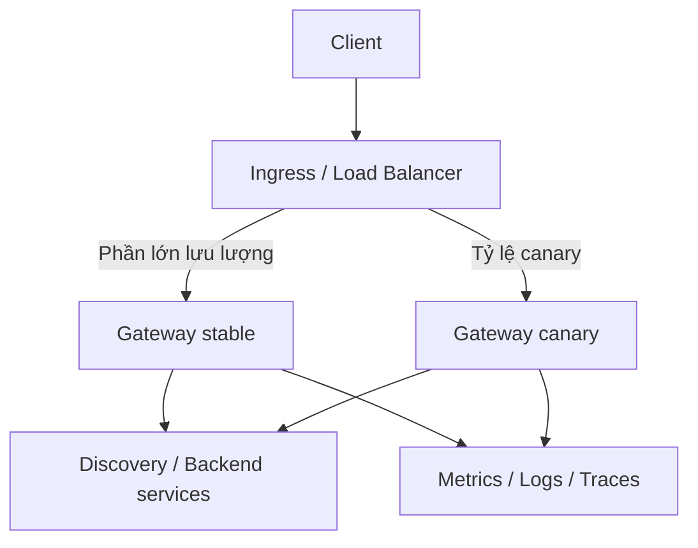

# Triển khai thử nghiệm, theo dõi sai lệch và khôi phục phiên bản Spring Cloud Gateway

Nâng cấp Spring Cloud Gateway ảnh hưởng trực tiếp đến cổng vào của nhiều microservice. Một lỗi nhỏ trong route, filter, HTTP client hoặc cấu hình bảo mật có thể làm tăng lỗi trên diện rộng dù từng service phía sau vẫn khỏe. Vì vậy, hãy đưa phiên bản mới vào production theo từng phần lưu lượng, so sánh hành vi với phiên bản đang ổn định và chuẩn bị đường quay lại trước khi mở rộng rollout.

Bài này tập trung vào cách triển khai canary cho Gateway, quan sát sai lệch và rollback có kiểm soát. Cần phân biệt hai phạm vi thử nghiệm:

- **Canary binary Gateway:** chạy hai nhóm instance Gateway với phiên bản ứng dụng khác nhau và phân phối một phần request đến nhóm mới. Đây là cách phù hợp để đánh giá nâng cấp dependency, Spring Cloud release train, Reactor Netty hoặc Spring Boot.
- **Canary backend qua Gateway:** giữ phiên bản Gateway ổn định nhưng cho một phần request đi đến service backend mới qua route, `Weight` predicate hoặc một cơ chế định tuyến khác. Cách này đánh giá backend và route policy, không tự chứng minh binary Gateway mới hoạt động tốt.

Nếu đồng thời thay binary Gateway, route definition, filter và backend, khi có sai lệch sẽ khó xác định thay đổi nào gây ra lỗi. Hãy chia rollout thành các thay đổi có thể quan sát và khôi phục độc lập.

## 1. Chuẩn bị trước khi tạo canary

### Chốt baseline và artifact có thể khôi phục

Trước khi triển khai, lưu lại trạng thái đang chạy:

- Image digest hoặc artifact version của Gateway ổn định; không chỉ lưu tag có thể bị ghi đè.
- Spring Boot, Spring Cloud release train, Spring Cloud Gateway và các dependency HTTP client đã resolve.
- Snapshot route definition, `default-filters`, cấu hình Java, discovery locator, profile và metadata có ảnh hưởng đến định tuyến.
- Cấu hình ingress/load balancer, TLS, timeout, connection pool và health check.
- Phiên bản secret/config reference cần thiết để khởi động lại bản ổn định.
- Dashboard và khoảng thời gian baseline có tải tương đương với thời điểm rollout dự kiến.

Baseline cần thể hiện lưu lượng bình thường theo giờ, ngày và nhóm route. Một lần so sánh giữa giờ thấp điểm của bản mới với giờ cao điểm của bản cũ dễ tạo kết luận sai. Ghi rõ những route có lưu lượng thấp để không đánh giá một tỷ lệ lỗi chỉ từ vài request.

### Kiểm tra tính tương thích của cấu hình

Nếu Gateway mới dùng chung Config Server hoặc kho cấu hình với Gateway cũ, bảo đảm cấu hình được cả hai phiên bản hiểu. Thuộc tính mới có thể bị phiên bản cũ bỏ qua hoặc không bind được; filter factory mới có thể không tồn tại trong binary cũ. Có thể dùng hai revision cấu hình riêng, ví dụ `gateway-stable` và `gateway-canary`, nhưng phải quản lý chúng như artifact có version và biết chính xác instance nào đang nạp revision nào.

Không thay đổi route order, path rewrite, forwarded header, retry hoặc rate limit trong cùng đợt đầu tiên khi mục tiêu là kiểm tra binary Gateway. Trước hết, chạy binary mới với cấu hình tương đương bản ổn định. Khi binary đã đạt tiêu chí, mới phát hành thay đổi route/filter như một đợt riêng.

### Kiểm tra hợp đồng với service phía sau

Gateway mới vẫn phải tương thích với backend hiện tại. Kiểm tra trước:

- Path, method, query string và header mà backend nhận sau filter.
- Authentication context, cookie, forwarded header và CORS.
- Response status/header, nén, streaming, WebSocket và SSE.
- Retry có thể gửi lại request hay không; request không idempotent cần idempotency key hoặc cơ chế chống tạo giao dịch trùng.
- Thời gian chờ, circuit breaker, rate limiter và hành vi khi service discovery tạm thời không có instance.

Nếu Gateway mới và cũ cùng phục vụ một backend, schema API và cách backend xử lý header phải tương thích với cả hai trong thời gian chuyển tiếp. Với thay đổi database hoặc event contract, áp dụng chiến lược expand-and-contract để bản cũ vẫn hoạt động trong thời gian rollback.

## 2. Chọn điểm phân phối canary

### Phân phối giữa hai nhóm Gateway binary

Trong rollout nâng cấp Gateway, nên đặt hai nhóm instance sau một ingress hoặc load balancer có thể điều chỉnh tỷ lệ:



Ban đầu, chỉ đưa một tỷ lệ nhỏ request đến nhóm canary. Cả hai nhóm nên có readiness check riêng, cùng chính sách TLS và bảo mật, đồng thời được gắn nhãn phiên bản rõ ràng trong telemetry. Đừng dùng một health endpoint chỉ kiểm tra process đang sống để kết luận Gateway có thể nhận traffic; cần kiểm tra thêm khả năng nạp route và các dependency bắt buộc.

Ví dụ một Service Kubernetes chọn các pod Gateway theo label:

```yaml
apiVersion: v1
kind: Service
metadata:
  name: gateway-canary
spec:
  selector:
    app: api-gateway
    track: canary
  ports:
    - name: http
      port: 80
      targetPort: 8080
```

Service này chỉ minh họa cách tách endpoint canary. Tỷ lệ request giữa `gateway-stable` và `gateway-canary` cần được cấu hình tại ingress controller, service mesh hoặc load balancer đang sử dụng. Kubernetes Service thông thường không cung cấp tỷ lệ phần trăm phân phối giữa hai Service độc lập. Hãy xác minh thuật toán và khả năng sticky session của lớp phân phối thực tế.

Để giảm biến số, giữ nguyên số replica, resource limit, cấu hình JVM, route và upstream trong lần thử đầu nếu điều kiện tải cho phép. Sau đó điều chỉnh capacity canary theo kết quả đo và lưu lượng dự kiến.

### Phân phối đến backend mới bằng Weight predicate

Nếu mục tiêu là thử backend mới qua Gateway, có thể định nghĩa hai route cùng một weight group:

```yaml
spring:
  cloud:
    gateway:
      routes:
        - id: catalog-stable
          uri: lb://catalog-service-v1
          predicates:
            - Path=/catalog/**
            - Weight=catalog-release, 95
        - id: catalog-canary
          uri: lb://catalog-service-v2
          predicates:
            - Path=/catalog/**
            - Weight=catalog-release, 5
```

Hai route dùng chung tên group `catalog-release`; trọng số là tỷ lệ tương đối giữa các route trong group. Với ví dụ trên, mục tiêu là khoảng 95/5 trong tập request khớp group, không phải bảo đảm chính xác 95 request trên mỗi 100 request. Phân phối thực tế chịu ảnh hưởng của thuật toán chọn route, số lượng request và thời gian quan sát.

Không nhầm canary backend với canary binary Gateway. Nếu hai route nằm trên cùng một binary Gateway, chúng không kiểm tra được việc nâng cấp Gateway. Cũng cần nhớ rằng lựa chọn route theo weight thường diễn ra theo request; một phiên người dùng có nhiều request có thể đi đến cả hai backend. Với WebSocket, lựa chọn diễn ra khi handshake và kết nối sau đó gắn với backend đã chọn. Nếu ứng dụng yêu cầu phiên ổn định, cần affinity hoặc cơ chế chia sẻ session ở tầng phù hợp.

### Phân phối theo cohort được kiểm soát

Để thử một nhóm nội bộ, có thể ưu tiên request có header do ingress tin cậy thêm vào:

```yaml
spring:
  cloud:
    gateway:
      routes:
        - id: catalog-canary-cohort
          order: -10
          uri: lb://catalog-service-v2
          predicates:
            - Path=/catalog/**
            - Header=X-Release-Cohort, canary
        - id: catalog-stable-fallback
          order: 0
          uri: lb://catalog-service-v1
          predicates:
            - Path=/catalog/**
```

Route canary có thứ tự ưu tiên và chỉ khớp khi header cohort có giá trị được chọn; request còn lại đi đến route stable. Không cho client Internet tự quyết định header này nếu nó có thể truy cập trực tiếp Gateway. Ingress phải xóa header do client gửi rồi tự gắn header dựa trên danh sách người dùng hoặc cohort đã được xác thực. Có thể dùng cookie ký số hoặc một khóa phân nhóm đáng tin cậy nếu cần duy trì cohort qua nhiều request.

## 3. Tăng lưu lượng theo từng giai đoạn

Một rollout mẫu có thể đi qua các mức sau:

| Giai đoạn | Tỷ lệ canary tham khảo | Điều kiện để chuyển bước |
|---|---:|---|
| Smoke test | Chỉ synthetic hoặc request nội bộ | Health, route, TLS, auth và kết nối upstream đều đạt |
| Canary nhỏ | 1–5% | Không có lỗi nghiêm trọng; số liệu đủ để so sánh |
| Mở rộng lần 1 | 10–25% | Error rate, latency và tài nguyên gần baseline |
| Mở rộng lần 2 | 50% | Không có sai lệch theo route hoặc nhóm client; capacity đủ |
| Hoàn tất | 100% | Đạt thời gian quan sát và ngưỡng chấp nhận đã thống nhất |

Đây là các mốc tham khảo, không phải công thức bắt buộc. Với hệ thống có lưu lượng thấp, 1% có thể chỉ tạo vài request và không đủ dữ liệu. Với hệ thống nhạy cảm, có thể bắt đầu bằng synthetic traffic hoặc nhóm người dùng nội bộ lâu hơn. Mỗi lần tăng tỷ lệ cần có khoảng quan sát đủ dài để bao phủ chu kỳ tải và các tình huống như token refresh, cache miss hoặc discovery refresh.

Không tự động tăng tỷ lệ chỉ vì không có alert. Một dashboard trống, metric chưa được export hoặc canary chưa nhận request cũng có thể không tạo alert. Trước mỗi bước, xác nhận canary thực sự nhận đúng tỷ lệ traffic và telemetry đang được thu thập.

## 4. Theo dõi sai lệch giữa stable và canary

### So sánh theo cùng một lát cắt

Gắn nhãn version/track cho từng nhóm Gateway và giữ route ID ổn định giữa hai nhóm. So sánh stable với canary theo cùng thời gian, route, method, status class và loại client. Không gộp mọi route vào một tỷ lệ chung: một route lưu lượng lớn có thể che khuất lỗi ở route ít request nhưng quan trọng.

Các tín hiệu nên theo dõi:

| Nhóm | Chỉ số hoặc dấu hiệu | Ý nghĩa khi canary lệch baseline |
|---|---|---|
| Khả dụng | Request count, 4xx/5xx, 502/503/504, timeout, connection reset | Route không khớp, upstream lỗi, lỗi HTTP client hoặc kết nối bị đóng |
| Độ trễ | p50, p95, p99 và thời gian kết nối upstream | Filter nặng hơn, pool chờ lâu, DNS/TLS hoặc service discovery chậm |
| Retry và circuit breaker | Số lần retry, lỗi retry, trạng thái open/half-open/closed | Gateway mới retry nhiều hơn hoặc circuit breaker mở thường xuyên |
| Rate limiting | Số request bị từ chối, key resolver, Redis latency/error | Thay đổi bucket, key hoặc lỗi dependency làm sai chính sách giới hạn |
| Tài nguyên | CPU, heap, GC pause, event-loop, connection pool, file descriptor | Rò rỉ tài nguyên, nghẽn event loop hoặc pool không đủ capacity |
| Định tuyến | Route ID, URI upstream, số request theo backend | Predicate/order/discovery chọn sai route hoặc traffic split sai |
| Bảo mật | Auth failure, TLS handshake failure, CORS rejection, forwarded header | Thay đổi header, trust chain hoặc cấu hình xác thực |
| Streaming | WebSocket handshake/close, thời lượng kết nối, SSE event delay và disconnect | Timeout, buffering, response filter hoặc graceful shutdown không phù hợp |

Nếu ứng dụng bật Gateway Actuator metrics, có thể kiểm tra timer request Gateway, thường có tên `spring.cloud.gateway.requests`. Tên metric, tag và cấu hình export phụ thuộc phiên bản Gateway, Micrometer và registry. Xác minh metric có thật trong môi trường đang chạy bằng endpoint metrics được bảo vệ hoặc dashboard của hệ thống quan sát; không giả định mọi tag đều có sẵn ở mọi phiên bản.

Nên có nhãn triển khai như `gateway_version` hoặc `track` ở tầng scrape/deployment để so sánh cohort. Tránh gắn raw URL, user ID, token, session ID hoặc query string làm tag metric vì cardinality tăng nhanh và có thể làm lộ dữ liệu. Dùng route ID và nhóm status có cardinality thấp; chi tiết request cần điều tra nên nằm trong log/trace đã kiểm soát quyền truy cập.

### Phân biệt lỗi của Gateway với lỗi upstream

Một response `502` hoặc `503` có thể xuất phát từ Gateway, load balancer hoặc backend. Để xác định nguồn, kết hợp:

- Route ID và URI upstream đã chọn.
- Status trả về từ upstream nếu có, status do Gateway tạo và exception của HTTP client.
- Thời điểm bắt đầu/kết thúc request và thời gian chờ kết nối.
- Correlation ID hoặc trace ID xuyên qua Gateway và backend.
- Log của ingress, Gateway và service đích trong cùng cửa sổ thời gian.

Đừng ghi access token, cookie, nội dung body nhạy cảm hoặc toàn bộ header tùy tiện để tìm lỗi. Log các trường cần thiết, che dữ liệu định danh và giữ correlation ID xuyên suốt các hop.

### Đặt tiêu chí dừng trước khi rollout

Ngưỡng dừng cần được xác định trước dựa trên SLO và baseline. Có thể dùng các tín hiệu như:

- Tỷ lệ 5xx hoặc timeout của canary tăng vượt ngưỡng cho phép trong một cửa sổ đủ dài.
- p95/p99 tăng đáng kể so với stable ở cùng route và mức tải.
- Retry, circuit breaker open hoặc rate limit rejection tăng bất thường.
- Canary không nạp đủ route, mất kết nối discovery, không đọc được secret hoặc health check chuyển sang not-ready.
- Có lỗi xác thực, TLS, CORS hoặc rò rỉ header nhạy cảm.
- CPU, heap, GC, event loop hoặc connection pool tiến gần giới hạn vận hành.

Ví dụ một chính sách nội bộ có thể yêu cầu dừng nếu error rate canary cao hơn stable 1 điểm phần trăm hoặc p95 cao hơn 20% liên tục trong 5 phút, với số lượng request tối thiểu. Các con số này chỉ là ví dụ để minh họa cách viết ngưỡng; hãy chọn giá trị theo SLO, độ biến động baseline và mức độ quan trọng của từng route. Một lỗi bảo mật hoặc mất route trọng yếu có thể yêu cầu dừng ngay cả khi tỷ lệ lỗi tổng thể thấp.

## 5. Kiểm thử các hành vi đặc thù của Gateway

### Route và filter

Gửi cùng một bộ request qua stable và canary, rồi so sánh:

1. Route ID được chọn và URI upstream.
2. Path, method, query và header sau request filter.
3. Status, response header và body sau response filter.
4. Số lần backend nhận request để phát hiện retry ngoài dự kiến.
5. Hành vi khi backend trả 4xx/5xx, timeout hoặc không có instance.

Bao gồm URL có/không có trailing slash, encoded path, header thiếu hoặc trùng, OPTIONS/CORS, forwarded header và request không hợp lệ. Nếu route lấy từ discovery hoặc Config Server, kiểm tra thời gian refresh và hành vi khi nguồn cấu hình tạm thời không truy cập được.

### TLS và xác thực

Kiểm tra cả hai chặng TLS nếu có: client → ingress/Gateway và Gateway → upstream. Xác nhận certificate chain, hostname verification, truststore, mTLS nếu sử dụng, thời hạn chứng chỉ và hành vi khi chứng chỉ upstream được xoay vòng. Kiểm tra token hết hạn, audience/issuer, cookie và quyền truy cập ở cả stable lẫn canary.

### WebSocket và SSE

WebSocket và SSE là kết nối dài hạn, nên số request mới nhận được chưa phản ánh đầy đủ số kết nối đang mở. Theo dõi handshake, close code, thời gian sống, số kết nối hoạt động, độ trễ event và disconnect. Canary Gateway có thể được đánh giá tốt với request REST nhưng vẫn làm rớt kết nối dài hạn nếu idle timeout, heartbeat hoặc shutdown policy khác.

Khi giảm traffic khỏi stable, tránh đóng ngay các kết nối WebSocket đang hoạt động. Dừng nhận kết nối mới vào instance cần drain, chờ kết nối cũ kết thúc trong giới hạn vận hành, hoặc thông báo client reconnect theo hợp đồng ứng dụng. Với SSE, hỗ trợ `Last-Event-ID` nếu ứng dụng cần tiếp tục từ event cuối đã nhận. Không mirror WebSocket hoặc request ghi dữ liệu sang hai backend để thử nghiệm.

### Shadow traffic có kiểm soát

Shadow traffic có thể giúp so sánh response mà không thay đổi response gửi cho client, nhưng chỉ an toàn khi backend nhận request có thể xử lý lặp mà không tạo side effect. Không nhân đôi POST thanh toán, tạo đơn, gửi email, phát event, ghi dữ liệu hoặc thao tác có tác dụng phụ. Nếu cần shadow, chỉ chọn request đọc, loại bỏ credential nhạy cảm khi phù hợp, giới hạn tỷ lệ và kiểm soát dữ liệu cá nhân. Không coi shadow traffic là thay thế cho canary thực với người dùng.

## 6. Runbook rollback

Rollback cần được thực hiện theo một trình tự đã thử trước đó. Mục tiêu là đưa traffic mới về nhóm ổn định, khôi phục cấu hình tương thích và giữ đủ bằng chứng để tìm nguyên nhân.

### Khi nào cần rollback

Kích hoạt rollback nếu chạm ngưỡng dừng đã thống nhất, phát hiện lỗi bảo mật, mất route quan trọng, lỗi xác thực/TLS diện rộng, tăng lỗi upstream không giải thích được hoặc canary không thể được quan sát tin cậy. Không chờ đủ thời gian quan sát nếu có dấu hiệu ảnh hưởng nghiêm trọng đến dữ liệu hoặc quyền truy cập.

### Trình tự khôi phục

1. **Đóng băng thay đổi:** dừng tăng tỷ lệ và tạm ngừng phát hành route/config mới để giữ trạng thái có thể tái hiện.
2. **Chuyển traffic về stable:** đặt tỷ lệ canary về 0% hoặc chuyển ingress/load balancer về nhóm Gateway ổn định. Xác minh request mới không còn đi vào canary.
3. **Drain kết nối:** ngừng nhận kết nối mới trên canary; cho WebSocket/SSE đang hoạt động thời gian kết thúc phù hợp. Nếu phải đóng khẩn cấp, chấp nhận client reconnect theo hợp đồng đã thiết kế.
4. **Khôi phục cấu hình:** nếu sai lệch đến từ route/filter/config, nạp lại revision đã biết tốt tương ứng với binary stable. Không đẩy cấu hình chỉ có Gateway mới hiểu xuống binary cũ.
5. **Khôi phục artifact:** nếu cần, triển khai lại image digest hoặc artifact version đã lưu. Xác minh dependency và secret tương ứng.
6. **Kiểm tra sau rollback:** chạy synthetic request cho route quan trọng, auth, TLS, service discovery, rate limit và backend. Xác nhận error rate/latency trở về vùng baseline.
7. **Giữ bằng chứng:** lưu thời điểm rollout, tỷ lệ traffic, config revision, image digest, route ID, trace ID, metric và log liên quan để phân tích sau.

Rollback binary và rollback route config là hai thao tác khác nhau. Nếu lỗi do route/filter, chỉ quay lại binary có thể không khôi phục được hành vi. Nếu lỗi do binary mới, khôi phục route config mà vẫn giữ binary lỗi cũng không giải quyết được. Runbook cần chỉ rõ artifact/config revision nào đi cùng nhau.

### Ví dụ chuyển traffic bằng cấu hình phân phối

Với ingress hoặc load balancer hỗ trợ weight, rollback có thể tương đương đặt:

```yaml
weights:
  gateway-stable: 100
  gateway-canary: 0
```

Đây là cấu trúc minh họa, không phải schema YAML chung cho mọi ingress. Dùng cú pháp của controller/service mesh/load balancer đang triển khai và xác minh trạng thái đã được áp dụng trước khi kết luận rollback hoàn tất.

## 7. Diễn tập rollback trước production

Một lần rollback chưa từng thử có thể thất bại vì sai tên Service, image tag bị ghi đè, secret đã xoay vòng hoặc cấu hình cũ không còn tương thích. Trước khi mở rollout production, thực hiện diễn tập ở staging:

- Đưa stable và canary lên cùng một ingress thử nghiệm.
- Tăng traffic canary theo các bước đã định.
- Tạo một lỗi có kiểm soát, chẳng hạn route canary trả 503 hoặc health check thất bại.
- Xác nhận alert phát hiện đúng cohort và đúng route.
- Chuyển traffic về stable, drain canary và xác minh request mới chỉ đi đến stable.
- Khôi phục cấu hình và artifact từ snapshot, sau đó chạy lại smoke test.
- Đo thời gian từ lúc phát hiện đến khi traffic trở về trạng thái ổn định.

Diễn tập riêng trường hợp kết nối dài hạn, Config Server mất kết nối, discovery không có instance và secret/TLS certificate lỗi. Không tạo lỗi bằng cách làm hỏng hệ thống production hoặc phát request có side effect.

## 8. Checklist trước, trong và sau rollout

### Trước rollout

- [ ] Đã lưu image digest, BOM/dependency version, route/config revision và secret reference của bản stable.
- [ ] Có baseline theo route, thời gian, method và mức tải tương đương.
- [ ] Canary có readiness/liveness, resource limit, telemetry và nhãn version riêng.
- [ ] Cấu hình dùng chung tương thích với cả hai binary hoặc đã tách revision rõ ràng.
- [ ] Đã kiểm thử route, filter, auth, TLS, discovery, retry, rate limit, circuit breaker và streaming.
- [ ] Có người chịu trách nhiệm, ngưỡng dừng và runbook rollback đã diễn tập.

### Trong rollout

- [ ] Xác nhận canary thực sự nhận đúng tỷ lệ traffic.
- [ ] So sánh stable/canary theo cùng route và cửa sổ thời gian.
- [ ] Theo dõi 4xx/5xx, timeout, p95/p99, retry, circuit breaker, rate limit và tài nguyên.
- [ ] Kiểm tra route ID, upstream và header forwarding khi có sai lệch.
- [ ] Chỉ tăng traffic khi đủ mẫu và không có ngưỡng dừng bị vi phạm.
- [ ] Theo dõi riêng WebSocket, SSE và các kết nối dài hạn.

### Sau rollout hoặc rollback

- [ ] 100% traffic mới đi đến phiên bản được chọn; không còn instance ngoài dự kiến nhận request.
- [ ] Kết nối cũ đã drain hoặc được xử lý reconnect theo chính sách.
- [ ] Synthetic test xác nhận route, auth, TLS và upstream hoạt động.
- [ ] Metric/log/trace được lưu cùng image digest và config revision.
- [ ] Nếu rollback, xác nhận baseline phục hồi và ghi lại nguyên nhân trước lần thử tiếp theo.

Triển khai canary hiệu quả khi mỗi thay đổi có một cohort rõ ràng, có baseline để so sánh và có cách quay lại đã kiểm chứng. Với Spring Cloud Gateway, hãy quan sát riêng route, filter, upstream và kết nối dài hạn để phát hiện sai lệch đúng lớp, rồi mới mở rộng lưu lượng đến toàn bộ hệ thống.
