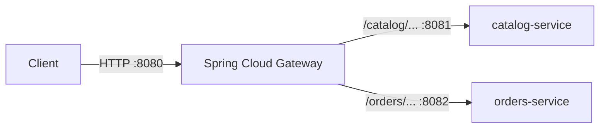

# Dựng gateway với nhiều dịch vụ và kiểm chứng chọn tuyến

Trong kiến trúc microservices, client nên có một điểm vào ổn định thay vì phải biết địa chỉ và cổng của từng dịch vụ. Spring Cloud Gateway nhận request tại điểm vào đó, chọn dịch vụ đích bằng route predicate, rồi chạy filter chain để chuẩn hóa đường dẫn, bổ sung header và áp dụng các chính sách trước khi chuyển tiếp request.

Bài thực hành dựng một gateway và hai dịch vụ `catalog-service`, `orders-service`. Ta sẽ gửi request qua gateway, xác minh dịch vụ nhận được request, đường dẫn sau biến đổi và header do gateway thêm vào. Phần cuối mở rộng cấu hình sang service discovery, xác thực, giới hạn lưu lượng, circuit breaker, retry, TLS và quan sát request để vận hành cổng vào an toàn.

## 1. Mục tiêu và sơ đồ

Sau bài này, bạn có thể:

- Tạo route riêng cho nhiều dịch vụ bằng `Path` predicate.
- Giải thích cách gateway chọn route và chuyển request đến URI tương ứng.
- Dùng `StripPrefix`, `RewritePath`, `AddRequestHeader` và `AddResponseHeader` trong filter chain.
- Kiểm chứng việc chọn tuyến bằng response body, response header và log của dịch vụ đích.
- Biết cách chuyển từ địa chỉ cố định sang service discovery và bổ sung các lớp bảo vệ khi triển khai.

Kiến trúc chạy cục bộ:



Gateway lắng nghe cổng `8080`. Hai dịch vụ phía sau lần lượt lắng nghe `8081` và `8082`. Client chỉ gọi các URL bắt đầu bằng `/api/catalog/` hoặc `/api/orders/`.

## 2. Chuẩn bị ba ứng dụng

Sử dụng một phiên bản Spring Boot và Spring Cloud tương thích theo release train của Spring Cloud. Gateway trong bài dùng WebFlux; hai dịch vụ phía sau có thể dùng Spring MVC. Không trộn các phiên bản starter khác release train.

Trong ứng dụng gateway, thêm starter Spring Cloud Gateway Server WebFlux và Actuator. Với release train cũ dùng tên artifact `spring-cloud-starter-gateway`; các release mới có thể dùng `spring-cloud-starter-gateway-server-webflux`.

```xml
<dependency>
    <groupId>org.springframework.cloud</groupId>
    <artifactId>spring-cloud-starter-gateway-server-webflux</artifactId>
</dependency>
<dependency>
    <groupId>org.springframework.boot</groupId>
    <artifactId>spring-boot-starter-actuator</artifactId>
</dependency>
```

Trong mỗi dịch vụ phía sau, thêm `spring-boot-starter-web`. Đặt tên và cổng cho hai ứng dụng như sau.

`catalog-service/src/main/resources/application.yml`:

```yaml
spring:
  application:
    name: catalog-service
server:
  port: 8081
```

`orders-service/src/main/resources/application.yml`:

```yaml
spring:
  application:
    name: orders-service
server:
  port: 8082
```

Tạo endpoint đơn giản để nhận biết dịch vụ nào đã xử lý request. Ví dụ trong `catalog-service`:

```java
@RestController
@RequestMapping("/catalog")
public class CatalogController {
    @GetMapping("/items/{id}")
    public Map<String, String> getItem(
            @PathVariable String id,
            @RequestHeader(name = "X-Gateway-Route", required = false) String route) {
        return Map.of(
                "service", "catalog-service",
                "id", id,
                "gatewayRoute", Objects.toString(route, "missing")
        );
    }
}
```

Endpoint này nhận `GET /catalog/items/{id}`. Thêm import `java.util.Map` và `java.util.Objects`, cùng các import Spring MVC cần thiết.

Trong `orders-service`, tạo endpoint tương tự:

```java
@RestController
@RequestMapping("/orders")
public class OrdersController {
    @GetMapping("/{id}")
    public Map<String, String> getOrder(
            @PathVariable String id,
            @RequestHeader(name = "X-Gateway-Route", required = false) String route) {
        return Map.of(
                "service", "orders-service",
                "id", id,
                "gatewayRoute", Objects.toString(route, "missing")
        );
    }
}
```

Endpoint này nhận `GET /orders/{id}`. Hai endpoint cố ý trả về tên dịch vụ và giá trị `X-Gateway-Route`; nhờ vậy ta có thể kiểm tra cả đích đến lẫn header được gateway chuyển tiếp.

## 3. Khai báo route và filter chain

Trong `gateway/src/main/resources/application.yml`, khai báo hai route:

```yaml
server:
  port: 8080

spring:
  application:
    name: edge-gateway
  cloud:
    gateway:
      routes:
        - id: catalog-route
          order: 0
          uri: http://localhost:8081
          predicates:
            - Path=/api/catalog/**
          filters:
            - StripPrefix=1
            - AddRequestHeader=X-Gateway-Route,catalog
            - AddResponseHeader=X-Route-Id,catalog

        - id: orders-route
          order: 0
          uri: http://localhost:8082
          predicates:
            - Path=/api/orders/**
          filters:
            - RewritePath=/api/orders/(?<remaining>.*), /orders/$\{remaining}
            - AddRequestHeader=X-Gateway-Route,orders
            - AddResponseHeader=X-Route-Id,orders
```

Ý nghĩa từng phần:

| Thành phần | Vai trò trong bài |
|---|---|
| `id` | Định danh duy nhất cho route, hữu ích khi kiểm tra cấu hình và log. |
| `uri` | Địa chỉ dịch vụ đích. Hiện dùng URL cố định để chạy local. |
| `Path` | Predicate chỉ khớp request có đường dẫn thuộc nhánh tương ứng. |
| `StripPrefix=1` | Bỏ một đoạn path ở đầu. `/api/catalog/items/42` trở thành `/catalog/items/42`. |
| `RewritePath` | Dùng biểu thức chính quy để đổi `/api/orders/42` thành `/orders/42`. |
| `AddRequestHeader` | Thêm header trước khi request được chuyển đến dịch vụ phía sau. |
| `AddResponseHeader` | Thêm header vào response trả về client. |

Ở route `catalog`, `StripPrefix=1` loại bỏ phần `/api`; phần `/catalog` vẫn còn để khớp `@RequestMapping("/catalog")`. Ở route `orders`, `RewritePath` thay toàn bộ tiền tố `/api/orders/` bằng `/orders/`. Dấu gạch chéo trong `/$\{remaining}` được escape để Spring không coi `${remaining}` là placeholder cấu hình; gateway dùng nhóm regex `remaining` để tạo path mới.

Mỗi route có predicate riêng nên request `/api/catalog/items/42` chỉ khớp `catalog-route`, còn `/api/orders/42` chỉ khớp `orders-route`. Nếu sau này có các predicate chồng lấn, đặt `order` để route cụ thể được xét trước route tổng quát. Nhiều predicate trong cùng một route phải cùng khớp thì route mới được chọn.

Filter chain xử lý request trước khi chuyển tiếp và có thể xử lý response khi response quay lại. Thứ tự filter ảnh hưởng đến giá trị mà filter sau nhìn thấy; vì vậy hãy đặt thao tác biến đổi path và header có chủ đích, rồi kiểm chứng bằng request thật.

## 4. Khởi chạy và kiểm chứng chọn tuyến

Khởi chạy hai dịch vụ phía sau trước, sau đó khởi chạy gateway. Đảm bảo cả ba ứng dụng đều đã sẵn sàng.

Gọi dịch vụ catalog thông qua gateway:

```bash
curl -i http://localhost:8080/api/catalog/items/42
```

Response dự kiến có header và body tương tự:

```http
HTTP/1.1 200 OK
X-Route-Id: catalog
Content-Type: application/json

{"service":"catalog-service","id":"42","gatewayRoute":"catalog"}
```

Kết quả chứng minh ba điều: predicate `/api/catalog/**` đã chọn `catalog-route`; gateway đã chuyển path thành `/catalog/items/42`; header `X-Gateway-Route: catalog` đã đến được dịch vụ phía sau. Header `X-Route-Id: catalog` được thêm vào response tại gateway.

Tiếp tục kiểm tra route orders:

```bash
curl -i http://localhost:8080/api/orders/9001
```

Body dự kiến:

```json
{"service":"orders-service","id":"9001","gatewayRoute":"orders"}
```

Response phải có `X-Route-Id: orders`. Dịch vụ nhận được path `/orders/9001`, cho thấy `RewritePath` đã hoạt động.

Kiểm tra một path không có route:

```bash
curl -i http://localhost:8080/api/unknown/1
```

Gateway thường trả `404 Not Found` vì không có route nào khớp. Đây là kết quả khác với lỗi `5xx` khi route đã khớp nhưng dịch vụ đích không phản hồi.

Để hoàn tất kiểm chứng, gọi trực tiếp endpoint của từng dịch vụ trên cổng `8081` và `8082`, rồi so sánh với kết quả qua gateway. Sau đó dừng riêng `catalog-service` và gọi lại URL catalog: route vẫn được chọn nhưng gateway không thể kết nối backend, vì vậy response sẽ là lỗi gateway `5xx`. Khởi động lại dịch vụ trước khi làm các phần tiếp theo.

## 5. Chuyển route sang service discovery

URL cố định phù hợp cho bài lab nhỏ. Trong môi trường microservices, số lượng instance và địa chỉ IP có thể thay đổi. Khi đã tích hợp discovery client và Spring Cloud LoadBalancer, đổi URI của route sang service ID:

```yaml
spring:
  cloud:
    gateway:
      routes:
        - id: catalog-route
          uri: lb://catalog-service
          predicates:
            - Path=/api/catalog/**
          filters:
            - StripPrefix=1
        - id: orders-route
          uri: lb://orders-service
          predicates:
            - Path=/api/orders/**
          filters:
            - RewritePath=/api/orders/(?<remaining>.*), /orders/$\{remaining}
```

Thêm discovery client phù hợp, ví dụ `spring-cloud-starter-netflix-eureka-client`, vào gateway và các dịch vụ cần đăng ký. Cấu hình địa chỉ registry theo môi trường. Mỗi dịch vụ đăng ký với tên `spring.application.name` tương ứng; gateway tra service ID và LoadBalancer chọn một instance đang được registry công bố.

URI `lb://...` dùng discovery để tìm instance. Tùy chọn `spring.cloud.gateway.discovery.locator.enabled=true` có thể tự tạo route theo service ID, thường với path dạng `/<serviceId>/**`. Chỉ bật cơ chế tự tạo route khi đã kiểm soát danh sách dịch vụ được công bố; với API public, các route khai báo tường minh giúp giới hạn bề mặt truy cập và giữ URL ổn định.

## 6. Bổ sung xác thực và giới hạn lưu lượng

Với gateway WebFlux, có thể xác thực access token JWT tại điểm vào bằng Spring Security Resource Server. Thêm `spring-boot-starter-security` và `spring-boot-starter-oauth2-resource-server`, sau đó cấu hình issuer của nhà cung cấp định danh:

```yaml
spring:
  security:
    oauth2:
      resourceserver:
        jwt:
          issuer-uri: ${OIDC_ISSUER_URI}
```

Tạo security chain để chỉ cho phép health check công khai và yêu cầu xác thực cho các request còn lại:

```java
@Configuration
public class GatewaySecurityConfig {
    @Bean
    SecurityWebFilterChain securityWebFilterChain(ServerHttpSecurity http) {
        return http
                .csrf(ServerHttpSecurity.CsrfSpec::disable)
                .authorizeExchange(exchange -> exchange
                        .pathMatchers("/actuator/health").permitAll()
                        .anyExchange().authenticated())
                .oauth2ResourceServer(oauth2 -> oauth2.jwt(Customizer.withDefaults()))
                .build();
    }
}
```

Đây là cấu hình nền tảng cho API stateless; thêm quy tắc theo path, scope hoặc role theo chính sách của hệ thống. Các dịch vụ phía sau vẫn cần ranh giới tin cậy phù hợp: không mặc định tin một header nhận dạng do client tự gửi, và cân nhắc xác thực token hoặc danh tính dịch vụ ở backend nếu mô hình đe dọa yêu cầu.

Để giới hạn lưu lượng bằng Redis, thêm `spring-boot-starter-data-redis-reactive` và khai báo `KeyResolver`. Ví dụ dưới đây lấy tên principal đã được xác thực làm khóa:

```java
@Bean
KeyResolver principalKeyResolver() {
    return exchange -> exchange.getPrincipal()
            .map(Principal::getName)
            .defaultIfEmpty("anonymous");
}
```

Thêm filter vào route cần giới hạn:

```yaml
filters:
  - name: RequestRateLimiter
    args:
      key-resolver: "#{@principalKeyResolver}"
      redis-rate-limiter.replenishRate: 10
      redis-rate-limiter.burstCapacity: 20
      redis-rate-limiter.requestedTokens: 1
```

Ví dụ cho phép nạp 10 token mỗi giây, dung lượng burst 20 token và mỗi request tiêu thụ một token. Khi vượt ngưỡng, gateway trả `429 Too Many Requests`. Cần điều chỉnh ngưỡng theo tải thực tế và chính sách từng API. Nếu chưa xác thực, khóa `anonymous` có thể gom mọi client vào cùng một bucket; không dùng header tùy ý do client điều khiển làm định danh người dùng.

## 7. Circuit breaker và retry cho lỗi tạm thời

Circuit breaker ngăn gateway tiếp tục gọi một backend đang lỗi kéo dài. Với Spring Cloud CircuitBreaker Reactor Resilience4J, thêm starter `spring-cloud-starter-circuitbreaker-reactor-resilience4j`, rồi gắn filter vào route:

```yaml
filters:
  - name: CircuitBreaker
    args:
      name: catalogBreaker
      fallbackUri: forward:/fallback/catalog
```

Tạo fallback endpoint trong ứng dụng gateway:

```java
@RestController
public class GatewayFallbackController {
    @GetMapping("/fallback/catalog")
    public ResponseEntity<Map<String, String>> catalogFallback() {
        return ResponseEntity.status(HttpStatus.SERVICE_UNAVAILABLE)
                .body(Map.of(
                        "service", "catalog-service",
                        "status", "temporarily_unavailable"
                ));
    }
}
```

Fallback nên trả thông tin có thể hành động và không tiết lộ stack trace hay dữ liệu nội bộ. Có thể cấu hình ngưỡng mở circuit, thời gian chờ và cửa sổ đo theo đặc tính backend; các giá trị đó cần được kiểm thử bằng tải và kịch bản lỗi.

Retry chỉ phù hợp với lỗi tạm thời và request có thể lặp an toàn. Ví dụ giới hạn retry cho GET khi nhận một số mã lỗi gateway:

```yaml
  - name: Retry
    args:
      retries: 2
      methods: GET
      statuses: BAD_GATEWAY,SERVICE_UNAVAILABLE,GATEWAY_TIMEOUT
      backoff:
        firstBackoff: 50ms
        maxBackoff: 500ms
        factor: 2
        basedOnPreviousValue: false
```

Không retry mù quáng các lệnh ghi như POST hoặc thanh toán: backend có thể đã thực hiện thao tác trước khi kết nối bị ngắt. Nếu nghiệp vụ cần retry, hãy thiết kế idempotency key và quy tắc xử lý trùng ở dịch vụ đích. Circuit breaker và retry cũng cần được cấu hình cùng nhau để tránh khuếch đại tải khi backend đang suy giảm.

## 8. Bật TLS và quan sát request

Để mã hóa kết nối từ client đến gateway, cấu hình chứng thư cho listener HTTPS. Ví dụ dùng PKCS12 được cung cấp qua secret của môi trường triển khai:

```yaml
server:
  port: 8443
  ssl:
    enabled: true
    key-store: file:/run/secrets/gateway.p12
    key-store-password: ${GATEWAY_KEYSTORE_PASSWORD}
    key-store-type: PKCS12
    key-alias: gateway
```

Client lúc này gọi `https://<gateway-host>:8443/...`. Nếu gateway kết nối đến backend bằng HTTPS, dùng URI `https://...` và cấu hình trust store/CA đáng tin cậy cho HTTP client của gateway. Không tắt kiểm tra chứng thư trong môi trường thật; quản lý private key và mật khẩu bằng secret manager, đồng thời có quy trình gia hạn chứng thư.

Actuator giúp kiểm tra sức khỏe và route đã nạp. Ví dụ cấu hình chỉ expose các endpoint cần thiết:

```yaml
management:
  endpoints:
    web:
      exposure:
        include: health,info,metrics,gateway,prometheus
  endpoint:
    health:
      probes:
        enabled: true
```

Thêm Micrometer Prometheus registry nếu hệ thống thu thập metric bằng Prometheus. Tùy phiên bản Spring Boot và Spring Cloud Gateway, endpoint gateway có thể cần được bật riêng; kiểm tra tài liệu đúng release train. Có thể dùng `/actuator/health` để kiểm tra trạng thái, `/actuator/gateway/routes` để xem route đã đăng ký và `/actuator/metrics` để khám phá metric đang được xuất.

Trong môi trường production, giới hạn quyền truy cập Actuator bằng mạng quản trị hoặc xác thực riêng; không public route cấu hình, metric chi tiết hay thông tin môi trường cho client Internet. Dùng Micrometer Observation/Tracing để nối trace qua gateway và các dịch vụ. Log nên có request ID, route ID, trạng thái HTTP và thời gian xử lý; tránh ghi access token, cookie, dữ liệu nhạy cảm hoặc toàn bộ body request.

## 9. Bài kiểm tra và xử lý sự cố

Thực hiện lần lượt các kiểm tra sau và lưu lại kết quả:

1. Gọi `/api/catalog/items/42`; xác nhận body có `service=catalog-service`, `gatewayRoute=catalog` và response có `X-Route-Id: catalog`.
2. Gọi `/api/orders/9001`; xác nhận body có `service=orders-service`, `gatewayRoute=orders` và response có `X-Route-Id: orders`.
3. Gọi `/api/unknown/1`; xác nhận gateway trả `404` do không có route phù hợp.
4. Tắt một backend; xác nhận route vẫn khớp nhưng request thất bại ở bước kết nối backend. Sau khi bật circuit breaker, thử lại nhiều lần và kiểm tra fallback.
5. Gửi request thiếu hoặc có JWT hết hạn; xác nhận chính sách xác thực trả `401` hoặc `403` đúng trường hợp.
6. Gửi burst request vượt giới hạn; xác nhận rate limiter trả `429`, sau đó chờ token được nạp lại và thử lại.
7. Kiểm tra HTTPS với chứng thư hợp lệ và chứng thư không được tin cậy; gateway/client phải từ chối kết nối không hợp lệ.
8. Kiểm tra health, route, metric và trace; xác nhận có thể lần theo request qua gateway đến backend.

Một số dấu hiệu thường gặp:

| Hiện tượng | Nguyên nhân cần kiểm tra |
|---|---|
| `404` từ gateway | Path không khớp predicate, route chưa được nạp hoặc path gửi lên sai tiền tố. |
| Backend trả `404` | `StripPrefix`/`RewritePath` tạo path khác với mapping của controller. |
| `502` hoặc `503` | Backend dừng, sai host/cổng, service registry chưa có instance hoặc circuit breaker đang mở. |
| Header không xuất hiện ở backend | Filter chưa gắn vào route được chọn hoặc tên header không thống nhất. |
| `401` hoặc `403` | Token thiếu/hết hạn, issuer/audience sai hoặc scope/role không đủ. |
| `429` | Khóa rate limit và ngưỡng đang áp dụng; kiểm tra principal và trạng thái Redis. |
| TLS handshake thất bại | Chứng thư hết hạn, hostname không khớp, CA chưa được tin cậy hoặc cấu hình keystore sai. |

**Tiêu chí hoàn thành:** hai URL public đi đến đúng hai dịch vụ; path và header tại backend đúng như cấu hình; path không có route nhận `404`; người học giải thích được predicate đã chọn route nào và từng filter đã thay đổi request/response ra sao. Các phần discovery, xác thực, rate limit, circuit breaker, retry, TLS và observability cần được bật theo từng bước và kiểm tra bằng kịch bản tương ứng trước khi áp dụng vào môi trường thật.
