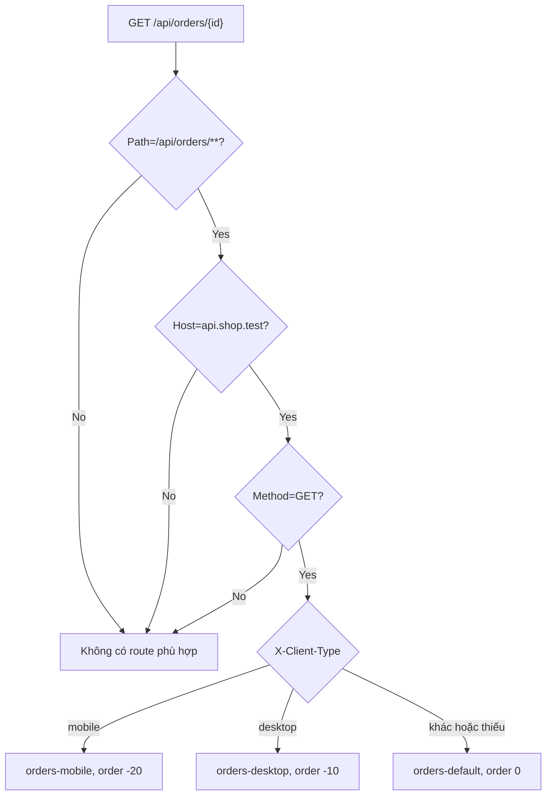

# Kết hợp Path, Host, Method và Header trong một tình huống định tuyến

## 1. Tình huống thực hành

Một cửa hàng trực tuyến công bố API đơn hàng qua một hostname duy nhất:

```text
https://api.shop.test/api/orders/{orderId}
```

Đây là URL công khai theo thiết kế. Trong lab local, ta dùng HTTP trên cổng 8080 và tự đặt Host header để tập trung vào predicate; TLS có thể được cấu hình sau ở ingress/Gateway.

Gateway cần phân luồng request đọc đơn hàng theo loại client:

- Ứng dụng **mobile** gửi header `X-Client-Type: mobile`.
- Ứng dụng **desktop** gửi header `X-Client-Type: desktop`.
- Client khác hoặc không gửi header dùng tuyến **default**.
- Chỉ hostname `api.shop.test`, path `/api/orders/**` và HTTP method `GET` được nhận vào nhóm route này.

Trong bài thực hành, cả ba route cùng proxy tới một backend thử nghiệm ở `localhost:8081`. Backend trả lại route class do Gateway gắn vào request để người học nhìn thấy route nào đã match. Cách làm này giữ lab nhỏ gọn nhưng vẫn chứng minh được **Path + Host + Method + Header** phối hợp như thế nào.

**Kết quả mong đợi**

| Request | Route được chọn |
|---|---|
| Host đúng, GET, path đúng, header mobile | `orders-mobile` |
| Host đúng, GET, path đúng, header desktop | `orders-desktop` |
| Host đúng, GET, path đúng, header khác hoặc thiếu | `orders-default` |
| Sai host, sai path hoặc sai method | Không có route phù hợp; Gateway trả 404 |

## 2. Mục tiêu học tập

Sau khi hoàn thành, bạn có thể:

1. Giải thích các predicate trong **cùng một route** được kết hợp theo logic AND.
2. Kết hợp `Path`, `Host`, `Method` và `Header` để mô tả một điều kiện định tuyến hoàn chỉnh.
3. Dùng biểu thức regular expression trong Header predicate để khớp giá trị header.
4. Sắp xếp route bằng `order` để route cụ thể được kiểm tra trước route mặc định.
5. Dùng `StripPrefix` và `SetRequestHeader` để chuyển tiếp request tới backend.
6. Kiểm thử cả trường hợp match và không match bằng `curl`.
7. Chẩn đoán 404 do predicate không thỏa và phân biệt nó với lỗi kết nối upstream.

## 3. Hiểu logic kết hợp predicate

### 3.1. Các predicate trong một route là AND

Spring Cloud Gateway đánh giá các predicate của một route theo logic **AND**. Request chỉ match khi tất cả predicate trong route đều trả về true.

Với route mobile:

```text
Path=/api/orders/**
AND Host=api.shop.test
AND Method=GET
AND Header X-Client-Type matches ^mobile$
------------------------------------------
=> Chỉ request thỏa cả bốn điều kiện mới chọn route orders-mobile
```

Ví dụ request sau match:

```http
GET /api/orders/ORD-1001 HTTP/1.1
Host: api.shop.test
X-Client-Type: mobile
```

Nếu thay một điều kiện, route mobile không còn match:

- `Host: admin.shop.test`: sai Host predicate.
- `GET /api/products/1001`: sai Path predicate.
- `POST /api/orders/ORD-1001`: sai Method predicate.
- `X-Client-Type: desktop`: sai Header predicate.

### 3.2. OR nằm bên trong một số predicate, không phải giữa các dòng predicate

Các predicate được liệt kê riêng trong route được nối bằng AND. Một predicate factory có thể nhận nhiều pattern hoặc một regex biểu diễn nhiều lựa chọn.

Ví dụ Path predicate có hai pattern:

```yaml
predicates:
  - Path=/api/orders/**,/api/purchases/**
  - Host=api.shop.test
  - Method=GET
```

Ý nghĩa:

```text
(Path=/api/orders/** OR Path=/api/purchases/**)
AND Host=api.shop.test
AND Method=GET
```

Header predicate có thể dùng regex để chấp nhận một trong nhiều giá trị:

```yaml
predicates:
  - Header=X-Client-Type, ^(mobile|tablet)$
```

Trong bài lab chính, ta dùng regex chính xác `^mobile$` và `^desktop$` để dễ quan sát kết quả.

### 3.3. Route order quyết định route nào được chọn trước

Một request có thể thỏa nhiều route. Gateway xét routes theo thứ tự ưu tiên; route có `order` nhỏ hơn được xét trước. Vì vậy route dành cho mobile/desktop phải đứng trước route default có điều kiện rộng hơn.



Không dựa vào thứ tự khai báo YAML nếu route có điều kiện chồng lấn. Hãy đặt `order` rõ ràng và kiểm thử request thỏa nhiều route.

## 4. Chuẩn bị hai ứng dụng

Ta chạy hai process:

| Ứng dụng | Cổng | Vai trò |
|---|---:|---|
| Gateway | 8080 | Nhận request và đánh giá route predicates |
| Orders backend | 8081 | Nhận request sau khi Gateway chọn route |

Sử dụng Spring Boot 4.2.x và Spring Cloud 2026.0.x làm bộ phiên bản tham chiếu cho ví dụ. Spring Cloud BOM sẽ quản lý phiên bản Gateway; không tự thêm version riêng vào starter.

### 4.1. Tạo dự án Gateway

Trong Maven, dùng các dependency chính:

```xml
<?xml version="1.0" encoding="UTF-8"?>
<project xmlns="http://maven.apache.org/POM/4.0.0"
         xmlns:xsi="http://www.w3.org/2001/XMLSchema-instance"
         xsi:schemaLocation="http://maven.apache.org/POM/4.0.0 https://maven.apache.org/xsd/maven-4.0.0.xsd">
    <modelVersion>4.0.0</modelVersion>

<parent>
    <groupId>org.springframework.boot</groupId>
    <artifactId>spring-boot-starter-parent</artifactId>
    <version>4.2.0</version>
    <relativePath/>
</parent>

<groupId>com.example</groupId>
<artifactId>gateway</artifactId>
<version>1.0.0</version>

<properties>
    <java.version>21</java.version>
    <spring-cloud.version>2026.0.0</spring-cloud.version>
</properties>

<dependencyManagement>
    <dependencies>
        <dependency>
            <groupId>org.springframework.cloud</groupId>
            <artifactId>spring-cloud-dependencies</artifactId>
            <version>${spring-cloud.version}</version>
            <type>pom</type>
            <scope>import</scope>
        </dependency>
    </dependencies>
</dependencyManagement>

<dependencies>
    <dependency>
        <groupId>org.springframework.cloud</groupId>
        <artifactId>spring-cloud-starter-gateway-server-webflux</artifactId>
    </dependency>
</dependencies>
</project>
```

Đây là **Gateway Server WebFlux**. Không thêm `spring-boot-starter-web` hoặc starter Gateway MVC vào cùng ứng dụng.

Main class:

```java
package com.example.gateway;

import org.springframework.boot.SpringApplication;
import org.springframework.boot.autoconfigure.SpringBootApplication;

@SpringBootApplication
public class GatewayApplication {
    public static void main(String[] args) {
        SpringApplication.run(GatewayApplication.class, args);
    }
}
```

### 4.2. Tạo Orders backend

Backend là một ứng dụng Spring Boot riêng. Dùng Spring Boot 4.2.x và thêm `spring-boot-starter-webflux`. Không thêm Spring Cloud Gateway starter vào backend.

POM tối thiểu của backend:

```xml
<?xml version="1.0" encoding="UTF-8"?>
<project xmlns="http://maven.apache.org/POM/4.0.0"
         xmlns:xsi="http://www.w3.org/2001/XMLSchema-instance"
         xsi:schemaLocation="http://maven.apache.org/POM/4.0.0 https://maven.apache.org/xsd/maven-4.0.0.xsd">
<modelVersion>4.0.0</modelVersion>

<parent>
    <groupId>org.springframework.boot</groupId>
    <artifactId>spring-boot-starter-parent</artifactId>
    <version>4.2.0</version>
    <relativePath/>
</parent>

<groupId>com.example</groupId>
<artifactId>orders-backend</artifactId>
<version>1.0.0</version>

<properties>
    <java.version>21</java.version>
</properties>

<dependencies>
    <dependency>
        <groupId>org.springframework.boot</groupId>
        <artifactId>spring-boot-starter-webflux</artifactId>
    </dependency>
</dependencies>
</project>
```

```yaml
# application.yml của orders-backend
server:
  port: 8081
```

Controller trả lại thông tin request:

```java
package com.example.orders;

import org.springframework.web.bind.annotation.GetMapping;
import org.springframework.web.bind.annotation.PathVariable;
import org.springframework.web.bind.annotation.RequestHeader;
import org.springframework.web.bind.annotation.RestController;

@RestController
public class OrdersController {

    public record OrderEcho(
            String orderId,
            String clientType,
            String routeClass) {}

    @GetMapping("/orders/{orderId}")
    public OrderEcho getOrder(
            @PathVariable String orderId,
            @RequestHeader(value = "X-Client-Type", required = false)
            String clientType,
            @RequestHeader(value = "X-Route-Class", required = false)
            String routeClass) {

        return new OrderEcho(
                orderId,
                clientType == null ? "missing" : clientType,
                routeClass == null ? "missing" : routeClass);
    }
}
```

Main class của backend:

```java
package com.example.orders;

import org.springframework.boot.SpringApplication;
import org.springframework.boot.autoconfigure.SpringBootApplication;

@SpringBootApplication
public class OrdersApplication {
    public static void main(String[] args) {
        SpringApplication.run(OrdersApplication.class, args);
    }
}
```

Ví dụ response:

```json
{
  "orderId": "ORD-1001",
  "clientType": "mobile",
  "routeClass": "mobile"
}
```

`X-Route-Class` là header do Gateway đặt để minh họa route đã chọn. Backend demo không dùng header này làm căn cứ phân quyền.

## 5. Cấu hình bốn điều kiện trong Gateway

### 5.1. Khai báo ba route trong application.yml

Đặt nội dung sau trong file `application.yml` của Gateway:

```yaml
server:
  port: 8080

spring:
  cloud:
    gateway:
      server:
        webflux:
          routes:
            # Route chuyên biệt cho ứng dụng mobile.
            - id: orders-mobile
              order: -20
              uri: http://localhost:8081
              predicates:
                - Path=/api/orders/**
                - Host=api.shop.test
                - Method=GET
                - Header=X-Client-Type, ^mobile$
              filters:
                - StripPrefix=1
                - SetRequestHeader=X-Route-Class, mobile

            # Route chuyên biệt cho ứng dụng desktop.
            - id: orders-desktop
              order: -10
              uri: http://localhost:8081
              predicates:
                - Path=/api/orders/**
                - Host=api.shop.test
                - Method=GET
                - Header=X-Client-Type, ^desktop$
              filters:
                - StripPrefix=1
                - SetRequestHeader=X-Route-Class, desktop

            # Route mặc định: nhận client type khác hoặc không có header.
            - id: orders-default
              order: 0
              uri: http://localhost:8081
              predicates:
                - Path=/api/orders/**
                - Host=api.shop.test
                - Method=GET
              filters:
                - StripPrefix=1
                - SetRequestHeader=X-Route-Class, default
```

### 5.2. Đọc từng predicate

| Cấu hình | Ý nghĩa trong lab |
|---|---|
| `Path=/api/orders/**` | Chỉ nhận path bắt đầu bằng `/api/orders/` và các path con |
| `Host=api.shop.test` | Chỉ nhận request có Host header khớp hostname này |
| `Method=GET` | Chỉ nhận HTTP GET |
| `Header=X-Client-Type, ^mobile$` | Header `X-Client-Type` phải có giá trị khớp regex `^mobile$` |
| `Header=X-Client-Type, ^desktop$` | Header phải có giá trị chính xác `desktop` |
| `order: -20` | Route mobile được xét trước desktop và default |
| `order: -10` | Route desktop được xét sau mobile nhưng trước default |
| `order: 0` | Route default là route rộng nhất trong nhóm |

**Điều kiện match route mobile:** Path đúng **AND** Host đúng **AND** Method là GET **AND** Header khớp mobile.

Route default không có Header predicate. Vì thế request có header `tablet` hoặc không gửi `X-Client-Type` vẫn match default nếu ba điều kiện Path/Host/Method thỏa.

### 5.3. Vì sao dùng SetRequestHeader?

`SetRequestHeader=X-Route-Class, mobile` ghi đè giá trị header cũ cùng tên. Nếu client cố gửi:

```http
X-Route-Class: admin
```

Gateway vẫn đặt lại thành `mobile` khi route mobile match. Đây là cách tránh để client tự giả mạo **header chẩn đoán của lab**. Trong hệ thống thật, các header identity/tenant/role cần được xác lập từ principal đã xác thực, không lấy từ header do client tự khai.

### 5.4. Vì sao dùng StripPrefix=1?

Client gọi:

```text
/api/orders/ORD-1001
```

`StripPrefix=1` bỏ segment đầu tiên `api` trước khi proxy. Backend nhận:

```text
/orders/ORD-1001
```

Đây là thay đổi path sau khi route đã được chọn. Predicate `Path` vẫn đánh giá path ban đầu từ client.

## 6. Chạy hai ứng dụng

### 6.1. Khởi động backend trước

Trong terminal của dự án Orders backend:

```bash
./mvnw spring-boot:run
```

Kiểm tra backend trực tiếp:

```bash
curl -i http://localhost:8081/orders/ORD-1001
```

Nếu chạy Windows PowerShell, dùng `curl.exe` thay cho alias `curl` khi cần truyền các cờ của curl.

Các lệnh nhiều dòng trong bài dùng cú pháp Bash. Với PowerShell, có thể chạy một lệnh tương đương trên một dòng:

```powershell
curl.exe -i -H "Host: api.shop.test" -H "X-Client-Type: mobile" http://localhost:8080/api/orders/ORD-1001
```

### 6.2. Khởi động Gateway

Trong terminal thứ hai của dự án Gateway:

```bash
./mvnw spring-boot:run
```

Gateway lắng nghe tại `localhost:8080`. Chỉ bắt đầu kiểm thử predicate sau khi cả hai ứng dụng đã khởi động thành công.

## 7. Kiểm thử từng trường hợp định tuyến

Trong các lệnh dưới đây, URL kết nối là `localhost:8080`, còn header `Host` giả lập hostname công khai `api.shop.test`. Cách này cho phép chạy lab trên máy cá nhân mà không cần cấu hình DNS.

### 7.1. Client mobile — phải chọn orders-mobile

```bash
curl -i \
  -H "Host: api.shop.test" \
  -H "X-Client-Type: mobile" \
  http://localhost:8080/api/orders/ORD-1001
```

Kết quả mong đợi:

```json
{
  "orderId": "ORD-1001",
  "clientType": "mobile",
  "routeClass": "mobile"
}
```

Giải thích: cả bốn điều kiện của route `orders-mobile` đều đúng. `StripPrefix` đổi path thành `/orders/ORD-1001` trước khi gửi backend; `SetRequestHeader` đặt `X-Route-Class: mobile`.

### 7.2. Client desktop — phải chọn orders-desktop

```bash
curl -i \
  -H "Host: api.shop.test" \
  -H "X-Client-Type: desktop" \
  http://localhost:8080/api/orders/ORD-1002
```

Kết quả mong đợi có `routeClass` bằng `desktop`.

### 7.3. Client tablet — phải rơi vào route default

```bash
curl -i \
  -H "Host: api.shop.test" \
  -H "X-Client-Type: tablet" \
  http://localhost:8080/api/orders/ORD-1003
```

Kết quả mong đợi:

```json
{
  "orderId": "ORD-1003",
  "clientType": "tablet",
  "routeClass": "default"
}
```

Header `tablet` không match regex mobile hoặc desktop. Tuy nhiên Path, Host và Method vẫn đúng nên route `orders-default` được chọn.

### 7.4. Không gửi X-Client-Type — vẫn chọn route default

```bash
curl -i \
  -H "Host: api.shop.test" \
  http://localhost:8080/api/orders/ORD-1004
```

Backend trả `clientType` là `missing` và `routeClass` là `default`. Đây là hành vi có chủ đích vì route default không yêu cầu Header predicate.

### 7.5. Sai Host — không có route phù hợp

```bash
curl -i \
  -H "Host: admin.shop.test" \
  -H "X-Client-Type: mobile" \
  http://localhost:8080/api/orders/ORD-1005
```

Kết quả mong đợi: **404 Not Found** từ Gateway vì không route nào có `Host=api.shop.test` match. Backend không nhận request.

### 7.6. Sai Path — không có route phù hợp

```bash
curl -i \
  -H "Host: api.shop.test" \
  -H "X-Client-Type: mobile" \
  http://localhost:8080/api/products/1005
```

Kết quả mong đợi: **404 Not Found** vì `/api/products/1005` không match `Path=/api/orders/**`.

### 7.7. Sai Method — không có route phù hợp

```bash
curl -i -X POST \
  -H "Host: api.shop.test" \
  -H "X-Client-Type: mobile" \
  -H "Content-Type: application/json" \
  -d '{"note":"test"}' \
  http://localhost:8080/api/orders/ORD-1006
```

Kết quả mong đợi: **404 Not Found** vì tất cả route trong lab đều yêu cầu `Method=GET`. Gateway không tự trả 405 chỉ vì path tồn tại; không có route match thì thường là 404.

### 7.8. Giá trị header khác chữ hoa/thường

```bash
curl -i \
  -H "Host: api.shop.test" \
  -H "X-Client-Type: Mobile" \
  http://localhost:8080/api/orders/ORD-1007
```

Kết quả mong đợi: route `orders-default`. Tên HTTP header không phân biệt hoa/thường, nhưng regex value `^mobile$` phân biệt chữ hoa/thường. `Mobile` không khớp `mobile`.

## 8. Ma trận kết quả kiểm thử

| # | Host | Path | Method | X-Client-Type | Kết quả |
|---:|---|---|---|---|---|
| 1 | api.shop.test | /api/orders/1 | GET | mobile | orders-mobile |
| 2 | api.shop.test | /api/orders/2 | GET | desktop | orders-desktop |
| 3 | api.shop.test | /api/orders/3 | GET | tablet | orders-default |
| 4 | api.shop.test | /api/orders/4 | GET | Không gửi | orders-default |
| 5 | admin.shop.test | /api/orders/5 | GET | mobile | 404 |
| 6 | api.shop.test | /api/products/6 | GET | mobile | 404 |
| 7 | api.shop.test | /api/orders/7 | POST | mobile | 404 |
| 8 | api.shop.test | /api/orders/8 | GET | Mobile | orders-default |

**Điều cần quan sát:** thay đổi một điều kiện có thể khiến route chuyên biệt không match. Nếu các điều kiện chung vẫn đúng, request có thể đi vào route default; nếu Path/Host/Method không đúng thì không route nào trong nhóm này nhận request.

## 9. Theo dõi route nào đã match

### 9.1. Bật log định tuyến trong môi trường lab

Thêm vào `application.yml` của Gateway:

```yaml
logging:
  level:
    org.springframework.cloud.gateway: DEBUG
    org.springframework.cloud.gateway.handler.RoutePredicateHandlerMapping: TRACE
```

Khởi động lại Gateway và gửi lần lượt request mobile, desktop, tablet. Log giúp quan sát quá trình tìm route và route ID được chọn. Mức TRACE có thể rất nhiều log; chỉ bật tạm trong môi trường thực hành, sau đó đưa về DEBUG/INFO phù hợp.

### 9.2. Dùng Actuator khi cần kiểm tra route definitions

Nếu ứng dụng đã cấu hình Gateway Actuator endpoint, có thể kiểm tra route definitions trong môi trường nội bộ. Chỉ expose endpoint cần thiết và bảo vệ bằng authentication/network policy. Không mở endpoint quản trị Gateway ra Internet công khai chỉ để làm bài lab.

### 9.3. Phân biệt 404 với 502/503

| Status | Ý nghĩa thường gặp trong lab | Kiểm tra |
|---|---|---|
| 404 | Không có route predicate nào match | Host, Path, Method, Header, route order |
| 502 | Gateway đã chọn route nhưng không lấy được phản hồi upstream hợp lệ | Backend port, protocol, connection refusal |
| 503 | Upstream/service không khả dụng hoặc lỗi hạ tầng liên quan | Backend process, service discovery, load balancer |
| 200 | Route match, backend xử lý và trả phản hồi thành công | JSON echo và routeClass |

Nếu route predicates match nhưng backend chưa chạy, lỗi thường nằm ở kết nối upstream chứ không phải predicate.

## 10. Các lỗi cấu hình thường gặp

| Lỗi | Triệu chứng | Cách sửa |
|---|---|---|
| Quên Host header khi test localhost | Gateway trả 404 | Thêm `-H "Host: api.shop.test"` hoặc cấu hình hostname local |
| Host predicate không đúng hostname | Mọi request đều không match | Kiểm tra Host header thực tế và pattern |
| Dùng Path của backend thay vì public path | Route không match | Predicate phải dùng path client gửi tới Gateway |
| Dùng `Method=POST` trong khi client gửi GET | 404 | Đối chiếu method thực trong request |
| Header value không khớp regex | Route chuyên biệt không match | Kiểm tra chính xác value, khoảng trắng và chữ hoa/thường |
| Đặt default route có order ưu tiên cao hơn route chuyên biệt | Request luôn đi default | Đặt order nhỏ hơn cho route cụ thể |
| Quên `StripPrefix=1` | Backend nhận `/api/orders/...` và có thể trả 404 | Chuyển path public về path backend mong đợi |
| Dùng `AddRequestHeader` cho header cần ghi đè | Có thể giữ cả giá trị client gửi và giá trị mới | Dùng `SetRequestHeader` khi cần ghi đè |
| Gateway dùng sai property prefix | Route không được load | Dùng prefix đúng với Gateway release đang chạy |
| Backend chưa chạy | Route match nhưng nhận 502/503 | Kiểm tra port 8081 và backend logs |

### 10.1. Route không match dù từng predicate có vẻ đúng

Hãy kiểm tra request **thực tế** thay vì chỉ nhìn lệnh curl:

1. Dùng verbose mode để xem request headers được gửi.
2. Xác nhận Host header không bị proxy/ingress ghi đè.
3. Kiểm tra URL path có dấu slash, context path hoặc encoding khác dự kiến.
4. Xác nhận method sau redirect; một số client đổi POST thành GET khi theo redirect tùy mã phản hồi/cấu hình.
5. Kiểm tra regex Header và giá trị có khoảng trắng đầu/cuối.
6. Kiểm tra route order và route ID trong log.

Ví dụ:

```bash
curl -v \
  -H "Host: api.shop.test" \
  -H "X-Client-Type: mobile" \
  http://localhost:8080/api/orders/ORD-2001
```

### 10.2. Cẩn thận khi dùng Header predicate cho bảo mật

`X-Client-Type` là header do client kiểm soát. Người dùng có thể tự gửi `X-Client-Type: mobile` hoặc bất kỳ giá trị nào. Vì vậy:

- Dùng Header predicate để **phân loại request hoặc chọn backend phù hợp**, không dùng nó làm bằng chứng xác thực.
- Không route tới API nội bộ/quyền cao chỉ vì client gửi `X-Role: admin`.
- Authentication phải xác minh token/session; authorization phải dựa trên principal và quyền đã xác minh.
- Nếu một header nội bộ được backend tin cậy, Gateway cần xóa/ghi đè header client trước khi forward.
- Backend quan trọng vẫn phải kiểm tra quyền và resource ownership; không coi Gateway là lớp bảo vệ duy nhất.

## 11. Bài tập mở rộng

### Bài 1 — Chấp nhận hai nhóm client trong cùng route

Yêu cầu: route mobile chấp nhận cả `mobile` và `tablet`, desktop vẫn đi route riêng, các giá trị khác vào default.

Gợi ý: thay Header predicate của route mobile thành:

```yaml
- Header=X-Client-Type, ^(mobile|tablet)$
```

Kết quả:

| Header | Route |
|---|---|
| mobile | orders-mobile |
| tablet | orders-mobile |
| desktop | orders-desktop |
| kiosk | orders-default |

### Bài 2 — Thêm route chỉ cho API v2

Yêu cầu: thêm route cho `/api/v2/orders/**` với Host `api.shop.test` và Method GET. Header `X-Client-Type` có thể là mobile hoặc desktop.

Gợi ý:

```yaml
- id: orders-v2
  order: -30
  uri: http://localhost:8081
  predicates:
    - Path=/api/v2/orders/**
    - Host=api.shop.test
    - Method=GET
    - Header=X-Client-Type, ^(mobile|desktop)$
  filters:
    - StripPrefix=2
    - SetRequestHeader=X-Route-Class, v2
```

Nếu backend vẫn chỉ có `/orders/{id}`, path sau `StripPrefix=2` là `/orders/{id}`. Kiểm tra lại số segment bị bỏ: `api` và `v2`.

### Bài 3 — Chỉ nhận hostname con

Yêu cầu: route chấp nhận `api.shop.test` và `partner.shop.test`.

Gợi ý dùng Host predicate với nhiều pattern:

```yaml
- Host=api.shop.test,partner.shop.test
```

Hoặc dùng pattern phù hợp với yêu cầu hostname. Luôn test các hostname được phép và hostname gần giống nhưng không được phép.

### Bài 4 — Phân biệt path có và không có trailing slash

Kiểm thử:

```text
/api/orders
/api/orders/
/api/orders/ORD-3001
/api/ordersXYZ/ORD-3001
```

Quan sát pattern `/api/orders/**` có match từng trường hợp theo PathPattern semantics của phiên bản Gateway đang dùng hay không. Nếu endpoint collection `/api/orders` cần được hỗ trợ rõ ràng, khai báo pattern/route bổ sung và test riêng, không đoán từ wildcard.

### Bài 5 — Thêm route POST tạo đơn hàng

Yêu cầu: chỉ POST tới `/api/orders` với Host `api.shop.test` mới được chọn route tạo đơn; request body được chuyển tới backend. Không làm route GET hiện tại bị ảnh hưởng.

Gợi ý:

```yaml
- id: orders-create
  order: -5
  uri: http://localhost:8081
  predicates:
    - Path=/api/orders
    - Host=api.shop.test
    - Method=POST
  filters:
    - StripPrefix=1
    - SetRequestHeader=X-Route-Class, create
```

Route POST này có điều kiện Path/Host/Method riêng. Backend phải có handler POST tương ứng; nếu backend chỉ có GET, route vẫn match nhưng backend có thể trả 405.

## 12. Đáp án và tiêu chí hoàn thành

### 12.1. Bảng đáp án nhanh

| Bài | Điểm cần đạt |
|---|---|
| 1 | Regex `^(mobile|tablet)$`, route order mobile vẫn đứng trước default |
| 2 | Path `/api/v2/orders/**`, StripPrefix=2, order cao hơn route default |
| 3 | Host predicate chứa cả hai hostname được phép; test hostname ngoài danh sách |
| 4 | Ghi nhận kết quả từng path và thêm pattern tường minh nếu collection path cần match |
| 5 | POST route có order riêng, Method=POST và backend có POST handler |

### 12.2. Checklist tự đánh giá

- [ ] Backend chạy ở port 8081 và truy cập trực tiếp được.
- [ ] Gateway chạy ở port 8080.
- [ ] Route mobile chỉ match khi đủ Path + Host + GET + Header mobile.
- [ ] Route desktop chỉ match khi đủ Path + Host + GET + Header desktop.
- [ ] Header khác/thiếu đi vào route default.
- [ ] Sai Host, Path hoặc Method không match route nào trong lab.
- [ ] Route order bảo đảm mobile/desktop được xét trước default.
- [ ] Backend nhận path đã được StripPrefix chuyển đổi.
- [ ] Backend nhìn thấy X-Route-Class do Gateway ghi đè.
- [ ] Đã kiểm tra log route match và phân biệt lỗi 404 với lỗi upstream.

### 12.3. Tiêu chí hoàn thành

Lab hoàn thành khi bạn giải thích được vì sao request mobile cần đồng thời thỏa bốn predicate, chứng minh bằng response backend rằng route mobile đã được chọn, và chỉ ra điều gì thay đổi khi sửa riêng Host, Path, Method hoặc Header. Bạn cũng cần giải thích vì sao route default có **độ ưu tiên thấp hơn (số order lớn hơn)** và vì sao Header predicate không phải cơ chế authentication.

## 13. Tài liệu tham khảo

- [Spring Cloud Gateway Server WebFlux – Route Predicate Factories](https://docs.spring.io/spring-cloud-gateway/reference/spring-cloud-gateway-server-webflux/route-predicate-factories.html): Path, Host, Method, Header predicates và cách cấu hình.
- [Spring Cloud Gateway Server WebFlux – How to Include](https://docs.spring.io/spring-cloud-gateway/reference/spring-cloud-gateway-server-webflux/starter.html): starter và runtime WebFlux.
- [Spring Cloud Gateway – Route Definition](https://docs.spring.io/spring-cloud-gateway/reference/spring-cloud-gateway-server-webflux/how-it-works.html): cách Gateway chọn route và thực thi filter chain.
- [Spring Cloud Gateway – GatewayFilter Factories](https://docs.spring.io/spring-cloud-gateway/reference/spring-cloud-gateway-server-webflux/gatewayfilter-factories.html): StripPrefix và SetRequestHeader.
- [Spring Boot – Reactive Web Applications](https://docs.spring.io/spring-boot/reference/web/reactive.html): nền tảng reactive server.

**Ghi nhớ:** Một route có nhiều predicate là một điều kiện tổng hợp: **Path AND Host AND Method AND Header**. Route chỉ match khi tất cả điều kiện đều đúng. Khi nhiều route có thể match cùng request, dùng **order** để route cụ thể chạy trước route default. Cuối cùng, hãy xác minh bằng request thực và response backend; log 404 do không match predicate khác với 502/503 do upstream không khả dụng.
