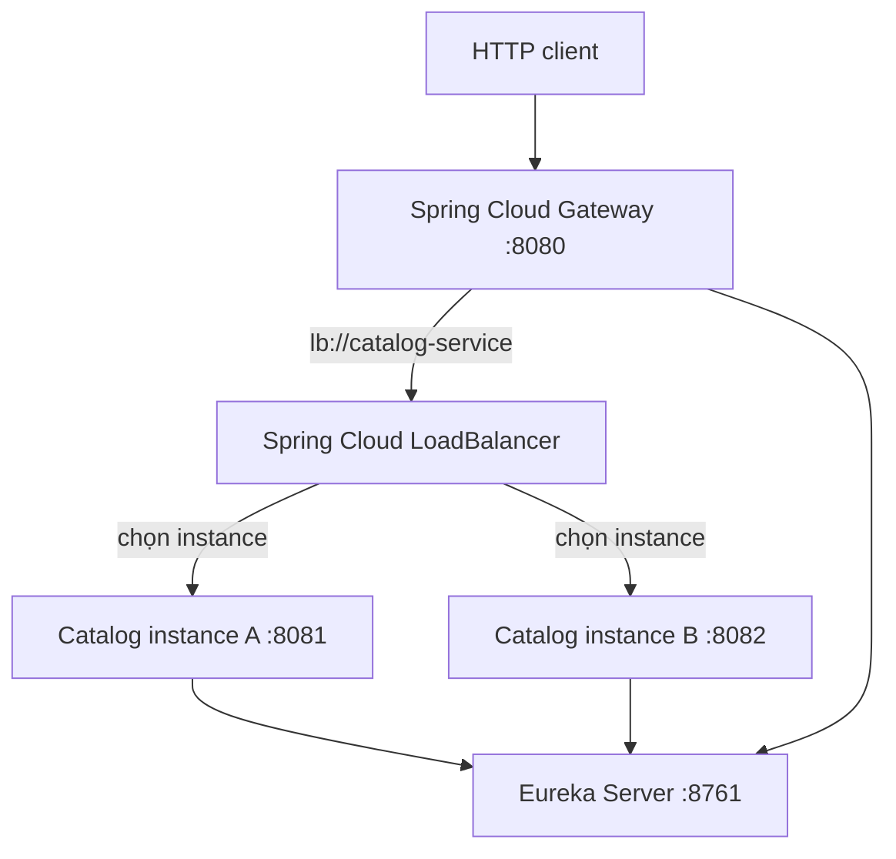

# Thực hành tích hợp service discovery và cân bằng tải nhiều instance

Trong bài thực hành này, bạn sẽ dựng một Eureka Server, chạy hai instance của cùng một service và cấu hình Spring Cloud Gateway định tuyến đến service bằng tên logic. Gateway không biết trước địa chỉ hoặc port của từng instance; nó lấy danh sách instance từ service discovery rồi dùng Spring Cloud LoadBalancer để chọn một instance cho mỗi request.

Kết quả cần đạt được:

- Hai instance `catalog-service` đăng ký vào Eureka với định danh riêng.
- Gateway nhận diện service bằng `lb://catalog-service`.
- Request đi qua Gateway được phân phối đến nhiều instance.
- Khi một instance dừng, Gateway tiếp tục phục vụ qua instance còn lại sau khi registry và danh sách instance được cập nhật.
- Có thể kiểm tra route, instance được chọn và các lỗi cấu hình thường gặp.

Ta dùng Eureka để minh họa. Có thể thay Eureka bằng Consul hoặc một registry khác nếu dự án đã chọn nền tảng đó; nguyên tắc ở Gateway vẫn là route tới service ID qua Spring Cloud LoadBalancer.

## 1. Kiến trúc và luồng request

Tạo ba ứng dụng Spring Boot độc lập: `discovery-server`, `catalog-service` và `api-gateway`. Trong bài lab, hai tiến trình `catalog-service` chạy cùng một máy nhưng dùng hai port khác nhau.



Eureka lưu thông tin instance như service ID, hostname/IP, port và trạng thái đăng ký. Gateway lấy danh sách instance qua Eureka client. Spring Cloud LoadBalancer chọn một instance trong danh sách đó; với cấu hình mặc định phổ biến, thuật toán chọn là round robin.

Điểm quan trọng là URI `lb://catalog-service` có ý nghĩa khác với `http://localhost:8081`. URI `lb://` yêu cầu Gateway phân giải service ID và chọn instance. URI cố định `http://localhost:8081` luôn gọi một địa chỉ, do đó bỏ qua service discovery và không cân bằng tải giữa hai instance.

## 2. Chuẩn bị project và dependency

Tạo ba project Spring Boot riêng hoặc ba module trong một build. Dùng Spring Cloud BOM/release train tương thích với phiên bản Spring Boot của dự án. Không tự chọn version độc lập cho từng starter; hãy để BOM quản lý các dependency Spring Cloud.

Các dependency chính:

| Ứng dụng | Dependency cần có |
|---|---|
| `discovery-server` | `spring-cloud-starter-netflix-eureka-server`, `spring-boot-starter-actuator` |
| `catalog-service` | `spring-boot-starter-web`, `spring-cloud-starter-netflix-eureka-client`, `spring-boot-starter-actuator` |
| `api-gateway` | Starter Spring Cloud Gateway Server WebFlux phù hợp release train, `spring-cloud-starter-netflix-eureka-client`, `spring-cloud-starter-loadbalancer`, `spring-boot-starter-actuator` |

Ví dụ khai báo dependency Gradle (các tên starter có thể thay đổi theo dòng Spring Cloud; giữ tên artifact phù hợp với BOM của dự án):

```groovy
dependencies {
    implementation 'org.springframework.cloud:spring-cloud-starter-netflix-eureka-client'
    implementation 'org.springframework.boot:spring-boot-starter-actuator'
}
```

Trong `discovery-server`, thay dependency Eureka client ở trên bằng `spring-cloud-starter-netflix-eureka-server`. Trong `catalog-service`, thêm `spring-boot-starter-web`. Trong `api-gateway`, thêm Gateway Server WebFlux starter và `spring-cloud-starter-loadbalancer`. Nếu dùng Maven, khai báo các artifact tương ứng trong `pom.xml` và import Spring Cloud BOM ở `dependencyManagement`.

Đảm bảo Gateway đang dùng WebFlux nếu chọn starter Gateway Server WebFlux. Không trộn starter MVC và WebFlux trong cùng ứng dụng Gateway trừ khi kiến trúc và phiên bản hỗ trợ rõ ràng.

## 3. Dựng Eureka Server

Trong project `discovery-server`, bật Eureka Server:

```java
import org.springframework.boot.SpringApplication;
import org.springframework.boot.autoconfigure.SpringBootApplication;
import org.springframework.cloud.netflix.eureka.server.EnableEurekaServer;

@SpringBootApplication
@EnableEurekaServer
public class DiscoveryServerApplication {
    public static void main(String[] args) {
        SpringApplication.run(DiscoveryServerApplication.class, args);
    }
}
```

Cấu hình `src/main/resources/application.yml`:

```yaml
server:
  port: 8761

spring:
  application:
    name: discovery-server

eureka:
  client:
    register-with-eureka: false
    fetch-registry: false
    service-url:
      defaultZone: http://localhost:8761/eureka/

management:
  endpoints:
    web:
      exposure:
        include: health,info
```

Hai thuộc tính `register-with-eureka: false` và `fetch-registry: false` giúp server standalone không tự đăng ký và truy vấn registry của chính nó. Với môi trường production có nhiều Eureka Server, topology peer replication cần cấu hình riêng; bài lab này chỉ dùng một node để dễ quan sát.

Chạy ứng dụng và mở `http://localhost:8761`. Trang Eureka hiển thị registry và các instance đã đăng ký. Khi mới khởi động server, danh sách application có thể đang trống; điều này bình thường trước khi client đăng ký.

## 4. Tạo catalog service có thể chạy nhiều instance

Trong project `catalog-service`, tạo ứng dụng Spring Boot:

```java
import org.springframework.boot.SpringApplication;
import org.springframework.boot.autoconfigure.SpringBootApplication;

@SpringBootApplication
public class CatalogServiceApplication {
    public static void main(String[] args) {
        SpringApplication.run(CatalogServiceApplication.class, args);
    }
}
```

Tạo controller trả về định danh instance để ta quan sát được Gateway đã gọi tiến trình nào:

```java
import java.util.Map;

import org.springframework.beans.factory.annotation.Value;
import org.springframework.web.bind.annotation.GetMapping;
import org.springframework.web.bind.annotation.RequestMapping;
import org.springframework.web.bind.annotation.RestController;

@RestController
@RequestMapping("/api/catalog")
public class CatalogController {

    @Value("${spring.application.name}")
    private String serviceName;

    @Value("${server.port}")
    private String port;

    @GetMapping("/instance")
    public Map<String, String> instance() {
        return Map.of(
            "service", serviceName,
            "port", port,
            "instance", serviceName + ":" + port
        );
    }
}
```

Cấu hình `application.yml` của catalog service:

```yaml
server:
  port: ${SERVER_PORT:8081}

spring:
  application:
    name: catalog-service

eureka:
  client:
    service-url:
      defaultZone: ${EUREKA_SERVER_URL:http://localhost:8761/eureka/}
  instance:
    instance-id: ${spring.application.name}:${server.port}
    prefer-ip-address: true

management:
  endpoints:
    web:
      exposure:
        include: health,info
```

Cả hai tiến trình có cùng `spring.application.name` là `catalog-service`, vì chúng đại diện cho cùng một service logic. `instance-id` lại khác nhau do port khác nhau, tránh hai tiến trình trên cùng host đăng ký trùng định danh. Biến môi trường `SERVER_PORT` cho phép đổi port mà không phải sửa file cấu hình.

Controller dùng `Map.of`, vì vậy ví dụ yêu cầu Java 9 trở lên. Với dự án Java cũ hơn, thay bằng DTO hoặc `HashMap`.

## 5. Chạy hai instance của catalog service

Khởi động Eureka Server trước. Sau đó build catalog service và chạy cùng một artifact hai lần. Ví dụ với file JAR đã build:

Trên PowerShell, mở hai terminal riêng:

```powershell
# Terminal 1
$env:SERVER_PORT = "8081"
java -jar .\build\libs\catalog-service.jar
```

```powershell
# Terminal 2
$env:SERVER_PORT = "8082"
java -jar .\build\libs\catalog-service.jar
```

Trên Bash, mở hai terminal riêng:

```bash
SERVER_PORT=8081 java -jar build/libs/catalog-service.jar
```

```bash
SERVER_PORT=8082 java -jar build/libs/catalog-service.jar
```

Nếu dùng Maven, thay đường dẫn JAR theo thư mục `target`. Nếu dùng Gradle multi-module, build đúng module catalog service. Không chạy cả hai tiến trình với cùng port; hệ điều hành sẽ từ chối bind port thứ hai.

Đợi hai instance đăng ký vào Eureka. Trên dashboard, application `CATALOG-SERVICE` cần hiển thị hai instance với port `8081` và `8082`. Có thể kiểm tra trực tiếp từng instance:

```bash
curl http://localhost:8081/api/catalog/instance
curl http://localhost:8082/api/catalog/instance
```

Kết quả cần cho thấy cùng service name nhưng instance/port khác nhau. Nếu chỉ thấy một instance trong Eureka, hãy xử lý bước đăng ký trước khi cấu hình Gateway.

## 6. Cấu hình Gateway dùng service ID

Trong project `api-gateway`, tạo ứng dụng:

```java
import org.springframework.boot.SpringApplication;
import org.springframework.boot.autoconfigure.SpringBootApplication;

@SpringBootApplication
public class ApiGatewayApplication {
    public static void main(String[] args) {
        SpringApplication.run(ApiGatewayApplication.class, args);
    }
}
```

Gateway không cần `@EnableEurekaClient` trong cấu hình Spring Cloud hiện đại; việc thêm Eureka client starter kích hoạt cơ chế auto-configuration. Nếu dự án dùng phiên bản cũ có yêu cầu annotation riêng, hãy theo tài liệu của release train tương ứng.

Cấu hình `application.yml`:

```yaml
server:
  port: 8080

spring:
  application:
    name: api-gateway
  cloud:
    gateway:
      discovery:
        locator:
          enabled: false
      routes:
        - id: catalog-route
          uri: lb://catalog-service
          predicates:
            - Path=/catalog/**
          filters:
            - StripPrefix=1

eureka:
  client:
    service-url:
      defaultZone: ${EUREKA_SERVER_URL:http://localhost:8761/eureka/}
  instance:
    instance-id: ${spring.application.name}:${server.port}
    prefer-ip-address: true

management:
  endpoints:
    web:
      exposure:
        include: health,info,metrics
```

Giải thích cấu hình:

- `uri: lb://catalog-service` yêu cầu Spring Cloud LoadBalancer chọn một instance từ danh sách do discovery client cung cấp.
- `Path=/catalog/**` chỉ route request có prefix `/catalog/`.
- `StripPrefix=1` bỏ segment đầu tiên trước khi chuyển tiếp. Request `/catalog/api/catalog/instance` đến backend dưới dạng `/api/catalog/instance`.
- `discovery.locator.enabled: false` giữ route tự khai báo là nguồn định tuyến duy nhất trong bài lab. Điều này không tắt Eureka client hoặc `lb://`; nó chỉ tắt việc tự sinh route cho mọi service được phát hiện.

`spring-cloud-starter-loadbalancer` phải có trên classpath để dùng `lb://`. Nếu chỉ khai báo Eureka client nhưng thiếu load balancer, route có thể không phân giải được scheme `lb`.

## 7. Gửi request qua Gateway và quan sát cân bằng tải

Khởi động Gateway sau khi Eureka và hai catalog instance đã sẵn sàng. Gửi request qua một địa chỉ duy nhất:

```bash
curl http://localhost:8080/catalog/api/catalog/instance
```

Request đi qua Gateway, bỏ prefix `/catalog`, rồi được gửi đến một trong hai catalog instance. Gửi lặp nhiều lần để quan sát lựa chọn instance:

```bash
for i in $(seq 1 12); do
  curl -s http://localhost:8080/catalog/api/catalog/instance
  echo
done
```

PowerShell:

```powershell
1..12 | ForEach-Object {
    $result = Invoke-RestMethod "http://localhost:8080/catalog/api/catalog/instance"
    "{0,2}: {1}" -f $_, $result.instance
}
```

Kết quả mong đợi là cả `catalog-service:8081` và `catalog-service:8082` đều xuất hiện trong các response. Không yêu cầu số lần gọi đến hai instance phải bằng nhau tuyệt đối trong một mẫu nhỏ. Danh sách instance có thể được cache và làm mới theo chu kỳ; request lỗi, instance vừa đăng ký hoặc thuật toán chọn instance cũng ảnh hưởng phân bố trong khoảng quan sát ngắn.

Để chứng minh request thật sự đi qua Gateway, chỉ gọi URL port `8080` trong bước kiểm tra này. Gọi trực tiếp port `8081` hoặc `8082` chỉ kiểm tra từng backend, không kiểm tra route và load balancing của Gateway.

## 8. Thử nghiệm khi một instance dừng

Trong khi hai instance đang phục vụ, dừng tiến trình chạy port `8081` bằng cách đóng terminal hoặc gửi tín hiệu dừng bình thường. Sau đó tiếp tục gọi Gateway:

```bash
for i in $(seq 1 10); do
  curl -sS http://localhost:8080/catalog/api/catalog/instance
  echo
done
```

Sau khi Eureka loại instance đã dừng khỏi registry và Gateway làm mới danh sách instance, request mới cần tiếp tục đến `catalog-service:8082`. Khi khởi động lại tiến trình port `8081`, chờ nó đăng ký lại rồi kiểm tra phân phối giữa hai instance.

Không giả định việc dừng process sẽ làm mọi client biết ngay instance đã biến mất. Eureka dùng heartbeat, lease và cơ chế eviction; client cũng có cache danh sách instance. Thời gian hội tụ phụ thuộc cấu hình và trạng thái registry. Trong khoảng chuyển tiếp, request có thể gặp lỗi kết nối tới instance vừa dừng. Với production, cần chọn timeout, retry và health policy phù hợp, đồng thời tránh retry request ghi dữ liệu nếu không có bảo đảm idempotency.

Thử thêm các tình huống:

1. Khởi động lại một instance với port cũ và quan sát đăng ký lại.
2. Dừng cả hai instance rồi gửi request; Gateway thường trả lỗi upstream như `503 Service Unavailable` khi không còn instance khả dụng. Ghi nhận response thực tế theo phiên bản và error handler của ứng dụng.
3. Khởi động lại Eureka Server trong môi trường lab và quan sát hành vi client khi registry tạm thời không truy cập được. Client có thể giữ cache hiện tại trong một khoảng thời gian; không xem đây là bảo đảm cho mọi cấu hình production.

## 9. Bật discovery locator để khám phá route tự động (tùy chọn)

Route khai báo tường minh ở trên thường dễ kiểm soát hơn vì chỉ expose endpoint đã chọn. Gateway cũng có thể sinh route từ service ID trong registry bằng Discovery Locator. Khi bật tính năng này, kiểm tra kỹ quy tắc path, filter rewrite và quyền truy cập; service đăng ký trong Eureka có thể trở thành đích được truy cập qua Gateway.

Ở các phiên bản hỗ trợ cấu hình này, bật:

```yaml
spring:
  cloud:
    gateway:
      discovery:
        locator:
          enabled: true
          lower-case-service-id: true
```

Discovery Locator mặc định tạo route theo service ID và path convention của phiên bản Gateway. Ví dụ service `catalog-service` có thể được truy cập qua prefix tương ứng với service ID, sau đó Gateway bỏ prefix trước khi chuyển request đến service. Hãy kiểm tra route được sinh ra qua Gateway Actuator hoặc log định tuyến thay vì giả định URL từ tên service.

Không bật locator rộng rãi chỉ để tránh khai báo route. Trong production, hãy kiểm soát service nào được expose, áp dụng authentication/authorization, giới hạn path và bảo vệ các endpoint nội bộ. Nếu chỉ cần một số service, route tường minh thường giúp review và kiểm soát bề mặt truy cập tốt hơn.

Sau khi thử discovery locator, tắt lại nếu bài lab tiếp tục dùng route tường minh để tránh hai cơ chế cùng tạo route có thể khớp request.

## 10. Kiểm tra quan sát và vận hành

### Actuator và log

Trong môi trường lab, có thể kiểm tra health của Gateway:

```bash
curl http://localhost:8080/actuator/health
```

Nếu đã expose Gateway metrics, xem danh sách metric qua endpoint Actuator được cấu hình và bảo vệ. Tên metric Gateway thường gặp là `spring.cloud.gateway.requests`, nhưng metric/tag cụ thể phụ thuộc phiên bản và registry. Dùng route ID, status và thông tin track ở tầng quan sát để so sánh request.

Trong log, nên ghi các trường phục vụ chẩn đoán như correlation ID, route ID, service ID và thời gian xử lý. Tránh ghi access token, cookie, toàn bộ header hoặc body nhạy cảm. Không dùng URL đầy đủ có query string chứa dữ liệu người dùng làm nhãn metric vì có thể làm tăng cardinality và lộ thông tin.

### Các lỗi thường gặp

| Triệu chứng | Nguyên nhân có thể | Cách kiểm tra và xử lý |
|---|---|---|
| Eureka không hiển thị `CATALOG-SERVICE` | Thiếu Eureka client dependency, sai URL registry, network hoặc ứng dụng chưa khởi động xong | Kiểm tra log client, `defaultZone`, port `8761` và kết nối tới `/eureka/` |
| Chỉ thấy một catalog instance | Hai process dùng cùng port hoặc trùng `instance-id`; một process chưa đăng ký | Kiểm tra port, `server.port`, `eureka.instance.instance-id` và dashboard |
| Gateway trả `503` hoặc không phân giải được `lb` | Thiếu Spring Cloud LoadBalancer, không có instance khả dụng hoặc registry chưa đồng bộ | Kiểm tra dependency load balancer, danh sách instance và log route |
| Gateway trả `404` | Predicate không khớp hoặc path sau `StripPrefix` không đúng với controller | Kiểm tra URL `/catalog/api/catalog/instance`, route ID và path backend nhận |
| Request luôn đến một instance | Chỉ một instance đang healthy/đăng ký, cache chưa cập nhật hoặc đang gọi nhầm URL trực tiếp | Kiểm tra Eureka, gửi nhiều request đến port Gateway và chờ registry hội tụ |
| Port thứ hai không khởi động | Port đã được tiến trình khác sử dụng | Đổi `SERVER_PORT` và bảo đảm instance ID dùng port mới |
| Request lỗi ngay sau khi dừng instance | Eureka và LoadBalancer chưa cập nhật danh sách | Chờ heartbeat/eviction/cache refresh; kiểm tra graceful shutdown và timeout |
| Gateway khởi động nhưng route không hoạt động | Cấu hình Gateway MVC/WebFlux hoặc starter không tương thích | Kiểm tra BOM, starter, log auto-configuration và loại server đang dùng |

## 11. Bài tập mở rộng

Sau khi hoàn thành luồng cơ bản, thực hiện các bài tập sau:

1. **Thêm instance thứ ba:** chạy `catalog-service` ở port `8083`, đặt instance ID duy nhất và xác minh cả ba instance nhận request.
2. **Thêm route thứ hai:** tạo `inventory-service` và route `lb://inventory-service`; kiểm tra hai service không dùng nhầm service ID.
3. **Thử path rewrite:** thay `StripPrefix=1` bằng `RewritePath` phù hợp và chứng minh backend nhận đúng path.
4. **Bật health check:** expose actuator health ở backend và quan sát trạng thái instance trong registry. Phân biệt trạng thái health của ứng dụng với trạng thái đăng ký của Eureka.
5. **Thử weight backend:** tạo hai service ID cho phiên bản catalog v1/v2 và dùng `Weight` predicate để phân phối một phần request đến v2. Ghi lại tỷ lệ quan sát được sau một mẫu đủ lớn.
6. **Thêm bảo vệ route:** yêu cầu xác thực ở Gateway và xác minh header xác thực được chuyển tiếp đúng chính sách.
7. **Đo độ trễ:** gửi tải đồng đều, so sánh p50/p95/p99 và CPU của từng instance; kiểm tra có instance nào bị quá tải hoặc không nhận request.

## 12. Checklist hoàn thành bài lab

- [ ] Eureka Server chạy ở port `8761` và hiển thị registry.
- [ ] Hai catalog process dùng cùng service ID nhưng có port và instance ID khác nhau.
- [ ] Gateway đăng ký vào Eureka và chạy ở port `8080`.
- [ ] Route dùng `lb://catalog-service`, không dùng URI cố định đến một backend.
- [ ] `StripPrefix` đưa path đến đúng controller của catalog service.
- [ ] Request lặp qua Gateway nhận response từ cả hai instance.
- [ ] Khi dừng một instance, request mới tiếp tục đến instance còn lại sau khi registry/cache hội tụ.
- [ ] Khi instance khởi động lại, nó đăng ký lại với định danh đúng.
- [ ] Đã kiểm tra trường hợp không có instance và ghi nhận response lỗi.
- [ ] Đã xem log/health/metrics cần thiết và không ghi dữ liệu xác thực nhạy cảm.

Hoàn thành bài lab khi bạn giải thích được đường đi từ route predicate đến service ID, cách Eureka cung cấp danh sách instance, cách LoadBalancer chọn backend và độ trễ hội tụ khi instance thay đổi trạng thái. Đây là nền tảng để mở rộng Gateway sang nhiều service, nhiều môi trường và triển khai service discovery an toàn trong production.
