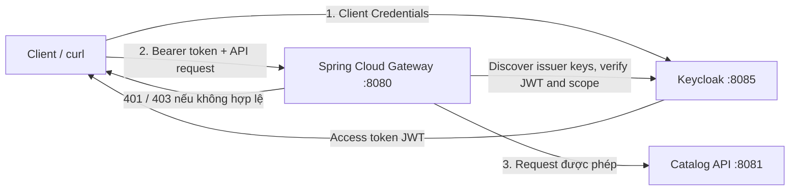

# Bảo vệ API bằng JWT và kiểm chứng quyền theo scope

Trong bài thực hành này, Spring Cloud Gateway xác minh access token dạng JWT do một Identity Provider phát hành, sau đó kiểm tra scope trước khi chuyển request đến dịch vụ phía sau. Bạn sẽ dựng Keycloak local làm nơi cấp token, một Catalog API làm backend và Gateway WebFlux làm OAuth2 Resource Server. Kết quả cần quan sát được là request không có token bị từ chối với `401`, token hợp lệ nhưng thiếu quyền bị từ chối với `403`, còn token có đúng scope được phép đi qua.

Mô hình tập trung vào xác thực máy-với-máy bằng OAuth 2.0 Client Credentials để việc thử nghiệm có thể lặp lại. Với người dùng đăng nhập qua trình duyệt, hãy dùng Authorization Code với PKCE và giữ nguyên nguyên tắc xác minh issuer, chữ ký, thời hạn và quyền của token.

## 1. Mục tiêu và kiến trúc

Sau bài thực hành, bạn sẽ có thể:

- Cấu hình Gateway làm OAuth2 Resource Server và lấy khóa công khai từ JWKS endpoint của issuer.
- Ánh xạ scope trong claim JWT thành authority theo quy ước `SCOPE_` của Spring Security.
- Bảo vệ `GET` bằng `catalog.read` và `POST` bằng `catalog.write`.
- Phân biệt lỗi chưa xác thực (`401`) với đã xác thực nhưng không đủ quyền (`403`).
- Kiểm tra rằng token hết hạn, token sai chữ ký hoặc token do issuer khác phát hành không được chấp nhận.



Gateway kiểm tra token trước khi route request. `catalog.read` và `catalog.write` là hai quyền độc lập. Một token có `catalog.read` có thể đọc danh mục nhưng không được tạo bản ghi mới.

## 2. Khởi chạy Keycloak local

Tạo file `compose.yaml` cho môi trường thực hành:

```yaml
services:
  keycloak:
    image: quay.io/keycloak/keycloak:26.3.3
    command: ["start-dev", "--http-port=8085"]
    environment:
      KC_BOOTSTRAP_ADMIN_USERNAME: admin
      KC_BOOTSTRAP_ADMIN_PASSWORD: admin
    ports:
      - "8085:8085"
```

Khởi chạy:

```bash
docker compose up -d
```

Mở `http://localhost:8085`, đăng nhập trang quản trị bằng tài khoản lab `admin` / `admin`. Đây là thông tin minh họa chỉ dùng local; không dùng mật khẩu này trong môi trường thật. Dừng môi trường sau khi thực hành bằng `docker compose down`.

### Tạo realm, client và scope

Trong Keycloak Admin Console, thực hiện các bước sau:

1. Tạo realm tên `gateway-lab` và chuyển sang realm này.
2. Tạo client `gateway-lab-client`, protocol OpenID Connect.
3. Bật **Client authentication** và **Service accounts roles**; tắt Standard flow cho client lab chỉ dùng Client Credentials.
4. Lưu cấu hình và mở tab **Credentials** để lấy client secret.
5. Vào **Client scopes**, tạo hai scope OpenID Connect có tên `catalog.read` và `catalog.write`.
6. Với từng scope, bật tùy chọn đưa scope vào token (nếu giao diện phiên bản đang dùng hiển thị), sau đó thêm cả hai vào client `gateway-lab-client` dưới dạng **Optional client scopes**.
7. Lưu lại cấu hình client.

Khi gọi token endpoint, client sẽ yêu cầu scope tùy chọn bằng tham số `scope`. Hãy kiểm tra trường `scope` trong token hoặc response token endpoint để chắc chắn chỉ quyền đã yêu cầu được cấp. Nếu Keycloak không đưa scope vào token, kiểm tra lại client scope, tùy chọn include-in-token-scope và cách gắn scope vào client.

Đặt các biến môi trường trong terminal dùng để gọi API. Ví dụ Bash hoặc Git Bash:

```bash
export CLIENT_ID='gateway-lab-client'
export CLIENT_SECRET='PASTE_LAB_CLIENT_SECRET_HERE'
```

Không commit client secret vào Git hoặc ghi nó vào file cấu hình Gateway. Trong production, lưu secret trong secret manager hoặc cơ chế quản lý bí mật của nền tảng triển khai.

## 3. Tạo Catalog API làm backend

Tạo một Spring Boot project tên `catalog-service`, dùng Spring Web MVC. Dependency cần có:

```xml
<dependency>
    <groupId>org.springframework.boot</groupId>
    <artifactId>spring-boot-starter-web</artifactId>
</dependency>
```

Tạo controller cung cấp một API đọc và một API ghi:

```java
import java.util.List;
import java.util.Map;

import org.springframework.http.HttpStatus;
import org.springframework.http.ResponseEntity;
import org.springframework.web.bind.annotation.GetMapping;
import org.springframework.web.bind.annotation.PostMapping;
import org.springframework.web.bind.annotation.RequestBody;
import org.springframework.web.bind.annotation.RequestMapping;
import org.springframework.web.bind.annotation.RestController;

@RestController
@RequestMapping("/items")
public class CatalogController {

    @GetMapping
    public Map<String, Object> listItems() {
        return Map.of(
                "items", List.of("gateway", "jwt", "scope"),
                "operation", "read");
    }

    @PostMapping
    public ResponseEntity<Map<String, Object>> createItem(
            @RequestBody Map<String, String> request) {
        return ResponseEntity.status(HttpStatus.CREATED).body(Map.of(
                "created", true,
                "name", request.getOrDefault("name", "unnamed"),
                "operation", "write"));
    }
}
```

Trong `application.yml` của Catalog Service:

```yaml
server:
  address: 127.0.0.1
  port: 8081

spring:
  application:
    name: catalog-service
```

Binding vào loopback giúp backend chỉ nhận kết nối từ cùng máy trong bài lab local. Nếu Gateway và backend chạy ở hai container hoặc hai máy, thay địa chỉ bind và URI đích bằng địa chỉ mạng riêng có thể truy cập giữa hai workload; đồng thời giới hạn network policy để client bên ngoài không gọi trực tiếp backend.

Khởi động backend:

```bash
mvn spring-boot:run
```

Kiểm tra trực tiếp backend trong terminal khác:

```bash
curl -i http://localhost:8081/items
```

API cần trả `200 OK` và danh sách item. Trong bài lab, backend chưa tự xác minh JWT; cổng `127.0.0.1` giới hạn truy cập trực tiếp ở máy local để tập trung kiểm tra chính sách tại Gateway. Trong production, nên bảo vệ cả đường mạng đến backend và cân nhắc để từng service tự xác minh token hoặc danh tính workload, tránh phụ thuộc duy nhất vào một lớp kiểm soát ở Gateway.

## 4. Tạo Gateway và cấu hình xác minh JWT

Tạo project `edge-gateway` dùng Spring Cloud Gateway Server WebFlux. Ví dụ cụ thể dưới đây dùng Spring Boot 3.x và Spring Cloud Gateway 4.x. Dependency chính:

```xml
<dependency>
    <groupId>org.springframework.cloud</groupId>
    <artifactId>spring-cloud-starter-gateway</artifactId>
</dependency>
<dependency>
    <groupId>org.springframework.boot</groupId>
    <artifactId>spring-boot-starter-oauth2-resource-server</artifactId>
</dependency>
```

Import Spring Cloud BOM tương thích với Spring Boot đang dùng để quản lý version Gateway. Không ép một version Spring Security riêng nếu release train đã quản lý version tương thích.

Tạo lớp khởi động:

```java
import org.springframework.boot.SpringApplication;
import org.springframework.boot.autoconfigure.SpringBootApplication;

@SpringBootApplication
public class EdgeGatewayApplication {
    public static void main(String[] args) {
        SpringApplication.run(EdgeGatewayApplication.class, args);
    }
}
```

Trong `application.yml` của Gateway:

```yaml
server:
  port: 8080

spring:
  application:
    name: edge-gateway
  security:
    oauth2:
      resourceserver:
        jwt:
          issuer-uri: http://localhost:8085/realms/gateway-lab
  cloud:
    gateway:
      routes:
        - id: catalog-api
          uri: http://localhost:8081
          predicates:
            - Path=/api/catalog/**
          filters:
            - StripPrefix=2
```

`issuer-uri` phải trùng chính xác giá trị `iss` trong access token. Spring Security dùng metadata của issuer để tìm JWKS endpoint và lấy khóa xác minh chữ ký JWT. Khi khóa được xoay vòng, resource server có thể lấy metadata khóa mới theo cơ chế của thư viện. Gateway cũng kiểm tra các claim thời gian như `exp` và `nbf` khi có trong token.

Route chỉ định backend `http://localhost:8081`. `Path=/api/catalog/**` chọn request công khai ở Gateway; `StripPrefix=2` chuyển `/api/catalog/items` thành `/items` trước khi gửi đến Catalog Service.

Với Spring Cloud Gateway 5.x Server WebFlux, dùng starter `spring-cloud-starter-gateway-server-webflux` và chuyển phần route sang prefix mới:

```yaml
spring:
  cloud:
    gateway:
      server:
        webflux:
          routes:
            - id: catalog-api
              uri: http://localhost:8081
              predicates:
                - Path=/api/catalog/**
              filters:
                - StripPrefix=2
```

Các cấu hình `server.port`, `spring.application.name` và `spring.security.oauth2.resourceserver.jwt.issuer-uri` vẫn ở cấp tương ứng như ví dụ. Chỉ dùng một namespace route phù hợp với major version đang chạy.

## 5. Khai báo quyền theo scope trong SecurityWebFilterChain

Tạo `GatewaySecurityConfiguration`:

```java
import org.springframework.context.annotation.Bean;
import org.springframework.context.annotation.Configuration;
import org.springframework.http.HttpMethod;
import org.springframework.security.config.Customizer;
import org.springframework.security.config.web.server.ServerHttpSecurity;
import org.springframework.security.web.server.SecurityWebFilterChain;

@Configuration
public class GatewaySecurityConfiguration {

    @Bean
    SecurityWebFilterChain gatewaySecurity(ServerHttpSecurity http) {
        return http
                .csrf(ServerHttpSecurity.CsrfSpec::disable)
                .authorizeExchange(exchanges -> exchanges
                        .pathMatchers(HttpMethod.GET, "/api/catalog/**")
                            .hasAuthority("SCOPE_catalog.read")
                        .pathMatchers(HttpMethod.POST, "/api/catalog/**")
                            .hasAuthority("SCOPE_catalog.write")
                        .anyExchange().denyAll())
                .oauth2ResourceServer(oauth2 -> oauth2
                        .jwt(Customizer.withDefaults()))
                .build();
    }
}
```

Spring Security mặc định đọc claim `scope` hoặc `scp` trong JWT và chuyển từng scope thành authority có prefix `SCOPE_`. Vì vậy:

| Claim scope trong access token | Authority được Spring tạo |
|---|---|
| `catalog.read` | `SCOPE_catalog.read` |
| `catalog.write` | `SCOPE_catalog.write` |
| `catalog.read catalog.write` | Cả hai authority trên |

`hasAuthority` so sánh chính xác authority. Token có `catalog.read` không thỏa điều kiện `SCOPE_catalog.write`. Nếu Identity Provider dùng claim khác, chẳng hạn `realm_access.roles`, cần viết `Converter<Jwt, Mono<AbstractAuthenticationToken>>` hoặc cấu hình converter phù hợp; không giả định Spring tự ánh xạ mọi claim riêng của nhà cung cấp.

CSRF được tắt trong ví dụ vì API lab xác thực bằng bearer token gửi trong header, không dựa vào cookie phiên trình duyệt. Nếu hệ thống dùng cookie hoặc session để xác thực, phải đánh giá và cấu hình CSRF protection thay vì sao chép cấu hình này. CORS là chính sách riêng và không thay thế kiểm tra token hoặc scope.

Khởi động Gateway:

```bash
mvn spring-boot:run
```

## 6. Lấy access token với các scope khác nhau

Keycloak cung cấp token endpoint theo realm. Client Credentials yêu cầu client đã bật Client authentication và Service accounts. Dùng secret đã lấy ở phần 2 để yêu cầu token chỉ có quyền đọc:

```bash
READ_TOKEN=$(curl -sS \
  -u "$CLIENT_ID:$CLIENT_SECRET" \
  -d 'grant_type=client_credentials' \
  --data-urlencode 'scope=catalog.read' \
  http://localhost:8085/realms/gateway-lab/protocol/openid-connect/token \
  | jq -r '.access_token')
```

Yêu cầu token chỉ có quyền ghi:

```bash
WRITE_TOKEN=$(curl -sS \
  -u "$CLIENT_ID:$CLIENT_SECRET" \
  -d 'grant_type=client_credentials' \
  --data-urlencode 'scope=catalog.write' \
  http://localhost:8085/realms/gateway-lab/protocol/openid-connect/token \
  | jq -r '.access_token')
```

Yêu cầu token có cả hai quyền:

```bash
FULL_TOKEN=$(curl -sS \
  -u "$CLIENT_ID:$CLIENT_SECRET" \
  -d 'grant_type=client_credentials' \
  --data-urlencode 'scope=catalog.read catalog.write' \
  http://localhost:8085/realms/gateway-lab/protocol/openid-connect/token \
  | jq -r '.access_token')
```

Nếu lệnh trả về `null`, kiểm tra response lỗi của Keycloak, client secret, service account và optional client scopes. Có thể xem scope được cấp bằng cách đọc trường `scope` trong response token endpoint. Không gửi access token production vào website giải mã JWT công cộng; chỉ kiểm tra token lab trong công cụ local nếu cần xem payload.

## 7. Kiểm chứng 401, 403 và request được phép

### Không gửi token: phải nhận 401

```bash
curl -i http://localhost:8080/api/catalog/items
```

Gateway không có danh tính xác thực cho request nên trả `401 Unauthorized`. Request chưa được chuyển đến Catalog Service.

### Token có `catalog.read`: GET thành công

```bash
curl -i \
  -H "Authorization: Bearer $READ_TOKEN" \
  http://localhost:8080/api/catalog/items
```

Kết quả mong đợi là `200 OK` cùng danh sách item từ backend.

### Token chỉ có `catalog.read`: POST bị từ chối

```bash
curl -i -X POST \
  -H "Authorization: Bearer $READ_TOKEN" \
  -H 'Content-Type: application/json' \
  -d '{"name":"new-item"}' \
  http://localhost:8080/api/catalog/items
```

Kết quả mong đợi là `403 Forbidden`. Token đã được xác minh nhưng không có authority `SCOPE_catalog.write`. Gateway từ chối trước khi gọi backend.

### Token có `catalog.write`: POST thành công

```bash
curl -i -X POST \
  -H "Authorization: Bearer $WRITE_TOKEN" \
  -H 'Content-Type: application/json' \
  -d '{"name":"new-item"}' \
  http://localhost:8080/api/catalog/items
```

Kết quả mong đợi là `201 Created`. Backend trả JSON xác nhận thao tác ghi.

### Token có cả hai scope: cả GET và POST thành công

```bash
curl -i -H "Authorization: Bearer $FULL_TOKEN" \
  http://localhost:8080/api/catalog/items

curl -i -X POST \
  -H "Authorization: Bearer $FULL_TOKEN" \
  -H 'Content-Type: application/json' \
  -d '{"name":"another-item"}' \
  http://localhost:8080/api/catalog/items
```

Tổng hợp kết quả mong đợi:

| Request | Token | Kết quả |
|---|---|---:|
| GET `/api/catalog/items` | Không có | 401 |
| GET `/api/catalog/items` | `catalog.read` | 200 |
| POST `/api/catalog/items` | `catalog.read` | 403 |
| GET `/api/catalog/items` | `catalog.write` | 403 |
| POST `/api/catalog/items` | `catalog.write` | 201 |
| GET và POST | Cả hai scope | 200 và 201 |

Nếu nhận 401 với token vừa cấp, kiểm tra `issuer-uri`, claim `iss`, thời gian hệ thống và khả năng Gateway truy cập discovery/JWKS endpoint của Keycloak. Nếu nhận 403 ở request đáng lẽ được phép, kiểm tra claim `scope` thực tế và tên authority. Nếu nhận 404, kiểm tra route predicate, backend path và `StripPrefix=2`.

## 8. Kiểm tra token không hợp lệ và ranh giới tin cậy

Thử một số trường hợp tiêu cực để xác nhận Gateway đang xác minh chữ ký và claim:

- **Token bị sửa payload:** thay một ký tự trong JWT rồi gửi lại; Gateway phải trả 401 vì chữ ký không hợp lệ.
- **Token hết hạn:** dùng token hết hạn hoặc giảm thời gian sống token trong realm lab, đợi token hết hạn rồi gọi API; Gateway phải trả 401.
- **Sai issuer:** cấu hình tạm issuer URI khác hoặc cấp token từ realm khác; Gateway không được chấp nhận token đó.
- **Thiếu scope:** dùng token hợp lệ chỉ có scope còn lại; Gateway trả 403 cho phương thức không được cấp quyền.
- **Header giả danh:** gửi thêm `X-User: admin` hoặc `X-Roles: catalog.write` nhưng không có JWT; request vẫn phải bị từ chối. Không dùng header do client tự đặt làm bằng chứng xác thực.

Ví dụ header giả danh:

```bash
curl -i \
  -H 'X-User: admin' \
  -H 'X-Roles: catalog.write' \
  http://localhost:8080/api/catalog/items
```

Gateway chỉ dựa trên JWT đã được xác minh và authority được tạo từ claim đáng tin cậy. Nếu cần truyền thông tin người dùng đến backend, hãy định nghĩa hợp đồng rõ ràng, xóa header định danh do client gửi trước khi thêm header nội bộ, và giới hạn backend chỉ nhận traffic từ Gateway. Trong hệ thống yêu cầu bảo vệ nhiều lớp, backend cũng xác minh token hoặc danh tính workload thay vì tin một header `X-User`.

Trong bài lab, bearer token được gửi cùng request đến backend nếu Gateway không có filter loại bỏ `Authorization`. Backend hiện không xác minh token để tập trung vào chính sách ở Gateway. Production cần quyết định rõ service nào xác minh token, scope nào thuộc trách nhiệm Gateway và scope nào phải kiểm tra lại ở service đích. Không coi việc request qua Gateway đã được phép là lý do để mở backend trực tiếp ra Internet.

## 9. Chẩn đoán lỗi thường gặp

| Hiện tượng | Nguyên nhân có thể | Cách xử lý |
|---|---|---|
| Gateway không khởi động, không tải được issuer metadata | Keycloak chưa sẵn sàng, sai realm hoặc issuer URI | Kiểm tra `http://localhost:8085/realms/gateway-lab/.well-known/openid-configuration` và log Gateway |
| Mọi token đều trả 401 | Claim `iss` không trùng issuer, sai chữ ký, token hết hạn hoặc Gateway không truy cập được JWKS | So sánh issuer chính xác, kiểm tra thời gian hệ thống và JWKS endpoint |
| Token có scope nhưng trả 403 | Scope chưa xuất hiện trong claim, tên scope khác hoặc converter dùng claim khác | Kiểm tra optional client scope, include-in-token-scope và authority `SCOPE_` |
| Token read gọi GET thành công nhưng POST cũng thành công | Rule POST không được khai báo đúng hoặc một rule rộng hơn đã cho phép trước đó | Kiểm tra thứ tự matcher; đặt các matcher cụ thể trước và dùng `denyAll` cho phần còn lại |
| Gateway trả 404 | Path predicate không khớp hoặc backend nhận path sai | Kiểm tra `/api/catalog/items`, `StripPrefix=2` và `/items` ở backend |
| Gateway trả 503 | Catalog Service chưa chạy hoặc Gateway không kết nối được backend | Kiểm tra cổng 8081 và log kết nối |
| Token endpoint trả `invalid_scope` | Client chưa gắn optional scope hoặc tên scope sai | Gắn `catalog.read`/`catalog.write` vào client và kiểm tra lại tên |
| Token endpoint trả `unauthorized_client` | Client Credentials hoặc service account chưa bật | Bật Client authentication và Service accounts roles |

Không bật log mức DEBUG chứa toàn bộ token hoặc secret để chẩn đoán. Nếu cần tăng log cho Spring Security, chỉ dùng trong môi trường thử nghiệm, che dữ liệu nhạy cảm và tắt lại sau khi điều tra.

## 10. Tiêu chí hoàn thành và bài tập mở rộng

Đánh dấu hoàn thành khi đã xác nhận được:

- [ ] Keycloak local hoạt động và có realm `gateway-lab`.
- [ ] Client `gateway-lab-client` lấy được access token bằng Client Credentials.
- [ ] Token có thể được cấp riêng với `catalog.read`, `catalog.write` và cả hai scope.
- [ ] Gateway xác minh chữ ký, issuer và thời hạn token qua cấu hình resource server.
- [ ] GET chỉ được phép với token có `catalog.read`.
- [ ] POST chỉ được phép với token có `catalog.write`.
- [ ] Request thiếu token trả 401; token hợp lệ thiếu scope trả 403.
- [ ] Token giả mạo hoặc sai issuer bị từ chối.
- [ ] Header định danh do client tự gửi không thể thay thế JWT.

Bài tập mở rộng:

1. Thêm scope `catalog.delete` và endpoint `DELETE /api/catalog/items/{id}`; chỉ cấp quyền này cho client quản trị.
2. Thay Client Credentials bằng Authorization Code + PKCE cho một ứng dụng web; so sánh danh tính người dùng với danh tính workload.
3. Tạo `Converter<Jwt, Mono<AbstractAuthenticationToken>>` để ánh xạ claim riêng của Identity Provider thành authority Spring Security.
4. Bổ sung kiểm tra audience cho JWT để Gateway chỉ chấp nhận token được phát hành cho API dự kiến.
5. Thêm một SecurityWebFilterChain riêng cho `/actuator/**`, chỉ cho phép health check theo chính sách và yêu cầu scope vận hành cho endpoint quản trị.
6. Bật TLS cho đường truyền giữa client và Gateway; nếu dùng TLS giữa Gateway và backend, cấu hình truststore và xác minh chứng thư thay vì tắt kiểm tra hostname.

Kết quả cần nộp gồm cấu hình realm/client/scope (không kèm secret), cấu hình Gateway, mã Catalog API và bảng kết quả thử nghiệm 401/403/200/201 kèm giải thích quyền được cấp.

## Tài liệu tham khảo

- [Spring Security – Reactive OAuth 2.0 Resource Server JWT](https://docs.spring.io/spring-security/reference/reactive/oauth2/resource-server/jwt.html)
- [Spring Security – Reactive Authorization](https://docs.spring.io/spring-security/reference/reactive/authorization/authorize-exchanges.html)
- [Spring Cloud Gateway – Configuration](https://docs.spring.io/spring-cloud-gateway/reference/)
- [Keycloak Server Administration Guide](https://www.keycloak.org/docs/latest/server_admin/)
- [OAuth 2.0 – Client Credentials Grant (RFC 6749, Section 4.4)](https://www.rfc-editor.org/rfc/rfc6749#section-4.4)
