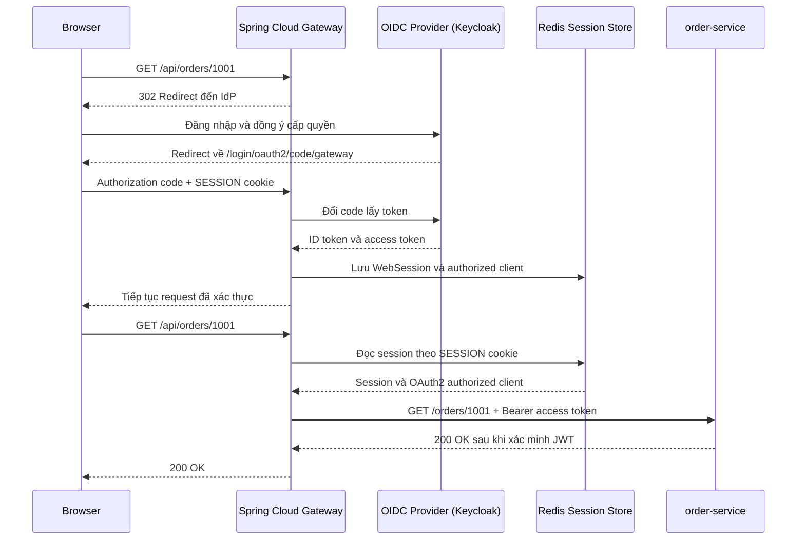

# Thực hành tổng hợp: Thiết lập đăng nhập OIDC, phiên dùng chung và TokenRelay

Bài thực hành này cấu hình Spring Cloud Gateway làm cổng vào có đăng nhập OpenID Connect (OIDC). Sau khi người dùng đăng nhập, Gateway lưu phiên và thông tin OAuth2 client ở Redis để nhiều instance Gateway cùng sử dụng. Filter `TokenRelay` chuyển tiếp access token đến microservice phía sau; microservice xác minh token như một OAuth2 Resource Server.

Bạn sẽ dùng Keycloak làm nhà cung cấp danh tính, Redis làm kho phiên và một `order-service` làm API được bảo vệ. Ví dụ tập trung vào luồng đăng nhập bằng trình duyệt và route GET để dễ kiểm chứng. Các phiên bản Spring Boot, Spring Cloud và Spring Session phải thuộc những dòng tương thích theo Spring Cloud release train của dự án.

## Kết quả cần đạt

Hoàn thành bài khi bạn có thể:

- Đăng nhập qua Gateway bằng Authorization Code Flow của OIDC.
- Giải thích vai trò của `issuer-uri`, client registration, redirect URI và scope `openid`.
- Lưu `WebSession` và OAuth2 authorized client trong Redis để hai instance Gateway dùng chung trạng thái đăng nhập.
- Cấu hình `TokenRelay` để chuyển tiếp access token đến downstream service.
- Bảo vệ downstream bằng JWT Resource Server và xác minh token được chuyển tiếp.
- Chẩn đoán lỗi redirect URI, lỗi xác thực token và lỗi chia sẻ session.

## 1. Kiến trúc thực hành



| Thành phần | Trách nhiệm |
|---|---|
| Browser | Khởi tạo request, thực hiện đăng nhập và giữ cookie session |
| Keycloak | Xác thực người dùng, phát authorization code và token |
| Spring Cloud Gateway | Bảo vệ route, duy trì OAuth2 login, relay access token |
| Redis | Lưu session dùng chung giữa các Gateway instance |
| `order-service` | Xác minh access token và xử lý API được bảo vệ |

Cookie trình duyệt chỉ mang mã session. Session và OAuth2 authorized client được lưu phía máy chủ trong Redis; access token không cần lưu trong local storage của trình duyệt. Khi Gateway xử lý route có `TokenRelay`, nó lấy access token gắn với người dùng đã đăng nhập và thêm header `Authorization: Bearer ...` vào request downstream.

## 2. Chuẩn bị OIDC Provider bằng Keycloak

Khởi chạy Redis và Keycloak cho môi trường thực hành. Ví dụ dưới đây dùng Docker; mật khẩu quản trị mẫu chỉ dành cho máy local:

```bash
docker run --rm --name gateway-redis -p 6379:6379 redis:7-alpine
```

Trong terminal khác, khởi chạy Keycloak trên cổng host `8081`:

```powershell
docker run --rm --name gateway-keycloak -p 8081:8080 `
  -e KC_BOOTSTRAP_ADMIN_USERNAME=admin `
  -e KC_BOOTSTRAP_ADMIN_PASSWORD=change-me `
  quay.io/keycloak/keycloak:latest start-dev
```

Nếu dùng PowerShell, dấu backtick ở cuối dòng là ký tự nối dòng. Bạn cũng có thể viết lệnh trên thành một dòng. Với môi trường nhóm hoặc CI, hãy pin phiên bản image Keycloak đã được kiểm thử thay vì phụ thuộc vào tag `latest`.

Mở `http://localhost:8081`, đăng nhập Admin Console rồi tạo realm và client:

1. Tạo realm tên `gateway-lab`.
2. Trong realm đó, tạo client có Client ID `gateway`, loại OpenID Connect.
3. Bật **Client authentication** và **Standard flow**. Đây là confidential client chạy phía máy chủ Gateway.
4. Thêm các Valid redirect URIs:
   - `http://localhost:8080/login/oauth2/code/gateway`
   - `http://localhost:8082/login/oauth2/code/gateway`
5. Thêm Web origins `http://localhost:8080` và `http://localhost:8082` cho bài lab local.
6. Lấy client secret trong phần Credentials. Truyền secret qua biến môi trường `OIDC_CLIENT_SECRET`, không commit secret vào repository.
7. Tạo một user thử nghiệm, đặt mật khẩu và tắt tùy chọn yêu cầu đổi mật khẩu ở lần đăng nhập đầu nếu Keycloak bật tùy chọn đó.

Issuer URI của realm là:

```text
http://localhost:8081/realms/gateway-lab
```

Bạn có thể kiểm tra metadata discovery tại `http://localhost:8081/realms/gateway-lab/.well-known/openid-configuration`. Giá trị `issuer` trong metadata phải trùng với `issuer-uri` cấu hình ở Gateway và downstream. Nếu ứng dụng chạy trong container, `localhost` bên trong container là chính container đó; hãy dùng hostname có thể truy cập trên Docker network và bảo đảm URL authorization trong metadata cũng truy cập được từ trình duyệt.

## 3. Cấu hình Gateway làm OAuth2/OIDC Client

Ứng dụng Gateway dùng Spring Cloud Gateway reactive. Thêm các dependency do Spring Boot và Spring Cloud BOM tương thích quản lý phiên bản:

| Dependency | Mục đích |
|---|---|
| `spring-cloud-starter-gateway` | Gateway reactive, route và filter chain |
| `spring-boot-starter-security` | Spring Security cho WebFlux |
| `spring-boot-starter-oauth2-client` | OAuth2 Client và OIDC Login |
| `spring-session-data-redis` | Lưu WebSession trong Redis |
| `spring-boot-starter-data-redis-reactive` | Reactive Redis connection cho WebFlux và Spring Session |

Không thêm `spring-boot-starter-web` vào ứng dụng Gateway reactive. Cấu hình `application.yml`:

```yaml
server:
  port: ${SERVER_PORT:8080}
  forward-headers-strategy: framework

spring:
  application:
    name: api-gateway

  data:
    redis:
      host: ${REDIS_HOST:localhost}
      port: ${REDIS_PORT:6379}

  session:
    timeout: 30m
    redis:
      namespace: gateway:session

  security:
    oauth2:
      client:
        registration:
          gateway:
            provider: local-oidc
            client-id: gateway
            client-secret: ${OIDC_CLIENT_SECRET}
            authorization-grant-type: authorization_code
            redirect-uri: "{baseUrl}/login/oauth2/code/{registrationId}"
            scope:
              - openid
              - profile
              - email
        provider:
          local-oidc:
            issuer-uri: ${OIDC_ISSUER_URI:http://localhost:8081/realms/gateway-lab}

  cloud:
    gateway:
      routes:
        - id: orders-api
          uri: http://localhost:8091
          predicates:
            - Path=/api/orders/**
            - Method=GET
          filters:
            - StripPrefix=1
            - TokenRelay=

management:
  endpoints:
    web:
      exposure:
        include: health,info
```

`issuer-uri` cho Spring Security biết địa chỉ nhà cung cấp OIDC. Spring Security đọc metadata discovery để tìm authorization endpoint, token endpoint và JWK Set URI. Registration ID là `gateway`, vì vậy callback mặc định khớp với `/login/oauth2/code/gateway`. Scope `openid` kích hoạt OIDC; `profile` và `email` yêu cầu thêm các claim hồ sơ nếu provider cấp.

Tạo security chain cho WebFlux:

```java
import org.springframework.context.annotation.Bean;
import org.springframework.context.annotation.Configuration;
import org.springframework.security.config.Customizer;
import org.springframework.security.config.annotation.web.reactive.EnableWebFluxSecurity;
import org.springframework.security.config.web.server.ServerHttpSecurity;
import org.springframework.security.web.server.SecurityWebFilterChain;

@Configuration
@EnableWebFluxSecurity
public class GatewaySecurityConfiguration {

    @Bean
    SecurityWebFilterChain springSecurityFilterChain(ServerHttpSecurity http) {
        return http
                .authorizeExchange(exchanges -> exchanges
                        .pathMatchers("/actuator/health").permitAll()
                        .anyExchange().authenticated())
                .oauth2Login(Customizer.withDefaults())
                .oauth2Client(Customizer.withDefaults())
                .build();
    }
}
```

Request đến route cần đăng nhập sẽ được chuyển hướng đến Keycloak nếu chưa có session xác thực. Sau callback, Spring Security lưu thông tin đăng nhập và authorized client trong WebSession. `oauth2Client()` bật hỗ trợ OAuth2 Client; `TokenRelay` dùng authorized client của người dùng hiện tại để lấy access token. Giữ CSRF protection mặc định cho luồng trình duyệt dùng session cookie; nếu bổ sung API ghi dữ liệu, hãy thiết kế CSRF và chính sách xác thực theo loại client trước khi thay đổi cấu hình.

`forward-headers-strategy: framework` hỗ trợ tạo redirect URI theo thông tin forwarded từ reverse proxy. Chỉ tin header forwarded do proxy đáng tin cậy ghi đè; không để client bên ngoài tự giả mạo các header này. Trong lab truy cập trực tiếp qua localhost, thuộc tính này không bắt buộc nhưng giúp minh họa cấu hình khi triển khai sau load balancer.

## 4. Bảo vệ downstream service bằng JWT Resource Server

Tạo `order-service` chạy ở cổng `8091`. Thêm `spring-boot-starter-web`, `spring-boot-starter-security` và `spring-boot-starter-oauth2-resource-server`. Cấu hình issuer giống Gateway:

```yaml
server:
  port: 8091

spring:
  application:
    name: order-service
  security:
    oauth2:
      resourceserver:
        jwt:
          issuer-uri: ${OIDC_ISSUER_URI:http://localhost:8081/realms/gateway-lab}
```

Tạo security chain cho ứng dụng Spring MVC:

```java
import org.springframework.context.annotation.Bean;
import org.springframework.context.annotation.Configuration;
import org.springframework.security.config.Customizer;
import org.springframework.security.config.annotation.web.builders.HttpSecurity;
import org.springframework.security.web.SecurityFilterChain;

@Configuration
public class ResourceServerConfiguration {

    @Bean
    SecurityFilterChain apiSecurity(HttpSecurity http) throws Exception {
        return http
                .authorizeHttpRequests(authorize -> authorize
                        .requestMatchers("/actuator/health").permitAll()
                        .anyRequest().authenticated())
                .oauth2ResourceServer(resourceServer ->
                        resourceServer.jwt(Customizer.withDefaults()))
                .build();
    }
}
```

Resource Server dùng issuer để tìm khóa công khai của Keycloak và xác minh chữ ký, issuer cùng thời hạn JWT. Tạo endpoint trả về subject đã được xác thực:

```java
import java.util.Map;

import org.springframework.security.core.annotation.AuthenticationPrincipal;
import org.springframework.security.oauth2.jwt.Jwt;
import org.springframework.web.bind.annotation.GetMapping;
import org.springframework.web.bind.annotation.PathVariable;
import org.springframework.web.bind.annotation.RequestMapping;
import org.springframework.web.bind.annotation.RestController;

@RestController
@RequestMapping("/orders")
public class OrderController {

    @GetMapping("/{id}")
    public Map<String, String> getOrder(
            @PathVariable String id,
            @AuthenticationPrincipal Jwt jwt) {
        return Map.of(
                "orderId", id,
                "authenticatedSubject", jwt.getSubject(),
                "issuer", jwt.getIssuer().toString());
    }
}
```

Route Gateway công khai `/api/orders/1001`. `StripPrefix=1` bỏ segment `api`, nên downstream nhận `/orders/1001`, đúng với mapping của controller. `TokenRelay` chuyển tiếp access token; Resource Server xác minh token đó. ID token dùng để biểu diễn phiên đăng nhập OIDC của người dùng, còn access token mới là credential dành cho API. Không chuyển ID token đến endpoint Resource Server.

Trong ví dụ, downstream yêu cầu token hợp lệ từ issuer. Khi triển khai thật, hãy bổ sung kiểm tra audience, scope hoặc role theo hợp đồng bảo mật của API. Chỉ kiểm tra chữ ký và issuer chưa đủ để chứng minh token được phát hành cho đúng API đích.

## 5. Chạy và kiểm chứng đăng nhập, TokenRelay

Đặt các biến môi trường trong terminal chạy Gateway. Ví dụ PowerShell:

```powershell
$env:OIDC_CLIENT_SECRET = "<client-secret-lay-tu-Keycloak>"
$env:OIDC_ISSUER_URI = "http://localhost:8081/realms/gateway-lab"
$env:REDIS_HOST = "localhost"
$env:REDIS_PORT = "6379"
$env:SERVER_PORT = "8080"
```

Khởi chạy `order-service`, sau đó chạy Gateway. Nếu cần kiểm tra phiên dùng chung, mở terminal thứ hai và khởi chạy cùng ứng dụng Gateway với `SERVER_PORT` bằng `8082`; hai tiến trình phải dùng cùng Redis, OIDC issuer, client ID, client secret và session namespace.

**Kiểm tra đăng nhập lần đầu:**

1. Mở trình duyệt tại `http://localhost:8080/api/orders/1001`.
2. Gateway chưa có session nên chuyển hướng trình duyệt đến Keycloak.
3. Đăng nhập bằng user thử nghiệm. Keycloak chuyển trình duyệt về callback `/login/oauth2/code/gateway`.
4. Gateway đổi authorization code lấy token, lưu authorized client và session vào Redis, rồi tiếp tục request ban đầu.
5. Kết quả mong đợi là `200 OK` cùng JSON tương tự:

```json
{
  "orderId": "1001",
  "authenticatedSubject": "<subject-cua-user>",
  "issuer": "http://localhost:8081/realms/gateway-lab"
}
```

Giá trị subject được Keycloak cấp cho user thử nghiệm. Response này chứng minh downstream đã nhận được token hợp lệ và xác thực được principal.

**Kiểm tra TokenRelay:**

- Gọi trực tiếp `http://localhost:8091/orders/1001` trong terminal mà không có bearer token. Kết quả mong đợi là `401 Unauthorized`.
- Gọi cùng endpoint qua Gateway sau khi đăng nhập. Kết quả mong đợi là `200 OK`.
- Đối chiếu log hoặc kết quả xác thực tại `order-service`: subject phải là user vừa đăng nhập. Không bật log header `Authorization` hoặc in nguyên access token để kiểm chứng.

Nếu Gateway trả `200` nhưng downstream không yêu cầu xác thực, bài thực hành chưa chứng minh được TokenRelay. Hãy xác nhận Resource Server security chain đang bảo vệ endpoint và request direct không có token bị từ chối.

## 6. Kiểm chứng phiên dùng chung giữa hai Gateway instance

Giữ cả hai tiến trình Gateway chạy đồng thời trên cổng `8080` và `8082`. Trong Keycloak, redirect URI đã đăng ký cho cả hai callback. Sau khi đăng nhập thành công ở instance thứ nhất, dùng cùng trình duyệt mở:

```text
http://localhost:8082/api/orders/1001
```

Kết quả mong đợi là `200 OK` mà không phải đăng nhập lại. Trình duyệt gửi cookie session cho cùng hostname `localhost`; instance thứ hai dùng session ID đó để đọc WebSession và authorized client từ Redis. Cookie không phân biệt port, nhưng vẫn phụ thuộc hostname, domain, path và thuộc tính SameSite/Secure.

Để chứng minh Redis thực sự tham gia, có thể dừng instance `8080` sau khi đăng nhập rồi tiếp tục gọi qua `8082`. Nếu request vẫn được xác thực, session không phụ thuộc bộ nhớ riêng của tiến trình đầu tiên. Khởi động lại Gateway không được làm mất session còn hạn khi Redis vẫn giữ dữ liệu và cấu hình cookie/session không đổi.

| Thử nghiệm | Kết quả mong đợi | Điều được chứng minh |
|---|---|---|
| Chưa đăng nhập, gọi Gateway | Redirect đến Keycloak | OIDC login được kích hoạt |
| Đăng nhập thành công, gọi route | `200 OK` từ downstream | Gateway đã xác thực người dùng và relay access token |
| Gọi thẳng downstream không token | `401 Unauthorized` | Downstream thực sự được bảo vệ |
| Đã login ở `8080`, gọi `8082` | `200 OK`, không login lại | Hai instance đọc cùng session từ Redis |
| Dừng `8080`, tiếp tục gọi `8082` | Session còn hạn vẫn dùng được | Session được chia sẻ ngoài bộ nhớ tiến trình |

Nếu chạy hai Gateway trên hai hostname khác nhau, cookie host-only của `localhost` không tự được gửi sang hostname còn lại. Khi triển khai sau load balancer, dùng một hostname công khai thống nhất và cấu hình cookie domain/path phù hợp nếu cần. Hai instance cũng phải có cùng cấu hình client và tương thích về phiên bản ứng dụng, Spring Session và cách serialize session.

## 7. Phân tích lỗi thường gặp

| Hiện tượng | Nguyên nhân cần kiểm tra |
|---|---|
| Keycloak báo `Invalid parameter: redirect_uri` | Redirect URI trong client không khớp callback thực tế; kiểm tra scheme, host, port và `/login/oauth2/code/gateway`. |
| Gateway báo `invalid_client` | Client ID hoặc client secret sai; kiểm tra biến môi trường và trạng thái Client authentication trong Keycloak. |
| Không tải được OIDC metadata | `issuer-uri` sai, Keycloak chưa chạy hoặc Gateway không truy cập được địa chỉ discovery. |
| Gateway liên tục redirect đến trang login | Cookie không được lưu/gửi, callback lỗi, session không đọc được hoặc trình duyệt đang dùng hostname khác. |
| Downstream trả `401` qua Gateway | Token chưa được relay, access token hết hạn, issuer/JWK không khớp hoặc downstream không nhận header Bearer. |
| Downstream trả `403` | Token đã xác thực nhưng thiếu scope/role/audience theo chính sách phân quyền của API. |
| Instance thứ hai yêu cầu login lại | Redis host/database/namespace không đồng nhất, cookie không được gửi, session hết hạn hoặc hai node dùng cấu hình không tương thích. |
| Local chạy được nhưng sau proxy redirect sai host hoặc HTTP | Proxy chưa chuyển tiếp `Forwarded`/`X-Forwarded-*` đúng cách hoặc Gateway đang tin header từ nguồn không đáng tin cậy. |

Khi điều tra, kiểm tra theo thứ tự: OIDC discovery và callback; cookie/session; authorized client; header bearer ở ranh giới Gateway/downstream; cuối cùng là chính sách JWT của Resource Server. Không ghi access token, refresh token, client secret hay cookie session vào log hoặc ticket.

## 8. Yêu cầu bảo mật khi đưa vào vận hành

- Dùng HTTPS ở public endpoint và bật cookie `Secure`, `HttpOnly`, `SameSite` phù hợp. `SameSite=Lax` thường phù hợp với callback OIDC dạng top-level GET; nếu đổi response mode hoặc luồng điều hướng, phải kiểm tra lại hành vi cookie.
- Lưu client secret trong secret manager hoặc cơ chế quản lý secret của môi trường triển khai. Thay secret theo quy trình rotation và đồng bộ giữa các Gateway instance.
- Đặt Redis trong mạng tin cậy, yêu cầu xác thực và TLS khi phù hợp; giới hạn quyền truy cập, bật backup/monitoring và không công khai Redis ra Internet.
- Dùng session timeout phù hợp, hỗ trợ logout và thu hồi phiên khi cần. Xóa session phía Gateway không đồng nghĩa access token đã phát hành lập tức bị thu hồi ở mọi downstream.
- Xác minh audience, scope/role và issuer tại downstream. Chỉ relay token đến dịch vụ nằm trong trust boundary đã xác định; không relay token của người dùng đến host tùy ý.
- Không tin `X-Forwarded-*` từ client công khai. Chỉ proxy tin cậy được phép thiết lập các header này để Gateway tạo redirect URI đúng.
- Không ghi `Authorization`, cookie, mã authorization, access token hoặc refresh token vào log, trace hay metric label.

`TokenRelay` chuyển tiếp access token hiện có; nó không tự thay thế việc phân quyền ở downstream và không biến Gateway thành nơi duy nhất cần xác minh danh tính. Nếu token hết hạn, hãy thiết kế chính sách refresh theo khả năng của provider và OAuth2 client manager đang dùng; không giả định mọi cấu hình TokenRelay đều tự làm mới token trong mọi tình huống.

## 9. Bài tập mở rộng

1. Thêm scope `orders.read` ở Keycloak, yêu cầu scope đó ở `order-service` bằng authority `SCOPE_orders.read`, rồi kiểm tra token thiếu scope bị `403`.
2. Thêm một route công khai chỉ cho health check và xác nhận route nghiệp vụ vẫn yêu cầu đăng nhập.
3. Chạy ba Gateway instance và kiểm tra session vẫn dùng được khi lần lượt dừng từng instance.
4. Đặt Gateway sau reverse proxy HTTPS, cấu hình forwarded headers và kiểm tra redirect URI vẫn dùng hostname HTTPS công khai.
5. Thử hết hạn session và access token để ghi lại khác biệt giữa việc đăng nhập lại, refresh token và từ chối truy cập của downstream.

## 10. Tiêu chí hoàn thành

- [ ] Keycloak phát metadata OIDC cho đúng issuer và client `gateway` có redirect URI hợp lệ.
- [ ] Truy cập route nghiệp vụ khi chưa đăng nhập sẽ chuyển hướng đến Keycloak.
- [ ] Sau đăng nhập, Gateway lưu WebSession và OAuth2 authorized client trong Redis.
- [ ] `order-service` từ chối request trực tiếp không có bearer token.
- [ ] Request qua Gateway thành công nhờ `TokenRelay`, và downstream xác minh được JWT principal.
- [ ] Hai Gateway instance cùng sử dụng một session; có thể dừng instance đầu mà request qua instance còn lại vẫn xác thực được.
- [ ] Có thể giải thích sự khác nhau giữa ID token, access token, session cookie và OAuth2 authorized client.
- [ ] Secret và token không xuất hiện trong source code hoặc log.

Khi nộp bài, đính kèm cấu hình OIDC client, security chain, route có `TokenRelay`, cấu hình Redis session và kết quả kiểm chứng bốn trường hợp: chưa đăng nhập, đăng nhập thành công, gọi downstream trực tiếp không token và chuyển session giữa hai Gateway instance. Che client secret, cookie và token trong mọi ảnh chụp.
