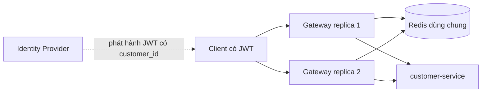

# Giới hạn lưu lượng theo khách hàng bằng kho trạng thái dùng chung

Trong hệ thống microservices, giới hạn request cần áp dụng theo danh tính khách hàng thay vì theo từng kết nối hoặc từng instance Gateway. Nếu mỗi replica của API Gateway tự đếm request trong bộ nhớ, một khách hàng có thể nhân hạn mức bằng cách gửi request qua nhiều replica. Bài thực hành này dùng `RequestRateLimiter` của Spring Cloud Gateway cùng `RedisRateLimiter` để lưu trạng thái token bucket trong Redis dùng chung.

Ta sẽ xác thực JWT ở Gateway, lấy mã khách hàng từ claim đã được nhà cung cấp định danh ký, rồi dùng mã đó làm khóa giới hạn lưu lượng. Các request của nhiều người dùng thuộc cùng một khách hàng sẽ dùng chung một bucket; khách hàng khác có bucket riêng. Cuối bài, ta kiểm chứng giới hạn khi có nhiều Gateway replica và xem cách vận hành Redis an toàn.

## 1. Mục tiêu và kiến trúc

Sau bài thực hành, bạn có thể:

- Giải thích token bucket và ba tham số `replenishRate`, `burstCapacity`, `requestedTokens`.
- Cấu hình `RequestRateLimiter` với Redis làm kho trạng thái dùng chung.
- Xác thực JWT và phân giải `customer_id` thành khóa giới hạn lưu lượng.
- Phân biệt request bị từ chối do thiếu thông tin định danh với request vượt hạn mức.
- Kiểm chứng các khách hàng có bucket độc lập và nhiều Gateway replica chia sẻ cùng trạng thái.
- Xác định giới hạn của rate limiter khi Redis mất kết nối và khi nghiệp vụ cần quota dài hạn.

Kiến trúc của bài:



Gateway xác minh token trước khi xử lý route. `KeyResolver` lấy claim `customer_id` từ principal đã xác thực. `RedisRateLimiter` dùng khóa đó để đọc và cập nhật bucket trong Redis. Vì các replica dùng cùng Redis và cùng cấu hình route, hạn mức của một khách hàng được chia sẻ giữa các replica.

## 2. Chuẩn bị ứng dụng và Redis

Ví dụ dùng Spring Cloud Gateway Server WebFlux, Spring Security Resource Server và Redis reactive. Chọn một release train Spring Cloud tương thích với phiên bản Spring Boot của dự án và import Spring Cloud BOM tương ứng. Với các release mới, starter Gateway có thể mang tên `spring-cloud-starter-gateway-server-webflux`; các release cũ dùng `spring-cloud-starter-gateway`.

Trong ứng dụng Gateway, thêm các dependency:

```xml
<dependency>
    <groupId>org.springframework.cloud</groupId>
    <artifactId>spring-cloud-starter-gateway-server-webflux</artifactId>
</dependency>
<dependency>
    <groupId>org.springframework.boot</groupId>
    <artifactId>spring-boot-starter-data-redis-reactive</artifactId>
</dependency>
<dependency>
    <groupId>org.springframework.boot</groupId>
    <artifactId>spring-boot-starter-security</artifactId>
</dependency>
<dependency>
    <groupId>org.springframework.boot</groupId>
    <artifactId>spring-boot-starter-oauth2-resource-server</artifactId>
</dependency>
<dependency>
    <groupId>org.springframework.boot</groupId>
    <artifactId>spring-boot-starter-actuator</artifactId>
</dependency>
```

Không thêm `spring-boot-starter-web` vào ứng dụng Gateway reactive. Dịch vụ phía sau có thể dùng Spring MVC.

Khởi chạy Redis dùng riêng cho bài thực hành:

```bash
docker run --rm --name gateway-redis -p 6379:6379 redis:7-alpine
```

Mở terminal khác và xác nhận Redis sẵn sàng:

```bash
docker exec gateway-redis redis-cli ping
```

Kết quả mong đợi là `PONG`. Trong môi trường triển khai, Redis cần được đặt trong mạng riêng, bật xác thực/ACL và TLS khi phù hợp; không expose cổng Redis trực tiếp ra Internet.

## 3. Tạo endpoint backend để kiểm tra

Tạo một dịch vụ nhỏ tên `customer-service`, chạy ở cổng `8081`. Endpoint `/customer/orders` trả kết quả đơn giản để phân biệt request đã đi qua Gateway:

```java
@RestController
@RequestMapping("/customer")
public class CustomerController {
    @GetMapping("/orders")
    public Map<String, String> getOrders() {
        return Map.of(
                "service", "customer-service",
                "result", "ok"
        );
    }
}
```

Thêm import `java.util.Map` và các import Spring Web cần thiết. Cấu hình cổng:

```yaml
spring:
  application:
    name: customer-service
server:
  port: 8081
```

Gateway sẽ công bố URL `/api/customer/orders` và bỏ segment `/api` trước khi chuyển request đến backend. Vì vậy endpoint nội bộ vẫn là `GET /customer/orders`.

## 4. Xác thực khách hàng bằng JWT

Không lấy mã khách hàng từ một header tùy ý do client gửi, chẳng hạn `X-Customer-Id`. Client có thể tự sửa header đó để tạo bucket mới và né giới hạn. Trong bài này, nhà cung cấp định danh phát hành JWT đã ký, có claim `customer_id`; Gateway xác minh chữ ký và issuer trước khi dùng claim làm khóa.

Ví dụ payload minh họa của một token đã được ký:

```json
{
  "iss": "https://identity.example.test",
  "sub": "user-17",
  "customer_id": "customer-1001",
  "aud": "customer-api"
}
```

`sub` xác định người dùng, còn `customer_id` xác định khách hàng sở hữu tài khoản. Nếu nhiều người dùng thuộc cùng một khách hàng, họ sẽ chia sẻ một bucket. Claim này phải do hệ thống định danh tin cậy cấp; không chấp nhận giá trị do client tự khai báo.

Trong `application.yml` của Gateway, cấu hình issuer:

```yaml
spring:
  security:
    oauth2:
      resourceserver:
        jwt:
          issuer-uri: ${OIDC_ISSUER_URI}
```

Đặt biến môi trường `OIDC_ISSUER_URI` theo nhà cung cấp định danh của môi trường thử nghiệm. Resource Server dùng metadata của issuer để tìm khóa xác minh và xác thực token. Nếu hệ thống cần kiểm tra audience, hãy bổ sung validator audience phù hợp với API của bạn.

Tạo security chain cho WebFlux:

```java
@Configuration
public class GatewaySecurityConfiguration {
    @Bean
    SecurityWebFilterChain gatewaySecurity(ServerHttpSecurity http) {
        return http
                .csrf(ServerHttpSecurity.CsrfSpec::disable)
                .authorizeExchange(exchanges -> exchanges
                        .pathMatchers("/actuator/health").permitAll()
                        .pathMatchers("/api/customer/**").authenticated()
                        .anyExchange().permitAll())
                .oauth2ResourceServer(oauth2 ->
                        oauth2.jwt(Customizer.withDefaults()))
                .build();
    }
}
```

Cấu hình trên yêu cầu JWT hợp lệ cho API khách hàng. Request không có token hoặc token không hợp lệ bị Spring Security từ chối trước khi đến filter rate limiter. Trong ứng dụng thật, điều chỉnh các quy tắc `authorizeExchange` theo bề mặt API và chính sách quyền truy cập.

## 5. Tạo KeyResolver theo mã khách hàng

`KeyResolver` quyết định request thuộc bucket nào. Đăng ký bean đọc claim `customer_id` từ `JwtAuthenticationToken` đã được Spring Security tạo sau khi xác minh JWT:

```java
@Configuration
public class CustomerRateLimitConfiguration {
    @Bean
    KeyResolver customerKeyResolver() {
        return exchange -> exchange.getPrincipal()
                .cast(JwtAuthenticationToken.class)
                .map(authentication -> authentication.getToken()
                        .getClaimAsString("customer_id"))
                .filter(StringUtils::hasText);
    }
}
```

Các import chính:

```java
import org.springframework.cloud.gateway.filter.ratelimit.KeyResolver;
import org.springframework.context.annotation.Bean;
import org.springframework.context.annotation.Configuration;
import org.springframework.security.oauth2.server.resource.authentication.JwtAuthenticationToken;
import org.springframework.util.StringUtils;
```

Phương thức trả về `Mono<String>` theo hợp đồng của `KeyResolver`. Nếu token hợp lệ nhưng thiếu claim `customer_id`, publisher không phát ra khóa. Ta sẽ cấu hình Gateway từ chối trường hợp này bằng `deny-empty-key`, tránh gom các request không có định danh vào một bucket chung hoặc cho phép chúng bỏ qua rate limit.

Nếu mục tiêu là giới hạn theo từng người dùng thay vì theo khách hàng, có thể dùng `authentication.getName()` hoặc claim `sub`. Chọn một định danh ổn định, duy nhất và được xác thực; không dùng IP làm khóa mặc định khi nhiều người dùng có thể đi qua cùng NAT hoặc proxy.

## 6. Cấu hình RequestRateLimiter với Redis

Trong `gateway/src/main/resources/application.yml`, cấu hình Redis và route:

```yaml
server:
  port: 8080

spring:
  application:
    name: edge-gateway
  data:
    redis:
      host: ${REDIS_HOST:localhost}
      port: ${REDIS_PORT:6379}
      password: ${REDIS_PASSWORD:}
  cloud:
    gateway:
      routes:
        - id: customer-api
          uri: http://localhost:8081
          predicates:
            - Path=/api/customer/**
          filters:
            - StripPrefix=1
            - name: RequestRateLimiter
              args:
                key-resolver: "#{@customerKeyResolver}"
                redis-rate-limiter.replenishRate: 2
                redis-rate-limiter.burstCapacity: 4
                redis-rate-limiter.requestedTokens: 1
                deny-empty-key: true
                empty-key-status-code: FORBIDDEN
                status-code: TOO_MANY_REQUESTS
```

Với Spring Boot 3, cấu hình kết nối Redis dùng tiền tố `spring.data.redis`. Một số phiên bản Spring Boot cũ dùng `spring.redis`; hãy chọn đúng tiền tố theo phiên bản của dự án. Khi Redis có mật khẩu, cấp `REDIS_PASSWORD` từ secret manager hoặc biến môi trường, không commit mật khẩu vào repository.

Ý nghĩa cấu hình rate limiter:

| Tham số | Giá trị | Ý nghĩa |
|---|---:|---|
| `replenishRate` | `2` | Nạp thêm 2 token mỗi giây. |
| `burstCapacity` | `4` | Bucket chứa tối đa 4 token, cho phép một đợt request ngắn vượt tốc độ trung bình. |
| `requestedTokens` | `1` | Mỗi request tiêu thụ 1 token. |
| `key-resolver` | `customerKeyResolver` | Dùng claim `customer_id` làm khóa bucket. |
| `deny-empty-key` | `true` | Từ chối request nếu không phân giải được khóa. |
| `empty-key-status-code` | `FORBIDDEN` | Trả `403` khi thiếu khóa khách hàng. |
| `status-code` | `TOO_MANY_REQUESTS` | Trả `429` khi bucket không còn đủ token. |

RedisRateLimiter triển khai thuật toán token bucket. Một bucket mới có thể nhận tối đa `burstCapacity` token. Mỗi request tiêu thụ `requestedTokens`; token được nạp lại theo `replenishRate` cho đến khi đạt dung lượng tối đa. Với cấu hình trên, một khách hàng có thể gửi một burst tối đa 4 request, sau đó trung bình được bổ sung 2 token mỗi giây.

Vì khóa là `customer_id`, hai người dùng có cùng claim sẽ dùng chung bucket. Khách hàng có mã khác sẽ dùng bucket khác. Route ID cũng tham gia phân biệt trạng thái của route; giữ route ID và chính sách rate limit nhất quán giữa các replica Gateway.

## 7. Khởi chạy và kiểm chứng

Khởi chạy theo thứ tự:

1. Khởi chạy Redis và xác nhận lệnh `redis-cli ping` trả `PONG`.
2. Khởi chạy `customer-service` ở cổng `8081`.
3. Cấp một JWT thử nghiệm hợp lệ từ identity provider. Token phải có claim `customer_id`, ví dụ `customer-1001`.
4. Đặt `OIDC_ISSUER_URI` và các biến Redis cần thiết, sau đó khởi chạy Gateway ở cổng `8080`.

Đặt token thử nghiệm vào biến môi trường trong terminal. Ví dụ với Bash:

```bash
export TOKEN_A='<jwt-cua-customer-1001>'
export TOKEN_B='<jwt-cua-customer-2002>'
```

Không đưa token thật vào file cấu hình hoặc commit vào mã nguồn. Gọi thử một request:

```bash
curl -i -H "Authorization: Bearer $TOKEN_A" \
  http://localhost:8080/api/customer/orders
```

Response mong đợi là `200 OK` cùng body từ `customer-service`. Điều này xác nhận JWT hợp lệ, route đã khớp và request được chuyển đến backend.

### Kiểm tra bucket của một khách hàng

Gửi nhanh 5 request liên tiếp với cùng token:

```bash
for i in 1 2 3 4 5; do
  curl -s -o /dev/null -w "%{http_code}\n" \
    -H "Authorization: Bearer $TOKEN_A" \
    http://localhost:8080/api/customer/orders
done
```

Nếu các request đến đủ nhanh trước khi token được nạp lại, kết quả dự kiến là bốn response `200` và một response `429`. Nếu request thứ năm đến sau khi đã có token mới, hãy thử lại với khoảng cách nhỏ hơn hoặc tạm hạ `replenishRate` trong môi trường lab để quan sát rõ ràng.

Đợi khoảng một giây rồi gửi lại một request. Bucket được nạp lại token nên request có thể thành công. Nếu tiếp tục gửi liên tục, Gateway chỉ cho phép request khi bucket có đủ token.

### Kiểm tra hai khách hàng độc lập

Gửi burst bằng `TOKEN_A` cho `customer-1001`, sau đó dùng `TOKEN_B` có claim `customer_id=customer-2002`:

```bash
curl -i -H "Authorization: Bearer $TOKEN_B" \
  http://localhost:8080/api/customer/orders
```

Request của khách hàng thứ hai vẫn có thể nhận `200` dù bucket của khách hàng thứ nhất đã cạn. Nếu cả hai token có cùng `customer_id`, chúng phải dùng chung bucket bất kể `sub` khác nhau.

### Kiểm tra thiếu định danh

- Không gửi token hoặc gửi token không hợp lệ: Spring Security từ chối request, thường là `401 Unauthorized`.
- Gửi token hợp lệ nhưng không có claim `customer_id`: `KeyResolver` trả rỗng và rate limiter từ chối với `403 Forbidden`.
- Gửi request hợp lệ vượt hạn mức: Gateway trả `429 Too Many Requests`.

Ba trường hợp này là ba nguyên nhân khác nhau. Không đổi `deny-empty-key` thành `false` chỉ để làm request thiếu định danh chạy qua; hãy sửa token hoặc quy tắc xác thực.

## 8. Chứng minh Redis chia sẻ hạn mức giữa nhiều Gateway

Để kiểm tra trạng thái dùng chung, chạy thêm một replica Gateway ở cổng `8082` với cùng cấu hình route, cùng route ID `customer-api`, cùng Redis và cùng chính sách rate limit. Trong lab, có thể tạo profile hoặc biến môi trường riêng để đổi `server.port`; backend vẫn ở cổng `8081`.

Giữ nguyên Redis đang chạy và gửi request của cùng một khách hàng luân phiên qua hai cổng Gateway:

```bash
curl -i -H "Authorization: Bearer $TOKEN_A" http://localhost:8080/api/customer/orders
curl -i -H "Authorization: Bearer $TOKEN_A" http://localhost:8082/api/customer/orders
curl -i -H "Authorization: Bearer $TOKEN_A" http://localhost:8080/api/customer/orders
curl -i -H "Authorization: Bearer $TOKEN_A" http://localhost:8082/api/customer/orders
```

Bucket là trạng thái trong Redis, vì vậy request ở replica thứ hai tiếp tục tiêu thụ token của cùng khách hàng. Không có một hạn mức burst mới cho mỗi replica. Nếu mỗi replica dùng Redis riêng hoặc dùng bộ đếm trong bộ nhớ, kết quả sẽ khác và khách hàng có thể nhân hạn mức theo số replica.

Đảm bảo tất cả replica có cùng `customerKeyResolver`, route ID và thông số `replenishRate`, `burstCapacity`, `requestedTokens`. Triển khai lệch cấu hình giữa các replica khiến hành vi khó dự đoán và khó đối soát.

## 9. Mở rộng chính sách theo gói khách hàng

Bài lab đang áp dụng cùng một tốc độ cho mọi khách hàng. Trong sản phẩm thực tế, khách hàng có thể thuộc các gói khác nhau, chẳng hạn Standard và Premium. `KeyResolver` chỉ quyết định khóa bucket; thay đổi khóa không tự làm thay đổi tốc độ nạp token.

Để áp dụng hạn mức khác nhau theo gói, cần một chính sách tin cậy xác định entitlement của khách hàng và một cách triển khai rate limiter tương ứng. Có thể:

- Dùng custom `RateLimiter` để đọc hạn mức từ cấu hình hoặc kho entitlement và áp dụng tốc độ/burst theo khách hàng.
- Tách route theo chính sách khi phân loại route được thực hiện dựa trên dữ liệu tin cậy đã xác thực, đồng thời bảo đảm khách hàng không thể tự chọn route có hạn mức cao hơn.
- Cache entitlement trong thời gian ngắn và có cơ chế cập nhật khi gói khách hàng thay đổi.

Không dùng header `X-Plan: premium` do client tự gửi để cấp hạn mức cao. Nếu entitlement nằm trong JWT, chỉ tin claim đã được issuer xác minh và có thời hạn phù hợp; nếu thay đổi gói cần có hiệu lực tức thời, tra cứu entitlement từ nguồn dữ liệu có kiểm soát.

Token bucket phù hợp để điều tiết tốc độ và burst trong khoảng thời gian ngắn. Nó không phải bộ đếm hóa đơn hoặc quota nghiệp vụ dài hạn như 100.000 request mỗi tháng. Quota dài hạn cần bộ đếm bền vững, chu kỳ reset, xử lý giao dịch và cơ chế đối soát riêng.

## 10. Vận hành Redis và quan sát rate limit

Redis là một phần của đường xử lý request. Khi Redis mất kết nối, Gateway không thể xác định chính xác bucket còn token hay không. Hãy quyết định rõ chính sách cho API của mình: fail closed để bảo vệ backend, hoặc có cơ chế dự phòng được thiết kế và giới hạn rõ ràng. Không mặc định rằng lỗi Redis tương đương với `429`; theo dõi lỗi kết nối và kiểm thử hành vi khi Redis không sẵn sàng.

Các việc cần thực hiện khi triển khai:

- Chạy Redis có tính sẵn sàng phù hợp, giới hạn truy cập bằng mạng riêng, ACL/password và TLS khi cần.
- Cấp thông tin kết nối qua secret manager; không ghi password, JWT hoặc private key vào log.
- Theo dõi độ trễ và lỗi kết nối Redis, số request `429`, số request `403` do thiếu khóa và tỷ lệ request thành công theo route.
- Dùng Actuator/Micrometer và hệ thống giám sát để quan sát Gateway; chỉ expose endpoint quản trị trên mạng được bảo vệ.
- Dùng request ID và route ID để truy vết; chỉ ghi mã khách hàng khi chính sách dữ liệu cho phép, và tránh ghi bearer token.
- Kiểm thử hành vi khi Redis restart hoặc chuyển failover. Trạng thái bucket có thể mất hoặc thay đổi khi kho trạng thái được khởi tạo lại; không dùng cơ chế này làm nguồn dữ liệu quota thanh toán.

Ví dụ chỉ expose một số endpoint Actuator cần thiết:

```yaml
management:
  endpoints:
    web:
      exposure:
        include: health,info,metrics,prometheus
  endpoint:
    health:
      probes:
        enabled: true
```

Nếu dùng Prometheus, thêm registry tương ứng với phiên bản Spring Boot. Đặt dashboard theo dõi tỷ lệ `429`, lưu lượng theo route, độ trễ Gateway và trạng thái Redis. Giới hạn quyền truy cập metric và endpoint quản trị; không public thông tin route hoặc cấu hình nội bộ.

## 11. Xử lý sự cố

| Hiện tượng | Nguyên nhân cần kiểm tra |
|---|---|
| Mọi request đều nhận `401` | Token thiếu, hết hạn, chữ ký sai hoặc `issuer-uri` không khớp. |
| Token hợp lệ nhưng nhận `403` | Claim `customer_id` thiếu/rỗng hoặc `KeyResolver` không nhận được `JwtAuthenticationToken`. |
| Request nhận `429` quá sớm | Bucket đang được dùng bởi người dùng khác cùng khách hàng, thông số burst thấp hoặc có nhiều request đồng thời. |
| Request không bị giới hạn | Filter chưa gắn vào route được chọn, route ID/cấu hình không đồng nhất hoặc KeyResolver dùng khóa khác nhau. |
| Hai replica có hạn mức riêng | Replica đang kết nối các Redis khác nhau, DB/namespace khác nhau hoặc route ID khác nhau. |
| Gateway báo lỗi khi Redis dừng | Gateway không thể đọc/cập nhật bucket; kiểm tra mạng, ACL, password, TLS và trạng thái Redis. |
| Khách hàng khác nhau dùng chung bucket | Claim được chọn không phải mã khách hàng duy nhất hoặc issuer cấp cùng một giá trị cho nhiều khách hàng. |

## 12. Bài tập hoàn thành

Thực hiện và ghi lại kết quả từng mục:

1. Khởi chạy Redis, backend và Gateway; xác nhận request JWT hợp lệ trả `200`.
2. Xác minh `customer_id` trong JWT là khóa của bucket; giải thích vì sao `sub` có thể tạo bucket khác nếu dùng thay claim này.
3. Với cấu hình `2 token/giây`, burst `4`, gửi burst request của một khách hàng và quan sát response `429` khi bucket cạn.
4. Dùng token của khách hàng khác và xác nhận bucket độc lập.
5. Dùng token hợp lệ nhưng thiếu claim `customer_id`; xác nhận request nhận `403`.
6. Chạy hai Gateway replica cùng Redis; gửi request luân phiên và chứng minh hạn mức được chia sẻ.
7. Ngắt Redis trong môi trường lab; ghi lại lỗi quan sát được và đề xuất chính sách fail closed hoặc dự phòng phù hợp.

**Tiêu chí hoàn thành:** request đã xác thực được phân nhóm theo mã khách hàng đáng tin cậy; khách hàng khác nhau có bucket riêng; các Gateway replica chia sẻ cùng trạng thái Redis; request vượt hạn mức nhận `429`; request thiếu khóa bị từ chối; người học giải thích được giới hạn của token bucket và cách vận hành Redis an toàn.
