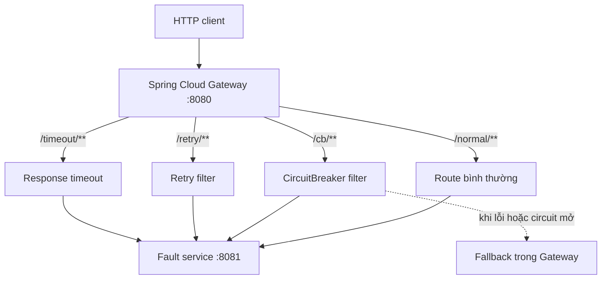

# Mô phỏng lỗi để quan sát timeout, retry và circuit breaker

Trong bài thực hành này, bạn dựng một backend có thể tạo phản hồi chậm, lỗi HTTP 503 và lỗi HTTP 500 có kiểm soát. Spring Cloud Gateway sẽ định tuyến từng tình huống qua một filter riêng để bạn quan sát ba cơ chế bảo vệ:

- **Timeout:** Gateway ngừng chờ upstream khi thời gian phản hồi vượt giới hạn.
- **Retry:** Gateway thử lại một request đủ điều kiện sau khi upstream trả lỗi có thể retry.
- **Circuit breaker:** Gateway tạm ngừng gọi upstream khi tỷ lệ lỗi vượt ngưỡng, đồng thời trả fallback để giảm tác động dây chuyền.

Ta dùng Spring Cloud Gateway Server WebFlux và Spring Cloud CircuitBreaker với Resilience4j. Các ví dụ cấu hình Gateway bên dưới theo namespace `spring.cloud.gateway.*` của dòng Gateway 4.x. Hãy chọn Spring Cloud BOM tương thích với Spring Boot của dự án; nếu dùng dòng Gateway khác, đối chiếu starter và prefix property theo tài liệu đúng phiên bản.

## 1. Mô hình lab

Tạo hai ứng dụng Spring Boot:

| Ứng dụng | Cổng | Trách nhiệm |
|---|---:|---|
| `fault-service` | 8081 | API mô phỏng phản hồi nhanh, chậm, 503 và 500 |
| `api-gateway` | 8080 | Route request và áp dụng timeout, retry, circuit breaker |

Mỗi nhóm lỗi dùng một route riêng để có thể quan sát tác động của từng filter. Ta không đặt Retry và CircuitBreaker cùng một route trong bài đầu tiên vì thứ tự filter có thể làm thay đổi cách đếm lỗi, số lần gọi upstream và fallback. Sau khi hiểu từng cơ chế, bạn có thể thử kết hợp chúng.



## 2. Chuẩn bị dependency

Quản lý Spring Cloud dependency bằng BOM tương thích với Spring Boot. Không đặt version riêng cho Gateway và Spring Cloud CircuitBreaker nếu BOM đã quản lý chúng.

Ví dụ dependency Maven cho `fault-service`:

```xml
<dependency>
    <groupId>org.springframework.boot</groupId>
    <artifactId>spring-boot-starter-web</artifactId>
</dependency>
```

Ví dụ dependency Maven cho `api-gateway` trên Gateway 4.x Server WebFlux:

```xml
<dependency>
    <groupId>org.springframework.cloud</groupId>
    <artifactId>spring-cloud-starter-gateway</artifactId>
</dependency>
<dependency>
    <groupId>org.springframework.cloud</groupId>
    <artifactId>spring-cloud-starter-circuitbreaker-reactor-resilience4j</artifactId>
</dependency>
<dependency>
    <groupId>org.springframework.boot</groupId>
    <artifactId>spring-boot-starter-actuator</artifactId>
</dependency>
```

Nếu dùng Gradle, khai báo cùng các artifact trong `dependencies`. Gateway Server WebFlux cần Reactor; không thêm `spring-boot-starter-web` vào ứng dụng Gateway trong bài lab này. `fault-service` có thể dùng Spring MVC vì đây là backend mô phỏng độc lập.

## 3. Tạo backend có thể mô phỏng lỗi

Tạo ứng dụng `FaultServiceApplication`:

```java
import org.springframework.boot.SpringApplication;
import org.springframework.boot.autoconfigure.SpringBootApplication;

@SpringBootApplication
public class FaultServiceApplication {
    public static void main(String[] args) {
        SpringApplication.run(FaultServiceApplication.class, args);
    }
}
```

Cấu hình `application.yml`:

```yaml
server:
  port: 8081

spring:
  application:
    name: fault-service
```

Tạo controller dưới đây. Bộ đếm `flakyAttempts` giúp endpoint `/flaky` trả 503 hai lần đầu rồi thành công ở lần thứ ba. Biến `controlledFailure` giúp bật/tắt lỗi 500 để quan sát circuit breaker chuyển từ OPEN sang HALF_OPEN rồi CLOSED.

```java
import java.util.Map;
import java.util.concurrent.atomic.AtomicBoolean;
import java.util.concurrent.atomic.AtomicInteger;

import org.springframework.http.HttpStatus;
import org.springframework.http.ResponseEntity;
import org.springframework.web.bind.annotation.GetMapping;
import org.springframework.web.bind.annotation.PostMapping;
import org.springframework.web.bind.annotation.RequestMapping;
import org.springframework.web.bind.annotation.RequestParam;
import org.springframework.web.bind.annotation.RestController;

@RestController
@RequestMapping("/api/test")
public class FaultController {

    private final AtomicInteger flakyAttempts = new AtomicInteger();
    private final AtomicBoolean controlledFailure = new AtomicBoolean(true);

    @GetMapping("/ok")
    public Map<String, String> ok() {
        return Map.of("status", "ok", "source", "fault-service");
    }

    @GetMapping("/slow")
    public Map<String, String> slow() throws InterruptedException {
        Thread.sleep(3000);
        return Map.of("status", "completed", "delayMs", "3000");
    }

    @GetMapping("/flaky")
    public ResponseEntity<Map<String, Object>> flaky() {
        int attempt = flakyAttempts.incrementAndGet();
        if (attempt <= 2) {
            return ResponseEntity.status(HttpStatus.SERVICE_UNAVAILABLE)
                .body(Map.of("status", "temporary_failure", "attempt", attempt));
        }
        return ResponseEntity.ok(
            Map.of("status", "recovered", "attempt", attempt));
    }

    @PostMapping("/reset-flaky")
    public Map<String, String> resetFlaky() {
        flakyAttempts.set(0);
        return Map.of("status", "reset");
    }

    @GetMapping("/controlled")
    public ResponseEntity<Map<String, String>> controlled() {
        if (controlledFailure.get()) {
            return ResponseEntity.status(HttpStatus.INTERNAL_SERVER_ERROR)
                .body(Map.of("status", "controlled_failure"));
        }
        return ResponseEntity.ok(Map.of("status", "recovered"));
    }

    @PostMapping("/admin/failure")
    public Map<String, Object> setFailure(@RequestParam boolean enabled) {
        controlledFailure.set(enabled);
        return Map.of("controlledFailure", enabled);
    }
}
```

Endpoint `/admin/failure` và `/reset-flaky` chỉ phục vụ lab local. Không expose endpoint điều khiển lỗi hoặc reset trạng thái ra Internet hay môi trường production. Nếu muốn chạy nhiều instance backend, bộ đếm và trạng thái phải được đặt trong một kho dùng chung hoặc mô phỏng độc lập theo instance; bài lab này chỉ dùng một tiến trình để kết quả dễ dự đoán.

Khởi động backend:

```bash
./mvnw spring-boot:run
```

Kiểm tra backend trực tiếp trước khi thêm Gateway:

```bash
curl -i http://localhost:8081/api/test/ok
curl -i http://localhost:8081/api/test/slow
curl -i http://localhost:8081/api/test/controlled
```

`/slow` mất khoảng ba giây mới trả về. `/controlled` ban đầu trả 500 vì `controlledFailure` khởi tạo là `true`.

## 4. Cấu hình Gateway cho ba tình huống

Tạo lớp khởi động Gateway:

```java
import org.springframework.boot.SpringApplication;
import org.springframework.boot.autoconfigure.SpringBootApplication;

@SpringBootApplication
public class ApiGatewayApplication {
    public static void main(String[] args) {
        SpringApplication.run(ApiGatewayApplication.class, args);
    }
}
```

Tạo controller fallback trong chính ứng dụng Gateway:

```java
import java.util.Map;

import org.springframework.web.bind.annotation.GetMapping;
import org.springframework.web.bind.annotation.RestController;

@RestController
public class GatewayFallbackController {

    @GetMapping("/fallback/catalog")
    public Map<String, String> catalogFallback() {
        return Map.of(
            "status", "degraded",
            "message", "Catalog service is temporarily unavailable",
            "source", "gateway-fallback"
        );
    }
}
```

Cấu hình `application.yml` của Gateway:

```yaml
server:
  port: 8080

spring:
  application:
    name: api-gateway
  cloud:
    gateway:
      httpclient:
        connect-timeout: 1000
        response-timeout: 3s
      routes:
        - id: normal-route
          uri: http://localhost:8081
          predicates:
            - Path=/normal/**
          filters:
            - StripPrefix=1

        - id: timeout-route
          uri: http://localhost:8081
          predicates:
            - Path=/timeout/**
          filters:
            - StripPrefix=1
          metadata:
            response-timeout: 1000

        - id: retry-route
          uri: http://localhost:8081
          predicates:
            - Path=/retry/**
          filters:
            - StripPrefix=1
            - name: Retry
              args:
                retries: 2
                methods:
                  - GET
                statuses:
                  - SERVICE_UNAVAILABLE

        - id: circuit-breaker-route
          uri: http://localhost:8081
          predicates:
            - Path=/cb/**
          filters:
            - StripPrefix=1
            - name: CircuitBreaker
              args:
                name: catalogCircuit
                fallbackUri: forward:/fallback/catalog
                statusCodes:
                  - 500

resilience4j:
  circuitbreaker:
    instances:
      catalogCircuit:
        slidingWindowType: COUNT_BASED
        slidingWindowSize: 4
        minimumNumberOfCalls: 4
        failureRateThreshold: 50
        waitDurationInOpenState: 10s
        permittedNumberOfCallsInHalfOpenState: 2

management:
  endpoints:
    web:
      exposure:
        include: health,info,metrics
  endpoint:
    health:
      show-details: always
```

Giải thích các phần chính:

- `connect-timeout` giới hạn thời gian thiết lập kết nối đến upstream, đơn vị mili giây.
- `response-timeout` toàn cục là duration; route `timeout-route` ghi đè bằng metadata `response-timeout: 1000`, tức 1.000 mili giây.
- `Retry` cho phép tối đa hai lần retry sau lần gọi đầu, chỉ với GET và status 503. Tổng số lần backend có thể nhận request trong một lần gọi Gateway là ba.
- `CircuitBreaker` dùng instance Resilience4j tên `catalogCircuit`; status 500 được tính là lỗi và Gateway chuyển sang fallback nội bộ khi lỗi hoặc circuit đang mở.
- Circuit breaker dùng cửa sổ bốn lần gọi, yêu cầu tối thiểu bốn mẫu và mở khi tỷ lệ lỗi đạt ít nhất 50%. Sau 10 giây, nó cho phép hai request thử ở trạng thái HALF_OPEN.

`response-timeout` toàn cục và metadata route có kiểu/đơn vị khác nhau như minh họa. Hãy xác nhận lại theo phiên bản Gateway cụ thể khi nâng cấp. Cấu hình này dùng HTTP URI cố định để mô phỏng lỗi trên một backend local; trong môi trường nhiều instance, có thể đổi `uri` thành `lb://fault-service` và đăng ký backend vào service discovery.

Khởi động Gateway:

```bash
./mvnw spring-boot:run
```

Nếu Gateway không khởi động, kiểm tra log binding property, phiên bản BOM, starter Gateway Server WebFlux và starter CircuitBreaker Reactor Resilience4j trước khi thử request.

## 5. Quan sát timeout

Gọi endpoint chậm trực tiếp qua Gateway:

```bash
curl -i http://localhost:8080/timeout/api/test/slow
```

Backend cần khoảng ba giây, nhưng route timeout chỉ chờ một giây. Kết quả thường là `504 Gateway Timeout` hoặc lỗi gateway tương ứng tùy phiên bản và cách exception được xử lý. Đo thời gian từ client để xác nhận Gateway ngừng chờ gần giới hạn đã đặt.

So sánh với route bình thường:

```bash
curl -i http://localhost:8080/normal/api/test/ok
curl -i http://localhost:8080/normal/api/test/slow
```

Route bình thường có response timeout toàn cục ba giây nên endpoint chậm khoảng ba giây có thể hoàn tất sát giới hạn. Nếu thời gian xử lý vượt ba giây, route này cũng có thể timeout.

Một số điểm cần quan sát:

- `connect-timeout` và `response-timeout` kiểm soát hai giai đoạn khác nhau. Tăng connect timeout không giải quyết backend xử lý lâu sau khi kết nối đã được thiết lập.
- Gateway ngừng chờ không đồng nghĩa backend chắc chắn dừng công việc ngay. Controller Spring MVC đang `Thread.sleep` có thể tiếp tục đến hết thời gian ngủ dù client đã nhận timeout.
- Timeout ở Gateway không tự thay đổi timeout của ingress, load balancer hoặc client. Các lớp này cần deadline nhất quán để tránh request bị giữ lâu ở một hop khác.
- Không đặt timeout quá ngắn cho upload, streaming, báo cáo dài hoặc endpoint có thời gian xử lý hợp lệ lớn.

## 6. Quan sát retry

Đầu tiên, reset bộ đếm flaky trực tiếp trên backend:

```bash
curl -X POST http://localhost:8081/api/test/reset-flaky
```

Sau đó gọi route retry qua Gateway:

```bash
curl -i http://localhost:8080/retry/api/test/flaky
```

Backend trả 503 ở hai lần đầu và 200 ở lần thứ ba. Vì `retries: 2`, Gateway gọi tối đa ba lần và response cuối cùng dự kiến là 200 với `attempt: 3`. Kiểm tra log backend để xác nhận số lần gọi thực tế.

Để thấy retry dừng khi hết số lần cho phép, sửa tạm backend để trả 503 liên tục hoặc tạo endpoint luôn lỗi 503. Với hai retry, Gateway sẽ thực hiện lần gọi đầu cộng hai lần thử lại, sau đó trả response lỗi cuối cùng.

Các nguyên tắc cần nhớ:

- Retry là số lần thử lại sau lần gọi đầu, không phải tổng số lần gọi.
- Chỉ retry các method và status có thể an toàn theo hợp đồng ứng dụng. Ví dụ GET thường phù hợp hơn POST tạo đơn hàng.
- Nếu retry POST hoặc thao tác ghi, cần idempotency key hoặc cơ chế deduplication để không tạo giao dịch trùng.
- Backoff giúp tránh dồn request vào upstream đang phục hồi. Với production, đặt khoảng chờ, hệ số tăng và giới hạn tổng thời gian phù hợp deadline của client.
- Retry làm tăng tải lên upstream khi hệ thống đang lỗi. Giới hạn số lần và theo dõi retry count để tránh khuếch đại sự cố.
- Không mặc định retry mọi exception hoặc mọi status. Khai báo rõ nhóm lỗi phù hợp với API.

## 7. Quan sát circuit breaker và fallback

Circuit breaker có ba trạng thái chính:

| Trạng thái | Ý nghĩa | Hành vi |
|---|---|---|
| CLOSED | Hệ thống cho phép request đi đến upstream và ghi nhận kết quả | Request được chuyển tiếp bình thường; lỗi được tích lũy trong cửa sổ |
| OPEN | Tỷ lệ lỗi vượt ngưỡng | Request bị từ chối nhanh, không gọi upstream; Gateway chuyển sang fallback |
| HALF_OPEN | Hết thời gian chờ sau khi OPEN | Chỉ cho một số request thử nghiệm đi đến upstream để đánh giá khả năng phục hồi |

Với cấu hình lab, cần tối thiểu bốn lần gọi để đánh giá cửa sổ. Bốn lần lỗi liên tiếp vượt ngưỡng 50% và làm circuit chuyển OPEN.

### Tạo lỗi để mở circuit

Đảm bảo backend đang ở chế độ lỗi (mặc định `controlledFailure=true`). Gọi route circuit breaker bốn lần:

```bash
for i in $(seq 1 4); do
  curl -i http://localhost:8080/cb/api/test/controlled
done
```

Mỗi request lỗi 500 từ backend được filter tính là lỗi và chuyển thành response fallback từ Gateway. Response fallback có `status: degraded` và `source: gateway-fallback`.

Gọi thêm lần nữa:

```bash
curl -i http://localhost:8080/cb/api/test/controlled
```

Khi circuit đã OPEN, Gateway tiếp tục trả fallback nhanh mà không cần gọi backend. Đối chiếu thời gian response và log backend để phân biệt fallback do lỗi upstream với fallback do circuit đã mở.

### Khôi phục và đóng circuit

Tắt chế độ lỗi trên backend:

```bash
curl -X POST "http://localhost:8081/api/test/admin/failure?enabled=false"
```

Chờ `waitDurationInOpenState` là 10 giây. Khi circuit chuyển HALF_OPEN, gửi hai request thử:

```bash
curl -i http://localhost:8080/cb/api/test/controlled
curl -i http://localhost:8080/cb/api/test/controlled
```

Nếu cả hai request thành công, circuit chuyển về CLOSED và các request sau tiếp tục đến backend. Nếu request thử vẫn lỗi, circuit mở lại và cần đợi thêm một chu kỳ.

Có thể bật health indicator và xem `/actuator/health` để quan sát trạng thái nếu dependency/version đang dùng export thông tin circuit breaker. Metric Resilience4j cũng có thể được export qua Micrometer tùy registry. Không expose endpoint Actuator chi tiết công khai trong production; giới hạn quyền truy cập và chỉ mở các endpoint thực sự cần thiết.

## 8. So sánh ba cơ chế

| Cơ chế | Phát hiện điều gì | Hành động | Khi nào phù hợp |
|---|---|---|---|
| Timeout | Upstream không phản hồi trong deadline | Ngừng chờ và kết thúc request | Giới hạn thời gian chờ, bảo vệ tài nguyên và trải nghiệm client |
| Retry | Một lỗi có thể chỉ là tạm thời | Gửi lại request có giới hạn | Lỗi transient, request an toàn để thử lại |
| Circuit breaker | Upstream liên tục lỗi hoặc quá tải | Tạm ngừng gọi upstream và có thể dùng fallback | Ngăn lỗi dây chuyền, giảm tải khi dependency suy giảm |

Ba cơ chế bổ trợ nhau nhưng không thay thế nhau. Timeout giới hạn thời gian một lần gọi; retry có thể tạo thêm lần gọi; circuit breaker quyết định có tiếp tục gửi request tới dependency hay không. Nếu kết hợp, tổng deadline cần tính cả thời gian của mọi lần thử và backoff. Ví dụ ba lần gọi, mỗi lần timeout hai giây và hai khoảng backoff có thể kéo dài hơn sáu giây; client timeout ngắn hơn sẽ đóng request trước khi Gateway hoàn tất.

Fallback cũng không phải lúc nào là trả dữ liệu giả. Chỉ dùng fallback khi có nội dung suy giảm hợp lệ như cache, dữ liệu mặc định hoặc thông báo tạm thời. Với giao dịch tài chính hoặc thao tác ghi, trả thành công giả có thể khiến client hiểu sai trạng thái giao dịch.

## 9. Thử kết hợp Retry và CircuitBreaker

Sau khi kiểm tra riêng từng cơ chế, có thể tạo một route thử nghiệm khác để kết hợp chúng. Khi đó cần xác định thứ tự filter và hiểu filter nào nhìn thấy lỗi trước. Một lần gọi logic có thể tạo nhiều request vật lý đến backend do Retry; CircuitBreaker có thể đếm kết quả theo từng lần gọi hoặc theo publisher tùy cách lồng filter và implementation.

Hãy thử hai cấu hình trong môi trường lab:

1. Retry nằm trước CircuitBreaker trong chuỗi filter: quan sát circuit breaker nhận kết quả sau khi retry hoàn tất hay từng lỗi trung gian.
2. CircuitBreaker bao quanh request có Retry: quan sát circuit breaker có tính cả các lần thử lại như một lần gọi logic hay không.

Thứ tự hiệu lực cần được xác minh qua log và số request ở backend, không chỉ dựa vào vị trí dòng YAML. Ghi nhận route ID, số lần gọi upstream, status cuối cùng, thời gian tổng và trạng thái circuit. Không sao chép cấu hình kết hợp vào production khi chưa kiểm tra thứ tự, deadline và idempotency.

## 10. Bảng chẩn đoán lỗi lab

| Triệu chứng | Nguyên nhân có thể | Cách xử lý |
|---|---|---|
| Route timeout vẫn chờ lâu hơn dự kiến | Metadata sai đơn vị, route không khớp hoặc proxy/client khác giữ request | Xác nhận route ID, `response-timeout` theo route và thời gian tại từng hop |
| Route bình thường cũng timeout | Global response timeout thấp hơn thời gian backend cần | Tăng timeout có chủ đích hoặc tách route dài hạn |
| Retry chỉ gọi backend một lần | Status không nằm trong cấu hình retry, method không khớp hoặc filter không nằm trên route | Kiểm tra status 503, method GET, route ID và log Gateway |
| Retry tạo quá nhiều request | Số lần retry cao, nhiều tầng cùng retry hoặc client cũng retry | Kiểm kê retry ở client, Gateway, service mesh và SDK; đặt tổng budget |
| Circuit không mở | Chưa đủ số mẫu, status 500 chưa được khai báo, hoặc lỗi không đi qua filter | Kiểm tra `minimumNumberOfCalls`, `statusCodes`, tên circuit và route |
| Fallback không chạy | Sai `fallbackUri`, endpoint nội bộ không tồn tại hoặc fallback handler lỗi | Kiểm tra `forward:/fallback/catalog` và log dispatch nội bộ |
| Circuit mở nhưng backend vẫn nhận request | Request đang chạy từ trước, route khác gọi cùng backend hoặc một instance khác dùng circuit riêng | Kiểm tra thời điểm request, route ID và phạm vi instance/configuration |
| Circuit không đóng sau khi backend phục hồi | Chưa hết thời gian OPEN, probe HALF_OPEN thất bại hoặc còn lỗi trong cửa sổ | Chờ đủ thời gian, gửi số probe cho phép và kiểm tra response backend |

## 11. Checklist hoàn thành

- [ ] Backend chạy ở port `8081` và các endpoint `/ok`, `/slow`, `/flaky`, `/controlled` phản hồi như thiết kế.
- [ ] Gateway chạy ở port `8080` và bốn route được nạp đúng.
- [ ] Route timeout kết thúc request chậm gần giới hạn một giây.
- [ ] Route retry gọi endpoint flaky ba lần và nhận thành công ở lần thứ ba.
- [ ] Route circuit breaker chuyển sang fallback sau đủ số lỗi 500.
- [ ] Khi circuit OPEN, request được fallback nhanh và không gọi backend.
- [ ] Sau khi tắt lỗi và qua thời gian chờ, probe HALF_OPEN thành công đưa circuit về CLOSED.
- [ ] Đã ghi nhận số lần gọi backend, thời gian response và trạng thái circuit.
- [ ] Các endpoint điều khiển lỗi chỉ được dùng trong môi trường lab và không được expose công khai.

## 12. Bài tập mở rộng

1. Thay backend cố định bằng `lb://fault-service`, đăng ký hai instance và dừng lần lượt từng instance để quan sát timeout/retry/circuit breaker khi discovery thay đổi.
2. Thử các mức response timeout khác nhau và đo ảnh hưởng đến p95/p99.
3. Thêm backoff cho Retry, sau đó so sánh tổng thời gian và số request upstream.
4. Thay đổi `slidingWindowSize`, `minimumNumberOfCalls` và `failureRateThreshold`; ghi lại thời điểm circuit chuyển OPEN.
5. Thêm fallback đọc dữ liệu từ cache và xác định dữ liệu nào đủ an toàn để trả khi catalog service không sẵn sàng.
6. Bật metric Resilience4j và tạo dashboard theo dõi state, failure rate, retry count và latency.

Kết quả cần nộp gồm mã nguồn fault service và Gateway, cấu hình ba filter, log hoặc response chứng minh timeout/retry/fallback, cùng ghi chú thời điểm circuit chuyển CLOSED → OPEN → HALF_OPEN → CLOSED. Qua bài lab, bạn sẽ thấy cách Gateway giới hạn thời gian chờ, thử lại lỗi tạm thời và ngăn một dependency liên tục lỗi làm ảnh hưởng toàn bộ hệ thống.
