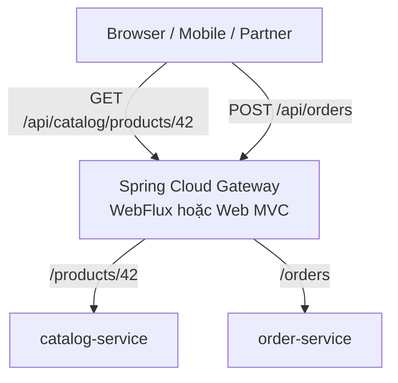
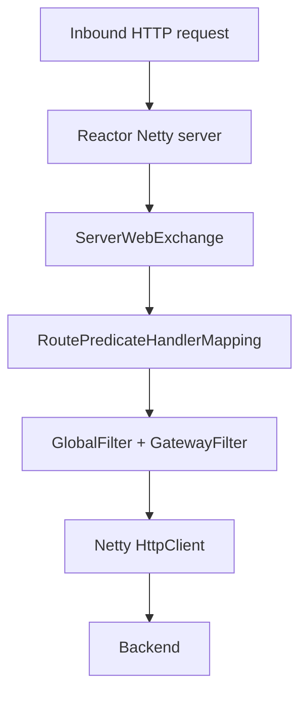
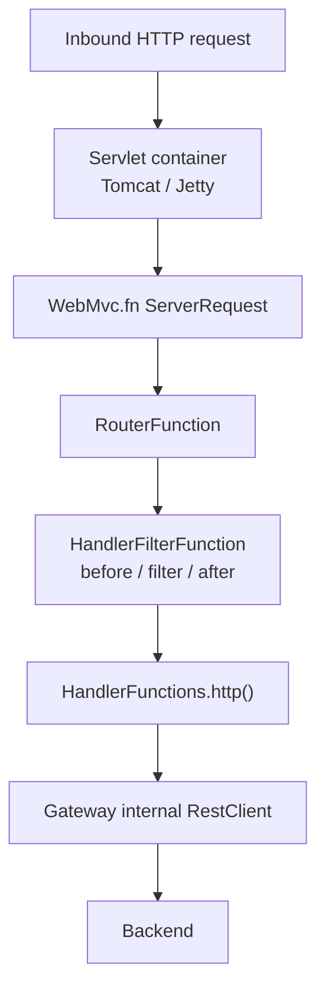
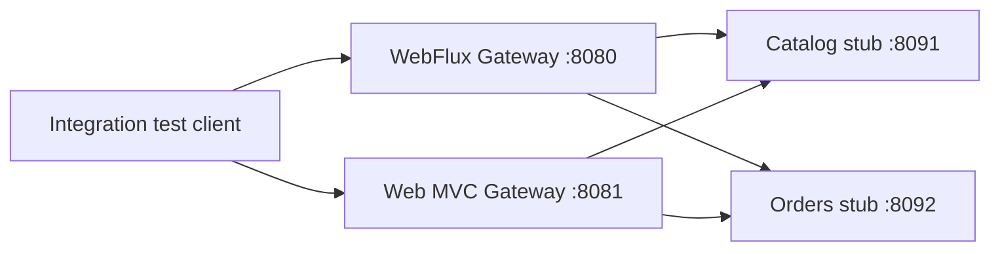

# So sánh cùng tình huống trên Server WebFlux và Server Web MVC

## Mục tiêu bài thực hành

Trong chương **Thực hành tổng hợp** của module **SPRING_CLOUD_GATEWAY**, bài này triển khai cùng một bài toán API Gateway trên hai server flavors: **Spring Cloud Gateway Server WebFlux** và **Spring Cloud Gateway Server Web MVC**. Mục tiêu là nhìn thấy sự khác nhau trong mô hình thực thi, route API, predicate, filter, HTTP client, load balancing, security, body handling và kiểm thử — đồng thời xác nhận cả hai có thể đáp ứng cùng một public API contract.

Use case xuyên suốt là một API cửa hàng:

- `GET /api/catalog/products/42` chuyển tới Catalog service với path nội bộ `/products/42`.
- `POST /api/orders` chuyển tới Order service với path nội bộ `/orders` và giữ nguyên JSON body.
- Hai route thêm header kỹ thuật `X-Gateway-Name: public-api`.
- Catalog yêu cầu scope `catalog.read`; tạo Order yêu cầu `orders.write`.
- Khi dùng service discovery, cả hai route phải chọn instance của service tương ứng.

Sau bài, bạn có thể:

- Phân biệt **Gateway Server** với **Proxy Exchange** và hiểu WebFlux/MVC là hai runtime flavor khác nhau.
- Tạo cùng routes bằng YAML và Java DSL ở cả hai flavor.
- So sánh `RouteLocator`, `GatewayFilter`, `GlobalFilter` với `RouterFunction`, `RequestPredicate`, `HandlerFilterFunction`.
- Viết lại path và header mà không thay đổi public API contract.
- Hiểu sự khác biệt giữa Reactor Netty HTTP client và HTTP client nội bộ của Server MVC.
- Cấu hình `lb://` và nhận biết sự khác nhau của load-balancing filter.
- Áp dụng Spring Security bằng `SecurityWebFilterChain` hoặc `SecurityFilterChain`.
- So sánh rate limiter, Retry, Circuit Breaker, TokenRelay và body caching theo từng flavor.
- Chọn WebFlux hoặc Web MVC theo execution model và dependency của hệ thống.
- Kiểm thử hai Gateway bằng cùng backend stub, so sánh request thực tế tới downstream.

> **Phiên bản tham chiếu:** tài liệu chính thức được đối chiếu với Spring Cloud Gateway **5.1.0 stable** tại ngày 24/11/2026. Các ví dụ dùng starter và namespace 5.1: `spring-cloud-starter-gateway-server-webflux`, `spring-cloud-starter-gateway-server-webmvc`, `spring.cloud.gateway.server.webflux.*` và `spring.cloud.gateway.server.webmvc.*`. Hãy dùng Spring Cloud BOM tương thích với Spring Boot của dự án; không ghép tùy ý hai phiên bản hoặc hai server starters.

## 1. Bài toán chung và kết quả cần đạt

### 1.1. Sơ đồ hệ thống



Hai ứng dụng Gateway là hai cách triển khai độc lập của cùng một contract. Trong bài lab, chạy từng flavor trên một port riêng và trỏ tới cùng backend stub:

| Thành phần | WebFlux Gateway | Web MVC Gateway |
| --- | --- | --- |
| Gateway port | `8080` | `8081` |
| Catalog stub | `8091` | `8091` |
| Orders stub | `8092` | `8092` |
| Public API | `/api/catalog/**`, `/api/orders` | Giống WebFlux |
| Header thêm | `X-Gateway-Name: public-api` | Giống WebFlux |

Các port là giá trị lab. Trong production, hai Gateway thường không cùng nhận một traffic pool nếu chưa có chủ đích về routing, rollout và capacity.

### 1.2. Request và response mong đợi

**Catalog**

```http
GET /api/catalog/products/42 HTTP/1.1
Host: api.example.test
Authorization: Bearer <token có scope catalog.read>
```

Backend phải nhận:

```http
GET /products/42 HTTP/1.1
X-Gateway-Name: public-api
```

**Orders**

```http
POST /api/orders HTTP/1.1
Host: api.example.test
Content-Type: application/json
Authorization: Bearer <token có scope orders.write>

{"productId":"42","quantity":2}
```

Backend phải nhận:

```http
POST /orders HTTP/1.1
X-Gateway-Name: public-api
Content-Type: application/json

{"productId":"42","quantity":2}
```

Điều kiện hoàn thành là **route đúng, path đúng, header đúng, body đúng và authorization đúng**. Một status 200 riêng lẻ không chứng minh proxy đã chuyển tiếp đúng request.

## 2. Phân biệt Gateway Server và Proxy Exchange

Spring Cloud Gateway có hai flavors chính:

| Flavor | Vai trò |
| --- | --- |
| **Server** | Một API Gateway đầy đủ, có thể chạy độc lập hoặc nhúng trong Spring Boot application |
| **Proxy Exchange** | Cho phép một handler/controller trong ứng dụng WebFlux hoặc Web MVC dùng đối tượng `ProxyExchange` để proxy một request cụ thể |

Mỗi flavor có thể tương thích WebFlux hoặc Web MVC. Bài này so sánh **Server WebFlux** và **Server Web MVC**, không so sánh `ProxyExchange`.

### 2.1. Server WebFlux

Server WebFlux được xây trên Spring WebFlux và Reactor. Starter WebFlux sử dụng Netty runtime do Spring Boot cung cấp; tài liệu Gateway nêu flavor này không chạy trong Servlet container truyền thống hoặc đóng gói dưới dạng WAR.

### 2.2. Server Web MVC

Server Web MVC được xây trên Spring Boot và **Spring WebMvc.fn**. Nó chạy trên Servlet runtimes như Tomcat hoặc Jetty. Route được biểu diễn bằng `RouterFunction` và handler proxy HTTP của Gateway.

**Tên “Server Web MVC” không có nghĩa route API mặc định được viết bằng `@RestController`.** Gateway Server MVC dùng functional routing của WebMvc.fn; ứng dụng vẫn có thể bổ sung MVC controllers cho fallback hoặc endpoint nội bộ nếu kiến trúc cần.

Nguồn: [Spring Cloud Gateway overview](https://docs.spring.io/spring-cloud-gateway/reference/index.html), [Server Web MVC starter](https://docs.spring.io/spring-cloud-gateway/reference/spring-cloud-gateway-server-webmvc/starter.html).

## 3. So sánh mô hình thực thi

### 3.1. Luồng WebFlux



Các khái niệm chính:

- Request/response đi qua `ServerWebExchange`.
- Route được mô tả bằng `RouteLocator` hoặc route definitions.
- Predicate kiểm tra `ServerWebExchange`.
- Filter trả về `Mono<Void>` và có thể xử lý body dưới dạng `Flux<DataBuffer>`.
- Outbound HTTP routing mặc định dùng Reactor Netty `HttpClient`.
- Mô hình I/O non-blocking phù hợp với nhiều kết nối đồng thời nếu toàn bộ pipeline tránh blocking.

### 3.2. Luồng Web MVC



Các khái niệm chính:

- Request/response đi qua Servlet stack và WebMvc.fn `ServerRequest`/`ServerResponse`.
- Route được mô tả bằng `RouterFunction<ServerResponse>`.
- Predicate là Spring WebMvc.fn `RequestPredicate`.
- Filter là `HandlerFilterFunction`, hoặc request/response processor được thêm bằng `.before()`/`.after()`.
- Handler proxy HTTP được cung cấp bởi `HandlerFunctions.http()`.
- Gateway Server MVC tạo HTTP client nội bộ dựa trên `RestClient` để proxy request.
- Mô hình Servlet thông thường xử lý I/O blocking; lựa chọn thread/container và virtual threads tùy ứng dụng.

### 3.3. Bảng khác biệt cốt lõi

| Thành phần | Server WebFlux | Server Web MVC |
| --- | --- | --- |
| Web stack | Spring WebFlux | Spring WebMvc.fn |
| Server runtime | Reactor Netty | Servlet container như Tomcat/Jetty |
| Route abstraction | `Route`, `RouteLocator` | `RouterFunction<ServerResponse>` |
| Request type trong predicate | `ServerWebExchange` | `ServerRequest` |
| Predicate extension | `RoutePredicateFactory` | WebMvc.fn `RequestPredicate` |
| Route filter | `GatewayFilter` | `HandlerFilterFunction` |
| Global filter API | `GlobalFilter` | Không dùng cùng interface; composition theo WebMvc.fn/Servlet filters |
| Pre/post API | Reactive chain, `Mono<Void>` | `.before()`, `.filter()`, `.after()` |
| Request body | `Flux<DataBuffer>` | Servlet/WebMvc.fn request body APIs |
| Outbound client | Reactor Netty `HttpClient` | Gateway internal `RestClient` |
| HTTP client customization | `HttpClientCustomizer` | Không dùng `HttpClientCustomizer`; xem MVC/RestClient extension points |
| Load balancing | Reactive LoadBalancer filter | MVC LoadBalancer filter |
| Security | `SecurityWebFilterChain` | `SecurityFilterChain` |
| Reactive operators | Reactor là nền tảng | Không mặc định có reactive Gateway filter chain |

Hai flavors chia sẻ mục tiêu API Gateway và nhiều filter/predicate tương tự, nhưng **không dùng chung mọi extension interfaces**. Không thể copy một class `GlobalFilter` hoặc `GatewayFilterFactory` WebFlux sang MVC rồi mong nó được đăng ký.

## 4. Chọn starter và cấu hình dự án

Dùng cùng Spring Cloud BOM tương thích Spring Boot. Mỗi ứng dụng lab chỉ cần một Gateway Server flavor.

### 4.1. Dependency WebFlux

```xml
<dependency>
    <groupId>org.springframework.cloud</groupId>
    <artifactId>spring-cloud-starter-gateway-server-webflux</artifactId>
</dependency>
```

### 4.2. Dependency Web MVC

```xml
<dependency>
    <groupId>org.springframework.cloud</groupId>
    <artifactId>spring-cloud-starter-gateway-server-webmvc</artifactId>
</dependency>
```

### 4.3. Những điểm cần giữ riêng

- Không đưa cả hai starters vào cùng một application chỉ để “bật cả hai mode”; auto-configuration và runtime server có thể xung đột hoặc gây hiểu nhầm.
- Dùng BOM release train thay vì tự chọn từng version Gateway/Reactor/Netty.
- WebFlux cần WebFlux/Netty runtime và dependencies tương ứng.
- Web MVC cần Spring MVC/Servlet runtime.
- Nếu project có sẵn Spring MVC controllers và JDBC/JPA blocking APIs, Server Web MVC thường hòa hợp hơn với stack hiện có.
- Nếu Gateway chủ yếu proxy I/O và cần reactive/non-blocking execution end-to-end, Server WebFlux thường là lựa chọn tự nhiên.

## 5. Cùng route bằng YAML trên Server WebFlux

Với WebFlux 5.1, routes thuộc namespace `spring.cloud.gateway.server.webflux.routes`.

```yaml
server:
  port: 8080

spring:
  cloud:
    gateway:
      server:
        webflux:
          routes:
            - id: catalog-read
              uri: http://localhost:8091
              predicates:
                - Path=/api/catalog/**
                - Method=GET
              filters:
                - StripPrefix=2
                - AddRequestHeader=X-Gateway-Name, public-api

            - id: orders-create
              uri: http://localhost:8092
              predicates:
                - Path=/api/orders
                - Method=POST
              filters:
                - StripPrefix=1
                - AddRequestHeader=X-Gateway-Name, public-api
```

Với request `/api/catalog/products/42`, `StripPrefix=2` bỏ `/api/catalog`, backend nhận `/products/42`.

Với request `/api/orders`, `StripPrefix=1` bỏ `/api`, backend nhận `/orders`.

Hai predicates trong một route được kết hợp theo logic AND: cả Path và Method đều phải match. `AddRequestHeader` thêm header kỹ thuật vào request downstream.

## 6. Cùng route bằng YAML trên Server Web MVC

Server MVC dùng namespace riêng `spring.cloud.gateway.server.webmvc.routes`. Cấu trúc route YAML gần với WebFlux, nhưng runtime và các extension APIs phía sau khác nhau.

```yaml
server:
  port: 8081

spring:
  cloud:
    gateway:
      server:
        webmvc:
          routes:
            - id: catalog-read
              uri: http://localhost:8091
              predicates:
                - Path=/api/catalog/**
                - Method=GET
              filters:
                - StripPrefix=2
                - AddRequestHeader=X-Gateway-Name, public-api

            - id: orders-create
              uri: http://localhost:8092
              predicates:
                - Path=/api/orders
                - Method=POST
              filters:
                - StripPrefix=1
                - AddRequestHeader=X-Gateway-Name, public-api
```

Đối với use case này, kết quả downstream path/header phải tương đương WebFlux. **Cùng YAML shape không có nghĩa cùng runtime implementation**: MVC route được xây từ WebMvc.fn và MVC filter functions.

### 6.1. Cấu hình có thể giống, namespace không được dùng lẫn

| Flavor | Prefix routes |
| --- | --- |
| WebFlux | `spring.cloud.gateway.server.webflux.routes` |
| Web MVC | `spring.cloud.gateway.server.webmvc.routes` |

Nếu copy nhầm prefix, route có thể không được bind. Hãy kiểm tra startup logs và effective route inventory, không chỉ kiểm tra file YAML parse thành công.

## 7. Cùng route bằng Java DSL

### 7.1. WebFlux: RouteLocatorBuilder

WebFlux Java DSL dùng `RouteLocatorBuilder`:

```java
@Configuration
class WebFluxRoutes {

    @Bean
    RouteLocator routes(RouteLocatorBuilder builder) {
        return builder.routes()
            .route("catalog-read", route -> route
                .path("/api/catalog/**")
                .and()
                .method(HttpMethod.GET)
                .filters(filters -> filters
                    .stripPrefix(2)
                    .addRequestHeader("X-Gateway-Name", "public-api")
                )
                .uri("http://localhost:8091")
            )
            .route("orders-create", route -> route
                .path("/api/orders")
                .and()
                .method(HttpMethod.POST)
                .filters(filters -> filters
                    .stripPrefix(1)
                    .addRequestHeader("X-Gateway-Name", "public-api")
                )
                .uri("http://localhost:8092")
            )
            .build();
    }
}
```

Các imports chính gồm `RouteLocator`, `RouteLocatorBuilder`, `HttpMethod`, `Configuration` và `Bean`. Java DSL tạo cùng route definitions như YAML nhưng cho phép composition/filter logic bằng Java.

### 7.2. Web MVC: GatewayRouterFunctions và HandlerFunctions

Server MVC Java DSL dựa trên Spring WebMvc.fn:

```java
@Configuration
class WebMvcGatewayRoutes {

    @Bean
    RouterFunction<ServerResponse> catalogRoute() {
        return route("catalog-read")
            .GET("/api/catalog/**", http())
            .before(uri("http://localhost:8091"))
            .before(stripPrefix(2))
            .before(addRequestHeader("X-Gateway-Name", "public-api"))
            .build();
    }

    @Bean
    RouterFunction<ServerResponse> ordersRoute() {
        return route("orders-create")
            .POST("/api/orders", http())
            .before(uri("http://localhost:8092"))
            .before(stripPrefix(1))
            .before(addRequestHeader("X-Gateway-Name", "public-api"))
            .build();
    }
}
```

Các static imports chính:

```java
import static org.springframework.cloud.gateway.server.mvc.filter.BeforeFilterFunctions.addRequestHeader;
import static org.springframework.cloud.gateway.server.mvc.filter.BeforeFilterFunctions.stripPrefix;
import static org.springframework.cloud.gateway.server.mvc.filter.BeforeFilterFunctions.uri;
import static org.springframework.cloud.gateway.server.mvc.handler.GatewayRouterFunctions.route;
import static org.springframework.cloud.gateway.server.mvc.handler.HandlerFunctions.http;
```

Các imports type chính là `RouterFunction`, `ServerResponse`, `Configuration` và `Bean`.

Điểm cần chú ý:

- `GatewayRouterFunctions.route("catalog-read")` gắn route ID vào request metadata; hữu ích cho các filters cần route ID.
- `HandlerFunctions.http()` là handler thực hiện proxy.
- `.before(uri(...))` đặt downstream URI.
- `.before(stripPrefix(...))` đổi path trước khi gửi.
- `.before(addRequestHeader(...))` thêm header request.
- Dùng `http()` kết hợp `BeforeFilterFunctions.uri(...)`; các overload `http(String)` và `http(URI)` đã deprecated từ 4.1.7.

Nguồn: [Server MVC Java Routes API](https://docs.spring.io/spring-cloud-gateway/reference/spring-cloud-gateway-server-webmvc/java-routes-api.html).

## 8. So sánh route predicates

### 8.1. WebFlux

WebFlux route predicates nhận `ServerWebExchange`. Built-in predicate factories được cấu hình bằng tên trong YAML hoặc Java DSL:

```yaml
predicates:
  - Host=api.example.test
  - Path=/api/catalog/**
  - Method=GET
  - Header=X-Client-Type, mobile
```

Nhiều predicates trong cùng route phải cùng match.

### 8.2. Web MVC

Server MVC dùng Spring WebMvc.fn `RequestPredicate` với đầu vào `ServerRequest`. Các predicates có thể được compose trong `RouterFunctions.Builder`:

```java
return route("catalog-read")
    .route(
        path("/api/catalog/**")
            .and(method(HttpMethod.GET))
            .and(host("api.example.test")),
        http()
    )
    .before(uri("http://localhost:8091"))
    .before(stripPrefix(2))
    .build();
```

Các static imports cho ví dụ:

```java
import static org.springframework.web.servlet.function.RequestPredicates.method;
import static org.springframework.web.servlet.function.RequestPredicates.path;
import static org.springframework.cloud.gateway.server.mvc.predicate.GatewayRequestPredicates.host;
```

### 8.3. Bảng so sánh

| Khía cạnh | WebFlux | Web MVC |
| --- | --- | --- |
| Predicate input | `ServerWebExchange` | `ServerRequest` |
| Built-in path | Route Predicate Factory `Path` | WebMvc.fn/Gateway `RequestPredicate` |
| Custom predicate | Extend `AbstractRoutePredicateFactory` | Implement WebMvc.fn `RequestPredicate` |
| Composition | Route DSL `.and()` và YAML list | `RequestPredicate.and()`/builder |
| Custom predicate từ config | Gateway factory discovery | `PredicateSupplier`/PredicateDiscoverer |

Không copy class `AbstractRoutePredicateFactory` sang MVC. MVC custom predicate có method `boolean test(ServerRequest request)`; WebFlux factory xây predicate trên `ServerWebExchange`.

### 8.4. Cùng một quy tắc business

Giả sử chỉ cho phép Catalog GET:

```text
Host = api.example.test
AND Path starts with /api/catalog/
AND Method = GET
```

Hai flavor phải được kiểm tra bằng cùng một test matrix:

| Request | Kết quả mong đợi |
| --- | --- |
| GET + đúng host + đúng path | Match catalog route |
| POST + đúng host + đúng path | Không match catalog read |
| GET + sai host | Không match |
| GET + đúng host + path khác domain | Không match |

## 9. So sánh filter chain và cách viết custom filter

### 9.1. WebFlux: GatewayFilter và GlobalFilter

WebFlux dùng:

- `GatewayFilter`: filter gắn theo route.
- `GlobalFilter`: filter được áp dụng có điều kiện cho các routes.
- `GatewayFilterFactory`: factory tạo route filter từ config.
- `Ordered`: quyết định thứ tự combined filter chain.

Filter signature dùng `ServerWebExchange`, `GatewayFilterChain` và `Mono<Void>`:

```java
@Component
class AddAuditMarkerFilter implements GlobalFilter, Ordered {

    @Override
    public int getOrder() {
        return -1;
    }

    @Override
    public Mono<Void> filter(
            ServerWebExchange exchange,
            GatewayFilterChain chain) {

        ServerHttpRequest request = exchange.getRequest()
            .mutate()
            .header("X-Gateway-Mode", "webflux")
            .build();

        return chain.filter(
            exchange.mutate().request(request).build()
        );
    }
}
```

Đây là ví dụ filter toàn cục cho lab. Không dùng header client gửi làm identity; header kỹ thuật phải được tạo/ghi đè ở trusted boundary. Filter order nhỏ hơn có precedence cao hơn ở pre-phase và chạy muộn hơn ở post-phase.

### 9.2. Web MVC: HandlerFilterFunction

Server MVC dùng `HandlerFilterFunction<ServerResponse, ServerResponse>` và các dạng before/after:

- `.before(Function<ServerRequest, ServerRequest>)`: biến đổi request trước handler.
- `.filter(HandlerFilterFunction)`: truy cập request, gọi handler tiếp theo và xử lý response.
- `.after(BiFunction<ServerRequest, ServerResponse, ServerResponse>)`: xử lý response sau handler.

Ví dụ filter thêm header trước khi proxy:

```java
static HandlerFilterFunction<ServerResponse, ServerResponse> addGatewayHeader() {
    return (request, next) -> {
        ServerRequest modified = ServerRequest.from(request)
            .header("X-Gateway-Mode", "webmvc")
            .build();

        return next.handle(modified);
    };
}
```

Dùng trong route:

```java
return route("catalog-read")
    .GET("/api/catalog/**", http())
    .before(uri("http://localhost:8091"))
    .before(stripPrefix(2))
    .filter(addGatewayHeader())
    .build();
```

### 9.3. Không có phép chuyển đổi 1:1 cho GlobalFilter

Web MVC route filters được composition qua WebMvc.fn. Nếu cần concern áp dụng nhiều routes, có thể:

- Tạo một filter function dùng lại và gắn vào các route builders.
- Tạo helper để chuẩn hóa route composition.
- Dùng Servlet Filter cho concern thực sự thuộc toàn bộ Servlet application.

Servlet Filter có phạm vi/lifecycle khác Gateway GlobalFilter. Cần xem nó có chạy trên Actuator, static resources, fallback endpoints hoặc các request không qua Gateway router hay không.

### 9.4. Custom filter factory

| WebFlux | Web MVC |
| --- | --- |
| `GatewayFilterFactory` | `HandlerFilterFunction`/request processor/response processor |
| `AbstractGatewayFilterFactory<Config>` | `SimpleFilterSupplier` hoặc `FilterSupplier` để đăng ký config functions |
| Config shortcut/expanded args | Static filter functions được discover qua supplier |
| `GlobalFilter` | WebMvc.fn composition hoặc Servlet Filter tùy phạm vi |

Web MVC custom predicates/filters dùng `PredicateSupplier`, `SimpleFilterSupplier` hoặc `FilterSupplier` để expose static methods cho external config. Tài liệu 5.1 nêu việc đăng ký qua `META-INF/spring.factories` đã deprecated; đăng ký supplier bean trong application context.

Nguồn: [Web MVC custom predicates and filters](https://docs.spring.io/spring-cloud-gateway/reference/spring-cloud-gateway-server-webmvc/writing-custom-predicates-and-filters.html), [WebFlux Developer Guide](https://docs.spring.io/spring-cloud-gateway/reference/spring-cloud-gateway-server-webflux/developer-guide.html).

## 10. Service discovery và load balancing

### 10.1. WebFlux

Với route YAML:

```yaml
spring:
  cloud:
    gateway:
      server:
        webflux:
          routes:
            - id: catalog-read
              uri: lb://catalog-service
              predicates:
                - Path=/api/catalog/**
                - Method=GET
              filters:
                - StripPrefix=2
```

WebFlux dùng `ReactiveLoadBalancerClientFilter` để resolve service ID thành instance. `lb://catalog-service` là logical service URI; route không cần hard-code host/port.

### 10.2. Web MVC YAML

```yaml
spring:
  cloud:
    gateway:
      server:
        webmvc:
          routes:
            - id: catalog-read
              uri: lb://catalog-service
              predicates:
                - Path=/api/catalog/**
                - Method=GET
              filters:
                - StripPrefix=2
```

MVC cũng hỗ trợ `lb://` trong route configuration và dùng MVC LoadBalancer filter/LoadBalancer client để resolve service instance.

### 10.3. Web MVC Java DSL cần chú ý thứ tự

Khi dùng Java DSL, tài liệu MVC yêu cầu dùng `lb()` filter và `HandlerFunctions.http()` không tham số:

```java
return route("catalog-read")
    .GET("/api/catalog/**", http())
    .before(stripPrefix(2))
    .filter(lb("catalog-service"))
    .build();
```

LoadBalancer filter phải chạy sau path-manipulating filters như `stripPrefix()` hoặc `setPath()`, nếu không URI được resolve có thể không đúng. Nếu dùng YAML `uri: lb://...`, Gateway cấu hình load-balancer handler theo route URI.

**Không đặt `@LoadBalanced` lên custom `RestClient.Builder` dùng chung trong Server MVC** mà không đọc hướng dẫn: Gateway MVC tạo internal `RestClient` riêng; custom `@LoadBalanced RestClient.Builder` có thể làm LoadBalancer intercept cả internal proxy calls và gây lỗi không tìm thấy ServiceInstance. Dùng `lb://` hoặc MVC `lb()` filter cho Gateway routes.

Nguồn: [MVC LoadBalancer Filter](https://docs.spring.io/spring-cloud-gateway/reference/spring-cloud-gateway-server-webmvc/filters/loadbalancer.html).

## 11. Security: cùng scope, khác filter chain

Hai flavor có thể enforce cùng authorization contract nhưng Spring Security integration khác nhau.

### 11.1. WebFlux SecurityWebFilterChain

```java
@Configuration
class WebFluxSecurityConfig {

    @Bean
    SecurityWebFilterChain apiSecurity(ServerHttpSecurity http) {
        return http
            .authorizeExchange(exchanges -> exchanges
                .pathMatchers(HttpMethod.GET, "/api/catalog/**")
                    .hasAuthority("SCOPE_catalog.read")
                .pathMatchers(HttpMethod.POST, "/api/orders/**")
                    .hasAuthority("SCOPE_orders.write")
                .anyExchange().denyAll()
            )
            .oauth2ResourceServer(oauth2 ->
                oauth2.jwt(Customizer.withDefaults())
            )
            .build();
    }
}
```

### 11.2. Web MVC SecurityFilterChain

```java
@Configuration
class WebMvcSecurityConfig {

    @Bean
    SecurityFilterChain apiSecurity(HttpSecurity http) throws Exception {
        return http
            .authorizeHttpRequests(authorize -> authorize
                .requestMatchers(HttpMethod.GET, "/api/catalog/**")
                    .hasAuthority("SCOPE_catalog.read")
                .requestMatchers(HttpMethod.POST, "/api/orders/**")
                    .hasAuthority("SCOPE_orders.write")
                .anyRequest().denyAll()
            )
            .oauth2ResourceServer(oauth2 ->
                oauth2.jwt(Customizer.withDefaults())
            )
            .build();
    }
}
```

Hai ví dụ dùng cùng scope names. Cần cấu hình JWT issuer/audience, decoder, authority mapping, CORS, CSRF theo mô hình client và management endpoints của ứng dụng thật. Nếu có health endpoint cần public, khai báo matcher health trước `denyAll`.

### 11.3. Những nguyên tắc giống nhau

- Route predicate chỉ chọn route; không thay authentication.
- Header `X-Role: ADMIN` do client gửi không phải authority đã xác minh.
- Backend vẫn cần kiểm tra ownership của order/tenant và quyền nghiệp vụ.
- Không forward access token cho upstream không được phép nhận token.
- `TokenRelay` cần OAuth2 client configuration và authorized-client manager phù hợp.

### 11.4. Khác biệt trong cấu hình Security

| Nhu cầu | WebFlux | Web MVC |
| --- | --- | --- |
| Security chain | `SecurityWebFilterChain` | `SecurityFilterChain` |
| Configurer | `ServerHttpSecurity` | `HttpSecurity` |
| Matcher | `authorizeExchange` | `authorizeHttpRequests` |
| JWT resource server | Reactive resource server integration | Servlet resource server integration |
| Token relay | WebFlux TokenRelay filter | MVC TokenRelay filter |

Không đưa `SecurityWebFilterChain` vào Servlet Gateway hoặc `SecurityFilterChain` vào WebFlux Gateway như thể chúng thay thế được nhau.

Nguồn: [Spring Security Integration for Server MVC](https://docs.spring.io/spring-cloud-gateway/reference/spring-cloud-gateway-server-webmvc/spring-security.html).

## 12. Rate limiting, Retry và Circuit Breaker

Các ý tưởng resilience có thể giống nhau, nhưng implementation và filter APIs của hai flavor không nhất thiết giống nhau.

### 12.1. Rate limiting

| WebFlux | Web MVC |
| --- | --- |
| `RequestRateLimiter` dùng `RateLimiter` abstraction; có thể dùng RedisRateLimiter | MVC `RateLimiter` filter dùng Bucket4j |
| Key resolver thường là reactive bean `KeyResolver` | Key resolver là `Function<ServerRequest, String>` trong Java DSL |
| RedisRateLimiter thường dùng để chia sẻ state giữa nhiều Gateway instances | Bucket4j có thể dùng local/distributed proxy manager; cấu hình storage khác |

Không chuyển cấu hình `redis-rate-limiter.replenishRate` từ WebFlux sang MVC rồi mong nó tự chạy. MVC rate limiter có Bucket4j semantics, cần cấu hình `AsyncProxyManager` phù hợp nếu cần bucket state phân tán.

Tài liệu MVC 5.1 hiện nêu key resolver chỉ được cấu hình qua Java DSL, không qua external properties. Nếu tổ chức muốn policy thay đổi độc lập với code, hãy tạo lớp cấu hình/policy riêng và kiểm thử cách đồng bộ policy; không giả định YAML có thể truyền một lambda resolver.

### 12.2. Retry trên WebFlux

WebFlux Retry filter nằm trong reactive Gateway filter chain. Nếu retry method có body, body có thể phải được cache để phát lại; điều này có chi phí bộ nhớ. Không retry POST không idempotent chỉ vì upstream timeout.

### 12.3. Retry trên Web MVC

MVC Retry filter chọn implementation theo classpath:

- Nếu Spring Retry có trên classpath, mặc định dùng Gateway Retry functions dựa trên Spring Retry.
- Nếu không có Spring Retry, dùng Framework Retry của Spring Framework 7.
- Có thể buộc dùng Framework Retry bằng `spring.cloud.gateway.server.webmvc.use-framework-retry-filter=true`.

Nếu `cacheBody=true`, phải thêm `AdaptCachedBody` để gửi cached body downstream. MVC đọc toàn body vào memory và lưu attribute dạng `ByteArrayInputStream`; cần giới hạn body và concurrency. Filter phía sau Retry có thể được chạy nhiều lần.

Nguồn: [MVC Retry Filter](https://docs.spring.io/spring-cloud-gateway/reference/spring-cloud-gateway-server-webmvc/filters/retry.html).

### 12.4. Circuit Breaker

Hai flavor có filter tích hợp Spring Cloud CircuitBreaker và có thể dùng Resilience4J. MVC có `CircuitBreakerFilterFunctions` cho Java DSL và `CircuitBreaker` trong route config; WebFlux dùng GatewayFilter factory tương ứng.

Fallback cần cùng contract ở hai ứng dụng: status, body, correlation ID và không làm lộ exception details. Test circuit open, timeout, backend 5xx và fallback path. Không coi một fallback 200 là thành công nghiệp vụ nếu nó trả dữ liệu mặc định không đúng.

### 12.5. Retry không thay Circuit Breaker

- Retry xử lý một số lỗi transient bằng cách thử lại.
- Circuit breaker ngăn tiếp tục gọi upstream đang lỗi.
- Timeout giới hạn thời gian chờ.
- Rate limiter giới hạn tốc độ inbound.

Kết hợp chúng cần retry budget, timeout budget và idempotency. Nếu tất cả route retry quá nhiều, Gateway có thể làm upstream quá tải hơn.

## 13. Request body và streaming

### 13.1. WebFlux

WebFlux request body đi qua dưới dạng reactive stream, thường là `Flux<DataBuffer>`. Gateway có thể proxy theo luồng mà không cần đọc toàn body vào heap. Nếu custom filter gọi `bodyToMono`, `DataBufferUtils.join` hoặc cache body, phải quản lý body one-shot semantics và memory limit.

### 13.2. Web MVC

MVC dùng Servlet/WebMvc.fn request-body abstractions và outbound internal `RestClient`. Không dùng `DataBuffer`/Reactor operators làm API body mặc định trong custom MVC filters. Nếu cần body cho retry, MVC Retry có cơ chế cache riêng; tài liệu yêu cầu `AdaptCachedBody` sau `Retry`.

### 13.3. So sánh thực tế

| Tình huống | WebFlux | Web MVC |
| --- | --- | --- |
| JSON nhỏ | Decode/cache bằng codecs nếu cần | Đọc/convert theo Servlet/WebMvc APIs |
| Upload lớn | Ưu tiên `Flux<DataBuffer>` streaming | Dùng Servlet/multipart streaming phù hợp |
| Body inspect rồi forward | Cache/decorate đúng lifecycle | Dùng MVC body/cache functions đúng lifecycle |
| Retry POST body | Reactive body replay/cache; memory budget | `cacheBody=true` + `AdaptCachedBody`; whole body in memory |
| Cancellation | Reactive cancel/discard cleanup | Servlet request/response lifecycle và client disconnect |

Đừng kết luận WebFlux luôn nhanh hơn MVC. Hãy đo đúng workload, body size, concurrency, upstream latency và dependency stack.

## 14. HTTP client, TLS và timeout

### 14.1. WebFlux outbound client

Server WebFlux dùng Reactor Netty `HttpClient` để proxy. Các cấu hình pool, connect timeout, response timeout, proxy và TLS nằm trong nhóm WebFlux HTTP client properties. `HttpClientCustomizer` là extension point cho outbound Reactor Netty client.

### 14.2. Web MVC outbound client

Server MVC tạo internal `RestClient` để proxy. Không dùng `HttpClientCustomizer` của WebFlux để cấu hình client này. Đối chiếu tài liệu Server MVC TLS/SSL, properties và supported extension points của đúng Gateway version.

### 14.3. So sánh

| Khía cạnh | WebFlux | Web MVC |
| --- | --- | --- |
| Outbound client | Reactor Netty `HttpClient` | Internal `RestClient` |
| Client customization | `HttpClientCustomizer` | MVC/Boot RestClient configuration theo API được hỗ trợ |
| Pool | Reactor Netty channel pool | RestClient HTTP transport/pool implementation |
| Connect/response timeout | Gateway HTTP client properties | MVC client/configuration properties theo release |
| TLS/mTLS | Reactor Netty SSL/client configuration | MVC TLS/SSL configuration |
| Proxy | Reactor Netty HttpClient proxy settings | MVC HTTP client transport settings |

### 14.4. Kiểm tra timeout theo từng giai đoạn

Phân biệt:

1. Pool acquire timeout.
2. TCP connect timeout.
3. TLS handshake timeout.
4. Response/read timeout.
5. Tổng request deadline.

Một lỗi chờ connection pool không được sửa bằng cách tăng TCP connect timeout. Với SSE/WebSocket hoặc response streaming dài, test timeout/idle semantics riêng.

### 14.5. TLS không giống nhau chỉ vì YAML có cùng tên

Hai flavor có thể có TLS settings tương tự nhưng outbound client khác nhau. Test:

- Certificate chain và hostname/SAN verification.
- mTLS client certificate.
- Trust store/SSL bundle.
- TLS handshake timeout.
- Proxy egress và bypass hosts.
- Upstream HTTPS với certificate hết hạn hoặc sai hostname phải thất bại.

Không bật insecure trust manager để che lỗi certificate trong production.

## 15. WebSocket và kết nối dài

WebFlux và MVC đều có WebSocket routing, nhưng behavior phụ thuộc runtime/container.

Server MVC dùng Servlet WebSocket API. Tài liệu MVC nêu:

- Gateway kết nối backend trước khi hoàn tất client handshake.
- Text, binary và pong messages được relay.
- Ping messages không được relay; Servlet container tự trả pong.
- Filter chỉ áp dụng trong handshake; response-body filters, Retry và Circuit Breaker không áp dụng cho messages sau khi connection đã thiết lập.
- Servlet WebSocket không có backpressure; nếu một phía đọc chậm, message được buffer tới `send-buffer-size-limit`, sau đó connection bị đóng.
- Mỗi connection dài giữ tài nguyên container; khi có nhiều kết nối, cần capacity test và có thể đánh giá virtual threads theo hướng dẫn Spring Boot.

Nếu ứng dụng dựa vào ping để kiểm tra backend health, cần application-level heartbeat thay vì coi pong do Gateway/container trả lời là bằng chứng backend còn sống.

Với WebFlux, kiểm tra WebSocket routing, connection lifecycle, event-loop usage và cleanup theo reactive runtime. Reactive backpressure có semantics khác Servlet WebSocket buffering. Không giả định mọi filter HTTP thông thường có thể xử lý frames sau handshake.

Nguồn: [Server MVC WebSockets](https://docs.spring.io/spring-cloud-gateway/reference/spring-cloud-gateway-server-webmvc/websockets.html).

## 16. Observability và quản trị routes

Hai ứng dụng phải tạo được cùng khả năng vận hành:

- Route ID ổn định.
- Metrics theo route/status/outcome.
- Trace ID xuyên Gateway và backend.
- Log có redact.
- Actuator health và route inventory được bảo vệ.
- Alert cho upstream latency, 5xx, 429, pool exhaustion và timeout.

### 16.1. Những gì cần so sánh

| Dữ liệu | Cần xác minh |
| --- | --- |
| Route ID | Cả hai flavor ghi nhận đúng ID |
| Selected route | Path/method/host chọn cùng route logic |
| Downstream URI | Cùng service/host trong lab |
| Outbound path | Catalog `/products/42`, Orders `/orders` |
| Headers | Header kỹ thuật đúng, auth header không bị giả mạo |
| Status | Backend status được chuyển tiếp theo contract |
| Latency | Đo inbound, proxy và backend |
| Retry count | Tách inbound request và outbound attempts |
| Pool metrics | Lấy từ đúng HTTP client/runtime |

Không mặc định metric name, tag set hoặc Actuator route endpoint của hai flavors giống hệt. Dùng config/metrics docs của từng flavor và kiểm tra bằng Actuator trong môi trường được bảo vệ.

### 16.2. Forwarded headers

Server WebFlux và Server MVC đều có `HttpHeadersFilters` để xử lý `Forwarded`, `X-Forwarded-*` và hop-by-hop headers. Tuy nhiên property prefix và runtime processing thuộc flavor tương ứng. Chỉ tin proxy chain đã cấu hình trusted; không dùng `X-Forwarded-For` do client gửi làm identity.

## 17. Kiểm thử cùng contract trên hai Gateway

### 17.1. Topology



Hai Gateway cùng dùng backend stubs. Stub phải ghi lại request method, path, query, safe headers, body bytes và call count; không log JWT, Cookie, API key hoặc dữ liệu cá nhân.

### 17.2. Test cases cơ bản

| Test | WebFlux | Web MVC | Kết quả mong đợi |
| --- | --- | --- | --- |
| GET Catalog | Có | Có | Backend path `/products/42` |
| POST Orders | Có | Có | Backend path `/orders` |
| Header marker | Có | Có | `X-Gateway-Name: public-api` |
| JSON body | Có | Có | Backend nhận đúng bytes |
| Wrong method | Có | Có | Không match route tương ứng |
| Wrong path | Có | Có | Không match |
| Missing scope | Có | Có | 401/403 theo security contract |
| Correct scope | Có | Có | Request qua được security |
| Unknown service | Có | Có | Lỗi 503/behavior theo LoadBalancer policy |
| Upstream timeout | Có | Có | Timeout theo policy |
| Upstream 5xx | Có | Có | Response/circuit behavior đúng |
| Large body | Có | Có | Body limit đúng theo flavor |
| Client disconnect | Có | Có | Cleanup connection/buffers đúng |

### 17.3. WebTestClient cho WebFlux

Ví dụ:

```java
webTestClient.post()
    .uri("/api/orders")
    .contentType(MediaType.APPLICATION_JSON)
    .headers(headers -> headers.setBearerAuth(validOrdersWriteToken))
    .bodyValue("""
        {"productId":"42","quantity":2}
        """)
    .exchange()
    .expectStatus().is2xxSuccessful();
```

Sau exchange, assert backend stub nhận đúng một call, path `/orders`, header marker và JSON body.

### 17.4. MockMvc cho Web MVC

Ví dụ:

```java
mockMvc.perform(post("/api/orders")
        .contentType(MediaType.APPLICATION_JSON)
        .header(HttpHeaders.AUTHORIZATION, "Bearer " + validOrdersWriteToken)
        .content("""
            {"productId":"42","quantity":2}
            """))
    .andExpect(status().is2xxSuccessful());
```

Sau request, assert backend stub nhận đúng một call và đúng body. `MockMvc` xác minh Servlet/WebMvc.fn layer; để kiểm tra real network client, connection pooling và TLS, bổ sung integration test với embedded container và backend test server.

### 17.5. Không chỉ kiểm tra status

Test assertion nên gồm:

```text
expected route ID
expected backend host/service
expected HTTP method
expected rewritten path
expected safe headers
expected body byte count and content
expected backend call count
expected auth result
expected timeout/retry behavior
```

Nếu backend nhận hai calls cho một inbound request, xác định Retry/fan-out trước khi kết luận lỗi duplicate forwarding.

## 18. Bài thực hành hoàn chỉnh

### Bước 1 — Tạo hai ứng dụng Gateway

Tạo hai Spring Boot apps hoặc hai profiles/build modules riêng:

- `gateway-webflux-lab`: WebFlux starter, port 8080.
- `gateway-webmvc-lab`: Web MVC starter, port 8081.

Cả hai import cùng Spring Cloud BOM tương thích.

### Bước 2 — Khởi động backend stubs

Tạo hai HTTP stubs:

- Catalog trên port 8091, hỗ trợ `GET /products/{id}`.
- Orders trên port 8092, hỗ trợ `POST /orders`.

Mỗi stub trả JSON có request ID và ghi metadata an toàn.

### Bước 3 — Khai báo routes

Thêm YAML tương ứng ở Sections 5 và 6. Giữ nguyên public paths, methods, header marker và upstream paths giữa hai ứng dụng.

### Bước 4 — Cấu hình security

Thêm SecurityWebFilterChain cho WebFlux và SecurityFilterChain cho MVC. Tạo test JWT có scopes:

- `catalog.read`
- `orders.write`

Không dùng token thật.

### Bước 5 — Gửi request giống nhau

```bash
curl -i http://localhost:8080/api/catalog/products/42
curl -i http://localhost:8081/api/catalog/products/42

curl -i -X POST http://localhost:8080/api/orders \
  -H "Content-Type: application/json" \
  -d '{"productId":"42","quantity":2}'

curl -i -X POST http://localhost:8081/api/orders \
  -H "Content-Type: application/json" \
  -d '{"productId":"42","quantity":2}'
```

Để test security, gửi token có scope đúng/sai theo từng Gateway.

### Bước 6 — So sánh backend logs

Đối chiếu:

```text
WebFlux GET  → GET /products/42
Web MVC GET  → GET /products/42
WebFlux POST → POST /orders + JSON body
Web MVC POST → POST /orders + JSON body
```

Nếu khác nhau, kiểm tra route matching, StripPrefix, URI target, content headers, filter ordering và proxy client.

### Bước 7 — Thêm resilience

Thêm Retry/Circuit Breaker theo từng flavor, sau đó mô phỏng:

- Backend trả 503 lần đầu.
- Backend timeout.
- Backend trả 500 liên tục.
- Circuit mở.
- Fallback trả response.

Với POST, chỉ bật retry khi backend có idempotency key/deduplication. MVC Retry có body cache phải dùng `AdaptCachedBody`; WebFlux body replay/cache có lifecycle riêng.

### Bước 8 — Đo tải

Chạy tải tăng dần, ghi:

- Throughput và p95/p99.
- Số request đồng thời.
- CPU, heap và direct memory.
- Thread pool/Servlet threads hoặc Reactor event-loop saturation.
- HTTP client pool metrics.
- Pending acquire và timeout.

Không kết luận một flavor nhanh hơn chỉ từ một lần benchmark; giữ cùng hardware, JVM, TLS, backend, connection reuse, payload và traffic profile.

## 19. Khi nào chọn WebFlux, khi nào chọn Web MVC?

| Tiêu chí | Ưu tiên WebFlux khi | Ưu tiên Web MVC khi |
| --- | --- | --- |
| I/O | Pipeline chủ yếu non-blocking | Nhiều tích hợp blocking hiện có |
| Runtime | Muốn Netty/reactive stack | Đang vận hành Servlet/Tomcat/Jetty |
| Dependencies | Reactive HTTP clients/data access | JDBC/JPA/SDK blocking |
| Team | Thành thạo Reactor/backpressure | Thành thạo Spring MVC/WebMvc.fn |
| Streaming | Cần reactive streams end-to-end | Servlet stack hiện có đáp ứng yêu cầu |
| Custom filters | Đã có GatewayFilter/GlobalFilter | Muốn WebMvc.fn RequestPredicate/HandlerFilterFunction |
| HTTP client | Muốn Reactor Netty HttpClient/customizer | Muốn MVC internal RestClient behavior |
| Integration | Dùng reactive security/context | Dùng servlet security/filter chain |

### 19.1. Khi nào không nên đổi stack?

- Một ứng dụng Spring MVC đang ổn định không cần chuyển sang WebFlux chỉ vì Gateway có reactive flavor.
- Một Gateway WebFlux đang chạy tốt không cần chuyển MVC chỉ vì backend dùng JPA/JDBC; Gateway chủ yếu proxy I/O và không gọi trực tiếp các blocking repositories.
- Nếu custom filters phụ thuộc sâu vào `ServerWebExchange`, `DataBuffer`, `GatewayFilterFactory` và `HttpClientCustomizer`, chi phí chuyển sang MVC có thể đáng kể.
- Nếu hệ thống có nhiều Servlet filters, security customizations và `RestClient` integrations, MVC có thể giảm công sức tích hợp.

### 19.2. Không có kết luận “WebFlux luôn nhanh hơn”

Hiệu năng phụ thuộc:

- Số kết nối đồng thời và thời gian chờ upstream.
- Blocking code và cách cô lập thread.
- HTTP client, connection pool và TLS.
- Body buffering/streaming.
- CPU-bound transformations.
- GC, heap/direct memory.
- Container, JVM và cấu hình triển khai.

Chọn theo execution model và workload thực tế, rồi benchmark bằng cùng kịch bản.

## 20. Troubleshooting khi hai flavor cho kết quả khác nhau

### 20.1. WebFlux chạy nhưng MVC không tìm thấy route

Kiểm tra:

- Starter `spring-cloud-starter-gateway-server-webmvc`.
- Prefix `spring.cloud.gateway.server.webmvc.routes`.
- `RouterFunction` bean đã được đăng ký.
- Predicate và handler imports đúng package `server.mvc`.

### 20.2. MVC trả 404 sau khi thêm StripPrefix

Kiểm tra số path segments bị bỏ và path backend mong đợi. Request `/api/catalog/products/42` với `StripPrefix=2` phải thành `/products/42`.

### 20.3. MVC LoadBalancer báo không có ServiceInstance

Kiểm tra DiscoveryClient/LoadBalancer dependencies và service ID. Trong Java DSL, dùng `http()` và `lb("catalog-service")` theo hướng dẫn MVC. Không gắn `@LoadBalanced` vào RestClient builder mà Gateway internal client dùng.

### 20.4. WebFlux custom filter không compile trong MVC

Đó là khác biệt API dự kiến. Viết lại filter bằng WebMvc.fn `HandlerFilterFunction` hoặc before/after processor; không cố ép `Mono<Void>` vào Servlet handler chain.

### 20.5. Security rules giống nhau nhưng status khác

Kiểm tra SecurityWebFilterChain vs SecurityFilterChain, JWT authority mapping, matcher order, CORS/CSRF và default authentication behavior. Assert cùng principal/scopes thay vì chỉ gửi một header giả.

### 20.6. Retry body chỉ hoạt động trên một flavor

WebFlux và MVC có body cache/replay mechanisms khác nhau. MVC cần `cacheBody=true` và `AdaptCachedBody`; WebFlux cần dùng Retry semantics/cache đúng version. Kiểm tra memory, idempotency và backend call count.

### 20.7. MVC outbound call bị chặn hoặc pool khác

Kiểm tra internal RestClient/HTTP transport và Servlet thread saturation. Không áp `HttpClientCustomizer` của WebFlux vào MVC.

### 20.8. WebSocket ping không tới backend trong MVC

Đây là behavior tài liệu MVC mô tả: Servlet WebSocket API/container xử lý ping/pong, ping không được relay. Dùng application-level heartbeat để kiểm tra backend.

## 21. Checklist nghiệm thu

| Hạng mục | WebFlux | Web MVC |
| --- | --- | --- |
| Đúng starter/runtime | ☐ | ☐ |
| Đúng route namespace | ☐ | ☐ |
| Catalog GET match | ☐ | ☐ |
| Orders POST match | ☐ | ☐ |
| StripPrefix đúng | ☐ | ☐ |
| Header marker đúng | ☐ | ☐ |
| Body JSON được chuyển tiếp nguyên vẹn | ☐ | ☐ |
| Wrong method/path không match | ☐ | ☐ |
| JWT scope đúng được cho phép | ☐ | ☐ |
| Scope sai bị từ chối | ☐ | ☐ |
| Load balancing chọn đúng service | ☐ | ☐ |
| Timeout/resilience được test | ☐ | ☐ |
| Retry không tạo duplicate side effects | ☐ | ☐ |
| TLS/hostname/mTLS được test | ☐ | ☐ |
| Streaming/body size được test | ☐ | ☐ |
| Actuator được bảo vệ | ☐ | ☐ |
| Metrics/traces có route identity | ☐ | ☐ |
| Backend stub ghi đúng request | ☐ | ☐ |

## 22. Bài tập có đáp án

### Bài 1 — Chọn API route declaration

Bạn có custom `GlobalFilter` dùng `ServerWebExchange` và `Mono<Void>`. Có thể đưa bean này sang Server MVC?

**Đáp án:** không trực tiếp. Đây là WebFlux API. Server MVC dùng WebMvc.fn `HandlerFilterFunction`, before/after processors hoặc Servlet Filter tùy phạm vi.

### Bài 2 — Chọn HTTP client

Ứng dụng đang dùng Server MVC và muốn cấu hình `HttpClientCustomizer`.

**Đáp án:** `HttpClientCustomizer` là extension của Gateway WebFlux Reactor Netty client. MVC dùng internal RestClient; cần xem MVC HTTP client/TLS configuration được hỗ trợ.

### Bài 3 — Route không đổi nhưng namespace khác

Bạn copy `spring.cloud.gateway.server.webflux.routes` sang MVC.

**Đáp án:** đổi sang `spring.cloud.gateway.server.webmvc.routes` hoặc khai báo `RouterFunction`.

### Bài 4 — Load balancing bằng Java DSL MVC

Bạn dùng `http("lb://catalog-service")` trong Java route.

**Đáp án:** dùng `http()` kết hợp `lb("catalog-service")` filter; nếu strip path, đặt load-balancer filter sau path manipulation. Overloads `http(String/URI)` đã deprecated.

### Bài 5 — Body POST được retry

Gateway MVC bật `cacheBody=true` nhưng body lần retry rỗng.

**Đáp án:** thêm `AdaptCachedBody` sau Retry theo tài liệu; giới hạn body vì cache toàn bộ request vào memory.

### Bài 6 — Rate limiter không nhận Redis properties

Bạn copy `redis-rate-limiter.*` WebFlux sang MVC.

**Đáp án:** MVC RateLimiter dùng Bucket4j. Cần cấu hình Bucket4j key resolver và distributed proxy manager phù hợp.

### Bài 7 — Chọn security chain

Ứng dụng MVC khai báo `SecurityWebFilterChain`.

**Đáp án:** dùng `SecurityFilterChain` và `HttpSecurity` cho Servlet stack.

### Bài 8 — Ping WebSocket không được relay

Backend không thấy ping frame từ client khi đi qua MVC Gateway.

**Đáp án:** Servlet WebSocket API/container xử lý ping/pong; dùng application-level heartbeat để kiểm tra backend.

### Bài 9 — WebFlux benchmark tốt hơn nhưng dùng JDBC blocking

**Đáp án:** benchmark có thể bị sai nếu blocking code chiếm event-loop hoặc cần scheduler riêng. Đánh giá toàn bộ dependency path và workload; không suy hiệu năng chỉ từ server flavor.

### Bài 10 — Cùng status 200 nhưng backend path khác

**Đáp án:** assert path và headers ở backend stub. Kiểm tra StripPrefix/RewritePath và filter order trên từng flavor.

## 23. Tài liệu tham khảo chính thức

- [Spring Cloud Gateway 5.1.0 — Overview](https://docs.spring.io/spring-cloud-gateway/reference/index.html): hai flavors Server/Proxy Exchange và WebFlux/Web MVC.
- [Server WebFlux — Starter](https://docs.spring.io/spring-cloud-gateway/reference/spring-cloud-gateway-server-webflux/starter.html): starter, Netty runtime và giới hạn Servlet/WAR.
- [Server WebFlux — How It Works](https://docs.spring.io/spring-cloud-gateway/reference/spring-cloud-gateway-server-webflux/how-it-works.html): route mapping và reactive filter chain.
- [Server WebFlux — Global Filters](https://docs.spring.io/spring-cloud-gateway/reference/spring-cloud-gateway-server-webflux/global-filters.html): GlobalFilter, ordering, Netty routing và load balancing.
- [Server Web MVC — Starter](https://docs.spring.io/spring-cloud-gateway/reference/spring-cloud-gateway-server-webmvc/starter.html): starter, WebMvc.fn và Servlet runtime.
- [Server Web MVC — How It Works](https://docs.spring.io/spring-cloud-gateway/reference/spring-cloud-gateway-server-webmvc/how-it-works.html): RouterFunction, HandlerFunctions, predicates và filter functions.
- [Server Web MVC — Java Routes API](https://docs.spring.io/spring-cloud-gateway/reference/spring-cloud-gateway-server-webmvc/java-routes-api.html): GatewayRouterFunctions, HandlerFunctions.http và route builder.
- [Server Web MVC — Custom Predicates and Filters](https://docs.spring.io/spring-cloud-gateway/reference/spring-cloud-gateway-server-webmvc/writing-custom-predicates-and-filters.html): RequestPredicate, HandlerFilterFunction, before/after processors và suppliers.
- [Server Web MVC — LoadBalancer Filter](https://docs.spring.io/spring-cloud-gateway/reference/spring-cloud-gateway-server-webmvc/filters/loadbalancer.html): `lb()`, `lb://` và lưu ý RestClient.
- [Server Web MVC — Retry Filter](https://docs.spring.io/spring-cloud-gateway/reference/spring-cloud-gateway-server-webmvc/filters/retry.html): Retry implementation, cacheBody và AdaptCachedBody.
- [Server Web MVC — RateLimiter Filter](https://docs.spring.io/spring-cloud-gateway/reference/spring-cloud-gateway-server-webmvc/filters/ratelimiter.html): Bucket4j rate limiting.
- [Server Web MVC — CircuitBreaker Filter](https://docs.spring.io/spring-cloud-gateway/reference/spring-cloud-gateway-server-webmvc/filters/circuitbreaker-filter.html): circuit state, fallback và status code handling.
- [Server Web MVC — TokenRelay](https://docs.spring.io/spring-cloud-gateway/reference/spring-cloud-gateway-server-webmvc/filters/tokenrelay.html): OAuth2 token relay.
- [Server Web MVC — Security Integration](https://docs.spring.io/spring-cloud-gateway/reference/spring-cloud-gateway-server-webmvc/spring-security.html): SecurityFilterChain, JWT và TokenRelay.
- [Server Web MVC — HttpHeadersFilters](https://docs.spring.io/spring-cloud-gateway/reference/spring-cloud-gateway-server-webmvc/httpheadersfilters.html): Forwarded/X-Forwarded và hop-by-hop header handling.
- [Server Web MVC — WebSockets](https://docs.spring.io/spring-cloud-gateway/reference/spring-cloud-gateway-server-webmvc/websockets.html): Servlet WebSocket routing và ping/pong behavior.
- [Spring Framework — WebFlux overview](https://docs.spring.io/spring-framework/reference/web/webflux/new-framework.html): execution model và lựa chọn WebFlux/MVC.

## Tổng kết

Cùng một API Gateway contract có thể được triển khai bằng **Spring Cloud Gateway Server WebFlux** hoặc **Server Web MVC**, nhưng hai flavors có execution model và extension APIs khác nhau. WebFlux dùng Spring WebFlux/Reactor Netty, `ServerWebExchange`, `RouteLocator`, `GatewayFilter` và `GlobalFilter`; Web MVC dùng Servlet runtime, WebMvc.fn `RouterFunction`, `RequestPredicate`, `HandlerFilterFunction` và `HandlerFunctions.http()`.

Trong bài thực hành, cả hai flavor phải chuyển `GET /api/catalog/products/42` thành `GET /products/42`, chuyển `POST /api/orders` thành `POST /orders`, giữ JSON body và thêm header kỹ thuật như nhau. Khác biệt nằm ở cách khai báo route, filter/predicate APIs, Security chain, outbound HTTP client, LoadBalancer, Retry/body caching, rate limiter và WebSocket behavior. Không copy nguyên custom filter, predicate, HttpClientCustomizer hoặc security chain từ flavor này sang flavor kia.

Hãy chọn WebFlux khi cần reactive/non-blocking I/O end-to-end và team làm chủ Reactor; chọn Web MVC khi muốn tích hợp với Servlet/WebMvc.fn và các thư viện blocking hiện có. **Chỉ nghiệm thu khi cả hai có cùng kết quả backend, cùng security contract và test runtime riêng cho đúng flavor** — không chỉ khi YAML parse được hoặc ứng dụng khởi động thành công.
