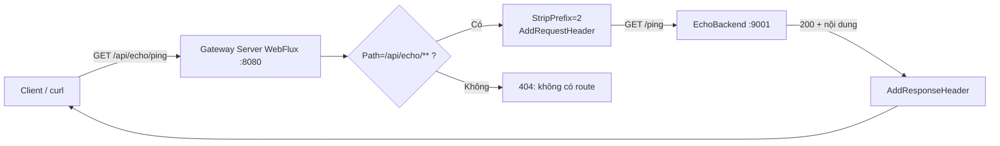

# Tạo ứng dụng Gateway Server WebFlux tối thiểu

## 1. Mục tiêu và kết quả cần đạt

Trong hệ thống microservices, một **API Gateway** là điểm nhận request từ client, chọn dịch vụ đích theo quy tắc định tuyến và áp dụng các bước xử lý chung trước/sau khi gửi request. Với **SPRING_CLOUD_GATEWAY**, biến thể **Spring Cloud Gateway Server WebFlux** dùng Spring WebFlux, Reactor và Reactor Netty để phục vụ luồng HTTP theo mô hình bất đồng bộ.

Sau bài thực hành này, bạn có thể:

1. Tạo một ứng dụng Spring Boot chạy **Gateway Server WebFlux** bằng Java và Maven.
2. Khai báo đúng Spring Cloud BOM và starter tương ứng, không tự ghim phiên bản thư viện Gateway.
3. Viết một route trong `application.yml` với `Path` predicate, `StripPrefix` và filter thêm header.
4. Chạy một downstream service rất nhỏ trên máy cục bộ, gửi `curl` qua Gateway và kiểm tra kết quả.
5. Phân biệt lỗi cấu hình route, lỗi kết nối upstream và trường hợp không có route phù hợp.

Đây là phần **khởi tạo tối thiểu**, làm nền cho những bài sau về service discovery, filter chain, xác thực, rate limiting, retry, circuit breaker, TLS và quan sát request. Ví dụ chưa triển khai các cơ chế bảo vệ đó; không nên công khai Gateway này ra Internet như một cổng production.

### Gateway nằm ở đâu?



Ví dụ cố tình dùng địa chỉ backend tĩnh `127.0.0.1:9001` để không cần Eureka, Consul hay LoadBalancer. Khi ứng dụng hoạt động, bạn sẽ thấy Gateway đứng giữa client và backend; mỗi bước trên sơ đồ có thể được kiểm tra bằng response thực tế.

## 2. Điều kiện trước khi bắt đầu và chọn phiên bản

Bạn cần **JDK 17 trở lên**, Maven (hoặc Maven Wrapper từ Spring Initializr), trình soạn thảo, terminal và một công cụ gửi HTTP như `curl`. Kiểm tra:

```bash
java -version
mvn -version
curl --version
```

Trong ví dụ xuyên suốt bài, dùng bộ phiên bản sau:

| Thành phần | Phiên bản minh họa | Tại sao |
| --- | --- | --- |
| Java | 17 | Đáp ứng yêu cầu Java tối thiểu của Spring Boot 3.5. |
| Spring Boot | `3.5.0` | Cung cấp runtime WebFlux/Netty, auto-configuration và Maven plugin. |
| Spring Cloud BOM | `2025.0.0` | Release train tương thích với Spring Boot 3.5.0. |
| Gateway Server WebFlux | Do Spring Cloud BOM quản lý | Sử dụng starter `spring-cloud-starter-gateway-server-webflux`. |

**Lưu ý về phiên bản:** đây là cặp được chọn để minh họa cấu hình nhất quán, **không phải khuyến nghị dùng bản vá `*.0` cho production**. Khi tạo dự án thực tế, hãy dùng bản vá được hỗ trợ mới hơn trong cùng cặp tương thích, dựa trên [bảng tương thích Spring Cloud](https://spring.io/projects/spring-cloud/) và [Spring Cloud 2025.0 release notes](https://github.com/spring-cloud/spring-cloud-release/wiki/Spring-Cloud-2025.0-Release-Notes).

Bắt đầu từ release train **Spring Cloud 2025.0**, tên starter WebFlux được làm rõ thành `spring-cloud-starter-gateway-server-webflux` (thay cho tên cũ `spring-cloud-starter-gateway`); nhóm thuộc tính WebFlux mới dùng prefix **`spring.cloud.gateway.server.webflux`** thay cho `spring.cloud.gateway` ở các ví dụ cũ. Đừng ghép starter của dòng mới với cách cấu hình từ tài liệu của dòng khác. Biến thể **Gateway Server Web MVC** là một lựa chọn kiến trúc riêng, không dùng trong bài này.

## 3. Khởi tạo dự án Maven

Bạn có thể vào [Spring Initializr](https://start.spring.io/) và chọn **Maven**, **Java**, **Spring Boot 3.5.x**, **Java 17**, packaging **Jar**, group `com.example`, artifact `gateway-webflux`. Nếu danh sách dependency có mục **Gateway Server WebFlux**, hãy chọn mục đó. Nếu giao diện Initializr thay đổi hoặc không hiện đúng starter, tạo một dự án Maven Spring Boot cơ bản rồi dùng `pom.xml` bên dưới.

Cấu trúc dự án chính:

```text
gateway-webflux/
├── pom.xml
├── src/
│   └── main/
│       ├── java/com/example/gateway/GatewayApplication.java
│       └── resources/application.yml
└── demo/
    └── EchoBackend.java     # server thử nghiệm, không đóng gói cùng Gateway
```

### 3.1. Khai báo `pom.xml`

```xml
<?xml version="1.0" encoding="UTF-8"?>
<project xmlns="http://maven.apache.org/POM/4.0.0"
         xmlns:xsi="http://www.w3.org/2001/XMLSchema-instance"
         xsi:schemaLocation="http://maven.apache.org/POM/4.0.0
                             https://maven.apache.org/xsd/maven-4.0.0.xsd">
    <modelVersion>4.0.0</modelVersion>

    <parent>
        <groupId>org.springframework.boot</groupId>
        <artifactId>spring-boot-starter-parent</artifactId>
        <version>3.5.0</version>
        <relativePath/>
    </parent>

    <groupId>com.example</groupId>
    <artifactId>gateway-webflux</artifactId>
    <version>0.0.1-SNAPSHOT</version>
    <name>gateway-webflux</name>
    <description>Minimal Spring Cloud Gateway Server WebFlux</description>

    <properties>
        <java.version>17</java.version>
        <spring-cloud.version>2025.0.0</spring-cloud.version>
    </properties>

    <dependencyManagement>
        <dependencies>
            <dependency>
                <groupId>org.springframework.cloud</groupId>
                <artifactId>spring-cloud-dependencies</artifactId>
                <version>${spring-cloud.version}</version>
                <type>pom</type>
                <scope>import</scope>
            </dependency>
        </dependencies>
    </dependencyManagement>

    <dependencies>
        <dependency>
            <groupId>org.springframework.cloud</groupId>
            <artifactId>spring-cloud-starter-gateway-server-webflux</artifactId>
        </dependency>
    </dependencies>

    <build>
        <plugins>
            <plugin>
                <groupId>org.springframework.boot</groupId>
                <artifactId>spring-boot-maven-plugin</artifactId>
            </plugin>
        </plugins>
    </build>
</project>
```

Ba chi tiết quyết định:

- `spring-boot-starter-parent` cung cấp cách quản lý phiên bản các thư viện thuộc hệ Spring Boot và cấu hình build mặc định.
- BOM `spring-cloud-dependencies` được **import** trong `dependencyManagement`, giúp khớp phiên bản các thành phần thuộc cùng Spring Cloud release train.
- Starter Gateway được khai báo **không ghi `<version>` riêng**. Thêm `spring-boot-starter-web` là không cần thiết cho Gateway Server WebFlux; phiên bản thực hành này chạy trên Reactor Netty, không dùng servlet WAR.

Không cần thêm controller REST hay bất kỳ thư viện service discovery nào ở bước khởi tạo.

### 3.2. Viết entry point Java

Tạo `src/main/java/com/example/gateway/GatewayApplication.java`:

```java
package com.example.gateway;

import org.springframework.boot.SpringApplication;
import org.springframework.boot.autoconfigure.SpringBootApplication;

@SpringBootApplication
public class GatewayApplication {
    public static void main(String[] args) {
        SpringApplication.run(GatewayApplication.class, args);
    }
}
```

`@SpringBootApplication` bật auto-configuration dựa trên các starter hiện có. Gateway sẽ đọc route từ cấu hình, nên ứng dụng đơn giản này **không cần `@RestController`**. Nếu bạn tự viết một controller trả dữ liệu, đó là endpoint của chính ứng dụng Gateway, khác với việc proxy request tới downstream.

## 4. Cấu hình route trong `application.yml`

Tạo `src/main/resources/application.yml`:

```yaml
server:
  port: 8080

spring:
  application:
    name: gateway-webflux
  cloud:
    gateway:
      server:
        webflux:
          routes:
            - id: local-echo
              uri: http://127.0.0.1:9001
              predicates:
                - Path=/api/echo/**
              filters:
                - StripPrefix=2
                - AddRequestHeader=X-Gateway-Request, webflux
                - AddResponseHeader=X-Gateway-Variant, webflux
```

Đây là **một route tối thiểu có thể nhìn thấy được cả request và response**:

| Cấu hình | Tác dụng |
| --- | --- |
| `id: local-echo` | Định danh route, phục vụ tra cứu, log và chẩn đoán. |
| `uri: http://127.0.0.1:9001` | Backend HTTP cụ thể được Gateway chuyển tiếp đến. |
| `Path=/api/echo/**` | Route chỉ khớp request có đường dẫn nằm dưới `/api/echo/`. |
| `StripPrefix=2` | Bỏ hai phân đoạn `api` và `echo` trước khi gửi downstream. |
| `AddRequestHeader=...` | Thêm header `X-Gateway-Request: webflux` vào request chuyển tiếp. |
| `AddResponseHeader=...` | Thêm header `X-Gateway-Variant: webflux` vào response trả client. |

Ví dụ: client gọi `http://localhost:8080/api/echo/ping`, Gateway khớp route, chuyển tiếp thành `http://127.0.0.1:9001/ping` và thêm header. **Predicate** quyết định route có áp dụng hay không; **filter** quyết định cách request/response bị biến đổi.

Cần giữ đúng thụt lề YAML: `routes` nằm dưới `spring.cloud.gateway.server.webflux`; `predicates` và `filters` là danh sách của *một* route. Một lỗi thụt lề có thể khiến route không được tải hoặc ứng dụng không khởi động.

## 5. Tạo backend thử nghiệm bằng JDK

Để kiểm chứng luồng request mà **không cần thêm một dự án Spring Boot khác**, tạo `demo/EchoBackend.java`:

```java
import com.sun.net.httpserver.HttpServer;
import java.io.IOException;
import java.net.InetSocketAddress;
import java.nio.charset.StandardCharsets;

public class EchoBackend {
    public static void main(String[] args) throws IOException {
        HttpServer server = HttpServer.create(
            new InetSocketAddress("127.0.0.1", 9001), 0
        );

        server.createContext("/", exchange -> {
            String path = exchange.getRequestURI().getRawPath();
            String fromGateway =
                exchange.getRequestHeaders().getFirst("X-Gateway-Request");

            String body = "path=" + path + "\n"
                        + "gateway-header=" + fromGateway + "\n";
            byte[] bytes = body.getBytes(StandardCharsets.UTF_8);

            exchange.getResponseHeaders().set(
                "Content-Type", "text/plain; charset=UTF-8"
            );
            exchange.sendResponseHeaders(200, bytes.length);

            try (var stream = exchange.getResponseBody()) {
                stream.write(bytes);
            }
        });

        server.start();
        System.out.println("EchoBackend listening on 127.0.0.1:9001");
    }
}
```

JDK có sẵn `HttpServer` dùng đủ cho việc kiểm thử này. Nó nhận mọi path, in path và header nhận được, rồi trả `200 OK`; **không dùng backend thử nghiệm này làm dịch vụ production**.

Mở **terminal thứ nhất** tại thư mục gốc `gateway-webflux/` và chạy:

```bash
java demo/EchoBackend.java
```

Terminal sẽ in dòng `EchoBackend listening on 127.0.0.1:9001` và giữ tiến trình để phục vụ request. Có thể thử gọi thẳng backend:

```bash
curl -i http://127.0.0.1:9001/ping
```

Phần thân sẽ cho thấy `path=/ping` và `gateway-header=null`, vì request này không đi qua Gateway. Giá trị `null` ở đây là mong đợi.

## 6. Chạy ứng dụng Gateway

Mở **terminal thứ hai** tại thư mục gốc dự án và chạy:

```bash
mvn spring-boot:run
```

Nếu tạo dự án bằng Spring Initializr và có Maven Wrapper, dùng `./mvnw spring-boot:run` trên Linux/macOS hoặc `mvnw.cmd spring-boot:run` trên Windows. Nếu có lỗi Java/Maven, kiểm tra lại `java -version` và `mvn -version`.

Ứng dụng cần khởi động Spring Boot, cấu hình Spring Cloud Gateway Server WebFlux và lắng nghe cổng `8080`. Cổng `9001` và `8080` phải còn trống trước khi chạy. Bạn có thể đổi một trong hai cổng nếu sửa nhất quán cả cấu hình lẫn lệnh kiểm thử.

### 6.1. Gọi qua Gateway

Trong **terminal thứ ba**, chạy:

```bash
curl -i http://localhost:8080/api/echo/ping
```

Kết quả mong đợi có dạng (các header hệ thống khác có thể thay đổi):

```http
HTTP/1.1 200 OK
Content-Type: text/plain; charset=UTF-8
X-Gateway-Variant: webflux

path=/ping
gateway-header=webflux
```

Điều này xác nhận đủ bốn bước: `Path` match, `StripPrefix` bỏ `/api/echo`, header request được thêm, response được Gateway gắn header rồi trả client.

Nếu dùng Windows PowerShell và `curl` được ánh xạ sang lệnh khác, dùng `curl.exe -i http://localhost:8080/api/echo/ping`.

### 6.2. Thử request không khớp route

```bash
curl -i http://localhost:8080/not-configured
```

Vì không có route nào khớp `/not-configured` và ứng dụng không khai báo controller cho path này, Gateway dự kiến trả `404 Not Found`. Đây là hành vi khác với lỗi upstream: request chưa được chuyển tới `EchoBackend`.

### 6.3. Thử khi backend không hoạt động

Dừng riêng tiến trình `EchoBackend` bằng `Ctrl+C` ở terminal thứ nhất, giữ Gateway tiếp tục chạy rồi gọi lại:

```bash
curl -i http://localhost:8080/api/echo/ping
```

Route vẫn khớp, nhưng Gateway không thể kết nối `127.0.0.1:9001`, nên nhận phản hồi lỗi phía Gateway (thường thuộc nhóm **5xx**) và log kết nối thất bại. Đừng nhầm lỗi này với `404` do không có route. Khởi động lại backend để tiếp tục thử nghiệm.

## 7. Trình tự xử lý request bên trong Gateway

Một cách hình dung ngắn gọn:

```text
HTTP request
  -> RoutePredicateHandlerMapping tìm route phù hợp
  -> Gateway Web Handler dựng chuỗi GlobalFilter và GatewayFilter của route
  -> các filter tiền xử lý (ví dụ StripPrefix, AddRequestHeader)
  -> routing filter gửi HTTP request qua Reactor Netty tới backend
  <- backend trả HTTP response
  <- các filter xử lý phản hồi (ví dụ AddResponseHeader)
  <- trả response cho client
```

`Path` là **route predicate**, không phải một filter. `StripPrefix`, `AddRequestHeader` và `AddResponseHeader` là các **GatewayFilter** được gắn với route. Các `GlobalFilter` có thể chạy trên mọi route và được hợp nhất, sắp xếp cùng filter của route tùy cơ chế thứ tự; vì vậy khi xây dựng filter tùy chỉnh ở những bài tiếp theo, cần chú ý `order` và chiều xử lý request/response.

Spring Cloud Gateway Server WebFlux dùng runtime **reactive** dựa trên Netty. Khi về sau tự viết filter, tránh chạy I/O đồng bộ lâu trên event-loop; các lời gọi chặn (blocking) có thể làm chậm nhiều request đồng thời. Ở bài này, việc chuyển tiếp HTTP cơ bản đã được starter xử lý.

## 8. Chẩn đoán các lỗi thường gặp

| Triệu chứng | Kiểm tra | Hướng khắc phục |
| --- | --- | --- |
| Lỗi build `dependency version is missing` hoặc không tìm thấy starter | POM có import BOM, tên starter và repository đúng không? | Import `spring-cloud-dependencies`, không chèn version tùy tiện vào starter, kiểm tra kết nối Maven Central. |
| Spring Cloud báo cặp phiên bản không tương thích | Có dùng Boot 3.5.x với Cloud 2025.0.x không? | Đối chiếu release train chính thức; nâng hai phía thành cặp được hỗ trợ. |
| `Port 8080 was already in use` | Tiến trình khác đang giữ cổng? | Dừng tiến trình đó hoặc đổi `server.port` và URL kiểm thử. |
| Gọi `/api/echo/ping` lại nhận `404` | YAML có đúng prefix `spring.cloud.gateway.server.webflux.routes` và predicate không? | Sửa lại key, thụt lề, path; kiểm tra log khởi động. |
| Gateway có route nhưng trả lỗi 5xx | Backend `127.0.0.1:9001` có đang chạy? | Gọi trực tiếp backend, kiểm tra cổng, host và log kết nối. |
| Backend thấy `/api/echo/ping` thay vì `/ping` | Filter `StripPrefix=2` có nằm trong đúng route? | Sửa danh sách filter và khởi động lại. |
| Thiếu header `X-Gateway-Request` ở backend | Request có đi qua Gateway không? `AddRequestHeader` có đúng tên không? | Gửi request tới cổng `8080`, không gọi trực tiếp `9001`. |
| Không thấy header `X-Gateway-Variant` | Route có match không? Filter response đã đăng ký? | Kiểm tra HTTP response với `curl -i` và cấu hình route. |

Để xem các dependency Maven đã chọn, dùng:

```bash
mvn dependency:tree
```

Nếu đã có bản Gateway cũ trong dự án, đừng sao chép nguyên cấu hình cũ `spring.cloud.gateway.routes` vào ví dụ dùng Spring Cloud 2025.0. Hãy kiểm tra release notes trước khi đổi tên starter và thuộc tính.

## 9. Từ ứng dụng tối thiểu đến Gateway thực tế

Sau khi chạy được route đầu tiên, bạn có thể mở rộng theo đúng trình tự:

1. **Định tuyến:** thêm `Method`, `Header`, `Host` predicates và filter thay đổi path/header với các test rõ ràng.
2. **Khám phá dịch vụ:** thay URI tĩnh bằng `lb://ten-dich-vu` khi đã có Spring Cloud LoadBalancer và nguồn danh sách instance (discovery client hoặc instance được cấu hình). Chỉ đổi URI thành `lb://...` khi chưa có các thành phần này sẽ không tự tạo discovery.
3. **Bảo vệ cổng vào:** tích hợp Spring Security/OAuth2 phù hợp WebFlux, rate limiting, retry, circuit breaker và timeout có giới hạn.
4. **Vận hành:** cấu hình TLS, Actuator, Micrometer, tracing/log request có kiểm soát và kiểm thử lúc upstream chậm, lỗi hoặc không sẵn sàng.

Các bước đó cần thiết trước khi triển khai production, nhưng không nên đưa hết vào ví dụ đầu tiên: một Gateway **có thể khởi động và chuyển tiếp request** vẫn chưa tự cung cấp xác thực, giới hạn lưu lượng hay khả năng chịu lỗi.

## 10. Checklist hoàn thành

- [ ] Dùng một cặp phiên bản Spring Boot/Spring Cloud tương thích.
- [ ] Có starter `spring-cloud-starter-gateway-server-webflux`, không gắn version riêng.
- [ ] Entry point Java có `@SpringBootApplication`, không cần REST controller.
- [ ] `application.yml` có route `local-echo` đúng prefix và đúng thụt lề.
- [ ] Backend cục bộ phản hồi ở cổng `9001`; Gateway khởi động ở cổng `8080`.
- [ ] `curl -i localhost:8080/api/echo/ping` trả `200`, `path=/ping`, `gateway-header=webflux`, header response `X-Gateway-Variant: webflux`.
- [ ] Request không match được phân biệt với lỗi backend không kết nối được.

### Tài liệu tham khảo chính thức

- [Spring Cloud: chọn release train tương thích với Spring Boot](https://spring.io/projects/spring-cloud/)
- [Spring Cloud 2025.0 release notes: đổi tên Gateway starter và prefix cấu hình](https://github.com/spring-cloud/spring-cloud-release/wiki/Spring-Cloud-2025.0-Release-Notes)
- [Spring Cloud Gateway Server WebFlux: cách thêm starter](https://docs.spring.io/spring-cloud-gateway/reference/4.3/spring-cloud-gateway-server-webflux/starter.html)
- [Spring Cloud Gateway Server WebFlux: route predicates](https://docs.spring.io/spring-cloud-gateway/reference/spring-cloud-gateway-server-webflux/request-predicates-factories.html)
- [Spring Cloud Gateway Server WebFlux: filter factories](https://docs.spring.io/spring-cloud-gateway/reference/spring-cloud-gateway-server-webflux/gatewayfilter-factories.html)
