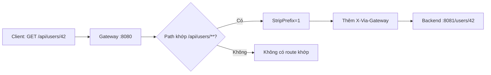

# Khai báo starter phù hợp bằng Maven hoặc Gradle cho Spring Cloud Gateway

## 1. Mục tiêu và bối cảnh

Để xây dựng **API Gateway bằng Spring Cloud Gateway**, bước đầu tiên là chọn đúng **starter** cho loại ứng dụng đang triển khai, sau đó khai báo bộ phiên bản tương thích giữa **Spring Boot**, **Spring Cloud** và **Spring Cloud Gateway**. Starter quyết định web stack mà Gateway sử dụng; các khả năng định tuyến qua **route predicate**, chạy **filter chain**, biến đổi path/header, tích hợp **service discovery**, xác thực, rate limiting, circuit breaker, retry, TLS và quan sát request được bổ sung bằng cấu hình hoặc dependency thích hợp.

Sau bài này, bạn có thể:

- Chọn đúng **Gateway Server WebFlux** hoặc **Gateway Server Web MVC** theo nhu cầu dự án.
- Khai báo starter và **Spring Cloud BOM** trong `pom.xml`, `build.gradle` hoặc `build.gradle.kts`.
- Bổ sung thư viện cho discovery, load balancing, bảo mật, giới hạn lưu lượng và khả năng quan sát khi thực sự cần.
- Xác minh dependency và chạy một route thử để phát hiện sớm lỗi starter hoặc sai namespace cấu hình.

> **Quy tắc:** đừng chọn starter chỉ vì tên quen thuộc. Trước tiên xác định phiên bản Spring Cloud Gateway và ứng dụng chạy **reactive WebFlux** hay **Servlet MVC**; sau đó mới khai báo dependency, để BOM quản lý phiên bản các thư viện Spring Cloud.

## 2. Hai loại Gateway Server và starter tương ứng

Spring Cloud Gateway có hai biến thể **Gateway Server** chính:

| Tiêu chí | Gateway Server WebFlux | Gateway Server Web MVC |
|---|---|---|
| Web stack | Spring WebFlux, reactive, thường chạy Reactor Netty | Spring Web MVC, Servlet, thường chạy Tomcat hoặc Jetty |
| Starter mới từ Gateway 4.3 | `spring-cloud-starter-gateway-server-webflux` | `spring-cloud-starter-gateway-server-webmvc` |
| Starter cũ ở Gateway 4.1–4.2 | `spring-cloud-starter-gateway` | `spring-cloud-starter-gateway-mvc` |
| Prefix khai báo route từ Gateway 4.3 | `spring.cloud.gateway.server.webflux.routes` | `spring.cloud.gateway.server.webmvc.routes` |
| Prefix khai báo route ở Gateway 4.1–4.2 | `spring.cloud.gateway.routes` | `spring.cloud.gateway.mvc.routes` |
| Phù hợp khi | Xây dựng cổng vào reactive, xử lý lượng lớn request I/O và dùng hệ sinh thái WebFlux | Cần tích hợp hệ sinh thái Servlet/Spring MVC đang có và chọn chủ đích runtime MVC |
| Cách cấu hình bảo mật ứng dụng | Thường dùng `SecurityWebFilterChain` | Thường dùng `SecurityFilterChain` |

**Chọn WebFlux** nếu đang xây mới một Gateway có vai trò định tuyến, xác thực và áp dụng filter cho các microservice, mà hệ thống chưa có ràng buộc phải dùng Servlet. **Chọn Web MVC** khi dự án đã có lý do rõ ràng để dùng Spring MVC/Servlet. Cả hai đều là Gateway Server; không cần đưa cả hai starter vào một ứng dụng để “có đủ tính năng”.

**Phân biệt với Proxy Exchange:** các artifact có tên `spring-cloud-gateway-proxyexchange-webflux` hoặc `spring-cloud-gateway-proxyexchange-webmvc` phục vụ viết logic proxy qua `ProxyExchange` trong handler/controller. Chúng **không thay thế** starter Gateway Server khi mục tiêu là khai báo danh sách route bằng `application.yml`.

### 2.1. Chọn theo dòng phiên bản

| Bộ phiên bản Spring Cloud tiêu biểu | Dòng Spring Cloud Gateway | Starter WebFlux | Starter Web MVC |
|---|---|---|---|
| `2023.0.x` / `2024.0.x` | 4.1.x / 4.2.x | `spring-cloud-starter-gateway` | `spring-cloud-starter-gateway-mvc` |
| `2025.0.x` | 4.3.x | `spring-cloud-starter-gateway-server-webflux` | `spring-cloud-starter-gateway-server-webmvc` |
| `2025.1.x` trở lên | 5.x trở lên | `spring-cloud-starter-gateway-server-webflux` | `spring-cloud-starter-gateway-server-webmvc` |

Dòng **4.3** là giai đoạn chuyển tên starter và namespace cấu hình. Tên cũ được đánh dấu deprecated; từ dòng **5.x** nên dùng các artifact mới. Với các dự án ở 4.2 trở về trước, không áp tên starter hoặc prefix mới vào khi chưa nâng cấp BOM.

**Ví dụ xuyên suốt bài:** Spring Boot **3.5.0**, Spring Cloud BOM **2025.0.0**, Spring Cloud Gateway **4.3.x**, chọn **Gateway Server WebFlux**. Đây là một cặp phiên bản cụ thể để minh họa; khi áp dụng vào dự án thực tế, cần cập nhật tới các bản vá tương thích trong cùng release train. Không trộn một bản Boot của thế hệ khác với Cloud BOM của ví dụ.

## 3. Maven: khai báo starter và import Spring Cloud BOM

Tạo dự án Spring Boot có `pom.xml`, hoặc mở module Gateway trong dự án nhiều module. Dùng một Spring Boot parent tương thích để quản lý các dependency của Boot; **import Spring Cloud BOM** để quản lý phiên bản Gateway và các thư viện Spring Cloud.

`pom.xml` tối thiểu dành cho **Gateway Server WebFlux 4.3.x**:

```xml
<?xml version="1.0" encoding="UTF-8"?>
<project xmlns="http://maven.apache.org/POM/4.0.0"
         xmlns:xsi="http://www.w3.org/2001/XMLSchema-instance"
         xsi:schemaLocation="http://maven.apache.org/POM/4.0.0
             https://maven.apache.org/xsd/maven-4.0.0.xsd">
    <modelVersion>4.0.0</modelVersion>

    <parent>
        <groupId>org.springframework.boot</groupId>
        <artifactId>spring-boot-starter-parent</artifactId>
        <version>3.5.0</version>
        <relativePath/>
    </parent>

    <groupId>com.example</groupId>
    <artifactId>api-gateway</artifactId>
    <version>0.0.1-SNAPSHOT</version>
    <name>api-gateway</name>

    <properties>
        <java.version>17</java.version>
        <spring-cloud.version>2025.0.0</spring-cloud.version>
    </properties>

    <dependencyManagement>
        <dependencies>
            <dependency>
                <groupId>org.springframework.cloud</groupId>
                <artifactId>spring-cloud-dependencies</artifactId>
                <version>${spring-cloud.version}</version>
                <type>pom</type>
                <scope>import</scope>
            </dependency>
        </dependencies>
    </dependencyManagement>

    <dependencies>
        <dependency>
            <groupId>org.springframework.cloud</groupId>
            <artifactId>spring-cloud-starter-gateway-server-webflux</artifactId>
        </dependency>
    </dependencies>

    <build>
        <plugins>
            <plugin>
                <groupId>org.springframework.boot</groupId>
                <artifactId>spring-boot-maven-plugin</artifactId>
            </plugin>
        </plugins>
    </build>
</project>
```

Điểm cần hiểu:

1. `spring-boot-starter-parent` quản lý bộ thư viện Spring Boot. Java 17 phù hợp với Spring Boot 3.5; bạn có thể sử dụng Java phiên bản cao hơn nếu được hỗ trợ.
2. `spring-cloud-dependencies` nằm trong **`dependencyManagement`**, với `type=pom` và `scope=import`. BOM **không tự thêm thư viện vào classpath**, mà cung cấp phiên bản cho các dependency được khai báo.
3. `spring-cloud-starter-gateway-server-webflux` được đặt trong **`dependencies`**, **không ghi `<version>` riêng**: BOM sẽ chọn phiên bản Gateway tương ứng.
4. `spring-boot-maven-plugin` cho phép chạy/đóng gói ứng dụng bằng các mục tiêu của Spring Boot.

Nếu chọn **Gateway Server Web MVC**, giữ nguyên bộ phiên bản tương thích nhưng thay dependency duy nhất ở phần Gateway:

```xml
<dependency>
    <groupId>org.springframework.cloud</groupId>
    <artifactId>spring-cloud-starter-gateway-server-webmvc</artifactId>
</dependency>
```

**Không giữ đồng thời** cả hai dependency Gateway Server trong cùng ứng dụng. Tránh thêm thủ công `spring-boot-starter-web` vào dự án Gateway Server WebFlux: thư viện MVC/Servlet có thể khiến quá trình chọn web application type hoặc các auto-configuration trở nên khó hiểu.

### 3.1. Dự án Maven nhiều module

Nếu có parent POM chung, thường đặt phần quản lý Spring Boot/Spring Cloud và các phiên bản ở **POM cha**, còn module `api-gateway` chỉ khai báo starter được sử dụng. Đảm bảo BOM thực sự được kế thừa/import vào module Gateway; chỉ viết tên BOM ở một file không được module kế thừa sẽ **không** quản lý version cho module đó.

## 4. Gradle Groovy DSL: `build.gradle`

Với Gradle Groovy, có thể dùng plugin `io.spring.dependency-management` để import Spring Cloud BOM. Ví dụ tương đương Maven ở phần trên:

```groovy
plugins {
    id 'java'
    id 'org.springframework.boot' version '3.5.0'
    id 'io.spring.dependency-management' version '1.1.7'
}

group = 'com.example'
version = '0.0.1-SNAPSHOT'

java {
    toolchain {
        languageVersion = JavaLanguageVersion.of(17)
    }
}

repositories {
    mavenCentral()
}

dependencyManagement {
    imports {
        mavenBom 'org.springframework.cloud:spring-cloud-dependencies:2025.0.0'
    }
}

dependencies {
    implementation 'org.springframework.cloud:spring-cloud-starter-gateway-server-webflux'
}
```

Nếu dùng MVC, thay đúng một dòng trong `dependencies`:

```groovy
implementation 'org.springframework.cloud:spring-cloud-starter-gateway-server-webmvc'
```

Ở đây `implementation` thêm starter vào classpath, còn `dependencyManagement.imports.mavenBom` cung cấp các phiên bản Spring Cloud. Chú ý **không đặt phiên bản Gateway vào chuỗi `implementation`** khi BOM đã quản lý.

## 5. Gradle Kotlin DSL: `build.gradle.kts`

Nếu dự án dùng Kotlin DSL, cách khai báo tương đương:

```kotlin
plugins {
    java
    id("org.springframework.boot") version "3.5.0"
    id("io.spring.dependency-management") version "1.1.7"
}

group = "com.example"
version = "0.0.1-SNAPSHOT"

java {
    toolchain {
        languageVersion = JavaLanguageVersion.of(17)
    }
}

repositories {
    mavenCentral()
}

dependencyManagement {
    imports {
        mavenBom("org.springframework.cloud:spring-cloud-dependencies:2025.0.0")
    }
}

dependencies {
    implementation("org.springframework.cloud:spring-cloud-starter-gateway-server-webflux")
}
```

Thay `spring-cloud-starter-gateway-server-webflux` bằng `spring-cloud-starter-gateway-server-webmvc` khi chọn Server MVC. Nếu dự án đã dùng **Gradle native `platform(...)`** thay cho plugin dependency-management, hãy theo một chiến lược BOM nhất quán, gồm cả BOM Spring Boot và BOM Spring Cloud khi cần; tránh vừa áp nhiều cơ chế quản lý phiên bản vừa ghim tay dependency dẫn tới khó giải thích version được chọn.

> **Maven và Gradle có cú pháp khác nhau, nhưng nguyên tắc giống nhau:** chọn Boot plugin/parent thích hợp, nhập Spring Cloud BOM đúng release train, khai báo **một** starter Gateway Server và để BOM chọn version của Gateway.

## 6. Starter chính và thư viện bổ sung theo tính năng

Starter Gateway cung cấp lõi định tuyến, predicate và filter. Một số tính năng vận hành có **điều kiện bổ sung** về thư viện, dịch vụ hoặc cấu hình. Không nên thêm toàn bộ dependency chỉ để “phòng khi dùng tới”.

| Nhu cầu | Dependency thường cân nhắc | Ghi chú |
|---|---|---|
| Định tuyến theo `Path`, `Host`, `Method`; `StripPrefix`, `RewritePath`, `AddRequestHeader`, `Retry` | Starter Gateway Server đã chọn | Những route predicate/filter cơ bản có sẵn theo biến thể và phiên bản; vẫn phải cấu hình route |
| Dùng `lb://service-name` | `spring-cloud-starter-loadbalancer` | Cho phép Spring Cloud LoadBalancer chọn instance; cần nguồn instance như discovery hoặc cấu hình phù hợp |
| Tìm microservice qua Eureka | `spring-cloud-starter-netflix-eureka-client` | Cần Eureka Server và cấu hình registry; không cần nếu dùng URI cố định |
| Bảo mật, kiểm tra JWT OAuth2 | `spring-boot-starter-oauth2-resource-server` | Cần cấu hình issuer/JWK, xác thực và phân quyền; không có cơ chế tự bảo vệ route chỉ nhờ dependency |
| Redis rate limiting trên WebFlux | `spring-boot-starter-data-redis-reactive` | Cần Redis thực tế, `RequestRateLimiter` và `KeyResolver` phù hợp |
| Circuit breaker reactive với Resilience4j | `spring-cloud-starter-circuitbreaker-reactor-resilience4j` | Dành cho reactive Gateway; kiểm tra hỗ trợ của biến thể, version và filter |
| Circuit breaker trên MVC | `spring-cloud-starter-circuitbreaker-resilience4j` | Dành cho phần tích hợp non-reactive; xem tài liệu filter của Gateway Server MVC đúng version |
| Health, metrics, quan sát HTTP request | `spring-boot-starter-actuator` | Cân nhắc thêm registry Micrometer như `micrometer-registry-prometheus` nếu xuất metrics ra Prometheus |
| TLS cho cổng vào | Không cần starter Gateway riêng | Cấu hình HTTPS qua `server.ssl.*`; TLS từ Gateway đến backend có cấu hình riêng theo HTTP client/stack |

**Ví dụ Maven**: khi Gateway Server WebFlux cần service load balancing, xác thực JWT, quan sát request và circuit breaker, có thể thêm các dependency sau trong thẻ `dependencies` của `pom.xml` (cùng với starter Gateway chính):

```xml
<dependency>
    <groupId>org.springframework.cloud</groupId>
    <artifactId>spring-cloud-starter-loadbalancer</artifactId>
</dependency>
<dependency>
    <groupId>org.springframework.boot</groupId>
    <artifactId>spring-boot-starter-oauth2-resource-server</artifactId>
</dependency>
<dependency>
    <groupId>org.springframework.boot</groupId>
    <artifactId>spring-boot-starter-actuator</artifactId>
</dependency>
<dependency>
    <groupId>org.springframework.cloud</groupId>
    <artifactId>spring-cloud-starter-circuitbreaker-reactor-resilience4j</artifactId>
</dependency>
```

**Tương đương trong Gradle** (đặt trong khối `dependencies`):

```groovy
implementation 'org.springframework.cloud:spring-cloud-starter-loadbalancer'
implementation 'org.springframework.boot:spring-boot-starter-oauth2-resource-server'
implementation 'org.springframework.boot:spring-boot-starter-actuator'
implementation 'org.springframework.cloud:spring-cloud-starter-circuitbreaker-reactor-resilience4j'
```

Các ví dụ trên chỉ minh họa cách thêm thư viện, **không phải cấu hình hoàn chỉnh** của JWT, discovery, circuit breaker hoặc TLS. Với Gateway MVC, thay thư viện circuit breaker và bộ filter/security theo Servlet stack. Luôn kiểm tra tài liệu tương ứng phiên bản trước khi dùng một filter cụ thể.

## 7. Chạy thử một Gateway Server WebFlux tối thiểu

Sau khi khai báo starter bằng Maven hoặc Gradle, tạo class khởi động Spring Boot:

```java
package com.example.gateway;

import org.springframework.boot.SpringApplication;
import org.springframework.boot.autoconfigure.SpringBootApplication;

@SpringBootApplication
public class ApiGatewayApplication {
    public static void main(String[] args) {
        SpringApplication.run(ApiGatewayApplication.class, args);
    }
}
```

Ví dụ này giả định file Java đặt tại `src/main/java/com/example/gateway/ApiGatewayApplication.java`, ở đúng root package để Spring Boot quét được các bean ứng dụng.

Tiếp theo, đặt cấu hình vào `src/main/resources/application.yml`. Với **Gateway 4.3+ WebFlux**, routes phải nằm dưới `spring.cloud.gateway.server.webflux.routes`:

```yaml
server:
  port: 8080

spring:
  application:
    name: api-gateway
  cloud:
    gateway:
      server:
        webflux:
          routes:
            - id: users-service-route
              uri: http://localhost:8081
              predicates:
                - Path=/api/users/**
              filters:
                - StripPrefix=1
                - AddRequestHeader=X-Via-Gateway, true
```

Đường đi của request:



**Giải thích:** predicate `Path=/api/users/**` chọn route, `StripPrefix=1` bỏ một đoạn path `/api`, nên backend nhận `/users/42`. Filter `AddRequestHeader` thêm header gửi tới backend. Khi backend ở cổng 8081 chưa chạy, kết nối downstream thất bại; lỗi đó **khác với** việc Gateway không nạp route.

Chạy ứng dụng:

```bash
# Maven (sử dụng wrapper nếu dự án có mvnw)
./mvnw spring-boot:run

# Hoặc Gradle (sử dụng wrapper nếu dự án có gradlew)
./gradlew bootRun
```

Chỉ chạy **một** trong hai lệnh theo công cụ build của dự án. Trên Windows có thể dùng `mvnw.cmd`/`gradlew.bat`. Khi đã chạy một backend mẫu tại `http://localhost:8081` có endpoint `/users/42`, kiểm tra:

```bash
curl -i http://localhost:8080/api/users/42
```

Đối chiếu log/header phía backend: request đến `/users/42` với `X-Via-Gateway: true`. Mã trạng thái và body trả về phụ thuộc backend. Khi muốn thử **Gateway Server MVC 4.3+**, đổi starter sang `spring-cloud-starter-gateway-server-webmvc` và thay cấp `webflux:` bằng `webmvc:` trong cấu hình tương ứng; xác minh từng filter với tài liệu MVC.

### 7.1. Nếu cần `lb://` thay cho địa chỉ tĩnh

Khi dùng service discovery, có thể đổi URI thành `lb://users-service`:

```yaml
uri: lb://users-service
```

Lúc này route cần một thành phần cung cấp danh sách instance cho `users-service` và cơ chế load balancing phù hợp. `spring-cloud-starter-loadbalancer` xử lý việc lựa chọn instance, còn discovery client như Eureka (nếu chọn Eureka) giúp lấy danh sách instance. Chỉ thay `http://localhost:8081` thành `lb://users-service` mà chưa có discovery hoặc instance cấu hình sẽ không tạo được kết nối mong muốn.

## 8. Kiểm tra dependency và phiên bản đã được giải quyết

Khai báo BOM xong cần biết **phiên bản thực tế được Maven/Gradle chọn**, đặc biệt trong dự án nhiều module hoặc có thư viện kéo theo dependency gián tiếp.

**Maven:**

```bash
./mvnw dependency:tree
./mvnw help:effective-pom
```

**Gradle:**

```bash
./gradlew dependencies --configuration runtimeClasspath
./gradlew dependencyInsight --dependency spring-cloud-gateway --configuration runtimeClasspath
```

Trong kết quả, tìm starter Server đã chọn và các dependency Gateway liên quan. Nếu có nhiều phiên bản cùng thư viện hoặc một starter cũ xen vào classpath, truy ngược nguồn dependency trước khi sửa. `help:effective-pom` giúp xác minh BOM đã được kế thừa/import trong Maven; `dependencyInsight` cho biết quy tắc chọn phiên bản của Gradle.

Nếu dùng Spring Cloud BOM đúng nhưng IDE vẫn báo “Could not resolve”, hãy kiểm tra repository, proxy/mirror, khả năng tải metadata và Gradle/Maven cache. Việc đặt version thủ công cho một starter đơn lẻ để né lỗi có thể khiến Gateway không tương thích với Spring Framework/Boot.

## 9. Các lỗi thường gặp khi khai báo starter

| Hiện tượng | Nguyên nhân phổ biến | Cách xử lý |
|---|---|---|
| Maven báo thiếu version cho `spring-cloud-starter-gateway-server-webflux` | Chưa import Spring Cloud BOM, hoặc module không kế thừa `dependencyManagement` | Kiểm tra `spring-cloud-dependencies` và POM hiệu lực |
| Không tìm thấy artifact starter mới | Dùng Spring Cloud train cũ/Gateway 4.2 trở về trước, hoặc repository chưa truy cập được | Chọn đúng starter theo release train; kiểm tra Maven Central/mirror |
| Ứng dụng khởi động nhưng route trả 404 | Starter đúng nhưng prefix routes vẫn là `spring.cloud.gateway.routes` của dòng cũ | Dùng `spring.cloud.gateway.server.webflux.routes` ở Gateway 4.3+ WebFlux hoặc `server.webmvc.routes` cho MVC |
| Ứng dụng WebFlux có hành vi auto-configuration lạ | Thêm nhầm `spring-boot-starter-web` hoặc cả starter Gateway MVC và WebFlux | Chỉ giữ đúng starter ứng với một web stack |
| `lb://service-name` không tìm được instance | Chưa có load balancer, discovery hoặc danh sách instance | Thêm dependency và cấu hình tương ứng nguồn instance |
| Route hoạt động nhưng xác thực/rate limiting/circuit breaker không chạy | Chỉ thêm starter Gateway mà chưa thêm/cấu hình các thành phần mở rộng | Thêm đúng thư viện, dịch vụ phụ trợ, security/filter và kiểm thử hành vi |
| Lỗi `NoClassDefFoundError`/`NoSuchMethodError` | Trộn phiên bản Boot/Cloud/Gateway hoặc ép version riêng | Chọn lại cặp Boot–Cloud tương thích; để BOM quản lý Spring Cloud |

### 9.1. Checklist trước khi tiếp tục cấu hình nâng cao

- [ ] Đã quyết định **WebFlux** hoặc **Web MVC** và chỉ dùng **một** starter Gateway Server.
- [ ] Spring Boot, Spring Cloud BOM và Spring Cloud Gateway thuộc **các dòng phiên bản tương thích**.
- [ ] Dependency starter không bị ghim version riêng khi BOM đang quản lý.
- [ ] `mvn dependency:tree` hoặc `gradlew dependencies` cho thấy dependency đúng loại và version.
- [ ] `application.yml` dùng **prefix route đúng với phiên bản và web stack**.
- [ ] Đã chạy được route tối thiểu với backend mẫu và xác minh biến đổi path/header.
- [ ] Chỉ bổ sung các dependency cho discovery, JWT, Redis, resilience, TLS và metrics phù hợp với chức năng cần triển khai.

## 10. Bài tập thực hành

**Bài tập 1 – Chọn starter.** Một nhóm phát triển API Gateway mới bằng Spring Boot 3.5, Spring Cloud 2025.0, dùng reactive WebFlux để định tuyến nhiều microservice. Hãy chọn dependency chính và prefix route.

**Đáp án:** `org.springframework.cloud:spring-cloud-starter-gateway-server-webflux`, prefix `spring.cloud.gateway.server.webflux.routes`. Import BOM `org.springframework.cloud:spring-cloud-dependencies:2025.0.x` tương thích Boot 3.5; không ghi version Gateway riêng.

**Bài tập 2 – Đọc lỗi nâng cấp.** Một dự án Spring Cloud 2024.0 dùng `spring-cloud-starter-gateway`, sau đó đổi sang `2025.0` nhưng giữ YAML `spring.cloud.gateway.routes`. Ứng dụng khởi động mà không định tuyến như dự kiến. Hãy tìm hai chỗ cần kiểm tra.

**Đáp án:** đổi starter sang `spring-cloud-starter-gateway-server-webflux` và chuyển namespace route sang `spring.cloud.gateway.server.webflux.routes`, đồng thời rà các property Gateway Server khác như discovery, HTTP client, metrics; xác minh cấu hình thực tế đã được nạp.

**Bài tập 3 – Chọn thư viện bổ sung.** Gateway Server WebFlux cần định tuyến `lb://inventory-service`, xác thực JWT, rate limit bằng Redis và metrics Prometheus. Starter Gateway đơn lẻ đã đủ chưa?

**Đáp án:** chưa. Xem xét Spring Cloud LoadBalancer cùng nguồn instance/discovery, OAuth2 Resource Server, reactive Redis và cơ chế `RequestRateLimiter`, Spring Boot Actuator cùng Micrometer Prometheus registry. Mỗi thành phần vẫn cần cấu hình và kiểm thử; dependency chỉ đưa khả năng vào classpath.

## 11. Tham khảo tài liệu chính thức

- [Spring Cloud release trains và cách chọn phiên bản tương thích](https://spring.io/projects/spring-cloud).
- [Spring Cloud 2025.0 Release Notes — đổi tên starter và prefix Gateway](https://github.com/spring-cloud/spring-cloud-release/wiki/Spring-Cloud-2025.0-Release-Notes).
- [Spring Cloud Gateway Server WebFlux: Starter](https://docs.spring.io/spring-cloud-gateway/reference/5.0/spring-cloud-gateway-server-webflux/starter.html).
- [Spring Cloud Gateway Server Web MVC: Starter](https://docs.spring.io/spring-cloud-gateway/reference/5.0/spring-cloud-gateway-server-webmvc/starter.html).
- [Gateway 4.3: Configuration Properties](https://docs.spring.io/spring-cloud-gateway/reference/4.3/configprops.html).
- [Spring Boot Maven Plugin](https://docs.spring.io/spring-boot/maven-plugin/) và [Spring Boot Gradle Plugin](https://docs.spring.io/spring-boot/gradle-plugin/).

**Ghi nhớ:** **starter** chọn cách Gateway chạy, **BOM** chọn phiên bản dependency tương thích, còn **route/filter và các thành phần mở rộng** quyết định Gateway xử lý request như thế nào. Làm đúng ba phần này từ đầu sẽ giúp triển khai và vận hành API Gateway an toàn, dễ nâng cấp hơn.
